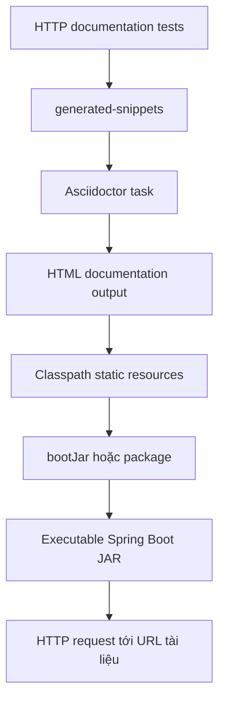

# Đưa tài liệu vào JAR của Spring Boot

## Mục tiêu học tập

Sau bài này, bạn có thể:

- Giải thích cách output HTML của Asciidoctor trở thành classpath resource trong ứng dụng Spring Boot.
- Chọn vị trí đóng gói tài liệu như static web resources hoặc META-INF/resources.
- Cấu hình Gradle để tạo tài liệu trước khi đóng gói bootJar.
- Cấu hình Maven để copy output tài liệu vào vị trí tài nguyên được đóng gói.
- Phân biệt tài liệu được phục vụ từ JAR với website hoặc artifact riêng.
- Kiểm tra nội dung JAR, chạy ứng dụng và xác minh URL tài liệu hoạt động.
- Xử lý lỗi thiếu file, sai đường dẫn, task chạy sai thứ tự và static resource config bị ghi đè.

## 1. Vì sao đưa tài liệu vào JAR?

Spring REST Docs sinh snippet từ HTTP test. Asciidoctor ghép snippet cùng phần giải thích để tạo HTML hoặc PDF. Với ứng dụng Spring Boot, có thể đóng gói HTML tài liệu ngay trong executable JAR để phát hành ứng dụng và tài liệu theo cùng một phiên bản.

Lợi ích:

- Mỗi bản build chứa tài liệu tương ứng với code và API contract đã kiểm thử.
- Đội vận hành có thể triển khai một artifact nếu tài liệu được phục vụ cùng ứng dụng.
- Không cần copy thủ công thư mục HTML sau khi build.
- Có thể kiểm tra tài liệu đã được đóng gói trong pipeline tạo JAR.
- Tài liệu phát hành có cùng version/release với ứng dụng.

Không phải dự án nào cũng nên phục vụ tài liệu từ ứng dụng runtime. Developer portal độc lập, tài liệu cần CDN/cache riêng hoặc tài liệu chỉ dành nội bộ có thể phù hợp hơn khi phát hành như website/artifact riêng. Bài này tập trung trường hợp ứng dụng Spring Boot phục vụ HTML documentation từ executable JAR.

## 2. Luồng build từ REST Docs đến executable JAR

Luồng phổ biến:

1. Chạy HTTP documentation tests bằng MockMvc, WebTestClient hoặc REST Assured.
2. Test tạo snippet vào thư mục generated-snippets.
3. Asciidoctor include snippet và biên dịch AsciiDoc thành HTML.
4. HTML được copy vào thư mục tài nguyên của ứng dụng.
5. Gradle hoặc Maven đóng gói các tài nguyên vào JAR.
6. Spring Boot phục vụ HTML như static resource khi ứng dụng chạy.



Tài liệu phải được render và copy vào resource directory trước khi task đóng gói tạo JAR. Nếu bootJar chạy trước khi HTML được tạo, JAR có thể hợp lệ nhưng thiếu tài liệu.

## 3. Chọn vị trí tài nguyên trong JAR

Spring Boot có thể phục vụ tài nguyên tĩnh từ các vị trí classpath phổ biến, bao gồm:

- classpath:/static
- classpath:/public
- classpath:/resources
- classpath:/META-INF/resources

Ví dụ chọn static/docs:

```text
src/main/resources/
└── static/
    └── docs/
        ├── index.html
        ├── orders.html
        ├── authentication.html
        ├── css/
        ├── images/
        └── js/
```

Khi được đóng gói, resource nằm trong JAR dưới đường dẫn classpath tương ứng. Với static resource handling mặc định, index.html bên trong static/docs thường được truy cập bằng /docs/; orders.html bằng /docs/orders.html.

Ví dụ:

```text
GET http://localhost:8080/docs/
GET http://localhost:8080/docs/orders.html
```

URL chính xác còn phụ thuộc server context path, reverse proxy, resource handler và cấu hình ứng dụng.

### 3.1. Có nên đặt tài liệu trong META-INF/resources?

META-INF/resources là vị trí classpath resource được hỗ trợ trong web application environment. Nó có thể phù hợp khi thư viện hoặc artifact muốn cung cấp web resource qua META-INF/resources.

Với Spring Boot application thông thường, src/main/resources/static/docs dễ hiểu và dễ tìm hơn. Không cần chọn META-INF/resources chỉ vì tài liệu được đóng gói trong JAR; hãy chọn vị trí phù hợp với cấu trúc dự án.

### 3.2. Giữ nguyên cấu trúc HTML output

Website Asciidoctor có thể gồm nhiều file và thư mục:

- HTML trang chính và trang operation.
- CSS theme hoặc stylesheet tùy chỉnh.
- JavaScript cho navigation/search.
- Hình ảnh, logo và tài nguyên được include.
- Các trang tham chiếu và file tải về.

Khi copy output, phải giữ cấu trúc tương đối. Nếu chỉ copy index.html mà bỏ thư mục css/images, trang có thể trả 200 nhưng không hiển thị đúng.

## 4. Cấu hình output Asciidoctor cho ứng dụng

Giả sử:

- AsciiDoc source nằm trong src/docs/asciidoc.
- Snippet sinh trong build/generated-snippets.
- Asciidoctor render HTML vào build/docs/asciidoc.
- Ứng dụng đóng gói tài liệu dưới static/docs.

Hai thư mục chính:

| Thư mục | Vai trò |
| --- | --- |
| build/docs/asciidoc | Output trung gian từ Asciidoctor |
| build/resources/main/static/docs | Classpath resource được đóng gói vào JAR |

Không nhất thiết render thẳng vào src/main/resources. Để output tự sinh trong build directory giúp tránh file generated lẫn với source được quản lý bằng Git.

## 5. Cấu hình Gradle

Ví dụ dưới đây minh họa plugin Spring Boot, Spring REST Docs và Asciidoctor Gradle plugin. Tên task và cách truy cập output có thể cần điều chỉnh theo phiên bản plugin của dự án.

### 5.1. Dependencies và output directory

Một cấu hình khái niệm trong build.gradle:

```groovy
plugins {
    id 'java'
    id 'org.springframework.boot' version '3.4.0'
    id 'org.asciidoctor.jvm.convert' version '4.0.2'
}

configurations {
    asciidoctorExt
}

dependencies {
    testImplementation 'org.springframework.restdocs:spring-restdocs-mockmvc'
    asciidoctorExt 'org.springframework.restdocs:spring-restdocs-asciidoctor'
}

def snippetsDir = layout.buildDirectory.dir('generated-snippets')
def docsOutputDir = layout.buildDirectory.dir('docs/asciidoc')
def generatedResourcesDir = layout.buildDirectory.dir('generated-resources/api-docs')
def packagedDocsDir = generatedResourcesDir.map { it.dir('static/docs') }
```

Version plugin trong ví dụ chỉ mang tính minh họa. Dùng version tương thích với Spring Boot, Spring REST Docs và Gradle của dự án; quản lý version qua version catalog hoặc dependency management nếu repository đã có quy ước.

### 5.2. Test sinh snippet

Khai báo output của test:

```groovy
tasks.named('test') {
    outputs.dir snippetsDir
}
```

Test documentation phải thực sự chạy và gọi document(...). Khai báo outputs.dir chỉ mô tả output của task; nó không tự tạo snippet nếu test không tích hợp REST Docs.

### 5.3. Render Asciidoctor

Ví dụ:

```groovy
tasks.named('asciidoctor') {
    inputs.dir snippetsDir
    configurations 'asciidoctorExt'

    sources {
        include 'index.adoc'
    }

    baseDirFollowsSourceFile()

    attributes(
        'snippets': snippetsDir.get().asFile,
        'project-version': project.version
    )

    outputDir = docsOutputDir.get().asFile
    dependsOn tasks.named('test')
}
```

Đây là cấu hình minh họa cho Asciidoctor Gradle plugin. Kiểm tra DSL theo plugin version thực tế và file source chính của dự án. Nếu trang include nhiều file, đảm bảo chúng nằm trong base directory được phép include.

### 5.4. Copy HTML vào classpath resource

Tạo task copy:

```groovy
tasks.register('copyApiDocs', Copy) {
    dependsOn tasks.named('asciidoctor')
    from(docsOutputDir)
    into(packagedDocsDir)
}
```

Sau đó bảo đảm resource processing và bootJar chờ copy:

```groovy
sourceSets {
    main {
        resources {
            srcDir generatedResourcesDir
        }
    }
}

tasks.named('processResources') {
    dependsOn tasks.named('copyApiDocs')
}
```

Tài liệu được copy vào build/generated-resources/api-docs/static/docs, sau đó processResources đưa nó vào build/resources/main/static/docs. Không ghi trực tiếp vào output directory của processResources trước khi task này chạy, vì task có thể dọn và tạo lại output. Task bootJar đã phụ thuộc vào chuỗi classes/processResources của Gradle Java plugin.

### 5.5. Chạy build

```bash
./gradlew clean test asciidoctor bootJar
```

Task graph sẽ đảm bảo copyApiDocs chạy trước khi đóng gói do dependency đã khai báo. Không dựa vào thứ tự task gõ trên command line; hãy khai báo dependency trong build script.

## 6. Vì sao nên dùng generated resource directory riêng?

Một cách khác là thêm output Asciidoctor vào source set resources:

```groovy
def docsOutputDir = layout.buildDirectory.dir('docs/asciidoc')

sourceSets {
    main {
        resources {
            srcDir(generatedResourcesDir)
        }
    }
}

tasks.register('copyApiDocs', Copy) {
    dependsOn tasks.named('asciidoctor')
    from(docsOutputDir)
    into(generatedResourcesDir.map { it.dir('static/docs') })
}

tasks.named('processResources') {
    dependsOn tasks.named('copyApiDocs')
}
```

Ví dụ này dùng generated resource directory riêng để giữ prefix static/docs trong classpath. Chỉ thêm docsOutputDir trực tiếp vào source set sẽ không tự tạo URL prefix /docs nếu output Asciidoctor nằm ngay ở root.

Chọn một chiến lược copy/resource cho dự án. Không cấu hình cả sourceSets và Copy task cùng đưa một bộ file vào hai đường dẫn khác nhau, vì điều đó có thể tạo duplicate resources hoặc khó xác định file được phục vụ.

## 7. Cấu hình Maven

Với Maven, nguyên tắc tương tự: chạy test sinh snippet, thực thi Asciidoctor, rồi copy HTML vào output resources trước khi đóng gói.

Cấu trúc mục tiêu:

```text
target/
├── generated-snippets/
├── generated-docs/
│   ├── index.html
│   └── ...
└── classes/
    └── static/
        └── docs/
            ├── index.html
            └── ...
```

### 7.1. Copy output vào target/classes

Có thể cấu hình maven-resources-plugin hoặc maven-antrun-plugin để copy output sau khi Asciidoctor chạy và trước package.

Ví dụ maven-resources-plugin có execution ở phase phù hợp:

```xml
<plugin>
  <groupId>org.apache.maven.plugins</groupId>
  <artifactId>maven-resources-plugin</artifactId>
  <version>3.3.1</version>
  <executions>
    <execution>
      <id>copy-api-docs</id>
        <phase>prepare-package</phase>
      <goals>
        <goal>copy-resources</goal>
      </goals>
      <configuration>
        <outputDirectory>target/classes/static/docs</outputDirectory>
        <resources>
          <resource>
            <directory>target/generated-docs</directory>
            <filtering>false</filtering>
          </resource>
        </resources>
      </configuration>
    </execution>
  </executions>
</plugin>
```

Đoạn trên là phần copy; hãy bind execution này vào prepare-package và bảo đảm execution Asciidoctor cũng chạy ở prepare-package trước nó (hoặc một phase muộn hơn test nhưng sớm hơn copy). Với hai execution cùng phase, kiểm tra thứ tự khai báo plugin/execution trong POM. Mục tiêu là test đã sinh snippet, Asciidoctor đã tạo generated-docs, rồi copy mới đưa file vào target/classes/static/docs trước package.

Không bật resource filtering cho HTML/CSS/JS một cách tùy tiện. Filtering có thể thay thế chuỗi delimiter trong nội dung và làm hỏng JavaScript, CSS hoặc ví dụ tài liệu. Với tài liệu tĩnh, thường nên copy nguyên file bằng filtering=false.

### 7.2. Kiểm tra thứ tự Maven lifecycle

| Bước | Phase/goal minh họa | Kết quả |
| --- | --- | --- |
| Test | test | HTTP documentation tests chạy, sinh snippet |
| Render | prepare-package sau test | HTML từ Asciidoctor |
| Copy | prepare-package sau render | HTML vào target/classes/static/docs |
| Package | package | Spring Boot JAR chứa tài liệu |

Các phase và thứ tự execution phải điều chỉnh theo plugin thực tế. Xác minh generated-docs tồn tại trước copy và target/classes/static/docs tồn tại trước khi Spring Boot Maven Plugin đóng gói JAR.

## 8. Truy cập tài liệu khi ứng dụng chạy

Với tài liệu đặt dưới classpath static/docs:

| File trong JAR | URL mặc định thường dùng |
| --- | --- |
| static/docs/index.html | /docs/ |
| static/docs/orders.html | /docs/orders.html |
| static/docs/css/site.css | /docs/css/site.css |

Chạy ứng dụng:

```bash
java -jar build/libs/orders-service.jar
```

Sau đó truy cập:

```text
http://localhost:8080/docs/
```

Spring Boot static resource handling có thể phục vụ index.html khi request đến thư mục docs. Nếu không hoạt động, thử request trực tiếp /docs/index.html và kiểm tra resource mapping.

Nếu ứng dụng dùng context path:

```properties
server.servlet.context-path=/api
```

URL có thể trở thành /api/docs/. Reverse proxy hoặc ingress có thể thêm/bỏ prefix khác, vì vậy cần xác nhận URL public từ môi trường deploy.

## 9. Cấu hình static resource có thể làm tài liệu không truy cập được

Spring Boot có cấu hình static resource handling. Một số cấu hình có thể thay đổi vị trí tìm kiếm:

```properties
spring.web.resources.static-locations=classpath:/custom-static/
```

Khi khai báo static-locations, hãy kiểm tra các location có còn bao gồm thư mục resource chứa tài liệu hay không. Nếu chỉ định một location tùy chỉnh, bạn có thể đã thay thế các location mặc định.

Các yếu tố khác cần kiểm tra:

- Resource handler custom khai báo bằng WebMvcConfigurer.
- Security filter chain chặn URL /docs/**.
- Context path hoặc servlet path.
- Reverse proxy path rewriting.
- Forwarded headers và URL scheme.
- Quy tắc cache hoặc compression của proxy.

Nếu dùng Spring Security, quyết định URL tài liệu là public hay protected. Không mở public toàn bộ static resources chỉ để truy cập tài liệu. Có thể chỉ allow path cụ thể hoặc yêu cầu xác thực cho tài liệu nội bộ.

## 10. Đóng gói tài liệu có kiểm soát truy cập

Không phải mọi REST API document đều nên public. Tài liệu có thể chứa endpoint nội bộ, header/error detail chỉ dùng trong hệ thống, thông tin kiến trúc hoặc quy trình vận hành.

Nếu tài liệu chỉ dành cho developer/operator:

1. Đặt URL sau authentication/authorization.
2. Dùng security rule riêng cho /docs/**.
3. Không nhúng credential, dữ liệu cá nhân hoặc endpoint bí mật vào snippet.
4. Có thể phát hành tài liệu dưới artifact/portal nội bộ thay vì JAR được triển khai công khai.
5. Kiểm tra quyền truy cập ở runtime, không chỉ trong test build.

Ví dụ matcher minh họa, cần điều chỉnh DSL theo Spring Security version:

```java
http.authorizeHttpRequests(authorize -> authorize
    .requestMatchers("/docs/**").hasAuthority("SCOPE_API_DOCS_READ")
    .anyRequest().authenticated()
);
```

Nếu docs public, chỉ mở đúng đường dẫn tài liệu. Nếu docs chứa contract nhạy cảm, dùng role/scope phù hợp và xác minh 401/403 bằng integration test.

## 11. Kiểm tra nội dung thực sự nằm trong JAR

Build thành công không chứng minh JAR đã chứa trang tài liệu. Cần kiểm tra artifact.

Với JAR Gradle:

```bash
jar tf build/libs/orders-service.jar
```

Tìm các entry:

```text
BOOT-INF/classes/static/docs/index.html
BOOT-INF/classes/static/docs/orders.html
BOOT-INF/classes/static/docs/css/site.css
```

Đường dẫn trong executable Spring Boot JAR thường nằm dưới BOOT-INF/classes/. Nếu không thấy file, kiểm tra output Asciidoctor, copy task, destination directory, dependency của bootJar và include/exclude resource.

Với Maven:

```bash
jar tf target/orders-service.jar
```

Tìm entry tương ứng dưới BOOT-INF/classes/static/docs/.

## 12. Kiểm tra runtime sau khi đóng gói

Sau khi xác nhận entry trong JAR, chạy chính JAR vừa build:

```bash
java -jar build/libs/orders-service.jar
```

Kiểm tra bằng curl:

```bash
curl -I http://localhost:8080/docs/
curl -I http://localhost:8080/docs/index.html
curl -I http://localhost:8080/docs/css/site.css
```

Kỳ vọng:

- Trang chính trả status phù hợp, thường là 200.
- Tài nguyên CSS/JS/images truy cập được.
- Link từ index đến operation page hoạt động.
- Không có 404 do base path hoặc relative link sai.
- Nếu docs được bảo vệ, người chưa xác thực nhận 401/403 và người có quyền truy cập thành công.

Không chỉ kiểm tra HTTP status. Trang HTML 200 nhưng thiếu CSS/JS hoặc include image sai vẫn có thể hỏng khi người đọc sử dụng.

## 13. Versioning, cache và base path

Khi đóng gói tài liệu cùng JAR, nội dung được phát hành theo version ứng dụng. Nên công bố version tài liệu/API ở vị trí dễ nhận biết:

```asciidoc
= Orders API
:doctype: book
:revnumber: {project-version}
:revdate: {docdate}
```

Attribute version phải được truyền từ build và không nên hard-code ở nhiều file. Nếu dự án dùng version catalog hoặc release metadata, lấy một nguồn thống nhất.

Một số điểm cần cân nhắc:

- Tài liệu static có thể được cache ở browser hoặc reverse proxy.
- Khi release version mới, file cùng URL có thể cần cache policy phù hợp để tránh hiển thị nội dung cũ.
- Nếu tài liệu có versioned URL, tổ chức path như /docs/1.4/ hoặc /docs/current/ theo chính sách phát hành.
- Relative link trong HTML nên hoạt động khi ứng dụng được triển khai dưới context path.
- Không hard-code localhost hoặc host production trong link nội bộ.

Nếu cần phục vụ nhiều version API cùng lúc, tài liệu có thể phù hợp hơn khi phát hành như website riêng hoặc resource có version prefix thay vì một thư mục docs bị ghi đè ở mỗi release.

## 14. Lỗi thường gặp

| Biểu hiện | Nguyên nhân có thể | Cách xử lý |
| --- | --- | --- |
| JAR không chứa index.html | bootJar chạy trước copy task hoặc output chưa được tạo | Thêm dependency từ task package tới task copy/Asciidoctor |
| JAR có index.html nhưng CSS/ảnh 404 | Chỉ copy file HTML, không copy toàn bộ cây output | Copy toàn bộ output directory và giữ cấu trúc |
| /docs/ trả 404 nhưng /docs/index.html hoạt động | Resource/index mapping hoặc cấu hình static resource | Kiểm tra resource handler, static locations và URL |
| Trang docs bị 401/403 | Spring Security chặn đường dẫn | Quyết định public/internal và thêm matcher phù hợp |
| Đường dẫn CSS sai sau deploy | Base path hoặc relative URL chưa phù hợp | Dùng relative links hoặc cấu hình base path đúng |
| Bảng/snippet cũ xuất hiện trong JAR | Generated snippets còn stale hoặc task không chạy lại | Dùng clean output và khai báo input/output đúng |
| Resource không có trong executable JAR | Copy vào folder khác với resource root được package | Kiểm tra classpath path và jar tf |
| HTML bị thay chuỗi lạ | Maven resource filtering tác động lên nội dung | Tắt filtering cho tài liệu static |
| Build local thành công nhưng CI thiếu tài liệu | CI chạy package theo task khác hoặc bỏ qua docs task | Gắn dependency trong lifecycle và xác minh artifact |

## 15. Checklist đóng gói tài liệu vào Spring Boot JAR

- [ ] HTTP documentation tests chạy và sinh snippet.
- [ ] Asciidoctor render HTML thành công.
- [ ] Output HTML được copy vào classpath resource directory.
- [ ] Cấu trúc CSS, JS, images và trang con được giữ nguyên.
- [ ] Task package phụ thuộc vào bước tạo/copy tài liệu.
- [ ] Không có resource filtering làm thay đổi HTML/CSS/JS ngoài ý muốn.
- [ ] JAR chứa BOOT-INF/classes/static/docs/index.html và tài nguyên cần thiết.
- [ ] Chạy executable JAR và truy cập URL docs thành công.
- [ ] Kiểm tra context path, reverse proxy và relative links.
- [ ] Security policy cho /docs/** được xác định và test.
- [ ] Version tài liệu khớp bản release của ứng dụng.
- [ ] CI kiểm tra cả nội dung JAR và HTTP runtime smoke test.

## 16. Bài tập thực hành

Một dịch vụ Orders dùng Gradle và Spring Boot. AsciiDoc source nằm trong src/docs/asciidoc, REST Docs sinh snippets vào build/generated-snippets và Asciidoctor tạo HTML.

Hãy thực hiện:

1. Cấu hình Asciidoctor dùng đúng generated-snippets directory.
2. Render tài liệu vào build/docs/asciidoc.
3. Tạo task copy toàn bộ HTML/CSS/JS/images vào build/resources/main/static/docs.
4. Đảm bảo processResources hoặc bootJar phụ thuộc vào task copy theo task graph rõ ràng.
5. Build executable JAR từ clean state.
6. Dùng jar tf xác minh BOOT-INF/classes/static/docs/index.html và tài nguyên liên quan có trong JAR.
7. Chạy JAR, truy cập /docs/ và các trang operation.
8. Nếu bật Spring Security, viết test cho quyền truy cập /docs/**.
9. Mô phỏng deploy dưới context path để xác minh link tài liệu không trỏ sai.
10. Thêm kiểm tra artifact và runtime smoke test vào CI.

**Câu hỏi tự kiểm tra:** Nếu Asciidoctor tạo được index.html nhưng executable JAR không chứa file đó, có phải lỗi Spring MVC static resource mapping không? Chưa thể kết luận. Trước hết cần kiểm tra file có được copy vào classpath resource directory và task package có phụ thuộc bước copy hay chưa. Resource mapping chỉ có thể phục vụ tài nguyên đã nằm trong classpath/JAR hoặc được cung cấp từ vị trí static resource được cấu hình.

## Kết luận

Đưa tài liệu vào Spring Boot JAR là cách phát hành HTML API documentation cùng phiên bản ứng dụng. Luồng cần bảo đảm documentation tests sinh snippet, Asciidoctor tạo HTML, output được copy vào classpath static resource và task package chờ các bước đó hoàn tất. Gradle/Maven đều cần dependency task/lifecycle rõ ràng; sau build hãy kiểm tra entry trong JAR và chạy chính executable JAR để thử URL, CSS, ảnh, context path và security. Giữ nguyên cây tài nguyên, tránh filtering làm hỏng file và quyết định rõ tài liệu public hay nội bộ. Khi CI xác minh cả artifact lẫn runtime endpoint, nhóm có bằng chứng rằng tài liệu thực sự được phát hành và truy cập được.
