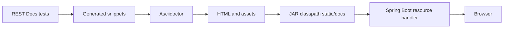

# Phục vụ tài liệu tĩnh từ ứng dụng

## 1. Mục tiêu và luồng hoạt động

Trong module **SPRING_REST_DOCS**, các bài kiểm thử HTTP dùng MockMvc, WebTestClient hoặc REST Assured tạo snippet cho request, response, payload, header, parameter và multipart part. Asciidoctor/Markdown ghép snippet với phần mô tả để tạo tài liệu REST API. Sau khi được đóng gói, Spring Boot có thể phục vụ HTML và các tài nguyên đi kèm như static resources.

Người dùng có thể truy cập:

```text
GET /docs/index.html
GET /docs/css/site.css
GET /docs/images/upload-flow.png
```

Luồng tổng quát:



Tạo HTML và phục vụ HTML là hai giai đoạn riêng. Bài này giả định tài liệu đã được copy vào classpath của artifact, ví dụ `BOOT-INF/classes/static/docs`. Nếu JAR không chứa tài liệu, cấu hình MVC không thể tự tìm thấy file.

## 2. Đặt tài liệu trong classpath static resources

Spring Boot phục vụ static content từ các vị trí classpath mặc định, trong đó có `/static`, `/public`, `/resources` và `/META-INF/resources`.

Cấu trúc đơn giản cho tài liệu:

```text
src/main/resources/
└── static/
    └── docs/
        ├── index.html
        ├── css/site.css
        ├── js/navigation.js
        └── images/upload-flow.png
```

Nếu generated documentation được copy vào output resources khi build, executable JAR thường có:

```text
BOOT-INF/classes/static/docs/
├── index.html
├── css/site.css
├── js/navigation.js
└── images/upload-flow.png
```

Với static resource mapping mặc định, `static/docs/index.html` thường được truy cập tại:

```text
http://localhost:8080/docs/index.html
```

Không cần tạo controller riêng để trả từng file. Static resource handler của Spring MVC tìm file trên classpath và ghi nội dung vào response.

### 2.1. Phân biệt URL path và classpath path

| Mục đích | Đường dẫn |
| --- | --- |
| File trong JAR/classpath | `static/docs/index.html` |
| URL client gọi | `/docs/index.html` |
| CSS trong classpath | `static/docs/css/site.css` |
| URL CSS | `/docs/css/site.css` |

Phần `static` là thư mục trên classpath, thông thường không xuất hiện trong URL. Nếu copy nhầm vào `BOOT-INF/classes/docs` thay vì `BOOT-INF/classes/static/docs`, URL mặc định có thể trả 404.

## 3. Cấu hình mặc định và property liên quan

Nếu file nằm trong một static location mặc định, ứng dụng thường không cần cấu hình thêm. Hãy bảo đảm tài liệu nằm trong `classpath:/static/docs/` và static resource mappings vẫn được bật.

Các property có thể ảnh hưởng hành vi:

| Property | Tác động |
| --- | --- |
| `spring.web.resources.add-mappings` | Bật/tắt static resource mappings mặc định |
| `spring.web.resources.static-locations` | Thay đổi các static locations được tìm kiếm |
| `spring.mvc.static-path-pattern` | Thay đổi URL pattern cho static resources |
| `server.servlet.context-path` | Thêm context prefix vào URL ứng dụng |

Ví dụ giá trị mặc định minh họa:

```properties
spring.web.resources.add-mappings=true
spring.mvc.static-path-pattern=/**
server.servlet.context-path=
```

Khi đặt `spring.web.resources.static-locations`, property này thay đổi danh sách location mặc định. Nếu cấu hình chỉ còn một thư mục tùy chỉnh mà bỏ `classpath:/static/`, tài liệu ở `static/docs` có thể không còn được tìm thấy. Hãy giữ lại các location cần thiết.

### 3.1. Truy cập file index

Dùng URL tường minh `/docs/index.html` để kiểm tra trang chính. Không mặc định `/docs/` luôn được resolve thành index trong thư mục con; welcome-page handling và resource mapping còn phụ thuộc cấu hình ứng dụng.

Nếu muốn URL ngắn `/docs/`, có thể tạo redirect/forward có chủ đích hoặc kiểm thử hành vi welcome page trên phiên bản Spring Boot đang dùng. Ghi rõ URL thực tế đã được xác minh.

## 4. Tùy chỉnh URL bằng ResourceHandlerRegistry

Nếu muốn public URL khác classpath location, đăng ký resource handler bằng `WebMvcConfigurer`.

Ví dụ giữ tài liệu ở `classpath:/static/docs/` nhưng phục vụ dưới `/api-reference/**`:

```java
import org.springframework.context.annotation.Configuration;
import org.springframework.web.servlet.config.annotation.ResourceHandlerRegistry;
import org.springframework.web.servlet.config.annotation.WebMvcConfigurer;

@Configuration
class ApiDocumentationResources implements WebMvcConfigurer {

    @Override
    public void addResourceHandlers(ResourceHandlerRegistry registry) {
        registry.addResourceHandler("/api-reference/**")
                .addResourceLocations("classpath:/static/docs/");
    }
}
```

Mapping tương ứng:

| Classpath resource | URL |
| --- | --- |
| `static/docs/index.html` | `/api-reference/index.html` |
| `static/docs/css/site.css` | `/api-reference/css/site.css` |
| `static/docs/images/upload-flow.png` | `/api-reference/images/upload-flow.png` |

Resource location kết thúc bằng slash để thể hiện thư mục. Prefix URL không cần trùng tên thư mục classpath.

Không đăng ký handler trùng mapping mặc định nếu không có mục đích. Custom configuration có thể tạo các handler overlap hoặc ảnh hưởng static resources khác. Nếu đã cấu hình `spring.mvc.static-path-pattern` hoặc `spring.web.resources.add-mappings=false`, hãy xem lại toàn bộ MVC configuration và test các route sau thay đổi.

### 4.1. CacheControl cho tài liệu

Có thể đặt cache policy trên resource handler:

```java
import java.time.Duration;

import org.springframework.context.annotation.Configuration;
import org.springframework.http.CacheControl;
import org.springframework.web.servlet.config.annotation.ResourceHandlerRegistry;
import org.springframework.web.servlet.config.annotation.WebMvcConfigurer;

@Configuration
class ApiDocsResourceConfiguration implements WebMvcConfigurer {

    @Override
    public void addResourceHandlers(ResourceHandlerRegistry registry) {
        registry.addResourceHandler("/docs/**")
                .addResourceLocations("classpath:/static/docs/")
                .setCacheControl(CacheControl.maxAge(Duration.ofMinutes(5))
                        .cachePublic());
    }
}
```

Ví dụ cho phép cache công khai trong 5 phút. Chỉ dùng `cachePublic()` nếu nội dung được phép lưu ở shared cache/CDN. Nếu tài liệu phụ thuộc quyền truy cập hoặc chứa thông tin nội bộ, dùng policy riêng và authorization phù hợp.

Với tài liệu thay đổi theo mỗi release, cache dài có thể khiến người dùng thấy bản cũ. Có thể version hóa URL hoặc tên asset và cache dài cho những URL bất biến.

## 5. Giữ đường dẫn CSS, ảnh và JavaScript

HTML có thể tải các file cùng thư mục docs:

```html
<link rel="stylesheet" href="css/site.css">
<script src="js/navigation.js"></script>

```

Với URL trang `/docs/index.html`, relative URL thường được resolve thành `/docs/css/site.css`, `/docs/js/navigation.js` và `/docs/images/upload-flow.png`.

Phải giữ nguyên cấu trúc thư mục khi đóng gói. Nếu chỉ copy HTML entry point, browser có thể hiển thị nội dung mà không có style hoặc ảnh.

Nếu dùng custom prefix `/api-reference/**`, relative link như `css/site.css` thường tiếp tục hoạt động; link bắt đầu bằng slash như `/css/site.css` có thể trỏ về root host và bỏ qua prefix. Kiểm tra link trong HTML và URL thực tế sau reverse proxy.

## 6. Spring Security: public hoặc protected docs

Static resource mapping và authorization là hai việc riêng. File có trong classpath không có nghĩa mọi client đều được phép truy cập; Spring Security có thể chặn request trước resource handler.

Nếu tài liệu công khai, có thể permit `/docs/**`:

```java
import org.springframework.context.annotation.Bean;
import org.springframework.context.annotation.Configuration;
import org.springframework.security.config.annotation.web.builders.HttpSecurity;
import org.springframework.security.web.SecurityFilterChain;

@Configuration
class SecurityConfiguration {

    @Bean
    SecurityFilterChain applicationSecurity(HttpSecurity http) throws Exception {
        return http
                .authorizeHttpRequests(authorize -> authorize
                        .requestMatchers("/docs/**").permitAll()
                        .anyRequest().authenticated()
                )
                .build();
    }
}
```

Nếu resource handler dùng `/api-reference/**`, security matcher cũng cần dùng prefix đó. Với nhiều `SecurityFilterChain`, xác định chain nào thực sự match request docs.

### 6.1. Tài liệu nội bộ

Không dùng `permitAll()` cho docs nội bộ. Có thể yêu cầu đăng nhập:

```java
.authorizeHttpRequests(authorize -> authorize
    .requestMatchers("/docs/**").authenticated()
    .anyRequest().authenticated()
)
```

Hoặc role riêng:

```java
.authorizeHttpRequests(authorize -> authorize
    .requestMatchers("/docs/**").hasRole("API_DOCS")
    .anyRequest().authenticated()
)
```

Bảo vệ toàn bộ URL prefix, không chỉ index trong khi CSS, ảnh hoặc trang con ở route khác được mở công khai. Test bằng user có quyền và user không có quyền. Không đưa token, mật khẩu, API key, dữ liệu khách hàng hoặc endpoint nội bộ nhạy cảm vào tài liệu.

## 7. Context path và reverse proxy

Nếu ứng dụng đặt context path `/service`, URL client có thể là `/service/docs/index.html`. Nếu reverse proxy expose ứng dụng dưới prefix khác, URL bên ngoài còn phụ thuộc proxy và forwarded headers.

| Thành phần | Đường dẫn |
| --- | --- |
| Resource path trong JAR | `static/docs/index.html` |
| App context path | `/service` |
| URL trong ứng dụng | `/service/docs/index.html` |
| Public URL sau gateway | `/platform/service/docs/index.html` |

Không hardcode public host trong AsciiDoc nếu cùng artifact được triển khai ở nhiều môi trường. Ưu tiên relative link và cấu hình proxy/context path nhất quán. Phân biệt server URL của API với URL của chính trang tài liệu.

## 8. Content-Type, HEAD và cache

Spring MVC resource handling xác định media type theo file extension và cơ chế content negotiation. Ví dụ:

| File | Content-Type thường gặp |
| --- | --- |
| `.html` | `text/html` |
| `.css` | `text/css` |
| `.js` | Media type JavaScript theo registry |
| `.png` | `image/png` |
| `.svg` | `image/svg+xml` |
| `.woff2` | `font/woff2` |

Không đặt chung `text/html` cho toàn bộ thư mục docs. CSS, ảnh và font cần media type phù hợp.

Spring MVC resource handling hỗ trợ các request static như GET/HEAD và cơ chế cache/conditional request theo cấu hình framework. Khi dùng CDN/reverse proxy, kiểm tra response headers như `Cache-Control`, `Last-Modified` hoặc `ETag` thực tế thay vì giả định chúng giống nhau giữa mọi version/configuration.

Gợi ý cache:

| Nội dung | Chính sách |
| --- | --- |
| HTML landing page | Cache ngắn hoặc revalidate để nhận release mới |
| CSS/JS tên cố định | Cache vừa phải; purge khi release |
| Asset có hash/version trong tên | Có thể cache dài vì URL đổi theo nội dung |
| Tài liệu private | Cache policy phù hợp quyền truy cập; cân nhắc `private` hoặc `no-store` |

## 9. Kiểm thử static documentation endpoint

Dùng Spring Boot integration test để xác minh file được phục vụ. Ví dụ MockMvc:

```java
@SpringBootTest
@AutoConfigureMockMvc
class ApiDocumentationResourceTest {

    @Autowired
    MockMvc mockMvc;

    @Test
    void servesDocumentationIndex() throws Exception {
        mockMvc.perform(get("/docs/index.html"))
                .andExpect(status().isOk())
                .andExpect(content().contentTypeCompatibleWith(MediaType.TEXT_HTML))
                .andExpect(content().string(containsString("User API")));
    }

    @Test
    void servesStylesheet() throws Exception {
        mockMvc.perform(get("/docs/css/site.css"))
                .andExpect(status().isOk())
                .andExpect(content().contentTypeCompatibleWith("text/css"));
    }
}
```

Ví dụ giả định index và stylesheet có trong classpath, chẳng hạn fixture ở `src/main/resources/static/docs` hoặc output được đưa vào test/runtime classpath. Nếu Spring Security bật, cấu hình test user hoặc xác minh access-denied behavior thay vì tắt security tùy tiện.

Các trường hợp nên kiểm tra:

- URL index trả 200 cho user được phép.
- CSS hoặc ảnh trả 200.
- URL không tồn tại trả 404.
- Anonymous/role thiếu quyền bị từ chối khi docs được bảo vệ.
- URL có context path/prefix hoạt động trong môi trường tích hợp.

Với HTML, xác nhận Content-Type và nội dung có title/marker mong đợi. Với asset, xác nhận media type phù hợp và body không rỗng.

## 10. Chẩn đoán lỗi thường gặp

| Triệu chứng | Nguyên nhân có thể | Cách kiểm tra |
| --- | --- | --- |
| `/docs/index.html` trả 404 | File không có trong classpath hoặc copy sai archive path | Dùng `jar tf` tìm `BOOT-INF/classes/static/docs/index.html` |
| HTML 200 nhưng CSS 404 | Asset thiếu hoặc relative path sai | Kiểm tra archive và request URL của browser |
| 401/403 | Spring Security yêu cầu login/role | Kiểm tra filter chain và matcher |
| `/docs/` lỗi nhưng `/docs/index.html` chạy | Không có welcome-page mapping cho thư mục con | Dùng URL file rõ ràng hoặc cấu hình redirect |
| Local chạy nhưng gateway lỗi | Context path, proxy prefix hoặc forwarded headers | Kiểm tra public URL |
| Tài liệu cũ xuất hiện | Browser/CDN cache hoặc artifact cũ | Kiểm tra Cache-Control và version URL |
| CSS sai MIME | Resource mapping/proxy override header | Kiểm tra response Content-Type |
| Docs private nhưng anonymous vẫn truy cập | Route/asset khác chưa được bảo vệ | Bảo vệ toàn bộ prefix và test anonymous |
| Custom handler không hoạt động | URL pattern/location không khớp | Kiểm tra addResourceHandlers |
| Static resources khác bị mất | static-locations ghi đè default hoặc add-mappings=false | Khôi phục locations và kiểm tra mapping |

## 11. Checklist triển khai

Trước khi phát hành tài liệu cùng ứng dụng, xác nhận:

1. Asciidoctor đã tạo HTML và assets trong output directory.
2. Build copy toàn bộ cây tài liệu vào classpath dưới `static/docs`.
3. JAR/WAR có index, CSS, ảnh và JavaScript liên quan.
4. URL công khai phù hợp context path và reverse proxy.
5. Security cho phép đúng user hoặc bảo vệ toàn bộ docs path.
6. Content-Type của HTML và assets phù hợp.
7. Cache policy không giữ tài liệu cũ quá lâu.
8. Không có secret hoặc thông tin nội bộ không được phép publish.
9. Smoke test xác minh index và ít nhất một asset sau deploy.

## 12. Bài thực hành

Giả sử REST Docs đã sinh tài liệu User API:

1. Đưa HTML và CSS thử nghiệm vào `src/main/resources/static/docs`.
2. Chạy ứng dụng và gọi `GET /docs/index.html`.
3. Xác minh status 200, Content-Type HTML và body có title mong muốn.
4. Gọi `GET /docs/css/site.css` và kiểm tra media type.
5. Tạo custom handler `/api-reference/**` trỏ tới `classpath:/static/docs/`.
6. Thử security rule public và role-restricted trong môi trường test.
7. Thiết lập context path, kiểm tra URL sau prefix.
8. Đặt CacheControl phù hợp và kiểm tra response headers.
9. Build executable JAR, xác minh `BOOT-INF/classes/static/docs/index.html`.
10. Chạy JAR từ working directory khác và xác nhận tài liệu lấy từ classpath, không phụ thuộc source folder trên máy developer.

**Tiêu chí hoàn thành:** giải thích classpath location và public URL; cấu hình static resource mặc định và custom handler; kiểm soát security/cache; xác minh HTML và assets bằng integration test và executable JAR.

## 13. Câu hỏi tự kiểm tra

**1. File static/docs/index.html trong classpath được truy cập ở URL nào?**

Thông thường là `/docs/index.html`; prefix `/static` không xuất hiện trong URL mặc định.

**2. Khi nào cần ResourceHandlerRegistry?**

Khi cần URL prefix riêng, resource location khác mặc định hoặc cache policy tùy chỉnh.

**3. dependsOn trong build có tác dụng gì khi phục vụ static docs?**

Nó bảo đảm tài liệu được sinh/đóng gói trước runtime. Khi ứng dụng chạy, Spring Boot đọc tài liệu đã có trong classpath; resource handler không chạy lại Asciidoctor.

**4. Vì sao phải kiểm tra Spring Security?**

Static resource mapping không đồng nghĩa public access. Security filter chain có thể chặn request trước resource handler.

**5. Vì sao cần copy CSS và ảnh cùng HTML?**

Trang tham chiếu tài nguyên bằng URL tương đối. Thiếu file hoặc thay đổi cấu trúc thư mục sẽ làm trang hiển thị không đầy đủ.

**6. Vì sao không mặc định /docs/ luôn mở index?**

Welcome-page mapping cho thư mục con phụ thuộc cấu hình/version. Dùng `/docs/index.html` hoặc cấu hình redirect rõ ràng và có test.

## Tài liệu tham khảo

- [Spring Boot — Static Content](https://docs.spring.io/spring-boot/reference/web/servlet.html#web.servlet.spring-mvc.static-content): static resource locations, URL mapping và cấu hình liên quan.
- [Spring Framework — Serving Static Resources](https://docs.spring.io/spring-framework/reference/web/webmvc/mvc-config/static-resources.html): ResourceHandlerRegistry, resource locations, cache control và MVC static resource handling.
- [Spring Security — Authorize HTTP Requests](https://docs.spring.io/spring-security/reference/servlet/authorization/authorize-http-requests.html): bảo vệ hoặc cho phép truy cập URL docs.
- [Spring REST Docs — Getting Started](https://docs.spring.io/spring-restdocs/tutorial/getting-started/index.html): sinh snippets và biên soạn tài liệu trước khi phục vụ.

