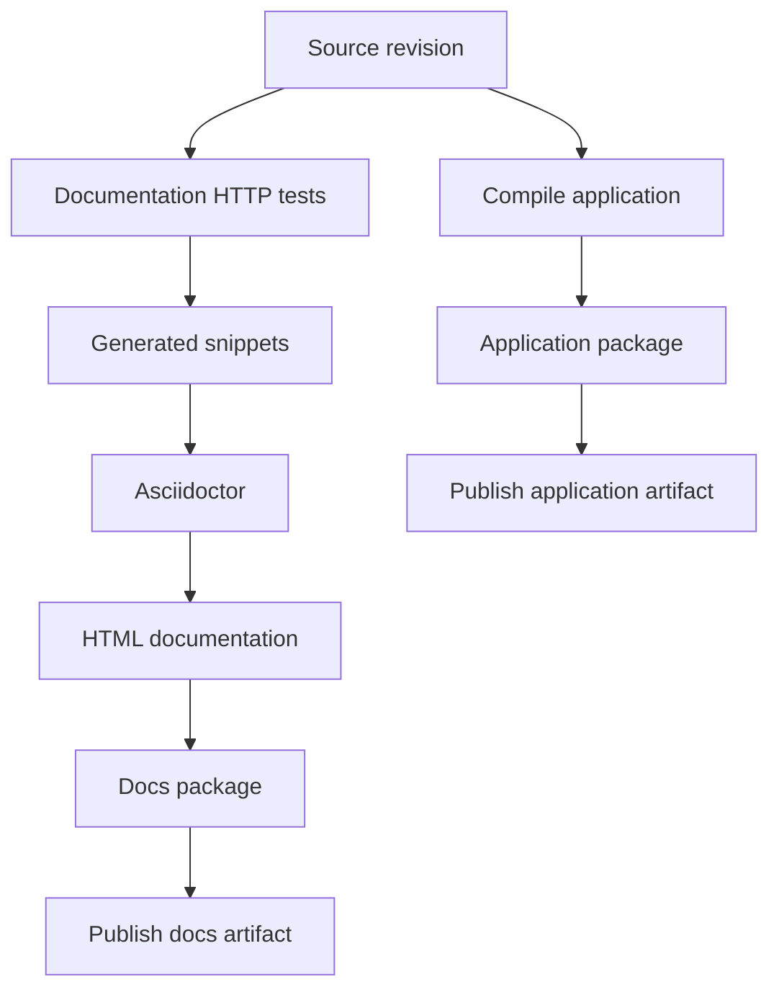
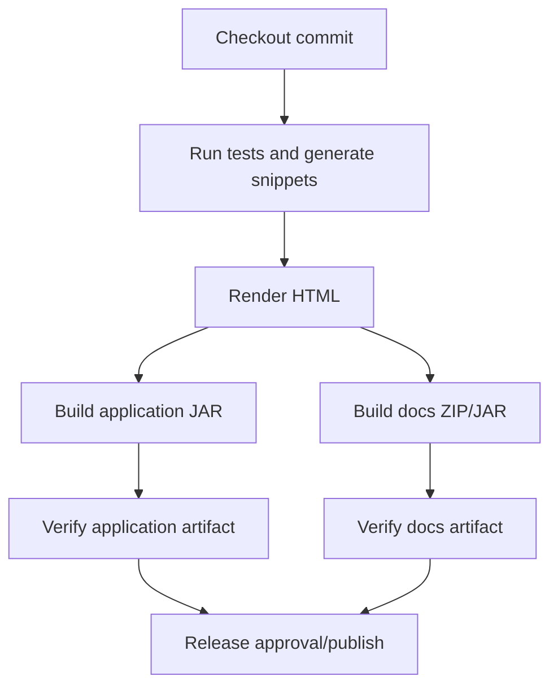

# Phân biệt artifact tài liệu với artifact ứng dụng

## Mục tiêu học tập

Sau bài này, bạn có thể:

- Giải thích sự khác nhau giữa executable artifact của Spring Boot và artifact chứa API documentation.
- Chọn cách phát hành tài liệu: nhúng trong JAR ứng dụng, đóng gói thành JAR riêng, phát hành website tĩnh hoặc lưu như build artifact.
- Thiết kế pipeline để sinh snippet, render Asciidoctor và tạo artifact tài liệu độc lập.
- Đồng bộ version tài liệu với version API/ứng dụng và nhận biết trường hợp cần versioning riêng.
- Cấu hình Gradle hoặc Maven để xuất bản đúng artifact, tránh phụ thuộc build output ngẫu nhiên.
- Kiểm tra nội dung, metadata, checksum và khả năng tải/triển khai artifact.
- Đánh giá quyền truy cập, bảo mật và vòng đời lưu trữ trước khi phát hành tài liệu.

## 1. Hai loại artifact có mục đích khác nhau

Trong một dự án Spring REST Docs, build thường tạo ra ít nhất hai nhóm đầu ra:

1. **Artifact ứng dụng**: executable JAR/WAR chứa bytecode, dependency hoặc lớp khởi động cần thiết để chạy dịch vụ.
2. **Artifact tài liệu**: HTML/PDF được tạo từ AsciiDoc và snippet do HTTP test sinh ra.

Hai đầu ra có thể được phát hành cùng nhau hoặc riêng biệt. Quyết định này ảnh hưởng đến cách deploy, phân quyền, cache, versioning và khả năng truy cập của người tích hợp API.

Ví dụ:

```text
orders-service-2.4.0.jar
orders-api-docs-2.4.0.zip
```

JAR ứng dụng phục vụ API runtime. ZIP tài liệu chứa trang HTML và các tài nguyên tĩnh để publish lên developer portal, web server hoặc object storage. Cùng version giúp người đọc biết tài liệu mô tả contract nào.

Không nên mặc định rằng tài liệu luôn phải nằm trong JAR ứng dụng. Hãy chọn cách phát hành dựa trên người đọc, quyền truy cập, cách deploy và yêu cầu vận hành.

## 2. Các mô hình phát hành phổ biến

| Mô hình | Artifact | Cách truy cập | Khi phù hợp |
| --- | --- | --- | --- |
| Nhúng trong ứng dụng | Một executable JAR chứa code và HTML docs | Qua URL của Spring Boot, ví dụ /docs/ | Tài liệu đi cùng release ứng dụng và có cùng quyền truy cập |
| JAR tài liệu riêng | Một JAR chỉ chứa static docs | Classpath resource hoặc được giải nén/publish bởi hệ thống khác | Muốn version và deploy docs độc lập nhưng vẫn dùng Maven/Gradle repository |
| ZIP website tĩnh | Một ZIP chứa HTML/CSS/JS/images | Giải nén lên web server, CDN hoặc object storage | Developer portal hoặc hosting độc lập |
| HTML/PDF build artifact | File HTML/PDF được lưu trong CI artifact store | Tải từ pipeline hoặc release page | Nội bộ, review, audit hoặc lưu bản build |
| Publish website | Nội dung được deploy vào docs site | Domain/portal chính thức | Tài liệu công khai hoặc nhiều version API |

Không có mô hình phù hợp cho mọi dự án. Một hệ thống có thể tạo cả JAR ứng dụng lẫn ZIP docs từ cùng một lần build, sau đó publish theo hai chính sách khác nhau.

## 3. Nhúng tài liệu vào executable JAR

Với mô hình này, HTML được copy vào classpath static resource, ví dụ static/docs:

```text
orders-service.jar
└── BOOT-INF/classes/
    └── static/
        └── docs/
            ├── index.html
            ├── orders.html
            ├── css/
            ├── images/
            └── js/
```

Ưu điểm:

- Một artifact chứa ứng dụng và tài liệu tương ứng.
- Release ứng dụng tự mang theo tài liệu.
- Không cần triển khai website riêng nếu URL trong ứng dụng đáp ứng nhu cầu.
- Dễ xác định phiên bản tài liệu đi cùng phiên bản runtime.

Hạn chế:

- Thay đổi tài liệu cũng cần build và phát hành lại ứng dụng.
- Quyền truy cập docs thường gắn với hạ tầng và security policy của ứng dụng.
- Tải tài liệu có thể dùng tài nguyên của API service.
- Nhiều phiên bản tài liệu đồng thời khó tổ chức nếu chỉ dùng một path /docs/.
- CDN/cache và deployment website không độc lập với application release.

Chọn cách này khi tài liệu là phần đi kèm ứng dụng, kích thước hợp lý và người đọc có thể truy cập qua cùng host/security policy.

## 4. Phát hành JAR tài liệu riêng

JAR riêng có thể chứa static resources dưới một package path:

```text
orders-api-docs-2.4.0.jar
├── static/
│   └── docs/
│       ├── index.html
│       ├── orders.html
│       └── css/
└── META-INF/
    └── ...
```

JAR tài liệu không cần chứa application classes. Nó là một artifact versioned có thể được publish lên Maven repository hoặc artifact repository nội bộ.

Một số cách sử dụng:

- Consumer tải JAR và giải nén để publish static website.
- Một docs-host application thêm JAR này như dependency rồi phục vụ tài nguyên trên classpath.
- Pipeline release lấy JAR, giải nén vào thư mục deploy của web server.
- Hệ thống lưu trữ artifact giữ lại từng version để audit hoặc rollback.

Điểm cần thiết kế là resource path bên trong JAR. Nếu docs host phục vụ static resources từ classpath, hãy chọn path mà host có thể map rõ ràng, ví dụ META-INF/resources hoặc vị trí resource được cấu hình riêng. Kiểm tra URL thực tế trên host; chỉ có JAR tồn tại không có nghĩa browser tự truy cập được nội dung.

### 4.1. Khi nào nên tách docs JAR?

Tách riêng hữu ích khi:

- Đội API và đội developer portal có lịch phát hành khác nhau.
- Tài liệu lớn hoặc cần phục vụ qua CDN.
- Một host cần tập hợp tài liệu của nhiều service.
- Tài liệu có thể được publish cho nhiều môi trường khác nhau.
- Muốn lưu trữ/rollback docs mà không deploy lại service.

Tuy nhiên, tách artifact không có nghĩa được phép tách version tùy ý. Tài liệu cần xác định API version hoặc application build mà nó mô tả.

## 5. Phát hành website tĩnh hoặc ZIP

Với developer portal, ZIP thường là định dạng thuận tiện:

```text
orders-api-docs-2.4.0.zip
├── index.html
├── orders/
│   ├── list.html
│   ├── get.html
│   └── create.html
├── css/
├── images/
└── js/
```

ZIP có thể được giải nén lên:

- Nginx/Apache hoặc web server tĩnh.
- Object storage có static website hosting.
- CDN origin.
- Developer portal nội bộ.
- Hệ thống lưu artifact của CI để tải về.

Ưu điểm là hosting không phụ thuộc vào Spring Boot runtime. Tài liệu có thể cache, scale và deploy độc lập. Nhược điểm là pipeline phải bảo đảm đúng version được publish, base path/link hoạt động sau khi giải nén và chính sách truy cập được cấu hình ở hosting layer.

Không chỉ ZIP một file index.html. Cần giữ tất cả tài nguyên tương đối như CSS, JavaScript, hình ảnh, trang con, font và file tải về.

## 6. Quyết định chọn mô hình

Hãy trả lời các câu hỏi sau trước khi chọn:

| Câu hỏi | Nếu câu trả lời là Có | Hướng thường phù hợp |
| --- | --- | --- |
| Tài liệu cần đi cùng đúng bản chạy của service? | Release docs phải đồng bộ tuyệt đối với app | Nhúng vào application JAR hoặc phát hành song song cùng version |
| Docs cần deploy mà không restart service? | Hosting có vòng đời riêng | ZIP/website hoặc docs JAR riêng |
| Cần phục vụ nhiều version API cùng lúc? | Consumer có thể dùng version cũ | Website có version prefix hoặc artifact versioned |
| Tài liệu chỉ dành nội bộ? | Cần authentication/authorization riêng | Docs portal nội bộ hoặc protected endpoint |
| Muốn phân phối cho hệ thống khác bằng dependency? | Consumer dùng Maven/Gradle | Docs JAR |
| Chỉ cần lưu kết quả của pipeline? | Không cần hosting runtime | HTML/PDF build artifact |

Một lựa chọn kết hợp phổ biến là:

- Application JAR giữ API runtime.
- ZIP docs được publish lên developer portal.
- HTML/PDF cũng được lưu trong CI artifact store để audit.

## 7. Luồng build tạo hai artifact từ cùng một nguồn

Điều quan trọng là cả hai artifact được tạo từ cùng source revision và cùng lần sinh snippet:



Không nên tạo application JAR từ commit A rồi tạo docs ZIP từ commit B nhưng gắn cùng version release. Nếu build độc lập, hãy lưu source commit/build identifier vào metadata để truy nguyên.

## 8. Cấu hình Gradle tạo docs ZIP riêng

Giả sử Asciidoctor đã tạo HTML vào build/docs/asciidoc. Có thể tạo ZIP:

```groovy
def docsOutputDir = layout.buildDirectory.dir('docs/asciidoc')

tasks.register('apiDocsZip', Zip) {
    dependsOn tasks.named('asciidoctor')
    from(docsOutputDir)
    archiveBaseName = 'orders-api-docs'
    archiveVersion = project.version.toString()
    archiveClassifier = 'docs'
    destinationDirectory = layout.buildDirectory.dir('distributions')
}
```

Artifact minh họa:

```text
build/distributions/orders-api-docs-2.4.0-docs.zip
```

Tên file cuối cùng phụ thuộc archiveBaseName, archiveVersion, archiveClassifier và Gradle version. Nếu muốn đúng tên orders-api-docs-2.4.0.zip, bỏ classifier docs hoặc điều chỉnh naming convention.

### 8.1. Đưa docs JAR vào publication

Nếu cần phát hành docs dưới dạng JAR:

```groovy
tasks.register('apiDocsJar', Jar) {
    dependsOn tasks.named('asciidoctor')
    from(docsOutputDir) {
        into 'static/docs'
    }
    archiveBaseName = 'orders-api-docs'
    archiveVersion = project.version.toString()
    archiveClassifier = 'docs'
}
```

JAR này chỉ chứa tài liệu static. Consumer hoặc docs host phải biết cách giải nén hoặc phục vụ resource từ JAR; nó không tự trở thành một website độc lập chỉ vì có đuôi .jar.

### 8.2. Phát hành qua Maven Publish

Có thể thêm artifact docs vào Maven publication:

```groovy
publishing {
    publications {
        docs(MavenPublication) {
            artifact(tasks.named('apiDocsJar'))
            groupId = project.group.toString()
            artifactId = 'orders-api-docs'
            version = project.version.toString()
        }
    }
}
```

Đoạn cấu hình là ví dụ. Dự án cần khai báo plugin maven-publish, repository đích và credential theo secret của CI. Không hard-code token/password vào build.gradle.

Nếu chỉ publish ZIP, dùng artifact(tasks.named('apiDocsZip')) và đặt extension/classifier phù hợp. Kiểm tra POM/metadata được publish để consumer có thể xác định tọa độ artifact.

## 9. Cấu hình Maven tạo docs ZIP hoặc JAR

Maven có thể dùng maven-assembly-plugin hoặc maven-jar-plugin để đóng gói output HTML sau khi Asciidoctor chạy.

Ví dụ mục tiêu:

```text
target/
├── generated-snippets/
├── generated-docs/
├── orders-service.jar
└── orders-api-docs-2.4.0.zip
```

Với ZIP, cấu hình assembly descriptor để lấy nội dung trong target/generated-docs và giữ nguyên cấu trúc tương đối. Bind execution vào package hoặc một phase sau khi docs đã được render.

Với JAR, maven-jar-plugin có thể đóng gói một classes/docs staging directory thành artifact classifier docs. Hãy tách staging directory khỏi target/classes của application để không vô tình đưa tài liệu vào cả hai artifact.

Điều cần xác minh:

- Test phase đã tạo snippets.
- Asciidoctor chạy sau test và tạo generated-docs.
- Packaging plugin đọc đúng output directory.
- Artifact docs có tên/version/classifier đúng.
- Application JAR chỉ chứa những tài nguyên dự định nhúng.

## 10. Đồng bộ version giữa ứng dụng và tài liệu

Nếu docs mô tả API của ứng dụng version 2.4.0, artifact nên thể hiện mối liên hệ đó:

```text
orders-service:2.4.0
orders-api-docs:2.4.0
```

Có thể dùng cùng version release:

- Application version: version của code/service.
- API version: version contract public, có thể độc lập với version ứng dụng.
- Docs artifact version: version của bản tài liệu đã render.
- Source revision/build ID: commit hoặc build number tạo ra artifact.

Không phải lúc nào bốn version này cũng giống nhau. Ví dụ một bản vá code không đổi API contract có thể làm application version tăng nhưng API version giữ nguyên. Tuy vậy docs artifact vẫn cần trace được nó được sinh từ commit/build nào.

### 10.1. Metadata truy nguyên

Có thể đính kèm metadata file trong ZIP:

```json
{
  "service": "orders-service",
  "applicationVersion": "2.4.0",
  "apiVersion": "v2",
  "sourceRevision": "a1b2c3d4",
  "buildNumber": "184",
  "generatedAt": "2026-11-17T03:00:00Z"
}
```

Giá trị trên chỉ là ví dụ. Pipeline cần điền từ build metadata thực tế, không hard-code commit hoặc timestamp minh họa. Metadata hữu ích khi điều tra tài liệu nào đã được publish và nó tương ứng với bản code nào.

### 10.2. Versioned documentation URL

Website có thể tổ chức:

```text
/docs/
├── current/
├── 2.4/
└── 2.3/
```

current trỏ đến bản được hỗ trợ mới nhất; version cụ thể giữ lại để consumer đang tích hợp phiên bản cũ có thể tra cứu. Chính sách retention cần quy định khi nào một version bị archive hoặc gỡ bỏ.

## 11. CI tạo, kiểm tra và publish artifact

Một pipeline điển hình:

1. Checkout source revision.
2. Chạy unit/integration/documentation tests.
3. Xác nhận snippet được sinh.
4. Render Asciidoctor.
5. Tạo application JAR.
6. Tạo docs ZIP/JAR.
7. Kiểm tra nội dung, version và checksum.
8. Lưu artifact hoặc publish lên repository/portal theo quyền của pipeline.

Ví dụ workflow:



Trong pipeline, publish thường chỉ chạy ở branch/tag/release đã được phê duyệt. Build pull request có thể tạo artifact để review mà không phát hành ra repository production.

### 11.1. Kiểm tra docs ZIP

Sau khi tạo ZIP, kiểm tra:

- Có index.html.
- Có các trang operation được liên kết từ index.
- CSS, JS, images và font được giữ nguyên.
- Không có file tạm, log test hoặc source file không cần thiết.
- Không chứa token, session cookie, dữ liệu cá nhân hoặc hostname nội bộ không được phép công bố.
- Link tương đối hoạt động sau khi giải nén vào base path dự kiến.

### 11.2. Kiểm tra docs JAR

Với JAR:

```bash
jar tf build/libs/orders-api-docs-2.4.0-docs.jar
```

Kiểm tra entry:

```text
static/docs/index.html
static/docs/orders.html
static/docs/css/site.css
```

Với ZIP:

```bash
jar tf build/distributions/orders-api-docs-2.4.0-docs.zip
```

Lệnh jar tf có thể liệt kê nội dung ZIP trên JDK hỗ trợ; có thể dùng unzip -l hoặc công cụ archive tương đương. Không dựa vào tên file mà kết luận artifact đúng; hãy kiểm tra entries thực tế.

### 11.3. Checksum và provenance

Tạo checksum giúp phát hiện artifact bị thay đổi sau khi publish:

```bash
sha256sum orders-api-docs-2.4.0-docs.zip
```

Trên Windows có thể dùng Get-FileHash với SHA256. Lưu checksum cạnh artifact và gắn source revision/build ID trong release metadata. Với môi trường yêu cầu provenance/signing, dùng cơ chế ký artifact của tổ chức.

## 12. Quyền truy cập và nội dung nhạy cảm

Tách artifact không tự giải quyết bảo mật. Một ZIP docs public có thể bị tải bởi bất kỳ ai có URL; một docs JAR trong repository nội bộ có thể được truy cập theo quyền repository.

Trước khi publish, kiểm tra:

- Endpoint nội bộ có bị lộ không?
- Snippet có chứa Authorization, Cookie, session ID hoặc token thật không?
- Ví dụ có dữ liệu người dùng hoặc thông tin production không?
- Error message có tiết lộ hostname, stack trace hoặc cấu trúc nội bộ không?
- Tài liệu có mô tả endpoint chưa được public/được bật ở môi trường production không?
- Repository/portal có đúng nhóm người đọc không?

Nếu docs chỉ dành cho nội bộ, publish vào repository/portal có access control. Nếu public, áp dụng review nội dung và secret scanning trước release. Dùng fixture giả trong documentation test từ đầu để giảm nguy cơ rò rỉ.

## 13. Chọn nơi lưu artifact

| Nơi lưu | Phù hợp với | Lưu ý |
| --- | --- | --- |
| Maven repository | JAR/ZIP có version và consumer tải bằng tọa độ | Quản lý quyền, retention và immutable release |
| CI artifact store | Kết quả build, review, audit | Thời hạn lưu có thể ngắn; không mặc định là kênh phát hành |
| Object storage | Website tĩnh và versioned docs | Cấu hình ACL, cache và origin policy |
| CDN | Phân phối docs public ở quy mô lớn | Purge/cache version và base path |
| Developer portal | Nhiều API/service và navigation chung | Cần metadata service/version và quy trình publish |
| Application JAR | Docs gắn với một runtime service | Cùng lifecycle deploy và security policy |

Không dùng CI artifact tạm làm URL tài liệu chính thức nếu retention và quyền truy cập không đáp ứng nhu cầu consumer.

## 14. Lỗi thường gặp

| Biểu hiện | Nguyên nhân có thể | Cách xử lý |
| --- | --- | --- |
| Docs ZIP khác version với application JAR | Hai artifact lấy version từ nguồn khác nhau | Dùng chung release metadata và source revision |
| ZIP chỉ có index.html | Task chỉ đóng gói một file | Đóng gói toàn bộ output directory |
| Docs JAR không được host phục vụ | Resource path trong JAR không được resource handler quét | Xác định classpath location và cấu hình host |
| Publish docs thành công nhưng website 404 | Base path hoặc deployment layout không khớp | Kiểm tra cấu trúc sau giải nén và URL mapping |
| Consumer tải nhầm bản docs | Artifact không có version hoặc alias current không rõ | Publish version cụ thể và quản lý alias rõ ràng |
| Artifact chứa snippet cũ | Generated output stale hoặc test không chạy | Clean output, chạy docs test và render lại |
| Tài liệu lộ credential | Fixture thật hoặc secret lọt vào snippet | Dùng dữ liệu giả, preprocess và quét artifact |
| App JAR phình lớn | Nhúng toàn bộ website/docs assets không cần thiết | Cân nhắc artifact/hosting riêng |
| Publish từ pull request ngoài ý muốn | CI publish không giới hạn trigger | Chỉ publish ở tag/branch/release được phép |

## 15. Checklist phân biệt và phát hành artifact

- [ ] Xác định người đọc và nơi tài liệu sẽ được phục vụ.
- [ ] Chọn nhúng trong application JAR, docs JAR, ZIP website hay CI artifact.
- [ ] Đảm bảo artifact docs được tạo từ cùng source revision với application khi cần đồng bộ.
- [ ] Dùng version và metadata có thể truy nguyên.
- [ ] Giữ toàn bộ HTML/CSS/JS/images và cấu trúc tương đối.
- [ ] Không đưa generated snippets cũ hoặc file tạm vào package.
- [ ] Kiểm tra nội dung artifact và checksum.
- [ ] Quét credential, cookie, token và dữ liệu nhạy cảm.
- [ ] Xác định access control của repository/portal/website.
- [ ] Kiểm tra URL/base path sau khi deploy.
- [ ] Giới hạn publish trigger cho branch/tag/release phù hợp.
- [ ] Lưu artifact và provenance theo retention policy.

## 16. Bài tập thực hành

Một nhóm phát triển Orders API muốn tạo executable JAR cho service và một gói docs ZIP để publish lên developer portal.

Hãy thực hiện:

1. Cấu hình documentation tests sinh snippet vào generated-snippets.
2. Render HTML bằng Asciidoctor vào một output directory riêng.
3. Cấu hình application JAR theo yêu cầu runtime; không bắt buộc nhúng docs nếu portal phục vụ riêng.
4. Tạo ZIP chứa toàn bộ HTML/CSS/JS/images với tên có version.
5. Thêm metadata service, API version, source revision và build number.
6. Kiểm tra ZIP entries và quét secret trước khi publish.
7. Tạo checksum SHA-256 và lưu cùng artifact.
8. Thiết lập CI chỉ publish khi tag release hợp lệ.
9. Deploy ZIP lên staging portal, kiểm tra navigation và relative links.
10. Xác nhận consumer có thể truy cập đúng version docs tương ứng API.

**Câu hỏi tự kiểm tra:** Nếu docs ZIP và application JAR được tạo từ cùng version string, đã đủ chứng minh chúng mô tả cùng source chưa? Chưa. Hai pipeline có thể dùng cùng version nhưng checkout commit khác nhau. Cần lưu source revision/build ID và bảo đảm hai artifact được tạo từ cùng revision hoặc cùng release pipeline.

## Kết luận

Artifact ứng dụng và artifact tài liệu có thể được phát hành cùng nhau hoặc độc lập. Nhúng HTML vào executable JAR phù hợp khi docs đi cùng runtime và security policy; docs JAR hoặc ZIP phù hợp khi muốn version, hosting và deployment riêng; CI artifact phù hợp cho review/audit. Dù chọn mô hình nào, hãy sinh snippet và HTML từ cùng source revision, đồng bộ version metadata, giữ toàn bộ tài nguyên, kiểm tra nội dung và checksum, đồng thời quét secret trước publish. CI cần giới hạn trigger phát hành và lưu provenance để consumer biết tài liệu đang mô tả chính xác API version nào. Khi phân biệt rõ mục đích và vòng đời của từng artifact, nhóm có thể phát hành ứng dụng và tài liệu theo cách phù hợp mà vẫn truy nguyên được contract đã kiểm thử.
