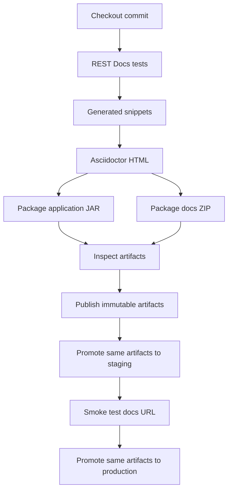

# Đóng gói tài liệu theo môi trường phát hành

## 1. Mục tiêu

**Spring REST Docs** tạo tài liệu REST API có thể kiểm chứng từ test HTTP dùng MockMvc, WebTestClient hoặc REST Assured. Test sinh snippet cho request, response, payload, header, parameter và multipart part; Asciidoctor/Markdown kết hợp snippet với nội dung biên soạn để tạo tài liệu phát hành.

Khi chuẩn bị release, nhóm phát triển cần quyết định tài liệu được đóng gói ở đâu và có khác nhau giữa các môi trường hay không. Ba mô hình phổ biến:

1. Nhúng HTML vào JAR/WAR của ứng dụng.
2. Phát hành tài liệu thành artifact riêng.
3. Publish tài liệu lên site/portal hoặc object storage.

Việc chọn mô hình ảnh hưởng kích thước artifact, quyền truy cập, versioning, pipeline CI/CD và rollback. Bài này hướng dẫn cấu hình Maven/Gradle theo môi trường, đồng thời giữ mối liên hệ giữa phiên bản API và phiên bản tài liệu.

## 2. Phân biệt môi trường build và runtime

Cần phân biệt hai thời điểm:

- **Build time:** test sinh snippets, Asciidoctor tạo HTML, task copy và package quyết định file nào nằm trong artifact.
- **Runtime:** Spring Boot khởi động với profile như `dev`, `staging` hoặc `prod`; profile điều chỉnh URL, security, logging và property ứng dụng.

Profile runtime không tự thay đổi nội dung đã được đóng gói trong JAR. Nếu JAR đã chứa `static/docs/index.html`, bật profile `prod` không thể thay file đó bằng tài liệu khác trừ khi ứng dụng được thiết kế để đọc tài liệu từ nguồn ngoài classpath.

```text
Build:
  REST Docs tests
    -> generated snippets
    -> Asciidoctor HTML
    -> package application.jar

Runtime:
  application.jar + SPRING_PROFILES_ACTIVE=prod
    -> production settings
    -> serves HTML already inside the JAR
```

Quyết định "tài liệu nào được phát hành" thường thuộc build/publish pipeline. Quyết định "ai được truy cập và URL nào được dùng" thường thuộc runtime configuration/deployment.

## 3. Chọn mô hình phát hành

| Mô hình | Khi phù hợp | Ưu điểm | Cân nhắc |
| --- | --- | --- | --- |
| Nhúng trong JAR/WAR | Docs luôn đi cùng API version | Đồng bộ release; rollback cùng ứng dụng | Tăng kích thước; thay docs cần build lại |
| Artifact docs riêng | Docs có quyền truy cập hoặc vòng đời riêng | Publish/rollback độc lập; giữ nhiều version | Cần version và pipeline đồng bộ |
| Portal/static site | Nhiều API/version cần tra cứu | Tìm kiếm và versioning tập trung | Cần hosting, access và cache |

### 3.1. Nhúng tài liệu vào application artifact

Cấu trúc trong Spring Boot executable JAR thường là:

```text
BOOT-INF/classes/static/docs/
├── index.html
├── css/
├── images/
└── operations/
```

Phù hợp khi người dùng cần tài liệu đúng với API đang chạy, docs không có vòng đời độc lập và rollback ứng dụng phải khôi phục cả API lẫn tài liệu.

Gradle thường cho `bootJar` phụ thuộc `asciidoctor` và copy output vào `static/docs`. Maven có thể chạy Asciidoctor ở `prepare-package` rồi copy output vào `target/classes/static/docs` trước package.

### 3.2. Phát hành docs thành artifact riêng

Ví dụ pipeline tạo hai artifact:

```text
release/
├── application-2.4.0.jar
└── api-docs-2.4.0.zip
```

Artifact docs có thể được lưu trong repository artifacts hoặc publish lên static hosting. Cần giữ metadata liên kết với API release:

```yaml
apiVersion: 2.4.0
docsVersion: 2.4.0
sourceRevision: 8f31c2a
generatedAt: 2026-11-17T03:00:00Z
```

Các giá trị chỉ minh họa. Pipeline phải lấy version/commit từ build, không hardcode.

### 3.3. Publish lên portal hoặc static site

Portal phù hợp khi có nhiều service, nhiều nhóm và nhiều phiên bản. Mỗi release có thể nằm dưới prefix riêng như `/services/orders/2.4.0/`, còn `/services/orders/current/` trỏ tới bản hiện hành.

Cần xác định ai được publish/xem, cách lưu lịch sử và invalidation CDN. Không publish tài liệu nội bộ ra public site chỉ vì HTML đã được sinh thành công.

## 4. Có cần tài liệu khác nhau giữa dev, staging và production?

Không nên mặc định mỗi môi trường cần một bộ nội dung khác nhau. Mô tả endpoint, schema, status code và ví dụ request/response nên phản ánh contract của cùng một API version. Thay nội dung docs theo môi trường có thể khiến người dùng hiểu nhầm API contract.

Khác biệt thường nằm ở:

- base URL hoặc server URL;
- gateway prefix;
- cách lấy token/xác thực;
- banner chỉ rõ môi trường;
- chính sách truy cập docs;
- hướng dẫn nội bộ chỉ được phép xuất hiện ở non-production.

Không đưa credentials, token, dữ liệu khách hàng hoặc endpoint nội bộ nhạy cảm vào generated snippets. Dùng fixture và dữ liệu tổng hợp trong test.

Một chiến lược tốt là giữ API contract giống nhau, cung cấp server URL/hướng dẫn môi trường bên ngoài artifact. Nếu cần docs nội bộ khác public, tách nguồn/output rõ ràng và kiểm tra artifact để tránh lẫn nội dung.

## 5. Maven: profile build để chọn tài liệu

Maven profile có thể bật/tắt execution hoặc cấu hình output. Ví dụ chỉ đưa tài liệu vào application JAR khi profile `with-api-docs` được kích hoạt.

```xml
<profiles>
    <profile>
        <id>with-api-docs</id>
        <build>
            <plugins>
                <plugin>
                    <groupId>org.asciidoctor</groupId>
                    <artifactId>asciidoctor-maven-plugin</artifactId>
                    <version>3.2.0</version>
                    <executions>
                        <execution>
                            <id>generate-api-docs</id>
                            <phase>prepare-package</phase>
                            <goals>
                                <goal>process-asciidoc</goal>
                            </goals>
                            <configuration>
                                <backend>html</backend>
                            </configuration>
                        </execution>
                    </executions>
                    <dependencies>
                        <dependency>
                            <groupId>org.asciidoctor</groupId>
                            <artifactId>asciidoctorj</artifactId>
                            <version>3.0.0</version>
                        </dependency>
                        <dependency>
                            <groupId>org.springframework.restdocs</groupId>
                            <artifactId>spring-restdocs-asciidoctor</artifactId>
                            <version>${spring-restdocs.version}</version>
                        </dependency>
                    </dependencies>
                </plugin>
            </plugins>
        </build>
    </profile>
</profiles>
```

Profile chỉ minh họa việc kích hoạt execution. Dependency REST Docs test và cấu hình test output phải nằm ở build chung hoặc trong cùng profile một cách nhất quán. Nếu resource copy cũng cần điều kiện, đưa execution copy vào profile đó và đặt sau plugin Asciidoctor.

Kích hoạt:

```bash
./mvnw -Pwith-api-docs clean package
```

Nếu profile không active, execution trong profile không chạy. CI phải chủ động kích hoạt profile khi tạo release docs; không dựa vào `activeByDefault` nếu profile khác có thể làm nó tự tắt.

### 5.1. Tách artifact docs bằng classifier

Nếu muốn docs thành artifact phụ, dùng plugin archive/assembly để tạo ZIP riêng thay vì copy vào `target/classes/static`. Đặt classifier hoặc tên artifact gắn với cùng version ứng dụng, ví dụ `api-docs`. Cả docs và application phải lấy snippets/source từ cùng build revision.

Không publish docs artifact từ commit khác với application JAR rồi gắn nhãn cùng version nếu không lưu provenance.

## 6. Gradle: task riêng và điều kiện đóng gói

Có thể định nghĩa task docs riêng rồi chỉ đưa docs vào JAR khi property được bật. Ví dụ Groovy DSL:

```groovy
def includeApiDocs = providers.gradleProperty('includeApiDocs')
        .map { it.toBoolean() }
        .getOrElse(false)

tasks.named('asciidoctor') {
    dependsOn tasks.named('test')
    inputs.dir file('build/generated-snippets')
    configurations 'asciidoctorExt'
}

tasks.named('bootJar') {
    if (includeApiDocs) {
        dependsOn tasks.named('asciidoctor')
        from(tasks.named('asciidoctor').map { it.outputDir }) {
            into 'static/docs'
        }
    }
}
```

Build có docs:

```bash
./gradlew clean bootJar -PincludeApiDocs=true
```

Build không nhúng docs:

```bash
./gradlew clean bootJar -PincludeApiDocs=false
```

Trong cấu hình này, test/Asciidoctor chỉ được kéo vào dependency graph của `bootJar` khi property bật. Nếu CI vẫn cần kiểm chứng docs trong mọi build, hãy chạy task docs/verify riêng thay vì bỏ qua test sinh snippets.

### 6.1. Tạo artifact docs độc lập

Có thể dùng task archive riêng:

```groovy
tasks.register('apiDocsZip', Zip) {
    dependsOn tasks.named('asciidoctor')
    from(tasks.named('asciidoctor').map { it.outputDir })
    archiveBaseName = 'api-docs'
    archiveVersion = project.version.toString()
    archiveClassifier = 'html'
    destinationDirectory = layout.buildDirectory.dir('distributions')
}
```

Chạy:

```bash
./gradlew clean apiDocsZip
```

ZIP nằm trong `build/distributions`. Để tạo cả JAR và ZIP từ cùng revision:

```bash
./gradlew clean bootJar apiDocsZip
```

Đảm bảo Asciidoctor phụ thuộc test và archive task lấy đúng output directory. Tránh đóng gói trùng docs vào JAR nếu mục tiêu chỉ là artifact riêng.

## 7. Runtime profiles: URL và quyền truy cập

Runtime profile phù hợp để điều chỉnh URL, security và cache policy, không phải để sửa nội dung đã đóng gói.

Ví dụ:

```yaml
# application-prod.yml
server:
  servlet:
    context-path: /service

spring:
  web:
    resources:
      cache:
        cachecontrol:
          max-age: 5m
          cache-public: true
```

Với context path này, URL có thể là `/service/docs/index.html`. Tuy nhiên cache-public chỉ phù hợp nếu docs thực sự công khai. Docs nội bộ cần security và cache policy riêng.

Profile staging có thể dùng prefix hoặc cache policy ngắn hơn, nhưng không nên thay API contract snippets. Nếu cần docs public và internal khác nhau, tách output/route rõ ràng và kiểm tra artifact tương ứng.

## 8. Đưa base URL theo môi trường vào tài liệu

Có thể dùng attribute Asciidoctor để chèn server URL theo build input:

```asciidoc
= Orders API
:toc: left
:api-server-url: https://api.example.invalid

API server: {api-server-url}

== GET /orders/{id}
include::{snippets}/orders-get/http-request.adoc[]
```

Có thể truyền attribute khi chạy Asciidoctor/Maven/Gradle tùy plugin. Nhưng nếu cùng artifact được promote từ staging sang production, nhúng hostname staging vào HTML sẽ sai. Khi có thể, dùng relative path hoặc đặt server URL trong portal/deployment config bên ngoài artifact.

Nếu thật sự tạo docs khác theo môi trường, gắn nhãn rõ trong title/banner và lưu environment metadata. Không dùng cùng artifact version cho nội dung khác nhau mà không ghi nhận.

## 9. CI/CD: build, verify và promote

Pipeline release có thể gồm:



Nguyên tắc:

1. Tạo snippets và HTML từ cùng commit với application.
2. Dùng clean build hoặc khai báo task input/output để tránh stale generated output.
3. Lưu JAR và docs artifact cùng version/revision.
4. Kiểm tra archive trước khi publish.
5. Promote cùng artifact đã kiểm thử qua staging và production; không build lại với nội dung khác nhưng giữ nguyên version.
6. Sau deploy, smoke test URL, security và cache headers.
7. Rollback cả application và docs nếu hai artifact phụ thuộc nhau.

### 9.1. Metadata provenance

Đính kèm metadata release để truy vết:

```text
service: orders-api
apiVersion: 2.4.0
docsArtifact: api-docs-2.4.0-html.zip
sourceRevision: 8f31c2a
buildNumber: 1842
```

Lấy giá trị từ CI environment hoặc build metadata, không nhập commit/version cố định vào tài liệu.

## 10. Bảo mật theo môi trường phát hành

| Môi trường | Quyền truy cập docs | Cân nhắc |
| --- | --- | --- |
| Local development | Developer/team | Có thể dùng docs fixture và endpoint local |
| CI | Build job/service account | Không publish tài liệu chưa qua kiểm tra |
| Staging | Tester, QA, nội bộ | Có thể yêu cầu authentication |
| Production public API | Khách hàng/developer | Chỉ publish contract đã duyệt |
| Production internal API | Role/team được cấp quyền | Bảo vệ toàn bộ docs route và assets |

Không dựa vào URL khó đoán để bảo vệ docs. Dùng Spring Security, gateway authentication hoặc access policy của hosting. Không để cache public giữ response có nội dung phụ thuộc user.

## 11. Lỗi thường gặp

| Triệu chứng | Nguyên nhân | Cách xử lý |
| --- | --- | --- |
| JAR production thiếu docs | Build không bật profile/property tạo docs | Kiểm tra tham số CI và archive |
| Staging docs khác production dù cùng version | Build lại với environment-specific content | Promote cùng artifact hoặc gắn version/provenance riêng |
| HTML chứa staging host ở production | Nhúng base URL lúc build staging rồi promote artifact | Dùng relative URL hoặc cấu hình URL ngoài artifact |
| Docs và API version lệch nhau | Publish từ hai commit/build khác nhau | Gắn source revision và version cho cả artifacts |
| Runtime profile không đổi HTML | Nội dung đã nằm trong JAR | Tạo artifact mới hoặc đọc docs từ nguồn ngoài |
| Docs public ngoài ý muốn | Route không có authorization | Bảo vệ prefix ở Security/gateway |
| Cache giữ docs cũ | Policy không phù hợp URL current | Revalidate HTML và version hóa assets |
| Docs ZIP thiếu snippets | Asciidoctor không phụ thuộc test | Bảo đảm test → asciidoctor |
| CI không sinh docs | Maven profile/Gradle property chưa bật | Kiểm tra lệnh build và active profiles |
| Rollback không đồng bộ | Docs artifact và JAR deploy độc lập | Gắn version và rollback theo cặp |

## 12. Bài thực hành

Thiết kế release cho service có API version 2.4.0:

1. Viết REST Docs test và sinh snippets.
2. Cấu hình Asciidoctor tạo HTML.
3. Chọn mô hình: nhúng docs trong JAR hoặc tạo ZIP riêng.
4. Với Maven, tạo profile `with-api-docs` và bind `process-asciidoc` vào `prepare-package`.
5. Với Gradle, tạo property `includeApiDocs` và task `apiDocsZip`.
6. Đảm bảo docs artifact và application artifact lấy cùng source revision.
7. Không nhúng staging hostname nếu artifact được promote sang production.
8. Cấu hình runtime profile cho context path, security và cache headers.
9. Kiểm tra JAR/ZIP bằng archive listing; xác minh entry point và assets.
10. Deploy staging, smoke test URL rồi promote cùng artifact sang production.
11. Thử rollback và xác nhận API cùng docs quay về cùng release.

**Tiêu chí hoàn thành:** phân biệt build-time/runtime; chọn mô hình phát hành; cấu hình profile/task có chủ đích; đồng bộ version/revision; kiểm tra security, URL và cache; promote/rollback artifact có thể truy vết.

## 13. Câu hỏi tự kiểm tra

**1. Runtime profile có thể thay HTML đã nằm trong JAR không?**

Không tự động. Profile runtime thay cấu hình ứng dụng; HTML đã đóng gói vẫn giữ nguyên trừ khi có cơ chế tải từ nguồn ngoài.

**2. Khi nào nên nhúng docs vào JAR?**

Khi docs cần luôn khớp API version và rollback cùng application artifact.

**3. Khi nào nên phát hành docs ZIP riêng?**

Khi docs có quyền truy cập, vòng đời, hosting hoặc rollback độc lập.

**4. Vì sao không nên build lại artifact riêng cho staging và production nhưng giữ cùng version?**

Nội dung có thể khác dù version giống nhau, làm mất tính bất biến và gây khó truy vết/rollback. Promote cùng artifact hoặc gắn version/provenance riêng.

**5. Maven profile có vai trò gì?**

Profile kích hoạt execution tạo/copy docs cho một kiểu build. CI phải chủ động chọn profile tương ứng.

**6. Gradle property có thể điều khiển điều gì?**

Bật/tắt việc đưa docs vào bootJar hoặc tạo docs archive riêng. Task graph phải phản ánh lựa chọn.

**7. Làm sao bảo đảm docs khớp API release?**

Sinh docs và application từ cùng commit/build, gắn cùng version/source revision và kiểm tra artifacts trước khi publish.

## Tài liệu tham khảo

- [Spring REST Docs — Getting Started](https://docs.spring.io/spring-restdocs/tutorial/getting-started/index.html): sinh snippets và biên soạn tài liệu trong build.
- [Maven Profiles](https://maven.apache.org/guides/introduction/introduction-to-profiles.html): kích hoạt cấu hình build theo profile.
- [Maven Build Lifecycle](https://maven.apache.org/guides/introduction/introduction-to-the-lifecycle.html): thứ tự phase và plugin execution.
- [Gradle Build Environment](https://docs.gradle.org/current/userguide/build_environment.html): project properties và cấu hình build.
- [Gradle Task Configuration](https://docs.gradle.org/current/userguide/lazy_configuration.html): task provider và dependency.
- [Spring Boot Profiles](https://docs.spring.io/spring-boot/reference/features/profiles.html): cấu hình runtime theo profile.

