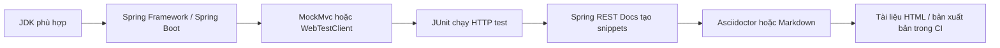

# Yêu cầu Java, Spring Framework và phiên bản Spring REST Docs

## Mục tiêu học tập

Trước khi cấu hình **Spring REST Docs**, cần xác định dự án đang sử dụng JDK nào, thuộc thế hệ Spring Framework/Spring Boot nào và chọn đúng nhánh Spring REST Docs. Một tổ hợp phiên bản sai có thể khiến bài kiểm thử HTTP không biên dịch, không chạy được hoặc không sinh ra snippet, dù API vẫn hoạt động bình thường.

Sau bài này, bạn có thể:

- Xác định yêu cầu tối thiểu về Java, Spring Framework và bộ thư viện kiểm thử đối với Spring REST Docs 3.x và 4.x.
- Chọn nhánh Spring REST Docs phù hợp cho dự án Spring Boot 3.x hoặc 4.x, đồng thời biết trường hợp nào dùng MockMvc, WebTestClient hoặc REST Assured.
- Kiểm tra phiên bản JDK thực tế của máy phát triển, công cụ build và CI.
- Thiết lập một dự án mẫu với dependency phù hợp, chạy kiểm thử tạo snippet và nhận biết các lỗi do không tương thích phiên bản.

> **Phạm vi:** Bài thuộc chương **Thiết lập dự án** của module `SPRING_REST_DOCS`. Spring REST Docs là công cụ tạo tài liệu REST API có thể kiểm chứng từ bài kiểm thử HTTP. Các chương tiếp theo sẽ đào sâu cách mô tả request/response, payload, tham số, header và xuất tài liệu Asciidoctor/Markdown trong build, CI. Thông tin về các bản phát hành bên dưới được đối chiếu theo tài liệu Spring tại thời điểm **17/11/2026**; khi áp dụng cho dự án lâu dài, hãy kiểm tra lại phiên bản vá mới nhất.

## 1. Phân biệt các thành phần và quan hệ phụ thuộc

Spring REST Docs không phải một framework xử lý HTTP độc lập. Nó gắn vào công cụ kiểm thử HTTP thuộc hệ sinh thái Spring, quan sát request/response thực sự trong bài test, sau đó tạo các mảnh tài liệu (snippet). Nếu test hoặc mô tả không đúng, việc sinh tài liệu cũng thất bại; nhờ vậy tài liệu có cơ sở kiểm chứng bằng mã nguồn.

| Thành phần | Trách nhiệm | Tác động đến việc chọn phiên bản |
| --- | --- | --- |
| **JDK (Java Development Kit)** | Biên dịch và chạy ứng dụng, test, Gradle/Maven | Phải đạt mức tối thiểu của Spring Framework, Spring REST Docs và các công cụ liên quan. |
| **Spring Framework** | Cung cấp Spring MVC Test/`MockMvc`, WebFlux/`WebTestClient` và Spring Test | Là ràng buộc tương thích chính của Spring REST Docs. |
| **Spring Boot** *(nếu dùng)* | Quản lý phiên bản dependency, cấu hình và test starter | Thường quyết định thế hệ Spring Framework; Boot 3 và Boot 4 nên dùng các nhánh REST Docs khác nhau. |
| **Spring REST Docs** | Tích hợp với bài kiểm thử HTTP, xác minh mô tả và tạo snippet | Chọn bản 3.x hoặc 4.x theo hệ Spring đang sử dụng. |
| **JUnit và công cụ HTTP test** | Thực thi test và gửi request tới API | Phải đúng phiên bản được Spring REST Docs hỗ trợ. |
| **Asciidoctor/Markdown** | Biên soạn snippet thành tài liệu đọc được | Là phần xuất bản, được nối vào quá trình build sau khi test tạo snippet. |

Luồng xử lý tổng quát:



**Không nên hiểu rằng chỉ cần thêm dependency `spring-restdocs-core` là đủ.** Một cấu hình tối thiểu phải có công cụ kiểm thử HTTP phù hợp, cấu hình tạo snippet và nhiệm vụ build sử dụng các snippet đã sinh.

## 2. Ma trận tương thích nên bắt đầu từ đâu?

Với các dự án Spring hiện đại, nên xác định phiên bản **Spring Boot (nếu có) → Spring Framework → Spring REST Docs → Java/JUnit** theo thứ tự này.

| Dự án | Spring Framework | Spring REST Docs | Java tối thiểu | Kiểm thử và tích hợp |
| --- | --- | --- | --- | --- |
| **Spring Boot 3.x** | **6.x** | **3.x** | **17** | JUnit Jupiter 5; MockMvc, WebTestClient; tích hợp REST Assured 5.2+ của REST Docs 3.x. |
| **Spring Boot 4.x** | **7.x** | **4.x** | **17** | JUnit 6; MockMvc hoặc WebTestClient. **Không có tích hợp REST Assured của REST Docs 4.x.** |
| **Spring Framework không dùng Boot** | 6.x hoặc 7.x | Tương ứng 3.x hoặc 4.x | **17** cho cả hai nhánh | Tự quản lý phiên bản Spring Test, JUnit và module REST Docs tương ứng. |

Các mốc quan trọng:

1. **Spring REST Docs 3.0** nâng mức nền lên **Java 17** và **Spring Framework 6**. Nhánh này phù hợp khi ứng dụng vẫn ở Spring Boot 3.x. Tích hợp REST Assured ở nhánh 3.x yêu cầu REST Assured từ **5.2**.
2. **Spring REST Docs 4.0** vẫn yêu cầu tối thiểu **Java 17**, nhưng nâng lên **Spring Framework 7**, **JUnit 6** và **AsciidoctorJ 3.0**. Nhánh này dùng cho thế hệ Spring Boot 4.x.
3. **Spring REST Docs 4.0 loại bỏ module tích hợp REST Assured**, vì sự không tương thích với nền Groovy 5 khi phát hành 4.0. Do đó ví dụ dùng `spring-restdocs-restassured` từ REST Docs 3.x không thể bê nguyên sang 4.x.
4. Tại thời điểm của bài, bản ổn định mới nhất của nhánh 4.0 được công bố là **4.0.2** (phát hành 22/10/2026); nhánh 3.0 có bản **3.0.6** (09/06/2026). Bản **4.1.0-RC1** là release candidate, còn trong giai đoạn thử nghiệm và đã nâng yêu cầu Spring Framework lên 7.1; không mặc nhiên chọn nó cho môi trường cần bản ổn định.

Đây là **ma trận theo thế hệ tương thích**, không phải cam kết mọi bản vá của Boot, Framework và REST Docs đều có thể phối hợp tùy ý. Ưu tiên để **Spring Boot BOM** (hoặc BOM đã quản trị tập trung của dự án) chọn bộ phiên bản đã được kiểm thử cùng nhau.

### Chọn nhanh theo tình huống

**Tình huống A — Dự án hiện tại là Spring Boot 3.5.x.** Giữ Spring Framework 6.x và sử dụng Spring REST Docs 3.x. Có thể chọn MockMvc cho controller Servlet hoặc WebTestClient cho WebFlux. Nếu dự án đã dùng REST Assured 5.2+ để viết test, nhánh REST Docs 3.x còn hỗ trợ tích hợp đó.

**Tình huống B — Dự án mới dùng Spring Boot 4.0.x hoặc 4.1.x.** Chọn Spring Framework 7.x và Spring REST Docs 4.x. Ưu tiên MockMvc/WebTestClient. Cần cập nhật mã test liên quan đến JUnit 6 và các thay đổi gói/module của Spring Boot 4.

**Tình huống C — Dự án cũ dùng Java 8/11, Spring Framework 5 hoặc Spring Boot 2.x.** Không thể chỉ bổ sung Spring REST Docs 3.x/4.x rồi chạy. Cần có kế hoạch nâng JDK, Spring và chuyển đổi các API Jakarta liên quan, hoặc đánh giá riêng một nhánh REST Docs cũ còn phù hợp; tránh đưa một nhánh đã lỗi thời vào dự án mới.

## 3. Yêu cầu Java: tối thiểu 17, nhưng phải kiểm tra đúng JDK đang dùng

### 3.1. JDK và JVM có thể khác nhau giữa máy phát triển, build và CI

Spring REST Docs 3.x và 4.x đều có **mức Java tối thiểu là 17**. Java 21 hoặc Java 25 (các bản LTS mới hơn) cũng là lựa chọn hợp lý khi toàn bộ stack và pipeline hỗ trợ. Chọn mức Java dựa trên chính sách vận hành của dự án, thay vì suy đoán rằng phiên bản Java cao nhất luôn an toàn với mọi plugin.

Kiểm tra trong terminal:

```bash
java -version
javac -version
```

Ví dụ đầu ra hợp lệ về mặt yêu cầu tối thiểu:

```text
openjdk version "17.0.x" ...
javac 17.0.x
```

Kiểm tra riêng JVM của công cụ build:

```bash
./gradlew --version
./mvnw -version
```

Trên Windows có thể dùng `.\gradlew.bat --version` và `.\mvnw.cmd -version`. Hai lệnh wrapper chỉ chạy khi dự án có sẵn các tệp wrapper tương ứng.

**Điểm dễ bỏ sót:** `java -version` hiển thị Java 21 không đảm bảo Gradle, Maven, IDE hoặc runner CI cũng đang dùng JDK 21. IDE có thể chọn Gradle JVM riêng; CI có thể đặt `JAVA_HOME` về JDK 11. Hãy kiểm tra kết quả ngay trong môi trường thực thi test và cập nhật cấu hình CI cho nhất quán.

### 3.2. Khóa mức Java của dự án

Trong Gradle, dùng Java toolchain:

```groovy
java {
    toolchain {
        languageVersion = JavaLanguageVersion.of(17)
    }
}
```

Trong Maven có thể dùng cấu hình `release`:

```xml
<properties>
    <java.version>17</java.version>
    <maven.compiler.release>17</maven.compiler.release>
</properties>
```

`--release 17` điều khiển mức bytecode/API Java dùng để biên dịch; nó không tự đảm bảo máy CI đã được cài JDK phù hợp. Khi một dependency yêu cầu class file của Java 17 mà quá trình chạy dùng Java 11, có thể gặp `UnsupportedClassVersionError`.

## 4. Spring Framework và Spring Boot: tương thích theo thế hệ

**Spring Framework** chứa các API kiểm thử Spring MVC/WebFlux mà REST Docs sử dụng. **Spring Boot** là lớp cấu hình và quản lý dependency phía trên Spring Framework; không bắt buộc phải dùng Boot để triển khai REST Docs, nhưng với dự án Boot nên để Boot quản lý phiên bản Spring Framework.

### 4.1. Spring Framework 6 và 7 khác gì khi thiết lập REST Docs?

| Khía cạnh | Thế hệ Spring Framework 6 / Boot 3 | Thế hệ Spring Framework 7 / Boot 4 |
| --- | --- | --- |
| Mức Java tối thiểu | Java 17 | Java 17 |
| Spring REST Docs phù hợp | 3.x | 4.x |
| Công cụ test chính | Spring MVC Test (MockMvc), WebFlux WebTestClient | Spring MVC Test (MockMvc), WebFlux WebTestClient |
| JUnit | JUnit Jupiter 5 thường dùng | JUnit 6 là mức nền mà REST Docs 4 yêu cầu |
| Jakarta | Chuyển từ `javax.*` sang `jakarta.*` trong các API Jakarta EE tương ứng | Nền **Jakarta EE 11**; Servlet 6.1 cho web Servlet |
| Xử lý JSON trong REST Docs | Nhánh REST Docs 3 dùng Jackson 2 | REST Docs 4 dùng Jackson 3 |

Ví dụ, mã nhập `javax.servlet.http.HttpServletRequest` của một dự án cũ không còn thích hợp khi di chuyển lên Spring Framework 6/7; cần xem xét `jakarta.servlet.http.HttpServletRequest` và các thay đổi liên quan. Không phải mọi lớp `javax.*` của Java đều đổi tên: `javax.crypto.*` chẳng hạn vẫn thuộc Java SE.

### 4.2. Không ép phiên bản Framework chỉ để giải quyết một lỗi test

Ví dụ trong Spring Boot 4:

```groovy
dependencies {
    implementation 'org.springframework.boot:spring-boot-starter-webmvc'
    testImplementation 'org.springframework.boot:spring-boot-starter-webmvc-test'
    testImplementation 'org.springframework.restdocs:spring-restdocs-mockmvc'
}
```

Khi dự án dùng plugin quản lý dependency/BOM của Spring Boot, không cần khai báo riêng `spring-webmvc`, `spring-test` hoặc phiên bản của `spring-restdocs-mockmvc` nếu đã được BOM quản lý. Tránh gắn riêng một bản `spring-test` khác thế hệ với các module Spring khác: lỗi biên dịch có thể chuyển thành `NoSuchMethodError` hay `NoClassDefFoundError` lúc chạy test.

Có thể kiểm tra cây phụ thuộc mà **không sửa mã**:

```bash
./gradlew dependencies --configuration testRuntimeClasspath
./mvnw dependency:tree
```

Với Gradle, có thể dùng `dependencyInsight` để xác định dependency nào đã chọn một phiên bản cụ thể:

```bash
./gradlew dependencyInsight --dependency spring-restdocs-mockmvc --configuration testRuntimeClasspath
```

## 5. JUnit, MockMvc, WebTestClient và REST Assured: chọn đúng tích hợp

Spring REST Docs sinh snippet từ **bài test thực sự gọi HTTP endpoint**; không cần khởi chạy server trên cổng mạng khi dùng MockMvc hay WebTestClient gắn trực tiếp vào application context.

| Cách kiểm thử | Phù hợp khi | Dependency Spring REST Docs | Tình trạng theo phiên bản |
| --- | --- | --- | --- |
| **MockMvc** | Spring MVC/Servlet controller; muốn test nhanh ở lớp web | `org.springframework.restdocs:spring-restdocs-mockmvc` | Hỗ trợ trong 3.x và 4.x |
| **WebTestClient** | Spring WebFlux/reactive; cần API kiểm thử dựa trên WebTestClient | `org.springframework.restdocs:spring-restdocs-webtestclient` | Hỗ trợ trong 3.x và 4.x |
| **REST Assured** | Dự án nhánh 3.x đang kiểm thử API bằng DSL REST Assured | `org.springframework.restdocs:spring-restdocs-restassured` | **Chỉ dùng với REST Docs 3.x**; tích hợp đã bị loại bỏ ở 4.x |

Riêng nhánh 4.x:

- Dùng **JUnit 6** và `org.junit.jupiter.api.Test`. Tên package `org.junit.jupiter.*` vẫn được giữ, nên không thể xác định JUnit 5 hay 6 chỉ bằng cách nhìn import.
- Với cách cấu hình REST Docs thuần, dùng `@ExtendWith(RestDocumentationExtension.class)` và cấu hình `MockMvcBuilders`/`WebTestClient`. Cách này rõ ràng, không phụ thuộc vào vị trí annotation auto-configuration của Boot.
- Nếu dùng tiện ích `@AutoConfigureRestDocs` của Spring Boot 4, import chuyển thành `org.springframework.boot.restdocs.test.autoconfigure.AutoConfigureRestDocs`. Cần bảo đảm module `org.springframework.boot:spring-boot-restdocs` hiện diện trên test classpath; thêm `spring-restdocs-mockmvc` một mình không đủ để cung cấp annotation của Boot.
- Với Boot 3, `@AutoConfigureRestDocs` thuộc gói `org.springframework.boot.test.autoconfigure.restdocs` và cấu hình test starter tương ứng với Boot 3. Không sao chép nguyên import từ ví dụ Boot 3 sang Boot 4.

**Quy tắc chọn:** Chọn **một hướng kiểm thử chính** theo stack ứng dụng; chỉ thêm hướng khác khi có nhu cầu test rõ ràng. Dependency cho công cụ kiểm thử và Spring REST Docs thường dùng phạm vi `testImplementation` (Gradle) hoặc `test` (Maven), vì chúng không cần xuất hiện trong runtime của API đang chạy.

## 6. Ví dụ cấu hình hoàn chỉnh: Java 17 + Spring Boot 4 + REST Docs 4

Ví dụ sau dùng **Spring Boot 4.0.9**, **Spring REST Docs 4.0.2**, **JUnit 6**, **MockMvc** và **Asciidoctor**. Spring Boot BOM quản lý phiên bản `spring-restdocs-mockmvc`; mã Java dùng `RestDocumentationExtension` nên không cần annotation riêng của Spring Boot.

### 6.1. `build.gradle` (Groovy DSL)

```groovy
plugins {
    id 'java'
    id 'org.springframework.boot' version '4.0.9'
    id 'io.spring.dependency-management' version '1.1.7'
    id 'org.asciidoctor.jvm.convert' version '4.0.5'
}

group = 'com.example'
version = '0.0.1-SNAPSHOT'

java {
    toolchain {
        languageVersion = JavaLanguageVersion.of(17)
    }
}

repositories {
    mavenCentral()
}

configurations {
    asciidoctorExt
}

dependencies {
    implementation 'org.springframework.boot:spring-boot-starter-webmvc'
    testImplementation 'org.springframework.boot:spring-boot-starter-webmvc-test'
    testImplementation 'org.springframework.restdocs:spring-restdocs-mockmvc'
    testRuntimeOnly 'org.junit.platform:junit-platform-launcher'
    asciidoctorExt 'org.springframework.restdocs:spring-restdocs-asciidoctor'
}

asciidoctorj {
    version = '3.0.0'
}

ext {
    snippetsDir = file('build/generated-snippets')
}

tasks.named('test') {
    useJUnitPlatform()
    outputs.dir snippetsDir
}

tasks.named('asciidoctor') {
    inputs.dir snippetsDir
    configurations 'asciidoctorExt'
    dependsOn test
}
```

Giải thích theo lớp:

1. **JDK:** `java.toolchain` chọn Java 17 cho biên dịch và test.
2. **Web:** `spring-boot-starter-webmvc` chứa môi trường Spring MVC của ứng dụng; `spring-boot-starter-webmvc-test` cung cấp các tiện ích test web tương ứng ở Spring Boot 4.
3. **REST Docs:** `spring-restdocs-mockmvc` hỗ trợ tạo snippet trong MockMvc. Vì có BOM Spring Boot, không chỉ định trực tiếp `4.0.2` trên dependency này; hãy xác minh bản được resolve khi cần.
4. **JUnit:** `useJUnitPlatform()` kích hoạt nền tảng kiểm thử; launcher được khai báo trên test runtime.
5. **Tài liệu:** `spring-restdocs-asciidoctor` và AsciidoctorJ 3.0 xử lý macro/include của REST Docs.
6. **Thứ tự build:** `asciidoctor.dependsOn test` đảm bảo snippet tồn tại trước khi Asciidoctor đọc chúng. Thư mục output được công bố với Gradle để hỗ trợ incremental build.

Nếu dùng **WebFlux** thay cho Spring MVC, đổi sang starter WebFlux/test tương ứng và thay `spring-restdocs-mockmvc` bằng `spring-restdocs-webtestclient`; lớp test cũng cần dùng `WebTestClient` và cấu hình REST Docs dành riêng cho nó.

### 6.2. Một test nhỏ để xác minh đã chọn đúng phiên bản

Tạo `src/test/java/com/example/docs/PingDocumentationTest.java`:

```java
package com.example.docs;

import org.junit.jupiter.api.BeforeEach;
import org.junit.jupiter.api.Test;
import org.junit.jupiter.api.extension.ExtendWith;
import org.springframework.http.MediaType;
import org.springframework.restdocs.RestDocumentationContextProvider;
import org.springframework.restdocs.RestDocumentationExtension;
import org.springframework.test.web.servlet.MockMvc;
import org.springframework.test.web.servlet.setup.MockMvcBuilders;
import org.springframework.web.bind.annotation.GetMapping;
import org.springframework.web.bind.annotation.RestController;

import static org.springframework.restdocs.mockmvc.MockMvcRestDocumentation.document;
import static org.springframework.restdocs.mockmvc.MockMvcRestDocumentation.documentationConfiguration;
import static org.springframework.test.web.servlet.request.MockMvcRequestBuilders.get;
import static org.springframework.test.web.servlet.result.MockMvcResultMatchers.content;
import static org.springframework.test.web.servlet.result.MockMvcResultMatchers.status;

@ExtendWith(RestDocumentationExtension.class)
class PingDocumentationTest {

    private MockMvc mockMvc;

    @BeforeEach
    void setUp(RestDocumentationContextProvider restDocumentation) {
        this.mockMvc = MockMvcBuilders.standaloneSetup(new PingController())
                .apply(documentationConfiguration(restDocumentation))
                .build();
    }

    @Test
    void documentsPingEndpoint() throws Exception {
        this.mockMvc.perform(get("/api/ping").accept(MediaType.TEXT_PLAIN))
                .andExpect(status().isOk())
                .andExpect(content().string("pong"))
                .andDo(document("ping"));
    }

    @RestController
    static class PingController {
        @GetMapping(value = "/api/ping", produces = MediaType.TEXT_PLAIN_VALUE)
        String ping() {
            return "pong";
        }
    }
}
```

Ở đây `PingController` được dựng ngay trong test để minh họa độc lập; khi áp dụng vào dự án thực, thay nó bằng controller hoặc application context của bạn. `RestDocumentationExtension` quản lý thư mục output, `documentationConfiguration(...)` kết nối bộ ghi tài liệu vào MockMvc, và `document("ping")` tạo các snippet ứng với request/response của test đã vượt qua assertion.

Chạy `./gradlew test` (Windows: `.\gradlew.bat test`). Kết quả mong đợi là các tệp như:

```text
build/
└── generated-snippets/
    └── ping/
        ├── curl-request.adoc
        ├── http-request.adoc
        ├── http-response.adoc
        ├── httpie-request.adoc
        ├── request-body.adoc
        └── response-body.adoc
```

Tên snippet mặc định có thể khác khi dự án chủ động cấu hình loại snippet cần sinh. Nếu test chạy thành công nhưng thư mục không xuất hiện, hãy kiểm tra `.apply(documentationConfiguration(...))` và `.andDo(document("ping"))` trước tiên.

### 6.3. Dùng snippet trong tài liệu Asciidoctor

Tạo `src/docs/asciidoc/index.adoc`:

```asciidoc
= REST API Documentation
:toc: left
:sectnums:

== Ping endpoint

=== HTTP request

include::{snippets}/ping/http-request.adoc[]

=== HTTP response

include::{snippets}/ping/http-response.adoc[]
```

Chạy `./gradlew asciidoctor` (hoặc `.\gradlew.bat asciidoctor`). Nhờ ràng buộc `dependsOn test`, lệnh này sẽ chạy test trước rồi biên dịch tài liệu từ snippet. Kết quả HTML thường ở `build/docs/asciidoc/index.html`. Đây là bước xác minh đường đi từ HTTP test đến tài liệu đầu ra trước khi tích hợp vào đóng gói ứng dụng hoặc CI.

**Nếu chọn Markdown:** Spring REST Docs cũng có thể sinh snippet theo mẫu Markdown, nhưng cần cấu hình `TemplateFormats.markdown()` thay cho định dạng Asciidoctor mặc định và dùng pipeline dựng tài liệu Markdown phù hợp. Đổi phần mở rộng nội dung hay sao chép nguyên `include::{snippets}` sang Markdown không tự động tạo ra tài liệu hoàn chỉnh.

## 7. Cấu hình Maven tương đương: phần tối thiểu cần nhận diện

Nếu dự án Maven dùng `spring-boot-starter-parent` của nhánh Boot 4, hãy giữ dependency có phiên bản do parent/BOM quản lý. Ví dụ các phần liên quan trong `pom.xml`:

```xml
<parent>
    <groupId>org.springframework.boot</groupId>
    <artifactId>spring-boot-starter-parent</artifactId>
    <version>4.0.9</version>
    <relativePath/>
</parent>

<properties>
    <java.version>17</java.version>
</properties>

<dependencies>
    <dependency>
        <groupId>org.springframework.boot</groupId>
        <artifactId>spring-boot-starter-webmvc</artifactId>
    </dependency>
    <dependency>
        <groupId>org.springframework.boot</groupId>
        <artifactId>spring-boot-starter-webmvc-test</artifactId>
        <scope>test</scope>
    </dependency>
    <dependency>
        <groupId>org.springframework.restdocs</groupId>
        <artifactId>spring-restdocs-mockmvc</artifactId>
        <scope>test</scope>
    </dependency>
</dependencies>
```

Đây là **các đoạn cấu hình**, không phải toàn bộ `pom.xml`. Để biên soạn tài liệu HTML bằng Maven, bổ sung `org.asciidoctor:asciidoctor-maven-plugin` cùng dependency plugin `spring-restdocs-asciidoctor` và gắn goal `process-asciidoc` vào một phase sau khi kiểm thử đã chạy (ví dụ `prepare-package`). Với dự án dùng Maven không có Spring Boot parent/BOM, cần quản lý nhất quán cả phiên bản Spring Framework, JUnit và REST Docs.

Thư mục snippet mặc định của Maven là `target/generated-snippets`; của Gradle là `build/generated-snippets`. Mỗi nhóm lệnh build phải dùng đúng đường dẫn mà test thật sự xuất ra.

## 8. Kiểm tra tính sẵn sàng trước khi viết tài liệu API

Một dự án được xem là sẵn sàng học các bài tạo snippet request/response khi thỏa mãn cả sáu điều kiện sau:

| Kiểm tra | Cách xác nhận | Kết quả mong đợi |
| --- | --- | --- |
| 1. **JDK** | `java -version`, `javac -version` và phiên bản JVM của Gradle/Maven/CI | Java 17+; runtime thực tế phù hợp với build. |
| 2. **Spring Framework** | Cây dependency hoặc BOM của Boot | Boot 3 → Framework 6; Boot 4 → Framework 7. |
| 3. **REST Docs** | Kiểm tra dependency đã resolve trong test runtime | 3.x với Framework 6; 4.x với Framework 7. |
| 4. **HTTP test + JUnit** | Kiểm tra test dependency và chạy một bài test | Module MockMvc/WebTestClient đúng stack; JUnit tương thích. |
| 5. **Snippet** | Chạy test có `document(...)` | Tệp `http-request.adoc`, `http-response.adoc` được sinh ra. |
| 6. **Tài liệu cuối** | Chạy task Asciidoctor sau test | Trang HTML đọc được và có nội dung HTTP thật từ snippet. |

Chỉ chạy `./gradlew test` mà không kiểm tra snippet **chưa đủ** để kết luận REST Docs đã hoạt động: test có thể thành công vì nó chỉ assert response mà chưa gọi `document(...)`.

## 9. Lỗi thường gặp do chọn sai phiên bản

| Triệu chứng | Nguyên nhân cần kiểm tra đầu tiên | Hướng xử lý |
| --- | --- | --- |
| `UnsupportedClassVersionError` khi build/chạy test | JDK runtime quá thấp so với bytecode của Spring/REST Docs | Kiểm tra JDK thực tế của Gradle/Maven/IDE/CI và nâng lên Java 17+ theo stack. |
| `NoSuchMethodError`, `NoClassDefFoundError` trong Spring Test | Có các phiên bản Spring Framework khác thế hệ trên classpath | Quay về BOM phù hợp, bỏ các override không cần thiết, xem `dependencyInsight`/`dependency:tree`. |
| Không resolve được `spring-restdocs-restassured:4.x` | Module REST Assured đã bị loại bỏ ở REST Docs 4 | Dùng MockMvc/WebTestClient ở 4.x; nếu còn ở 3.x, quản lý REST Assured 5.2+ tương ứng. |
| Không tìm thấy `@AutoConfigureRestDocs` sau khi nâng lên Boot 4 | Import Boot 3 cũ hoặc thiếu module auto-config REST Docs | Dùng import của Boot 4 và thêm module `spring-boot-restdocs` trên test classpath; hoặc cấu hình `RestDocumentationExtension` trực tiếp. |
| Test chạy xanh nhưng không có `generated-snippets` | Chưa gắn REST Docs vào MockMvc/WebTestClient hoặc chưa gọi `document(...)` | Kiểm tra bước setup và mã bài test, kiểm tra chính xác đường dẫn output. |
| Asciidoctor báo không tìm thấy `http-request.adoc` | Task tài liệu chạy trước test, sai thư mục snippet hoặc sai tên operation | Khai báo `dependsOn test`, kiểm tra `snippetsDir` và tên trong `document("...")`. |
| Test viết bằng JUnit 5 cũ không chạy như dự kiến ở nhánh 4 | Bộ test engine/platform không đồng bộ với mức JUnit 6 | Để BOM của Boot 4 quản lý phiên bản JUnit; cập nhật launcher và cấu hình `useJUnitPlatform()`. |
| Test của Boot 2 thất bại sau nâng Spring | API Servlet còn `javax.servlet.*` hoặc dependency Jakarta cũ | Rà soát thay đổi `javax` → `jakarta` và các API Servlet/Jakarta EE theo hướng dẫn migration. |

Các lỗi trong bảng là **gợi ý chẩn đoán**, không phải kết luận chỉ từ một dòng exception. Khi điều tra, cần đọc phần `Caused by` và đối chiếu cây phụ thuộc thực tế.

## 10. Bài thực hành tự kiểm tra

1. Dùng một dự án đang có hoặc tạo dự án Spring Boot phù hợp. Ghi lại kết quả `java -version`, `./gradlew --version` (hoặc Maven) và phiên bản Boot.
2. Điền ma trận ngắn cho dự án của bạn: **Java → Spring Framework → Spring Boot → REST Docs → JUnit → MockMvc/WebTestClient**.
3. Thêm module REST Docs đúng với bộ kiểm thử HTTP, viết một test đơn giản gọi `/api/ping` và sinh snippet.
4. Chạy test; chứng minh rằng có `http-request.adoc` và `http-response.adoc`.
5. Nhúng hai snippet vào tài liệu Asciidoctor, chạy task dựng tài liệu và mở HTML kết quả.
6. Thử bỏ `.andDo(document("ping"))`, chạy lại sau khi xóa output cũ, so sánh việc test thành công với việc snippet không còn được sinh. Khôi phục mã test sau khi quan sát.

**Câu hỏi tự đánh giá:**

- Vì sao Java 17 là yêu cầu chung nhưng không đủ để chọn tùy ý REST Docs 3.x hoặc 4.x?
- Vì sao ứng dụng Spring Boot 4 thường nên dùng REST Docs 4 dù Boot vẫn có thể chạy trên Java 17?
- Vì sao test REST Assured cũ của REST Docs 3.x cần thay đổi khi chuyển lên REST Docs 4?
- Vì sao dependency Asciidoctor và thứ tự chạy test/tạo tài liệu cũng là một phần của việc “thiết lập dự án”?

## Tài liệu tham khảo chính thức

- [Spring REST Docs — System Requirements](https://docs.spring.io/spring-restdocs/system-requirements.html): Java 17, Spring Framework 7 cho nhánh 4.x.
- [Spring REST Docs — Getting Started](https://docs.spring.io/spring-restdocs/tutorial/getting-started/index.html): cấu hình Gradle/Maven, JUnit, MockMvc, WebTestClient, snippet và Asciidoctor.
- [Spring REST Docs 3.0 Release Notes](https://github.com/spring-projects/spring-restdocs/wiki/Spring-REST-Docs-3.0-Release-Notes): Java 17, Spring Framework 6 và REST Assured 5.2.
- [Spring REST Docs 4.0 Release Notes](https://github.com/spring-projects/spring-restdocs/wiki/Spring-REST-Docs-4.0-Release-Notes): JUnit 6, AsciidoctorJ 3, Spring Framework 7 và thay đổi tích hợp REST Assured.
- [Spring REST Docs — Releases](https://github.com/spring-projects/spring-restdocs/releases): kiểm tra bản ổn định và bản vá theo thời điểm.
- [Spring Boot 4.0 — System Requirements](https://docs.spring.io/spring-boot/4.0/system-requirements.html): JDK, Framework, Maven/Gradle và Servlet.
- [Spring Boot 4.0 — Testing Spring Boot Applications](https://docs.spring.io/spring-boot/4.0/reference/testing/spring-boot-applications.html): các module test và cấu hình `@AutoConfigureRestDocs`.

Khi triển khai cho một dự án thật, hãy **khóa nhánh tương thích trước**, dùng dependency management phù hợp, sau đó chứng minh tính đúng đắn bằng một test sinh snippet. Việc này tạo nền tảng để tất cả tài liệu request, response, payload, tham số và header ở những bài tiếp theo luôn đi cùng hành vi HTTP được kiểm thử.
