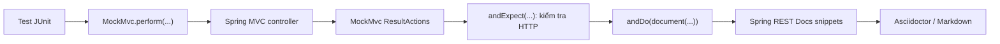
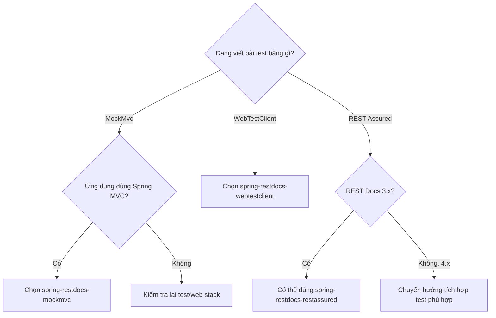

# Chọn module `spring-restdocs-mockmvc`

## Mục tiêu bài học

Trong chương **Thiết lập dự án** của module **SPRING_REST_DOCS**, chúng ta cần chọn đúng thành phần tích hợp Spring REST Docs với bài kiểm thử HTTP. Khi API được triển khai bằng **Spring MVC**, module thường được chọn là **`org.springframework.restdocs:spring-restdocs-mockmvc`**.

Sau bài này, bạn sẽ:

- Giải thích được chức năng của `spring-restdocs-mockmvc` và lý do module này gắn với **MockMvc**.
- Quyết định khi nào chọn MockMvc, khi nào nên dùng `spring-restdocs-webtestclient` hoặc tích hợp REST Assured ở nhánh được hỗ trợ.
- Khai báo đúng dependency cho Gradle/Maven, đúng phạm vi kiểm thử và đúng nhánh Spring REST Docs.
- Cấu hình một bài test MockMvc thực tế để tạo snippet về request/response, sau đó mở rộng sang payload, tham số và header.
- Kiểm tra kết quả để phân biệt **test HTTP thành công**, **REST Docs đã sinh snippet** và **tài liệu cuối cùng đã được biên soạn**.

> **Bối cảnh:** Spring REST Docs tạo tài liệu REST API có thể kiểm chứng từ các bài kiểm thử HTTP với MockMvc, WebTestClient hoặc REST Assured (tùy phiên bản). Snippet sinh ra từ request/response sẽ được đưa vào tài liệu Asciidoctor/Markdown rồi tích hợp với build và CI. Bài này tập trung vào quyết định chọn và thiết lập **`spring-restdocs-mockmvc`**; các phần mô tả chi tiết từng loại snippet là bước tiếp theo.

## 1. `spring-restdocs-mockmvc` thực hiện công việc gì?

**Spring MockMvc** là công cụ thuộc `spring-test` cho phép gọi Spring MVC controller bằng HTTP request giả lập mà không cần khởi động máy chủ trên một cổng mạng. Nó đi qua cơ chế xử lý request của Spring MVC và trả về kết quả để kiểm thử status, header và body.

**Spring REST Docs MockMvc** là module **kết nối** quá trình kiểm thử đó với bộ sinh tài liệu của Spring REST Docs. Module này cung cấp những API quan trọng sau:

| API | Công dụng |
| --- | --- |
| `org.springframework.restdocs.mockmvc.MockMvcRestDocumentation.documentationConfiguration(...)` | Gắn cấu hình REST Docs vào `MockMvcBuilders`. |
| `org.springframework.restdocs.mockmvc.MockMvcRestDocumentation.document(...)` | Đặt tên operation và yêu cầu ghi snippet trong `.andDo(...)`. |
| `org.springframework.restdocs.mockmvc.RestDocumentationRequestBuilders` | Tạo HTTP request builder có hỗ trợ tài liệu hóa tham số đường dẫn. |
| `org.springframework.restdocs.RestDocumentationExtension` | Quản lý ngữ cảnh và thư mục tài liệu cho từng test JUnit; thuộc REST Docs core, được module MockMvc kéo vào qua dependency. |
| `org.springframework.restdocs.payload.PayloadDocumentation`, `request.RequestDocumentation`, `headers.HeaderDocumentation` | Mô tả các phần của request/response; được dùng cùng `document(...)` trong một HTTP test. |

Luồng thực hiện:



Chọn module chỉ là **bước đầu**. Dependency giúp chương trình nhận diện các lớp REST Docs; muốn có tệp snippet, cần **cấu hình REST Docs trên chính đối tượng MockMvc** và **thực thi `document(...)`** trong bài test (hoặc dùng cơ chế tài liệu hóa mặc định được cấu hình).

### Điều module không làm thay bạn

- Nó **không** tự sinh tài liệu từ mọi controller khi ứng dụng khởi động.
- Nó **không** thay thế `spring-test`, JUnit, assertion hay công cụ build.
- Nó **không** tự xuất HTML hay Markdown hoàn chỉnh; đó là công việc biên soạn từ snippet.
- Nó **không** kiểm tra đầy đủ cấu trúc API nếu bạn chỉ gọi `document("ten-operation")`. Khi cần phát hiện field, tham số hoặc header thay đổi, phải bổ sung các descriptor tương ứng vào tài liệu.

## 2. Tiêu chí quyết định có chọn `spring-restdocs-mockmvc` hay không

### 2.1. Chọn khi API được xử lý bằng Spring MVC

`spring-restdocs-mockmvc` thường phù hợp nếu:

1. API sử dụng `@RestController`/`@RequestMapping`/`@GetMapping` của **Spring MVC (Servlet stack)**.
2. Dự án đã dùng `MockMvc` để kiểm thử controller hoặc muốn thêm HTTP test chạy nhanh mà không cần mở cổng mạng.
3. Bạn cần xác minh HTTP status, header, JSON hoặc request mapping đồng thời sinh snippet từ **cùng một bài test**.
4. Bạn muốn build hoặc CI thất bại khi các phần của API được mô tả bằng descriptor không còn khớp với response thực tế.

Ví dụ thực tế: đội phát triển một API quản lý đơn hàng trên Spring MVC. Test dùng MockMvc gọi `GET /api/orders/42`, kiểm tra status `200`, xác minh response JSON và ghi snippet `orders-get`. Khi trường `totalPrice` biến mất hoặc đổi tên, một `responseFields(...)` được khai báo chặt chẽ có thể làm test thất bại, báo cho nhóm biết tài liệu cần cập nhật.

### 2.2. So sánh với các module còn lại

| Lựa chọn | Nên dùng khi | Cách gọi endpoint trong test | Lưu ý |
| --- | --- | --- | --- |
| **`spring-restdocs-mockmvc`** | Spring MVC, Servlet controller; đã dùng `MockMvc` | `mockMvc.perform(...).andDo(document(...))` | Không yêu cầu chạy HTTP server thực. |
| **`spring-restdocs-webtestclient`** | WebFlux, reactive API hoặc test đang dùng `WebTestClient` | `webTestClient.get()...exchange()...consumeWith(document(...))` | Cần cấu hình filter/consumer của WebTestClient thay vì `MockMvcBuilders`. |
| **`spring-restdocs-restassured`** | Bài test REST Assured ở dự án dùng **Spring REST Docs 3.x** | REST Assured filter và request specification | Nhánh **Spring REST Docs 4.x không còn tích hợp REST Assured**. |
| **`spring-restdocs-core`** | Tạo thành phần nền hoặc extension riêng | Không trực tiếp thay `MockMvcRestDocumentation` | Được kéo vào gián tiếp qua module tích hợp; không cần khai báo thêm trong trường hợp thông thường. |
| **`spring-restdocs-asciidoctor`** | Biên soạn snippet thành tài liệu Asciidoctor | Plugin/tác vụ Asciidoctor | Là **bổ sung cho bước xuất bản**, không thay `spring-restdocs-mockmvc` trong HTTP test. |

**Quy tắc chọn:** Hãy nhìn vào **công cụ HTTP test thực tế** cùng với **web stack của ứng dụng**. Không chọn `spring-restdocs-mockmvc` chỉ vì ứng dụng là “REST API”: một dịch vụ WebFlux có thể vẫn là REST API nhưng cần tích hợp khác.



### 2.3. Chọn theo phiên bản Spring REST Docs

| Dự án Spring phổ biến | Spring Framework | Nhánh Spring REST Docs | Dependency MockMvc nên khai báo |
| --- | --- | --- | --- |
| Spring Boot **3.x** | **6.x** | **3.x** | `org.springframework.restdocs:spring-restdocs-mockmvc` |
| Spring Boot **4.x** | **7.x** | **4.x** | `org.springframework.restdocs:spring-restdocs-mockmvc` |
| Không dùng Boot | 6.x hoặc 7.x | Chọn 3.x hoặc 4.x tương ứng | Khai báo phiên bản nhất quán với Spring Test/JUnit của dự án |

**Artifact ID vẫn là `spring-restdocs-mockmvc`** qua cả nhánh 3.x và 4.x. Điều thay đổi là **phiên bản thư viện nền** (Spring Framework, JUnit và các thành phần liên quan). Cả hai nhánh hiện đại yêu cầu tối thiểu Java 17.

Ví dụ thời điểm **17/11/2026**, Spring Boot 3.5.16 quản lý `spring-restdocs-mockmvc:3.0.6` và Spring Boot 4.0.9 quản lý `spring-restdocs-mockmvc:4.0.2`. **Không nên sao chép con số này để ép phiên bản trên mọi dự án**: ưu tiên BOM/parent tương ứng với phiên bản Boot đang thực sự dùng.

## 3. Khai báo dependency đúng cách

### 3.1. Gradle Groovy DSL cho Spring Boot 3.x

Trong `build.gradle` của một dự án **đã có Spring Boot plugin và dependency management**:

```groovy
dependencies {
    implementation 'org.springframework.boot:spring-boot-starter-web'

    testImplementation 'org.springframework.boot:spring-boot-starter-test'
    testImplementation 'org.springframework.restdocs:spring-restdocs-mockmvc'
}

tasks.named('test') {
    useJUnitPlatform()
}
```

`spring-boot-starter-web` cung cấp Spring MVC; `spring-boot-starter-test` cung cấp công cụ test; `spring-restdocs-mockmvc` thêm phần tích hợp REST Docs. Cả **JUnit** và **REST Docs** đều ở phạm vi test. Nếu Boot BOM đã quản lý phiên bản, không cần `:3.x.y` trên dependency REST Docs.

### 3.2. Gradle Groovy DSL cho Spring Boot 4.x

Spring Boot 4 chia starter web và starter test theo công nghệ cụ thể. Với Spring MVC:

```groovy
dependencies {
    implementation 'org.springframework.boot:spring-boot-starter-webmvc'

    testImplementation 'org.springframework.boot:spring-boot-starter-webmvc-test'
    testImplementation 'org.springframework.restdocs:spring-restdocs-mockmvc'
    testRuntimeOnly 'org.junit.platform:junit-platform-launcher'
}

tasks.named('test') {
    useJUnitPlatform()
}
```

Ví dụ giả định dự án dùng plugin Spring Boot 4 và BOM tương ứng. Spring REST Docs 4 sử dụng nền **Spring Framework 7/JUnit 6**. Hãy dùng các starter test phù hợp với phiên bản Boot; không trộn starter Boot 3 với Boot 4.

Spring Boot **từ 4.0.4** còn có `spring-boot-starter-restdocs`. Starter này có thể hỗ trợ cấu hình tích hợp thuận tiện tùy nhu cầu, nhưng **`spring-restdocs-mockmvc` vẫn là artifact chuyên biệt** cần hiểu khi làm việc trực tiếp với MockMvc. Nếu chọn starter, kiểm tra dependency đã resolve để tránh khai báo trùng không cần thiết.

### 3.3. Gradle Kotlin DSL

Cùng module trên `build.gradle.kts`:

```kotlin
dependencies {
    testImplementation("org.springframework.restdocs:spring-restdocs-mockmvc")
}

tasks.test {
    useJUnitPlatform()
}
```

Đoạn này chỉ minh họa **phần dependency REST Docs**; ứng dụng vẫn phải có Spring MVC test, JUnit và cấu hình Spring Boot/Gradle thích hợp như các ví dụ trên.

### 3.4. Maven

Nếu dự án dùng `spring-boot-starter-parent` của nhánh Boot tương ứng:

```xml
<dependencies>
    <!-- Spring MVC application; ví dụ cho Boot 4.x -->
    <dependency>
        <groupId>org.springframework.boot</groupId>
        <artifactId>spring-boot-starter-webmvc</artifactId>
    </dependency>

    <!-- Các tiện ích kiểm thử Spring MVC của Boot 4.x -->
    <dependency>
        <groupId>org.springframework.boot</groupId>
        <artifactId>spring-boot-starter-webmvc-test</artifactId>
        <scope>test</scope>
    </dependency>

    <dependency>
        <groupId>org.springframework.restdocs</groupId>
        <artifactId>spring-restdocs-mockmvc</artifactId>
        <scope>test</scope>
    </dependency>
</dependencies>
```

Với **Boot 3.x**, thay hai starter `spring-boot-starter-webmvc`/`spring-boot-starter-webmvc-test` trong ví dụ bằng `spring-boot-starter-web`/`spring-boot-starter-test`, giữ nguyên `spring-restdocs-mockmvc`.

**`<scope>test</scope>` rất quan trọng:** công cụ sinh tài liệu chỉ phục vụ kiểm thử, không cần đóng gói vào ứng dụng chạy thật. Nếu không dùng Spring Boot parent/BOM, bạn phải chủ động khai báo phiên bản REST Docs tương thích với Spring Framework và dependency test; ví dụ với Spring Framework 7 là nhánh REST Docs 4.x.

### 3.5. Bảng tổng hợp dependency theo mục đích

| Thành phần | Ví dụ Gradle | Có cần ở runtime của API? |
| --- | --- | --- |
| Spring MVC application | `implementation 'org.springframework.boot:spring-boot-starter-webmvc'` (Boot 4) | Có |
| Spring MVC test + JUnit | `testImplementation 'org.springframework.boot:spring-boot-starter-webmvc-test'` (Boot 4) | Không |
| Spring REST Docs cho MockMvc | `testImplementation 'org.springframework.restdocs:spring-restdocs-mockmvc'` | Không |
| Extension cho Asciidoctor | `asciidoctorExt 'org.springframework.restdocs:spring-restdocs-asciidoctor'` | Không; dùng trong tác vụ tạo tài liệu |

**Lưu ý:** `spring-restdocs-mockmvc` không phải một Spring Boot web starter. Nó cung cấp API tài liệu hóa MockMvc và kéo theo core của REST Docs; nó không thay dependency ứng dụng, không tự cấp một instance `MockMvc` được cấu hình phù hợp.

## 4. Ví dụ từ đầu đến cuối: MockMvc sinh snippet mà không khởi chạy server

Ví dụ bên dưới dùng JUnit Jupiter + Spring MVC + Spring REST Docs. Nó phù hợp để hiểu phần tích hợp cơ bản ở REST Docs **3.x lẫn 4.x** và không phụ thuộc vào annotation auto-configuration của Spring Boot.

### 4.1. Tạo một bài kiểm thử độc lập

Giả sử đã khai báo dependency đúng như phần 3. Tạo file `src/test/java/com/example/docs/HealthDocumentationTest.java`:

```java
package com.example.docs;

import org.junit.jupiter.api.BeforeEach;
import org.junit.jupiter.api.Test;
import org.junit.jupiter.api.extension.ExtendWith;
import org.springframework.http.MediaType;
import org.springframework.restdocs.RestDocumentationContextProvider;
import org.springframework.restdocs.RestDocumentationExtension;
import org.springframework.test.web.servlet.MockMvc;
import org.springframework.test.web.servlet.setup.MockMvcBuilders;
import org.springframework.web.bind.annotation.GetMapping;
import org.springframework.web.bind.annotation.RestController;

import static org.springframework.restdocs.mockmvc.MockMvcRestDocumentation.document;
import static org.springframework.restdocs.mockmvc.MockMvcRestDocumentation.documentationConfiguration;
import static org.springframework.restdocs.mockmvc.RestDocumentationRequestBuilders.get;
import static org.springframework.test.web.servlet.result.MockMvcResultMatchers.content;
import static org.springframework.test.web.servlet.result.MockMvcResultMatchers.status;

@ExtendWith(RestDocumentationExtension.class)
class HealthDocumentationTest {

    private MockMvc mockMvc;

    @BeforeEach
    void setUp(RestDocumentationContextProvider documentation) {
        this.mockMvc = MockMvcBuilders
                .standaloneSetup(new HealthController())
                .apply(documentationConfiguration(documentation))
                .build();
    }

    @Test
    void documentHealth() throws Exception {
        this.mockMvc.perform(get("/api/health")
                        .accept(MediaType.TEXT_PLAIN))
                .andExpect(status().isOk())
                .andExpect(content().string("UP"))
                .andDo(document("health-check"));
    }

    @RestController
    static class HealthController {

        @GetMapping(value = "/api/health",
                    produces = MediaType.TEXT_PLAIN_VALUE)
        String health() {
            return "UP";
        }
    }
}
```

Các dòng chính:

1. **`@ExtendWith(RestDocumentationExtension.class)`** tạo ngữ cảnh REST Docs và gắn với thư mục snippet theo công cụ build.
2. **`MockMvcBuilders.standaloneSetup(...)`** xây dựng MockMvc từ controller mẫu, đủ để kiểm thử xử lý request cơ bản mà không mở server và không cần toàn bộ Spring application context.
3. **`.apply(documentationConfiguration(documentation))`** kích hoạt khả năng sinh snippet trên instance MockMvc đó.
4. **`get("/api/health")`** gửi request giả lập; `.andExpect(...)` xác nhận hành vi HTTP.
5. **`.andDo(document("health-check"))`** ghi các snippet vào thư mục con có tên `health-check`.

Ở đây `HealthController` được nhúng ngay trong file test cho dễ thử. Trong dự án thật, dùng controller đang triển khai. Với test cần kiểm tra security, filter, validation hay cấu hình Spring MVC thực tế, hãy cân nhắc `webAppContextSetup(...)` hoặc tích hợp test Spring Boot tương ứng: `standaloneSetup` không tự tái hiện mọi thành phần application context.

### 4.2. Chạy test và xác minh đầu ra

Từ thư mục gốc dự án:

```bash
# Gradle (Linux/macOS)
./gradlew test

# Maven (Linux/macOS)
./mvnw test
```

Trên Windows, dùng `.\gradlew.bat test` hoặc `.\mvnw.cmd test` nếu dự án có wrapper.

Kết quả mặc định với Gradle:

```text
build/
└── generated-snippets/
    └── health-check/
        ├── curl-request.adoc
        ├── http-request.adoc
        ├── http-response.adoc
        ├── httpie-request.adoc
        ├── request-body.adoc
        └── response-body.adoc
```

Với Maven, thư mục là `target/generated-snippets/health-check/`. Spring REST Docs mặc định tạo sáu snippet cơ bản; nội dung hoặc số snippet có thể khác khi bạn tùy chỉnh cấu hình. Test `health-check` nhận về response dạng `text/plain` nên hai snippet body có thể rất ngắn hoặc rỗng. Điều quan trọng là tồn tại `http-request.adoc` và `http-response.adoc` mô tả request và response đã kiểm thử.

**Ba cấp độ xác nhận khác nhau:**

| Cấp độ | Bằng chứng | Điều còn thiếu |
| --- | --- | --- |
| Test HTTP đúng | `.andExpect(status().isOk())` thành công | Chưa chắc đã gọi `document(...)`. |
| Đã tạo snippet | Có thư mục `generated-snippets/health-check` với tệp request/response | Chưa chắc tài liệu HTML/Markdown đã được biên soạn. |
| Tài liệu đã sẵn sàng công bố | Task Asciidoctor/Markdown chạy và tạo trang đầu ra đọc được | Cần bổ sung kiểm soát phát hành và CI theo dự án. |

Để kiểm tra nguyên lý, hãy xóa thư mục snippet cũ của đúng operation trong bản thực hành, tạm bỏ `.andDo(document("health-check"))` và chạy lại test. Test vẫn có thể xanh nhưng không còn snippet mới. Khôi phục lời gọi `document(...)` sau khi thử.

## 5. Hai cách tích hợp MockMvc vào dự án Spring Boot

### Cách A — Tự cấu hình MockMvc + REST Docs

Sử dụng `RestDocumentationExtension` và `MockMvcBuilders` như ví dụ ở phần 4 khi cần kiểm soát setup:

```java
@BeforeEach
void setUp(WebApplicationContext context,
           RestDocumentationContextProvider documentation) {
    this.mockMvc = MockMvcBuilders.webAppContextSetup(context)
            .apply(documentationConfiguration(documentation))
            .build();
}
```

Khi test tải `WebApplicationContext`, cần cấu hình Spring test context tương ứng, ví dụ `@SpringBootTest` cùng `SpringExtension` (được tích hợp bởi hầu hết annotation kiểm thử của Boot). Đoạn trên chỉ là **phần setup**, không phải một lớp test độc lập.

### Cách B — Để Spring Boot tự cấu hình REST Docs

Spring Boot có `@AutoConfigureRestDocs` để kết nối REST Docs với MockMvc do Boot quản lý. Nó hữu ích cho các test dùng `@WebMvcTest` hoặc cấu hình kiểm thử ứng dụng. Ví dụ **Spring Boot 4.x**, với controller thực tế `HealthController` trong mã ứng dụng:

```java
import org.junit.jupiter.api.Test;
import org.springframework.beans.factory.annotation.Autowired;
import org.springframework.boot.restdocs.test.autoconfigure.AutoConfigureRestDocs;
import org.springframework.boot.webmvc.test.autoconfigure.WebMvcTest;
import org.springframework.test.web.servlet.MockMvc;

import static org.springframework.restdocs.mockmvc.MockMvcRestDocumentation.document;
import static org.springframework.restdocs.mockmvc.RestDocumentationRequestBuilders.get;
import static org.springframework.test.web.servlet.result.MockMvcResultMatchers.status;

@WebMvcTest(HealthController.class)
@AutoConfigureRestDocs
class HealthControllerDocumentationTest {

    @Autowired
    MockMvc mockMvc;

    @Test
    void documentsHealth() throws Exception {
        mockMvc.perform(get("/api/health"))
                .andExpect(status().isOk())
                .andDo(document("health-check"));
    }
}
```

Trong Boot 4, cần module hỗ trợ auto-configuration REST Docs, ví dụ:

```groovy
dependencies {
    testImplementation 'org.springframework.boot:spring-boot-starter-webmvc-test'
    testImplementation 'org.springframework.boot:spring-boot-restdocs'
    testImplementation 'org.springframework.restdocs:spring-restdocs-mockmvc'
}
```

Với Spring Boot từ 4.0.4, có thể cân nhắc `spring-boot-starter-restdocs`; hãy kiểm tra các artifact REST Docs thực sự xuất hiện trên test classpath để chọn tập dependency phù hợp. Nếu controller có dependency nghiệp vụ trong constructor, `@WebMvcTest` có thể cần mock hoặc cấu hình thêm các bean đó.

Trong **Spring Boot 3.x**, annotation `@AutoConfigureRestDocs` có import **`org.springframework.boot.test.autoconfigure.restdocs.AutoConfigureRestDocs`**; `@WebMvcTest` có import **`org.springframework.boot.test.autoconfigure.web.servlet.WebMvcTest`**. Sang **Boot 4.x**, các import đổi thành những gói như trong ví dụ trên. Khi nâng phiên bản dự án, không sao chép nguyên các import test của Boot 3.

**Chọn A hay B?** Với test độc lập cần giải thích cơ chế REST Docs, A dễ quan sát. Với nhiều controller test đã dùng `@WebMvcTest`, B giảm mã lặp. Cả hai vẫn cần `spring-restdocs-mockmvc` cho API `document(...)` của MockMvc và cần kiểm tra tệp snippet sinh ra.

## 6. Từ snippet cơ bản đến tài liệu API có kiểm chứng

`document("operation")` mặc định ghi request/response cơ bản. Để tài liệu trở thành phép kiểm tra cấu trúc API, thêm các descriptor vào lời gọi `document(...)`:

| Phần cần tài liệu hóa | API thường dùng | Snippet thu được |
| --- | --- | --- |
| Trường JSON ở request | `requestFields(fieldWithPath("name").description(...))` | `request-fields.adoc` |
| Trường JSON ở response | `responseFields(fieldWithPath("id").description(...))` | `response-fields.adoc` |
| Query parameter | `queryParameters(parameterWithName("page").description(...))` | `query-parameters.adoc` |
| Path parameter | `pathParameters(parameterWithName("id").description(...))` | `path-parameters.adoc` |
| Header của request | `requestHeaders(headerWithName("Authorization").description(...))` | `request-headers.adoc` |
| Header của response | `responseHeaders(headerWithName("Location").description(...))` | `response-headers.adoc` |

Ví dụ, đối với một endpoint đã trả JSON `{"id":42,"name":"Lan"}`, phần tài liệu hóa response có thể viết:

```java
import static org.springframework.restdocs.mockmvc.MockMvcRestDocumentation.document;
import static org.springframework.restdocs.payload.PayloadDocumentation.fieldWithPath;
import static org.springframework.restdocs.payload.PayloadDocumentation.responseFields;

// Đặt sau andExpect(...) của bài test GET trả JSON:
.andDo(document("users-get",
        responseFields(
                fieldWithPath("id").description("Mã định danh người dùng"),
                fieldWithPath("name").description("Tên hiển thị")
        )));
```

Đây là **đoạn nối tiếp** của một lời gọi `mockMvc.perform(...).andExpect(...)`, không phải phương thức Java độc lập. Khi dùng `responseFields(...)` ở chế độ chặt chẽ mặc định, REST Docs báo lỗi nếu payload có field chưa được mô tả hoặc descriptor bắt buộc không tìm thấy. Điều này giúp phát hiện thay đổi API ngay trong bài test.

Một số chú ý:

- Không tài liệu hóa mật khẩu, access token, cookie phiên đăng nhập hoặc dữ liệu cá nhân thực trong các snippet dùng để công bố. Dùng dữ liệu giả lập, hoặc loại bỏ/che thông tin nhạy cảm trước khi ghi.
- Cần dùng `RestDocumentationRequestBuilders` khi muốn tài liệu hóa **path parameters** trong các phiên bản Spring Framework cũ hơn 6.2; builder này cũng dùng được trong ví dụ cơ bản.
- Các descriptor header/parameter/field phải phản ánh đúng request/response đã chạy. Nếu chỉ sinh sáu snippet mặc định, chưa có kiểm chứng đầy đủ từng trường JSON.
- Có thể chọn snippet Markdown bằng `TemplateFormats.markdown()` trong cấu hình REST Docs; mặc định là Asciidoctor. Lựa chọn này **không đổi module HTTP test**, vẫn là `spring-restdocs-mockmvc`.

## 7. Ghép vào tài liệu Asciidoctor và build

Sau khi `spring-restdocs-mockmvc` tạo `http-request.adoc` và `http-response.adoc`, có thể biên soạn chúng thành trang HTML bằng Asciidoctor. Với dự án Gradle Groovy DSL:

```groovy
plugins {
    id 'org.asciidoctor.jvm.convert' version '4.0.5'
}

configurations {
    asciidoctorExt
}

dependencies {
    asciidoctorExt 'org.springframework.restdocs:spring-restdocs-asciidoctor'
}

asciidoctorj {
    version = '3.0.0' // Dùng với Spring REST Docs 4.x
}

ext {
    snippetsDir = file('build/generated-snippets')
}

tasks.named('test') {
    outputs.dir snippetsDir
}

tasks.named('asciidoctor') {
    inputs.dir snippetsDir
    configurations 'asciidoctorExt'
    dependsOn test
}
```

Đây là phần **bổ sung** vào `build.gradle` đang có plugin Java/Spring Boot và dependency ở phần 3. Với **REST Docs 3.x**, kiểm tra phiên bản AsciidoctorJ/Gradle plugin phù hợp nhánh đó trước khi sao chép cấu hình dành cho 4.x.

Ví dụ `src/docs/asciidoc/index.adoc`:

```asciidoc
= API Documentation
:toc: left
:sectnums:

== Kiểm tra sức khỏe dịch vụ

=== HTTP request

include::{snippets}/health-check/http-request.adoc[]

=== HTTP response

include::{snippets}/health-check/http-response.adoc[]
```

Chạy:

```bash
./gradlew asciidoctor
```

Task Asciidoctor sẽ chạy sau test nhờ `dependsOn test`, đọc snippet trong `build/generated-snippets` và tạo HTML, thường là `build/docs/asciidoc/index.html`. Đối với Maven, cấu hình tương ứng thường chạy `asciidoctor-maven-plugin` ở phase `prepare-package` và trỏ vào `target/generated-snippets`.

Trên CI, cần thực thi test tạo snippet **trước** bước biên soạn, giữ nguyên các thư mục output giữa hai bước và lưu tài liệu như build artifact khi cần công bố. Với `responseFields(...)` hoặc descriptor chặt chẽ khác, CI sẽ nhận được lỗi kiểm thử khi hành vi API không còn đúng với tài liệu mô tả.

## 8. Cách tự xác minh dependency đã được chọn chính xác

### Gradle

```bash
./gradlew dependencies --configuration testRuntimeClasspath
./gradlew dependencyInsight --dependency spring-restdocs-mockmvc --configuration testRuntimeClasspath
```

Tìm `org.springframework.restdocs:spring-restdocs-mockmvc` và phiên bản đã resolve. Nếu có Spring Boot BOM thì bản này cần nằm cùng thế hệ với Boot/Framework của dự án. Đồng thời xác minh `spring-test` và JUnit trên test runtime.

### Maven

```bash
./mvnw dependency:tree -Dincludes=org.springframework.restdocs
```

Nếu dự án dùng Maven nhưng chưa có wrapper, chạy lệnh tương đương với `mvn`. Với nhiều module Maven, chạy trong đúng module chứa bài test hoặc chỉ định module bằng `-pl`.

### Checklist

- [ ] Web stack chính của API là **Spring MVC/Servlet**; bài test dùng **MockMvc**.
- [ ] Spring Boot 3/Framework 6 dùng REST Docs **3.x**, hoặc Boot 4/Framework 7 dùng REST Docs **4.x**.
- [ ] `spring-restdocs-mockmvc` ở `testImplementation` hoặc `test`, không phát sinh phiên bản Spring xung đột.
- [ ] Có dependency cho Spring MVC Test/JUnit và test được JUnit Platform nhận diện.
- [ ] MockMvc được gắn `documentationConfiguration(...)` hoặc `@AutoConfigureRestDocs` đúng cách.
- [ ] Test dùng `.andDo(document("..."))` hoặc cơ chế tương đương để ghi snippet.
- [ ] Thư mục `generated-snippets` có tệp request/response mới tạo.
- [ ] Nếu xuất bản tài liệu, task Asciidoctor/Markdown có đầu vào là snippet đã được tạo trong build hiện tại.

## 9. Lỗi thường gặp khi chọn hoặc cấu hình module

| Triệu chứng | Nguyên nhân phổ biến | Cách kiểm tra và sửa |
| --- | --- | --- |
| Không tìm thấy `MockMvcRestDocumentation` khi biên dịch | Thiếu `spring-restdocs-mockmvc` hoặc khai báo nhầm vào configuration không cấp cho test | Kiểm tra dependency `testImplementation`/`test` và resolved classpath. |
| Không tìm thấy `MockMvc` | Thiếu `spring-test` hoặc webmvc test starter | Thêm starter test đúng nhánh Boot; xác minh `org.springframework.test:spring-test`. |
| `document(...)` không có trong phạm vi import | Dùng sai static import hoặc import từ WebTestClient | Dùng `org.springframework.restdocs.mockmvc.MockMvcRestDocumentation.document`. |
| Test xanh nhưng không thấy snippet | Chưa gắn `documentationConfiguration(...)`, chưa gọi `document(...)` hoặc xem sai output folder | Kiểm tra MockMvc được cấu hình thực tế và xem `build/generated-snippets` hoặc `target/generated-snippets`. |
| Không tìm thấy `RestDocumentationContextProvider` trong setup | Chưa áp dụng `RestDocumentationExtension` hoặc cấu hình test context không chính xác | Thêm `@ExtendWith(RestDocumentationExtension.class)` cho cách thủ công; với Boot auto-config không cần extension riêng. |
| `NoSuchMethodError` trong `spring-test`/REST Docs | Trộn Spring Framework 6 và 7, hoặc cưỡng ép REST Docs khác nhánh | Đối chiếu cây dependency; để BOM/parent quản lý bộ phiên bản. |
| `@AutoConfigureRestDocs` không resolve trong Boot 4 | Dùng import Boot 3 hoặc thiếu module Boot REST Docs | Đổi import sang `org.springframework.boot.restdocs.test.autoconfigure.AutoConfigureRestDocs`; bổ sung test dependency phù hợp. |
| Dùng REST Docs 4 nhưng test vẫn cần `spring-restdocs-restassured` | Nhánh 4 đã bỏ module REST Assured | Chuyển sang MockMvc/WebTestClient nếu phù hợp hoặc giữ bộ test cũ trên nhánh 3.x có kiểm soát. |
| `response-fields.adoc` không sinh ra | Chỉ gọi `document("...")`, chưa khai báo `responseFields(...)` | Bổ sung descriptor để yêu cầu tạo snippet trường JSON. |
| Asciidoctor báo không tìm thấy tệp include | Tạo tài liệu trước test, sai tên operation hoặc sai `snippetsDir` | Cấu hình `dependsOn test` và đối chiếu đường dẫn với tệp mới sinh. |
| Test bằng `standaloneSetup` không phản ánh hành vi ứng dụng | Chưa áp dụng filter, controller advice, security hoặc cấu hình MVC thực tế | Dùng `webAppContextSetup`/`@WebMvcTest`/`@SpringBootTest` theo phạm vi cần kiểm thử. |

## 10. Bài thực hành và câu hỏi tự kiểm tra

**Bài thực hành**

1. Xác định dự án hiện tại dùng Spring MVC hay WebFlux và đọc cây dependency để biết phiên bản Spring Framework.
2. Chọn đúng nhánh REST Docs, thêm `spring-restdocs-mockmvc` vào test classpath của dự án Spring MVC.
3. Tạo bài `HealthDocumentationTest` ở phần 4; chạy test và xác minh sáu snippet mặc định trong thư mục `health-check`.
4. Thêm một endpoint JSON vào controller, mô tả các field bằng `responseFields(...)` rồi đổi tên một field trong response. Quan sát test thất bại do mô tả không khớp và sửa lại descriptor.
5. Nhúng snippet request/response vào tài liệu Asciidoctor, nối task biên soạn với `test` và chạy lại bằng lệnh build.

**Tự đánh giá**

1. Vì sao một dự án có `@RestController` chưa đủ thông tin để chọn `spring-restdocs-mockmvc`?
2. Điều gì khác nhau giữa `spring-test`, `spring-restdocs-mockmvc` và `spring-restdocs-asciidoctor`?
3. Vì sao `testImplementation`/`test` phù hợp hơn `implementation`/`compile` cho `spring-restdocs-mockmvc`?
4. Một test trả về HTTP 200 nhưng không tạo snippet cần được kiểm tra ở những vị trí nào?
5. `responseFields(...)` giúp nhận biết sai lệch tài liệu như thế nào khi JSON thay đổi?
6. Nếu chuyển từ Boot 3 sang Boot 4, những nhóm phiên bản và import test nào cần rà soát?

## Tài liệu tham khảo chính thức

- [Spring REST Docs — Getting Started](https://docs.spring.io/spring-restdocs/tutorial/getting-started/index.html): cấu hình `spring-restdocs-mockmvc` trên Gradle/Maven, test, snippet và Asciidoctor.
- [Spring REST Docs — Default Snippets](https://docs.spring.io/spring-restdocs/reference/configuration/default-snippets.html): sáu snippet mặc định, tùy chỉnh cấu hình MockMvc.
- [Spring REST Docs — Request and Response Payloads](https://docs.spring.io/spring-restdocs/reference/documenting-your-api/request-response-payloads.html): `requestFields`, `responseFields` và xác minh descriptor.
- [Spring REST Docs — Snippet Template Format](https://docs.spring.io/spring-restdocs/reference/configuration/snippet-template-format.html): chuyển sang snippet Markdown khi cần.
- [Spring Boot — Testing Spring Boot Applications](https://docs.spring.io/spring-boot/reference/testing/spring-boot-applications.html): `@AutoConfigureRestDocs`, `@WebMvcTest` và cấu hình test.
- [Spring Boot 3.5 — Managed Dependency Coordinates](https://docs.spring.io/spring-boot/3.5/appendix/dependency-versions/coordinates.html) và [Spring Boot 4.0 — Managed Dependency Coordinates](https://docs.spring.io/spring-boot/4.0/appendix/dependency-versions/coordinates.html): tra phiên bản REST Docs do BOM quản lý.
- [Spring Boot 4.0 Migration Guide](https://github.com/spring-projects/spring-boot/wiki/Spring-Boot-4.0-Migration-Guide): các starter và thay đổi ở test module khi nâng từ Boot 3.

Khi làm việc với Spring MVC, **`spring-restdocs-mockmvc` là cầu nối giữa HTTP test bằng MockMvc và bộ sinh snippet Spring REST Docs**. Hãy kiểm tra dependency tương thích, gắn cấu hình vào MockMvc và chứng minh snippet mới được tạo ra trước khi nối chúng vào tài liệu và CI.
