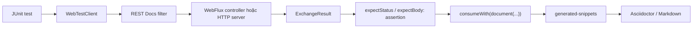
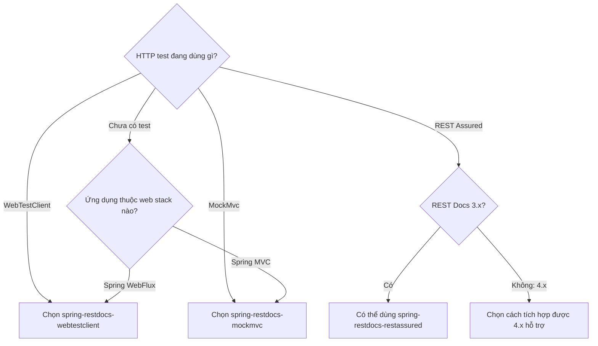
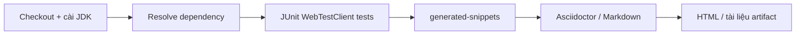

# Chọn module `spring-restdocs-webtestclient`

## Mục tiêu học tập

Trong chương **Thiết lập dự án** của module **SPRING_REST_DOCS**, việc chọn module tích hợp quyết định cách Spring REST Docs thu thập request và response từ bài kiểm thử HTTP. Nếu sử dụng **`WebTestClient`**, module cần tìm hiểu là **`org.springframework.restdocs:spring-restdocs-webtestclient`**.

Spring REST Docs giúp tạo tài liệu REST API có thể kiểm chứng bằng các test HTTP, sinh snippet về request, response, payload, tham số và header; sau đó đưa các snippet vào tài liệu Asciidoctor/Markdown trong build và CI. Bài này giải thích cách **chọn và thiết lập tích hợp WebTestClient** trước khi đi sâu vào từng loại snippet.

Sau bài này, bạn có thể:

- Giải thích vai trò của `spring-restdocs-webtestclient` và quan hệ giữa WebTestClient, Spring WebFlux và Spring REST Docs.
- Phân biệt trường hợp nên dùng WebTestClient, MockMvc hoặc REST Assured tùy công cụ HTTP test và thế hệ Spring.
- Khai báo dependency đúng phạm vi trong Gradle hoặc Maven, tránh trộn phiên bản Spring Framework/Spring Boot/REST Docs.
- Viết một bài test WebTestClient thực sự sinh snippet, mô tả field JSON và kiểm tra tài liệu đầu ra.
- Biết cách chọn giữa test controller không mở cổng, test ứng dụng reactive và test HTTP với server thật.

## 1. `spring-restdocs-webtestclient` là gì?

`WebTestClient` là API kiểm thử HTTP do Spring cung cấp trong **`spring-test`**. Cách viết test theo chuỗi:

```java
webTestClient.get()
        .uri("/api/status")
        .exchange()
        .expectStatus().isOk()
        .expectBody()
        .jsonPath("$.status").isEqualTo("UP");
```

Test ở trên xác minh hành vi HTTP, nhưng **chưa sinh tài liệu REST Docs**. Module `spring-restdocs-webtestclient` cung cấp cầu nối để:

1. Gắn một **`ExchangeFilterFunction`** vào client nhằm thu thập request và response cho REST Docs.
2. Dùng `WebTestClientRestDocumentation.document(...)` tại cuối chuỗi kiểm thử để ghi snippet.
3. Kết hợp các descriptor của REST Docs core như `responseFields(...)`, `requestHeaders(...)`, `queryParameters(...)`.
4. Đưa snippet được tạo ra vào Asciidoctor/Markdown hoặc artifact của CI.

Sơ đồ dòng công việc:



Ba lớp cần phân biệt:

| Thành phần | Vai trò | Có tự sinh snippet? |
| --- | --- | --- |
| **`WebClient`** | HTTP client sử dụng trong mã ứng dụng (ví dụ gọi dịch vụ bên ngoài). | Không. |
| **`WebTestClient`** | API viết và xác minh bài kiểm thử HTTP, có thể gắn với WebFlux handler hoặc HTTP server. | Không, nếu chưa nối REST Docs. |
| **`spring-restdocs-webtestclient`** | Tích hợp Spring REST Docs với kết quả trao đổi HTTP của `WebTestClient`. | Có, sau khi cấu hình filter và dùng `document(...)` hoặc cơ chế ghi tài liệu được cấu hình. |

**Điểm quan trọng:** REST Docs chỉ ghi lại những request được bài test thực thi và được yêu cầu tài liệu hóa. Nó không tự quét controller để tạo tài liệu, cũng không tự xuất website HTML.

## 2. Khi nào nên chọn WebTestClient thay vì MockMvc hoặc REST Assured?

### 2.1. Phù hợp nhất với Spring WebFlux

Chọn `spring-restdocs-webtestclient` nếu dự án sử dụng **Spring WebFlux** (reactive web stack) và test đang gọi endpoint qua `WebTestClient`. Các trường hợp thường gặp:

- REST API phản hồi bằng `Mono<T>` hoặc `Flux<T>`.
- Endpoint xử lý bằng annotated controller (`@RestController`) hoặc functional routing (`RouterFunction`).
- Bài test dùng `@WebFluxTest` để kiểm tra web layer mà không chạy một máy chủ HTTP bên ngoài.
- Bài test tích hợp dùng `@SpringBootTest` với `WebTestClient` gắn vào application context hoặc kết nối server thực.
- Nhóm cần sinh tài liệu trực tiếp từ cùng các case test xác minh status, JSON, tham số và header.

Ví dụ: một dịch vụ báo cáo trả `Mono<ReportDto>` qua `GET /api/reports/{id}`. Test WebTestClient xác nhận HTTP 200 và payload JSON; `document(...)` sinh request/response snippet và `responseFields(...)` giúp phát hiện field mới chưa có mô tả.

### 2.2. Căn cứ vào **công cụ test**, không chỉ tên công nghệ

| Phương án | Điều kiện chọn | Cách kích hoạt REST Docs | Ghi chú |
| --- | --- | --- | --- |
| **`spring-restdocs-webtestclient`** | Test thực hiện bằng `WebTestClient` | `.filter(documentationConfiguration(...))` và `.expectBody().consumeWith(document(...))` | Đặc biệt thuận tiện với Spring WebFlux. |
| **`spring-restdocs-mockmvc`** | Test đang dùng `MockMvc` với Spring MVC/Servlet | `MockMvcBuilders` + `.andDo(document(...))` | MockMvc chạy theo pipeline Spring MVC; không giống WebTestClient. |
| **`spring-restdocs-restassured`** | Nhóm duy trì REST Assured và Spring REST Docs **3.x** | REST Assured filter và `document(...)` tương ứng | Module này **không còn trong REST Docs 4.x**. |
| **`spring-restdocs-core`** | Xây dựng phần nền/extension riêng của REST Docs | Không có sẵn cầu nối WebTestClient chỉ từ core | Không thay thế module tích hợp. |
| **`spring-restdocs-asciidoctor`** | Muốn biên soạn snippet thành tài liệu Asciidoctor | Plugin hoặc task Asciidoctor | Bổ sung cho bước build; không gửi HTTP request. |

WebTestClient cũng có thể gửi request đến **server HTTP thực** bằng `bindToServer()`. Vì vậy, một test `WebTestClient` không nhất thiết phải là unit test reactive. Ngược lại, nếu API dùng Spring MVC và test đã được xây dựng tốt bằng MockMvc, **không cần chuyển sang WebTestClient chỉ để làm REST Docs**.

> **Lưu ý Spring Boot:** Khi cả Spring MVC và WebFlux cùng hiện diện, Boot thông thường ưu tiên cấu hình ứng dụng theo **Spring MVC**. Nếu mục tiêu là kiểm thử reactive WebFlux, hãy kiểm tra web application type và cấu hình test để không vô tình chạy trên Servlet stack.

### 2.3. Cây quyết định nhanh



## 3. Chọn đúng phiên bản và phạm vi dependency

### 3.1. Tương thích theo thế hệ Spring

| Nền dự án | Spring Framework | Spring REST Docs | Java tối thiểu | Ghi chú kiểm thử |
| --- | --- | --- | --- | --- |
| **Spring Boot 3.x** | **6.x** | **3.x** | **17** | WebTestClient, JUnit Jupiter 5 thường dùng. |
| **Spring Boot 4.x** | **7.x** | **4.x** | **17** | WebTestClient, JUnit 6; REST Docs 4 yêu cầu AsciidoctorJ 3.0 nếu dựng Asciidoctor. |
| **Spring Framework không dùng Boot** | 6.x hoặc 7.x | Ghép 3.x hoặc 4.x tương ứng | **17** | Chủ động quản lý phiên bản `spring-test`, WebFlux và JUnit. |

Tên module **`spring-restdocs-webtestclient` giữ nguyên** giữa nhánh REST Docs 3.x và 4.x. Không mặc định rằng một artifact 4.x có thể dùng với Spring Framework 6.x, hoặc ngược lại.

Khi dùng Spring Boot, ưu tiên để **Spring Boot BOM/parent** quản lý bộ phiên bản test. Không ép riêng phiên bản Spring Test, Reactor hoặc REST Docs nếu không có nhu cầu rõ ràng và đã kiểm tra tương thích. Nếu không dùng BOM, cần khai báo phiên bản Spring REST Docs nhất quán với thế hệ Spring Framework.

### 3.2. Phạm vi dependency

Module này phục vụ **kiểm thử và sinh tài liệu** nên đặt ở:

- Gradle: `testImplementation("org.springframework.restdocs:spring-restdocs-webtestclient")`.
- Maven: `<scope>test</scope>`.

Nó **không** cần vào classpath runtime của API chạy trên production. Đặt sai phạm vi có thể làm artifact ứng dụng mang theo dependency kiểm thử không cần thiết.

## 4. Cấu hình Gradle

### 4.1. Dự án Spring Boot 3.x — Groovy DSL

Các đoạn sau giả định dự án đã có Spring Boot plugin, cấu hình quản lý dependency và `mavenCentral()`:

```groovy
dependencies {
    implementation 'org.springframework.boot:spring-boot-starter-webflux'

    testImplementation 'org.springframework.boot:spring-boot-starter-test'
    testImplementation 'org.springframework.restdocs:spring-restdocs-webtestclient'
    testImplementation 'io.projectreactor:reactor-test'
}

tasks.named('test') {
    useJUnitPlatform()
}
```

Trong đó:

- `spring-boot-starter-webflux` cung cấp stack reactive HTTP.
- `spring-boot-starter-test` cung cấp `spring-test`, JUnit Jupiter và tiện ích kiểm thử cơ bản.
- `spring-restdocs-webtestclient` kết nối `WebTestClient` với bộ sinh snippet.
- `reactor-test` phục vụ các test dùng Reactor `StepVerifier`; **không phải điều kiện bắt buộc để tạo REST Docs snippet** trong ví dụ HTTP đơn giản.

**Thận trọng:** Nếu ứng dụng là MVC, không cần thêm `spring-boot-starter-webflux` chỉ để truy cập một HTTP client. Hãy chọn dependency theo web stack và loại test thực sự dùng.

### 4.2. Dự án Spring Boot 4.x — Groovy DSL

Spring Boot 4 có starter test theo web stack cụ thể:

```groovy
dependencies {
    implementation 'org.springframework.boot:spring-boot-starter-webflux'

    testImplementation 'org.springframework.boot:spring-boot-starter-webflux-test'
    testImplementation 'org.springframework.restdocs:spring-restdocs-webtestclient'
    testRuntimeOnly 'org.junit.platform:junit-platform-launcher'
}

tasks.named('test') {
    useJUnitPlatform()
}
```

Đoạn này là phần `dependencies`/`test` của dự án **đã cấu hình Spring Boot 4**. Với nhánh 4, hãy dùng JUnit 6 và dependency test nhất quán với Spring Framework 7. Phần REST Docs vẫn giữ nguyên tọa độ Maven/Gradle `org.springframework.restdocs:spring-restdocs-webtestclient`.

### 4.3. Gradle Kotlin DSL

Khi dự án dùng `build.gradle.kts`:

```kotlin
dependencies {
    testImplementation("org.springframework.restdocs:spring-restdocs-webtestclient")
}

tasks.test {
    useJUnitPlatform()
}
```

Đây là phần bổ sung vào build hiện có; vẫn cần các dependency ứng dụng WebFlux, test starter, repository và plugin Java/Spring Boot như ví dụ trước.

### 4.4. Kiểm tra phiên bản đã resolve

```bash
./gradlew dependencies --configuration testRuntimeClasspath
./gradlew dependencyInsight --dependency spring-restdocs-webtestclient --configuration testRuntimeClasspath
```

Trong kết quả, tìm `org.springframework.restdocs:spring-restdocs-webtestclient`, `spring-test` và `spring-webflux`. Nếu REST Docs 4.x xuất hiện cùng Framework 6.x, đó là dấu hiệu cần xem lại dependency management.

## 5. Cấu hình Maven

Với dự án Maven dùng `spring-boot-starter-parent` của **Spring Boot 4.x**, các dependency kiểm thử chính:

```xml
<dependencies>
    <dependency>
        <groupId>org.springframework.boot</groupId>
        <artifactId>spring-boot-starter-webflux</artifactId>
    </dependency>
    <dependency>
        <groupId>org.springframework.boot</groupId>
        <artifactId>spring-boot-starter-webflux-test</artifactId>
        <scope>test</scope>
    </dependency>
    <dependency>
        <groupId>org.springframework.restdocs</groupId>
        <artifactId>spring-restdocs-webtestclient</artifactId>
        <scope>test</scope>
    </dependency>
</dependencies>
```

Nếu dùng **Spring Boot 3.x**, thay `spring-boot-starter-webflux-test` bằng `spring-boot-starter-test`; phần `spring-restdocs-webtestclient` vẫn có scope `test`. Parent/BOM quản lý phiên bản nên thường không viết `<version>` riêng vào dependency REST Docs.

Với Maven không dùng Spring Boot BOM, cần đặt `<version>` cho REST Docs theo thế hệ phù hợp, đồng thời quản lý thủ công Spring Framework, Spring Test và JUnit. Ví dụ REST Docs 4.0.x dành cho Spring Framework 7.x; không dùng trộn với Spring Framework 6.x.

Kiểm tra cây dependency:

```bash
./mvnw dependency:tree -Dincludes=org.springframework.restdocs
```

Nếu dự án không có Maven wrapper, dùng `mvn` thay cho `./mvnw`. Đừng nhầm **dependency của test** với dependency của plugin Asciidoctor: chúng thuộc hai bước khác nhau.

## 6. Chọn một trong ba kiểu khởi tạo `WebTestClient`

Spring cho phép kiểm thử ở các mức độ khác nhau. Cả ba có thể dùng REST Docs khi cấu hình đúng:

| Kiểu khởi tạo | Có mở server HTTP không? | Dùng khi | Lưu ý |
| --- | --- | --- | --- |
| `WebTestClient.bindToController(controller)` | **Không** | Test một hoặc vài annotated controller WebFlux độc lập | Các bean/filter/configuration thực tế phải khai báo nếu cần. |
| `WebTestClient.bindToApplicationContext(context)` | **Không** | Test Spring WebFlux trong application context | Cần context reactive phù hợp; có thể tích hợp với Spring Test/Boot. |
| `WebTestClient.bindToServer().baseUrl("http://localhost:...")` | **Có, yêu cầu server đã chạy** | End-to-end HTTP, network, filter, security và serialization triển khai thực tế | Cổng phải đang sẵn sàng; nội dung snippet cần tránh hostname và dữ liệu nhạy cảm của môi trường kiểm thử. |

Cả hai dạng **không mở server** đều có thể dùng:

```java
webTestClient = WebTestClient.bindToController(controller)
        .configureClient()
        .filter(documentationConfiguration(restDocumentation))
        .build();
```

Hoặc:

```java
webTestClient = WebTestClient.bindToApplicationContext(applicationContext)
        .configureClient()
        .filter(documentationConfiguration(restDocumentation))
        .build();
```

Với HTTP server thật:

```java
webTestClient = WebTestClient.bindToServer()
        .baseUrl("http://localhost:8080")
        .filter(documentationConfiguration(restDocumentation))
        .build();
```

Các đoạn trên minh họa **phần cấu hình client**; khi chạy với REST Docs cần cung cấp `restDocumentation` từ `RestDocumentationExtension` hoặc một cơ chế tương đương. Không dùng cổng 8080 cố định cho CI chạy song song nếu có thể dùng random port và truyền giá trị thực tế.

**Khác biệt đáng nhớ:** Với `bindToController`/`bindToApplicationContext`, phương thức `configureClient()` chuyển sang phần cấu hình client, nơi ta gắn `filter(...)`. Với `bindToServer()`, `WebTestClient.Builder` đã hỗ trợ `filter(...)` trực tiếp.

## 7. Ví dụ hoàn chỉnh: kiểm thử WebFlux và sinh snippet về JSON

Ví dụ sau dùng **Java 17+, JUnit Jupiter, Reactor, WebTestClient và Spring REST Docs**. Test chạy với controller được gắn trực tiếp, nên không phụ thuộc vào cấu hình `@AutoConfigureRestDocs` của Spring Boot. Khi áp dụng cho REST Docs 3.x hoặc 4.x, hãy đảm bảo có các dependency đúng thế hệ ở phần 4/5.

Tạo `src/test/java/com/example/docs/StatusDocumentationTest.java`:

```java
package com.example.docs;

import java.util.Map;

import org.junit.jupiter.api.BeforeEach;
import org.junit.jupiter.api.Test;
import org.junit.jupiter.api.extension.ExtendWith;
import org.springframework.http.MediaType;
import org.springframework.restdocs.RestDocumentationContextProvider;
import org.springframework.restdocs.RestDocumentationExtension;
import org.springframework.test.web.reactive.server.WebTestClient;
import org.springframework.web.bind.annotation.GetMapping;
import org.springframework.web.bind.annotation.RestController;

import reactor.core.publisher.Mono;

import static org.springframework.restdocs.payload.PayloadDocumentation.fieldWithPath;
import static org.springframework.restdocs.payload.PayloadDocumentation.responseFields;
import static org.springframework.restdocs.webtestclient.WebTestClientRestDocumentation.document;
import static org.springframework.restdocs.webtestclient.WebTestClientRestDocumentation.documentationConfiguration;

@ExtendWith(RestDocumentationExtension.class)
class StatusDocumentationTest {

    private WebTestClient webTestClient;

    @BeforeEach
    void setUp(RestDocumentationContextProvider documentation) {
        this.webTestClient = WebTestClient
                .bindToController(new StatusController())
                .configureClient()
                .filter(documentationConfiguration(documentation))
                .build();
    }

    @Test
    void documentsStatusEndpoint() {
        this.webTestClient.get()
                .uri("/api/status")
                .accept(MediaType.APPLICATION_JSON)
                .exchange()
                .expectStatus().isOk()
                .expectHeader()
                    .contentTypeCompatibleWith(MediaType.APPLICATION_JSON)
                .expectBody()
                .jsonPath("$.status").isEqualTo("UP")
                .consumeWith(document("status-get",
                        responseFields(
                                fieldWithPath("status")
                                        .description("Trạng thái dịch vụ")
                        )));
    }

    @RestController
    static class StatusController {

        @GetMapping(value = "/api/status",
                    produces = MediaType.APPLICATION_JSON_VALUE)
        Mono<Map<String, String>> status() {
            return Mono.just(Map.of("status", "UP"));
        }
    }
}
```

### 7.1. Từng phần vận hành ra sao?

1. **`@ExtendWith(RestDocumentationExtension.class)`** cung cấp ngữ cảnh REST Docs và đưa `RestDocumentationContextProvider` vào phương thức `@BeforeEach`.
2. **`bindToController(new StatusController())`** tạo client giả lập phản hồi từ controller WebFlux mà không mở cổng HTTP.
3. **`.configureClient().filter(documentationConfiguration(documentation))`** đặt bộ ghi request/response của REST Docs vào chuỗi exchange.
4. **`.get().uri(...).exchange()`** thực thi request. Các `expectStatus`, `expectHeader` và `jsonPath` kiểm tra HTTP response trước khi tạo tài liệu.
5. **`.expectBody().consumeWith(document("status-get", ...))`** ghi snippet thuộc operation `status-get`. `responseFields(...)` sinh thêm bảng trường JSON và xác minh trường `status` hiện diện.

Lời gọi `document` trong WebTestClient được lấy từ **`org.springframework.restdocs.webtestclient.WebTestClientRestDocumentation`** và được truyền vào **`consumeWith(...)`**. Không dùng `MockMvcRestDocumentation.document` hoặc `.andDo(...)`, vì chúng thuộc API của MockMvc.

Nếu dùng `@RestController` thực tế có service, security hoặc custom codec, test với `bindToController` chỉ phản ánh những gì bạn tự gắn vào builder. Hãy dùng `bindToApplicationContext` hay Spring Boot test khi mục tiêu là xác minh cấu hình ứng dụng đầy đủ.

### 7.2. Kết quả và cách kiểm chứng

Chạy Gradle:

```bash
./gradlew test
```

Hoặc Maven:

```bash
./mvnw test
```

Trên Windows, dùng `.\gradlew.bat test` hoặc `.\mvnw.cmd test` nếu dự án có wrapper.

Sau khi test thành công, Gradle mặc định sinh:

```text
build/
└── generated-snippets/
    └── status-get/
        ├── curl-request.adoc
        ├── http-request.adoc
        ├── http-response.adoc
        ├── httpie-request.adoc
        ├── request-body.adoc
        ├── response-body.adoc
        └── response-fields.adoc
```

Với Maven, đường dẫn mặc định là `target/generated-snippets/status-get/`. Sáu tệp đầu là snippet mặc định; tệp `response-fields.adoc` được tạo thêm nhờ `responseFields(...)`. Các tệp có thể khác nếu dự án cấu hình lại danh sách snippet mặc định.

Mở `http-response.adoc` và `response-fields.adoc` để xác minh rằng cả response JSON và bảng mô tả trường `status` đã được lưu. Để kiểm tra khả năng phát hiện sai lệch, sửa `Map.of("status", "UP")` thành một field khác nhưng chưa thay descriptor, rồi chạy test lại: `responseFields(...)` mặc định sẽ báo lỗi cho field chưa mô tả hoặc field bắt buộc bị thiếu. Khôi phục code sau khi thử.

## 8. Tích hợp trực tiếp với Spring Boot

Spring Boot có thể tự cấu hình WebTestClient và REST Docs. Khi sử dụng `@WebFluxTest`, chỉ một phần web layer được tải lên; khi dùng `@SpringBootTest`, có thể tải ứng dụng rộng hơn. Cách cấu hình phù hợp với mục tiêu test:

| Mục tiêu | Annotation/thành phần thường dùng | Đặc điểm |
| --- | --- | --- |
| Test controller WebFlux riêng lẻ | `@WebFluxTest(YourController.class)` | Tự cấu hình WebTestClient, có thể cần `@MockitoBean` cho dependency controller. |
| Test ứng dụng reactive không chạy cổng HTTP | `@SpringBootTest` kết hợp `@AutoConfigureWebTestClient` | Sử dụng mock web environment và application context. |
| Test HTTP server thật | `@SpringBootTest(webEnvironment = RANDOM_PORT)` hoặc server do CI khởi chạy | Có network request; có thể dùng `WebTestClient.bindToServer()` hoặc client được Boot cung cấp. |
| Bật REST Docs trên WebTestClient Boot quản lý | `@AutoConfigureRestDocs` | Boot tự nối cấu hình REST Docs; không cần tự gọi `RestDocumentationExtension` cho test đó. |

### 8.1. Ví dụ Spring Boot 4.x

Giả sử `StatusController` là controller **thực tế** trong mã ứng dụng và test đã có `spring-boot-starter-webflux-test` cùng `spring-restdocs-webtestclient`. Có thể cấu hình:

```java
import org.junit.jupiter.api.Test;
import org.springframework.beans.factory.annotation.Autowired;
import org.springframework.boot.restdocs.test.autoconfigure.AutoConfigureRestDocs;
import org.springframework.boot.webflux.test.autoconfigure.WebFluxTest;
import org.springframework.test.web.reactive.server.WebTestClient;

import static org.springframework.restdocs.webtestclient.WebTestClientRestDocumentation.document;

@WebFluxTest(StatusController.class)
@AutoConfigureRestDocs
class StatusControllerDocumentationTest {

    @Autowired
    WebTestClient webTestClient;

    @Test
    void documentsStatus() {
        webTestClient.get()
                .uri("/api/status")
                .exchange()
                .expectStatus().isOk()
                .expectBody()
                .consumeWith(document("status-get-boot"));
    }
}
```

Với Boot 4, `@AutoConfigureRestDocs` thuộc package `org.springframework.boot.restdocs.test.autoconfigure` và được cung cấp qua module hỗ trợ Spring Boot REST Docs (ví dụ `org.springframework.boot:spring-boot-restdocs` trên test classpath). Nếu chỉ thêm `spring-restdocs-webtestclient`, bạn có API `document(...)` nhưng chưa chắc đã có annotation auto-config của Boot.

### 8.2. Khác biệt khi ở Spring Boot 3.x

Với Boot 3, các import tương ứng là:

```java
import org.springframework.boot.test.autoconfigure.restdocs.AutoConfigureRestDocs;
import org.springframework.boot.test.autoconfigure.web.reactive.WebFluxTest;
```

Các starter phổ biến là `spring-boot-starter-webflux` và `spring-boot-starter-test`. Khi nâng Boot 3 lên Boot 4, kiểm tra import, dependency starter test và phiên bản JUnit/REST Docs; không chép nguyên cấu hình của hai thế hệ vào cùng một dự án.

### 8.3. Một số tình huống cần thận trọng

- **Controller có bean phụ thuộc:** `@WebFluxTest` chỉ tải thành phần web nên service/repository chưa chắc tồn tại. Dùng `@MockitoBean` hoặc `@Import` phù hợp.
- **Functional route:** `@WebFluxTest` thường không tự phát hiện mọi `RouterFunction`. Cần import cấu hình route/handler tương ứng hoặc dùng test có application context phù hợp.
- **Security:** Một bài test mock web layer có thể thiếu cấu hình security của production. Nếu tài liệu mô tả header xác thực, cần cung cấp security filter thích hợp và dữ liệu giả lập, không ghi token thực.
- **Khả năng chạy server thật:** Test `@WebFluxTest` không xác nhận tương thích network, TLS, proxy hoặc môi trường triển khai; dùng end-to-end test nếu cần.

## 9. Thêm snippet request, response, tham số và header

Mặc định, `document("operation")` ghi sáu snippet cơ bản. Các thành phần mô tả chi tiết dùng chung REST Docs core:

| Phần cần diễn giải | API descriptor | Tệp snippet ví dụ |
| --- | --- | --- |
| Trường JSON request | `requestFields(fieldWithPath("name").description(...))` | `request-fields.adoc` |
| Trường JSON response | `responseFields(fieldWithPath("status").description(...))` | `response-fields.adoc` |
| Query parameter | `queryParameters(parameterWithName("limit").description(...))` | `query-parameters.adoc` |
| Path parameter | `pathParameters(parameterWithName("id").description(...))` | `path-parameters.adoc` |
| Request header | `requestHeaders(headerWithName("X-Correlation-Id").description(...))` | `request-headers.adoc` |
| Response header | `responseHeaders(headerWithName("Content-Type").description(...))` | `response-headers.adoc` |

Ví dụ đoạn nối tiếp vào test WebTestClient:

```java
import static org.springframework.restdocs.headers.HeaderDocumentation.headerWithName;
import static org.springframework.restdocs.headers.HeaderDocumentation.requestHeaders;
import static org.springframework.restdocs.request.RequestDocumentation.parameterWithName;
import static org.springframework.restdocs.request.RequestDocumentation.queryParameters;
import static org.springframework.restdocs.webtestclient.WebTestClientRestDocumentation.document;

// Đoạn kết của test đã gửi một GET /api/items?limit=10
// cùng request header X-Correlation-Id:
.expectBody()
.consumeWith(document("items-list",
        queryParameters(
                parameterWithName("limit")
                        .description("Số phần tử tối đa cần trả về")
        ),
        requestHeaders(
                headerWithName("X-Correlation-Id")
                        .description("Mã theo dõi request")
        )));
```

Đây là **đoạn mã nối tiếp**, không phải một phương thức Java hoàn chỉnh. Test thật phải có request mang `limit=10` và header `X-Correlation-Id` để descriptor khớp. Descriptor được dùng cùng `document(...)`, chứ không gắn trực tiếp vào `get()` hoặc `exchange()`.

Theo chế độ kiểm tra chặt chẽ mặc định, `responseFields` hoặc `requestFields` có thể làm test thất bại khi field chưa được mô tả hoặc một field đã mô tả không xuất hiện. Dùng `optional()` cho trường thực sự không bắt buộc, và chỉ dùng chế độ `relaxed...Fields` khi có chủ đích bỏ qua các field còn lại.

**Bảo mật snippet:** Không đưa mật khẩu, token thật, cookie phiên thực, thông tin cá nhân hoặc dữ liệu sản xuất vào tài liệu. Có thể dùng request/response giả lập trong test và áp dụng `preprocessRequest(...)`, `preprocessResponse(...)` để che hoặc loại bỏ dữ liệu trước khi sinh snippet.

## 10. Chuẩn hóa nội dung snippet và địa chỉ HTTP

### 10.1. URL xuất hiện trong tài liệu

Khi dùng WebTestClient, URI được REST Docs mô tả mặc định có base `http://localhost:8080`. Điều này **không có nghĩa test controller đang thực sự mở cổng 8080**; đó là base để dựng nội dung request trong snippet.

Đối với client gắn với controller/context, có thể chọn host công khai để tài liệu dễ đọc:

```java
webTestClient = WebTestClient.bindToController(new StatusController())
        .configureClient()
        .baseUrl("https://api.example.com")
        .filter(documentationConfiguration(documentation))
        .build();
```

Với `bindToServer()`, `baseUrl(...)` xác định **đích HTTP thực**; không đổi thành host giả để làm đẹp snippet. Nếu muốn tài liệu hiển thị host công khai trong khi test server nội bộ, hãy dùng **URI preprocessor** để chỉ chỉnh nội dung được ghi trong tài liệu.

### 10.2. Dùng Markdown thay vì Asciidoctor

REST Docs mặc định sinh snippet định dạng **Asciidoctor** (`.adoc`). Muốn template Markdown, có thể cấu hình:

```java
import static org.springframework.restdocs.templates.TemplateFormats.markdown;

webTestClient = WebTestClient.bindToController(new StatusController())
        .configureClient()
        .filter(documentationConfiguration(documentation)
                .snippets().withTemplateFormat(markdown()))
        .build();
```

Thao tác này đổi **định dạng snippet**, còn dependency kiểm thử vẫn là `spring-restdocs-webtestclient`. Bạn vẫn cần quy trình ghép các snippet Markdown thành một tài liệu hoàn chỉnh. Không sử dụng cú pháp `include::{snippets}` của Asciidoctor trong Markdown thuần nếu pipeline của bạn không hỗ trợ include tương ứng.

## 11. Kết nối Asciidoctor với Gradle và CI

Để dùng snippet của WebTestClient trong Asciidoctor, phần bổ sung của `build.gradle` có thể trông như sau (**dự án đã có plugin Java/Spring Boot và dependency ở phần 4**):

```groovy
plugins {
    id 'org.asciidoctor.jvm.convert' version '4.0.5'
}

configurations {
    asciidoctorExt
}

dependencies {
    // Ví dụ nhánh REST Docs 4.x, giữ cùng phiên bản với bộ REST Docs của test
    asciidoctorExt 'org.springframework.restdocs:spring-restdocs-asciidoctor:4.0.2'
}

asciidoctorj {
    version = '3.0.0'
}

ext {
    snippetsDir = file('build/generated-snippets')
}

tasks.named('test') {
    outputs.dir snippetsDir
}

tasks.named('asciidoctor') {
    inputs.dir snippetsDir
    configurations 'asciidoctorExt'
    dependsOn test
}
```

**Lưu ý phiên bản:** Ví dụ trên dùng REST Docs **4.0.2/AsciidoctorJ 3**. Nếu dự án dùng REST Docs 3.x, chọn bộ plugin/Asciidoctor tương thích với nhánh đó. Không gắn cố định REST Docs 4.x cho plugin Asciidoctor trong khi HTTP test đang dùng REST Docs 3.x.

Tạo `src/docs/asciidoc/index.adoc`:

```asciidoc
= API Status Documentation
:toc: left
:sectnums:

== GET /api/status

=== HTTP request
include::{snippets}/status-get/http-request.adoc[]

=== HTTP response
include::{snippets}/status-get/http-response.adoc[]

=== Response fields
include::{snippets}/status-get/response-fields.adoc[]
```

Chạy:

```bash
./gradlew asciidoctor
```

`dependsOn test` bảo đảm test sinh snippet trước khi Asciidoctor biên soạn. Tài liệu HTML thường xuất hiện ở `build/docs/asciidoc/index.html`. Với Maven, sử dụng `asciidoctor-maven-plugin` ở phase sau test (chẳng hạn `prepare-package`) và thư mục `target/generated-snippets`.

Trong CI, luồng tối thiểu:



CI cần sử dụng cùng phiên bản JDK và dependency như máy phát triển; các snippet phải đến từ lần test hiện tại. Nếu descriptor sai, test thất bại và bước biên soạn tài liệu không nên che giấu lỗi đó.

## 12. Kiểm tra độc lập trước khi coi thiết lập thành công

| Hạng mục | Cách kiểm tra | Dấu hiệu thành công |
| --- | --- | --- |
| Java/Spring | `java -version`, dependency tree | Java ≥ 17 và Framework/REST Docs đúng thế hệ. |
| Test dependency | `dependencyInsight` hoặc `dependency:tree` | Có `spring-restdocs-webtestclient` trong test classpath. |
| Web stack | Kiểm tra controller và Spring test setup | WebFlux controller hoặc server được WebTestClient gọi đúng. |
| REST Docs filter | Kiểm tra `.filter(documentationConfiguration(...))` hoặc `@AutoConfigureRestDocs` | Cấu hình được gắn vào **client thực sự dùng trong test**. |
| HTTP assertion | Chạy test và xem status/body | Đáp ứng yêu cầu kiểm thử. |
| Tạo snippet | Kiểm tra `generated-snippets/status-get` | Có `http-request.adoc`, `http-response.adoc` và `response-fields.adoc`. |
| Biên soạn | Chạy task Asciidoctor/Markdown | Trang tài liệu đầu ra hiển thị dữ liệu HTTP từ test. |

Test xanh nhưng không thấy snippet **không chứng minh** Spring REST Docs đã hoạt động. Trước khi kết luận, hãy xác nhận client đã được filter và bài test có `consumeWith(document(...))`.

## 13. Lỗi thường gặp

| Triệu chứng | Nguyên nhân cần xem xét | Cách xử lý |
| --- | --- | --- |
| `WebTestClientRestDocumentation` không resolve | Thiếu `spring-restdocs-webtestclient` hoặc dependency không nằm trong test classpath | Thêm dependency đúng scope và kiểm tra cây phụ thuộc. |
| `WebTestClient` không resolve | Thiếu `spring-test`/test starter WebFlux | Sử dụng test starter tương ứng hoặc thêm dependency Spring Test nhất quán với Framework. |
| Test chạy thành công nhưng không có snippet | Chưa cấu hình REST Docs filter/auto-config hoặc chưa gọi `document(...)` | Xác minh đúng đối tượng client và chuỗi `.expectBody().consumeWith(document(...))`. |
| Lỗi biên dịch khi dùng `.andDo(document(...))` | Sao chép API của MockMvc sang WebTestClient | Dùng `.consumeWith(document(...))` với static import WebTestClient. |
| Test trả 404 khi gọi controller | URL mapping sai, context không có controller/route hoặc dùng sai application type | Kiểm tra `@GetMapping`, route bean và cấu hình WebFlux test. |
| `@WebFluxTest` báo thiếu service bean | Slice test chỉ tải phần web layer | Dùng `@MockitoBean`, `@Import` hoặc cấu hình test rộng hơn. |
| `@AutoConfigureRestDocs` không resolve sau nâng Boot | Import sai giữa Boot 3/4 hoặc thiếu module Boot REST Docs | Dùng import đúng thế hệ và bổ sung module hỗ trợ auto-config. |
| `NoSuchMethodError`/`NoClassDefFoundError` liên quan Spring | REST Docs 4.x đang trộn Spring Framework 6.x hoặc dependency khác thế hệ | Dùng BOM/parent phù hợp; kiểm tra dependency tree. |
| `response-fields.adoc` không tạo ra | Chưa khai báo `responseFields(...)` hoặc test đang tài liệu hóa operation khác | Bổ sung descriptor, kiểm tra tên operation trong `document(...)`. |
| Snippet ghi `localhost:8080` nhưng API được công bố ở domain khác | Chưa chỉnh base URL cho tài liệu | Dùng `baseUrl(...)` với mock binding hoặc URI preprocessor khi test server thật. |
| Asciidoctor báo tệp include không tồn tại | Biên soạn trước test, sai tên operation hoặc sai thư mục output | Khai báo dependency task, kiểm tra `{snippets}` và tệp đầu ra thực. |
| Test server thật chạy thất thường trên CI | Cổng cố định, server chưa sẵn sàng hoặc tranh chấp tài nguyên | Dùng random port và tạo client sau khi biết cổng; giữ test độc lập. |

Những lỗi trong bảng là **hướng chẩn đoán ban đầu**. Khi một bài test thất bại, cần đối chiếu nguyên nhân gốc trong stack trace và dependency đã resolve, không chỉ dựa vào dòng exception đầu.

## 14. Bài thực hành và câu hỏi tự đánh giá

**Thực hành**

1. Xác định dự án sử dụng Spring MVC hay Spring WebFlux; xác minh HTTP test đang dùng `WebTestClient` hay `MockMvc`.
2. Thêm `spring-restdocs-webtestclient` với `testImplementation` hoặc Maven `test` và kiểm tra phiên bản đã resolve.
3. Chạy `StatusDocumentationTest` ở phần 7. Xác minh tệp `status-get/http-response.adoc` và `status-get/response-fields.adoc`.
4. Thay response JSON `{"status":"UP"}` thành `{"state":"UP"}` nhưng giữ descriptor cũ. Quan sát lỗi mô tả field, sau đó khôi phục.
5. Viết thêm một HTTP test cho `GET /api/items?limit=10`, mô tả query parameter và request header, kiểm tra snippet bổ sung.
6. Biên soạn tài liệu bằng Asciidoctor, mở `index.html` và bảo đảm yêu cầu build chạy test trước khi sinh HTML.

**Tự đánh giá**

1. `WebClient`, `WebTestClient` và `spring-restdocs-webtestclient` khác nhau ở đâu?
2. Khi nào `bindToController` tốt hơn `bindToServer`, và trường hợp nào cần server thật?
3. Vì sao `spring-restdocs-webtestclient` thường ở test scope?
4. `document("status-get")` trong WebTestClient được nối vào chuỗi test bằng phương thức nào?
5. Vì sao `spring-restdocs-mockmvc` không tự thay thế được `spring-restdocs-webtestclient`?
6. Khi nâng từ Spring Boot 3 lên 4, cần xem lại những dependency, import và version nào?
7. Tại sao có snippet chưa có nghĩa tài liệu Asciidoctor/Markdown đã được xuất bản?

## Nguồn tham khảo chính thức

- [Spring REST Docs — Getting Started](https://docs.spring.io/spring-restdocs/tutorial/getting-started/index.html): lựa chọn module WebTestClient, cấu hình filter, `document(...)`, Gradle/Maven, Asciidoctor.
- [Spring REST Docs — Default Snippets](https://docs.spring.io/spring-restdocs/reference/configuration/default-snippets.html): sáu snippet mặc định và tùy chỉnh cấu hình.
- [Spring REST Docs — Documenting Request and Response Payloads](https://docs.spring.io/spring-restdocs/reference/documenting-your-api/request-response-payloads.html): mô tả trường JSON, chế độ chặt chẽ và relaxed.
- [Spring REST Docs — URI Configuration](https://docs.spring.io/spring-restdocs/reference/configuration/uris.html): base URL khi dùng WebTestClient.
- [Spring REST Docs — Snippet Template Format](https://docs.spring.io/spring-restdocs/reference/configuration/snippet-template-format.html): định dạng Asciidoctor/Markdown.
- [Spring REST Docs — Customizing Requests and Responses](https://docs.spring.io/spring-restdocs/reference/customizing-requests-and-responses.html): tiền xử lý URI, header và nội dung.
- [Spring Boot — Testing Spring Boot Applications](https://docs.spring.io/spring-boot/reference/testing/spring-boot-applications.html): `@WebFluxTest`, `@AutoConfigureWebTestClient`, `@AutoConfigureRestDocs`.
- [Spring WebFlux — Testing](https://docs.spring.io/spring-framework/reference/testing/webtestclient.html): các cách tạo WebTestClient và kiểm thử không mở server hoặc gọi HTTP server thật.

**Kết luận thực hành:** Nếu HTTP test dùng WebTestClient, hãy chọn `spring-restdocs-webtestclient` đúng nhánh Spring, gắn filter REST Docs, kiểm tra response rồi gọi `consumeWith(document(...))`. Xác minh các tệp trong `generated-snippets` trước khi nối chúng vào Asciidoctor/Markdown và CI.
