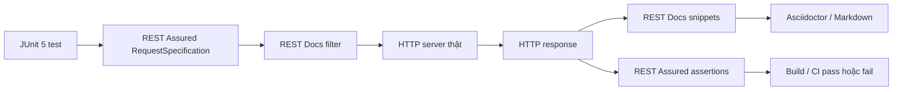
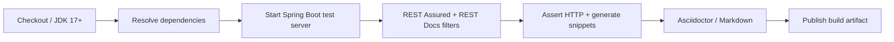

# Chọn module `spring-restdocs-restassured`

## Mục tiêu bài học

Trong chương **Thiết lập dự án** của module **SPRING_REST_DOCS**, việc chọn đúng tích hợp HTTP test giúp Spring REST Docs ghi lại request và response đã kiểm thử để tạo tài liệu API có thể kiểm chứng. Khi đội ngũ đang sử dụng **REST Assured** để kiểm thử HTTP và dự án ở thế hệ **Spring REST Docs 3.x**, module cần xem xét là **`org.springframework.restdocs:spring-restdocs-restassured`**.

Spring REST Docs có thể sinh snippet về request, response, payload JSON, tham số và header từ HTTP test, sau đó biên soạn thành tài liệu Asciidoctor hoặc Markdown và chạy cùng build/CI. Bài này tập trung vào **quyết định chọn module REST Assured, điều kiện tương thích và cách cấu hình thực tế**. Điểm đặc biệt cần ghi nhớ: **tích hợp REST Assured đã bị loại bỏ khỏi Spring REST Docs 4.0**.

Sau bài học, bạn có thể:

- Giải thích được `spring-restdocs-restassured` khác `io.rest-assured:rest-assured` như thế nào.
- Xác định khi nào nên chọn REST Assured, khi nào phù hợp hơn với MockMvc hoặc WebTestClient.
- Chọn đúng Spring Boot, Spring Framework, Java và nhánh Spring REST Docs hỗ trợ REST Assured.
- Khai báo dependency đúng scope, khởi chạy server thử nghiệm và kết nối REST Docs vào `RequestSpecification`.
- Viết bài test REST Assured sinh snippet cho HTTP request/response, trường JSON và query parameter.
- Tích hợp snippet vào tài liệu Asciidoctor/Markdown và phát hiện các lỗi cấu hình trong CI.

> **Phạm vi phiên bản:** Các ví dụ sử dụng **Spring Boot 3.x, Spring Framework 6.x, Java 17+ và Spring REST Docs 3.x** với REST Assured 5.x tương thích. Thông tin về việc loại bỏ tích hợp REST Assured ở REST Docs 4.0 được đối chiếu với release notes chính thức; không áp dụng nguyên ví dụ này cho dự án Spring Boot 4/Spring REST Docs 4.

## 1. Module `spring-restdocs-restassured` làm gì?

### 1.1. Hai thư viện phục vụ hai mục đích khác nhau

**REST Assured** là một thư viện Java để gửi HTTP request và kiểm tra response bằng cú pháp gần với Given–When–Then:

```java
given()
    .accept("application/json")
.when()
    .get("http://localhost:8080/api/greetings")
.then()
    .statusCode(200);
```

Đoạn trên kiểm tra HTTP status của một API đang chạy, nhưng **không tự sinh tài liệu Spring REST Docs**.

**`spring-restdocs-restassured`** là module tích hợp Spring REST Docs với cơ chế **REST Assured Filter**. Một filter có thể quan sát HTTP request và response; Spring REST Docs sử dụng cơ chế đó để thu thập dữ liệu, tạo snippet và xác minh các mô tả do người viết test khai báo.

| Thành phần | Công dụng | Có cần cho REST Docs với REST Assured? |
| --- | --- | --- |
| `io.rest-assured:rest-assured` | Tạo request, gọi HTTP server thật, kiểm tra status/body/header | **Có**; đây là công cụ gửi HTTP request. |
| `org.springframework.restdocs:spring-restdocs-restassured` | Cầu nối REST Docs qua REST Assured Filter, hỗ trợ `documentationConfiguration(...)` và `document(...)` | **Có**, nhưng chỉ với nhánh REST Docs có tích hợp REST Assured. |
| `org.springframework.restdocs:spring-restdocs-core` | Mô hình operation, snippet, descriptor | Được module tích hợp kéo vào; thông thường không cần khai báo riêng. |
| `org.springframework.boot:spring-boot-starter-test` | JUnit, Spring Test và tiện ích test trong ứng dụng Spring Boot | Cần với ví dụ Spring Boot/JUnit ở bài này. |
| `org.springframework.restdocs:spring-restdocs-asciidoctor` | Biên soạn các snippet Asciidoctor | Cần ở **bước xuất tài liệu**, không thay thế HTTP test filter. |

Trong REST Docs 3.x, lớp tích hợp nằm trong package **`org.springframework.restdocs.restassured`**:

| API | Vai trò |
| --- | --- |
| `RestAssuredRestDocumentation.documentationConfiguration(context)` | Tạo filter cấu hình REST Docs cho từng test. |
| `RestAssuredRestDocumentation.document("operation")` | Tạo filter tài liệu hóa một HTTP exchange. |
| `RestDocumentationExtension` | Quản lý ngữ cảnh REST Docs qua JUnit Jupiter. |
| `RequestSpecBuilder.addFilter(...)` | Gắn bộ lọc cấu hình vào `RequestSpecification` dùng chung. |
| `given(spec).filter(document(...))` | Gắn filter ghi tài liệu cho request cụ thể. |



**Điểm then chốt:** REST Assured thông thường gửi **request HTTP qua mạng** đến một server đang chạy. Khác với `MockMvc`, nó không tự tạo một Spring MVC controller giả lập trong test. Vì vậy, việc chọn module này cũng kéo theo lựa chọn **cách khởi chạy server kiểm thử và quản lý cổng**.

### 1.2. Vì sao không chỉ khai báo `spring-restdocs-core`?

`spring-restdocs-core` biết cách biểu diễn request, response, descriptor và tạo snippet nhưng không tự gắn được vào bộ lọc của REST Assured. Nếu chỉ khai báo `core`, bài test sẽ không có các factory method chuyên biệt như `RestAssuredRestDocumentation.documentationConfiguration(...)`.

Tương tự, thêm `spring-restdocs-restassured` mà **không gắn filter** cũng chưa đủ. Một test chỉ gọi `given().when().get(...).then()` vẫn có thể chạy xanh mà không tạo bất kỳ tệp tài liệu nào.

## 2. Khi nào nên chọn REST Assured?

### 2.1. Những tình huống phù hợp

Chọn `spring-restdocs-restassured` khi đồng thời có các điều kiện:

1. **Dự án dùng Spring REST Docs 3.x**, với phiên bản REST Assured được nhánh đó hỗ trợ.
2. Bộ HTTP test hiện có đã sử dụng REST Assured hoặc nhóm cần gọi API qua **HTTP server đang chạy**.
3. Bạn muốn tạo tài liệu dựa trên request/response thật của các endpoint, bao gồm serialization, HTTP status và header.
4. Môi trường phát triển và CI có thể khởi chạy server test, cấp cổng HTTP và duy trì vòng đời server trong lúc test chạy.

Ví dụ: dự án Spring Boot 3 có một suite REST Assured gọi `GET /api/orders` và `POST /api/orders` trên cổng ngẫu nhiên. Thêm REST Docs filter cho các test phù hợp có thể tạo tài liệu cùng lúc với việc kiểm tra status, JSON body và response header.

### 2.2. So sánh ba cách tích hợp HTTP test

| Tiêu chí | REST Assured | MockMvc | WebTestClient |
| --- | --- | --- | --- |
| Module REST Docs | `spring-restdocs-restassured` | `spring-restdocs-mockmvc` | `spring-restdocs-webtestclient` |
| Cách test phổ biến | Gửi HTTP tới **server thật** | Gọi Spring MVC pipeline trong test, không cần mở cổng | Gắn controller/context hoặc gửi HTTP đến server thật |
| Đối tượng chính | `RequestSpecification`, HTTP filter | `MockMvc`, `ResultActions` | `WebTestClient`, `ExchangeResult` |
| Điểm gọi tạo snippet | `.filter(document("..."))` | `.andDo(document("..."))` | `.expectBody().consumeWith(document("..."))` |
| Spring REST Docs 3.x | Hỗ trợ | Hỗ trợ | Hỗ trợ |
| Spring REST Docs **4.0.x** | **Tích hợp đã bị loại bỏ** | Hỗ trợ | Hỗ trợ |
| Tình huống chọn | Suite test API dùng REST Assured hiện có, cần kiểm tra HTTP server | Spring MVC controller, test web layer nhanh | Spring WebFlux/reactive hoặc suite WebTestClient |

REST Assured còn có một module riêng gọi là **`io.rest-assured:spring-mock-mvc`** để kiểm thử Spring MVC. Đừng nhầm nó với tích hợp **`spring-restdocs-restassured`**: bộ lọc REST Docs được minh họa trong bài này dành cho **REST Assured HTTP client**. Việc dùng REST Assured MockMvc hoặc các adapter khác không đồng nghĩa filter HTTP đó sẽ tự hoạt động.

Nếu bạn đang dùng `MockMvc` hoặc `WebTestClient` ổn định, không có lý do buộc phải chuyển sang REST Assured chỉ để sinh REST Docs. Chọn module theo **HTTP test thật sự thực thi**.

## 3. Tương thích phiên bản: điều kiện bắt buộc trước khi cài

### 3.1. Bảng lựa chọn

| Stack ứng dụng | Spring Framework | Spring REST Docs | Tích hợp REST Assured |
| --- | --- | --- | --- |
| **Spring Boot 3.x** | **6.x** | **3.x** | **Có**: dùng `spring-restdocs-restassured` cùng REST Assured 5.2+ và Java 17+. |
| **Spring Boot 4.x** | **7.x** | **4.0.x** | **Không**: module tích hợp REST Assured bị loại khỏi REST Docs 4.0. |
| Không dùng Spring Boot, dùng Framework 6.x | **6.x** | **3.x** | Có, nhưng tự quản lý đúng Spring Test, REST Docs, JUnit và REST Assured. |
| Không dùng Spring Boot, dùng Framework 7.x | **7.x** | **4.0.x** | Không có tích hợp REST Assured do Spring REST Docs 4.0 cung cấp. |

Các mốc trong release notes:

- **REST Docs 3.0** nâng mức tối thiểu lên **Java 17**, **Spring Framework 6** và **REST Assured 5.2**. Package của tích hợp REST Assured là `org.springframework.restdocs.restassured`.
- **REST Docs 4.0** nâng mức nền sang **Spring Framework 7** và **JUnit 6**; tích hợp REST Assured đã **bị loại bỏ** vì tại thời điểm phát hành có vấn đề tương thích với **Groovy 5**.
- REST Assured sau đó tiếp tục phát hành những phiên bản mới. **REST Assured có bản mới không có nghĩa `spring-restdocs-restassured:4.x` đã được khôi phục**. Khi lựa chọn dự án thực tế, kiểm tra release notes và artifact của **chính Spring REST Docs**.

**Không giải quyết bằng cách ép `spring-restdocs-restassured:3.x` vào dự án Boot 4/Framework 7**: làm như vậy có thể dẫn đến classpath khác thế hệ, `NoSuchMethodError` hoặc lỗi khi chạy test. Nếu nâng lên Boot 4, hãy lập kế hoạch chuyển phần tạo tài liệu sang MockMvc/WebTestClient hoặc đánh giá cơ chế tài liệu hóa khác phù hợp.

### 3.2. Quản lý phiên bản bằng BOM

Khi dùng Spring Boot 3, ưu tiên phiên bản của Spring REST Docs và REST Assured do **Spring Boot BOM** quản lý. Nếu có override, phải chứng minh chúng tương thích và chạy được các bài kiểm thử thực tế.

Với dự án Spring Framework thuần, Spring REST Docs 3.x cung cấp BOM riêng `org.springframework.restdocs:spring-restdocs-bom`, nhưng BOM này không thay thế toàn bộ dependency management cho Spring Framework và REST Assured. Cần phối hợp cả stack.

Kiểm tra máy phát triển, Gradle/Maven và CI đang chạy **Java 17 trở lên**. Java của terminal, JDK chạy test, Gradle JVM, Maven JVM và JDK cấu hình trong IDE có thể khác nhau.

## 4. Khai báo Gradle

### 4.1. Dự án Spring Boot 3.x dùng Groovy DSL

Đoạn dưới đây là phần `dependencies` và `test` thêm vào `build.gradle` của một dự án đã cấu hình plugin Spring Boot 3, repository và JDK thích hợp:

```groovy
dependencies {
    implementation 'org.springframework.boot:spring-boot-starter-web'

    testImplementation 'org.springframework.boot:spring-boot-starter-test'
    testImplementation 'io.rest-assured:rest-assured'
    testImplementation 'org.springframework.restdocs:spring-restdocs-restassured'
}

tasks.named('test') {
    useJUnitPlatform()
}
```

Giải thích:

1. `spring-boot-starter-web` giúp ứng dụng có Spring MVC và embedded HTTP server khi chạy test với `RANDOM_PORT`.
2. `spring-boot-starter-test` cung cấp JUnit Jupiter, Spring Test, assertion và tiện ích kiểm thử.
3. `io.rest-assured:rest-assured` cung cấp HTTP client/DSL kiểu `given()–when()–then()`.
4. `spring-restdocs-restassured` cung cấp hai filter cốt lõi: `documentationConfiguration(...)` và `document(...)`.

Hai dependency HTTP test đều dùng **`testImplementation`**, vì không phải chức năng cần đóng gói vào production runtime của ứng dụng.

Với Gradle Java toolchain:

```groovy
java {
    toolchain {
        languageVersion = JavaLanguageVersion.of(17)
    }
}
```

Các đoạn cấu hình trên **không phải toàn bộ `build.gradle`**; bạn vẫn cần khai báo `plugins`, `repositories` và phần cấu hình ứng dụng theo dự án. Nếu không dùng Spring Boot dependency management, phải cung cấp phiên bản dependency phù hợp, không được để tọa độ thiếu phiên bản.

### 4.2. Gradle Kotlin DSL

Trong `build.gradle.kts`:

```kotlin
dependencies {
    testImplementation("org.springframework.boot:spring-boot-starter-test")
    testImplementation("io.rest-assured:rest-assured")
    testImplementation("org.springframework.restdocs:spring-restdocs-restassured")
}

tasks.test {
    useJUnitPlatform()
}
```

Đây là phần **test dependencies** của một dự án Spring Boot 3 có REST API đang chạy; thêm `implementation("org.springframework.boot:spring-boot-starter-web")` nếu chưa có.

### 4.3. Kiểm tra dependency đã được resolve

```bash
./gradlew dependencies --configuration testRuntimeClasspath
./gradlew dependencyInsight --dependency spring-restdocs-restassured --configuration testRuntimeClasspath
./gradlew dependencyInsight --dependency rest-assured --configuration testRuntimeClasspath
```

Kết quả cần cho thấy một nhánh **Spring REST Docs 3.x** cùng **REST Assured 5.x tương thích** trên test classpath. Nếu Gradle báo không thể resolve artifact REST Docs 4.x với tên `spring-restdocs-restassured` thì nguyên nhân là module không còn tồn tại trong nhánh đó, không phải thiếu `mavenCentral()` một cách mặc định.

## 5. Khai báo Maven

Nếu dự án sử dụng `spring-boot-starter-parent` thuộc thế hệ Spring Boot 3:

```xml
<dependencies>
    <dependency>
        <groupId>org.springframework.boot</groupId>
        <artifactId>spring-boot-starter-web</artifactId>
    </dependency>
    <dependency>
        <groupId>org.springframework.boot</groupId>
        <artifactId>spring-boot-starter-test</artifactId>
        <scope>test</scope>
    </dependency>
    <dependency>
        <groupId>io.rest-assured</groupId>
        <artifactId>rest-assured</artifactId>
        <scope>test</scope>
    </dependency>
    <dependency>
        <groupId>org.springframework.restdocs</groupId>
        <artifactId>spring-restdocs-restassured</artifactId>
        <scope>test</scope>
    </dependency>
</dependencies>
```

Trong ví dụ, parent/BOM quản lý phiên bản nên không khai báo `<version>` riêng cho REST Docs và REST Assured. Nếu Maven không có parent/BOM tương ứng, bạn phải quản lý các phiên bản đó trong `dependencyManagement` hoặc khai báo cụ thể.

Kiểm tra:

```bash
./mvnw dependency:tree -Dincludes=org.springframework.restdocs,io.rest-assured
```

Nếu dự án không có Maven wrapper, dùng `mvn dependency:tree`. Trong dự án đa module, chạy tại module chứa test hoặc dùng `-pl` để xác định module cần xem.

## 6. Ví dụ đầy đủ: Spring Boot 3 + REST Assured + REST Docs 3

Ví dụ này gọi **HTTP server thật trên cổng ngẫu nhiên**, phù hợp với REST Assured. Các tệp giả định nằm trong một dự án Spring Boot 3 có dependency ở phần 4/5 và package gốc `com.example.demo`.

### 6.1. Tạo ứng dụng Spring Boot tối thiểu

`src/main/java/com/example/demo/DemoApplication.java`:

```java
package com.example.demo;

import org.springframework.boot.SpringApplication;
import org.springframework.boot.autoconfigure.SpringBootApplication;

@SpringBootApplication
public class DemoApplication {

    public static void main(String[] args) {
        SpringApplication.run(DemoApplication.class, args);
    }
}
```

`src/main/java/com/example/demo/GreetingController.java`:

```java
package com.example.demo;

import java.util.Map;

import org.springframework.http.MediaType;
import org.springframework.web.bind.annotation.GetMapping;
import org.springframework.web.bind.annotation.RequestParam;
import org.springframework.web.bind.annotation.RestController;

@RestController
class GreetingController {

    @GetMapping(value = "/api/greetings",
                produces = MediaType.APPLICATION_JSON_VALUE)
    Map<String, String> greet(
            @RequestParam(defaultValue = "vi") String lang) {
        String message = "en".equals(lang) ? "Hello" : "Xin chào";
        return Map.of("message", message);
    }
}
```

Endpoint `GET /api/greetings?lang=vi` trả về JSON:

```json
{
  "message": "Xin chào"
}
```

### 6.2. Viết test tích hợp có REST Docs filter

`src/test/java/com/example/demo/GreetingDocumentationTest.java`:

```java
package com.example.demo;

import io.restassured.builder.RequestSpecBuilder;
import io.restassured.specification.RequestSpecification;
import org.junit.jupiter.api.BeforeEach;
import org.junit.jupiter.api.Test;
import org.junit.jupiter.api.extension.ExtendWith;
import org.springframework.boot.test.context.SpringBootTest;
import org.springframework.boot.test.web.server.LocalServerPort;
import org.springframework.restdocs.RestDocumentationContextProvider;
import org.springframework.restdocs.RestDocumentationExtension;

import static io.restassured.RestAssured.given;
import static org.hamcrest.Matchers.equalTo;
import static org.springframework.restdocs.payload.PayloadDocumentation.fieldWithPath;
import static org.springframework.restdocs.payload.PayloadDocumentation.responseFields;
import static org.springframework.restdocs.request.RequestDocumentation.parameterWithName;
import static org.springframework.restdocs.request.RequestDocumentation.queryParameters;
import static org.springframework.restdocs.restassured.RestAssuredRestDocumentation.document;
import static org.springframework.restdocs.restassured.RestAssuredRestDocumentation.documentationConfiguration;

@SpringBootTest(webEnvironment = SpringBootTest.WebEnvironment.RANDOM_PORT)
@ExtendWith(RestDocumentationExtension.class)
class GreetingDocumentationTest {

    @LocalServerPort
    private int port;

    private RequestSpecification specification;

    @BeforeEach
    void setUp(RestDocumentationContextProvider documentation) {
        this.specification = new RequestSpecBuilder()
                .setBaseUri("http://127.0.0.1")
                .setPort(this.port)
                .addFilter(documentationConfiguration(documentation))
                .build();
    }

    @Test
    void documentsGreetingEndpoint() {
        given(this.specification)
                .accept("application/json")
                .queryParam("lang", "vi")
                .filter(document("greetings-get",
                        queryParameters(
                                parameterWithName("lang")
                                        .description("Ngôn ngữ của lời chào")
                        ),
                        responseFields(
                                fieldWithPath("message")
                                        .description("Nội dung lời chào")
                        )))
        .when()
                .get("/api/greetings")
        .then()
                .statusCode(200)
                .body("message", equalTo("Xin chào"));
    }
}
```

### 6.3. Giải thích từng điểm quan trọng

1. **`@SpringBootTest(webEnvironment = RANDOM_PORT)`** khởi chạy embedded HTTP server trên một cổng khả dụng, giúp tránh xung đột cổng khi nhiều test hoặc job CI chạy song song.
2. **`@LocalServerPort`** nhận đúng cổng do Boot chọn. Import trong ví dụ là của **Spring Boot 3**: `org.springframework.boot.test.web.server.LocalServerPort`.
3. **`@ExtendWith(RestDocumentationExtension.class)`** tích hợp JUnit Jupiter với ngữ cảnh Spring REST Docs. `@SpringBootTest` đã hỗ trợ phần Spring Test riêng; ở đây ta bổ sung REST Docs extension.
4. **`RequestSpecBuilder`** tạo cấu hình chung: host của server test, cổng động và `documentationConfiguration(documentation)`.
5. **`given(this.specification)`** dùng đúng cấu hình vừa tạo. Nếu vô tình gọi `given()` không có specification, filter chung có thể bị bỏ qua.
6. **`.filter(document("greetings-get", ...))`** tạo operation `greetings-get` và yêu cầu thêm snippet `query-parameters`, `response-fields`.
7. **`.when().get("/api/greetings")`** thực hiện HTTP request thật; REST Docs filter ghi nhận request/response trong quá trình exchange.
8. **`.then().statusCode(200).body(...)`** kiểm tra response đúng như hợp đồng API. Assertion và descriptor sai sẽ khiến bài kiểm thử không đạt.

**Cơ chế thời điểm khác MockMvc:** `document(...)` ở đây là một **REST Assured Filter**, được gắn trước `when()`; nó xử lý HTTP exchange trong quá trình request thực thi. Với MockMvc, lời gọi tài liệu hóa thường nằm trong `.andDo(...)`. Không sao chép nguyên chuỗi method giữa hai công cụ.

### 6.4. Vì sao phải dùng RANDOM_PORT?

Nếu ghi cứng `.setPort(8080)`:

- Test có thể gọi nhầm một ứng dụng khác đang chạy trên máy phát triển.
- CI có thể thất bại khi cổng 8080 bị chiếm.
- Nhiều build chạy đồng thời có thể ảnh hưởng đến nhau.

Sử dụng `RANDOM_PORT` kết hợp `@LocalServerPort` giúp request đi đúng server test do Spring Boot quản lý. Đối với hệ thống đã chạy sẵn bên ngoài Spring Boot test (ví dụ staging), cần cấu hình base URI và port từ môi trường; **không mặc định có `@LocalServerPort`**.

## 7. Kết quả mong đợi: request, response và descriptor

Chạy bộ test tại thư mục dự án:

```bash
# Gradle
./gradlew test

# Hoặc Maven
./mvnw test
```

Trên Windows, sử dụng `.\gradlew.bat test` hoặc `.\mvnw.cmd test` nếu dự án có wrapper tương ứng.

Với Gradle, các snippet của operation `greetings-get` mặc định xuất hiện tại:

```text
build/
└── generated-snippets/
    └── greetings-get/
        ├── curl-request.adoc
        ├── http-request.adoc
        ├── http-response.adoc
        ├── httpie-request.adoc
        ├── request-body.adoc
        ├── response-body.adoc
        ├── query-parameters.adoc
        └── response-fields.adoc
```

Với Maven, thư mục tương ứng là `target/generated-snippets/greetings-get/`.

| Snippet | Nội dung |
| --- | --- |
| `curl-request.adoc` | Câu lệnh curl mô tả HTTP request. |
| `http-request.adoc` | HTTP method, URI, header và request body (nếu có). |
| `http-response.adoc` | HTTP status, header và response body. |
| `httpie-request.adoc` | Ví dụ request theo cú pháp HTTPie. |
| `request-body.adoc` | Request body tách riêng; có thể rỗng với GET. |
| `response-body.adoc` | Response body tách riêng, ví dụ JSON trả về. |
| `query-parameters.adoc` | Bảng mô tả query parameter `lang`. |
| `response-fields.adoc` | Bảng mô tả trường JSON `message`. |

**Sáu snippet đầu** là mặc định của Spring REST Docs 3.x; hai snippet cuối được bổ sung do lời gọi `queryParameters(...)` và `responseFields(...)`. Danh sách mặc định có thể thay đổi khi dự án cấu hình riêng.

Mở `http-response.adoc` và `response-fields.adoc` để đối chiếu response thực tế với mô tả. Khi sửa JSON trả về từ `message` thành `text` mà vẫn giữ `responseFields(fieldWithPath("message"))`, bài test sẽ thất bại do descriptor không còn khớp. Đây là điểm cốt lõi của việc tạo **tài liệu API có thể kiểm chứng**.

> **Kiểm tra ba bước khác nhau:** Test HTTP có thể chạy xanh nhưng chưa sinh snippet nếu chưa gắn filter; snippet tồn tại chưa có nghĩa tài liệu HTML đã được biên soạn; HTML được biên soạn cũng cần được lưu hoặc phát hành qua đúng pipeline của dự án.

## 8. Tài liệu hóa payload, path, query, form và header

Các descriptor thuộc **Spring REST Docs core** được dùng cùng `document(...)` của REST Assured.

| Nội dung | API thường dùng | Snippet |
| --- | --- | --- |
| Trường của JSON request | `requestFields(fieldWithPath("name").description(...))` | `request-fields.adoc` |
| Trường của JSON response | `responseFields(fieldWithPath("id").description(...))` | `response-fields.adoc` |
| Query parameter | `queryParameters(parameterWithName("limit").description(...))` | `query-parameters.adoc` |
| Form parameter | `formParameters(parameterWithName("email").description(...))` | `form-parameters.adoc` |
| Path parameter | `pathParameters(parameterWithName("id").description(...))` | `path-parameters.adoc` |
| Header của request | `requestHeaders(headerWithName("X-Request-Id").description(...))` | `request-headers.adoc` |
| Header của response | `responseHeaders(headerWithName("Location").description(...))` | `response-headers.adoc` |

Từ REST Docs 3.0, **`requestParameters(...)` không còn là API để tài liệu hóa chung mọi loại parameter**. Hãy tách rõ `queryParameters(...)` và `formParameters(...)` theo vị trí dữ liệu thực tế trong HTTP request.

Ví dụ khi test gửi query parameter và request header (đoạn mã nối vào `given(this.specification)`):

```java
import static org.springframework.restdocs.headers.HeaderDocumentation.headerWithName;
import static org.springframework.restdocs.headers.HeaderDocumentation.requestHeaders;
import static org.springframework.restdocs.request.RequestDocumentation.parameterWithName;
import static org.springframework.restdocs.request.RequestDocumentation.queryParameters;
import static org.springframework.restdocs.restassured.RestAssuredRestDocumentation.document;

// Tiếp theo sau given(this.specification):
.queryParam("limit", 10)
.header("X-Request-Id", "example-request-001")
.filter(document("items-list",
        queryParameters(
                parameterWithName("limit")
                        .description("Số kết quả tối đa")
        ),
        requestHeaders(
                headerWithName("X-Request-Id")
                        .description("Mã theo dõi request")
        )))
.when()
.get("/api/items");
```

Đây là **đoạn minh họa** cho một endpoint `/api/items` đã tồn tại; nó không thay thế ví dụ đầy đủ ở phần 6. Request thực phải có đúng query parameter/header được mô tả để test và snippet nhất quán.

### 8.1. Kiểm tra chặt chẽ khi payload thay đổi

`responseFields(...)` và `requestFields(...)` mặc định kiểm tra những field được mô tả trong payload: trường đã mô tả mà không có sẽ gây lỗi, và các field chưa mô tả cũng có thể làm test thất bại. Nếu API có field tùy chọn, dùng `optional()` cho descriptor tương ứng. Chỉ dùng `relaxedResponseFields(...)` hoặc `relaxedRequestFields(...)` khi chủ động chấp nhận các field chưa liệt kê.

Một số API có body dạng mảng, object lồng nhau hoặc phản hồi không phải JSON. Khi đó descriptor phải phản ánh cấu trúc thực tế; REST Docs không tự hiểu đầy đủ ý nghĩa nghiệp vụ của các field.

### 8.2. Không đưa bí mật vào snippet

REST Docs xử lý dữ liệu từ **HTTP exchange thật**, nên tài liệu có thể vô tình chứa token, cookie, Authorization header, thông tin cá nhân hoặc hostname nội bộ. Nên:

- Dùng dữ liệu giả lập trong test và tài khoản chỉ dành cho môi trường kiểm thử.
- Tạo operation preprocessors để che hoặc xóa header, field nhạy cảm trước khi ghi snippet.
- Tránh ghi raw request/response chứa bí mật vào log CI hoặc build artifact.

Ví dụ áp dụng preprocessor cho tài liệu hóa request:

```java
import static org.springframework.restdocs.operation.preprocess.Preprocessors.modifyHeaders;
import static org.springframework.restdocs.operation.preprocess.Preprocessors.preprocessRequest;
import static org.springframework.restdocs.restassured.RestAssuredRestDocumentation.document;

// Thêm vào chuỗi given(spec) trước when():
.filter(document("profile-get",
        preprocessRequest(
                modifyHeaders().remove("Authorization")
        )))
```

Đoạn trên chỉ xóa header `Authorization` **khỏi nội dung snippet được tạo**, không bảo đảm bí mật đã được xóa khỏi mọi logger hoặc hệ thống giám sát HTTP. Đối với API cần giữ cookie/Authorization để kiểm tra, nên dùng giá trị giả trong test và kiểm tra lại output trước khi publish.

## 9. Chuẩn hóa URI trong tài liệu khi server chạy trên cổng ngẫu nhiên

Trong ví dụ phần 6, server lắng nghe trên `127.0.0.1:<cổng ngẫu nhiên>`. Điều đó đúng cho HTTP test, nhưng một lệnh curl xuất bản cho người dùng API không nên trỏ tới cổng nội bộ của máy CI.

REST Docs cho phép xử lý URI **sau khi HTTP request đã được thực thi và trước khi snippet được ghi**. Ví dụ:

```java
import static org.springframework.restdocs.operation.preprocess.Preprocessors.modifyUris;
import static org.springframework.restdocs.operation.preprocess.Preprocessors.preprocessRequest;
import static org.springframework.restdocs.restassured.RestAssuredRestDocumentation.document;

// Đặt filter cho request REST Assured:
.filter(document("greetings-get",
        preprocessRequest(
                modifyUris()
                        .scheme("https")
                        .host("api.example.com")
                        .removePort()
        )))
```

**Phân biệt hai việc:**

- `RequestSpecBuilder.setBaseUri(...)` và `setPort(...)` xác định **server thật sẽ nhận HTTP request**.
- `preprocessRequest(modifyUris()...)` điều chỉnh **URI được ghi trong snippet** sau khi request đã chạy.

Không đổi base URI thành một host giả của tài liệu trong lúc test, vì request sẽ gửi đến host giả và thất bại. Chỉ đặt host công khai trong preprocessor của snippet nếu endpoint thật được kiểm thử trên máy hoặc môi trường nội bộ.

Với response header như `Location` có URI tuyệt đối, có thể cần thêm response preprocessor tương ứng; hãy kiểm tra cả `http-response.adoc` trước khi phát hành.

## 10. Cấu hình REST Docs filter dùng chung

Khi dự án có nhiều HTTP test, tránh lặp cấu hình trong từng case. `RequestSpecBuilder` có thể tạo specification chung cho mỗi test, rồi thêm bộ lọc `document(...)` khác nhau ở từng HTTP operation.

Ví dụ tùy chỉnh định dạng response snippet mặc định trong `@BeforeEach` (thay cho phần tạo `RequestSpecification` ở ví dụ trước):

```java
import static org.springframework.restdocs.operation.preprocess.Preprocessors.prettyPrint;
import static org.springframework.restdocs.restassured.RestAssuredRestDocumentation.documentationConfiguration;

this.specification = new RequestSpecBuilder()
        .setBaseUri("http://127.0.0.1")
        .setPort(this.port)
        .addFilter(documentationConfiguration(documentation)
                .operationPreprocessors()
                    .withResponseDefaults(prettyPrint()))
        .build();
```

`prettyPrint()` thay đổi cách trình bày JSON/XML trong **snippet**, giúp tài liệu dễ đọc hơn; nó không làm thay đổi HTTP response server đã gửi cho REST Assured. Các cấu hình mặc định khác có thể đặt kiểu template hoặc bộ snippet cần sinh trong `documentationConfiguration(...)`.

> **Lưu ý:** Không dùng cấu hình `RestDocumentationFilter` toàn cục trên toàn bộ JVM nếu suite chạy song song và các test có ngữ cảnh khác nhau. Một `RequestSpecification` được tạo riêng trong `@BeforeEach` giúp giữ chính xác cổng và ngữ cảnh tài liệu của từng test.

## 11. Ghép snippet thành tài liệu Asciidoctor

Việc cài `spring-restdocs-restassured` chỉ hoàn thành **bước HTTP test và tạo snippet**. Để xuất trang tài liệu, cần cấu hình Asciidoctor hoặc hệ thống dựng Markdown.

Ví dụ bổ sung vào `build.gradle` của một dự án Spring Boot 3 đã có plugin Java/Spring Boot:

```groovy
plugins {
    id 'org.asciidoctor.jvm.convert' version '4.0.5'
}

configurations {
    asciidoctorExt
}

dependencies {
    asciidoctorExt 'org.springframework.restdocs:spring-restdocs-asciidoctor'
}

ext {
    snippetsDir = file('build/generated-snippets')
}

tasks.named('test') {
    outputs.dir snippetsDir
}

tasks.named('asciidoctor') {
    inputs.dir snippetsDir
    configurations 'asciidoctorExt'
    dependsOn test
}
```

Ví dụ sử dụng `spring-restdocs-asciidoctor` trong cùng nhánh REST Docs 3 do dependency management quản lý. Khi không có BOM áp dụng cho cấu hình `asciidoctorExt`, cần khai báo phiên bản extension tương ứng; không lấy artifact 4.x dùng chung với test REST Docs 3.x.

Tệp `src/docs/asciidoc/index.adoc`:

```asciidoc
= Greeting REST API
:toc: left
:sectnums:

== GET /api/greetings

=== Request
include::{snippets}/greetings-get/http-request.adoc[]

=== Query parameters
include::{snippets}/greetings-get/query-parameters.adoc[]

=== Response
include::{snippets}/greetings-get/http-response.adoc[]

=== Response fields
include::{snippets}/greetings-get/response-fields.adoc[]
```

Chạy `./gradlew asciidoctor`; task Asciidoctor đợi task test để tạo snippet, rồi dựng tài liệu HTML, thường là `build/docs/asciidoc/index.html`. Với Maven, có thể sử dụng `asciidoctor-maven-plugin` chạy ở phase `prepare-package` và trỏ tới `target/generated-snippets`.

Nếu cần **Markdown** thay cho Asciidoctor, Spring REST Docs 3.x có thể dùng định dạng template Markdown; bạn vẫn cần pipeline ghép snippet và biên soạn tài liệu phù hợp. Không thể dùng nguyên cú pháp `include::{snippets}/...[]` trong Markdown thuần nếu công cụ không hỗ trợ include.

## 12. Đưa REST Assured test và tài liệu vào CI

Một pipeline mẫu:



Đối với `@SpringBootTest(webEnvironment = RANDOM_PORT)`, Spring Test khởi chạy và quản lý server trong vòng đời test nên CI không cần khởi chạy một tiến trình HTTP độc lập cho ví dụ này. Nếu chạy trên môi trường staging bên ngoài, CI phải đảm bảo dịch vụ sẵn sàng, cấu hình URL/credentials qua biến môi trường được bảo vệ và tránh tài liệu hóa dữ liệu thật.

Một số nguyên tắc thực tế:

1. **JUnit chạy thành công** và các descriptor hợp đồng API phải khớp trước khi tài liệu được phát hành.
2. Task tài liệu cần phụ thuộc vào **test sinh snippet** để tránh dùng file cũ của lần build trước.
3. Artifact được phát hành nên chứa HTML/Markdown hoàn chỉnh; file `generated-snippets` chỉ là nguồn trung gian.
4. Nên dùng cổng ngẫu nhiên và dữ liệu giả lập để test chạy độc lập trên CI.
5. Khi API thay đổi, cập nhật test và descriptor cùng với code thay vì sửa thủ công các snippet trong `build/` hoặc `target/`.

## 13. Bảng lỗi thường gặp

| Hiện tượng | Nguyên nhân khả dĩ | Cách khắc phục |
| --- | --- | --- |
| Không tìm thấy `RestAssuredRestDocumentation` khi compile test | Thiếu `spring-restdocs-restassured` hoặc dependency sai scope | Kiểm tra `testImplementation`/`test` và test classpath. |
| Maven/Gradle không resolve được `spring-restdocs-restassured:4.x` | Spring REST Docs 4.0 đã loại bỏ tích hợp REST Assured | Dùng REST Docs 3.x với stack phù hợp, hoặc chọn MockMvc/WebTestClient khi lên 4.x. |
| Không tìm thấy lớp `RestAssuredRestDocumentation` dưới package cũ | Đã dùng import từ REST Docs 2.x | Với REST Docs 3.x, dùng `org.springframework.restdocs.restassured.RestAssuredRestDocumentation`. |
| `Connection refused` hoặc request sang cổng 8080 sai | Server test chưa chạy hoặc specification trỏ sai port | Dùng `@SpringBootTest(RANDOM_PORT)`, `@LocalServerPort`, `setBaseUri` và `setPort`. |
| HTTP 200 nhưng không có `generated-snippets` | Thiếu `documentationConfiguration(...)`, thiếu `document(...)` hoặc dùng specification khác | Kiểm tra cả filter cấu hình và filter operation trong test thực tế. |
| Lỗi `NoSuchMethodError` khi chạy test | Trộn Spring REST Docs/Framework/REST Assured khác thế hệ hoặc xung đột dependency | Kiểm tra `dependencyInsight`/`dependency:tree`, đưa dependency về bộ tương thích. |
| `query-parameters.adoc` không có | Chưa khai báo `queryParameters(...)` hoặc chưa truyền query param thực tế | Thêm descriptor và đảm bảo request có đúng parameter. |
| Test thất bại vì field chưa mô tả | Response JSON thay đổi nhưng descriptor vẫn cũ | Cập nhật tài liệu hoặc sửa lại response theo hợp đồng API. |
| Test JUnit không chạy | Thiếu JUnit Platform hoặc Gradle chưa `useJUnitPlatform()` | Kiểm tra test starter và cấu hình công cụ build. |
| Snippet lộ URL cổng nội bộ, Authorization header | REST Assured gửi request đến server thật; chưa áp dụng preprocessor | Dùng preprocessor chuẩn hóa URI và loại bỏ dữ liệu nhạy cảm khỏi snippet. |
| Asciidoctor báo thiếu `http-response.adoc` | Task tài liệu chạy trước test, sai thư mục snippet hoặc sai operation | Khai báo `dependsOn test` và đối chiếu file được sinh. |
| Suite thất thường khi chạy song song | Dùng cổng cố định, state dùng chung hoặc test phụ thuộc dữ liệu bên ngoài | Dùng random port, dữ liệu riêng theo test và môi trường ổn định. |

Đây là bảng **gợi ý chẩn đoán**, không thay thế việc đọc stack trace và kiểm tra dependency thực sự đã được resolve.

## 14. Bài thực hành và câu hỏi tự đánh giá

### Bài thực hành

1. Xác nhận dự án đang dùng Spring Boot 3/Spring Framework 6 và Java 17+, hoặc cấu hình thủ công Spring Framework 6 + REST Docs 3.
2. Khai báo REST Assured cùng `spring-restdocs-restassured` ở test scope và kiểm tra phiên bản dependency.
3. Tạo ba file Java ở phần 6; chạy test với server cổng ngẫu nhiên và đọc snippet `greetings-get/http-response.adoc`.
4. Sửa tạm response JSON từ `message` sang `text`; quan sát lỗi tài liệu hóa do `responseFields(...)` rồi khôi phục.
5. Thêm một test `POST` có JSON request body và `requestFields(...)`. Đảm bảo payload kiểm thử không chứa thông tin thật.
6. Nhúng snippet vào `index.adoc` và chạy Asciidoctor. Xác minh HTML được tạo mới từ snippet của lần test hiện tại.

### Câu hỏi tự đánh giá

1. Vì sao `io.rest-assured:rest-assured` không tự thay thế được `spring-restdocs-restassured`?
2. Khi nào REST Assured cần HTTP server thật và vì sao dùng `RANDOM_PORT` trong test Spring Boot?
3. Vì sao `document("operation")` là một **filter** trong REST Assured, nhưng nằm trong `.andDo(...)` khi dùng MockMvc?
4. Vì sao không nên đưa REST Docs 3.x REST Assured integration vào ứng dụng Spring Boot 4?
5. REST Docs 3.x khác bản cũ ra sao khi tài liệu hóa query parameter và form parameter?
6. Vì sao kiểm thử HTTP xanh không đủ bằng chứng rằng tài liệu đã được sinh và xuất bản?
7. Cách nào để cổng ngẫu nhiên của CI không xuất hiện trong tài liệu curl dành cho người dùng API?

## Tài liệu tham khảo chính thức

- [Spring REST Docs 3.0 — Release Notes](https://github.com/spring-projects/spring-restdocs/wiki/Spring-REST-Docs-3.0-Release-Notes): Java 17, Spring Framework 6, REST Assured 5.2 và package tích hợp.
- [Spring REST Docs 4.0 — Release Notes](https://github.com/spring-projects/spring-restdocs/wiki/Spring-REST-Docs-4.0-Release-Notes): loại bỏ tích hợp REST Assured, Spring Framework 7 và JUnit 6.
- [Spring REST Docs 3.x — Reference Documentation](https://docs.spring.io/spring-restdocs/docs/3.0.x/reference/htmlsingle/): tích hợp REST Assured filter, snippet, URI preprocessors và hướng dẫn build.
- [Spring REST Docs 3.0 — RestAssuredRestDocumentation API](https://docs.spring.io/spring-restdocs/docs/3.0.x/api/org/springframework/restdocs/restassured/RestAssuredRestDocumentation.html): các overload của `document(...)` và `documentationConfiguration(...)`.
- [REST Assured — Usage](https://github.com/rest-assured/rest-assured/wiki/Usage): `RequestSpecBuilder`, `given(...)`, filters và xác minh HTTP response.
- [Spring Boot — Testing Spring Boot Applications](https://docs.spring.io/spring-boot/3.5/reference/testing/spring-boot-applications.html): `@SpringBootTest` và cổng HTTP ngẫu nhiên.
- [Spring REST Docs — Project Releases](https://github.com/spring-projects/spring-restdocs/releases): kiểm tra hỗ trợ và phiên bản vá trước khi nâng cấp.

**Kết luận:** Chọn `spring-restdocs-restassured` khi suite HTTP test thực sự dùng REST Assured và dự án chạy trên **Spring REST Docs 3.x** với stack tương thích. Hãy gắn `documentationConfiguration(...)` vào `RequestSpecification`, dùng `.filter(document(...))` cho operation, kiểm tra snippet sau test và nối kết quả vào Asciidoctor/Markdown trong build và CI. Khi chuyển sang REST Docs 4.0, cần đổi hướng tích hợp tài liệu HTTP vì module REST Assured đã bị loại bỏ.
