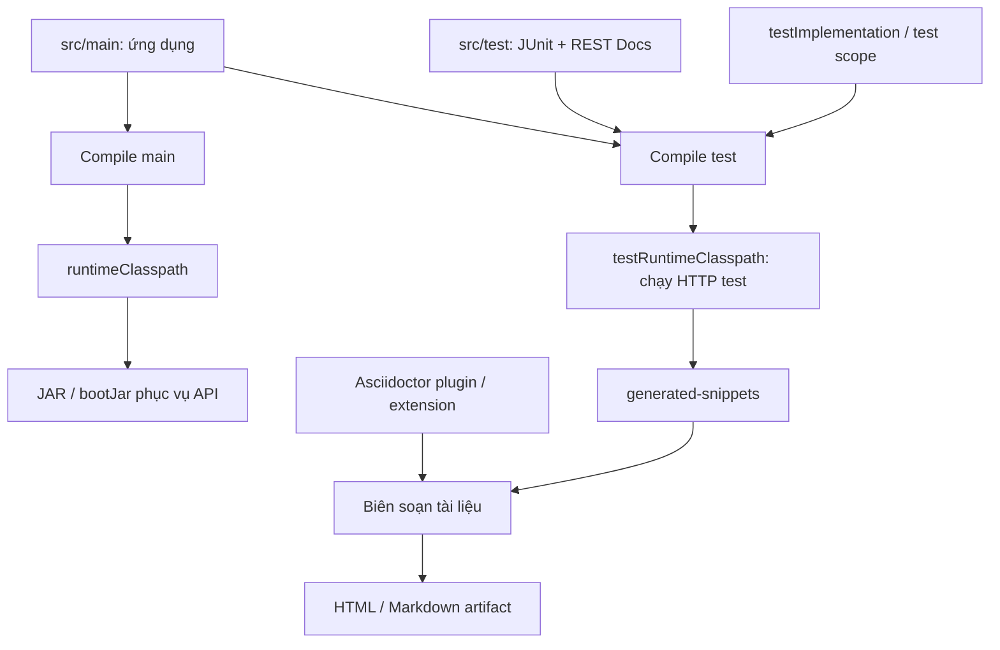
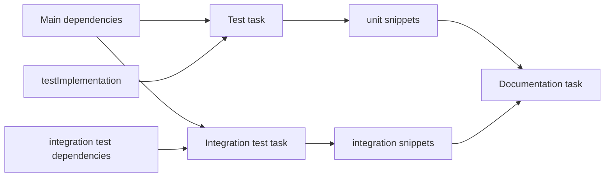
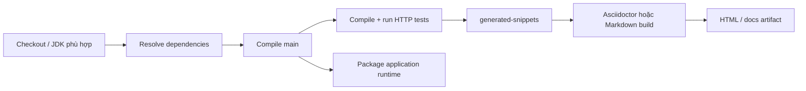

# Dependency test và phạm vi chỉ dùng khi kiểm thử

## Mục tiêu bài học

Trong chương **Thiết lập dự án** của module **SPRING_REST_DOCS**, một quyết định quan trọng là đặt các thư viện vào **đúng phạm vi dependency**. Spring REST Docs tạo tài liệu API có thể kiểm chứng từ các bài kiểm thử HTTP bằng MockMvc, WebTestClient hoặc REST Assured (tùy phiên bản), sinh snippet cho request, response, payload, tham số và header rồi chuyển các snippet đó sang Asciidoctor/Markdown trong build và CI.

Phần lớn thành phần Spring REST Docs chỉ được dùng **lúc chạy bài kiểm thử hoặc lúc biên soạn tài liệu**, vì vậy không cần đóng gói vào ứng dụng phục vụ HTTP trong môi trường production. Việc khai báo nhầm phạm vi có thể làm gói triển khai lớn hơn, đưa các thư viện kiểm thử vào runtime không cần thiết, hoặc gây lỗi `ClassNotFoundException` khi test chạy.

Sau bài này, bạn có thể:

- Phân biệt **compile classpath**, **runtime classpath**, **test compile classpath** và **test runtime classpath**.
- Sử dụng đúng `testImplementation`, `testRuntimeOnly`, `testCompileOnly` của Gradle và `<scope>test</scope>` của Maven.
- Chọn module Spring REST Docs phù hợp với MockMvc, WebTestClient hoặc REST Assured và đặt nó trong test scope.
- Tách dependency dành cho **kiểm thử HTTP** khỏi dependency dành cho **plugin biên soạn Asciidoctor**.
- Tạo bài test có snippet, kiểm tra dependency tree và xác minh gói chạy ứng dụng không chứa các công cụ kiểm thử ngoài ý muốn.
- Xử lý các tình huống đặc biệt như integration test riêng, CI đa bước và công cụ quản lý phiên bản dependency.

> **Phạm vi học thuật:** Bài này nói về **quản lý dependency khi thiết lập dự án**, không yêu cầu tự thiết kế mọi loại snippet. Ví dụ HTTP test sử dụng Spring MVC và MockMvc để minh họa; nguyên tắc phân tách classpath áp dụng tương tự cho WebTestClient và REST Assured ở những nhánh Spring REST Docs còn hỗ trợ.

## 1. Vì sao Spring REST Docs thường thuộc phạm vi test?

Giả sử ứng dụng có endpoint `GET /api/products/7`. Khi ứng dụng đang phục vụ người dùng, nó cần Spring MVC hoặc Spring WebFlux, mã nghiệp vụ, serializer và những thành phần vận hành khác. Nó **không cần** một bộ sinh tài liệu API để trả JSON cho người dùng.

Khi lập trình viên chạy một bài test tài liệu:

1. JUnit hoặc công cụ test khởi chạy bài kiểm thử.
2. MockMvc, WebTestClient hoặc REST Assured gửi HTTP request đến endpoint.
3. Assertion xác minh status, header và body.
4. Spring REST Docs ghi lại exchange và kiểm tra các descriptor về payload/parameter/header.
5. Snippet được lưu dưới thư mục build; Asciidoctor hoặc pipeline Markdown sử dụng chúng để sinh tài liệu hoàn chỉnh.

Hai hoạt động **chạy ứng dụng** và **tạo tài liệu từ test** có vòng đời và classpath khác nhau:



**Quy tắc mặc định:** Đặt tích hợp Spring REST Docs vào **test dependency**, còn thành phần xuất tài liệu vào **classpath của công cụ tài liệu**. Ứng dụng production chỉ nhận dependency cần để thực thi API.

### 1.1. Dependency có mặt trong test không có nghĩa được đóng gói

Gradle và Maven đều cho phép classpath của bài test sử dụng các lớp của mã ứng dụng. Điều đó **không** đồng nghĩa tất cả dependency của test sẽ nằm trong JAR chạy production.

Ví dụ, với Gradle Java/Spring Boot thông thường:

- `implementation` là dependency ứng dụng, tham gia compile và runtime của main.
- `testImplementation` chỉ bổ sung dependency để biên dịch và chạy test.
- `testRuntimeOnly` bổ sung thứ chỉ cần khi **chạy** test, không cần để biên dịch test.
- `bootJar` thông thường đóng gói các dependency runtime cần cho ứng dụng, không đưa `testImplementation` vào chỉ vì chúng có mặt trong project.

Tương tự, Maven `<scope>test</scope>` cho phép dependency xuất hiện khi **test-compile** và **test**, không đưa nó vào dependency runtime được chuyển tiếp cho ứng dụng.

### 1.2. Đừng hiểu test scope là ranh giới bảo mật tuyệt đối

Scope đúng giúp giảm rủi ro đưa thư viện không cần thiết vào production, nhưng một build tùy biến vẫn có thể sao chép nhầm thư mục `build/generated-snippets`, `target` hoặc toàn bộ test classpath vào gói phát hành. Hãy xác minh cấu hình đóng gói và artifact thực tế nếu dự án sử dụng task `bootJar`, Docker image hoặc assembly tùy biến.

Ngoài ra, test có thể chứa request/response giả lập hoặc dữ liệu nhạy cảm. Dù dependency không vào production, **snippet và log CI** vẫn cần được kiểm soát trước khi công bố.

## 2. Nắm rõ bốn classpath trước khi chọn scope

Một dự án Java thường có các lớp hoạt động trong những thời điểm sau:

| Classpath | Khi được dùng | Ví dụ thành phần |
| --- | --- | --- |
| **Main compile classpath** | Biên dịch `src/main/java` | Spring MVC, service API, serializer được import trong mã ứng dụng. |
| **Main runtime classpath** | Chạy ứng dụng hoặc đóng gói JAR chạy | Spring Boot runtime, logging, driver DB nếu cần. |
| **Test compile classpath** | Biên dịch `src/test/java` | JUnit API, MockMvc, REST Docs `document(...)`, AssertJ. |
| **Test runtime classpath** | Thực thi bài test | Thành phần test compile cần ở runtime, JUnit engine/launcher và công cụ chỉ được tải khi test chạy. |

Lựa chọn scope trả lời hai câu hỏi:

1. **Mã nào cần nhìn thấy dependency khi biên dịch?**
2. **Tiến trình nào cần tải dependency khi chạy?**

Ví dụ minh họa:

```java
// Trong src/main/java: ứng dụng cần Spring MVC
import org.springframework.web.bind.annotation.GetMapping;

// Trong src/test/java: test mới cần các API này
import org.junit.jupiter.api.Test;
import org.springframework.test.web.servlet.MockMvc;
import org.springframework.restdocs.RestDocumentationExtension;
```

Nếu lớp production bắt buộc phải import `MockMvc` hoặc `RestDocumentationExtension`, đó thường là dấu hiệu trách nhiệm của mã test đã lọt sang mã vận hành. Đừng vội đổi `testImplementation` thành `implementation` để “sửa” lỗi biên dịch; trước hết kiểm tra lại vị trí source file và thiết kế.

## 3. Scope Gradle: chọn đúng configuration

### 3.1. Các configuration thường gặp với Java plugin

| Gradle configuration | Compile main | Runtime main | Compile test | Runtime test | Dùng điển hình |
| --- | --- | --- | --- | --- | --- |
| `implementation` | Có | Có | Có, qua classpath của source set main trong test | Có | Spring MVC/WebFlux, thư viện nghiệp vụ. |
| `runtimeOnly` | Không | Có | Không trực tiếp | Có qua runtime ứng dụng | Driver JDBC được tải khi chạy, không được import lúc biên dịch. |
| `compileOnly` | Có | Không | Không tự động bảo đảm có ở test | Không tự động bảo đảm có ở test | API được môi trường khác cung cấp, annotation chỉ cần compile. |
| `testImplementation` | Không | Không | Có | Có | JUnit API, Spring Test, REST Docs MockMvc/WebTestClient/REST Assured. |
| `testRuntimeOnly` | Không | Không | Không | Có | JUnit Platform launcher khi stack cần nó. |
| `testCompileOnly` | Không | Không | Có | Không | API chỉ dùng để biên dịch test, trường hợp ít gặp. |

> Bảng thể hiện **khả năng sử dụng theo mục đích thông thường của Java plugin**. Các cấu hình source set, Gradle plugin và quan hệ kế thừa configuration do dự án tùy biến có thể thay đổi classpath thực tế; kiểm tra bằng lệnh Gradle thay vì suy luận từ tên configuration.

Trong một dự án Spring REST Docs cơ bản, dependency cốt lõi nên được tách như sau:

```groovy
dependencies {
    // Mã ứng dụng cần khi biên dịch và vận hành
    implementation 'org.springframework.boot:spring-boot-starter-web'

    // Chỉ phục vụ bài kiểm thử HTTP
    testImplementation 'org.springframework.boot:spring-boot-starter-test'
    testImplementation 'org.springframework.restdocs:spring-restdocs-mockmvc'

    // Chỉ phục vụ quá trình chạy nền tảng test nếu cần
    testRuntimeOnly 'org.junit.platform:junit-platform-launcher'
}
```

Ví dụ trên dành cho **Spring Boot 3.x + Spring REST Docs 3.x** và giả định dự án đã có Spring Boot plugin, Maven Central, BOM/dependency management phù hợp. Không chép cấu hình Boot 3 cho Boot 4 mà chưa xem các starter test mới.

### 3.2. Vì sao `testImplementation` là lựa chọn chuẩn cho REST Docs?

Khi viết:

```java
import static org.springframework.restdocs.mockmvc.MockMvcRestDocumentation.document;
```

Trình biên dịch bài test phải thấy lớp `MockMvcRestDocumentation`. Khi chạy, REST Docs cũng phải hiện diện để thực thi `document(...)` và ghi snippet. Do đó:

- `testImplementation` phù hợp vì cung cấp cả hai thời điểm.
- `testRuntimeOnly` **không phù hợp** cho module tích hợp REST Docs nếu code test import API đó, vì `compileTestJava` có thể báo không tìm thấy lớp.
- `testCompileOnly` **không phù hợp** nếu runtime test cần xử lý filter/snippet, vì thiếu lớp khi test chạy.
- `implementation` quá rộng nếu chỉ mã test dùng module này.

Với `spring-restdocs-webtestclient` và `spring-restdocs-restassured` ở phiên bản hỗ trợ, nguyên tắc tương tự: code test import API tích hợp, và logic tích hợp chạy khi test gửi HTTP request.

### 3.3. JUnit API và launcher không nhất thiết có cùng scope

Ví dụ test import `org.junit.jupiter.api.Test`; JUnit API cần trên **test compile classpath**. Khi chạy test, Gradle cũng phải có các thành phần tương ứng của nền tảng/engine kiểm thử.

Ở một số cấu hình hiện đại, launcher được thêm riêng:

```groovy
dependencies {
    testImplementation 'org.springframework.boot:spring-boot-starter-test'
    testRuntimeOnly 'org.junit.platform:junit-platform-launcher'
}

tasks.named('test') {
    useJUnitPlatform()
}
```

Không cố định phiên bản JUnit Platform/Jupiter thủ công nếu BOM Spring Boot đang quản lý chúng. Với Spring Boot 4/Spring REST Docs 4, cần hệ JUnit tương thích với JUnit 6.

### 3.4. API compile-only không thay thế testImplementation

`compileOnly` và `testCompileOnly` phù hợp với một số dependency annotation hoặc API được môi trường khác cung cấp, nhưng **không phải phạm vi mặc định** cho REST Docs. Khi test sinh snippet, mã REST Docs thực sự chạy nên cần nằm trên runtime classpath của test.

Đặc biệt, một dependency khai báo `compileOnly` cho main **không tự bảo đảm** có mặt trong tất cả custom source set kiểm thử. Nếu test cần thư viện đó, khai báo dependency tương ứng cho test hoặc điều chỉnh cấu hình source set một cách có chủ đích.

## 4. Scope Maven: hiểu `<scope>test</scope>`

Maven cung cấp những scope chính sau:

| Maven scope | Compile main | Runtime main | Compile/run test | Ứng dụng phổ biến |
| --- | --- | --- | --- | --- |
| `compile` (mặc định) | Có | Có | Có | Spring MVC/WebFlux và dependency ứng dụng. |
| `runtime` | Không | Có | Có ở test runtime; hạn chế khi compile main | Driver runtime được tải khi chạy. |
| `provided` | Có | Không được Maven đưa vào runtime transitive theo cơ chế thông thường | Có trong quá trình build/test | API do container/môi trường cung cấp. |
| `test` | Không | Không | Có | JUnit, REST Assured, MockMvc, Spring REST Docs. |

Với Maven, đặt REST Docs vào test scope:

```xml
<dependency>
    <groupId>org.springframework.restdocs</groupId>
    <artifactId>spring-restdocs-mockmvc</artifactId>
    <scope>test</scope>
</dependency>
```

Điều này cho phép `maven-compiler-plugin` biên dịch mã test có import API REST Docs, và `maven-surefire-plugin` chạy những test đó. Không cần thêm REST Docs MockMvc vào `compile` chỉ vì build cần sinh snippet.

**Sự khác nhau quan trọng:** Maven không có khái niệm `testImplementation` và `testRuntimeOnly` giống Gradle ngay trong dependency declaration. `<scope>test</scope>` thường cung cấp dependency cho cả biên dịch và thực thi test. Nếu muốn giới hạn sâu hơn, cần cân nhắc plugin/configuration hoặc tách module, không suy diễn Maven scope bằng cách sao chép tên configuration của Gradle.

### 4.1. Vì sao `<scope>test</scope>` không ảnh hưởng mã production?

Ví dụ một thư viện test được khai báo:

```xml
<dependency>
    <groupId>io.rest-assured</groupId>
    <artifactId>rest-assured</artifactId>
    <scope>test</scope>
</dependency>
```

Maven có thể tải REST Assured lúc test; dependency này **không xuất hiện như dependency runtime thông thường** của ứng dụng hoặc dependency được chuyển tiếp cho module sử dụng artifact của bạn.

Nếu lỡ bỏ `<scope>test</scope>`, Maven mặc định dùng `compile`: thư viện test có thể bị kéo vào classpath main và tăng bề mặt dependency không cần thiết.

### 4.2. Parent và BOM không phải scope

Khi dùng `spring-boot-starter-parent` hoặc BOM của Spring Boot, phiên bản các dependency được quản lý tập trung. Ví dụ:

```xml
<dependency>
    <groupId>org.springframework.restdocs</groupId>
    <artifactId>spring-restdocs-webtestclient</artifactId>
    <scope>test</scope>
</dependency>
```

Ở đây:

- **BOM/parent** quyết định phiên bản, nếu artifact đó thuộc danh sách dependency management.
- **`<scope>test</scope>`** quyết định nơi dependency được dùng.

Hai việc độc lập. Một BOM không tự đảm bảo thư viện kiểm thử chỉ xuất hiện trong test; người viết POM vẫn phải khai báo scope đúng.

## 5. Chọn module REST Docs theo HTTP test và thế hệ Spring

Tên dependency và phạm vi theo Gradle/Maven:

| Kiểu kiểm thử | Dependency Spring REST Docs | Gradle | Maven |
| --- | --- | --- | --- |
| **MockMvc** với Spring MVC | `org.springframework.restdocs:spring-restdocs-mockmvc` | `testImplementation` | `test` |
| **WebTestClient** với WebFlux hoặc HTTP test tương thích | `org.springframework.restdocs:spring-restdocs-webtestclient` | `testImplementation` | `test` |
| **REST Assured** ở REST Docs **3.x** | `org.springframework.restdocs:spring-restdocs-restassured` | `testImplementation` | `test` |
| Thành phần REST Docs core | `org.springframework.restdocs:spring-restdocs-core` | Thông thường được kéo theo module tích hợp | Thông thường được kéo theo module tích hợp |
| Asciidoctor integration | `org.springframework.restdocs:spring-restdocs-asciidoctor` | Classpath **plugin tài liệu** (`asciidoctorExt`) | Dependency của **Asciidoctor Maven plugin** |

**Quan trọng về tương thích:**

- **Spring Boot 3.x / Spring Framework 6.x**: chọn **Spring REST Docs 3.x**, Java tối thiểu 17.
- **Spring Boot 4.x / Spring Framework 7.x**: chọn **Spring REST Docs 4.x**, Java tối thiểu 17 và JUnit 6.
- **Spring REST Docs 4.0 đã loại bỏ tích hợp REST Assured**. Không khai báo `spring-restdocs-restassured:4.x` với kỳ vọng artifact tồn tại; cũng không ép một phiên bản REST Docs 3.x vào Framework 7.

REST Assured là thư viện HTTP test riêng, có tọa độ `io.rest-assured:rest-assured`. Khi sử dụng tích hợp REST Docs 3.x, cần cả **REST Assured HTTP client** và **module REST Docs REST Assured**, cùng cấu hình filter.

Không cần cài cả ba module MockMvc, WebTestClient và REST Assured trong mọi dự án. Mỗi module được thêm khi suite thực sự dùng công cụ test đó.

## 6. Cấu hình Gradle ví dụ: Spring Boot 3 + MockMvc

Giả sử dự án Spring Boot 3 sử dụng Java 17, Spring MVC và JUnit Jupiter. Các đoạn sau đặt dependency đúng phạm vi.

### 6.1. `build.gradle` (Groovy DSL)

```groovy
plugins {
    id 'java'
    id 'org.springframework.boot' version '3.5.0'
    id 'io.spring.dependency-management' version '1.1.7'
}

group = 'com.example'
version = '0.0.1-SNAPSHOT'

java {
    toolchain {
        languageVersion = JavaLanguageVersion.of(17)
    }
}

repositories {
    mavenCentral()
}

dependencies {
    // Chạy ứng dụng
    implementation 'org.springframework.boot:spring-boot-starter-web'

    // Biên dịch và chạy HTTP test, sinh snippet
    testImplementation 'org.springframework.boot:spring-boot-starter-test'
    testImplementation 'org.springframework.restdocs:spring-restdocs-mockmvc'

    // Thành phần thực thi test, không cần cho mã ứng dụng
    testRuntimeOnly 'org.junit.platform:junit-platform-launcher'
}

tasks.named('test') {
    useJUnitPlatform()
}
```

Ví dụ sử dụng một phiên bản thuộc dòng Boot 3.5 để minh họa, **không hàm ý 3.5.0 là bản vá được khuyến nghị hiện tại**. Trong dự án thật, cập nhật lên bản vá được hỗ trợ mới nhất của chính dòng Boot đang dùng và kiểm tra phiên bản Gradle/JDK tương thích. Tránh tự thêm `:3.x` sau `spring-restdocs-mockmvc` khi Spring Boot BOM đã quản lý nó.

### 6.2. Thay đổi tối thiểu nếu dùng WebTestClient

Với dự án Spring Boot 3 dựa trên WebFlux:

```groovy
dependencies {
    implementation 'org.springframework.boot:spring-boot-starter-webflux'
    testImplementation 'org.springframework.boot:spring-boot-starter-test'
    testImplementation 'org.springframework.restdocs:spring-restdocs-webtestclient'
}
```

Đó là **các khai báo thay thế** cho phần web-stack/test integration tương ứng, không thêm chồng cả hai starter MVC và WebFlux nếu ứng dụng không cần.

### 6.3. Khi đã có REST Assured test ở Spring REST Docs 3.x

```groovy
dependencies {
    implementation 'org.springframework.boot:spring-boot-starter-web'
    testImplementation 'org.springframework.boot:spring-boot-starter-test'
    testImplementation 'io.rest-assured:rest-assured'
    testImplementation 'org.springframework.restdocs:spring-restdocs-restassured'
}
```

REST Assured được dùng trong test để gửi HTTP request đến server kiểm thử. Module REST Docs REST Assured 3.x tạo snippet từ exchange thông qua filter. Không dùng khai báo này cho Spring REST Docs 4.x vì tích hợp đã bị bỏ.

## 7. Cấu hình Gradle ví dụ: Spring Boot 4

Ở Spring Boot 4, web starter và test starter được chia theo công nghệ cụ thể. Với ứng dụng Spring MVC:

```groovy
dependencies {
    implementation 'org.springframework.boot:spring-boot-starter-webmvc'
    testImplementation 'org.springframework.boot:spring-boot-starter-webmvc-test'
    testImplementation 'org.springframework.restdocs:spring-restdocs-mockmvc'
    testRuntimeOnly 'org.junit.platform:junit-platform-launcher'
}

tasks.named('test') {
    useJUnitPlatform()
}
```

Với WebFlux:

```groovy
dependencies {
    implementation 'org.springframework.boot:spring-boot-starter-webflux'
    testImplementation 'org.springframework.boot:spring-boot-starter-webflux-test'
    testImplementation 'org.springframework.restdocs:spring-restdocs-webtestclient'
    testRuntimeOnly 'org.junit.platform:junit-platform-launcher'
}
```

Các đoạn trên giả định dự án **đã có plugin/BOM Spring Boot 4**. Nếu dùng `@AutoConfigureRestDocs` của Boot 4, cần module auto-configuration REST Docs phù hợp (ví dụ `org.springframework.boot:spring-boot-restdocs` trên test classpath) hoặc starter tích hợp tương ứng với bản Boot được sử dụng. `spring-restdocs-mockmvc`/`spring-restdocs-webtestclient` cung cấp API REST Docs cho HTTP test, nhưng không tự tạo mọi annotation của Spring Boot.

Điều quan trọng về **scope** vẫn không đổi: HTTP testing + REST Docs ở test classpath, còn Spring web starter phục vụ ứng dụng ở main classpath.

## 8. Cấu hình Maven tương đương

Trong `pom.xml` có parent Spring Boot 3.x, các khai báo tối thiểu:

```xml
<dependencies>
    <!-- Runtime của Spring MVC application -->
    <dependency>
        <groupId>org.springframework.boot</groupId>
        <artifactId>spring-boot-starter-web</artifactId>
    </dependency>

    <!-- Chỉ phục vụ kiểm thử -->
    <dependency>
        <groupId>org.springframework.boot</groupId>
        <artifactId>spring-boot-starter-test</artifactId>
        <scope>test</scope>
    </dependency>
    <dependency>
        <groupId>org.springframework.restdocs</groupId>
        <artifactId>spring-restdocs-mockmvc</artifactId>
        <scope>test</scope>
    </dependency>
</dependencies>
```

Với Spring Boot 4, thay starter MVC bằng `spring-boot-starter-webmvc` và starter test bằng `spring-boot-starter-webmvc-test`; giữ nguyên `spring-restdocs-mockmvc` trong `test` và để BOM chọn nhánh REST Docs tương thích.

Với WebFlux, chọn webflux starter và test starter tương ứng. Với REST Assured ở nhánh REST Docs 3.x, thêm `io.rest-assured:rest-assured` và `spring-restdocs-restassured`, **cả hai đều ở scope `test`**.

**Lưu ý quan trọng khi chưa có BOM:** Dependency khai báo thiếu `<version>` sẽ không tự resolve. Nếu dự án không sử dụng parent/BOM tương ứng, cần xác định phiên bản hợp lệ của Spring Framework, Spring Test, REST Docs và JUnit rồi đặt chúng trong `dependencyManagement` hoặc dependency cụ thể.

### 8.1. Dependency cho Asciidoctor Maven Plugin thuộc một hệ classpath khác

Phần biên soạn tài liệu thường sử dụng một plugin Maven:

```xml
<build>
  <plugins>
    <plugin>
      <groupId>org.asciidoctor</groupId>
      <artifactId>asciidoctor-maven-plugin</artifactId>
      <version>3.2.0</version>
      <dependencies>
        <dependency>
          <groupId>org.springframework.restdocs</groupId>
          <artifactId>spring-restdocs-asciidoctor</artifactId>
          <version>3.0.4</version>
        </dependency>
      </dependencies>
      <executions>
        <execution>
          <id>generate-api-docs</id>
          <phase>prepare-package</phase>
          <goals>
            <goal>process-asciidoc</goal>
          </goals>
        </execution>
      </executions>
    </plugin>
  </plugins>
</build>
```

Các số phiên bản trong đoạn này **chỉ minh họa cách khóa plugin và extension**; phải xác minh sự tồn tại, tính tương thích và chọn phiên bản vá phù hợp của plugin cùng **nhánh REST Docs đã dùng cho test**. Cấu hình `spring-restdocs-asciidoctor` nằm trong **`<plugin><dependencies>`**, không cần thêm nó như một dependency `compile` của ứng dụng.

Điểm cần hiểu: dependency quản lý cho mã dự án và dependency classpath của Maven plugin là **hai cơ chế khác nhau**. Dependency management của Spring Boot không mặc nhiên chọn phiên bản cho mọi dependency khai báo bên trong plugin. Vì vậy, phải khai báo phiên bản extension hợp lệ ở vị trí plugin nếu Maven yêu cầu.

Maven `prepare-package` chạy sau `test` trong lifecycle mặc định; điều đó phù hợp nếu test sinh snippet được chạy bởi Surefire ở phase `test`. Nếu các snippet đến từ **Failsafe integration tests** ở các phase `integration-test`/`verify`, cần đặt bước biên soạn sau khi các test đó thực sự hoàn thành thay vì gắn cứng ở `prepare-package`.

## 9. Bài test minh họa: dependency chỉ nằm ở test nhưng vẫn sinh snippet

Ví dụ sau áp dụng cho **Spring Boot 3/Spring REST Docs 3, Spring MVC, JUnit 5 và MockMvc**. Không cần mở HTTP server vì `MockMvcBuilders.standaloneSetup(...)` mô phỏng pipeline Spring MVC ngay trong test.

Tạo file `src/test/java/com/example/docs/ProductDocumentationTest.java`:

```java
package com.example.docs;

import java.util.Map;

import org.junit.jupiter.api.BeforeEach;
import org.junit.jupiter.api.Test;
import org.junit.jupiter.api.extension.ExtendWith;
import org.springframework.http.MediaType;
import org.springframework.restdocs.RestDocumentationContextProvider;
import org.springframework.restdocs.RestDocumentationExtension;
import org.springframework.test.web.servlet.MockMvc;
import org.springframework.test.web.servlet.setup.MockMvcBuilders;
import org.springframework.web.bind.annotation.GetMapping;
import org.springframework.web.bind.annotation.PathVariable;
import org.springframework.web.bind.annotation.RestController;

import static org.springframework.restdocs.mockmvc.MockMvcRestDocumentation.document;
import static org.springframework.restdocs.mockmvc.MockMvcRestDocumentation.documentationConfiguration;
import static org.springframework.restdocs.payload.PayloadDocumentation.fieldWithPath;
import static org.springframework.restdocs.payload.PayloadDocumentation.responseFields;
import static org.springframework.test.web.servlet.request.MockMvcRequestBuilders.get;
import static org.springframework.test.web.servlet.result.MockMvcResultMatchers.jsonPath;
import static org.springframework.test.web.servlet.result.MockMvcResultMatchers.status;

@ExtendWith(RestDocumentationExtension.class)
class ProductDocumentationTest {

    private MockMvc mvc;

    @BeforeEach
    void setUp(RestDocumentationContextProvider documentation) {
        this.mvc = MockMvcBuilders.standaloneSetup(new ProductController())
                .apply(documentationConfiguration(documentation))
                .build();
    }

    @Test
    void documentsGetProduct() throws Exception {
        this.mvc.perform(get("/api/products/7")
                        .accept(MediaType.APPLICATION_JSON))
                .andExpect(status().isOk())
                .andExpect(jsonPath("$.id").value(7))
                .andExpect(jsonPath("$.name").value("Bút"))
                .andDo(document("products-get",
                        responseFields(
                                fieldWithPath("id").description("Mã sản phẩm"),
                                fieldWithPath("name").description("Tên sản phẩm")
                        )));
    }

    @RestController
    static class ProductController {
        @GetMapping(value = "/api/products/{id}",
                    produces = MediaType.APPLICATION_JSON_VALUE)
        Map<String, Object> getProduct(@PathVariable int id) {
            return Map.of("id", id, "name", "Bút");
        }
    }
}
```

Điểm cần quan sát:

1. `ProductDocumentationTest` đặt tại **`src/test/java`**, không phải `src/main/java`.
2. Test import `MockMvc` và `RestDocumentationExtension`; vì vậy chúng phải nằm trên **test compile classpath**.
3. Khi chạy, `documentationConfiguration(...)` kích hoạt REST Docs trong MockMvc; `document("products-get", responseFields(...))` sinh snippet từ exchange.
4. `responseFields(...)` xác minh các trường của response JSON và tạo `response-fields.adoc`. Nếu API đổi tên field `name` thành `title` nhưng descriptor chưa cập nhật, bài test sẽ phát hiện sai lệch.
5. Ứng dụng main không phụ thuộc REST Docs. Việc tạo snippet diễn ra **ngoài runtime production**.

Chạy:

```bash
./gradlew test
# Hoặc với Maven:
./mvnw test
```

Trên Windows dùng `.\gradlew.bat test` hoặc `.\mvnw.cmd test` nếu dự án có wrapper.

Đầu ra Gradle mặc định:

```text
build/
└── generated-snippets/
    └── products-get/
        ├── curl-request.adoc
        ├── http-request.adoc
        ├── http-response.adoc
        ├── httpie-request.adoc
        ├── request-body.adoc
        ├── response-body.adoc
        └── response-fields.adoc
```

Đầu ra Maven mặc định là `target/generated-snippets/products-get/`. Nếu test pass nhưng không thấy snippet, hãy kiểm tra có gọi `document(...)` và gắn `documentationConfiguration(...)` trên **chính instance MockMvc** dùng trong test.

### 9.1. Test source và production source không được lẫn lộn

Để dễ thử, ví dụ đặt `ProductController` ngay trong file test. Dự án thực tế thường có controller ở `src/main/java` và test dùng controller/application context đó; nguyên tắc scope vẫn như nhau.

Không di chuyển `ProductDocumentationTest` vào `src/main/java` để làm cho build tìm thấy lớp. Nếu một test không được Gradle/Maven phát hiện, hãy kiểm tra source set, tên lớp test, JUnit engine và test task.

## 10. Phân biệt dependency chạy test và dependency biên soạn tài liệu

Spring REST Docs thường có **hai nhóm phụ thuộc độc lập**:

| Giai đoạn | Thành phần phải có | Classpath phù hợp |
| --- | --- | --- |
| **Gửi HTTP request và sinh snippet** | JUnit, Spring Test/REST Assured, `spring-restdocs-mockmvc`/`webtestclient`/`restassured` | `testImplementation` (Gradle) hoặc `test` (Maven). |
| **Biên soạn snippet thành HTML** | Asciidoctor Gradle/Maven plugin, `spring-restdocs-asciidoctor` | Plugin/configuration **Asciidoctor**, không phải application runtime. |
| **Phát hành tài liệu** | Task copy, artifact upload hoặc publisher do dự án chọn | Build/CI; không phải dependency phục vụ API request. |

### 10.1. Gradle: dùng `asciidoctorExt`

Ví dụ thêm **bước dựng tài liệu** cho dự án Gradle đang có test tạo snippet:

```groovy
plugins {
    id 'org.asciidoctor.jvm.convert' version '4.0.5'
}

configurations {
    asciidoctorExt
}

dependencies {
    // Giữ cùng nhánh REST Docs với dependency sinh snippet trong test
    asciidoctorExt 'org.springframework.restdocs:spring-restdocs-asciidoctor:3.0.4'
}

ext {
    snippetsDir = file('build/generated-snippets')
}

tasks.named('test') {
    outputs.dir snippetsDir
}

tasks.named('asciidoctor') {
    inputs.dir snippetsDir
    configurations 'asciidoctorExt'
    dependsOn test
}
```

Đây là **phần bổ sung** vào build đã có các plugin Java/Spring Boot. Phiên bản `3.0.4` chỉ minh họa cách khai báo extension cùng nhánh REST Docs 3; dự án phải chọn phiên bản vá thực sự tương thích và đồng bộ với `spring-restdocs-mockmvc` đã được resolve. Nếu dùng REST Docs 4.x, cần chọn extension 4.x và AsciidoctorJ tương thích (REST Docs 4 yêu cầu AsciidoctorJ 3).

**Tại sao dùng `asciidoctorExt` thay vì `implementation`?** Khi plugin chạy, nó cần REST Docs extension để xử lý macro snippet. Ứng dụng Spring Boot chạy thật **không gọi** extension đó. Đặt dependency vào configuration của plugin giúp tách đúng trách nhiệm.

### 10.2. File Asciidoctor tham chiếu snippet do test sinh

Ví dụ `src/docs/asciidoc/index.adoc`:

```asciidoc
= Product API
:toc: left
:sectnums:

== GET /api/products/7

=== HTTP request
include::{snippets}/products-get/http-request.adoc[]

=== HTTP response
include::{snippets}/products-get/http-response.adoc[]

=== Response fields
include::{snippets}/products-get/response-fields.adoc[]
```

Chạy `./gradlew asciidoctor`. Với ràng buộc `dependsOn test`, Gradle tạo snippet trước rồi mới biên soạn tài liệu. Đường dẫn HTML thông dụng là `build/docs/asciidoc/index.html`.

**Markdown:** REST Docs cũng có khả năng dùng template snippet Markdown. Khi chọn định dạng Markdown, cần cấu hình `TemplateFormats.markdown()` trong REST Docs và một pipeline ghép snippet Markdown. Việc chuyển sang Markdown **không làm module REST Docs từ test dependency trở thành production dependency**.

### 10.3. Đừng đặt `spring-restdocs-asciidoctor` vào `runtimeOnly`

`runtimeOnly` ở đây là runtime của ứng dụng Java, khác với runtime của **plugin Asciidoctor**. Nếu đặt extension vào `runtimeOnly` của ứng dụng, plugin có thể vẫn thiếu class cần để biên soạn, đồng thời ứng dụng bị kéo theo dependency không cần thiết. Hãy dùng classpath riêng của plugin hoặc plugin dependency trong Maven.

## 11. Cách chứng minh dependency test không bị đóng gói

Không nên chỉ dựa vào việc build không báo lỗi. Có thể kiểm chứng ở ba lớp: **dependency graph**, **tệp artifact**, **task thực thi**.

### 11.1. Gradle

Liệt kê dependency của test:

```bash
./gradlew dependencies --configuration testRuntimeClasspath
./gradlew dependencyInsight --dependency spring-restdocs-mockmvc --configuration testRuntimeClasspath
```

Kiểm tra dependency của ứng dụng:

```bash
./gradlew dependencies --configuration runtimeClasspath
```

Kỳ vọng với dự án đơn giản:

- `spring-restdocs-mockmvc` có trong **testRuntimeClasspath**.
- `spring-restdocs-mockmvc` **không** nằm trong **runtimeClasspath** của ứng dụng nếu không có dependency hoặc plugin khác kéo vào ngoài ý muốn.
- `spring-restdocs-asciidoctor` nằm trong configuration được task Asciidoctor sử dụng, không nằm trong application runtime classpath.

Thư viện như `spring-core` hoặc `spring-webmvc` **có thể xuất hiện ở cả test và main**, vì chúng là thành phần ứng dụng cần. Mục tiêu không phải làm hai cây dependency hoàn toàn khác nhau; mục tiêu là **không đưa các module kiểm thử chuyên dụng vào runtime production**.

Có thể liệt kê dependency theo một artifact cụ thể:

```bash
./gradlew dependencyInsight --dependency spring-restdocs-mockmvc --configuration runtimeClasspath
```

Khi Gradle báo không tìm thấy dependency đang tìm trong `runtimeClasspath`, đó là dấu hiệu phù hợp với cấu hình test-only. Nếu có nhiều source set hoặc dependency custom, cần kiểm tra configuration riêng của chúng.

### 11.2. Maven

```bash
./mvnw dependency:tree
./mvnw help:effective-pom
```

Trong cây dependency, xác nhận REST Docs thuộc scope `test`. `help:effective-pom` giúp xem phiên bản dependency/plugin đã được quản lý theo parent/BOM và cấu hình thực tế.

Không suy luận rằng chỉ cần đặt scope `test` là mọi file đã sinh đều bị loại khỏi artifact. Nếu sử dụng plugin assembly/copy/resources đặc biệt, hãy kiểm tra file JAR hoặc Docker image thật.

### 11.3. Xem tệp được đóng gói

Với một Spring Boot executable JAR đã tạo:

```bash
jar tf build/libs/ten-ung-dung.jar
```

Maven thường xuất artifact dưới `target/`. Kiểm tra mục thư viện bên trong `BOOT-INF/lib/` nếu dùng Spring Boot executable JAR. Trong build thông thường, bạn **không nên thấy** `spring-restdocs-mockmvc-*.jar`, `junit-jupiter-*.jar` hoặc `rest-assured-*.jar` trong artifact production, trừ khi có lý do và cấu hình đặc biệt.

Tên `ten-ung-dung.jar` chỉ là ví dụ, cần thay bằng tệp thật sau khi build. Nếu dùng `war`, native image hoặc container image, kiểm tra artifact tương ứng.

## 12. Khi các bài tạo tài liệu nằm trong integration test riêng

Không phải mọi bài tài liệu hóa HTTP đều chạy trong task `test` mặc định. Một dự án có thể tạo suite `integrationTest` để khởi chạy server thật và kiểm tra API từ đầu đến cuối.

### 12.1. Cần đúng dependency cho source set mới

Ví dụ cấu trúc thư mục:

```text
src/
├── main/java/
├── test/java/
└── integrationTest/java/
```

Trong Gradle, một custom source set không mặc nhiên có toàn bộ dependency của `src/test`. Nếu dùng Gradle JVM Test Suite hoặc custom source set, hãy khai báo `spring-restdocs-*` trên **classpath của suite integration test** hoặc tạo quan hệ kế thừa configuration thích hợp.

Tư duy đúng:



Nếu snippet chỉ đến từ integration test, thì task tài liệu phải phụ thuộc vào **`integrationTest`**, không chỉ `test`. Tránh để unit test và integration test độc lập cùng ghi đè vào một operation ID/thư mục output; khi chúng chạy song song có thể ghi trùng snippet.

### 12.2. Maven Surefire và Failsafe

Với Maven:

- `maven-surefire-plugin` thường chạy unit test trong phase `test`.
- `maven-failsafe-plugin` thường chạy integration test ở các phase `integration-test` và `verify`.
- Nếu test tạo snippet nằm trong Failsafe, hãy đặt bước tạo tài liệu **sau khi integration test hoàn tất**, và bảo đảm build thất bại khi integration test hoặc descriptor không đạt.

Ví dụ đặt Asciidoctor ở `prepare-package` trong khi snippet chỉ sinh ở `integration-test` là sai thứ tự: `prepare-package` diễn ra sớm hơn. Cần đổi lifecycle/binding hoặc dùng pipeline CI chạy tuần tự từng bước đúng.

### 12.3. Phân chia output rõ ràng

Một đội có thể dùng thư mục khác nhau:

```text
build/
├── generated-snippets-unit/
└── generated-snippets-integration/
```

Sau đó cấu hình task biên soạn tài liệu tham chiếu đúng thư mục. Không tự ý thay tên mặc định nếu các script hiện tại đang giả định `build/generated-snippets`; thay đổi phải đồng bộ giữa REST Docs, Gradle/Maven plugin và nguồn Asciidoctor.

## 13. CI: chia ranh giới giữa test, snippet và tài liệu đầu ra

Một pipeline hợp lý:



**Điểm cần bảo đảm trong CI:**

1. Test sinh snippet phải chạy với **đúng JDK và dependency đã khóa**. Nếu local dùng Java 17 nhưng CI chạy Java 11 thì nhánh REST Docs 3.x/4.x hiện đại sẽ không đáp ứng yêu cầu tối thiểu.
2. Job biên soạn tài liệu phải nhận được snippet **của lần test hiện tại**. Nếu chia job, cần truyền thư mục snippet qua CI artifact/workspace; không tự giả định hai job dùng chung filesystem.
3. Một descriptor sai hoặc thiếu field phải làm test fail, ngăn phát hành tài liệu cũ nếu pipeline có quy định phát hành sau test.
4. Tài liệu HTML/Markdown sau build có thể được lưu như một artifact riêng. Không cần thêm công cụ tạo tài liệu vào classpath của ứng dụng production.
5. Khi test dùng HTTP server trên cổng ngẫu nhiên, cần chuẩn hóa URI trong snippet nếu tài liệu công khai yêu cầu domain cố định. Không sửa địa chỉ server thực mà test đang gọi chỉ để làm đẹp tài liệu.

**Phân biệt ba trạng thái:**

| Trạng thái | Dấu hiệu | Còn cần xác minh gì? |
| --- | --- | --- |
| HTTP test thành công | Status/body assertion pass | Đã gọi REST Docs `document(...)` chưa? |
| Snippet sinh thành công | `generated-snippets` chứa request/response và các descriptor | Task Asciidoctor/Markdown có dùng đúng snippet mới không? |
| Tài liệu hoàn chỉnh | Có HTML/Markdown đầu ra | Pipeline có lưu/phát hành artifact đúng phiên bản không? |

## 14. Những lỗi scope thường gặp

| Triệu chứng | Nguyên nhân khả dĩ | Cách xử lý |
| --- | --- | --- |
| `package org.springframework.restdocs... does not exist` khi `compileTestJava` | REST Docs bị đặt vào `testRuntimeOnly`, thiếu test dependency, hoặc khác source set | Chuyển module tích hợp vào `testImplementation` của đúng suite. |
| Runtime báo `ClassNotFoundException` cho REST Docs khi chạy test | Dependency chỉ có ở `testCompileOnly` hoặc classpath test bị tùy biến sai | Đảm bảo REST Docs cũng nằm trên test runtime classpath. |
| REST Docs xuất hiện trong `BOOT-INF/lib` của ứng dụng | Khai báo `implementation`/`compile` hoặc cấu hình đóng gói tùy biến kéo test libs | Đặt module test vào `testImplementation`/Maven `test` và kiểm tra artifact. |
| Maven dependency REST Docs mặc định là `compile` | Quên `<scope>test</scope>` | Khai báo scope đúng; xem `dependency:tree`. |
| `NoSuchMethodError` / `NoClassDefFoundError` trong Spring Test | Trộn Spring Framework 6 và 7, REST Docs 3 và 4 hoặc override BOM không phù hợp | Kiểm tra dependency tree, dùng tổ hợp phiên bản tương thích. |
| `spring-restdocs-restassured:4.x` không resolve | REST Docs 4.0 không còn module REST Assured | Dùng MockMvc/WebTestClient trên REST Docs 4; giữ REST Assured integration trên nhánh 3.x phù hợp. |
| JUnit không chạy dù code test biên dịch | Thiếu engine/launcher hoặc test task chưa cấu hình JUnit Platform | Kiểm tra starter test, `testRuntimeOnly` và `useJUnitPlatform()`. |
| Không sinh snippet dù test xanh | Chưa gắn REST Docs configurer/filter hoặc chưa gọi `document(...)` | Kiểm tra đúng HTTP client và đường dẫn output. |
| Asciidoctor không tìm được `spring-restdocs-asciidoctor` | Đặt extension trong dependency main/test, chưa cấu hình plugin classpath | Dùng `asciidoctorExt` hoặc dependency của Maven plugin. |
| Asciidoctor báo không tìm thấy `http-request.adoc` | Task tài liệu chạy trước suite tạo snippet hoặc sai operation ID | Sắp xếp dependency task và đối chiếu thư mục sinh snippet. |
| Test `integrationTest` không thấy REST Docs | Custom source set chưa nhận dependency kiểm thử | Khai báo dependency vào suite integration test hoặc cấu hình inheritance rõ ràng. |
| CI có snippet cũ dù test đã đổi API | Dùng cache/workspace cũ, không chạy suite sinh snippet, hoặc job không truyền artifact mới | Ràng buộc test → snippet → tài liệu, kiểm tra output và cache. |

## 15. Bài thực hành và câu hỏi tự đánh giá

### Bài thực hành A — Chứng minh test dependency được tách khỏi ứng dụng

1. Chọn dự án Spring MVC sử dụng Spring Boot 3 và Java 17+. Trong build, đặt `spring-restdocs-mockmvc` đúng `testImplementation` (Gradle) hoặc `test` (Maven).
2. Chạy ví dụ `ProductDocumentationTest` ở phần 9. Xác nhận thư mục `products-get` có `http-response.adoc` và `response-fields.adoc`.
3. Kiểm tra `testRuntimeClasspath` và `runtimeClasspath` (Gradle) hoặc `dependency:tree` (Maven). Ghi lại vị trí xuất hiện của REST Docs.
4. Tạo executable JAR; kiểm tra artifact không chứa module REST Docs MockMvc như dependency runtime.
5. Thử chuyển tạm `testImplementation 'spring-restdocs-mockmvc'` thành `testRuntimeOnly` và chạy `compileTestJava`. Giải thích lỗi biên dịch; khôi phục cấu hình đúng sau khi quan sát.

### Bài thực hành B — Tách công cụ tài liệu khỏi HTTP test

1. Cấu hình Asciidoctor plugin và extension REST Docs trong plugin classpath.
2. Tạo `src/docs/asciidoc/index.adoc` tham chiếu `products-get/http-response.adoc`.
3. Chạy task sinh tài liệu, xác nhận test được chạy trước và tạo HTML từ snippet mới.
4. Kiểm tra application runtime classpath một lần nữa. Giải thích tại sao `spring-restdocs-asciidoctor` không cần nằm trong `implementation`.

### Câu hỏi tự đánh giá

1. Vì sao `spring-restdocs-mockmvc` cần `testImplementation` thay vì `testRuntimeOnly`?
2. Maven `<scope>test</scope>` khác Gradle `testRuntimeOnly` như thế nào?
3. BOM giúp quản lý phiên bản ra sao và vì sao BOM không tự quyết định scope?
4. Vì sao một dự án dùng WebTestClient không nhất thiết cần `spring-restdocs-mockmvc`?
5. Điều gì xảy ra khi lấy `spring-restdocs-restassured` nhánh 3.x dùng với Spring Boot 4?
6. Tại sao `spring-restdocs-asciidoctor` nên ở plugin classpath?
7. Trong một dự án có `integrationTest` riêng, task tài liệu cần phụ thuộc task nào?
8. Làm sao chứng minh bản executable JAR không chứa các thư viện tạo tài liệu vốn chỉ dùng lúc test?

## Tài liệu tham khảo chính thức

- [Spring REST Docs — Getting Started](https://docs.spring.io/spring-restdocs/tutorial/getting-started/index.html): dependency test của MockMvc/WebTestClient, task tạo snippet và Asciidoctor.
- [Spring REST Docs — System Requirements](https://docs.spring.io/spring-restdocs/system-requirements.html): Java và Spring Framework tối thiểu cho nhánh hiện hành.
- [Spring REST Docs 3.0 — Release Notes](https://github.com/spring-projects/spring-restdocs/wiki/Spring-REST-Docs-3.0-Release-Notes): mức Java/Spring Framework và REST Assured được hỗ trợ.
- [Spring REST Docs 4.0 — Release Notes](https://github.com/spring-projects/spring-restdocs/wiki/Spring-REST-Docs-4.0-Release-Notes): thế hệ Spring Framework 7, JUnit 6 và thay đổi tích hợp REST Assured.
- [Gradle — Declaring Dependencies](https://docs.gradle.org/current/userguide/declaring_dependencies.html): `implementation`, `runtimeOnly`, `testImplementation` và các configuration.
- [Gradle — JVM Test Suite Plugin](https://docs.gradle.org/current/userguide/jvm_test_suite_plugin.html): dependency của integration test suite riêng.
- [Maven — Introduction to the Dependency Mechanism](https://maven.apache.org/guides/introduction/introduction-to-dependency-mechanism.html): scope `compile`, `provided`, `runtime`, `test` và transitive dependency.
- [Maven — Build Lifecycle](https://maven.apache.org/guides/introduction/introduction-to-the-lifecycle.html): thứ tự `test`, `prepare-package`, `integration-test` và `verify`.
- [Spring Boot — Gradle Plugin](https://docs.spring.io/spring-boot/gradle-plugin/index.html) và [Spring Boot — Maven Plugin](https://docs.spring.io/spring-boot/maven-plugin/index.html): đóng gói và quản lý build ứng dụng.

Trong phần lớn dự án, hãy giữ **Spring REST Docs HTTP integration ở test scope**, giữ **Asciidoctor extension trên classpath của plugin tài liệu** và xác nhận qua dependency tree rằng production runtime chỉ chứa thư viện cần để phục vụ API. Cách tách này cho phép HTTP test phát hiện tài liệu sai, tạo snippet và biên soạn tài liệu trong CI mà không làm phức tạp artifact triển khai.
