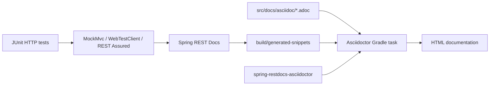
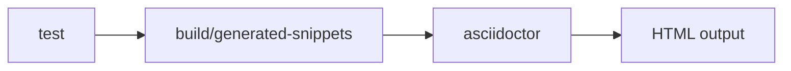
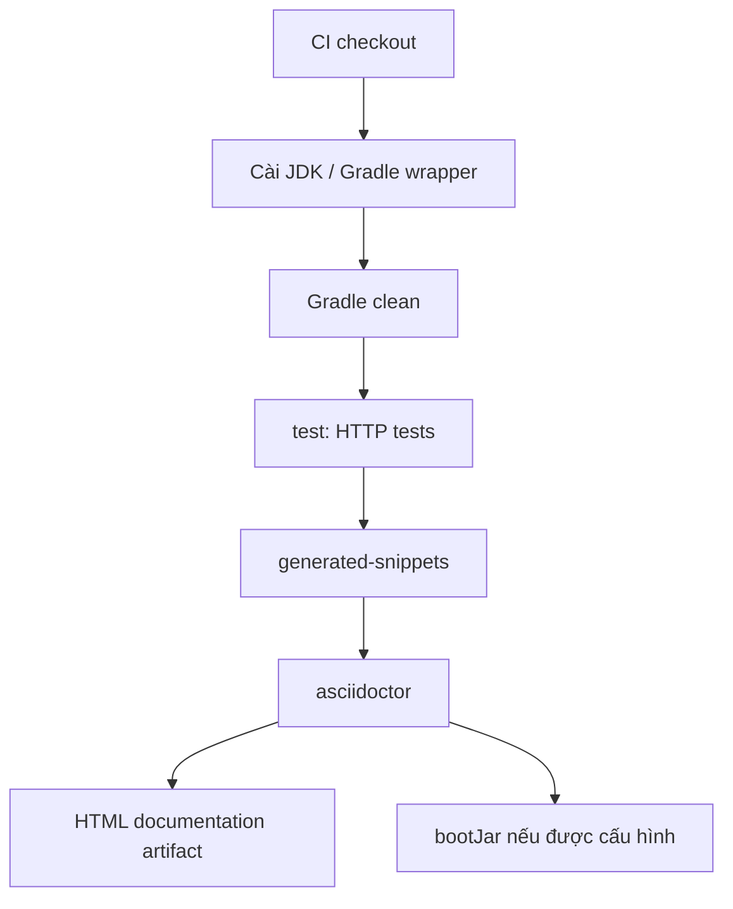

# Cấu hình plugin Asciidoctor cho Gradle

## Mục tiêu học tập

Trong chương **Thiết lập dự án** của module **SPRING_REST_DOCS**, sau khi các bài kiểm thử HTTP bằng MockMvc, WebTestClient hoặc REST Assured tạo snippet, cần có bước biên soạn để ghép chúng thành tài liệu đọc được. Với dự án Gradle dùng AsciiDoc, công cụ phù hợp là **Asciidoctor Gradle Plugin**.

Spring REST Docs tạo snippet từ request/response đã được kiểm thử; plugin Asciidoctor đọc các tệp **.adoc**, xử lý macro **include** cùng extension REST Docs rồi xuất HTML. Hai công đoạn liên kết trong Gradle task graph: **test tạo snippet trước, Asciidoctor dùng snippet làm đầu vào sau**.

Sau bài này, bạn có thể cài plugin **org.asciidoctor.jvm.convert**, khai báo **asciidoctorExt** và dependency **spring-restdocs-asciidoctor**, chọn AsciidoctorJ phù hợp, cấu hình **snippetsDir**, nối task test với task Asciidoctor, viết **index.adoc**, chạy và tìm HTML đầu ra, cũng như tích hợp quy trình vào CI.

> **Bộ cấu hình tham chiếu:** ví dụ dùng Spring REST Docs 4.0.2, Asciidoctor Gradle plugin 4.0.5 và AsciidoctorJ 3.0.0, đúng bộ phiên bản trong hướng dẫn Getting Started của Spring REST Docs 4.0.2. Với nhánh REST Docs hoặc Gradle khác, hãy kiểm tra yêu cầu tương thích trước khi thay version.

## 1. Plugin Asciidoctor giải quyết bước nào?

Một dự án REST Docs có hai nhóm tệp:

- **Snippet tự sinh** từ test, ví dụ http-request.adoc, http-response.adoc, response-fields.adoc. Gradle thường lưu tại build/generated-snippets.
- **Tài liệu nguồn do nhóm biên soạn**, ví dụ src/docs/asciidoc/index.adoc. Tệp này sắp xếp nội dung, tiêu đề, giải thích và include snippet đã sinh.

Asciidoctor chuyển tệp .adoc thành HTML. Extension **spring-restdocs-asciidoctor** bổ sung tích hợp REST Docs, thiết lập attribute **{snippets}** trỏ tới thư mục snippet và cung cấp macro **operation**.



Plugin **không tự viết nội dung API thay nhóm phát triển**. Test tạo bằng chứng HTTP; file .adoc quyết định cách trình bày và giải thích; Asciidoctor kết xuất chúng thành tài liệu.

## 2. Các thành phần cần cấu hình

| Thành phần | Nhiệm vụ | Cấu hình/đường dẫn |
| --- | --- | --- |
| Gradle plugin | Tạo task asciidoctor và kết nối AsciidoctorJ với Gradle | org.asciidoctor.jvm.convert |
| AsciidoctorJ | Engine chạy Asciidoctor trên JVM | asciidoctorj version 3.0.0 |
| REST Docs Asciidoctor extension | Cung cấp {snippets} và macro operation | Configuration asciidoctorExt |
| HTTP test integration | Sinh snippet từ test | testImplementation với module MockMvc/WebTestClient; REST Assured ở nhánh hỗ trợ |
| Thư mục snippet | Nơi test ghi các operation snippets | build/generated-snippets |
| Tài liệu nguồn | File AsciiDoc do nhóm biên soạn | src/docs/asciidoc/index.adoc |
| HTML đầu ra | Sản phẩm của task Asciidoctor | Theo outputDir hoặc mặc định plugin |

**Không nhầm hai dependency:** spring-restdocs-mockmvc hoặc spring-restdocs-webtestclient chạy cùng test trên test classpath; spring-restdocs-asciidoctor được cung cấp cho task biên soạn tài liệu. Extension Asciidoctor không phải dependency runtime của API.

## 3. Cấu hình Gradle Groovy DSL

### 3.1. Khai báo plugin

Trong build.gradle, thêm plugin vào khối hiện có:

```groovy
plugins {
    id 'java'
    id 'org.springframework.boot' version '4.0.9'
    id 'io.spring.dependency-management' version '1.1.7'
    id 'org.asciidoctor.jvm.convert' version '4.0.5'
}
```

Đây là phần plugin minh họa cho dự án Spring Boot 4; nếu dự án đã có khối plugins, chỉ thêm dòng Asciidoctor. Với dự án chỉ biên soạn tài liệu, không cần Spring Boot plugin:

```groovy
plugins {
    id 'org.asciidoctor.jvm.convert' version '4.0.5'
}
```

### 3.2. Chọn phiên bản AsciidoctorJ

Spring REST Docs 4 yêu cầu **AsciidoctorJ 3.0** cho extension và macro tương ứng:

```groovy
asciidoctorj {
    version = '3.0.0'
}
```

Ba version sau thuộc ba thành phần khác nhau:

| Khai báo | Thành phần được chọn |
| --- | --- |
| Plugin org.asciidoctor.jvm.convert version 4.0.5 | Plugin tích hợp Asciidoctor vào Gradle |
| asciidoctorj.version = 3.0.0 | Engine AsciidoctorJ được plugin sử dụng |
| spring-restdocs-asciidoctor:4.0.2 | Extension riêng của Spring REST Docs |

Không thay thế một version bằng version của thành phần khác. Khi nâng Spring REST Docs, hãy xem yêu cầu AsciidoctorJ trong tài liệu của nhánh đó.

### 3.3. Tạo configuration riêng cho extension

Thêm vào build.gradle:

```groovy
configurations {
    asciidoctorExt
}

dependencies {
    asciidoctorExt 'org.springframework.restdocs:spring-restdocs-asciidoctor:4.0.2'
}
```

asciidoctorExt là Gradle dependency configuration do dự án tạo ra. Nó giữ thư viện mở rộng Asciidoctor, không trộn với implementation, runtimeOnly hoặc testImplementation của ứng dụng.

Khi chạy task, chỉ định configuration này cho Asciidoctor:

```groovy
tasks.named('asciidoctor') {
    configurations 'asciidoctorExt'
}
```

Nhờ đó spring-restdocs-asciidoctor nằm trên classpath của AsciidoctorJ. Extension tự cấu hình {snippets} để trỏ tới thư mục snippet và cung cấp macro operation.

### 3.4. Khai báo thư mục snippet

Tạo biến dùng chung để tránh lặp đường dẫn:

```groovy
ext {
    snippetsDir = file('build/generated-snippets')
}
```

Phải bảo đảm test thực sự ghi snippet vào đúng thư mục này. Spring REST Docs dùng build/generated-snippets mặc định trên Gradle; nếu test đã được cấu hình output directory khác, hãy đồng bộ snippetsDir theo đường dẫn đó.

### 3.5. Nối task test và task Asciidoctor

Đây là phần quan trọng nhất:

```groovy
tasks.named('test') {
    outputs.dir snippetsDir
}

tasks.named('asciidoctor') {
    inputs.dir snippetsDir
    configurations 'asciidoctorExt'
    dependsOn test
}
```

Ý nghĩa:

1. outputs.dir snippetsDir: thông báo task test tạo thư mục snippet. Đây là output của task test, hỗ trợ Gradle quản lý thứ tự và incremental build.
2. inputs.dir snippetsDir: thông báo task asciidoctor đọc thư mục snippet. Khi snippet thay đổi, Gradle có thể nhận biết đầu vào tài liệu đã thay đổi.
3. configurations 'asciidoctorExt': đưa REST Docs extension vào classpath của Asciidoctor.
4. dependsOn test: yêu cầu chạy test trước khi biên soạn tài liệu.

Chỉ khai báo dependsOn test mà thiếu input/output directory chưa mô tả đầy đủ dữ liệu trao đổi giữa hai task. Điều đó làm cho incremental build và việc kiểm tra đầu vào kém rõ ràng hơn.

## 4. Cấu hình build.gradle tổng hợp

Ví dụ gom các phần chính của Spring Boot 4 + REST Docs 4 + MockMvc:

```groovy
plugins {
    id 'java'
    id 'org.springframework.boot' version '4.0.9'
    id 'io.spring.dependency-management' version '1.1.7'
    id 'org.asciidoctor.jvm.convert' version '4.0.5'
}

group = 'com.example'
version = '0.0.1-SNAPSHOT'

java {
    toolchain {
        languageVersion = JavaLanguageVersion.of(17)
    }
}

repositories {
    mavenCentral()
}

asciidoctorj {
    version = '3.0.0'
}

configurations {
    asciidoctorExt
}

dependencies {
    implementation 'org.springframework.boot:spring-boot-starter-webmvc'
    testImplementation 'org.springframework.boot:spring-boot-starter-webmvc-test'
    testImplementation 'org.springframework.restdocs:spring-restdocs-mockmvc'
    testRuntimeOnly 'org.junit.platform:junit-platform-launcher'
    asciidoctorExt 'org.springframework.restdocs:spring-restdocs-asciidoctor:4.0.2'
}

ext {
    snippetsDir = file('build/generated-snippets')
}

tasks.named('test') {
    useJUnitPlatform()
    outputs.dir snippetsDir
}

tasks.named('asciidoctor') {
    inputs.dir snippetsDir
    configurations 'asciidoctorExt'
    dependsOn test
}
```

Các dependency nằm trên classpath phù hợp:

- implementation: thư viện để biên dịch/chạy ứng dụng.
- testImplementation: starter test và Spring REST Docs MockMvc để biên dịch/chạy test.
- testRuntimeOnly: JUnit Platform launcher ở thời điểm thực thi test.
- asciidoctorExt: extension mà task Asciidoctor cần khi kết xuất tài liệu.

Nếu dùng **WebTestClient**, thay starter MVC/test starter bằng starter WebFlux tương ứng và đổi spring-restdocs-mockmvc thành spring-restdocs-webtestclient. Nếu dự án dùng REST Assured, lưu ý tích hợp spring-restdocs-restassured chỉ có ở nhánh REST Docs 3.x; module đã bị loại khỏi 4.0.

## 5. Kotlin DSL

Với build.gradle.kts, cách khai báo tương đương:

```kotlin
plugins {
    java
    id("org.springframework.boot") version "4.0.9"
    id("io.spring.dependency-management") version "1.1.7"
    id("org.asciidoctor.jvm.convert") version "4.0.5"
}

repositories {
    mavenCentral()
}

asciidoctorj {
    version = "3.0.0"
}

val asciidoctorExt by configurations.creating
val snippetsDir = file("build/generated-snippets")

dependencies {
    implementation("org.springframework.boot:spring-boot-starter-webmvc")
    testImplementation("org.springframework.boot:spring-boot-starter-webmvc-test")
    testImplementation("org.springframework.restdocs:spring-restdocs-mockmvc")
    testRuntimeOnly("org.junit.platform:junit-platform-launcher")
    asciidoctorExt("org.springframework.restdocs:spring-restdocs-asciidoctor:4.0.2")
}

tasks.test {
    useJUnitPlatform()
    outputs.dir(snippetsDir)
}

tasks.named("asciidoctor") {
    inputs.dir(snippetsDir)
    configurations("asciidoctorExt")
    dependsOn(tasks.test)
}
```

Kotlin DSL dùng val asciidoctorExt by configurations.creating để tạo configuration và configurations("asciidoctorExt") trong task. Nếu Spring Boot hoặc plugin khác được quản lý ở root project, hãy kế thừa plugin/version management thay vì khai báo trùng.

## 6. Tạo tài liệu nguồn index.adoc

Mặc định, plugin tìm tài liệu AsciiDoc tại:

```text
src/
└── docs/
    └── asciidoc/
        └── index.adoc
```

Tạo src/docs/asciidoc/index.adoc:

```asciidoc
= Product API
:toc: left
:sectnums:

== GET /api/products/7

=== Request
include::{snippets}/products-get/http-request.adoc[]

=== Response
include::{snippets}/products-get/http-response.adoc[]

=== Response fields
include::{snippets}/products-get/response-fields.adoc[]
```

{snippets} là attribute do spring-restdocs-asciidoctor thiết lập. Nó trỏ tới thư mục snippet đã cấu hình trong Gradle. Với operation ID products-get, include tham chiếu tới:

```text
build/generated-snippets/
└── products-get/
    ├── http-request.adoc
    ├── http-response.adoc
    └── response-fields.adoc
```

Nếu test sinh operation có tên khác, ví dụ product-get, cần sửa đường dẫn include cho khớp. Tên thư mục operation được tạo từ lời gọi document("...") trong bài test.

### 6.1. Dùng macro operation

Extension REST Docs cũng cung cấp macro operation để trình bày một operation:

```asciidoc
== GET /api/products/7

operation::products-get[snippets='http-request,http-response,response-fields']
```

Macro này giúp tài liệu gọn hơn khi một operation có nhiều snippet. Muốn sử dụng, phải đặt spring-restdocs-asciidoctor trên classpath của Asciidoctor task qua asciidoctorExt; chỉ khai báo dependency test không cung cấp macro cho bước biên soạn.

## 7. Chạy task và tìm HTML đầu ra

Chạy riêng task Asciidoctor:

```powershell
.\gradlew.bat asciidoctor
```

Hoặc trên Linux/macOS:

```bash
./gradlew asciidoctor
```

Vì đã khai báo dependsOn test, Gradle chạy test trước khi xử lý index.adoc. Nếu test thất bại, task Asciidoctor không được chạy như thể snippet của build hiện tại đã hợp lệ.

Theo convention Spring REST Docs, tài liệu nguồn nằm tại src/docs/asciidoc và HTML mặc định thường được tạo tại build/asciidoc/html5. Plugin có thể cấu hình outputDir khác; hãy xem log và task configuration nếu chưa xác định được file.

Có thể chỉ rõ output directory:

```groovy
tasks.named('asciidoctor') {
    outputDir = file(buildDir.toString() + '/docs/api')
}
```

Sau đó HTML nằm ở build/docs/api, giữ nguyên tên file nguồn với phần mở rộng .html. Nếu chỉ có index.adoc, đầu ra thường là index.html.

## 8. Vai trò của task graph và incremental build

Task graph tối thiểu:



Ba khai báo sau mô tả dữ liệu trao đổi giữa task:

```groovy
tasks.named('test') {
    outputs.dir snippetsDir
}

tasks.named('asciidoctor') {
    inputs.dir snippetsDir
    dependsOn test
}
```

Gradle dựa vào dependency và quan hệ input/output để xác định task cần thực thi:

- outputs.dir mô tả sản phẩm mà test tạo.
- inputs.dir mô tả dữ liệu Asciidoctor đọc.
- dependsOn xác định thứ tự thực thi.

Khi file .adoc thay đổi, Gradle cần chạy lại Asciidoctor. Khi response descriptor hoặc HTTP test thay đổi và snippet được cập nhật, task Asciidoctor cần nhận biết input đã thay đổi. Khi không có gì thay đổi và Gradle có đủ metadata, task có thể được bỏ qua nhờ up-to-date checking.

### 8.1. Không sửa snippet được sinh bằng tay

Các file trong build/generated-snippets là **output build**, có thể bị ghi lại khi chạy test. Không chỉnh trực tiếp các tệp này để sửa nội dung tài liệu. Thay đổi nên được thực hiện ở bài test/descriptor, file .adoc hoặc cấu hình preprocessor. Nhờ đó tài liệu sau mỗi lần build tái tạo được từ mã nguồn và bài test.

## 9. Đưa tài liệu vào JAR của Spring Boot (tùy chọn)

Thông thường HTML tài liệu là build artifact riêng. Nếu muốn ứng dụng Spring Boot cung cấp tài liệu như static content, cấu hình bootJar đợi Asciidoctor rồi chép HTML vào JAR:

```groovy
tasks.named('bootJar') {
    dependsOn tasks.named('asciidoctor')
    from(tasks.named('asciidoctor').map { it.outputDir }) {
        into 'static/docs'
    }
}
```

Sau khi đóng gói, các file tài liệu nằm dưới BOOT-INF/classes/static/docs trong executable JAR. Spring Boot có thể phục vụ nội dung tĩnh theo cấu hình web thông thường.

**Chỉ áp dụng nếu tài liệu thực sự cần được phục vụ cùng ứng dụng.** Nếu mục đích là phát hành tài liệu cho developer portal hoặc lưu artifact CI, thường nên giữ HTML ngoài application JAR.

## 10. Tích hợp vào CI

Pipeline tối thiểu có thể chạy:

```bash
./gradlew clean asciidoctor
```

Hoặc nếu muốn tạo thêm application artifact:

```bash
./gradlew clean bootJar
```

Nếu bootJar có dependency vào asciidoctor như phần 9, lệnh thứ hai dựng tài liệu trước khi đóng gói.



Nguyên tắc thực tế:

1. Dùng cùng JDK và Gradle wrapper với cấu hình đã kiểm thử ở local.
2. Test phải tạo snippet của operation cần công bố; không tái sử dụng snippet cũ từ workspace trước.
3. Task Asciidoctor phải nhận thư mục snippet của đúng lần build hiện tại.
4. Lưu HTML như artifact riêng nếu không đóng gói chung với ứng dụng.
5. Nếu chia test và biên soạn tài liệu thành nhiều CI job, truyền build/generated-snippets qua artifact/workspace; hai job không mặc nhiên chia sẻ filesystem.
6. Nếu test tạo snippet thất bại, pipeline phải dừng trước bước phát hành tài liệu.

## 11. Lỗi cấu hình thường gặp

| Triệu chứng | Nguyên nhân thường gặp | Cách xử lý |
| --- | --- | --- |
| Gradle không nhận task asciidoctor | Plugin chưa được áp dụng hoặc plugin ID sai | Kiểm tra org.asciidoctor.jvm.convert trong plugins. |
| Không tìm thấy {snippets} | Thiếu REST Docs Asciidoctor extension trên classpath task | Khai báo asciidoctorExt và configurations 'asciidoctorExt'. |
| Không nhận macro operation | Extension chưa được task sử dụng hoặc sai version | Kiểm tra plugin configuration và yêu cầu AsciidoctorJ. |
| http-request.adoc không tồn tại | Test chưa tạo operation hoặc sai operation ID | Chạy test, kiểm tra document("...") và thư mục snippet. |
| Asciidoctor chạy trước test | Thiếu dependsOn test | Thêm dependency vào task. |
| Snippet đổi nhưng HTML cũ không được dựng lại | Chưa khai báo input/output của task | Khai báo outputs.dir snippetsDir và inputs.dir snippetsDir. |
| Lỗi tương thích AsciidoctorJ | REST Docs extension yêu cầu engine khác | Đối chiếu yêu cầu của nhánh REST Docs; REST Docs 4 yêu cầu AsciidoctorJ 3.0. |
| Plugin không tương thích Gradle wrapper | Plugin version không phù hợp Gradle/JDK | Xem compatibility notes của plugin, điều chỉnh wrapper và plugin đồng bộ. |
| HTML nằm sai thư mục | outputDir đã bị override hoặc convention khác | Kiểm tra task configuration và đặt outputDir tường minh. |
| JAR không chứa tài liệu | Chưa nối bootJar với Asciidoctor hoặc chưa copy output | Thêm dependency và from(...){ into 'static/docs' } nếu muốn đóng gói. |
| CI báo include không tìm thấy snippet | Job không truyền snippet hoặc test không chạy trong job đó | Chạy test trước Asciidoctor trong cùng job hoặc truyền artifact snippet. |

## 12. Bài thực hành

1. Tạo hoặc dùng dự án Gradle có Spring REST Docs MockMvc hoặc WebTestClient theo web stack đang dùng.
2. Cấu hình plugin Asciidoctor và dependency spring-restdocs-asciidoctor theo phần 3.
3. Viết HTTP test với operation ID catalog-list, bảo đảm test tạo request/response snippets vào build/generated-snippets.
4. Tạo src/docs/asciidoc/index.adoc, include catalog-list/http-request.adoc và catalog-list/http-response.adoc.
5. Chạy ./gradlew clean asciidoctor; xác minh test chạy trước và HTML được tạo đúng.
6. Thay đổi descriptor hoặc file .adoc, chạy lại task và quan sát Gradle thực thi lại công đoạn cần thiết.
7. (Tùy chọn) Nối bootJar để đưa HTML vào static/docs, sau đó dùng jar tf kiểm tra vị trí file trong JAR.

**Câu hỏi tự đánh giá**

- Tại sao spring-restdocs-asciidoctor nằm trong asciidoctorExt thay vì implementation?
- Phân biệt asciidoctorj.version với version của plugin Gradle.
- Vì sao cần khai báo đồng thời outputs.dir, inputs.dir và dependsOn?
- Attribute {snippets} được extension cung cấp như thế nào?
- Vì sao không nên sửa trực tiếp file trong build/generated-snippets?
- Khi nào cần nối bootJar với task asciidoctor?
- Nếu test chạy trong CI job riêng, làm thế nào để Asciidoctor nhận đúng snippet?

## Tài liệu tham khảo chính thức

- [Spring REST Docs — Getting Started](https://docs.spring.io/spring-restdocs/tutorial/getting-started/index.html): cấu hình Gradle, AsciidoctorJ 3.0, asciidoctorExt, snippetsDir, input/output và task dependency.
- [Asciidoctor Gradle Plugin — Official Documentation](https://docs.asciidoctor.org/gradle-plugin/latest/): plugin, task asciidoctor, source directory, output directory và cấu hình.
- [Asciidoctor Gradle Plugin — Task Configuration](https://docs.asciidoctor.org/gradle-plugin/latest/classic/common-task-configuration/): sourceDir, outputDir, configurations, inputs và các thuộc tính task.
- [Asciidoctor Gradle Plugin — Adding Custom Extensions](https://docs.asciidoctor.org/gradle-plugin/latest/classic/asciidoctorj-custom-extensions/): đưa extension lên classpath riêng của Asciidoctor task.
- [Gradle — Incremental Builds](https://docs.gradle.org/current/userguide/incremental_build.html): khai báo task inputs/outputs và up-to-date checking.

Khi cấu hình xong, hãy xác minh bằng chuỗi build có thể lặp lại: **HTTP test tạo snippet → Asciidoctor đọc snippet và file nguồn → HTML đầu ra được lưu như artifact**. Đây là nền tảng để tài liệu REST API phản ánh hành vi đã được kiểm thử và có thể tự động dựng trong CI.
