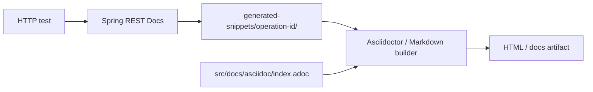
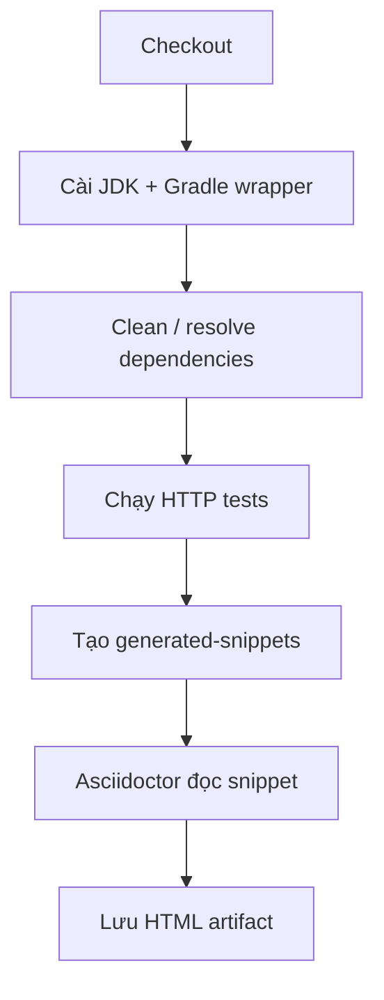

# Định nghĩa thư mục generated-snippets

## Mục tiêu học tập

Trong chương **Thiết lập dự án** của module **SPRING_REST_DOCS**, sau khi bài kiểm thử HTTP bằng MockMvc, WebTestClient hoặc REST Assured chạy, Spring REST Docs ghi request, response và các descriptor thành những tệp snippet. Các tệp này cần một nơi lưu trung gian để công cụ biên soạn tài liệu có thể đọc lại.

Thư mục thường được dùng cho mục đích đó có tên **generated-snippets**. Với Gradle, đường dẫn mặc định thường là **build/generated-snippets**; với Maven là **target/generated-snippets**. Đây là output do build tạo ra, không phải nơi viết tài liệu nguồn và không nên chỉnh sửa thủ công.

Sau bài này, bạn có thể:

- Giải thích vai trò của generated-snippets trong luồng test → snippet → Asciidoctor/Markdown.
- Phân biệt thư mục snippet với thư mục tài liệu nguồn và thư mục HTML đầu ra.
- Xác định convention path của Gradle/Maven và kiểm tra thư mục test thực sự sử dụng.
- Cấu hình output directory, đồng bộ với snippetsDir và attribute {snippets}.
- Tổ chức operation ID và cấu trúc thư mục cho nhiều endpoint, nhiều test suite.
- Xử lý dọn dẹp, incremental build, CI artifact, cache và lỗi do sai đường dẫn.

> **Phạm vi:** Bài tập trung vào quy ước và cách quản lý thư mục snippet do Spring REST Docs tạo ra. Ví dụ dùng MockMvc để minh họa; nguyên tắc đường dẫn áp dụng tương tự với WebTestClient và REST Assured ở nhánh được hỗ trợ.

## 1. generated-snippets là gì?

Spring REST Docs không tạo một trang tài liệu lớn ngay trong lúc gửi HTTP request. Thay vào đó, nó tạo nhiều **snippet nhỏ**, mỗi snippet ghi một khía cạnh của một HTTP operation. Ví dụ, với operation **products-get**, test có thể tạo:

```text
generated-snippets/
└── products-get/
    ├── curl-request.adoc
    ├── http-request.adoc
    ├── http-response.adoc
    ├── httpie-request.adoc
    ├── request-body.adoc
    ├── response-body.adoc
    └── response-fields.adoc
```

Mỗi thư mục operation chứa những tệp độc lập. **http-request.adoc** mô tả request; **http-response.adoc** ghi status, header và response body; **response-fields.adoc** xuất hiện khi test khai báo descriptor cho các trường JSON. Các snippet khác có thể xuất hiện khi test mô tả query parameter, path parameter, header, request field hoặc form parameter.

Thư mục gốc **generated-snippets** gom kết quả của các operation. Mỗi lần chạy test, Spring REST Docs ghi snippet vào output directory được cấu hình cho test context.

### Luồng dữ liệu



**Cần nhớ ba loại thư mục khác nhau:**

| Loại thư mục | Chứa gì? | Ai tạo hoặc chỉnh sửa? | Ví dụ |
| --- | --- | --- | --- |
| **Generated snippets** | Các tệp HTTP request/response và descriptor nhỏ | REST Docs tạo từ test; không sửa trực tiếp | build/generated-snippets |
| **Documentation source** | Trang AsciiDoc, Markdown, giải thích và cấu trúc nội dung | Nhóm phát triển biên soạn | src/docs/asciidoc |
| **Rendered documentation** | HTML hoặc định dạng xuất bản cuối | Asciidoctor/Markdown task tạo | build/docs hoặc build/asciidoc |

generated-snippets là vùng trung gian. Nó không thay thế source documentation và cũng không phải thư mục HTML được công bố.

## 2. Đường dẫn mặc định theo Gradle và Maven

Spring REST Docs dùng convention khác nhau tùy công cụ build:

| Công cụ | Thư mục snippet mặc định | Thư mục tài liệu nguồn thường dùng | Thư mục HTML |
| --- | --- | --- | --- |
| **Gradle** | build/generated-snippets | src/docs/asciidoc | Do task Asciidoctor cấu hình; thường trong build/ |
| **Maven** | target/generated-snippets | Thường là src/main/asciidoc hoặc cấu hình plugin riêng | Do Asciidoctor Maven Plugin cấu hình; thường trong target/ |

Gradle dùng **build/** làm thư mục sản phẩm của build; Maven dùng **target/**. Khi chuyển project từ Maven sang Gradle hoặc ngược lại, không nên giả định đường dẫn snippet giữ nguyên.

### 2.1. Gradle

Trong dự án Gradle, REST Docs mặc định ghi snippet tại:

```text
<project-root>/
└── build/
    └── generated-snippets/
        └── <operation-id>/
            ├── http-request.adoc
            └── http-response.adoc
```

Biến Gradle thường được đặt trong build.gradle để tái sử dụng:

```groovy
ext {
    snippetsDir = file('build/generated-snippets')
}
```

Đây là biến của build script, **không phải thuộc tính tự động đổi output directory của REST Docs**. Nó hữu ích để đồng bộ nơi test ghi snippet, output của task test, input của task asciidoctor và attribute/extension mà tài liệu nguồn dùng để include snippet.

Nếu chỉ định snippetsDir nhưng test vẫn ghi ở một đường dẫn mặc định khác, Asciidoctor sẽ đọc thư mục rỗng. Hãy kiểm tra output thực tế trước khi kết luận biến này đã cấu hình xong.

### 2.2. Maven

Với Maven, đường dẫn snippet mặc định là:

```text
<project-root>/
└── target/
    └── generated-snippets/
        └── <operation-id>/
            ├── http-request.adoc
            └── http-response.adoc
```

Maven và plugin biên soạn thường dùng target/generated-snippets làm nguồn include. Nếu test dùng @AutoConfigureRestDocs hoặc một output directory tùy chỉnh, cần đồng bộ cấu hình Asciidoctor Maven Plugin với output đó.

## 3. Xác định output directory của REST Docs

### 3.1. Trường hợp dùng Spring Boot và @AutoConfigureRestDocs

Khi Boot tự cấu hình REST Docs, có thể chỉ định output directory qua thuộc tính outputDir:

```java
import org.springframework.boot.test.autoconfigure.restdocs.AutoConfigureRestDocs;
import org.springframework.boot.test.autoconfigure.web.servlet.WebMvcTest;

@WebMvcTest(ProductController.class)
@AutoConfigureRestDocs(outputDir = "build/generated-snippets")
class ProductDocumentationTest {
    // MockMvc test và document(...) đặt tại đây
}
```

Đây là import của Spring Boot 3.x. Với Boot 4, package test auto-configuration được tổ chức lại; kiểm tra package tương ứng của phiên bản Boot đang sử dụng. Module tích hợp REST Docs vẫn cần nằm trong test classpath.

Giá trị outputDir là thư mục gốc của snippet; REST Docs tạo thư mục con theo operation ID. Nếu dùng Gradle có thể chọn build/generated-snippets; với Maven convention thường là target/generated-snippets. Quan trọng là test, task biên soạn và tài liệu phải thống nhất một đường dẫn.

### 3.2. Trường hợp cấu hình MockMvc thủ công

Nếu test tạo MockMvc bằng MockMvcBuilders và RestDocumentationExtension, cấu hình REST Docs được gắn vào chính đối tượng MockMvc:

```java
@ExtendWith(RestDocumentationExtension.class)
class ProductDocumentationTest {

    private MockMvc mockMvc;

    @BeforeEach
    void setUp(RestDocumentationContextProvider documentation) {
        this.mockMvc = MockMvcBuilders.standaloneSetup(new ProductController())
                .apply(documentationConfiguration(documentation))
                .build();
    }
}
```

Extension cung cấp context cho REST Docs, gồm output directory phù hợp với môi trường build. Nếu cần thay đổi thư mục, hãy dùng cấu hình output directory được hỗ trợ bởi phiên bản Spring REST Docs/Boot và bảo đảm Asciidoctor nhận đúng thư mục đó. Không giả định biến Gradle snippetsDir tự thay đổi cấu hình output của JUnit extension.

### 3.3. Với WebTestClient

WebTestClient kết nối REST Docs bằng filter:

```java
this.webTestClient = WebTestClient
        .bindToController(new ProductController())
        .configureClient()
        .filter(documentationConfiguration(documentation))
        .build();
```

Sau khi thực thi exchange, gọi consumeWith(document("products-get")) để ghi snippet. Output directory thuộc RestDocumentationContextProvider được dùng trong cấu hình filter. Nếu đổi output location, bảo đảm context được cấu hình tương ứng; chỉ đặt một biến Gradle không tự chuyển đường dẫn của filter.

### 3.4. Với REST Assured

Tích hợp REST Assured của Spring REST Docs 3.x cũng dùng context để tạo filter cấu hình:

```java
this.specification = new RequestSpecBuilder()
        .setBaseUri("http://127.0.0.1")
        .setPort(port)
        .addFilter(documentationConfiguration(documentation))
        .build();
```

Khi test gọi filter(document("products-get")), snippet được ghi vào output directory của REST Docs context. **Lưu ý phiên bản:** Spring REST Docs 4.0 đã loại bỏ tích hợp REST Assured; ví dụ này dành cho nhánh REST Docs 3.x tương thích.

## 4. Đồng bộ snippetsDir với task Asciidoctor

### 4.1. Cấu hình Gradle cơ bản

Trong build.gradle:

```groovy
ext {
    snippetsDir = file('build/generated-snippets')
}

tasks.named('test') {
    outputs.dir snippetsDir
}

tasks.named('asciidoctor') {
    inputs.dir snippetsDir
    dependsOn test
}
```

Ba khai báo có ý nghĩa khác nhau:

| Khai báo | Mục đích |
| --- | --- |
| snippetsDir = file(...) | Tạo biến đường dẫn thống nhất trong build script |
| test.outputs.dir snippetsDir | Đăng ký thư mục snippet là output của task test |
| asciidoctor.inputs.dir snippetsDir | Đăng ký thư mục snippet là input của task Asciidoctor |
| dependsOn test | Bảo đảm test chạy trước khi biên soạn |

Trong task Asciidoctor, extension REST Docs được đưa vào classpath qua configuration riêng:

```groovy
configurations {
    asciidoctorExt
}

dependencies {
    asciidoctorExt 'org.springframework.restdocs:spring-restdocs-asciidoctor:4.0.2'
}

tasks.named('asciidoctor') {
    inputs.dir snippetsDir
    configurations 'asciidoctorExt'
    dependsOn test
}
```

Version extension 4.0.2 dành cho REST Docs 4.0.2. Nếu dùng REST Docs 3.x, chọn extension cùng nhánh và AsciidoctorJ phù hợp. Không trộn extension 4.x với test integration 3.x.

### 4.2. Đồng bộ attribute {snippets}

Trong file src/docs/asciidoc/index.adoc, có thể include snippet:

```asciidoc
= Product API

== GET /api/products/7

=== HTTP request
include::{snippets}/products-get/http-request.adoc[]

=== HTTP response
include::{snippets}/products-get/http-response.adoc[]
```

Attribute {snippets} được extension spring-restdocs-asciidoctor thiết lập. Nó cần trỏ tới **thư mục gốc snippet** do test tạo. Nếu thư mục thực tế là build/generated-snippets nhưng include đang trỏ tới target/generated-snippets, Asciidoctor sẽ báo không tìm thấy file.

Không nên hard-code một đường dẫn trong file .adoc và đặt một path khác trong Gradle mà không có chủ ý. Ưu tiên dùng attribute do extension quản lý hoặc truyền một biến/attribute thống nhất qua build.

### 4.3. Operation ID tạo thư mục con

Lời gọi tài liệu hóa đặt operation ID:

```java
.andDo(document("products-get"))
```

Hoặc với WebTestClient:

```java
.consumeWith(document("products-get"))
```

REST Assured:

```java
.filter(document("products-get"))
```

Ba cách trên khác API gọi theo HTTP testing tool, nhưng đều xác định operation ID là products-get. REST Docs tạo thư mục con:

```text
generated-snippets/
└── products-get/
    ├── http-request.adoc
    └── http-response.adoc
```

Tài liệu nguồn phải tham chiếu đúng operation ID. Nếu test đổi tên operation thành product-detail, các include cũ dùng products-get sẽ không tự cập nhật.

## 5. Đặt tên operation và tổ chức nhiều endpoint

Một API thường có nhiều operation. Nên chọn ID ổn định, dễ đọc, mô tả tài nguyên và hành động:

| Endpoint | Operation ID gợi ý | Thư mục được tạo |
| --- | --- | --- |
| GET /api/products | products-list | generated-snippets/products-list |
| GET /api/products/{id} | products-get | generated-snippets/products-get |
| POST /api/products | products-create | generated-snippets/products-create |
| PUT /api/products/{id} | products-update | generated-snippets/products-update |
| DELETE /api/products/{id} | products-delete | generated-snippets/products-delete |

Không dùng ID trùng cho các test tạo tài liệu có mục đích khác nhau, trừ khi chủ động muốn cùng operation ghi vào cùng thư mục. Nếu hai test cùng ghi products-get nhưng mô tả response khác nhau, chúng có thể ghi đè snippet hoặc gây kết quả phụ thuộc thứ tự chạy.

Với một operation có nhiều biến thể request/response, có thể đặt ID khác như:

- products-get-basic
- products-get-not-found
- products-get-with-fields

Hoặc tách theo phương pháp/phiên bản API nếu cần. Chọn tên có ý nghĩa với người đọc; tránh dùng ID tự sinh từ thứ tự test như test-1, test-2.

### 5.1. Không nhầm thư mục operation với thư mục tài nguyên

REST Docs mặc định tạo cấu trúc theo **operation ID**, không tự phân loại theo controller/package hoặc resource name. Nếu muốn chia theo nhóm tài liệu, hãy tổ chức source AsciiDoc bằng nhiều file/section hoặc cấu hình ID theo quy ước như catalog/products-list; sau đó bảo đảm đường dẫn include phản ánh đúng cấu trúc tạo ra.

### 5.2. Tránh test song song ghi cùng output

Khi test chạy song song, mỗi test nên dùng operation ID riêng, hoặc cần cơ chế điều phối để tránh cùng ghi một file snippet. Không chia sẻ cùng một thư mục output giữa các job CI độc lập nếu chúng có thể thực thi test khác nhau nhưng ghi cùng operation.

## 6. Nhiều test suite và nhiều thư mục snippet

Trong dự án đơn giản, một thư mục generated-snippets là đủ. Dự án lớn có thể tách:

```text
build/
├── generated-snippets-unit/
├── generated-snippets-integration/
└── docs/
    └── api/
```

Ví dụ về mục đích:

| Thư mục | Nguồn tạo | Nội dung |
| --- | --- | --- |
| generated-snippets-unit | Task test | Snippet từ test controller/service trong test suite nhanh |
| generated-snippets-integration | Task integrationTest | Snippet từ test chạy ứng dụng/server thực |
| docs/api | Task asciidoctor | HTML đầu ra cuối cùng |

Khi tách test suite, phải cấu hình **output directory của REST Docs context** trong từng suite và khai báo task output/input chính xác. Không chỉ đổi tên biến Gradle rồi giả định JUnit extension sẽ ghi sang thư mục mới.

### 6.1. Ví dụ khai báo hai output directory trong Gradle

Đây là minh họa về task graph:

```groovy
def unitSnippets = file('build/generated-snippets-unit')
def integrationSnippets = file('build/generated-snippets-integration')

tasks.named('test') {
    outputs.dir unitSnippets
}

tasks.named('integrationTest') {
    outputs.dir integrationSnippets
}

tasks.named('asciidoctor') {
    inputs.dir unitSnippets
    inputs.dir integrationSnippets
    dependsOn test, integrationTest
}
```

Đoạn trên chỉ khai báo quan hệ task. Để hoàn chỉnh, test suite test và integrationTest phải được cấu hình để REST Docs thực sự ghi vào đúng thư mục tương ứng; Asciidoctor extension cũng cần đọc cả hai nguồn hoặc tài liệu phải include theo hai attribute riêng. Với suite custom, kiểm tra Gradle test suite/source set và cách Spring REST Docs context nhận output directory.

### 6.2. Đặt attribute riêng khi có hai nguồn snippet

Nếu dùng Asciidoctor với hai thư mục, có thể đặt attribute rõ ràng trong tài liệu:

```asciidoc
:unit-snippets: build/generated-snippets-unit
:integration-snippets: build/generated-snippets-integration

== API tests
include::{unit-snippets}/products-list/http-response.adoc[]

== End-to-end tests
include::{integration-snippets}/products-create/http-response.adoc[]
```

Đường dẫn tương đối trong AsciiDoc được phân giải theo base directory của Asciidoctor task. Nếu chạy task từ Gradle project root, cần xác minh các đường dẫn này trỏ tới thư mục đúng. Với cấu hình nâng cao, truyền attribute từ task để tránh lặp path và bảo đảm một nguồn cấu hình.

## 7. Dọn dẹp snippet và kiểm soát file cũ

generated-snippets là output build, nên thường không được commit vào Git. .gitignore tiêu chuẩn của dự án thường bỏ qua build/ hoặc target/; hãy giữ convention đó.

### 7.1. Vì sao snippet cũ nguy hiểm?

Giả sử test trước đó tạo products-create/request-fields.adoc. Sau này test thay đổi và không còn tạo snippet đó, nhưng thư mục build cũ vẫn còn file. Nếu task Asciidoctor include file cũ, tài liệu có thể biên soạn thành công dù snippet không còn được test hiện tại tạo ra.

Một lần build sạch giúp loại bỏ output cũ:

```bash
./gradlew clean asciidoctor
```

Hoặc Maven:

```bash
./mvnw clean verify
```

clean xóa thư mục build/target do công cụ build quản lý, sau đó test tạo lại snippet. Không dùng clean nếu thư mục đó chứa file nguồn hoặc dữ liệu không thể tái tạo.

### 7.2. Không sửa snippet bằng tay

Nếu nội dung snippet sai:

- Sửa HTTP test, assertion hoặc descriptor.
- Sửa preprocessor nếu cần ẩn header, thay host/port hoặc chuẩn hóa body.
- Sửa file tài liệu nguồn nếu cần bổ sung diễn giải/heading.

Không sửa trực tiếp build/generated-snippets rồi commit để giữ thay đổi; lần test sau có thể ghi đè và nội dung sẽ không thể tái tạo.

### 7.3. Git và artifact

Thông thường chỉ commit test và mã cấu hình Spring REST Docs, file AsciiDoc/Markdown nguồn, cấu hình Gradle/Maven và các script cần thiết. Không commit snippet trung gian hoặc HTML build trừ khi dự án có quy trình phát hành yêu cầu rõ ràng. Trong CI, có thể lưu HTML như artifact; snippet có thể được truyền giữa job nếu task biên soạn chạy ở job riêng.

## 8. Tích hợp với CI và cache

Luồng CI chuẩn:



Khi dùng cache, cần phân biệt:

- **Dependency cache:** lưu các thư viện Gradle đã tải để build nhanh hơn.
- **Build output cache:** có thể khôi phục output task nếu task cacheable và input/output khớp.
- **CI artifact:** chuyển file từ job này sang job khác.

Không coi thư mục snippet đã tồn tại là bằng chứng test vừa chạy thành công. Nếu CI chia thành hai job:

1. Job HTTP test chạy test và lưu build/generated-snippets thành artifact.
2. Job documentation tải artifact snippet và chạy Asciidoctor với đúng đường dẫn.
3. Kiểm tra operation cần thiết có đủ snippet trước khi phát hành HTML.

Nếu task Asciidoctor chạy trong cùng job, cách đơn giản là nối asciidoctor.dependsOn test và khai báo task input/output. Khi đó Gradle có thể kiểm soát thứ tự thực thi và tính up-to-date.

### 8.1. Không cache nhầm output giữa các nhánh

Nếu output cache hoặc CI workspace dùng chung giữa nhánh khác nhau, bảo đảm cache key tính đến source, Gradle configuration và test input liên quan. Snippet có thể thay đổi theo dữ liệu test, phiên bản API hoặc cấu hình environment.

Không đưa dữ liệu nhạy cảm vào snippet để tránh rủi ro khi lưu artifact/cache. Sử dụng dữ liệu giả và preprocessor để loại bỏ token hoặc cookie trước khi ghi.

## 9. Kiểm tra thư mục snippet sau khi test

### 9.1. Gradle

PowerShell:

```powershell
Get-ChildItem -Recurse build/generated-snippets
```

Linux/macOS:

```bash
find build/generated-snippets -type f
```

Kiểm tra:

- Có đúng thư mục operation ID mà test dùng không?
- Có http-request.adoc và http-response.adoc không?
- Nếu test khai báo responseFields(...), có response-fields.adoc không?
- Thời điểm sửa file có thuộc lần chạy test vừa thực hiện không?

### 9.2. Maven

PowerShell:

```powershell
Get-ChildItem -Recurse target/generated-snippets
```

Linux/macOS:

```bash
find target/generated-snippets -type f
```

Nếu không thấy thư mục, chạy test có lời gọi document(...) và xác minh output directory đã chọn. Đừng chỉ chạy Asciidoctor rồi tìm snippet; task biên soạn không tự tạo HTTP test output.

### 9.3. Kiểm tra task graph Gradle

```bash
./gradlew asciidoctor --dry-run
```

Lệnh dry-run giúp xem task nào sẽ được đưa vào execution graph mà không thực thi build. Với cấu hình đúng, task test phải đứng trước task asciidoctor trong quan hệ phụ thuộc. Dry-run không chứng minh test sẽ tạo đủ snippet; vẫn cần một lần chạy test thật để kiểm tra file.

## 10. Lỗi thường gặp do sai đường dẫn

| Triệu chứng | Nguyên nhân có thể | Cách xử lý |
| --- | --- | --- |
| Asciidoctor báo không tìm thấy http-request.adoc | Include sai operation ID hoặc sai gốc snippet | Kiểm tra tên trong document("...") và {snippets}. |
| build/generated-snippets không tồn tại | Test không chạy, không gọi document(...) hoặc output directory đã đổi | Chạy đúng test và xác minh cấu hình REST Docs. |
| Test ghi snippet ở target/ nhưng Gradle đọc build/ | Chuyển build tool nhưng giữ path cũ | Đồng bộ test output directory và snippetsDir. |
| Asciidoctor đọc snippet cũ sau khi test bỏ descriptor | File cũ còn tồn tại từ lần build trước | Chạy clean, xác minh output lần build mới. |
| {snippets} resolve thành đường dẫn rỗng/sai | Extension không nằm trên classpath Asciidoctor hoặc attribute sai | Kiểm tra spring-restdocs-asciidoctor và task configuration. |
| Hai test ghi cùng operation folder | Operation ID bị trùng | Đặt ID riêng hoặc hợp nhất test có chủ ý. |
| CI có snippet ở job test nhưng job docs không thấy | Job không truyền artifact hoặc path không khớp | Upload/download đúng thư mục và đồng bộ base directory. |
| Task Asciidoctor luôn chạy lại | Input thay đổi liên tục hoặc task chưa khai báo input/output ổn định | Kiểm tra Gradle inputs/outputs và lý do task out-of-date. |
| Build sạch xong tài liệu báo thiếu snippet | Test suite sinh snippet chưa được nối vào task Asciidoctor | Thêm đúng dependsOn và inputs cho suite đó. |
| HTML chứa URL localhost/cổng ngẫu nhiên | Snippet phản ánh host test server | Dùng URI preprocessor cho nội dung được ghi, không thay server URL thực. |

## 11. Bài thực hành

1. Tạo một test MockMvc có operation ID inventory-list; xác minh REST Docs ghi snippet vào build/generated-snippets/inventory-list.
2. Tạo src/docs/asciidoc/index.adoc include inventory-list/http-request.adoc và inventory-list/http-response.adoc.
3. Định nghĩa snippetsDir, đăng ký test.outputs.dir, asciidoctor.inputs.dir và dependsOn test.
4. Chạy ./gradlew clean asciidoctor, xác minh thư mục snippet được tạo mới và HTML được kết xuất.
5. Đổi operation ID trong test nhưng chưa sửa include; quan sát lỗi không tìm thấy snippet. Sau đó cập nhật include cho đúng.
6. Thêm descriptor responseFields(...), xác minh snippet response-fields.adoc xuất hiện.
7. (Nâng cao) Tách integration test suite và tạo output directory riêng, rồi cấu hình task Asciidoctor đọc cả hai thư mục.

**Câu hỏi tự đánh giá**

- generated-snippets khác gì src/docs/asciidoc?
- Vì sao Gradle dùng build/generated-snippets còn Maven thường dùng target/generated-snippets?
- Một biến Gradle tên snippetsDir có tự đổi output directory của RestDocumentationExtension không?
- Operation ID được dùng để đặt tên thư mục như thế nào?
- Vì sao không nên dùng chung operation ID cho hai test có response khác nhau?
- inputs.dir, outputs.dir và dependsOn đóng vai trò gì?
- Làm sao phát hiện tài liệu đang include snippet cũ?
- Nếu test và Asciidoctor nằm ở hai CI job, cần truyền gì giữa chúng?

## Tài liệu tham khảo chính thức

- [Spring REST Docs — Getting Started](https://docs.spring.io/spring-restdocs/tutorial/getting-started/index.html): thư mục snippet mặc định, cấu hình test và cách include snippet.
- [Spring REST Docs — Configuration](https://docs.spring.io/spring-restdocs/reference/configuration.html): cấu hình REST Docs, output và template/snippet.
- [Spring REST Docs — Documenting Your API](https://docs.spring.io/spring-restdocs/reference/documenting-your-api.html): operation, request/response và các loại descriptor.
- [Spring Boot — Testing Spring Boot Applications](https://docs.spring.io/spring-boot/reference/testing/spring-boot-applications.html): @AutoConfigureRestDocs và cấu hình test context.
- [Gradle — Incremental Builds](https://docs.gradle.org/current/userguide/incremental_build.html): khai báo input/output cho task và kiểm tra up-to-date.
- [Gradle — Build Cache](https://docs.gradle.org/current/userguide/build_cache.html): quản lý output cache và tái sử dụng kết quả build.
- [Gradle — JVM Test Suite Plugin](https://docs.gradle.org/current/userguide/jvm_test_suite_plugin.html): tổ chức nhiều test suite và dependency riêng.
- [Maven — Introduction to the Build Lifecycle](https://maven.apache.org/guides/introduction/introduction-to-the-lifecycle.html): vòng đời test, package và verify.

Khi hoàn tất cấu hình, hãy kiểm tra bằng một lần build sạch: test tạo snippet trong đúng thư mục, operation ID khớp với đường dẫn include, Asciidoctor đọc đúng output và HTML được lưu ở vị trí đã định. Nhờ vậy generated-snippets trở thành đầu ra có thể tái tạo, thay vì một tập tệp cũ không rõ nguồn gốc.
