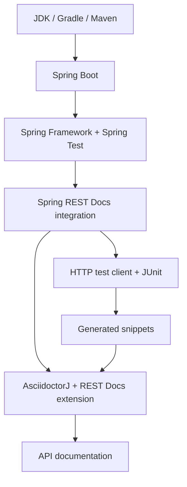

# Quản lý phiên bản thư viện và khả năng tương thích

## Mục tiêu học tập

Trong chương **Thiết lập dự án** của module **SPRING_REST_DOCS**, quản lý phiên bản quyết định bài kiểm thử HTTP có biên dịch và chạy ổn định hay không, Spring REST Docs có tạo đúng snippet hay không và Asciidoctor có biên soạn được tài liệu hay không. Các thành phần liên quan gồm JDK, Spring Boot, Spring Framework, Spring Test, JUnit, module tích hợp REST Docs, HTTP test client và công cụ biên soạn tài liệu.

Sau bài này, bạn có thể:

- Xác định quan hệ tương thích giữa Spring Boot, Spring Framework và Spring REST Docs.
- Phân biệt việc quản lý **phiên bản** với việc chọn **dependency scope**.
- Dùng BOM và dependency management để hạn chế xung đột phiên bản.
- Cấu hình Gradle/Maven để các module REST Docs dùng cùng một dòng phiên bản.
- Kiểm tra dependency graph và phát hiện thư viện bị nâng/hạ phiên bản ngoài dự kiến.
- Lập kế hoạch nâng cấp nhánh REST Docs, JUnit, REST Assured hoặc Asciidoctor mà không làm hỏng test và tài liệu.

> **Nguyên tắc:** Chọn một thế hệ Spring tương thích trước, sau đó chọn nhánh Spring REST Docs phù hợp và để BOM quản lý các dependency trong phạm vi của nó. Không nâng riêng từng thư viện chỉ vì có bản mới hơn.

## 1. Vì sao phải quản lý phiên bản theo một bộ?

Một bài test REST Docs đi qua nhiều lớp thư viện:

1. JDK biên dịch và chạy ứng dụng, Gradle/Maven và test.
2. Spring Boot quản lý dependency và cấu hình ứng dụng.
3. Spring Framework và Spring Test cung cấp API web/test.
4. JUnit thực thi bài kiểm thử.
5. MockMvc, WebTestClient hoặc REST Assured gửi request.
6. Module Spring REST Docs ghi request/response và tạo snippet.
7. AsciidoctorJ cùng extension REST Docs biên soạn snippet thành tài liệu.

Nếu các lớp này lệch thế hệ, lỗi có thể xuất hiện ở nhiều thời điểm:

| Thời điểm | Ví dụ lỗi |
| --- | --- |
| Resolve dependency | Không tìm thấy artifact hoặc không có phiên bản tương thích |
| Biên dịch | Không tìm thấy class/package, API đã đổi hoặc bị loại bỏ |
| Chạy test | NoSuchMethodError, NoClassDefFoundError, lỗi JUnit engine |
| Sinh snippet | Filter/extension không hoạt động, không có operation output |
| Biên soạn tài liệu | AsciidoctorJ không tương thích extension, macro hoặc template |
| Đóng gói/phát hành | Dependency test lọt vào runtime hoặc artifact tài liệu không được tạo |



Lỗi tương thích không nhất thiết do Spring REST Docs. Test compile có thể thất bại do JUnit API; lỗi dựng HTML có thể đến từ AsciidoctorJ hoặc Gradle plugin dù HTTP test đã chạy thành công.

## 2. Ma trận tương thích theo thế hệ

Ma trận sau là hướng chọn ban đầu cho các dự án Spring phổ biến:

| Nền dự án | Spring Framework | Spring REST Docs | Java tối thiểu | Bộ test thường dùng |
| --- | --- | --- | --- | --- |
| Spring Boot 2.x (dòng cũ) | Framework 5.x | REST Docs 2.x tương ứng | Tùy bản Boot/Framework; nhiều bản hỗ trợ Java 8/11 | JUnit 5 ở cấu hình phù hợp; kiểm tra từng release |
| Spring Boot 3.x | Framework 6.x | REST Docs 3.x | Java 17 | JUnit Jupiter 5; MockMvc/WebTestClient; REST Assured 5.2+ với REST Docs 3 |
| Spring Boot 4.x | Framework 7.x | REST Docs 4.x | Java 17 | JUnit 6; MockMvc/WebTestClient |

Các mốc quan trọng:

- **Nhánh 3.0** nâng mức nền lên Java 17 và Spring Framework 6. Tích hợp REST Assured yêu cầu REST Assured 5.2 trở lên.
- **Nhánh 4.0** chuyển sang Spring Framework 7 và JUnit 6; yêu cầu AsciidoctorJ 3.0 khi dùng tích hợp Asciidoctor. Tích hợp REST Assured đã bị loại bỏ khỏi REST Docs 4.0.
- Tên artifact MockMvc và WebTestClient giữ vai trò tương ứng qua các nhánh, nhưng phải chọn phiên bản module khớp thế hệ Framework/REST Docs.

**Không xem bảng này là ma trận cho phép mọi bản vá phối hợp tùy ý.** Spring Boot BOM/parent là nguồn quản lý phiên bản ưu tiên cho dự án Boot. Với dự án không dùng Boot, cần kiểm tra release notes và system requirements của chính phiên bản Spring REST Docs dự định cài.

### 2.1. Chọn nhánh REST Docs theo Boot

- Dự án Boot 3.x đang dùng Framework 6.x: chọn REST Docs 3.x, thường dùng JUnit Jupiter 5 và module tích hợp theo HTTP test client hiện có.
- Dự án Boot 4.x đang dùng Framework 7.x: chọn REST Docs 4.x và JUnit 6; dùng MockMvc hoặc WebTestClient. Nếu test đang dựa vào tích hợp REST Assured của REST Docs 3, phải lên kế hoạch thay đổi cách tích hợp tài liệu.
- Dự án không dùng Boot: lấy Framework làm mốc, rồi kiểm tra yêu cầu Spring REST Docs, JUnit và JDK. Không đưa BOM của Boot vào chỉ để mượn phiên bản khi không dùng hệ dependency của Boot.

### 2.2. Chọn theo HTTP test client

| HTTP test client | Module Spring REST Docs | Ghi chú phiên bản |
| --- | --- | --- |
| MockMvc | org.springframework.restdocs:spring-restdocs-mockmvc | Dùng với Spring MVC; chọn bản REST Docs phù hợp Framework |
| WebTestClient | org.springframework.restdocs:spring-restdocs-webtestclient | Phù hợp WebFlux hoặc test client đã dùng WebTestClient |
| REST Assured | org.springframework.restdocs:spring-restdocs-restassured | Tích hợp thuộc nhánh REST Docs 3; bị loại bỏ ở REST Docs 4.0 |

REST Assured có tọa độ riêng là io.rest-assured:rest-assured. Khi dùng tích hợp REST Docs 3.x, cần cả REST Assured và module cầu nối REST Docs trên test classpath. Hai dependency có nhiệm vụ khác nhau và phải tương thích với nhau.

## 3. Phân biệt version, BOM và scope

Ba khái niệm này thường bị nhầm:

| Khái niệm | Trả lời câu hỏi | Ví dụ |
| --- | --- | --- |
| **Version** | Dùng phiên bản thư viện nào? | Spring REST Docs 4.0.x |
| **BOM/dependency management** | Nguồn nào quản lý phiên bản cho nhóm dependency? | Spring Boot dependency management hoặc Spring REST Docs BOM |
| **Scope/configuration** | Dependency có mặt ở compile/runtime/test/plugin nào? | Gradle testImplementation, Maven test |

BOM không tự biến dependency thành test-only. Ví dụ:

```groovy
dependencies {
    testImplementation 'org.springframework.restdocs:spring-restdocs-mockmvc'
}
```

Spring Boot BOM có thể quản lý phiên bản artifact, còn testImplementation quyết định dependency nằm trong test classpath. Hai việc độc lập.

Tương tự trong Maven:

```xml
<dependency>
    <groupId>org.springframework.restdocs</groupId>
    <artifactId>spring-restdocs-mockmvc</artifactId>
    <scope>test</scope>
</dependency>
```

Parent/BOM quản lý phiên bản; scope giữ dependency trong quá trình biên dịch và chạy test.

## 4. Dùng BOM khi dự án Spring Boot

### 4.1. Maven với Spring Boot parent

Khi dùng spring-boot-starter-parent, Spring Boot cung cấp dependency management cho những thư viện được quản lý:

```xml
<parent>
    <groupId>org.springframework.boot</groupId>
    <artifactId>spring-boot-starter-parent</artifactId>
    <version>4.0.9</version>
    <relativePath/>
</parent>

<dependencies>
    <dependency>
        <groupId>org.springframework.boot</groupId>
        <artifactId>spring-boot-starter-webmvc</artifactId>
    </dependency>
    <dependency>
        <groupId>org.springframework.boot</groupId>
        <artifactId>spring-boot-starter-webmvc-test</artifactId>
        <scope>test</scope>
    </dependency>
    <dependency>
        <groupId>org.springframework.restdocs</groupId>
        <artifactId>spring-restdocs-mockmvc</artifactId>
        <scope>test</scope>
    </dependency>
</dependencies>
```

Đây là ví dụ cho Boot 4; version Boot chỉ là mốc minh họa và cần được thay theo dòng dự án lựa chọn. Không ghi version riêng cho dependency REST Docs nếu BOM đang quản lý đúng artifact đó. Nếu artifact không thuộc danh sách được quản lý, Maven sẽ yêu cầu version hoặc dependency management bổ sung.

Với Boot 3, dùng các starter tương ứng của thế hệ 3, ví dụ spring-boot-starter-web và spring-boot-starter-test; giữ REST Docs 3.x trên Framework 6.x.

### 4.2. Maven không dùng Boot parent

Có thể import BOM của Spring REST Docs để quản lý các artifact thuộc dự án REST Docs:

```xml
<dependencyManagement>
    <dependencies>
        <dependency>
            <groupId>org.springframework.restdocs</groupId>
            <artifactId>spring-restdocs-bom</artifactId>
            <version>4.0.2</version>
            <type>pom</type>
            <scope>import</scope>
        </dependency>
    </dependencies>
</dependencyManagement>
```

Ví dụ dùng BOM 4.0.2 cho REST Docs 4.0.x. BOM REST Docs chỉ quản lý dependency thuộc phạm vi BOM; nó không thay thế việc quản lý Spring Framework, JUnit, plugin Maven hoặc các thư viện khác. Dự án không dùng Boot vẫn phải tự kiểm tra toàn bộ bộ phiên bản.

### 4.3. Gradle với Spring Boot plugin và dependency management

Khi dùng plugin Spring Boot cùng dependency management, có thể khai báo dependency không cần lặp version nếu artifact được BOM quản lý:

```groovy
plugins {
    id 'java'
    id 'org.springframework.boot' version '4.0.9'
    id 'io.spring.dependency-management' version '1.1.7'
}

dependencies {
    implementation 'org.springframework.boot:spring-boot-starter-webmvc'
    testImplementation 'org.springframework.boot:spring-boot-starter-webmvc-test'
    testImplementation 'org.springframework.restdocs:spring-restdocs-mockmvc'
}
```

Nếu dùng Gradle native platform/BOM thay plugin dependency management, có thể import platform tường minh:

```groovy
dependencies {
    implementation platform('org.springframework.boot:spring-boot-dependencies:4.0.9')
    implementation 'org.springframework.boot:spring-boot-starter-webmvc'
    testImplementation 'org.springframework.boot:spring-boot-starter-webmvc-test'
    testImplementation 'org.springframework.restdocs:spring-restdocs-mockmvc'
}
```

Không cần đồng thời sử dụng nhiều cơ chế quản lý phiên bản nếu chúng giải quyết cùng một việc. Chọn một cách quản lý rõ ràng và kiểm tra dependency graph sau khi thay đổi.

## 5. Quản lý phiên bản không dùng Spring Boot

Khi dùng Spring Framework độc lập, nhóm dự án chịu trách nhiệm quản lý:

- Spring Framework và Spring Test cùng một dòng phiên bản.
- Spring REST Docs core và module tích hợp cùng một phiên bản.
- JDK đạt mức tối thiểu của Framework/REST Docs.
- JUnit API, engine và launcher tương thích.
- HTTP client/adapter như REST Assured nếu dùng.
- AsciidoctorJ và extension Asciidoctor của REST Docs.

Ví dụ Maven dùng REST Docs 3.x:

```xml
<dependencyManagement>
    <dependencies>
        <dependency>
            <groupId>org.springframework</groupId>
            <artifactId>spring-framework-bom</artifactId>
            <version>6.2.0</version>
            <type>pom</type>
            <scope>import</scope>
        </dependency>
        <dependency>
            <groupId>org.springframework.restdocs</groupId>
            <artifactId>spring-restdocs-bom</artifactId>
            <version>3.0.4</version>
            <type>pom</type>
            <scope>import</scope>
        </dependency>
    </dependencies>
</dependencyManagement>
```

Các version trong ví dụ chỉ minh họa cách phối hợp BOM, **không phải khuyến nghị chọn bản vá cụ thể cho dự án mới**. Hãy thay bằng bản vá được hỗ trợ sau khi đối chiếu system requirements và release notes. JUnit và REST Assured cũng cần được quản lý riêng nếu không có BOM khác quản lý chúng.

Không chỉ khai báo spring-restdocs-core rồi kỳ vọng có API MockMvc/WebTestClient/REST Assured. Cần module tích hợp phù hợp; các module REST Docs thuộc cùng release nên được giữ đồng bộ.

## 6. Đồng bộ các module Spring REST Docs

Một cấu hình điển hình chỉ dùng **một** HTTP test integration:

```groovy
dependencies {
    testImplementation 'org.springframework.restdocs:spring-restdocs-mockmvc'
}
```

Nếu dự án thực sự có nhiều test stack độc lập, có thể khai báo module tích hợp tương ứng, nhưng phải giữ chúng cùng phiên bản và chỉ dùng trong test cần thiết:

```groovy
dependencies {
    testImplementation 'org.springframework.restdocs:spring-restdocs-mockmvc'
    testImplementation 'org.springframework.restdocs:spring-restdocs-webtestclient'
}
```

Không thêm cả MockMvc, WebTestClient và REST Assured chỉ để thử nghiệm nếu project không dùng chúng. Đối với REST Assured, chỉ thêm spring-restdocs-restassured trong REST Docs 3.x và kiểm tra tương thích phiên bản REST Assured.

### 6.1. Kiểm tra phiên bản đồng bộ

Nếu project vô tình có spring-restdocs-core 4.0.x và spring-restdocs-mockmvc 3.0.x, classpath đã trộn hai release train. Hãy đưa các module REST Docs về cùng version. Tương tự, không kết hợp Spring Test 6.x với Spring Framework 7.x chỉ vì dependency resolver chọn một bản mới hơn.

## 7. Quản lý JUnit và HTTP client

### 7.1. JUnit 5 và JUnit 6

Spring REST Docs 3.x thường được sử dụng với JUnit Jupiter 5. Spring REST Docs 4.0 nâng yêu cầu lên JUnit 6. Không nên chỉ đổi version junit-jupiter-api mà quên engine/launcher.

Với Gradle:

```groovy
dependencies {
    testImplementation 'org.springframework.boot:spring-boot-starter-test'
    testRuntimeOnly 'org.junit.platform:junit-platform-launcher'
}

tasks.named('test') {
    useJUnitPlatform()
}
```

Khi dùng Boot, để BOM quản lý JUnit nếu có thể. Nếu tự quản lý JUnit, giữ API, engine và launcher ở những phiên bản tương thích.

### 7.2. REST Assured

REST Assured có version độc lập với Spring REST Docs. Với REST Docs 3.x, release notes xác định yêu cầu REST Assured từ 5.2 cho tích hợp của nhánh này. Không tự động nâng REST Assured lên major mới mà chưa xác minh tương thích.

Với REST Docs 4.0, module tích hợp REST Assured đã bị loại bỏ. Có thể tiếp tục dùng REST Assured như HTTP client độc lập cho mục đích kiểm thử nếu dự án muốn, nhưng không thể import API tích hợp RestAssuredRestDocumentation của REST Docs 4.0; cần lựa chọn cách tạo tài liệu khác được hỗ trợ.

## 8. Quản lý AsciidoctorJ và Gradle plugin

AsciidoctorJ, Asciidoctor Gradle plugin và spring-restdocs-asciidoctor là ba thành phần riêng biệt:

| Thành phần | Vai trò |
| --- | --- |
| org.asciidoctor.jvm.convert | Gradle plugin tạo task biên soạn |
| AsciidoctorJ | Engine xử lý AsciiDoc trên JVM |
| spring-restdocs-asciidoctor | Extension cung cấp attribute/macro của REST Docs |

REST Docs 4.0 yêu cầu AsciidoctorJ 3.0 khi dùng tích hợp Asciidoctor. Ví dụ:

```groovy
plugins {
    id 'org.asciidoctor.jvm.convert' version '4.0.5'
}

asciidoctorj {
    version = '3.0.0'
}

configurations {
    asciidoctorExt
}

dependencies {
    asciidoctorExt 'org.springframework.restdocs:spring-restdocs-asciidoctor:4.0.2'
}

tasks.named('asciidoctor') {
    configurations 'asciidoctorExt'
}
```

Plugin version 4.0.5, engine 3.0.0 và extension 4.0.2 là version của ba artifact khác nhau. Không có quy tắc rằng version của plugin Gradle phải giống version Spring REST Docs. Chọn từng phiên bản dựa trên tài liệu tương thích của chính thành phần đó.

Với REST Docs 3.x, không lấy cấu hình AsciidoctorJ 3.0 của REST Docs 4 áp dụng máy móc. Kiểm tra yêu cầu engine và plugin tương ứng nhánh 3.x.

## 9. Kiểm tra dependency graph trước khi chạy test

### 9.1. Gradle

Kiểm tra test runtime:

```bash
./gradlew dependencies --configuration testRuntimeClasspath
```

Kiểm tra phiên bản từng dependency:

```bash
./gradlew dependencyInsight --dependency spring-restdocs-core --configuration testRuntimeClasspath
./gradlew dependencyInsight --dependency spring-restdocs-mockmvc --configuration testRuntimeClasspath
./gradlew dependencyInsight --dependency spring-test --configuration testRuntimeClasspath
./gradlew dependencyInsight --dependency junit-jupiter-api --configuration testRuntimeClasspath
```

Đối chiếu:

- Tất cả module Spring REST Docs phải cùng release train.
- Spring Test phải cùng thế hệ với Spring Framework/Boot.
- JUnit API và engine/launcher phải tương thích.
- REST Assured phải đáp ứng yêu cầu của module tích hợp nếu dùng.
- Module test-only không được xuất hiện trong application runtime classpath ngoài ý muốn.

### 9.2. Maven

Liệt kê dependency tree:

```bash
./mvnw dependency:tree
```

Lọc riêng Spring REST Docs, Spring Framework và JUnit:

```bash
./mvnw dependency:tree -Dincludes=org.springframework.restdocs,org.springframework,org.junit.jupiter
```

Kiểm tra effective POM:

```bash
./mvnw help:effective-pom
```

Effective POM giúp xác định dependency version được kế thừa từ parent/BOM, plugin version và override trong dự án. Đừng chỉ xem pom.xml nguồn khi dependency có thể được quản lý ở parent.

## 10. Xử lý xung đột và khóa phiên bản

### 10.1. Vì sao resolver chọn phiên bản không mong đợi?

Một dependency bắc cầu có thể yêu cầu version khác với version được khai báo trực tiếp. Kết quả cuối phụ thuộc quy tắc resolution của Gradle/Maven, constraint, BOM và override. Vì thế, đọc một dòng dependency trong build file chưa đủ; cần xem **phiên bản cuối cùng trên classpath**.

Các biện pháp:

- Ưu tiên BOM của Spring Boot hoặc BOM phù hợp thay vì tự pin từng Spring module.
- Tránh khai báo version riêng cho spring-core, spring-test, spring-webmvc khi Boot đã quản lý chúng.
- Không ép một module REST Docs khác release train để sửa tạm lỗi biên dịch.
- Dùng dependency constraints/platform khi thực sự cần khóa phiên bản ngoài BOM.
- Sau khi thay đổi, chạy dependencyInsight/dependency:tree và test.

### 10.2. Gradle dependency locking

Với dự án cần build tái lập, Gradle hỗ trợ dependency locking. Có thể bật cho configuration cần thiết:

```groovy
dependencyLocking {
    lockAllConfigurations()
}
```

Sau đó ghi nhận các phiên bản được resolve theo quy trình lock của dự án. Lock file giúp những lần build sau dùng cùng version cho đến khi nhóm chủ động cập nhật lock state. Không dùng locking để che giấu một tổ hợp dependency không tương thích; hãy xác minh test trước khi lưu lock mới.

### 10.3. Maven Enforcer và convergence

Maven Enforcer Plugin có thể phát hiện dependency version không hội tụ hoặc vi phạm quy tắc dự án. Rule dependency convergence giúp tìm trường hợp cùng một artifact được yêu cầu ở nhiều version khác nhau. Đây là công cụ phát hiện vấn đề; vẫn cần xem xét ngoại lệ hợp lệ và không tắt rule chỉ để build xanh.

## 11. Quy trình nâng cấp phiên bản an toàn

Khi nâng Spring Boot, Spring REST Docs hoặc công cụ liên quan, thực hiện theo trình tự:

1. **Chọn đích:** xác định Boot/Framework/JDK mục tiêu và nhánh REST Docs tương thích.
2. **Đọc release notes:** kiểm tra breaking changes, Java/JUnit/Asciidoctor yêu cầu và module đã bị loại bỏ.
3. **Cập nhật quản lý version:** thay Boot parent/plugin/BOM hoặc BOM độc lập; tránh override lẻ tẻ.
4. **Cập nhật test client:** kiểm tra MockMvc/WebTestClient/REST Assured; đặc biệt khi chuyển REST Docs 3 sang 4.
5. **Cập nhật Asciidoctor:** đồng bộ extension, engine và Gradle/Maven plugin.
6. **Kiểm tra dependency graph:** xác minh không còn module sai thế hệ hoặc dependency bị ép ngoài dự kiến.
7. **Chạy test HTTP:** xác minh assertion và snippet mới được tạo.
8. **Biên soạn tài liệu:** chạy Asciidoctor/Markdown và kiểm tra artifact đầu ra.
9. **Chạy CI/build đóng gói:** xác minh runtime artifact không chứa test dependencies ngoài ý muốn.

### 11.1. Ví dụ chuyển từ REST Docs 3 sang 4

| Khu vực | Trước: REST Docs 3 | Sau: REST Docs 4 |
| --- | --- | --- |
| Nền Spring phổ biến | Boot 3 / Framework 6 | Boot 4 / Framework 7 |
| Java | 17+ | 17+ |
| JUnit | JUnit 5 | JUnit 6 |
| REST Assured integration | Có, REST Assured 5.2+ | Đã bị loại bỏ |
| MockMvc | Module MockMvc 3.x | Module MockMvc 4.x |
| WebTestClient | Module WebTestClient 3.x | Module WebTestClient 4.x |
| AsciidoctorJ | Kiểm tra yêu cầu nhánh 3.x | AsciidoctorJ 3.0 |

Đây là một lần nâng thế hệ framework, không chỉ thay version REST Docs. Các package test của Spring Boot cũng có thể thay đổi; kiểm tra import annotation như AutoConfigureRestDocs, WebMvcTest và WebFluxTest theo Boot version mới.

## 12. Chẩn đoán lỗi tương thích thường gặp

| Triệu chứng | Nguyên nhân cần xem xét | Hướng xử lý |
| --- | --- | --- |
| UnsupportedClassVersionError | JDK runtime thấp hơn mức bytecode của thư viện | Kiểm tra JDK của IDE, Gradle/Maven và CI |
| NoSuchMethodError trong Spring Test | Spring Test và Spring Framework lệch version hoặc API đã thay đổi | Xem dependency graph, dùng BOM và loại bỏ override sai |
| NoClassDefFoundError cho REST Docs | Thiếu module tích hợp hoặc dependency sai scope | Thêm module MockMvc/WebTestClient đúng test scope |
| REST Docs core và module MockMvc khác version | Trộn release train | Đồng bộ version toàn bộ module REST Docs |
| spring-restdocs-restassured không resolve ở nhánh 4.x | Tích hợp REST Assured đã bị loại bỏ | Chuyển sang MockMvc/WebTestClient hoặc phương án tài liệu khác |
| Test compile không tìm thấy JUnit API | JUnit API thiếu ở test compile classpath hoặc version không đúng | Kiểm tra starter/BOM và test dependency |
| Test engine không chạy | JUnit engine/launcher không tương thích hoặc thiếu | Kiểm tra testRuntimeClasspath và JUnit Platform |
| Macro Asciidoctor không được nhận diện | Extension sai version hoặc không nằm trên classpath task | Đồng bộ extension và AsciidoctorJ |
| Asciidoctor lỗi class/method sau nâng cấp | Engine hoặc Gradle plugin chưa tương thích extension | Đọc yêu cầu AsciidoctorJ của nhánh REST Docs |
| Build local xanh nhưng CI thất bại | JDK, Gradle wrapper, Maven hoặc lock state khác nhau | Chuẩn hóa toolchain và dependency resolution |
| Runtime JAR chứa JUnit/REST Docs test module | Dependency ở implementation/compile thay vì test scope | Chuyển về testImplementation hoặc Maven test; kiểm tra artifact |

Luôn đọc nguyên nhân sâu nhất trong stack trace và đối chiếu dependency đã resolve. Không nên chỉ thêm một version cụ thể để làm biến mất lỗi đầu tiên khi chưa hiểu xung đột.

## 13. Checklist trước khi hoàn tất thiết lập dự án

- [ ] Đã xác định Spring Boot và Spring Framework thuộc cùng thế hệ.
- [ ] JDK của máy phát triển, IDE, build tool và CI đáp ứng mức tối thiểu.
- [ ] Chọn nhánh Spring REST Docs tương thích với Framework.
- [ ] Tất cả module REST Docs dùng cùng release train.
- [ ] HTTP test client phù hợp với web stack và được module REST Docs hỗ trợ.
- [ ] Nếu dùng REST Assured, xác minh đang ở nhánh REST Docs 3 và version client đáp ứng yêu cầu.
- [ ] JUnit API, engine và launcher tương thích với nhánh Spring/REST Docs.
- [ ] AsciidoctorJ, REST Docs Asciidoctor extension và Gradle/Maven plugin đã được kiểm tra riêng.
- [ ] BOM/dependency management được sử dụng có chủ đích; không có override phiên bản không rõ lý do.
- [ ] Dependency graph đã được kiểm tra trên test classpath và runtime classpath.
- [ ] HTTP test tạo snippet và task biên soạn tạo được HTML/Markdown.
- [ ] CI sử dụng JDK, wrapper, dependency lock và task giống cấu hình đã xác minh.

## 14. Bài thực hành

1. Chọn một dự án Spring Boot 3 hoặc 4 và ghi lại phiên bản JDK, Boot, Framework, REST Docs, JUnit và HTTP test client.
2. Kiểm tra dependency graph bằng Gradle dependencyInsight hoặc Maven dependency:tree.
3. Đối chiếu ma trận tương thích; xác định module REST Docs có đúng release train không.
4. Tạo một HTTP test sinh snippet và chạy Asciidoctor để tạo tài liệu.
5. Thử override riêng một dependency Spring Test sang version khác thế hệ trong một nhánh thử nghiệm. Quan sát dependency graph và lỗi test; sau đó khôi phục BOM nhất quán.
6. Lập kế hoạch chuyển một dự án REST Docs 3 sang REST Docs 4, liệt kê thay đổi JUnit, REST Assured, AsciidoctorJ và package test của Boot.

**Câu hỏi tự đánh giá**

1. BOM có quản lý dependency scope không?
2. Vì sao các module spring-restdocs-* trong cùng một dự án nên thuộc cùng release train?
3. Tại sao không thể chọn REST Docs 4 chỉ bằng cách đổi version khi ứng dụng vẫn dùng Framework 6?
4. Điều gì thay đổi với REST Assured khi nâng REST Docs 3 lên 4?
5. Vì sao version Asciidoctor Gradle plugin không nhất thiết bằng version Spring REST Docs?
6. dependencyInsight và dependency:tree giúp tìm vấn đề nào?
7. Dependency locking có thay thế việc kiểm tra tương thích không?

## Tài liệu tham khảo chính thức

- [Spring REST Docs — System Requirements](https://docs.spring.io/spring-restdocs/system-requirements.html): yêu cầu JDK và Spring Framework của nhánh hiện hành.
- [Spring REST Docs — Getting Started](https://docs.spring.io/spring-restdocs/tutorial/getting-started/index.html): module tích hợp, cấu hình build và Asciidoctor.
- [Spring REST Docs 3.0 — Release Notes](https://github.com/spring-projects/spring-restdocs/wiki/Spring-REST-Docs-3.0-Release-Notes): Java 17, Framework 6 và REST Assured.
- [Spring REST Docs 4.0 — Release Notes](https://github.com/spring-projects/spring-restdocs/wiki/Spring-REST-Docs-4.0-Release-Notes): Framework 7, JUnit 6, AsciidoctorJ 3 và loại bỏ REST Assured integration.
- [Spring Boot — Dependency Versions](https://docs.spring.io/spring-boot/appendix/dependency-versions/index.html): các dependency version được Spring Boot quản lý.
- [Gradle — Platforms](https://docs.gradle.org/current/userguide/platforms.html): sử dụng BOM/platform và dependency constraints.
- [Gradle — Dependency Locking](https://docs.gradle.org/current/userguide/dependency_locking.html): khóa dependency để build tái lập.
- [Gradle — Viewing and Debugging Dependencies](https://docs.gradle.org/current/userguide/viewing_debugging_dependencies.html): dependency report và dependencyInsight.
- [Maven — Dependency Mechanism](https://maven.apache.org/guides/introduction/introduction-to-dependency-mechanism.html): dependency management, BOM và scope.
- [Maven Enforcer Plugin](https://maven.apache.org/enforcer/maven-enforcer-plugin/): quy tắc kiểm soát dependency và convergence.

Quản lý phiên bản tốt giúp toàn bộ quy trình **HTTP test → REST Docs snippets → Asciidoctor/Markdown → CI artifact** chạy trên một bộ thư viện nhất quán. Hãy dùng BOM đúng phạm vi, kiểm tra dependency graph sau mỗi lần nâng cấp và chứng minh kết quả bằng test cùng tài liệu đầu ra trước khi phát hành.
