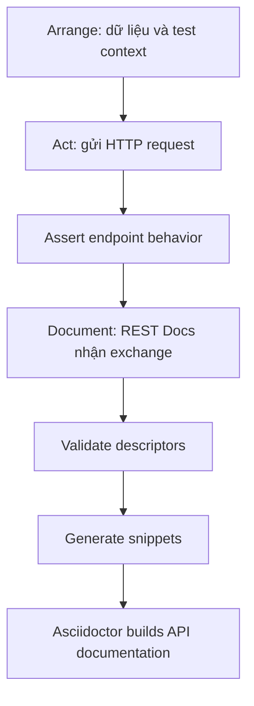

# Test tài liệu phải kiểm tra cả hành vi endpoint

## Mục tiêu học tập

Trong module **SPRING_REST_DOCS**, bài kiểm thử tài liệu có hai nhiệm vụ liên quan nhưng khác nhau. Bài test thực hiện HTTP exchange và cung cấp dữ liệu để Spring REST Docs sinh snippet; đồng thời nó phải xác minh endpoint thực sự hoạt động đúng hợp đồng. Nếu test chỉ gọi endpoint rồi ghi lại request/response, tài liệu có thể được tạo từ một hành vi sai.

Ví dụ endpoint tạo sản phẩm có thể trả HTTP 201 và một JSON body. Test cần xác minh status, các field quan trọng và header Location theo hợp đồng. Sau đó REST Docs mới dùng cùng exchange để sinh http-request, http-response và payload snippets.

Sau bài này, bạn có thể:

- Giải thích vì sao sinh snippet không đồng nghĩa với kiểm chứng hành vi endpoint.
- Viết documentation test có assertion về status, header, body và lỗi.
- Kết hợp assertion nghiệp vụ với descriptor của Spring REST Docs.
- Áp dụng cách kiểm thử cho MockMvc, WebTestClient và REST Assured.
- Tạo test cho trường hợp thành công, validation error, not found và unauthorized/forbidden.
- Giữ test độc lập, dữ liệu xác định và tránh assertion quá mong manh.
- Chẩn đoán trường hợp snippet được tạo nhưng test vẫn chưa đủ khả năng bảo vệ hợp đồng API.

## 1. Hai trách nhiệm trong một documentation test

Một documentation test cần trả lời hai nhóm câu hỏi:

| Trách nhiệm | Câu hỏi cần trả lời | Cơ chế |
| --- | --- | --- |
| Kiểm tra endpoint | HTTP status có đúng không? Header và body có đúng hợp đồng không? Quy tắc nghiệp vụ có được thực thi không? | Assertion của test framework |
| Tạo và kiểm tra tài liệu | Request/response có được ghi lại? Field, parameter, header, cookie có được mô tả đầy đủ và khớp exchange không? | Spring REST Docs và descriptor |

Ví dụ luồng:



Assertion về hành vi phải có trước khi test được xem là thành công. REST Docs không tự quyết định status code nào đúng với nghiệp vụ, sản phẩm nào được tạo hay user nào được phép truy cập. Nó ghi nhận exchange và kiểm tra các descriptor mà test cung cấp.

## 2. Vì sao chỉ gọi document(...) là chưa đủ?

Ví dụ chưa đủ:

```java
this.mockMvc.perform(post("/api/products")
        .contentType(MediaType.APPLICATION_JSON)
        .content("""
                {
                  "name": "Keyboard",
                  "price": 129.90
                }
                """))
    .andDo(document("products-create"));
```

Test này có thể ghi lại một response, nhưng không khẳng định response đúng. Nếu endpoint vô tình trả 500, 200 thay vì 201, hoặc trả body lỗi, test vẫn có thể đi tới bước tạo snippet nếu không có assertion khiến nó thất bại.

Phiên bản có kiểm chứng hành vi:

```java
this.mockMvc.perform(post("/api/products")
        .contentType(MediaType.APPLICATION_JSON)
        .content("""
                {
                  "name": "Keyboard",
                  "price": 129.90
                }
                """))
    .andExpect(status().isCreated())
    .andExpect(header().exists(HttpHeaders.LOCATION))
    .andExpect(jsonPath("$.id").isNumber())
    .andExpect(jsonPath("$.name").value("Keyboard"))
    .andDo(document("products-create"));
```

Ở đây:

- status().isCreated() xác minh endpoint trả HTTP 201.
- header().exists(...) xác minh response có Location.
- jsonPath kiểm tra dữ liệu trong body.
- document(...) ghi lại exchange và kích hoạt việc tạo snippet.

Nếu một assertion thất bại, test thất bại và không được xem là nguồn tài liệu đã kiểm chứng.

## 3. Kiểm tra status code

Status code là một phần cơ bản của hợp đồng HTTP. Hãy xác minh đúng status cho từng hành động:

| Hành động | Status thường gặp | Điều cần xác minh |
| --- | --- | --- |
| Tạo resource thành công | 201 Created | Resource được tạo; có thể có Location hoặc body theo API |
| Đọc resource thành công | 200 OK | Resource trả đúng dữ liệu |
| Xóa thành công không trả body | 204 No Content | Không có response body theo hợp đồng |
| Request không hợp lệ | 400 Bad Request hoặc status API quy định | Lỗi validation có cấu trúc đúng |
| Không tìm thấy | 404 Not Found | Mã lỗi và thông điệp đúng |
| Chưa xác thực | 401 Unauthorized | Chính sách xác thực được áp dụng |
| Không đủ quyền | 403 Forbidden | Quyền truy cập được kiểm tra đúng |

Đây là các mẫu phổ biến, không phải quy tắc bắt buộc cho mọi API. Dự án phải xác định status theo hợp đồng thực tế.

MockMvc:

```java
.andExpect(status().isCreated())
```

WebTestClient:

```java
.expectStatus().isCreated()
```

REST Assured:

```java
given()
    .contentType(ContentType.JSON)
    .body(request)
    .when()
    .post("/api/products")
    .then()
    .statusCode(201);
```

Không dùng status assertion chung chung như is2xxSuccessful() nếu từng endpoint có status cụ thể trong hợp đồng và test cần bảo vệ điều đó.

## 4. Kiểm tra response headers

Status đúng vẫn chưa đủ nếu header quan trọng bị thiếu hoặc sai.

Ví dụ endpoint tạo sản phẩm cần Location:

```java
this.mockMvc.perform(post("/api/products")
        .contentType(MediaType.APPLICATION_JSON)
        .content(requestJson))
    .andExpect(status().isCreated())
    .andExpect(header().exists(HttpHeaders.LOCATION))
    .andExpect(header().string(
        HttpHeaders.CONTENT_TYPE,
        MediaType.APPLICATION_JSON_VALUE
    ))
    .andDo(document("products-create"));
```

Với WebTestClient:

```java
this.webTestClient.post()
    .uri("/api/products")
    .contentType(MediaType.APPLICATION_JSON)
    .bodyValue(request)
    .exchange()
    .expectStatus().isCreated()
    .expectHeader().contentTypeCompatibleWith(MediaType.APPLICATION_JSON)
    .expectHeader().exists(HttpHeaders.LOCATION)
    .expectBody()
    .consumeWith(document("products-create"));
```

Chọn header thật sự có ý nghĩa với client. Những header như Cache-Control, ETag, Location, Content-Type, Retry-After hoặc Set-Cookie cần assertion khi chúng là một phần của hợp đồng endpoint.

Nếu muốn tài liệu hóa header, hãy thêm requestHeaders/responseHeaders hoặc cookie snippets. Assertion và descriptor có mục đích khác nhau: assertion xác minh giá trị đúng; descriptor giải thích ý nghĩa header với người đọc.

## 5. Kiểm tra response body

### 5.1. Kiểm tra các field có ý nghĩa

Response JSON:

```json
{
  "id": 501,
  "name": "Keyboard",
  "price": 129.90,
  "status": "ACTIVE"
}
```

Test nên kiểm tra các field đại diện cho hợp đồng:

```java
.andExpect(jsonPath("$.id").isNumber())
.andExpect(jsonPath("$.name").value("Keyboard"))
.andExpect(jsonPath("$.price").value(129.90))
.andExpect(jsonPath("$.status").value("ACTIVE"))
```

Sau đó khai báo responseFields:

```java
responseFields(
    fieldWithPath("id").description("Mã sản phẩm do server tạo."),
    fieldWithPath("name").description("Tên sản phẩm."),
    fieldWithPath("price").description("Giá bán."),
    fieldWithPath("status").description("Trạng thái sản phẩm.")
)
```

Hai lớp kiểm tra bổ sung cho nhau:

- jsonPath xác minh giá trị thực tế có đúng không.
- responseFields xác minh cấu trúc payload được mô tả đầy đủ và field path trong descriptor tồn tại.

Descriptor đúng không bảo đảm giá trị đúng. Ví dụ responseFields có thể mô tả status là “Trạng thái sản phẩm” dù endpoint trả status "DELETED" thay vì "ACTIVE". Assertion cần kiểm tra điều đó.

### 5.2. Kiểm tra body rỗng

Endpoint DELETE trả 204:

```java
this.mockMvc.perform(delete("/api/products/{id}", 501))
    .andExpect(status().isNoContent())
    .andExpect(content().string(""))
    .andDo(document("products-delete"));
```

Không khai báo responseFields nếu response không có body. Có thể tài liệu hóa status và header phù hợp.

### 5.3. Không kiểm tra mọi chi tiết ngẫu nhiên

Tránh assertion vào giá trị biến đổi theo thời gian hoặc môi trường nếu nó không phải phần hợp đồng:

- Timestamp chính xác được tạo tại thời điểm test.
- ID sinh tự động không ổn định giữa các lần chạy.
- Thứ tự collection không được API cam kết.
- Trace ID hoặc request ID ngẫu nhiên.

Thay vào đó, kiểm tra kiểu, sự tồn tại, format hoặc quan hệ cần thiết. Nếu giá trị cụ thể là hợp đồng, chuẩn hóa Clock/ID generator hoặc fixture để test xác định.

## 6. Kiểm tra request và validation behavior

Một documentation test không chỉ chứng minh payload hợp lệ được chấp nhận. Nó cũng nên bảo vệ cách endpoint xử lý payload không hợp lệ ở các operation tài liệu hóa lỗi.

Ví dụ DTO:

```java
public record CreateProductRequest(
        @NotBlank
        @Size(max = 80)
        String name,
        @NotNull
        @Positive
        BigDecimal price
) {
}
```

Controller kích hoạt validation:

```java
@PostMapping
ResponseEntity<ProductResponse> create(
        @Valid @RequestBody CreateProductRequest request) {
    ProductResponse created = productService.create(request);
    return ResponseEntity.status(HttpStatus.CREATED).body(created);
}
```

Test cho request không hợp lệ:

```java
this.mockMvc.perform(post("/api/products")
        .contentType(MediaType.APPLICATION_JSON)
        .content("""
                {
                  "name": " ",
                  "price": -1
                }
                """))
    .andExpect(status().isBadRequest())
    .andExpect(jsonPath("$.code").value("VALIDATION_ERROR"))
    .andExpect(jsonPath("$.violations").isArray())
    .andDo(document("products-create-invalid",
        responseFields(
            fieldWithPath("code").description("Mã lỗi."),
            fieldWithPath("message").description("Thông điệp lỗi."),
            fieldWithPath("violations").description("Danh sách lỗi validation.")
        )));
```

Field path của lỗi cần được mô tả chi tiết theo schema thực tế, ví dụ violations[].field và violations[].message. Đoạn trên minh họa cấu trúc khái quát; descriptor phải khớp JSON body endpoint thực sự trả.

Một test validation có hai việc:

1. Xác minh request sai bị từ chối và lỗi theo đúng hợp đồng.
2. Dùng REST Docs để sinh snippet cho response lỗi.

Việc chỉ có @NotBlank trên DTO không chứng minh controller đã bật validation. Assertion HTTP mới xác minh hành vi endpoint.

## 7. Kiểm tra lỗi nghiệp vụ và bảo mật

Nên có documentation test riêng cho những tình huống quan trọng:

| Tình huống | Assertion hành vi | Tài liệu cần mô tả |
| --- | --- | --- |
| Resource không tồn tại | Status 404 và error code | Error response |
| Thiếu authentication | Status 401 và header/challenge nếu có | Error response, WWW-Authenticate khi thuộc hợp đồng |
| Không đủ quyền | Status 403 hoặc status API quy định | Error response |
| Conflict | Status 409 và mã lỗi domain | Error response |
| Rate limit | Status API quy định, Retry-After nếu có | Error response và header |
| Validation failure | Status lỗi và danh sách violation | Error payload, field path |

Ví dụ:

```java
this.mockMvc.perform(get("/api/admin/reports")
        .header(HttpHeaders.AUTHORIZATION, "Bearer invalid-token"))
    .andExpect(status().isUnauthorized())
    .andExpect(jsonPath("$.code").value("UNAUTHENTICATED"))
    .andDo(document("admin-reports-unauthenticated",
        responseFields(
            fieldWithPath("code").description("Mã lỗi xác thực."),
            fieldWithPath("message").description("Thông điệp lỗi.")
        )));
```

Không dùng token thật trong test hoặc snippet. Fixture xác thực nên là giá trị giả và không có quyền truy cập hệ thống thật.

## 8. Kết hợp assertion và REST Docs với MockMvc

MockMvc hỗ trợ assertion qua ResultActions trước khi gọi document:

```java
this.mockMvc.perform(post("/api/products")
        .contentType(MediaType.APPLICATION_JSON)
        .accept(MediaType.APPLICATION_JSON)
        .content("""
                {
                  "name": "Keyboard",
                  "price": 129.90
                }
                """))
    .andExpect(status().isCreated())
    .andExpect(content().contentTypeCompatibleWith(
            MediaType.APPLICATION_JSON))
    .andExpect(jsonPath("$.id").isNumber())
    .andExpect(jsonPath("$.name").value("Keyboard"))
    .andExpect(jsonPath("$.status").value("ACTIVE"))
    .andDo(document("products-create",
        requestFields(
            fieldWithPath("name").description("Tên sản phẩm."),
            fieldWithPath("price").description("Giá bán.")
        ),
        responseFields(
            fieldWithPath("id").description("Mã sản phẩm."),
            fieldWithPath("name").description("Tên sản phẩm."),
            fieldWithPath("price").description("Giá bán."),
            fieldWithPath("status").description("Trạng thái.")
        )));
```

Thứ tự này làm rõ rằng test chỉ ghi tài liệu sau khi các expectation đã được kiểm tra. Nếu dùng custom ResultHandler hoặc cấu trúc test helper, vẫn phải bảo đảm tài liệu không được xem là thành công khi assertion hành vi thất bại.

## 9. Kết hợp assertion và REST Docs với WebTestClient

WebTestClient hỗ trợ expect status, headers và body:

```java
this.webTestClient.post()
    .uri("/api/products")
    .contentType(MediaType.APPLICATION_JSON)
    .accept(MediaType.APPLICATION_JSON)
    .bodyValue(Map.of(
            "name", "Keyboard",
            "price", 129.90
    ))
    .exchange()
    .expectStatus().isCreated()
    .expectHeader().contentTypeCompatibleWith(MediaType.APPLICATION_JSON)
    .expectBody()
    .jsonPath("$.name").isEqualTo("Keyboard")
    .jsonPath("$.status").isEqualTo("ACTIVE")
    .consumeWith(document("products-create",
        responseFields(
            fieldWithPath("id").description("Mã sản phẩm."),
            fieldWithPath("name").description("Tên sản phẩm."),
            fieldWithPath("price").description("Giá bán."),
            fieldWithPath("status").description("Trạng thái.")
        )));
```

expectBody có thể dùng JSONPath hoặc body assertions phù hợp. Chọn cách kiểm tra đủ ý nghĩa với endpoint và giữ descriptor khớp response.

## 10. Kết hợp assertion và REST Docs với REST Assured

REST Assured thường tổ chức kiểm tra theo given/when/then:

```java
given(this.spec)
    .contentType(ContentType.JSON)
    .body("""
            {
              "name": "Keyboard",
              "price": 129.90
            }
            """)
    .filter(document("products-create",
        requestFields(
            fieldWithPath("name").description("Tên sản phẩm."),
            fieldWithPath("price").description("Giá bán.")
        )))
    .when()
    .post("/api/products")
    .then()
    .statusCode(201)
    .contentType(ContentType.JSON)
    .body("name", equalTo("Keyboard"))
    .body("status", equalTo("ACTIVE"));
```

Với REST Assured, filter(document(...)) kích hoạt phần ghi snippet; then() chứa assertion hành vi. Hãy xác minh thứ tự filter và assertion theo cấu hình test của dự án, đồng thời dùng phiên bản module REST Docs tương thích với REST Assured. Tích hợp REST Assured thuộc các nhánh REST Docs có hỗ trợ; không giả định mọi major version REST Docs đều cung cấp adapter này.

## 11. Strict descriptors cũng là một lớp kiểm tra hợp đồng

Khi dùng requestFields/responseFields (không relaxed), REST Docs kiểm tra field descriptor với payload:

- Field mới xuất hiện mà chưa có descriptor có thể làm test thất bại.
- Descriptor trỏ tới field không có trong payload có thể làm test thất bại.
- optional() cho phép field được mô tả vắng mặt.
- ignored() cho phép field được xử lý mà không hiển thị trong bảng.

Đây là kiểm tra **mức cấu trúc tài liệu**. Nó bổ sung cho assertion **mức hành vi**.

Ví dụ:

```java
.andExpect(jsonPath("$.status").value("ACTIVE"))
.andDo(document("products-get",
    responseFields(
        fieldWithPath("id").description("Mã sản phẩm."),
        fieldWithPath("name").description("Tên sản phẩm."),
        fieldWithPath("status").description("Trạng thái sản phẩm.")
    )));
```

Nếu status bị bỏ khỏi response, assertion JSONPath sẽ thất bại. Nếu endpoint thêm một field archived mà descriptor chưa xử lý, kiểm tra payload strict của REST Docs có thể thất bại. Hai tín hiệu này phát hiện hai loại thay đổi khác nhau.

Chế độ relaxed hữu ích khi có chủ ý chỉ mô tả một phần payload, nhưng không nên thay thế strict mode một cách mặc định nếu mục tiêu là giữ tài liệu đồng bộ với schema.

## 12. Test dữ liệu xác định và có thể lặp lại

Documentation tests tạo artifact được commit hoặc publish, vì vậy kết quả cần ổn định giữa các lần chạy.

### 12.1. Dữ liệu test cố định

- Dùng fixture có giá trị dễ hiểu và có ý nghĩa.
- Dùng database test hoặc repository giả lập theo mục đích test.
- Làm sạch trạng thái trước/sau test nếu dữ liệu được lưu.
- Không phụ thuộc thứ tự test chạy.
- Dùng ID cố định hoặc kiểm tra ID theo kiểu/ràng buộc thay vì giá trị ngẫu nhiên nếu ID không phải hợp đồng.

### 12.2. Thời gian và định danh

Nếu response chứa timestamp:

- Dùng Clock có thể điều khiển để cố định thời gian khi timestamp cần được kiểm tra chính xác.
- Nếu chỉ cần xác minh format, kiểm tra format hoặc parse thành thời gian thay vì so chuỗi động.
- Không include timestamp thay đổi theo mỗi lần build vào tài liệu nếu không cần.

Với UUID, trace ID hoặc session ID:

- Dùng giá trị giả hoặc dependency có thể thay thế trong test.
- Không dùng token thật từ môi trường ngoài.
- Không để ID ngẫu nhiên làm operation ID hoặc tên snippet directory.

### 12.3. Test không phụ thuộc lẫn nhau

Test A không nên phải chạy trước Test B mới sinh được snippet hoặc có dữ liệu hợp lệ. Mỗi documentation test nên tự chuẩn bị điều kiện và chỉ tạo output của operation mà nó sở hữu.

Nếu nhiều test ghi cùng operation directory, nội dung snippet có thể bị ghi đè hoặc phụ thuộc thứ tự chạy. Dùng operation ID riêng cho những tình huống có request/response khác nhau.

## 13. Test ở lớp nào: slice, integration hay end-to-end?

Chọn phạm vi test phù hợp với điều cần chứng minh:

| Kiểu test | Kiểm tra được | Khi phù hợp |
| --- | --- | --- |
| Web slice với MockMvc/WebTestClient | Mapping, validation, serialization, controller advice và web layer với cấu hình test | Tài liệu endpoint ở tầng web |
| Integration test | Tích hợp controller, service, repository, security và database test | Hợp đồng phụ thuộc nhiều thành phần |
| End-to-end test | Luồng qua nhiều process/dịch vụ hoặc môi trường gần thực tế | Một số luồng quan trọng cần chứng minh xuyên hệ thống |

Không phải mọi operation đều cần end-to-end. Một test web slice có assertion đầy đủ có thể là nguồn documentation test tốt nếu những dependency không thuộc phạm vi đã được thay thế một cách có chủ đích. Nhưng nếu tài liệu tuyên bố một hành vi phụ thuộc database, security filter hoặc message broker, test cần bao phủ thành phần thực sự quyết định hành vi đó.

## 14. Những anti-pattern thường gặp

| Anti-pattern | Rủi ro | Cách cải thiện |
| --- | --- | --- |
| Chỉ gọi document(...) | Snippet có thể được tạo dù endpoint trả sai status/body | Thêm assertion hành vi trước khi document |
| Chỉ kiểm tra status 2xx | Không phát hiện body sai, field thiếu hoặc header sai | Kiểm tra body/header theo hợp đồng |
| Chỉ khai báo field descriptors | Mô tả cấu trúc nhưng không xác minh giá trị nghiệp vụ | Thêm JSONPath/body assertion |
| Luôn dùng relaxed descriptors | Field mới có thể lọt qua mà không được review | Dùng strict khi cần schema coverage |
| Dùng dữ liệu production | Rò rỉ cookie, token, email hoặc dữ liệu cá nhân vào snippet | Dùng fixture giả |
| Dựa vào thứ tự test | Kết quả không ổn định khi chạy song song hoặc CI | Mỗi test tự chuẩn bị state |
| Assert timestamp/UUID ngẫu nhiên bằng chuỗi cố định | Test chập chờn | Cố định Clock/ID hoặc kiểm tra format |
| Dùng cùng operation ID cho nhiều response khác nhau | Snippet có thể ghi đè | Tách operation ID |
| Bỏ qua error response | Tài liệu chỉ có luồng thành công | Tài liệu hóa validation, not-found và auth errors |
| Test chỉ chạy khi Asciidoctor chạy | Khó xác định lỗi thuộc assertion hay biên soạn | Chạy test sinh snippet riêng rồi chạy task tài liệu |

## 15. Bài thực hành

1. Tạo endpoint POST /api/products nhận name và price.
2. Viết MockMvc documentation test với assertion status 201, Content-Type, Location và các field response quan trọng.
3. Thêm requestFields và responseFields để kiểm tra cấu trúc payload.
4. Tạo test validation lỗi dùng operation ID products-create-invalid; assert status và error code trước khi document response.
5. Tạo test GET resource không tồn tại; assert status 404 và schema error response.
6. Tạo test unauthorized; assert status 401 và tài liệu hóa lỗi xác thực, không dùng token thật.
7. Cố định fixture hoặc Clock để chạy test nhiều lần cho kết quả snippet ổn định.
8. Thử xóa một assertion body trong nhánh thử nghiệm và làm endpoint trả sai field; quan sát lý do descriptor không thay thế assertion giá trị.

**Câu hỏi tự đánh giá**

1. Vì sao gọi document(...) không chứng minh endpoint hoạt động đúng?
2. Assertion status, header và body bảo vệ những phần nào của hợp đồng?
3. Field descriptor khác JSONPath assertion như thế nào?
4. Khi nào cần documentation test cho response lỗi?
5. Vì sao một test dùng relaxedResponseFields có thể bỏ sót schema drift?
6. Khi nào web slice test đủ để làm nguồn tài liệu, khi nào cần integration test?
7. Làm sao giữ timestamp, UUID và fixture ổn định?
8. Vì sao test không nên phụ thuộc thứ tự chạy hoặc chia sẻ operation ID có output khác nhau?

## Tài liệu tham khảo chính thức

- [Spring REST Docs — Getting Started](https://docs.spring.io/spring-restdocs/tutorial/getting-started/index.html): thực hiện HTTP test và tạo snippet.
- [Spring REST Docs — Documenting Your API](https://docs.spring.io/spring-restdocs/reference/documenting-your-api.html): cách kết hợp test, operation và snippet.
- [Spring Framework — MockMvc](https://docs.spring.io/spring-framework/reference/testing/mockmvc.html): thực thi và kiểm tra request/response với MockMvc.
- [Spring Framework — WebTestClient](https://docs.spring.io/spring-framework/reference/testing/webtestclient.html): kiểm tra HTTP exchange với WebTestClient.
- [Spring REST Docs — Request and Response Fields](https://docs.spring.io/spring-restdocs/reference/documenting-your-api/request-response-payloads.html): kiểm tra field descriptors và payload.
- [REST Assured](https://rest-assured.io/): API given/when/then và response assertions.

**Kết luận thực hành:** Một documentation test đáng tin cậy phải chứng minh endpoint trả đúng status, headers và body theo hợp đồng, rồi mới dùng cùng exchange để tạo snippet. Assertion hành vi kiểm tra giá trị và quy tắc nghiệp vụ; REST Docs kiểm tra descriptor và tạo tài liệu. Kết hợp cả hai, dùng fixture xác định và tách operation ID cho các tình huống khác nhau để snippet vừa đúng cấu trúc vừa phản ánh một endpoint đã được kiểm chứng.
