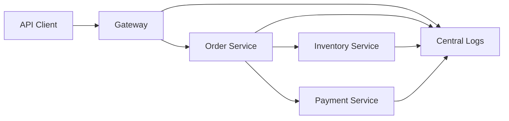

# Correlation id để truy tìm lỗi

## 1. Vì sao error response cần correlation ID?

Trong module **SPRING_REST_DOCS**, Spring REST Docs tạo tài liệu REST API từ các bài kiểm thử HTTP bằng MockMvc, WebTestClient hoặc REST Assured. Tài liệu cần giải thích cách client báo lỗi và cách đội vận hành tìm request tương ứng trong log/trace.

Correlation ID là giá trị nhận diện một request hoặc luồng xử lý liên quan. Client có thể cung cấp ID, gateway/application có thể tạo ID, và response phản hồi ID để support tra cứu. Tài liệu cần nói rõ header nào được dùng, ID có được echo hay tạo mới, body có field tương ứng không, và ID có được truyền qua service boundaries không.

Correlation ID không phải access token hay thông tin xác thực. Nên dùng giá trị opaque, không nhúng username, hostname, email hoặc dữ liệu nhạy cảm.

## 2. Phân biệt request ID, correlation ID và trace ID

| Khái niệm | Mục đích | Phạm vi |
| --- | --- | --- |
| Request ID | Định danh một HTTP request | Thường một request/response |
| Correlation ID | Liên kết log/event thuộc cùng workflow | Có thể qua nhiều request/service |
| Trace ID | Định danh distributed trace | Một trace gồm nhiều span |
| Span ID | Định danh một đoạn công việc | Một span cụ thể |

Một hệ thống có thể dùng cùng giá trị cho request ID và correlation ID theo convention riêng. W3C Trace Context dùng traceparent để truyền trace context với trace ID và span ID riêng. Không tự đổi tên hoặc diễn giải traceparent thành custom correlation ID.

Ví dụ header thường gặp:
- X-Request-Id: mã request do gateway/application tạo.
- X-Correlation-Id: mã liên kết workflow.
- traceparent: context propagation theo W3C Trace Context.

Nếu API hỗ trợ nhiều loại ID, mô tả semantics từng loại và mối quan hệ giữa chúng.

## 3. Định nghĩa contract cho correlation ID

Một contract có thể quy định:

1. Client được phép gửi X-Request-Id.
2. Nếu thiếu, gateway hoặc application tạo ID mới.
3. Response phản hồi ID đã chấp nhận trong header X-Request-Id.
4. Error body có thể đưa cùng ID vào field correlationId.
5. Log server ghi cùng ID để support truy vấn.

Ví dụ request:

```http
GET /api/orders/ORD-42 HTTP/1.1
Host: api.example.com
X-Request-Id: req-demo-7f31
Accept: application/json
```

Ví dụ error response:

```http
HTTP/1.1 404 Not Found
Content-Type: application/problem+json
X-Request-Id: req-demo-7f31
```

Body:

```json
{
  "type": "https://api.example.com/problems/order-not-found",
  "title": "Không tìm thấy đơn hàng",
  "status": 404,
  "detail": "Không tìm thấy đơn hàng ORD-42.",
  "code": "ORDER_NOT_FOUND",
  "correlationId": "req-demo-7f31"
}
```

Đây là convention ví dụ, không phải hành vi mặc định của Spring REST Docs hoặc Spring MVC. Ứng dụng cần filter/interceptor hoặc gateway policy để tạo, validate, propagate và phản hồi ID.

## 4. Document correlation ID trong response header

Spring REST Docs dùng responseHeaders(...) để mô tả header:

```java
.andDo(document("orders-get-not-found",
    responseHeaders(
        headerWithName("Content-Type")
            .description("Media type của error response"),
        headerWithName("X-Request-Id")
            .description("Mã dùng để tra cứu request trong log hỗ trợ")
    )
))
```

Nếu header có thể vắng mặt theo contract, đánh dấu optional:

```java
headerWithName("X-Request-Id")
    .optional()
    .description("Mã truy vết nếu được cung cấp")
```

Không đánh dấu optional chỉ để test qua. Nếu middleware bảo đảm luôn trả ID, test nên kiểm tra header bắt buộc và descriptor không nên optional.

responseHeaders(...) sinh snippet riêng, thường là response-headers.adoc. http-response.adoc hiển thị toàn bộ response; response-headers.adoc mô tả ý nghĩa các header được chọn.

## 5. Document correlation ID trong error payload

Nếu error body cũng có correlationId, mô tả field bằng responseFields(...):

```java
responseFields(
    fieldWithPath("type").description("URI định danh loại vấn đề"),
    fieldWithPath("title").description("Tiêu đề lỗi"),
    fieldWithPath("status").description("HTTP status"),
    fieldWithPath("detail").description("Thông tin lỗi dành cho client"),
    fieldWithPath("code").description("Mã lỗi ổn định"),
    fieldWithPath("correlationId")
        .description("Mã dùng để liên hệ log và trace của request")
)
```

Nếu field chỉ có ở một số loại lỗi, dùng optional đúng với contract. Nếu ID chỉ nằm trong response header, không thêm field giả vào body để tiện tìm kiếm.

Khi ID xuất hiện ở cả header và body, kiểm tra hai giá trị giống nhau. Nếu khác nhau, client không biết ID nào cần cung cấp cho support.

## 6. Kiểm tra tính nhất quán giữa request, response và error body

Một test nên kiểm tra HTTP exchange gốc:

```java
mockMvc.perform(get("/api/orders/ORD-42")
        .header("X-Request-Id", "req-test-42")
        .accept(MediaType.APPLICATION_PROBLEM_JSON))
    .andExpect(status().isNotFound())
    .andExpect(header().string("X-Request-Id", "req-test-42"))
    .andExpect(jsonPath("$.correlationId").value("req-test-42"))
    .andDo(document("orders-get-not-found",
        responseHeaders(
            headerWithName("X-Request-Id")
                .description("Mã truy vết request")
        ),
        responseFields(
            fieldWithPath("type").description("URI loại vấn đề"),
            fieldWithPath("title").description("Tiêu đề lỗi"),
            fieldWithPath("status").description("HTTP status"),
            fieldWithPath("detail").description("Chi tiết lỗi"),
            fieldWithPath("code").description("Mã lỗi"),
            fieldWithPath("correlationId").description("Mã truy vết")
        )
    ));
```

Ví dụ giả định ứng dụng có filter/interceptor đưa ID vào response và error body. Nếu contract chỉ phản hồi header, bỏ assertion/descriptor của body. Nếu server tự tạo ID khi client không gửi, test riêng trường hợp đó và xác nhận ID không rỗng, đúng định dạng.

Đừng chỉ kiểm tra header tồn tại. So sánh giá trị header/body với ID client gửi hoặc ID server tạo.

## 7. Filter minh họa tạo và phản hồi request ID

Ví dụ filter đơn giản lấy ID từ request, tạo mới nếu thiếu và đặt vào response. Production implementation cần validate độ dài/ký tự và quyết định có tin giá trị client gửi không.

```java
import java.io.IOException;
import java.util.UUID;
import jakarta.servlet.Filter;
import jakarta.servlet.FilterChain;
import jakarta.servlet.ServletException;
import jakarta.servlet.ServletRequest;
import jakarta.servlet.ServletResponse;
import jakarta.servlet.http.HttpServletRequest;
import jakarta.servlet.http.HttpServletResponse;

class RequestIdFilter implements Filter {
    static final String HEADER = "X-Request-Id";

    @Override
    public void doFilter(ServletRequest request, ServletResponse response,
                         FilterChain chain)
            throws IOException, ServletException {
        HttpServletRequest httpRequest = (HttpServletRequest) request;
        HttpServletResponse httpResponse = (HttpServletResponse) response;

        String requestId = httpRequest.getHeader(HEADER);
        if (requestId == null || requestId.isBlank()) {
            requestId = "req-" + UUID.randomUUID();
        }

        httpResponse.setHeader(HEADER, requestId);
        chain.doFilter(request, response);
    }
}
```

Trong ứng dụng thực, nên đặt ID vào request attribute hoặc logging context (MDC) để controller advice và log formatter dùng cùng giá trị. Clear MDC trong finally sau request để thread pool không mang ID của request trước sang request kế tiếp.

Ví dụ trên nhận trực tiếp giá trị client gửi chỉ để minh họa. API public cần validate charset/length, loại newline để ngăn log injection, giới hạn kích thước và cân nhắc tạo ID mới tại trust boundary.

## 8. Đưa ID vào error response qua exception handler

Controller advice có thể đọc request-scoped context để đưa ID vào Problem Details:

```java
@RestControllerAdvice
class ApiExceptionHandler {
    private final RequestCorrelation requestCorrelation;

    ApiExceptionHandler(RequestCorrelation requestCorrelation) {
        this.requestCorrelation = requestCorrelation;
    }

    @ExceptionHandler(OrderNotFoundException.class)
    ResponseEntity<ProblemDetail> notFound(OrderNotFoundException exception) {
        ProblemDetail problem = ProblemDetail.forStatusAndDetail(
                HttpStatus.NOT_FOUND, exception.getMessage());

        problem.setTitle("Không tìm thấy đơn hàng");
        problem.setType(URI.create(
                "https://api.example.com/problems/order-not-found"));
        problem.setProperty("code", "ORDER_NOT_FOUND");
        problem.setProperty("correlationId", requestCorrelation.currentId());

        return ResponseEntity.status(HttpStatus.NOT_FOUND)
                .header("X-Request-Id", requestCorrelation.currentId())
                .contentType(MediaType.APPLICATION_PROBLEM_JSON)
                .body(problem);
    }
}
```

ProblemDetail hỗ trợ standard members và extension properties. Cách serialize extension phụ thuộc Spring Framework/Jackson configuration; test phải xác minh JSON thực tế. RequestCorrelation là abstraction của ứng dụng, không phải API có sẵn của Spring REST Docs.

Nếu dùng schema lỗi riêng, thêm field vào DTO tương ứng. Giữ cùng một nguồn ID để response header, body và log không lệch nhau.

## 9. Propagate correlation ID qua nhiều service

Trong kiến trúc nhiều service, request có thể đi qua gateway, order service, inventory service và payment service.



Nguyên tắc:
- Gateway xác định trust boundary và quyết định chấp nhận hay tạo ID.
- Service downstream nhận ID từ request context và chuyển tiếp khi gọi service khác.
- Log của mỗi service ghi ID dưới field name thống nhất.
- Response trả ID mà client cần cung cấp cho support.
- Trace ID/span ID vẫn được quản lý riêng nếu dùng distributed tracing.

Không forward mọi custom header vô điều kiện. Dùng allowlist và tránh chuyển credential hoặc metadata không liên quan. Với W3C Trace Context, dùng instrumentation phù hợp thay vì tự ghép traceparent bằng string.

## 10. Correlation ID trong log và tracing

Correlation ID chỉ hữu ích khi log ghi cùng giá trị. Có thể đặt vào MDC để log pattern thêm field:

```text
correlationId=req-test-42
```

Ví dụ log:

```text
2026-11-17T08:30:00Z INFO [correlationId=req-test-42] OrderController - Order lookup failed
```

Trong hệ thống OpenTelemetry, trace ID và span ID thường được thêm vào log context tự động. Không ghi token, password hoặc payload nhạy cảm chỉ vì đã có correlation ID. ID giúp tìm bản ghi; nó không thay thế data minimization và access control.

Tài liệu client nên chỉ cách cung cấp ID cho support, không công bố query syntax nội bộ, tên index log hoặc dashboard private.

## 11. Document request header và response header

Nếu API cho phép client gửi request ID, dùng requestHeaders(...):

```java
requestHeaders(
    headerWithName("X-Request-Id")
        .optional()
        .description("Mã request do client cung cấp; server tạo nếu vắng mặt")
)
```

Nếu API bắt buộc client gửi, bỏ optional và test trường hợp thiếu header. Nếu server luôn tự tạo ID, có thể không cần request header descriptor; chỉ mô tả response header.

Một operation có thể tài liệu hóa cả hai:

```java
.andDo(document("orders-get",
    requestHeaders(
        headerWithName("X-Request-Id").optional()
            .description("Mã request do client cung cấp")
    ),
    responseHeaders(
        headerWithName("X-Request-Id")
            .description("Mã truy vết được server phản hồi")
    )
))
```

Cần làm rõ server phản hồi nguyên ID client gửi hay tạo ID mới. Không mô tả echo nếu gateway có thể thay giá trị tại trust boundary.

## 12. Các trường hợp lỗi và ID

| Scenario | HTTP status | Hành vi ID cần tài liệu |
| --- | --- | --- |
| 400 validation | 400 | ID trong response header và/hoặc body |
| 401 unauthenticated | 401 | Xác định middleware tạo ID trước authentication không |
| 403 forbidden | 403 | Giữ ID cho support nhưng không tiết lộ thông tin phân quyền |
| 404 not found | 404 | ID giúp tra request không tìm thấy resource |
| 409 conflict | 409 | Liên kết log của transaction conflict |
| 429 rate limited | 429 | ID có thể đi cùng Retry-After |
| 500 internal error | 500 | Trả ID công khai, không trả stack trace |
| 503 unavailable | 503 | Giữ ID để truy vết outage |

Nếu lỗi xảy ra trước khi request vào application, ví dụ gateway từ chối, application filter không thể tạo response ID. Gateway phải đảm nhiệm contract hoặc tài liệu cần nói rõ phạm vi. Test tích hợp ở gateway nếu đây là cam kết public.

## 13. Tổ chức snippet và Asciidoctor

Generated snippets có thể gồm response, response headers và response fields:

```adoc
= Order API

== Không tìm thấy đơn hàng

=== HTTP response
include::{snippets}/orders-get-not-found/http-response.adoc[]

=== Response headers
include::{snippets}/orders-get-not-found/response-headers.adoc[]

=== Error payload fields
include::{snippets}/orders-get-not-found/response-fields.adoc[]
```

Nêu rõ client cần gửi correlation ID nào cho support và ID nằm ở đâu trong response. Nếu body và header cùng chứa ID, chỉ rõ cả hai vị trí.

Build cần chạy documentation tests trước Asciidoctor. Kiểm tra snippet dùng ID demo ổn định, không lộ metadata nội bộ và include đúng operation identifier.

## 14. Lỗi thường gặp

| Hiện tượng | Nguyên nhân | Cách xử lý |
| --- | --- | --- |
| Header ID có nhưng body ID khác | Hai nguồn tạo ID độc lập | Dùng một request-scoped source |
| ID mất ở downstream service | Client nội bộ không forward context | Cấu hình propagation có allowlist |
| Log không tìm thấy ID | Logging không ghi correlation field | Đưa ID vào MDC/log context |
| ID request trước xuất hiện | Không clear MDC trên thread pool | Cleanup trong finally |
| Client gửi ID gây log injection | Không validate input | Giới hạn charset/length, loại newline |
| Dùng traceparent như correlation ID | Nhầm trace context với custom request ID | Mô tả semantics riêng |
| Lỗi trước application không có ID | Gateway từ chối trước filter | Tạo ID ở gateway và test contract |
| Descriptor optional sai | Chưa xác định contract | Quy định behavior khi thiếu |
| ID lộ hostname/user data | ID chứa thông tin nội bộ | Sinh opaque identifier |
| Snippet thay ID mỗi lần chạy | Fixture dùng UUID ngẫu nhiên | Dùng ID giả cố định trong docs test |

## 15. Bài thực hành

Dùng endpoint GET /api/orders/{id}:

1. Tạo filter/interceptor gắn X-Request-Id vào request context.
2. Nếu client không gửi ID, sinh ID mới; kiểm tra response có header theo contract.
3. Khi order không tồn tại, trả Problem Details có extension correlationId.
4. Assert status 404, response header và body field có cùng giá trị.
5. Dùng responseHeaders(...) mô tả X-Request-Id.
6. Dùng responseFields(...) mô tả correlationId.
7. Thêm requestHeaders(...) nếu client được phép gửi ID.
8. Thử ID có newline/quá dài và xác minh server từ chối hoặc thay ID mới theo policy.
9. Mô phỏng downstream call và kiểm tra cùng ID trong log context của service kế tiếp.
10. Include HTTP response, response headers và response fields vào Asciidoctor; kiểm tra snippet không chứa ID production hoặc metadata nội bộ.

**Tiêu chí hoàn thành:** bạn phân biệt request ID, correlation ID và trace ID; định nghĩa contract gửi/nhận ID; document header và error body bằng Spring REST Docs; kiểm tra tính nhất quán response/log; và hiểu propagation qua gateway/service cùng trust boundary.

## Tài liệu tham khảo

- [Spring REST Docs — HTTP Headers](https://docs.spring.io/spring-restdocs/reference/documenting-your-api/headers.html): mô tả request và response headers.
- [Spring REST Docs — Response Fields](https://docs.spring.io/spring-restdocs/reference/documenting-your-api/response-fields.html): mô tả field trong response payload.
- [W3C Trace Context](https://www.w3.org/TR/trace-context/): chuẩn truyền trace context qua HTTP.
- [OpenTelemetry — Context Propagation](https://opentelemetry.io/docs/concepts/context-propagation/): truyền trace context qua service boundaries.
