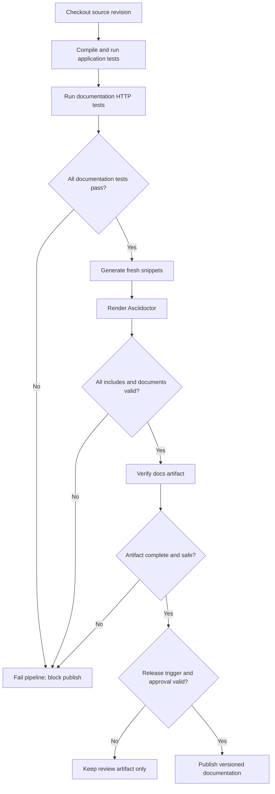

# Không phát hành tài liệu nếu test tài liệu thất bại

## Mục tiêu học tập

Sau bài này, bạn có thể:

- Giải thích vì sao documentation test là quality gate bắt buộc trước khi phát hành API documentation.
- Thiết kế pipeline theo thứ tự test HTTP, sinh snippet, render Asciidoctor, kiểm tra artifact rồi mới publish.
- Cấu hình Gradle hoặc Maven để lỗi ở bất kỳ bước kiểm chứng nào làm pipeline thất bại.
- Phân biệt artifact phục vụ review trong pull request với artifact được phát hành chính thức.
- Ngăn publish khi test bị bỏ qua, snippet thiếu, tài liệu không render hoặc artifact không đầy đủ.
- Quản lý điều kiện publish theo branch, tag, approval và version.
- Lưu log, test report và artifact để truy nguyên nguyên nhân khi quality gate thất bại.

## 1. Vì sao không được phát hành tài liệu khi test thất bại?

Spring REST Docs tạo snippet từ HTTP exchange của documentation test. Asciidoctor sử dụng các snippet đó để biên soạn trang API. Nếu test thất bại, tài liệu có thể mô tả request/response đã lỗi thời, thiếu field hoặc header mới, chứa snippet cũ, không phản ánh lỗi validation/authentication hiện tại hoặc không biên dịch được vì include trỏ tới snippet không được sinh.

Publish tài liệu trong trạng thái đó khiến consumer dựa vào contract sai. Vì vậy, test tài liệu phải là cổng chất lượng bắt buộc. Pipeline không được chuyển sang bước publish nếu test hoặc bước render/verify tài liệu thất bại.

Nguyên tắc:

1. Chỉ tạo artifact phát hành từ source revision đã được kiểm chứng.
2. Documentation test phải chạy và pass.
3. Snippet phải được sinh trong build hiện tại.
4. Asciidoctor phải render thành công.
5. Artifact phải vượt qua kiểm tra nội dung và cấu trúc.
6. Chỉ sau đó mới được publish.

Pipeline có thể lưu artifact chẩn đoán khi thất bại, nhưng artifact đó không được gắn nhãn hoặc phân phối như bản tài liệu chính thức.

## 2. Pipeline có quality gate rõ ràng



| Gate | Điều kiện pass | Khi fail |
| --- | --- | --- |
| Application tests | Test ứng dụng cần thiết đều pass | Dừng pipeline |
| Documentation tests | HTTP exchange và REST Docs assertions pass | Không render/publish bản chính thức |
| Asciidoctor | Tất cả include và source hợp lệ | Không publish |
| Artifact verification | Đủ HTML/assets/version metadata, không có nội dung cấm | Không publish |
| Release policy | Đúng branch/tag và approval | Chỉ lưu artifact review hoặc bỏ qua publish |

Không gom tất cả thành một lệnh publish duy nhất mà không có điều kiện phụ thuộc rõ. Người review cần thấy bước nào thất bại và publish bị chặn ở đâu.

## 3. Documentation test phải thực sự được chạy

Một lỗi cấu hình thường gặp là pipeline chạy unit test nhưng không chạy nhóm documentation test. Build vẫn xanh trong khi generated snippets không được cập nhật.

Có thể tổ chức test bằng tag hoặc source set riêng. Dù chọn cách nào, cần bảo đảm:

- Task test documentation được gọi trong pipeline bắt buộc.
- Không có cấu hình exclude làm bỏ qua toàn bộ test REST Docs.
- Test report cho thấy số test được thực thi lớn hơn 0 khi module có documentation tests.
- Test thất bại làm task trả exit code khác 0.
- Publish phụ thuộc vào task đã chạy thành công.

Nếu dùng JUnit tag, kiểm tra includeTags/excludeTags và cấu hình Gradle/Maven để chắc chắn nhóm test docs không bị loại khỏi CI.

### 3.1. Không dùng skip flag trong release job

Các tùy chọn như Gradle -x test, Maven -DskipTests hoặc -Dmaven.test.skip=true có thể bỏ qua test hoặc cả quá trình compile test tùy cách dùng. Không cho phép release job dùng các cờ này để tạo artifact tài liệu chính thức.

Có thể có job nhanh cho mục đích phát triển bỏ qua một số test, nhưng job đó không được có quyền publish. Release workflow phải chạy lại quality gate đầy đủ từ source revision sẽ phát hành.

### 3.2. Phát hiện test không được chạy

Exit code 0 không luôn chứng minh test mong đợi đã được phát hiện. Hãy kiểm tra test report: có suite documentation test mong đợi, số lượng test không bằng 0 khi dự án yêu cầu, không có test bị skipped ngoài chính sách cho phép và không có assumption/condition làm toàn bộ suite bị bỏ qua trên CI.

Nếu module có thể không có docs test ở một số profile, khai báo rõ profile hợp lệ thay vì coi “0 test” là pass mặc định.

## 4. Sinh snippet mới và tránh dùng output cũ

Spring REST Docs ghi snippet vào output directory. Nếu test không chạy hoặc task bị skip, thư mục generated-snippets có thể còn file từ lần build trước. Asciidoctor có thể dùng output cũ và render thành công dù test hiện tại không tạo snippet.

Biện pháp:

1. Dùng clean build trong release pipeline hoặc xóa output generated trước khi test.
2. Để test task khai báo đúng output directory.
3. Bảo đảm Asciidoctor phụ thuộc vào documentation test.
4. Không copy snippet từ workspace hoặc artifact của build khác vào release.
5. Xác minh snippet bắt buộc có trong output của lần chạy hiện tại.

Không dùng một thư mục snippet chung giữa nhiều job hoặc nhiều commit chạy song song. Mỗi pipeline cần workspace/output độc lập.

## 5. Cấu hình Gradle để chặn publish khi test docs lỗi

Ví dụ minh họa cho Gradle Groovy DSL:

```groovy
def snippetsDir = layout.buildDirectory.dir('generated-snippets')
def docsOutputDir = layout.buildDirectory.dir('docs/asciidoc')

tasks.named('test') {
    outputs.dir snippetsDir
}

tasks.named('asciidoctor') {
    dependsOn tasks.named('test')
    inputs.dir snippetsDir
    outputDir = docsOutputDir.get().asFile
}
```

Nếu dự án có task riêng cho documentation test, dùng task đó thay cho test chung:

```groovy
tasks.register('documentationTest', Test) {
    useJUnitPlatform {
        includeTags 'restdocs'
    }
    outputs.dir snippetsDir
}

tasks.named('asciidoctor') {
    dependsOn tasks.named('documentationTest')
    inputs.dir snippetsDir
    outputDir = docsOutputDir.get().asFile
}
```

Đoạn trên là cấu trúc minh họa. Cấu hình tag, test source set, classpath và output directory phải khớp dự án. Không đăng ký hai task cùng ghi vào một snippets directory nếu chúng có thể chạy song song.

### 5.1. Task verify trước publish

```groovy
tasks.register('verifyApiDocs') {
    dependsOn tasks.named('asciidoctor')

    doLast {
        def indexFile = docsOutputDir.get().file('index.html').asFile
        if (!indexFile.isFile() || indexFile.length() == 0) {
            throw new GradleException(
                'API documentation index.html is missing or empty'
            )
        }
    }
}
```

Publish task phải phụ thuộc verifyApiDocs:

```groovy
tasks.named('publish') {
    dependsOn tasks.named('verifyApiDocs')
}
```

Đây là ví dụ cho Gradle Maven Publish plugin và cần điều chỉnh theo publication/task thực tế. Nếu publish được thực hiện bởi CI command hoặc plugin khác, đặt verifyApiDocs làm prerequisite trong pipeline đó. Không chỉ tạo task verify rồi để release job không gọi nó.

### 5.2. Lệnh release

```bash
./gradlew clean test asciidoctor verifyApiDocs publish
```

Task graph sẽ đảm bảo verifyApiDocs và dependency của nó chạy trước publish. Tuy nhiên, cần xác minh task graph và không dùng command-line option để loại test/Asciidoctor trong release job.

## 6. Cấu hình Maven để fail fast

Maven lifecycle thường chạy test trước package. Hãy cấu hình documentation tests trong test phase, Asciidoctor sau khi test hoàn tất và publish/deploy sau khi package/verify thành công.

Pipeline command minh họa:

```bash
mvn clean verify
```

Sau đó publish artifact trong job hoặc stage riêng, chỉ khi verify thành công:

```bash
mvn deploy
```

Không chạy deploy trong job độc lập chỉ dựa vào việc artifact file tồn tại từ workspace cũ. Job deploy phải dùng artifact được tạo và xác minh bởi cùng source revision/build.

### 6.1. Bind Asciidoctor vào lifecycle

Plugin Asciidoctor cần chạy sau test sinh snippet. Ví dụ cấu hình Maven:

```xml
<plugin>
  <groupId>org.asciidoctor</groupId>
  <artifactId>asciidoctor-maven-plugin</artifactId>
  <version>3.2.0</version>
  <executions>
    <execution>
      <id>render-api-docs</id>
      <phase>prepare-package</phase>
      <goals>
        <goal>process-asciidoc</goal>
      </goals>
      <configuration>
        <sourceDirectory>src/docs/asciidoc</sourceDirectory>
        <outputDirectory>target/generated-docs</outputDirectory>
        <attributes>
          <snippets>target/generated-snippets</snippets>
        </attributes>
      </configuration>
    </execution>
  </executions>
</plugin>
```

Version plugin là ví dụ; kiểm tra version tương thích với Maven và cấu hình hiện tại. Test phase phải hoàn tất trước prepare-package. Nếu test docs nằm ở profile riêng, release profile phải kích hoạt profile đó và CI phải xác minh test report.

### 6.2. Maven deploy chỉ sau verify

Maven deploy thông thường chạy các phase trước đó trong lifecycle. Dù vậy, không nên dùng deploy làm cách duy nhất để kiểm tra nội dung tài liệu. Thêm bước verify artifact sau package: kiểm tra HTML chính và trang operation, include/resource, artifact JAR/ZIP, và runtime smoke test nếu docs được phục vụ từ ứng dụng.

Chỉ cho phép deploy khi các bước verify đó pass. Nếu publish docs qua repository riêng, publication/deploy phải nằm trong stage phụ thuộc vào verify.

## 7. Phân biệt artifact review và artifact release

Pull request có thể tạo HTML để reviewer xem trước. Đây là artifact phục vụ review, chưa phải bản phát hành chính thức.

| Loại pipeline | Tạo tài liệu | Publish chính thức |
| --- | --- | --- |
| Pull request | Có thể tạo preview artifact | Không |
| Branch tích hợp | Chạy docs test và render | Chỉ publish snapshot nếu policy cho phép |
| Release tag | Chạy đầy đủ test và verify | Có, sau quality gate và approval |
| Hotfix | Chạy lại gate trên revision hotfix | Có, sau gate và release policy |

Đặt tên artifact preview có commit SHA hoặc build number để tránh nhầm với bản release. Không dùng cùng tọa độ/version immutable cho preview và release.

### 7.1. Điều kiện publish

Release job nên xác minh source revision là tag/branch được phép, application/documentation tests pass, Asciidoctor render pass, artifact completeness/content checks pass, approval/environment protection đã thỏa mãn và version metadata phù hợp release.

Điều kiện branch/tag chỉ quyết định khi nào publish; chúng không thay thế test. Một tag release vẫn phải chạy lại quality gate.

## 8. Không publish khi test bị skipped hoặc không có report

Một số pipeline dùng cache hoặc điều kiện để bỏ qua job khi cho rằng output không đổi. Với documentation release, cần thận trọng:

- Nếu cache được dùng, key phải bao gồm source, test code, descriptor, AsciiDoc và dependency liên quan.
- Không dùng snippet cache từ revision khác.
- Không coi job skipped là job pass.
- Nếu test report không được tạo, release gate phải fail.
- Nếu test count bằng 0 bất thường, fail hoặc yêu cầu cấu hình profile rõ.

Cache có thể tăng tốc nhưng không được làm mất bằng chứng test đã kiểm chứng source revision đang phát hành. Với release quan trọng, chạy test docs trên clean workspace thường dễ audit hơn.

## 9. Kiểm tra Asciidoctor và artifact trước publish

Test pass chưa đủ. Asciidoctor có thể thất bại do include sai, attribute thiếu hoặc snippet không được tạo. Vì vậy, render phải là gate riêng.

Sau render, kiểm tra:

1. Trang index tồn tại và không rỗng.
2. Trang operation được liên kết tồn tại.
3. Các snippet include bắt buộc có trong output.
4. CSS, JS, hình ảnh và file tải về đầy đủ.
5. Không có file stale từ build trước.
6. Version/source revision metadata đúng.
7. Artifact không chứa token, cookie hoặc dữ liệu nhạy cảm.

Nếu tạo ZIP/JAR riêng, kiểm tra entries của artifact. Nếu nhúng vào application JAR, kiểm tra classpath entries trong executable JAR. Nếu publish website, kiểm tra output staging trước deploy.

## 10. Ví dụ pipeline CI dạng tổng quát

```yaml
stages:
  - test
  - documentation
  - verify
  - publish

documentation_tests:
  stage: test
  script:
    - ./gradlew clean test
  artifacts:
    when: always
    reports:
      junit: build/test-results/test/*.xml

render_documentation:
  stage: documentation
  needs:
    - documentation_tests
  script:
    - ./gradlew asciidoctor
  artifacts:
    paths:
      - build/docs/asciidoc/

verify_documentation:
  stage: verify
  needs:
    - render_documentation
  script:
    - ./gradlew verifyApiDocs

publish_documentation:
  stage: publish
  needs:
    - verify_documentation
  rules:
    - if: '$CI_COMMIT_TAG'
  script:
    - ./gradlew publish
```

Đây là YAML minh họa phong cách GitLab CI, không phải file cấu hình hoàn chỉnh cho mọi repository. Workspace/artifact handoff phải bảo đảm render job nhận snippets được tạo từ documentation_tests. Cấu hình thật cần dùng dependency/artifact đúng của CI provider và bảo đảm publish job không chạy nếu bất kỳ gate trước đó thất bại.

Với GitHub Actions hoặc hệ thống CI khác, nguyên tắc tương tự: job publish dùng needs/dependency vào test, render và verify; điều kiện tag chỉ áp dụng sau khi các dependency pass.

## 11. Lưu bằng chứng khi pipeline thất bại

Khi test docs fail, cần giữ lại thông tin để chẩn đoán:

- JUnit XML/test report.
- Log của test và Asciidoctor.
- Danh sách snippet được sinh.
- Generated HTML nếu render đã hoàn tất và được đánh dấu preview/diagnostic.
- Commit SHA, build number, Java/build tool version.
- Thông tin môi trường không nhạy cảm như timezone, locale và profile.

Có thể dùng artifacts when: always để lưu test report kể cả khi job fail. Tuy nhiên, không đưa diagnostic artifact vào release repository hoặc website chính thức.

Không lưu token, environment secret hoặc request header nhạy cảm trong log. Redact trước khi upload artifact chẩn đoán.

## 12. Xử lý lỗi và phục hồi pipeline

Khi gate thất bại:

1. Xác định gate nào fail: test, render, verify hay policy.
2. Đọc test report và lỗi đầu tiên có ý nghĩa.
3. Kiểm tra generated-snippets có thuộc build hiện tại không.
4. Xác minh descriptor và response thực tế.
5. Sửa test, implementation hoặc AsciiDoc theo nguyên nhân.
6. Chạy lại từ clean state.
7. Xác nhận tất cả gate pass trước khi publish lại.

Không sửa snippet generated bằng tay để làm build xanh. Không xóa assertion hoặc đổi test thành skipped chỉ để vượt quality gate. Nếu contract thay đổi hợp lệ, cập nhật test và tài liệu cùng nhau.

### 12.1. Không dùng retry thay cho sửa lỗi

Retry có thể hữu ích với lỗi hạ tầng tạm thời đã được nhận diện. Nhưng nếu documentation test thất bại do response sai, field thiếu hoặc authorization behavior đổi, retry không làm contract đúng trở lại.

Ghi nhận số lần retry và lý do. Một release không nên publish chỉ vì lần retry sau tình cờ pass mà không có chẩn đoán cho lần fail trước.

## 13. Chính sách version và publish an toàn

Artifact docs phải truy nguyên được service name, API version, application version nếu có, source commit SHA, build identifier và thời điểm tạo.

Không publish lại artifact đã phát hành với cùng tọa độ/version nhưng nội dung khác. Dùng version mới hoặc quy tắc snapshot phù hợp repository.

Nếu tài liệu có nhiều version, publish vào path/version riêng và cập nhật alias current chỉ sau khi bản mới vượt qua quality gate. Không thay current trước khi upload hoàn chỉnh toàn bộ trang và asset.

## 14. Lỗi thường gặp

| Biểu hiện | Nguyên nhân có thể | Cách xử lý |
| --- | --- | --- |
| Pipeline xanh nhưng docs cũ | Documentation test không được chạy | Bắt buộc task docs test và kiểm tra report/test count |
| Asciidoctor pass dù test bị skip | Snippet cũ còn trong output directory | Clean output và ràng buộc task dependency |
| Publish chạy dù verify fail | Publish job không phụ thuộc verify | Thêm needs/dependency và fail-fast |
| Pull request publish ra production | Trigger publish quá rộng | Giới hạn theo release tag/branch và approval |
| Docs thiếu trang operation | Test không chạy hoặc artifact handoff thiếu snippets | Kiểm tra test report, snippets và render input |
| Test report không có | Job fail trước khi upload hoặc report path sai | Cấu hình artifacts/report path chính xác |
| Release dùng artifact từ commit khác | Job lấy artifact cũ hoặc build tách rời không có provenance | Ràng buộc commit SHA/build ID giữa jobs |
| Retry làm release pass không ổn định | Flaky test chưa được xử lý | Điều tra root cause, không bỏ qua gate |
| Diagnostic HTML bị publish nhầm | Dùng chung channel preview và release | Tách artifact name, repository và quyền publish |

## 15. Checklist quality gate trước phát hành

- [ ] Release job không dùng flag bỏ qua documentation tests.
- [ ] Test suite docs được phát hiện và số test thực thi hợp lệ.
- [ ] Test thất bại làm pipeline dừng với exit code khác 0.
- [ ] Generated snippets được tạo từ clean/current build.
- [ ] Asciidoctor phụ thuộc vào documentation test.
- [ ] Render/include lỗi làm pipeline thất bại.
- [ ] Artifact completeness và content checks pass.
- [ ] Publish phụ thuộc vào tất cả gate trước đó.
- [ ] Publish chỉ chạy ở branch/tag và environment được phép.
- [ ] Pull request chỉ tạo preview/review artifact.
- [ ] Artifact có version và source revision rõ ràng.
- [ ] Test report/log được lưu kể cả khi fail, không lộ secret.
- [ ] Không có cơ chế retry/skip che lỗi contract.

## 16. Bài tập thực hành

Một dịch vụ Orders dùng Gradle, Spring REST Docs và Asciidoctor. CI hiện tại chạy test và publish docs ZIP trong cùng một job. Đôi khi test REST Docs bị skip nhưng ZIP cũ vẫn được publish.

Hãy thực hiện:

1. Tách documentation test thành task hoặc tag suite được CI gọi rõ ràng.
2. Dùng clean workspace/output để loại snippet stale.
3. Khai báo Asciidoctor phụ thuộc vào documentation test.
4. Tạo verifyApiDocs kiểm tra index.html, các trang operation và asset bắt buộc.
5. Tạo publish job phụ thuộc test, render và verify.
6. Chỉ cho publish khi tag release hợp lệ và approval đã được đáp ứng.
7. Cấu hình lưu JUnit report và log khi job thất bại.
8. Cố ý làm một documentation test fail và xác nhận publish job không chạy.
9. Cố ý bỏ một snippet bắt buộc và xác nhận Asciidoctor/verify thất bại.
10. Khôi phục test, chạy pipeline sạch và xác nhận artifact phát hành có đúng commit/version.

**Câu hỏi tự kiểm tra:** Nếu test docs fail nhưng file HTML cũ vẫn tồn tại, có nên cho publish tiếp không? Không. File cũ không phải bằng chứng cho contract của source revision hiện tại. Pipeline phải fail, giữ diagnostic artifact riêng nếu cần và chỉ publish sau khi test, render và verify chạy thành công từ revision đang phát hành.

## Kết luận

Không phát hành tài liệu khi documentation test thất bại là quality gate bắt buộc, vì snippet và trang API phải phản ánh HTTP behavior đã được kiểm chứng của source revision hiện tại. Pipeline cần chạy test, tạo snippet mới, render Asciidoctor, xác minh artifact rồi mới publish. Gradle/Maven phải có task/lifecycle dependency rõ; CI publish job phải phụ thuộc vào tất cả gate và chỉ chạy ở release trigger được phép. Loại bỏ snippet stale, không dùng skip/retry để che lỗi, lưu test report khi fail và tách preview artifact khỏi release artifact. Khi test hoặc render thất bại, pipeline dừng và không cập nhật tài liệu chính thức; chỉ một build đã vượt qua toàn bộ kiểm tra mới được phát hành.
