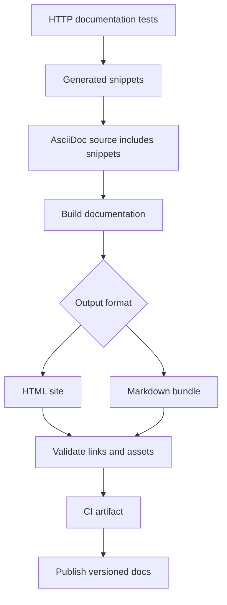

# Đăng tải tài liệu HTML hoặc Markdown

## Mục tiêu học tập

Trong module **SPRING_REST_DOCS**, các HTTP documentation tests tạo snippet đã được kiểm chứng. Để người dùng API đọc được, nhóm cần biên soạn snippet thành tài liệu hoàn chỉnh rồi phát hành ở định dạng phù hợp. Hai lựa chọn phổ biến là HTML cho website có điều hướng và Markdown cho repository, wiki hoặc portal hỗ trợ Markdown.

Spring REST Docs thường được tích hợp với Asciidoctor để ghép snippet AsciiDoc thành HTML. Markdown là lựa chọn xuất bản khác, nhưng cần xác định rõ cách tạo nội dung Markdown: dùng template snippet Markdown tùy chỉnh, chuyển đổi nội dung theo pipeline riêng hoặc duy trì tài liệu Markdown có liên kết tới artifact/snippet. Không nên giả định Asciidoctor tự động tạo Markdown bằng backend mặc định.

Sau bài này, bạn có thể:

- Chọn HTML hoặc Markdown theo nơi người dùng đọc tài liệu.
- Sinh HTML từ AsciiDoc và snippet Spring REST Docs.
- Xây dựng quy trình xuất bản Markdown có kiểm soát.
- Lưu artifact tài liệu trong CI và phát hành theo commit/tag.
- Đăng tải lên static hosting hoặc documentation portal.
- Kiểm tra liên kết, snippet và quyền truy cập trước khi publish.
- Thiết kế quy trình publish có thể lặp lại và rollback.

## 1. Từ documentation test đến tài liệu được phát hành

Quy trình thường gồm:



1. Test xác minh endpoint và tạo snippet.
2. Tài liệu nguồn tổ chức nội dung, giải thích và include snippet.
3. Build tạo HTML hoặc Markdown bundle.
4. Validation kiểm tra file, link, ảnh và nội dung cần thiết.
5. CI lưu artifact gắn với commit/build.
6. Publish triển khai artifact tới nơi người dùng truy cập.

Không nên publish trực tiếp từ snippet directory. Snippet chỉ là các phần nhỏ của HTTP exchange; người đọc cần trang có mục lục, hướng dẫn, xác thực, lỗi và luồng sử dụng.

## 2. Chọn HTML hay Markdown

| Tiêu chí | HTML | Markdown |
| --- | --- | --- |
| Trải nghiệm đọc | Website có navigation, style và tìm kiếm | Repository, wiki và portal hỗ trợ Markdown |
| Nội dung | Layout, CSS, ảnh và navigation | Heading, bảng, code, link; phụ thuộc renderer |
| Tích hợp REST Docs | Luồng Asciidoctor HTML phổ biến | Cần pipeline/template Markdown riêng hoặc chuyển đổi |
| Versioning | URL theo version | Nhánh/tag hoặc thư mục version |
| Review | Review artifact/site | Dễ diff và review trong Git |
| Link và asset | Kiểm tra relative path, CSS, ảnh | Kiểm tra renderer và relative link |

Chọn HTML khi cần API reference dễ duyệt, có navigation và được host như website. Chọn Markdown khi tổ chức muốn tài liệu nằm cùng source code, review bằng pull request hoặc nhập vào portal hỗ trợ Markdown.

Một dự án có thể phát hành cả hai từ cùng nguồn nội dung, nhưng cần pipeline và kiểm tra riêng cho từng định dạng.

## 3. Phát hành HTML bằng Asciidoctor

Spring REST Docs thường tạo snippet AsciiDoc. Tài liệu nguồn có thể include chúng:

```asciidoc
= Products API

== Tạo sản phẩm

=== HTTP request
include::{snippets}/products-create/http-request.adoc[]

=== Request fields
include::{snippets}/products-create/request-fields.adoc[]

=== HTTP response
include::{snippets}/products-create/http-response.adoc[]

=== Response fields
include::{snippets}/products-create/response-fields.adoc[]
```

Khi test tạo snippet và Asciidoctor có extension phù hợp, task biên soạn thay include bằng nội dung snippet rồi render HTML.

### 3.1. Gradle

Ví dụ cấu hình Gradle Groovy DSL:

```groovy
plugins {
    id 'java'
    id 'org.asciidoctor.jvm.convert' version '4.0.4'
}

configurations {
    asciidoctorExt
}

dependencies {
    testImplementation 'org.springframework.restdocs:spring-restdocs-mockmvc'
    asciidoctorExt 'org.springframework.restdocs:spring-restdocs-asciidoctor'
}

ext {
    snippetsDir = file("$buildDir/generated-snippets")
}

tasks.test {
    outputs.dir snippetsDir
}

tasks.asciidoctor {
    inputs.dir snippetsDir
    configurations 'asciidoctorExt'
    dependsOn tasks.test
    attributes 'snippets': snippetsDir
}
```

Đây là cấu hình minh họa; plugin và phiên bản cần được quản lý thống nhất với build của dự án. Với Gradle Kotlin DSL, cú pháp task/configuration sẽ khác.

Chạy:

```bash
./gradlew clean test asciidoctor
```

HTML thường được tạo dưới build/docs/asciidoc hoặc output directory được cấu hình. Kiểm tra task output thực tế trước khi đóng gói.

### 3.2. Maven

Với Maven, quy trình tương tự:

1. Test plugin chạy documentation tests và ghi snippet vào target/generated-snippets.
2. Asciidoctor Maven Plugin đọc AsciiDoc source.
3. REST Docs Asciidoctor extension cung cấp attribute snippets.
4. Plugin tạo HTML vào output directory cấu hình.

Lệnh build minh họa:

```bash
./mvnw clean verify
```

Tên goal, plugin version, dependency và phase phải khớp cấu hình dự án. Không copy nguyên cấu hình Gradle vào Maven hoặc ngược lại.

## 4. Cấu trúc HTML site để publish

Một site tài liệu có thể có cấu trúc:

```text
build/docs/api/
├── index.html
├── products.html
├── orders.html
├── css/
│   └── api-docs.css
├── images/
│   └── architecture.svg
└── assets/
```

Trang index nên cung cấp phiên bản API/tài liệu, cách xác thực, quy ước request/response, link tới các resource, quy ước error response và thông tin hỗ trợ/changelog.

Các trang resource include snippet đã sinh, nhưng phần diễn giải xung quanh cần giải thích khi nào dùng endpoint, điều kiện đầu vào và cách xử lý lỗi.

## 5. Xuất bản Markdown: xác định nguồn Markdown

Spring REST Docs mặc định thường sinh snippet AsciiDoc khi dùng template mặc định. Nếu đích xuất bản là Markdown, cần chọn chiến lược rõ ràng.

### 5.1. Chiến lược A: Markdown là tài liệu nguồn

Nhóm duy trì các file Markdown trong repository, còn documentation tests sinh snippet để kiểm chứng payload và exchange. Pipeline có thể:

1. Chạy test để sinh snippet.
2. Kiểm tra snippet và descriptor.
3. Cập nhật hoặc xác minh ví dụ trong Markdown từ fixture đã kiểm thử.
4. Render Markdown bằng static site generator hoặc portal.
5. Publish output.

Ưu điểm là Markdown dễ review và diff. Nhược điểm là nếu ví dụ được chép thủ công, nó có thể lệch khỏi snippet; cần quy trình kiểm tra hoặc sinh nội dung để tránh drift.

### 5.2. Chiến lược B: Tạo Markdown snippet bằng template tùy chỉnh

REST Docs cho phép tùy chỉnh snippet template. Có thể thiết kế template tạo file Markdown cho các phần phù hợp:

- Chọn tên file có đuôi .md.
- Tạo template tương ứng cho request/response/fields.
- Xác minh output thực tế trong operation directory.
- Dùng đúng cú pháp include hoặc xử lý Markdown của hệ thống tài liệu.

Không phải mọi snippet/template mặc định đều tự động có bản Markdown tương đương. Nhóm phải triển khai và duy trì template, đồng thời bảo đảm nội dung vẫn được kiểm chứng bởi descriptor.

### 5.3. Chiến lược C: Chuyển đổi nội dung qua pipeline riêng

Có thể chuyển đổi nội dung AsciiDoc hoặc HTML đã render sang Markdown bằng công cụ chuyển đổi. Conversion có thể làm mất macro, include, bảng phức tạp, attributes hoặc cấu trúc đặc thù.

Nếu dùng converter:

- Chọn công cụ và version cố định.
- Chuyển đổi sau khi include snippet đã được resolve.
- Kiểm tra code block, table, link và anchor.
- Không coi conversion thành công về exit code là đủ; cần kiểm tra nội dung.
- Giữ nguồn AsciiDoc và output Markdown có thể truy vết tới cùng commit.

Asciidoctor có các backend output riêng; không giả định backend mặc định là Markdown. Hãy xác minh converter hoặc extension được dự án sử dụng.

## 6. Cấu trúc Markdown bundle

Ví dụ:

```text
docs/markdown/
├── index.md
├── authentication.md
├── products.md
├── orders.md
├── errors.md
└── assets/
    └── architecture.svg
```

Markdown nên tổ chức theo luồng đọc:

```markdown
# API Reference

## Authentication

Mô tả cách lấy và gửi credential.

## Products

### Create product

Mô tả endpoint, quyền yêu cầu và request fields.

### Errors

Mô tả error code và cách xử lý.
```

Markdown thuần không có cú pháp include chuẩn được mọi renderer hỗ trợ. Nếu muốn tái sử dụng snippet file, cần dùng include extension của static site generator, build step ghép file hoặc template generator. Xác minh renderer trên môi trường publish hỗ trợ đúng cú pháp đó.

## 7. Artifact trong CI

CI nên lưu output tài liệu như build artifact trước khi publish:

```text
artifacts/
└── api-docs/
    ├── html/
    │   ├── index.html
    │   └── ...
    └── markdown/
        ├── index.md
        └── ...
```

Artifact nên gắn với commit SHA, build number/workflow run ID, version/tag của API, kết quả documentation tests và định dạng output.

Lưu artifact giúp review bản dựng trước khi phát hành và cho phép publish lại đúng nội dung đã kiểm tra mà không phải chạy lại test trên một trạng thái source khác.

## 8. Ví dụ pipeline CI

Pipeline khái quát:

```yaml
name: Build API documentation

on:
  push:
    branches: [main]
  pull_request:

jobs:
  build-docs:
    runs-on: ubuntu-latest
    steps:
      - uses: actions/checkout@v4

      - uses: actions/setup-java@v4
        with:
          distribution: temurin
          java-version: '21'

      - name: Run documentation tests and build HTML
        run: ./gradlew clean test asciidoctor

      - name: Upload HTML documentation
        uses: actions/upload-artifact@v4
        with:
          name: api-docs-html
          path: build/docs/asciidoc/
```

Đây là ví dụ GitHub Actions. Đường dẫn artifact phải khớp output directory thực tế. Pull request có thể build và lưu artifact để review; bước publish production thường chỉ chạy trên branch/tag được bảo vệ.

Nếu dự án dùng Maven, thay lệnh build và đường dẫn output theo cấu hình Maven.

## 9. Publish HTML lên static hosting

HTML có thể được host trên GitHub Pages, GitLab Pages, object storage có static website hosting, web server nội bộ hoặc CDN.

Quy trình publish nên:

1. Chỉ lấy artifact đã qua test và validation.
2. Đặt tài liệu vào đường dẫn version rõ ràng, ví dụ /api-docs/1.4/.
3. Kiểm tra index page, CSS, ảnh và link tương đối.
4. Publish vào thư mục version mới rồi cập nhật alias/current.
5. Kiểm tra URL sau publish.
6. Giữ lại version trước để rollback.

Không publish nội dung của pull request chưa được tin cậy vào site production. Nếu cần preview, dùng môi trường preview riêng và giới hạn quyền truy cập.

## 10. Publish Markdown lên repository hoặc portal

Markdown có thể được commit vào thư mục docs trong cùng repository, đẩy vào repository tài liệu riêng theo tag/version, upload lên portal hỗ trợ Markdown hoặc đưa vào wiki/knowledge base nội bộ.

Nếu pipeline tự động ghi Markdown vào Git:

- Tạo commit/PR riêng hoặc dùng cơ chế publish được kiểm soát.
- Gắn output với commit source đã test.
- Không ghi ngược vào branch release từ build của pull request không tin cậy.
- Tránh tạo commit nếu nội dung không thay đổi.
- Giữ lịch sử phiên bản để so sánh thay đổi API.

Nếu portal có API upload, dùng credential dạng secret của CI và quyền tối thiểu. Không ghi token vào log hoặc file artifact.

## 11. Versioning và quản lý nhiều bản tài liệu

Ví dụ:

```text
api-docs/
├── v1/
├── v2/
└── latest/
```

Một cách triển khai:

- Mỗi release tag tạo artifact tài liệu bất biến cho version đó.
- latest trỏ tới version được công bố hiện hành.
- Bản preview từ main có nhãn snapshot hoặc development.
- Không ghi đè tài liệu version cũ nếu API version đó vẫn được hỗ trợ.

Nếu API không dùng URL version nhưng có version release, ghi rõ version/commit trong trang tài liệu.

## 12. Kiểm tra chất lượng trước khi publish

- [ ] Documentation tests đã chạy thành công.
- [ ] Snippet output thuộc đúng commit hiện tại.
- [ ] Asciidoctor/Markdown build hoàn tất.
- [ ] Không có include bị thiếu.
- [ ] Link nội bộ và anchor hoạt động.
- [ ] CSS, ảnh và asset được đóng gói.
- [ ] Code block và bảng hiển thị đúng trên renderer đích.
- [ ] Không có token, cookie, password hoặc dữ liệu cá nhân trong snippet.
- [ ] Version và commit được ghi rõ.
- [ ] Artifact được lưu trước bước publish.
- [ ] URL sau publish đã được kiểm tra.
- [ ] Có phương án rollback về version trước.

Đối với Markdown, hãy kiểm tra bằng chính renderer/portal đích. Một file hiển thị đúng trong GitHub có thể khác khi đưa vào wiki dùng dialect Markdown khác.

## 13. Quyền truy cập và bảo mật khi phát hành

Trước khi publish, xác định tài liệu là public hay internal:

- Tài liệu public không được chứa hostname nội bộ, endpoint quản trị không công khai hoặc credential.
- Tài liệu internal cần authentication và authorization phù hợp.
- Preview từ pull request không tin cậy không được có quyền truy cập secret production.
- Artifact phải tuân theo retention policy của tổ chức.
- Link tới dashboard, log hoặc ticket nội bộ không nên xuất hiện trong tài liệu public.

REST Docs ghi lại HTTP exchange; nó không tự động phân loại thông tin được phép công khai. Dùng fixture giả và review artifact trước khi xuất bản.

## 14. Lỗi thường gặp

| Triệu chứng | Nguyên nhân có thể | Cách xử lý |
| --- | --- | --- |
| HTML không có snippet | Test chưa chạy hoặc output root sai | Kiểm tra task dependency và snippets directory |
| Asciidoctor báo include missing | Operation ID hoặc snippet path sai | Đối chiếu test và generated-snippets |
| HTML build pass nhưng CSS/ảnh lỗi | Asset không được copy hoặc relative path sai | Kiểm tra output site và base path |
| Markdown thiếu nội dung snippet | Renderer không hỗ trợ include hoặc converter bỏ macro | Ghép snippet ở build step hoặc dùng custom template |
| Markdown table/code hiển thị sai | Dialect Markdown không tương thích | Test bằng renderer đích |
| CI artifact rỗng | Upload sai output path | Kiểm tra task output và artifact path |
| Publish bản cũ | Job dùng artifact từ commit khác | Gắn artifact với SHA/version và kiểm tra provenance |
| URL latest trỏ nhầm version | Cập nhật alias trước khi deploy hoàn tất | Deploy versioned folder rồi cập nhật alias sau |
| Pull request có thể publish production | Điều kiện workflow/permission quá rộng | Giới hạn publish theo branch/tag và quyền |
| Tài liệu lộ token hoặc dữ liệu thật | Fixture lấy từ môi trường thật | Dùng dữ liệu giả và rà artifact |
| Không rollback được | Ghi đè bản hiện tại mà không lưu bản trước | Publish versioned và giữ bản phát hành trước |

## 15. Bài thực hành

1. Tạo AsciiDoc page include request/response snippets của một operation.
2. Cấu hình Gradle hoặc Maven tạo HTML từ tài liệu nguồn.
3. Kiểm tra output directory và mở trang HTML để xác minh CSS, link và code block.
4. Tạo một trang Markdown cho cùng operation; xác định snippet được tạo bằng custom template, build include hay nội dung Markdown source.
5. Render Markdown bằng nền tảng dự kiến publish và kiểm tra bảng, code block, anchor.
6. Tạo CI job chạy documentation tests, build docs và upload artifact.
7. Gắn artifact với commit SHA và version.
8. Thiết lập publish preview cho pull request và publish production chỉ cho tag/branch release.
9. Kiểm tra URL sau publish và thử rollback về artifact trước.

**Câu hỏi tự đánh giá**

1. Vì sao HTML là output phổ biến khi dùng Asciidoctor với Spring REST Docs?
2. Vì sao không nên giả định Asciidoctor mặc định xuất Markdown?
3. Ba chiến lược tạo Markdown từ documentation tests là gì?
4. Vì sao cần lưu artifact trước bước publish?
5. Làm thế nào bảo đảm tài liệu đúng commit và API version?
6. Vì sao pull request không tin cậy không được dùng secret production?
7. Những link và asset nào cần kiểm tra sau publish?
8. Làm thế nào rollback một bản tài liệu đã phát hành?

## Tài liệu tham khảo chính thức

- [Spring REST Docs — Getting Started](https://docs.spring.io/spring-restdocs/tutorial/getting-started/index.html): cấu hình Asciidoctor và tạo tài liệu từ snippets.
- [Spring REST Docs — Documenting Your API](https://docs.spring.io/spring-restdocs/reference/documenting-your-api.html): snippet được sinh từ HTTP tests.
- [Asciidoctor Gradle Plugin](https://docs.asciidoctor.org/gradle-plugin/latest/): cấu hình task và output tài liệu HTML.
- [Asciidoctor Maven Plugin](https://docs.asciidoctor.org/maven-tools/latest/): biên soạn AsciiDoc bằng Maven.
- [GitHub Actions — Workflow Artifacts](https://docs.github.com/actions/using-workflows/storing-workflow-data-as-artifacts): lưu và truyền artifact giữa job.
- [GitHub Pages](https://docs.github.com/pages): publish website tĩnh.
- [RFC 9110 — HTTP Semantics](https://www.rfc-editor.org/rfc/rfc9110): ngữ nghĩa HTTP liên quan tới ví dụ API.

**Kết luận thực hành:** Dùng Asciidoctor để biên soạn HTML từ tài liệu nguồn và snippet REST Docs là luồng phổ biến. Nếu cần Markdown, hãy chọn template hoặc bước chuyển đổi/ghép nội dung rõ ràng, rồi kiểm tra bằng renderer đích. Trong CI, build và validate trước, lưu artifact gắn với commit/version, sau đó mới publish tới hosting hoặc portal có kiểm soát quyền truy cập và khả năng rollback.
