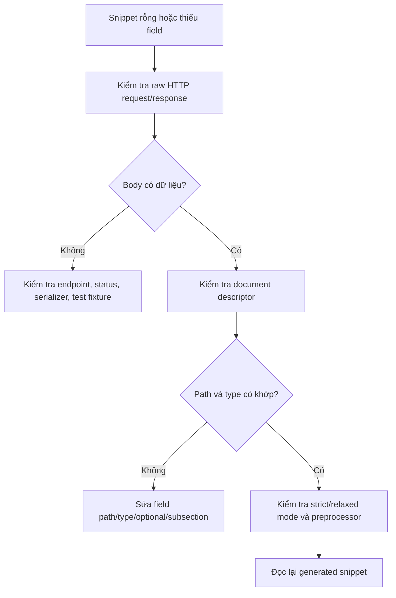

# Snippet rỗng hoặc thiếu trường mô tả

## 1. Nhận diện đúng loại lỗi

Spring REST Docs tạo tài liệu REST API có thể kiểm chứng từ HTTP tests dùng MockMvc, WebTestClient hoặc REST Assured. Trong test, lời gọi `document(...)` kết hợp các descriptor như `requestFields(...)`, `responseFields(...)`, `requestHeaders(...)`, `pathParameters(...)` hoặc `links(...)` để tạo snippet. Khi snippet rỗng hoặc thiếu trường, cần xác định lỗi thuộc payload thực tế, descriptor, document operation hay cách xem output.

Các biểu hiện thường gặp:

- `http-response.adoc` có status/header nhưng phần body trống.
- `response-body.adoc` trống hoặc không có file như mong đợi.
- `response-fields.adoc` chỉ có header mà không có hàng dữ liệu.
- Một số field có trong JSON nhưng không xuất hiện trong bảng mô tả.
- Test thất bại với thông báo field không được document hoặc descriptor không tìm thấy field.
- Snippet hiển thị giá trị khác kỳ vọng do response/request đã được preprocess.

Không nên sửa template ngay. Trước tiên hãy so sánh ba nguồn: **HTTP payload thực tế**, **descriptor trong test** và **file snippet được sinh**.



## 2. Kiểm tra body HTTP thực tế trước khi kiểm tra snippet

Nếu response body thực tế rỗng thì Spring REST Docs không thể tạo ví dụ JSON có nội dung hoặc bảng field từ dữ liệu không tồn tại. Những nguyên nhân có thể gồm:

- Endpoint trả `204 No Content` hoặc status không có response body theo contract.
- Controller trả `null`, `void` hoặc `ResponseEntity` không có body.
- Test gọi nhầm endpoint hoặc fixture không tạo dữ liệu.
- Request bị trả lỗi sớm trước khi đi vào handler mong muốn.
- Serializer/converter không ghi representation như kỳ vọng.
- Test đang kiểm tra response khác với response mà người viết tài liệu nghĩ tới.

Trước tiên, kiểm tra response trong test:

```java
mockMvc.perform(get("/api/books/{id}", 42))
        .andExpect(status().isOk())
        .andExpect(content().contentTypeCompatibleWith(MediaType.APPLICATION_JSON))
        .andExpect(jsonPath("$.id").value(42))
        .andDo(document("books-get"));
```

Với REST Assured:

```java
given(this.specification)
        .when()
        .get("/api/books/{id}", 42)
        .then()
        .statusCode(200)
        .contentType(ContentType.JSON)
        .body("id", equalTo(42));
```

Với WebTestClient:

```java
webTestClient.get()
        .uri("/api/books/{id}", 42)
        .exchange()
        .expectStatus().isOk()
        .expectHeader().contentTypeCompatibleWith(MediaType.APPLICATION_JSON)
        .expectBody()
        .jsonPath("$.id").isEqualTo(42)
        .consumeWith(document("books-get"));
```

Các ví dụ là khung minh họa; dùng assertion và filter/documentation setup tương ứng với version, client test của dự án. Nếu body thực sự rỗng nhưng API đúng là trả `204`, đừng thêm field descriptor để ép sinh bảng. Tài liệu nên mô tả status và headers đúng với contract.

## 3. Phân biệt các loại snippet body và fields

Một operation có thể sinh nhiều snippet khác nhau. Không phải file nào cũng chứa cùng nội dung:

| Snippet | Nội dung |
| --- | --- |
| `http-request.adoc` | HTTP request gồm method, URI, headers và body được ghi lại. |
| `http-response.adoc` | HTTP response gồm status, headers và representation body. |
| `request-body.adoc` | Phần request payload được trích riêng. |
| `response-body.adoc` | Phần response payload được trích riêng. |
| `request-fields.adoc` | Bảng mô tả các field request đã khai báo. |
| `response-fields.adoc` | Bảng mô tả các field response đã khai báo. |

Nếu `response-fields.adoc` không có nội dung như mong đợi, hãy xem `http-response.adoc` và xác nhận response body thực sự có dữ liệu. Nếu HTTP response snippet có JSON nhưng fields snippet thiếu một field, vấn đề thường nằm ở descriptor hoặc cấu trúc path.

Không phải mọi operation đều tạo đủ tất cả snippet. Ví dụ endpoint `204 No Content` có thể không có response body/response fields; test không khai báo `responseFields(...)` thì không có bảng `response-fields.adoc` để include.

## 4. Kiểm tra field path có khớp payload không

`fieldWithPath(...)` phải trỏ tới đúng đường dẫn trong JSON/XML payload. Ví dụ response:

```json
{
  "id": 42,
  "title": "Spring REST Docs",
  "author": {
    "id": 7,
    "name": "An"
  },
  "tags": ["java", "spring"]
}
```

Descriptor tương ứng:

```java
responseFields(
        fieldWithPath("id").description("Mã sách"),
        fieldWithPath("title").description("Tên sách"),
        fieldWithPath("author.id").description("Mã tác giả"),
        fieldWithPath("author.name").description("Tên tác giả"),
        fieldWithPath("tags").description("Danh sách nhãn của sách"));
```

Các lỗi path thường gặp:

| Payload thực tế | Descriptor sai | Descriptor đúng |
| --- | --- | --- |
| `author.name` | `fieldWithPath("authorName")` | `fieldWithPath("author.name")` |
| `items[0].id` | `fieldWithPath("items.id")` | `fieldWithPath("items[].id")` khi mô tả phần tử mảng theo cú pháp payload REST Docs hỗ trợ. |
| `meta.total` | `fieldWithPath("total")` | `fieldWithPath("meta.total")` |
| `isActive` | `fieldWithPath("active")` | `fieldWithPath("isActive")` |

Đối với mảng, dùng path wildcard `[]` để mô tả phần tử lặp, ví dụ `items[].id`, thay vì cố định index `items[0].id` nếu mục tiêu là mô tả mọi item. Kiểm tra cú pháp path theo payload type và phiên bản Spring REST Docs đang dùng.

## 5. Field lồng nhau, object và array

Với object lồng nhau, có thể mô tả từng field con hoặc gom một vùng bằng `subsectionWithPath(...)`.

Ví dụ mô tả chi tiết:

```java
responseFields(
        fieldWithPath("id").description("Mã đơn hàng"),
        fieldWithPath("customer.id").description("Mã khách hàng"),
        fieldWithPath("customer.name").description("Tên khách hàng"),
        fieldWithPath("items[].sku").description("Mã sản phẩm"),
        fieldWithPath("items[].quantity").description("Số lượng"));
```

Ví dụ gom subsection:

```java
responseFields(
        fieldWithPath("id").description("Mã đơn hàng"),
        subsectionWithPath("customer").description("Thông tin khách hàng"),
        subsectionWithPath("items").description("Danh sách dòng hàng"));
```

Khi khai báo subsection, các field con được coi là đã được bao phủ bởi subsection đó. Không vừa mô tả subsection vừa khai báo lại các field con cùng phạm vi trong một descriptor set nếu điều đó gây overlap hoặc validation conflict. Chọn mức chi tiết theo mục tiêu tài liệu.

## 6. Strict mode: field không được mô tả hoặc descriptor không tìm thấy

Các payload field snippets của Spring REST Docs thường kiểm tra chặt chẽ descriptor so với payload:

- Field có trong payload nhưng không có descriptor có thể khiến test thất bại.
- Descriptor bắt buộc nhưng field không có trong payload cũng có thể khiến test thất bại.
- Việc kiểm tra này giúp phát hiện tài liệu lệch khỏi response thực tế.

Ví dụ payload có thêm `createdAt` nhưng descriptor chưa khai báo:

```json
{
  "id": 42,
  "title": "Spring REST Docs",
  "createdAt": "2026-11-17T09:00:00Z"
}
```

Nếu descriptor chỉ có `id` và `title`, test có thể báo field `createdAt` không được document. Hãy quyết định field này có thuộc hợp đồng công khai không; nếu có, thêm descriptor. Nếu field nằm trong vùng đã được mô tả bằng subsection, kiểm tra subsection path có bao phủ đúng không.

Không dùng relaxed mode chỉ để làm test xanh. Một field mới có thể là thay đổi API cần được review và đưa vào tài liệu.

## 7. Field optional và ignored

`optional()` và `ignored()` có ngữ nghĩa khác nhau:

```java
responseFields(
        fieldWithPath("id").description("Mã sách"),
        fieldWithPath("title").description("Tên sách"),
        fieldWithPath("subtitle")
                .description("Phụ đề, có thể không xuất hiện")
                .optional(),
        fieldWithPath("internalTrace")
                .ignored());
```

| Descriptor | Hành vi |
| --- | --- |
| Field bắt buộc | Phải có trong payload đang document. |
| `.optional()` | Có thể vắng mặt trong payload mà không làm descriptor thất bại chỉ vì thiếu field. |
| `.ignored()` | Không đưa field vào snippet và không yêu cầu mô tả field đó. |

Chỉ dùng `.optional()` khi contract thực sự cho phép field không xuất hiện, ví dụ phụ đề chỉ có ở một số loại sách. Không đánh dấu tất cả field là optional để né lỗi; như vậy tài liệu không còn kiểm chứng được cấu trúc cần thiết.

`ignored()` phù hợp với field nội bộ hoặc field không thuộc phạm vi tài liệu. Tuy nhiên, cân nhắc liệu field đó có bị lộ ra public API và có cần xử lý bảo mật hay không; bỏ qua trong snippet không làm field biến mất khỏi response.

## 8. Relaxed field snippets

Khi chỉ muốn document một tập field mà không yêu cầu mô tả mọi field khác trong payload, có thể dùng `relaxedResponseFields(...)` hoặc `relaxedRequestFields(...)`:

```java
relaxedResponseFields(
        fieldWithPath("id").description("Mã sách"),
        fieldWithPath("title").description("Tên sách"));
```

Relaxed mode bỏ qua những field không được liệt kê. Các field đã khai báo vẫn cần khớp payload theo quy tắc descriptor. Nó hữu ích khi response có nhiều metadata hoặc tài liệu chỉ tập trung vào một phần representation.

Không dùng relaxed mode như mặc định cho mọi endpoint. Nếu mục tiêu là kiểm tra schema công khai đầy đủ, strict `responseFields(...)` giúp phát hiện field mới chưa được review. Có thể dùng strict cho tài liệu contract chính và relaxed cho một phần giải thích có chủ đích.

## 9. Kiểm tra type và giá trị field

REST Docs có thể suy luận một số kiểu từ payload, nhưng có thể khai báo type tường minh để bảng dễ đọc hoặc tránh suy luận không phù hợp:

```java
responseFields(
        fieldWithPath("id")
                .type(JsonFieldType.NUMBER)
                .description("Mã sách"),
        fieldWithPath("title")
                .type(JsonFieldType.STRING)
                .description("Tên sách"),
        fieldWithPath("published")
                .type(JsonFieldType.BOOLEAN)
                .description("Trạng thái đã xuất bản"),
        fieldWithPath("tags")
                .type(JsonFieldType.ARRAY)
                .description("Danh sách nhãn"));
```

Nếu snippet thiếu hoặc hiển thị type khác mong đợi, kiểm tra JSON thực tế. Ví dụ `"42"` là string, còn `42` là number; `"true"` là string, còn `true` là boolean. Không dựa vào tên field để suy luận type.

Với `null`, object, array hoặc custom payload format, kiểm tra `JsonFieldType`/field type phù hợp và cách payload format được parse. Nếu API trả XML hoặc định dạng tùy chỉnh, dùng payload documentation API/extractor phù hợp thay vì giả định mọi field là JSON path.

## 10. Request fields và response fields không dùng chung payload

Một nhầm lẫn thường gặp là mô tả field của response trong `requestFields(...)` hoặc ngược lại.

```java
filter(document("books-create",
        requestFields(
                fieldWithPath("title").description("Tên sách gửi lên"),
                fieldWithPath("authorId").description("Mã tác giả")),
        responseFields(
                fieldWithPath("id").description("Mã sách được tạo"),
                fieldWithPath("title").description("Tên sách đã lưu"))));
```

`requestFields(...)` kiểm tra request payload; `responseFields(...)` kiểm tra response payload. Nếu request body rỗng, không thể kỳ vọng `request-fields.adoc` có hàng dữ liệu. Nếu operation chỉ trả `204`, không có response body để tạo `response-fields.adoc`.

Đối với PATCH, request có thể chỉ chứa một phần field; hãy document đúng partial payload thay vì copy toàn bộ response schema sang request descriptor.

## 11. Kiểm tra preprocessors và nội dung được document

Spring REST Docs hỗ trợ preprocessors thay đổi request/response trước khi snippet được ghi. Ví dụ format JSON, mask header nhạy cảm hoặc thay host động:

```java
filter(document("books-get",
        preprocessResponse(prettyPrint()),
        responseFields(
                fieldWithPath("id").description("Mã sách"),
                fieldWithPath("title").description("Tên sách"))));
```

Nếu snippet body trông rỗng hoặc khác response mong đợi, kiểm tra:

- Có preprocessor nào thay body hoặc remove header không?
- Test có dùng custom operation preprocessor không?
- Có wrapper/filter khác làm thay đổi response trước khi REST Docs ghi lại không?
- Nội dung được mask có vô tình thay cả payload hoặc field cần document không?

`prettyPrint()` chỉ định dạng payload để dễ đọc; nó không tạo dữ liệu mới. Các preprocessor mask/remove nên chỉ tác động vùng cần che, không xóa nhầm field hợp đồng.

## 12. Header và parameter snippet bị thiếu

Nếu lỗi không nằm ở fields mà ở bảng headers/parameters, kiểm tra descriptor tương ứng:

```java
filter(document("books-get",
        requestHeaders(
                headerWithName("Accept").description("Media type client chấp nhận")),
        pathParameters(
                parameterWithName("id").description("Mã sách")),
        responseHeaders(
                headerWithName("Content-Type").description("Media type response"))));
```

Các snippet chỉ được tạo khi operation document có descriptor tương ứng và request thực tế có phần cần mô tả. Phân biệt:

- `pathParameters(...)` cho biến nằm trong URI template path.
- `queryParameters(...)` cho query string.
- `requestParameters(...)` cho request parameters theo loại request/API hỗ trợ.
- `requestHeaders(...)` và `responseHeaders(...)` cho HTTP headers.

Tên file output thường tương ứng loại descriptor, ví dụ `path-parameters.adoc`, `query-parameters.adoc`, `request-headers.adoc`. Hãy kiểm tra file thực tế trong operation directory trước khi viết include.

## 13. Ví dụ đầy đủ: chẩn đoán field bị thiếu

Giả sử response thực tế:

```json
{
  "id": 42,
  "title": "Spring REST Docs",
  "author": {
    "id": 7,
    "name": "An"
  },
  "tags": ["java", "spring"],
  "createdAt": "2026-11-17T09:00:00Z"
}
```

Descriptor thiếu `createdAt`:

```java
responseFields(
        fieldWithPath("id").description("Mã sách"),
        fieldWithPath("title").description("Tên sách"),
        subsectionWithPath("author").description("Thông tin tác giả"),
        fieldWithPath("tags").description("Các nhãn của sách"));
```

Trong strict mode, test có thể thất bại vì `createdAt` chưa được document. Nếu `createdAt` là field công khai, bổ sung:

```java
fieldWithPath("createdAt")
        .type(JsonFieldType.STRING)
        .description("Thời điểm tạo sách theo ISO-8601")
```

Nếu field mới chỉ là metadata không thuộc phạm vi bảng này, có thể dùng `.ignored()` hoặc relaxed mode theo mục tiêu tài liệu và quyết định review. Nếu `author` đã được mô tả bằng subsection, không cần liệt kê lại `author.id` và `author.name` trong cùng descriptor set.

Sau khi sửa, chạy test lại và đọc `response-fields.adoc` vừa tạo. Đừng chỉ kiểm tra test pass; xác nhận bảng có đúng path, type và description mong muốn.

## 14. Quy trình chẩn đoán từ đầu đến cuối

1. **Xác nhận test và operation:** Test có chạy, request đi qua REST Docs filter và gọi đúng `document("operation-id", ...)` không?
2. **Đọc raw response/request:** Body có dữ liệu và đúng Content-Type không?
3. **So sánh payload với descriptor:** Field path, array path, type và nesting có khớp không?
4. **Kiểm tra strict/relaxed:** Có field thừa hoặc descriptor bắt buộc đang thiếu không?
5. **Kiểm tra optional/ignored/subsection:** Có dùng đúng semantics và đúng vùng payload không?
6. **Kiểm tra preprocessors:** Body hoặc headers có bị biến đổi/mask quá mức không?
7. **Kiểm tra output:** Đọc đúng operation directory và snippet của lần build hiện tại không?
8. **Render tài liệu:** Include đúng file và HTML/PDF cuối có hiển thị đầy đủ không?

Giữ lại test report, raw request/response và snippet output trong quá trình chẩn đoán. Ba nguồn này giúp phân biệt lỗi API/test với lỗi descriptor và lỗi biên soạn.

## 15. Lỗi thường gặp

| Hiện tượng | Nguyên nhân | Cách xử lý |
| --- | --- | --- |
| `response-fields.adoc` không có hàng | Response body rỗng hoặc không có descriptor fields. | Kiểm tra raw response và `responseFields(...)`. |
| `http-response.adoc` body trống | Endpoint trả no-content, controller không có body hoặc response bị biến đổi. | Assert status/content type/body và kiểm tra serializer/preprocessor. |
| Test báo undocumented field | Payload có field chưa khai báo trong strict mode. | Thêm descriptor, subsection, ignored hoặc relaxed có chủ đích. |
| Test báo descriptor field không tìm thấy | Path sai hoặc field optional đang vắng mặt. | So sánh JSON path, dùng `optional()` nếu hợp đồng cho phép. |
| Field nested không hiện đúng | Path lồng nhau/array wildcard khai báo sai. | Dùng path đúng như `author.name`, `items[].sku`. |
| Type trong bảng không đúng | JSON value có type khác dự đoán hoặc descriptor type sai. | Kiểm tra raw JSON và khai báo type phù hợp. |
| Request fields rỗng | Request không có body hoặc dùng nhầm response descriptor. | Kiểm tra request body và dùng `requestFields(...)` đúng operation. |
| Headers/parameters snippet không tồn tại | Chưa khai báo descriptor tương ứng hoặc include nhầm tên file. | Thêm descriptor và kiểm tra output filename thực tế. |
| Snippet có dữ liệu cũ | Đọc nhầm output cũ hoặc build không clean. | Clean đúng output directory, chạy test hiện tại và xác minh timestamp. |
| Nội dung bị mất sau preprocessor | Mask/remove/custom preprocessor tác động quá rộng. | Thu hẹp phạm vi preprocessor và kiểm tra snippet sau xử lý. |

## 16. Checklist thực hành

- [ ] Test thực sự chạy qua REST Docs filter/extension và gọi đúng operation ID.
- [ ] Raw request/response có body và Content-Type đúng như contract.
- [ ] Đã phân biệt `http-response`, `response-body` và `response-fields` snippets.
- [ ] Field paths khớp payload, kể cả nested object và array wildcard.
- [ ] Request fields và response fields được mô tả từ đúng payload tương ứng.
- [ ] Field types khớp giá trị JSON thực tế.
- [ ] Strict/relaxed được chọn theo mục tiêu kiểm chứng, không chỉ để làm test xanh.
- [ ] `optional()`, `ignored()` và `subsectionWithPath()` được dùng đúng ngữ nghĩa.
- [ ] Preprocessor không xóa nhầm body/header/field cần document.
- [ ] Header/parameter descriptors và snippet filenames khớp.
- [ ] Đã đọc lại snippet mới sinh, không chỉ dựa vào test pass.
- [ ] Asciidoctor include đúng file và artifact cuối hiển thị đủ nội dung.

Snippet rỗng hoặc thiếu trường thường bắt nguồn từ payload thực tế không như mong đợi, descriptor không khớp cấu trúc dữ liệu hoặc test đang đọc nhầm output. Hãy bắt đầu từ raw HTTP response/request, so sánh path và type với descriptor, rồi kiểm tra strict/relaxed mode, optionality và preprocessors. Khi test pass và snippet được đọc lại đúng, mới xác nhận tài liệu đã phản ánh chính xác contract.

## Tài liệu tham khảo

- [Spring REST Docs – Request and Response Fields](https://docs.spring.io/spring-restdocs/reference/documenting-your-api/request-response-payloads.html)
- [Spring REST Docs – Customizing Requests and Responses](https://docs.spring.io/spring-restdocs/reference/customizing-requests-and-responses.html)
- [Spring REST Docs – Documenting Your API](https://docs.spring.io/spring-restdocs/reference/documenting-your-api.html)
- [Spring REST Docs – PayloadDocumentation API](https://docs.spring.io/spring-restdocs/docs/current/api/org/springframework/restdocs/payload/PayloadDocumentation.html)
