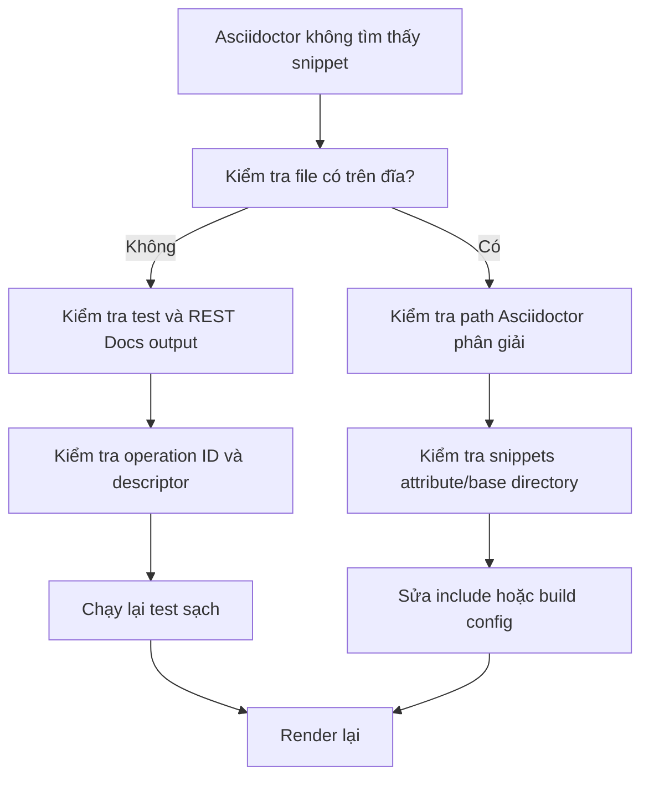

# Asciidoctor không tìm thấy snippet

## 1. Hiểu đúng lỗi include snippet

Spring REST Docs tạo tài liệu REST API có thể kiểm chứng từ HTTP tests với MockMvc, WebTestClient hoặc REST Assured. Khi test chạy qua REST Docs integration, các snippet như `http-request.adoc`, `http-response.adoc`, `response-fields.adoc` và `links.adoc` được ghi vào thư mục generated snippets. Asciidoctor sau đó đọc các file này thông qua `include::` hoặc operation macro để tạo HTML/PDF.

Lỗi thường gặp có dạng:

```text
include file not found: .../generated-snippets/books-get/http-response.adoc
```

Hoặc tài liệu render được nhưng một section rỗng/thiếu nội dung. Điều đó có nghĩa Asciidoctor không tìm thấy file tại đường dẫn đã phân giải, hoặc operation macro không tìm thấy operation/snippet tương ứng.

Đừng vội tạo file rỗng hoặc bỏ include để build xanh. Hãy xác định file có thực sự được sinh không, Asciidoctor đang tìm ở đâu và tên operation/snippet có khớp không.



## 2. Phân biệt file snippet chưa được sinh và đường dẫn include sai

Đây là hai nhóm nguyên nhân chính:

| Quan sát | Nguyên nhân có thể | Hướng kiểm tra |
| --- | --- | --- |
| Không có thư mục `generated-snippets`. | Test không chạy, REST Docs filter không gắn hoặc output path khác. | Test report, document filter, output directory. |
| Có thư mục nhưng thiếu `books-get/`. | Identifier khác hoặc test scenario không chạy. | `document("...")` và test report. |
| Có operation folder nhưng thiếu `http-response.adoc`. | Test chưa tạo snippet đó, request không tới filter hoặc descriptor flow khác. | Nội dung test và file thực tế trong folder. |
| File tồn tại nhưng include báo không tìm thấy. | `{snippets}` sai, relative path sai hoặc base directory khác. | Giá trị attribute và đường dẫn được Asciidoctor phân giải. |
| `operation::books-get[]` không có nội dung. | Extension không nạp, operation ID sai hoặc operation folder rỗng. | Classpath extension và generated snippets. |

Trước tiên hãy kiểm tra file thực tế trên đĩa. Không dựa vào tên path trong thông báo lỗi để kết luận rằng test chưa sinh snippet; lỗi cũng có thể do Asciidoctor đang tìm sai thư mục.

## 3. Kiểm tra test đã chạy và tạo snippet

Spring REST Docs chỉ ghi snippet khi HTTP documentation test thực thi request qua filter/extension và gọi `document(...)`. Xác nhận:

1. Test class/method được phát hiện và chạy.
2. Test không bị skip bởi tag, profile, `-x test`, `-DskipTests` hoặc điều kiện khác.
3. Test đã đi tới request có gắn REST Docs filter.
4. `document("books-get", ...)` dùng đúng operation identifier.
5. Test hoàn tất theo luồng mong muốn và không lỗi trước khi ghi snippet.

Ví dụ REST Assured:

```java
given(this.specification)
        .filter(document("books-get"))
.when()
        .get("/api/books/{id}", 42)
.then()
        .statusCode(200);
```

Ví dụ MockMvc:

```java
mockMvc.perform(get("/api/books/{id}", 42))
        .andExpect(status().isOk())
        .andDo(document("books-get"));
```

Nếu test không được chạy, sửa task/lifecycle trước. Nếu test pass nhưng không có snippet, kiểm tra filter/configuration và output directory. Tham khảo test report để phân biệt test không được discovery, skipped hay failed.

## 4. Xác minh operation identifier và tên file

Operation directory được xác định bởi identifier trong `document(...)`:

```java
document("books-get", ...)
```

Snippet được ghi dưới thư mục `books-get`. Nếu tài liệu lại include:

```asciidoc
include::{snippets}/book-get/http-response.adoc[]
```

thì path sai vì `book-get` khác `books-get`.

Tên snippet cũng phải chính xác. Một số tên thường gặp:

| Nội dung | File snippet |
| --- | --- |
| HTTP request | `http-request.adoc` |
| HTTP response | `http-response.adoc` |
| Request fields | `request-fields.adoc` |
| Response fields | `response-fields.adoc` |
| Path parameters | `path-parameters.adoc` |
| Query parameters | `query-parameters.adoc` |
| Request headers | `request-headers.adoc` |
| Response headers | `response-headers.adoc` |
| Hypermedia links | `links.adoc` |

Không phải operation nào cũng tạo mọi file trong bảng. File fields chỉ có khi test khai báo payload field descriptors; links chỉ có khi test document links phù hợp. Hãy lấy filename từ output thực tế, không đoán rằng mọi operation đều có `response-fields.adoc`.

## 5. Kiểm tra `{snippets}` attribute

Với include tường minh:

```asciidoc
include::{snippets}/books-get/http-response.adoc[]
```

`{snippets}` phải trỏ tới thư mục gốc chứa `books-get/`. Convention phổ biến:

| Build tool | Snippets directory thường dùng |
| --- | --- |
| Gradle | `build/generated-snippets/` |
| Maven | `target/generated-snippets/` |

Khi dùng `spring-restdocs-asciidoctor`, extension có thể cấu hình attribute `snippets` theo build tool. Nếu không dùng extension hoặc dùng custom path, khai báo attribute trong file nguồn hoặc build configuration:

```asciidoc
:snippets: ../../build/generated-snippets
```

Hoặc Gradle:

```groovy
tasks.named('asciidoctor') {
    attributes 'snippets': layout.buildDirectory.dir('generated-snippets').get().asFile
}
```

Hoặc Maven:

```xml
<attributes>
    <snippets>${project.build.directory}/generated-snippets</snippets>
</attributes>
```

Chỉ giữ một nguồn cấu hình rõ ràng. Nếu extension tự gán attribute nhưng build lại override bằng path cũ, Asciidoctor sẽ tìm sai chỗ. Đường dẫn test ghi snippet và đường dẫn Asciidoctor đọc snippet phải đồng nhất.

## 6. Kiểm tra đường dẫn tương đối và base directory

Nếu không dùng `{snippets}`, include có thể ghi trực tiếp path tương đối:

```asciidoc
include::../../build/generated-snippets/books-get/http-response.adoc[]
```

Đường dẫn tương đối phải được tính theo file AsciiDoc chứa macro trong ngữ cảnh xử lý của Asciidoctor, không nên mặc định theo terminal working directory. Với file include lồng nhau, xác định file nào thực sự chứa `include::` và tính path từ vị trí đó.

Ví dụ:

```text
project/
├── src/docs/asciidoc/
│   ├── index.adoc
│   └── operations/books-get.adoc
└── build/generated-snippets/books-get/http-response.adoc
```

Trong `index.adoc`, path trực tiếp tới snippets có thể là `../../build/generated-snippets/...`. Nhưng trong `operations/books-get.adoc`, path cần đi lên thêm một cấp: `../../../build/generated-snippets/...`. Dùng `{snippets}` đã cấu hình đúng thường giảm lỗi khi di chuyển file operation.

Ngoài path, kiểm tra `base_dir` và safe mode của Asciidoctor. Một file có tồn tại nhưng nằm ngoài vùng include được phép vẫn có thể bị từ chối bởi cấu hình an toàn của processor/plugin.

## 7. Kiểm tra task order của Gradle

Nếu chạy riêng:

```bash
./gradlew asciidoctor
```

thì task `test` có thể không chạy, trừ khi dependency đã được khai báo. Asciidoctor có thể đọc thư mục rỗng hoặc snippets cũ.

Cấu hình minh họa:

```groovy
def snippetsDir = layout.buildDirectory.dir('generated-snippets')

tasks.named('test') {
    outputs.dir snippetsDir
    useJUnitPlatform()
}

tasks.named('asciidoctor') {
    dependsOn tasks.named('test')
    inputs.dir snippetsDir
    configurations 'asciidoctorExt'
}
```

`outputs.dir` chỉ khai báo output task với Gradle; REST Docs test vẫn phải được cấu hình để ghi đúng `snippetsDir`. `inputs.dir` khai báo thư mục mà Asciidoctor đọc. Nếu snippet được tạo bởi `integrationTest` hoặc `documentationTest`, dependency phải trỏ đúng task đó thay vì mặc định `test`.

Chạy build sạch:

```bash
./gradlew clean test asciidoctor
```

## 8. Kiểm tra lifecycle của Maven

Với Maven, test thường ghi snippets vào `target/generated-snippets`. Asciidoctor Maven Plugin cần chạy sau test đã tạo snippets. Nếu dùng integration tests qua Failsafe, hãy chạy lifecycle phù hợp, thường là:

```bash
mvn clean verify
```

Đảm bảo execution của Asciidoctor nằm sau pha test liên quan, ví dụ `prepare-package`, và plugin có dependency `spring-restdocs-asciidoctor` nếu dùng operation macro. Nếu chỉ chạy goal Asciidoctor riêng lẻ, test có thể chưa được thực thi.

Trong multi-module project, chú ý `target` được tính theo từng module. Module test có thể ghi vào `api-tests/target/generated-snippets`, còn module docs tìm ở `api-docs/target/generated-snippets`. Cần cấu hình copy/artifact dependency hoặc path liên module rõ ràng.

## 9. Kiểm tra extension khi dùng `operation::`

Nếu dùng:

```asciidoc
operation::books-get[]
```

hãy chắc chắn `spring-restdocs-asciidoctor` nằm trên classpath của Asciidoctor plugin. Với Gradle, dependency thường được đặt trong configuration như `asciidoctorExt` và được nạp bởi task. Với Maven, dependency được khai báo trong plugin dependencies của `asciidoctor-maven-plugin`.

Phân biệt hai trường hợp:

- `include::{snippets}/books-get/http-response.adoc[]` không tìm thấy file: kiểm tra file, path và attribute.
- `operation::books-get[]` không được nhận diện: kiểm tra extension/macro classpath, ngoài operation directory.

Nếu include tường minh hoạt động nhưng operation macro không hoạt động, khả năng cao vấn đề nằm ở extension. Nếu cả hai cùng không tìm thấy file, tập trung vào output directory hoặc test generation.

## 10. Lệnh kiểm tra file thực tế

Sau clean test, dùng lệnh phù hợp hệ điều hành để xem file đã được sinh:

```bash
find build/generated-snippets -maxdepth 3 -type f
```

Hoặc Maven:

```bash
find target/generated-snippets -maxdepth 3 -type f
```

Trên PowerShell:

```powershell
Get-ChildItem .\build\generated-snippets -Recurse -File
Get-ChildItem .\target\generated-snippets -Recurse -File
```

Nếu biết chính xác operation cần kiểm tra:

```powershell
Get-ChildItem .\build\generated-snippets\books-get -File
```

Kết quả giúp xác nhận tên file và chữ hoa/thường. Linux thường phân biệt hoa/thường trong tên file, trong khi một số filesystem Windows không phân biệt. Hãy dùng chính xác filename được sinh để tránh lỗi chỉ xuất hiện trên CI Linux.

## 11. Tránh snippet cũ che giấu lỗi

Generated snippets có thể còn sót từ build trước. Nếu test hiện tại không chạy nhưng Asciidoctor đọc file cũ, tài liệu vẫn có thể render thành công và che giấu lỗi test discovery.

Để loại trừ:

- Chạy `clean` đúng project/module trước test.
- Xác nhận timestamp hoặc nội dung của operation snippets thuộc lần chạy hiện tại.
- Không commit hoặc chỉnh sửa thủ công trong `build/generated-snippets`/`target/generated-snippets`.
- Chỉ render/publish sau khi test tạo snippet pass.
- Không tạo file rỗng chỉ để thỏa mãn include.

## 12. Chẩn đoán theo triệu chứng

| Triệu chứng | Nguyên nhân có thể | Cách xử lý |
| --- | --- | --- |
| `include file not found` và file không tồn tại | Test không tạo snippet hoặc operation ID/descriptor không đúng. | Kiểm tra test report, filter và generated directory. |
| `include file not found` nhưng file có tồn tại | `{snippets}`, relative path hoặc `base_dir` sai. | Xem path đã phân giải và cấu hình Asciidoctor. |
| Include thủ công chạy nhưng `operation::` lỗi | Extension chưa được nạp. | Kiểm tra `spring-restdocs-asciidoctor` trên plugin classpath. |
| Operation macro không có section | Operation directory rỗng hoặc ID không khớp. | So sánh `document("...")` với target macro. |
| Chỉ một vài snippet bị thiếu | Test chưa khai báo descriptor hoặc file không được sinh. | Kiểm tra output thực tế và `document(...)`. |
| Local chạy, CI lỗi | Path/case sensitivity/task graph khác nhau. | Dùng path portable, clean output và so sánh build command. |
| Module docs không thấy snippets của module test | Output nằm ở target/build của module khác. | Cấu hình chia sẻ artifact/path giữa modules. |
| File cũ vẫn được include | Build không clean hoặc test bị skip. | Clean và xác minh test report/timestamp. |

## 13. Quy trình xử lý từ đầu đến cuối

1. Đọc lỗi Asciidoctor để lấy operation ID và filename đang thiếu.
2. Kiểm tra file đó có tồn tại trong generated snippets directory không.
3. Nếu không tồn tại, đọc test report và xác nhận HTTP documentation test đã chạy.
4. Kiểm tra REST Docs filter/extension và `document("operation-id", ...)`.
5. Kiểm tra test output directory và `{snippets}` attribute có trỏ cùng nơi không.
6. Nếu file tồn tại, tính lại relative include path hoặc kiểm tra `base_dir`/safe mode.
7. Nếu dùng operation macro, xác nhận extension được nạp và target khớp operation folder.
8. Chạy clean test rồi Asciidoctor theo đúng task/lifecycle.
9. Đọc lại HTML/PDF để xác nhận section đã xuất hiện.

## 14. Lỗi thường gặp

| Hiện tượng | Nguyên nhân | Hướng xử lý |
| --- | --- | --- |
| Sai tên operation | `document("books-get-200")` nhưng include `books-get`. | Đồng bộ identifier giữa test và AsciiDoc. |
| Sai filename | Include `response-field.adoc` thay vì `response-fields.adoc`. | Kiểm tra filename thực tế. |
| Attribute không được thay thế | Extension không nạp hoặc attribute chưa khai báo. | Cấu hình `spring-restdocs-asciidoctor` hoặc khai báo `snippets`. |
| Relative path sai ở file con | Tính path từ `index.adoc` thay vì file chứa include. | Dùng `{snippets}` hoặc tính lại từ file hiện tại. |
| Snippet thiếu do test chưa chạy | Asciidoctor task chạy độc lập. | Thêm task dependency/lifecycle sau test. |
| Operation macro không được nhận diện | Thiếu extension trên Asciidoctor plugin classpath. | Thêm dependency đúng configuration/plugin. |
| Chỉ lỗi trên Linux | Filename sai chữ hoa/thường. | Khớp chính xác tên file. |
| Build dùng snippet cũ | Output không được clean. | Clean đúng module và chỉ publish artifact mới. |

## 15. Checklist thực hành

- [ ] Đã lấy đúng operation ID và filename từ thông báo lỗi.
- [ ] Đã xác minh snippet có thật trên filesystem.
- [ ] Test report xác nhận HTTP documentation test đã chạy và pass.
- [ ] REST Docs filter/extension được gắn và gọi `document(...)`.
- [ ] Output directory của test đã được xác định từ cấu hình thực tế.
- [ ] `{snippets}` trỏ đúng thư mục generated snippets.
- [ ] Relative path được tính từ file AsciiDoc chứa macro.
- [ ] Đã kiểm tra `base_dir`/safe mode nếu file có thật nhưng include bị từ chối.
- [ ] Operation macro có extension trên classpath và target đúng identifier.
- [ ] Gradle/Maven chạy test trước Asciidoctor.
- [ ] Clean build không dùng snippet cũ; CI chỉ publish output của build hiện tại.
- [ ] HTML/PDF cuối đã được mở và xác nhận section đầy đủ.

Khi Asciidoctor không tìm thấy snippet, hãy kiểm tra file thực tế trước rồi mới sửa include. Nếu file không tồn tại, lần ngược về test discovery, REST Docs filter, operation identifier và output directory. Nếu file có tồn tại, kiểm tra `{snippets}`, relative path, `base_dir` và extension khi dùng `operation::`. Đồng bộ test output với Asciidoctor input và chạy clean build sẽ giúp tài liệu được tạo từ snippets của đúng lần kiểm thử hiện tại.

## Tài liệu tham khảo

- [Spring REST Docs – Getting Started](https://docs.spring.io/spring-restdocs/reference/getting-started.html)
- [Spring REST Docs – Working with Asciidoctor](https://docs.spring.io/spring-restdocs/docs/current/reference/htmlsingle/)
- [Spring REST Docs – Documenting Your API](https://docs.spring.io/spring-restdocs/reference/documenting-your-api.html)
- [Asciidoctor – Include Directive](https://docs.asciidoctor.org/asciidoc/latest/directives/include/)
- [Asciidoctor – Safe Modes](https://docs.asciidoctor.org/asciidoctor/latest/safe-modes/)
