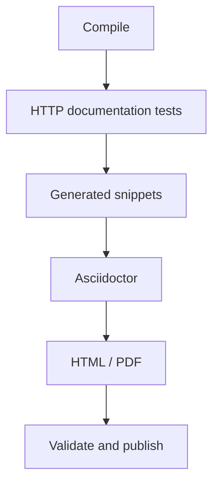

# Plugin build không chạy đúng thứ tự dependency

## 1. Hiện tượng và nguyên tắc xử lý

Spring REST Docs tạo tài liệu REST API có thể kiểm chứng từ HTTP tests với MockMvc, WebTestClient hoặc REST Assured. Test chạy qua REST Docs integration để ghi snippets; sau đó Asciidoctor đọc snippets và render HTML/PDF. Chuỗi công việc này có thứ tự phụ thuộc rõ ràng:

1. Compile production/test source.
2. Chạy HTTP documentation tests.
3. Ghi generated snippets vào output directory.
4. Chạy Asciidoctor sau khi snippets đã sẵn sàng.
5. Kiểm tra và publish tài liệu.

Nếu plugin build không khai báo dependency đúng, Asciidoctor có thể chạy trước test, chạy song song với test hoặc không chạy test tạo snippets. Kết quả thường là `include file not found`, section rỗng, HTML cũ được giữ lại hoặc build pass dù tài liệu không được cập nhật.

Nguyên tắc: **task tạo snippets phải là dependency đầu vào của task biên soạn tài liệu**. Chỉ khai báo một thư mục là `inputs.dir` không tự làm cho task test chạy trước; cần dependency task/lifecycle cụ thể.



## 2. Phân biệt dependency của plugin và dependency của task

Có hai loại dependency thường bị nhầm:

| Loại | Ví dụ | Vai trò |
| --- | --- | --- |
| Plugin/library dependency | `spring-restdocs-asciidoctor` trong `asciidoctorExt`. | Đưa macro/extension vào classpath của Asciidoctor. |
| Task dependency | `asciidoctor.dependsOn(test)`. | Bảo đảm task test chạy trước task Asciidoctor. |
| Task input/output | `asciidoctor.inputs.dir(snippetsDir)`, `test.outputs.dir(snippetsDir)`. | Khai báo dữ liệu task đọc/ghi cho Gradle. |
| Maven lifecycle binding | Asciidoctor execution ở `prepare-package`, test ở `test` hoặc Failsafe trước `verify`. | Sắp xếp plugin goals theo lifecycle phase. |

Thêm `spring-restdocs-asciidoctor` không tự chạy test. Thêm `dependsOn(test)` cũng không tự đưa extension vào classpath. Cấu hình hoàn chỉnh cần cả extension dependency, task/lifecycle order và đúng snippets directory.

## 3. Gradle: cấu hình task dependency tối thiểu

Với test nằm trong source set mặc định và tạo snippets ở `build/generated-snippets`, có thể cấu hình:

```groovy
plugins {
    id 'java'
    id 'org.asciidoctor.jvm.convert' version '3.3.2'
}

configurations {
    asciidoctorExt
}

def snippetsDir = layout.buildDirectory.dir('generated-snippets')

dependencies {
    testImplementation 'org.springframework.restdocs:spring-restdocs-mockmvc'
    asciidoctorExt 'org.springframework.restdocs:spring-restdocs-asciidoctor'
}

tasks.named('test') {
    outputs.dir snippetsDir
    useJUnitPlatform()
}

tasks.named('asciidoctor') {
    dependsOn tasks.named('test')
    inputs.dir snippetsDir
    configurations 'asciidoctorExt'
    attributes 'snippets': snippetsDir.get().asFile
}
```

Các dòng quan trọng:

- `dependsOn tasks.named('test')`: task `test` phải hoàn tất trước khi Asciidoctor chạy.
- `test.outputs.dir snippetsDir`: khai báo test ghi snippets vào thư mục này với Gradle.
- `asciidoctor.inputs.dir snippetsDir`: khai báo Asciidoctor đọc cùng thư mục.
- `configurations 'asciidoctorExt'`: nạp extension Spring REST Docs vào Asciidoctor task.

Lưu ý: `outputs.dir` không cấu hình REST Docs writer. Test setup (ví dụ `@AutoConfigureRestDocs`, `RestDocumentationExtension` hoặc custom configuration) cũng phải ghi vào đúng `snippetsDir`.

## 4. Gradle: dùng task integration/documentation test riêng

Một số dự án không đặt HTTP documentation tests trong task `test`. Chúng có thể nằm ở `integrationTest` hoặc `documentationTest`. Khi đó, dependency phải trỏ tới task thực sự tạo snippets.

Ví dụ dùng source set `integrationTest`:

```groovy
sourceSets {
    integrationTest {
        java.srcDir file('src/integrationTest/java')
        resources.srcDir file('src/integrationTest/resources')
        compileClasspath += sourceSets.main.output
        runtimeClasspath += output + compileClasspath
    }
}

configurations {
    integrationTestImplementation.extendsFrom testImplementation
    integrationTestRuntimeOnly.extendsFrom testRuntimeOnly
}

def snippetsDir = layout.buildDirectory.dir('generated-snippets')

tasks.register('integrationTest', Test) {
    description = 'Runs integration and REST Docs tests.'
    group = 'verification'
    testClassesDirs = sourceSets.integrationTest.output.classesDirs
    classpath = sourceSets.integrationTest.runtimeClasspath
    outputs.dir snippetsDir
    useJUnitPlatform()
}

tasks.named('asciidoctor') {
    dependsOn tasks.named('integrationTest')
    inputs.dir snippetsDir
    configurations 'asciidoctorExt'
    attributes 'snippets': snippetsDir.get().asFile
}
```

Đây là ví dụ khung; cấu hình source set và dependency có thể khác theo convention plugin của dự án. Nếu `check` cũng phải chạy integration tests, thêm dependency phù hợp vào `check`. Không trỏ Asciidoctor vào `test` nếu snippets chỉ được tạo bởi `integrationTest`.

Nếu cả `test` và `integrationTest` cùng ghi vào một snippets directory, hãy quản lý operation identifiers để tránh ghi đè và đảm bảo task ordering không tạo race condition.

## 5. Kiểm tra task graph của Gradle

Trước khi sửa cấu hình, xem task nào thực sự được schedule:

```bash
./gradlew asciidoctor --dry-run
```

Khi đã khai báo dependency, output cần thể hiện task test tạo snippets nằm trước `asciidoctor`. Có thể xem log chi tiết:

```bash
./gradlew clean asciidoctor --info
```

Nếu task test không xuất hiện trong dry-run graph, dependency có thể chưa được khai báo đúng, task khác đang tạo snippets hoặc build gọi nhầm task. Nếu test xuất hiện nhưng bị skipped, kiểm tra `onlyIf`, `enabled`, test filters, tags và skip properties.

Không suy luận thứ tự chỉ từ vị trí các block trong `build.gradle`. Gradle điều phối theo task graph và dependency, không theo thứ tự văn bản của khai báo.

## 6. Gradle: tránh phụ thuộc ngược hoặc task cycle

Dependency phải đi theo chiều:

```text
test/integrationTest -> generated snippets -> asciidoctor
```

Trong Gradle DSL, quan hệ thường viết `asciidoctor.dependsOn(test)`: Asciidoctor phụ thuộc vào test. Tránh cấu hình ngược như test phụ thuộc Asciidoctor nếu Asciidoctor lại phụ thuộc test; điều đó tạo task cycle.

Không khai báo task Asciidoctor ghi vào cùng thư mục mà test đang quản lý như output snippets. Tách rõ:

- `generated-snippets`: output của test, input của Asciidoctor.
- `docs/asciidoc/html5`: output HTML của Asciidoctor.
- PDF output: thư mục riêng theo cấu hình PDF backend/task.

Nếu build cache hoặc incremental build không nhận thay đổi, kiểm tra inputs/outputs có phản ánh đầy đủ nội dung mà task sử dụng không. Tránh đánh dấu task `UP-TO-DATE` một cách thủ công khi snippets chưa được tạo.

## 7. Maven: hiểu lifecycle trước khi cấu hình plugin

Maven chạy các plugin goals theo lifecycle phase. Một luồng thường gặp:

| Phase | Công việc thường gặp |
| --- | --- |
| `test` | Maven Surefire chạy unit/documentation tests phù hợp. |
| `integration-test` | Maven Failsafe chạy integration tests nếu được cấu hình. |
| `verify` | Failsafe xác nhận kết quả integration test và các bước kiểm tra. |
| `prepare-package` | Có thể chạy Asciidoctor để tạo tài liệu trước khi package. |

Nếu REST Docs test chạy bởi Surefire ở phase `test`, đặt Asciidoctor execution ở phase sau đó như `prepare-package` thường bảo đảm test đã chạy trước. Nếu snippets được tạo bởi Failsafe, phải xác nhận Asciidoctor chạy sau khi integration test đã thực thi. Với Failsafe, thường dùng `mvn verify` để chạy cả `integration-test` và `verify`.

Ví dụ gọi:

```bash
mvn clean verify
```

Chỉ gọi một goal render Asciidoctor riêng lẻ có thể bỏ qua test tạo snippets. Khi đó plugin vẫn chạy nhưng không có input mới.

## 8. Maven: cấu hình Asciidoctor sau test

Ví dụ cấu hình Asciidoctor Maven Plugin ở phase `prepare-package`:

```xml
<plugin>
    <groupId>org.asciidoctor</groupId>
    <artifactId>asciidoctor-maven-plugin</artifactId>
    <version>2.2.6</version>
    <executions>
        <execution>
            <id>render-api-docs</id>
            <phase>prepare-package</phase>
            <goals>
                <goal>process-asciidoc</goal>
            </goals>
            <configuration>
                <backend>html</backend>
                <attributes>
                    <snippets>${project.build.directory}/generated-snippets</snippets>
                </attributes>
            </configuration>
        </execution>
    </executions>
    <dependencies>
        <dependency>
            <groupId>org.springframework.restdocs</groupId>
            <artifactId>spring-restdocs-asciidoctor</artifactId>
            <version>${spring-restdocs.version}</version>
        </dependency>
    </dependencies>
</plugin>
```

`spring-restdocs-asciidoctor` nằm trong dependencies của plugin để macro được nạp. Nó không phải dependency thay thế module test integration. `snippets` phải trỏ tới output directory mà test đã tạo. Version plugin và Spring REST Docs trong ví dụ cần được đồng bộ với dependency management của dự án.

Nếu REST Docs tests nằm trong Failsafe, xác nhận execution Asciidoctor thực sự chạy sau các integration-test goals. Có thể đặt execution ở phase muộn hơn hoặc cấu hình lifecycle phù hợp, nhưng phải kiểm tra thứ tự thực tế bằng log Maven.

## 9. Maven: multi-module và profile

Trong multi-module build, module test và module docs có thể có output directory riêng:

```text
parent/
├── api-tests/target/generated-snippets/
└── api-docs/target/generated-docs/
```

Asciidoctor trong `api-docs` không tự động đọc `api-tests/target/generated-snippets`. Cần cấu hình copy/artifact dependency hoặc đường dẫn chia sẻ tường minh. Đảm bảo reactor order chạy module test trước module docs và module docs nhận đúng artifact.

Nếu plugin/test execution nằm trong Maven profile, profile phải được bật trong lệnh CI:

```bash
mvn -Papi-docs clean verify
```

Tên profile chỉ là ví dụ. Kiểm tra POM thực tế và effective POM khi không rõ execution nào đang active:

```bash
mvn help:active-profiles
mvn help:effective-pom
```

Không để profile tài liệu bị tắt trong CI nhưng vẫn publish HTML cũ từ workspace trước.

## 10. Đừng nhầm plugin dependency với lifecycle execution

Một số lỗi cấu hình xuất phát từ việc plugin có dependency đúng nhưng execution không được gọi, hoặc execution chạy nhưng plugin thiếu extension.

| Cấu hình | Nếu thiếu/sai thì |
| --- | --- |
| `spring-restdocs-asciidoctor` trong plugin dependencies | `operation::` hoặc các macro Spring REST Docs không được nhận diện. |
| `asciidoctor-maven-plugin` execution | Không có bước render tài liệu trong lifecycle. |
| Execution phase | Render có thể chạy trước test tạo snippets. |
| `snippets` attribute | Include trỏ sai thư mục dù snippets đã tồn tại. |
| REST Docs test dependency/filter | Test chạy nhưng không tạo snippet. |
| Maven profile activation | Plugin execution hoặc test bị loại khỏi build. |

Với Gradle, tương tự: `asciidoctorExt` cung cấp extension classpath; `dependsOn` điều khiển task order; `inputs/outputs` mô tả dữ liệu cho incremental build. Không có một cấu hình nào thay thế được tất cả cấu hình còn lại.

## 11. Chạy clean build và kiểm tra output mới

Sau khi sửa dependency order, chạy clean build để tránh snippets cũ che giấu lỗi.

Gradle:

```bash
./gradlew clean test asciidoctor
```

Hoặc nếu dùng integration task:

```bash
./gradlew clean integrationTest asciidoctor
```

Maven:

```bash
mvn clean verify
```

Kiểm tra:

- Test report có các documentation tests mong đợi.
- Snippets có timestamp/nội dung thuộc lần chạy mới.
- Asciidoctor task bắt đầu sau khi test kết thúc.
- Không có `include file not found`.
- HTML/PDF output được tạo mới.
- Nếu test fail, task render/publish phụ thuộc phải dừng theo chính sách build.

Không dùng việc “thư mục tồn tại” làm bằng chứng duy nhất. Một thư mục có thể còn từ build trước hoặc được tạo rỗng bởi task output declaration.

## 12. Chẩn đoán theo triệu chứng

| Triệu chứng | Nguyên nhân có thể | Cách xử lý |
| --- | --- | --- |
| Asciidoctor chạy trước test | Thiếu `dependsOn` hoặc Maven phase quá sớm. | Khai báo dependency task/lifecycle sau test. |
| Gradle dry-run không có task test | Asciidoctor không phụ thuộc task tạo snippets hoặc task sai tên. | Trỏ `dependsOn` tới `test`, `integrationTest` hoặc task thực tế. |
| Test chạy nhưng Asciidoctor đọc folder rỗng | Test writer và Asciidoctor input dùng path khác nhau. | Đồng bộ REST Docs output directory với `snippetsDir`/attribute. |
| `operation::` không nhận diện | Thiếu extension trên plugin classpath. | Thêm `spring-restdocs-asciidoctor` vào `asciidoctorExt`/Maven plugin dependencies. |
| Maven `test` không chạy `*IT` | Test thuộc Failsafe nhưng lifecycle chưa tới integration-test/verify. | Dùng `mvn verify` và kiểm tra Failsafe execution. |
| Chỉ chạy `asciidoctor` thì include lỗi | Renderer không tự chạy HTTP tests. | Chạy task test trước hoặc thêm dependency. |
| Task chạy song song và đọc thiếu file | Dependency order chưa đúng hoặc nhiều task cùng ghi output. | Khai báo task dependency và tách output/operation IDs. |
| CI render tài liệu cũ | Clean/profile/task graph khác local. | Clean đúng module, xác minh active profiles và artifact build ID. |
| Build cycle | Task dependency khai báo ngược hoặc vòng. | Thiết kế chiều test → snippets → Asciidoctor, bỏ dependency vòng. |

## 13. Ví dụ kiểm tra dependency order từ đầu đến cuối

Giả sử `books-get` được sinh bởi `documentationTest`, không phải task `test`.

**Bước 1 — Xem task graph:**

```bash
./gradlew asciidoctor --dry-run
```

Nếu `documentationTest` không xuất hiện trước `asciidoctor`, dependency chưa đúng.

**Bước 2 — Khai báo đúng task:**

```groovy
tasks.named('asciidoctor') {
    dependsOn tasks.named('documentationTest')
}
```

**Bước 3 — Đồng bộ snippets directory:**

```groovy
tasks.named('documentationTest') {
    outputs.dir snippetsDir
}

tasks.named('asciidoctor') {
    inputs.dir snippetsDir
    attributes 'snippets': snippetsDir.get().asFile
}
```

Đảm bảo REST Docs test configuration cũng ghi vào `snippetsDir`.

**Bước 4 — Chạy clean build và kiểm tra report:**

```bash
./gradlew clean documentationTest asciidoctor --info
```

Xác nhận `books-get/http-response.adoc` mới được sinh trước khi Asciidoctor bắt đầu. Nếu file có nhưng include vẫn lỗi, chuyển sang chẩn đoán `{snippets}`/relative path thay vì tiếp tục sửa task order.

## 14. Lỗi thường gặp

| Hiện tượng | Nguyên nhân | Hướng xử lý |
| --- | --- | --- |
| Build file có `asciidoctor` nhưng không có test dependency | Chỉ khai báo task render. | Thêm `dependsOn` hoặc lifecycle binding phù hợp. |
| Dùng `inputs.dir` và nghĩ test sẽ tự chạy | Inputs không tạo task dependency. | Khai báo dependency rõ ràng. |
| Đặt `dependsOn(test)` nhưng snippet do integration test tạo | Phụ thuộc sai task. | Trỏ tới `integrationTest`/`documentationTest`. |
| Chỉ thêm `spring-restdocs-asciidoctor` | Có extension nhưng không có task tạo snippets. | Cấu hình test integration và task order. |
| Chỉ thêm `spring-restdocs-mockmvc` | Có test integration nhưng thiếu Asciidoctor macro extension. | Thêm plugin dependency `spring-restdocs-asciidoctor`. |
| Maven render ở phase `test` | Execution có thể chạy trước hoặc cùng phase với test tùy thứ tự plugin. | Đặt phase sau test và xác minh log/lifecycle. |
| Maven bỏ qua Failsafe | Chỉ gọi `mvn test` hoặc profile không active. | Chạy `mvn verify`, bật đúng profile. |
| Build cache giữ output cũ | Inputs/outputs hoặc clean chưa đúng. | Clean và khai báo task inputs/outputs chính xác. |
| Task cycle | Dependency ngược chiều. | Chỉ để Asciidoctor phụ thuộc task tạo snippets. |

## 15. Checklist thực hành

- [ ] Đã xác định chính xác task tạo generated snippets.
- [ ] Asciidoctor phụ thuộc đúng task đó, không phụ thuộc nhầm `test` mặc định.
- [ ] Gradle task graph hoặc Maven lifecycle log xác nhận thứ tự thực tế.
- [ ] Đã phân biệt plugin classpath dependency với task/lifecycle dependency.
- [ ] Test output directory và Asciidoctor snippets input/attribute trùng nhau.
- [ ] Gradle inputs/outputs khai báo đúng để incremental build không dùng output sai.
- [ ] Maven Surefire/Failsafe và profile được gọi đúng lifecycle.
- [ ] Multi-module build truyền snippets giữa module test và module docs đúng cách.
- [ ] Không có task cycle hoặc nhiều task ghi cùng output gây race.
- [ ] Clean build tạo snippets mới trước khi render.
- [ ] Test fail thì Asciidoctor/publish phụ thuộc không tiếp tục dùng snippet cũ.

Khi plugin build không chạy đúng thứ tự dependency, hãy xác định task nào tạo snippets và task nào đọc chúng. Với Gradle, nối Asciidoctor vào đúng task bằng `dependsOn`, khai báo input/output và kiểm tra task graph. Với Maven, đặt Asciidoctor ở phase sau test phù hợp và chạy lifecycle đủ sâu, đặc biệt khi dùng Failsafe. Giữ riêng dependency extension, task order và snippets path; cả ba phải đúng thì tài liệu mới được render từ output của lần test hiện tại.

## Tài liệu tham khảo

- [Spring REST Docs – Getting Started](https://docs.spring.io/spring-restdocs/reference/getting-started.html)
- [Spring REST Docs – Working with Asciidoctor](https://docs.spring.io/spring-restdocs/docs/current/reference/htmlsingle/)
- [Gradle – Task Dependencies](https://docs.gradle.org/current/userguide/controlling_task_execution.html#sec:task_dependencies)
- [Gradle – Incremental Builds](https://docs.gradle.org/current/userguide/incremental_build.html)
- [Maven – Introduction to the Build Lifecycle](https://maven.apache.org/guides/introduction/introduction-to-the-lifecycle.html)
- [Maven Failsafe Plugin – Usage](https://maven.apache.org/surefire/maven-failsafe-plugin/usage.html)
