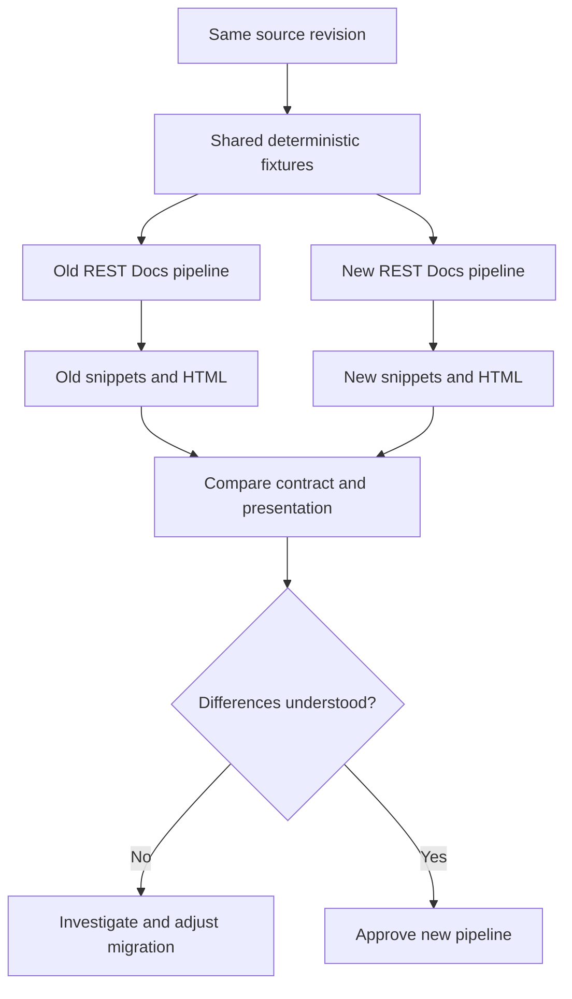

# Giữ tài liệu cũ có thể tái tạo trong giai đoạn chuyển tiếp

## Mục tiêu học tập

Sau bài này, bạn có thể:

- Giải thích vì sao cần giữ khả năng tái tạo tài liệu cũ trong lúc nâng cấp Spring REST Docs, Spring Boot, build tool hoặc Asciidoctor.
- Kiểm kê nguồn, snippet, template, toolchain và artifact đang tạo ra tài liệu hiện tại.
- Pin dependency và môi trường để dựng lại bản tài liệu baseline.
- Tạo quy trình chạy song song bản build cũ và mới để so sánh kết quả.
- Phân loại diff do thay đổi định dạng với diff phản ánh thay đổi API contract.
- Quản lý version, provenance, archive và chính sách deprecation cho tài liệu cũ.
- Thiết lập điều kiện chuyển đổi và phương án rollback có thể kiểm chứng.

## 1. Vì sao phải giữ khả năng tái tạo tài liệu cũ?

Khi nâng cấp Spring REST Docs hoặc hệ sinh thái xung quanh, output có thể thay đổi dù API không đổi. Ví dụ:

- Version plugin Asciidoctor thay đổi HTML structure hoặc theme.
- Spring REST Docs thay đổi snippet template hoặc cách format request/response.
- Spring Boot/Spring Framework thay đổi serialization, error handling hoặc static resource behavior.
- Java, Gradle hoặc Maven thay đổi task lifecycle và dependency resolution.
- Custom snippet template hoặc AsciiDoc attribute bị chỉnh sửa.
- Dependency của test thay đổi thứ tự JSON, header hoặc cách biểu diễn giá trị.

Nếu chỉ giữ source hiện tại và xóa cấu hình cũ ngay, nhóm có thể mất khả năng dựng lại tài liệu đã phát hành để điều tra incident, đối chiếu contract hoặc hỗ trợ consumer đang dùng API version cũ.

Trong giai đoạn chuyển tiếp, cần giữ một baseline có thể tái tạo. Baseline không nhất thiết phải tiếp tục được phát hành công khai; nó là bằng chứng kỹ thuật cho biết bản tài liệu cũ được tạo từ source, toolchain và cấu hình nào.

## 2. Xác định phạm vi baseline

Trước khi nâng cấp, kiểm kê những thành phần tạo nên tài liệu:

| Thành phần | Cần ghi nhận |
| --- | --- |
| Source revision | Commit SHA hoặc release tag |
| Application/API version | Version code và contract |
| Java | JDK vendor/version hoặc toolchain |
| Build tool | Gradle wrapper hoặc Maven version |
| Spring Boot/Framework | Version platform |
| Spring REST Docs | Version core và test integration |
| Asciidoctor | Plugin, engine và extension version |
| Test dependencies | JUnit, MockMvc/WebTestClient/REST Assured và mock server |
| Snippet templates | Template mặc định và custom template |
| AsciiDoc sources | Entry point, include, attributes, theme |
| Generated snippets | Output directory và document identifiers |
| Artifact | HTML/PDF/JAR/ZIP đã phát hành, checksum và metadata |

Một baseline tốt cho phép người khác trả lời được: “Tôi cần checkout revision nào, dùng JDK/build tool nào và chạy lệnh gì để tạo lại tài liệu này?”

### 2.1. Lưu manifest baseline

Có thể lưu metadata cạnh artifact:

```json
{
  "service": "orders-service",
  "applicationVersion": "2.3.1",
  "apiVersion": "v2",
  "sourceRevision": "7f3a91c",
  "javaVersion": "17",
  "gradleVersion": "8.7",
  "springBootVersion": "3.2.5",
  "springRestDocsVersion": "3.0.1",
  "asciidoctorPluginVersion": "4.0.2",
  "artifact": "orders-api-docs-2.3.1.zip",
  "sha256": "example-checksum"
}
```

Các giá trị chỉ minh họa cấu trúc. Khi dùng thật, lấy dữ liệu từ build metadata, dependency lock/version catalog và release pipeline. Không ghi version suy đoán hoặc checksum giả vào manifest phát hành.

### 2.2. Lưu cả cấu hình sinh tài liệu

Artifact HTML đơn lẻ chưa đủ để tái tạo. Cần giữ:

- AsciiDoc source và include files.
- Custom snippet templates.
- Build script và wrapper.
- Dependency lockfile/version catalog nếu dự án dùng.
- Test fixture và test configuration.
- Attribute/variable được truyền cho Asciidoctor.
- Metadata về environment cần thiết.

Không nhất thiết phải lưu generated snippets lâu dài nếu chúng có thể được tạo lại đáng tin cậy. Tuy nhiên, lưu snippet của release có thể hữu ích để so sánh và audit. Nếu lưu, phải gắn chúng với source revision cụ thể.

## 3. Pin toolchain và dependency của bản cũ

Để tái tạo baseline, tránh dùng dependency version trôi nổi:

- Commit Gradle Wrapper hoặc Maven Wrapper.
- Khóa JDK toolchain.
- Dùng version cụ thể cho Spring Boot, Spring REST Docs và Asciidoctor plugin.
- Khóa custom template và extension.
- Dùng dependency lock hoặc dependency management phù hợp.
- Ghi rõ environment variables ảnh hưởng đến output.

Ví dụ Gradle toolchain:

```groovy
java {
    toolchain {
        languageVersion = JavaLanguageVersion.of(17)
    }
}
```

Version trên là ví dụ. Dùng đúng JDK mà baseline đã sử dụng; không nâng toolchain trong cùng thay đổi nếu mục tiêu là dựng lại output cũ.

Ví dụ kiểm tra wrapper:

```bash
./gradlew --version
```

Với Maven:

```bash
./mvnw --version
```

Wrapper giúp pin build tool nhưng không tự pin JDK. CI vẫn cần cài đúng JDK hoặc dùng image đã khóa version/digest.

## 4. Tạo baseline từ trạng thái cũ

Trước khi thay đổi dependency hoặc template:

1. Checkout release tag hoặc commit đang tạo tài liệu cũ.
2. Dùng đúng JDK và build wrapper.
3. Xóa generated output để tránh file cũ còn sót.
4. Chạy documentation tests.
5. Render Asciidoctor.
6. Tạo artifact theo đúng quy trình release cũ.
7. Lưu test report, artifact, manifest và checksum.
8. Ghi lại lệnh build có thể chạy lại.

Ví dụ Gradle:

```bash
./gradlew clean test asciidoctor
```

Ví dụ Maven:

```bash
./mvnw clean verify
```

Các lệnh phải phù hợp task/lifecycle thật của dự án. Xác nhận documentation test thực sự được chạy và Asciidoctor dùng snippet của chính lần build đó.

### 4.1. Baseline phải được kiểm tra

Không coi lần build đầu tiên là baseline hợp lệ nếu:

- Có test bị skip ngoài chính sách.
- Snippet directory còn file từ build trước.
- Asciidoctor render với warning/error bị bỏ qua.
- Artifact thiếu CSS, ảnh hoặc trang operation.
- Không xác định được source revision hoặc dependency version.
- Build phụ thuộc file cục bộ không được lưu.

Nếu không thể tái tạo baseline, ghi rõ giới hạn và lưu artifact cuối cùng đã phát hành cùng metadata còn có. Không tuyên bố baseline reproducible khi chưa chạy lại thành công.

## 5. Nâng cấp trong nhánh riêng và giữ đường chạy cũ

Trong giai đoạn chuyển tiếp, giữ hai đường build có thể phân biệt:

```text
release/2.x
    └── old toolchain + old templates + baseline docs

upgrade/restdocs-3.x
    └── new toolchain + updated templates + candidate docs
```

Không sửa trực tiếp cấu hình release cũ để thử nâng cấp nếu chưa có baseline và cách quay lại. Nhánh nâng cấp cần thay đổi dependency/template có chủ đích, ghi lại diff và chạy test độc lập.

Nếu repository dùng một nhánh release duy nhất, có thể dùng commit/tag baseline và nhánh feature để thử. Tránh duy trì hai cấu hình build không được kiểm tra vì chúng nhanh chóng lệch nhau.

## 6. Chạy song song old/new documentation pipeline

Trong một khoảng chuyển tiếp, chạy hai pipeline trên cùng source revision khi có thể:

1. Old pipeline dùng dependency/template cũ.
2. New pipeline dùng dependency/template mới.
3. Cả hai chạy cùng documentation test và fixture.
4. Mỗi pipeline ghi output vào directory riêng.
5. Lưu HTML, snippet và test report riêng biệt.
6. So sánh kết quả trước khi thay pipeline chính.

Sơ đồ:



Nếu không thể chạy cùng source revision do API/dependency incompatibility, ghi rõ commit tương ứng và tách diff do code với diff do toolchain. Không so sánh hai artifact từ hai commit khác nhau rồi quy mọi khác biệt cho nâng cấp REST Docs.

## 7. So sánh snippet và HTML đúng cách

Diff giữa bản cũ và mới có thể đến từ nhiều lớp:

| Loại diff | Ví dụ | Cách đánh giá |
| --- | --- | --- |
| Contract diff | Field mới, status đổi, header thay đổi | Cần review API behavior |
| Snippet formatting | Whitespace, table markup, line wrapping | Có thể là thay đổi template/formatter |
| HTML presentation | CSS class, navigation, heading structure | Review giao diện và link |
| Environment noise | Port, timestamp, UUID, host | Kiểm soát fixture/preprocessor |
| Dependency behavior | JSON serialization hoặc exception mapping | Xác định có thay đổi runtime không |

Không dùng snapshot HTML duy nhất làm tiêu chí duy nhất. HTML có thể đổi do theme trong khi snippet contract không đổi; ngược lại, HTML nhìn gần giống nhau nhưng response field có thể đã mất.

Nên so sánh theo lớp:

1. Test result và HTTP assertions.
2. REST Docs snippet có cấu trúc.
3. AsciiDoc source/include resolution.
4. HTML render và navigation.
5. Artifact package và runtime serving.

### 7.1. Review contract trước presentation

Ưu tiên kiểm tra:

- Request method/path và parameter.
- Request/response headers.
- Request/response fields.
- Status code của success/error.
- Links và multipart parts.
- Error schema và authentication challenge.

Sau khi contract pass, mới review HTML/CSS/navigation. Điều này giúp phân biệt thay đổi API với thay đổi giao diện do Asciidoctor.

## 8. Kiểm soát thay đổi custom snippet template

Custom snippet template có thể phụ thuộc model hoặc helper của Spring REST Docs version cũ. Khi nâng cấp:

- Đọc release notes/migration notes của đúng version đang chuyển.
- Xác minh tên model attribute và template engine.
- Kiểm tra escape HTML/AsciiDoc.
- Kiểm tra table markup, cell span và multiline content.
- Kiểm tra tên file snippet có giữ tương thích với include hay không.
- Không copy template mặc định của version mới vào project mà chưa so sánh mục đích custom cũ.

Giữ template cũ trong baseline branch/tag để có thể tái tạo artifact đã phát hành. Template mới nên được review cùng test output, không thay thế âm thầm.

## 9. Quản lý AsciiDoc và Markdown cũ

Trong giai đoạn chuyển tiếp, có thể tồn tại:

- AsciiDoc source đang dùng để render.
- HTML được publish từ source đó.
- Markdown source được phân phối cho consumer.
- Template và attribute của bản cũ.
- Trang mới đang được chuyển đổi hoặc tổ chức lại.

Hãy xác định mỗi file là source of truth, generated output hay archive. Không để hai file được chỉnh sửa thủ công cùng đại diện một nội dung mà không có quy tắc đồng bộ.

Nếu Markdown chỉ là bản export từ AsciiDoc, ghi rõ nguồn và cách tái tạo. Nếu Markdown là nguồn chính thức, cần có pipeline kiểm tra link/image/code fence và đảm bảo nội dung được cập nhật cùng contract.

Không xóa URL tài liệu cũ ngay khi pipeline mới hoạt động. Consumer có thể còn bookmark, SDK generation hoặc integration guide trỏ đến bản cũ.

## 10. Versioning và archive tài liệu cũ

Có thể tổ chức website theo version:

```text
docs/
├── current/
├── 3.0/
├── 2.4/
└── archive/
    └── 2.3/
```

Chính sách cần nêu:

- Version nào đang được hỗ trợ.
- Version nào chỉ còn để tham khảo.
- Ngày tài liệu chuyển sang deprecated.
- Khi nào URL cũ bị redirect hoặc gỡ bỏ.
- Ai sở hữu nội dung và việc cập nhật security notice.

Nếu giữ URL cũ, thêm banner rõ rằng đó là tài liệu của API version cũ. Không sửa nội dung cũ thành contract mới nhưng vẫn giữ URL/version cũ vì consumer sẽ hiểu sai lịch sử.

## 11. Chuyển đổi URL và tương thích liên kết

Khi đổi cấu trúc trang, các liên kết có thể bị hỏng:

- URL resource page đổi.
- Anchor ID đổi.
- File CSS/ảnh chuyển thư mục.
- Base path của website thay đổi.
- Tên file Markdown/HTML thay đổi.

Lập mapping old URL → new URL:

| URL cũ | URL mới | Chính sách |
| --- | --- | --- |
| /docs/orders.html | /docs/2.4/orders/ | Redirect nếu tương đương |
| /docs/#orders-get | /docs/2.4/orders/#orders-get | Giữ anchor hoặc mapping |
| /docs/api.md | /docs/2.4/api.md | Giữ file hoặc thông báo URL mới |

Các URL trong bảng là ví dụ. Kiểm tra access log, link checker và tài liệu consumer trước khi loại bỏ đường dẫn cũ. Redirect chỉ phù hợp khi nội dung đích thực sự tương đương; không redirect mọi version cũ sang current nếu contract đã thay đổi.

## 12. Rollback khi pipeline mới có vấn đề

Trước khi chuyển pipeline chính:

1. Giữ tag/commit baseline cũ.
2. Giữ artifact docs đã phát hành và checksum.
3. Giữ build wrapper, dependency lock và template cũ.
4. Không ghi đè artifact immutable đã publish.
5. Chuẩn bị cách chuyển alias current về bản trước.
6. Xác minh URL và redirect sau rollback.

Rollback tài liệu có thể độc lập với rollback application nếu docs được publish riêng. Nếu docs nằm trong application JAR, rollback docs thường gắn với deploy lại application artifact tương ứng. Hãy xác định mối liên hệ này trước release.

Không xóa archive cũ khi rollback xong. Nó là bằng chứng cho version đã phát hành và giúp tái tạo khi cần điều tra.

## 13. Điều kiện kết thúc giai đoạn chuyển tiếp

Chỉ bỏ pipeline cũ khi:

- New documentation tests chạy ổn định trong CI.
- Tất cả snippet bắt buộc được sinh.
- Custom template đã tương thích và được review.
- Asciidoctor render không còn lỗi include/link.
- Contract diff đã được chấp thuận.
- HTML/Markdown/assets được kiểm tra.
- Artifact mới có version/provenance rõ.
- URL/redirect và version archive được xác nhận.
- Có phương án rollback đã thử hoặc được diễn tập.
- Người sở hữu release chấp thuận ngừng old pipeline.

Không dùng tiêu chí “build mới chạy xanh một lần” để xóa baseline. Cần đủ bằng chứng qua các môi trường và release cycle phù hợp.

## 14. Lỗi thường gặp

| Biểu hiện | Nguyên nhân có thể | Cách xử lý |
| --- | --- | --- |
| Không tái tạo được docs cũ | JDK/plugin/dependency version không được pin | Lưu wrapper, toolchain, lockfile và manifest |
| Diff quá lớn sau nâng cấp | Trộn contract, template và theme changes | So sánh riêng test, snippet, AsciiDoc và HTML |
| Snippet mới lấy nhầm output cũ | Hai pipeline dùng chung output directory | Tách workspace và generated directory |
| Custom snippet template không chạy | Model/template API thay đổi | Đọc migration notes và kiểm tra template theo version |
| Link cũ 404 | URL/anchor bị đổi mà không có mapping | Giữ redirect hoặc archive URL |
| Consumer dùng nhầm contract | URL current thay nội dung không có version label | Publish versioned docs và banner rõ ràng |
| Rollback không khôi phục được | Artifact/toolchain cũ đã bị xóa | Giữ immutable artifact và baseline metadata |
| Old/new pipeline tạo output khác vì dữ liệu | Fixture/timezone/randomness không ổn định | Dùng cùng deterministic test data |
| Cùng version nhưng artifact khác source | Hai pipeline checkout commit khác nhau | Gắn source revision/build ID và ràng buộc provenance |

## 15. Checklist giữ tài liệu cũ tái tạo được

- [ ] Đã ghi source revision và API/application version của baseline.
- [ ] Java, Gradle/Maven, Spring REST Docs và Asciidoctor version được pin.
- [ ] Đã lưu AsciiDoc, custom template, build script và attribute.
- [ ] Đã tạo lại baseline từ clean state.
- [ ] Artifact cũ, checksum và metadata được archive.
- [ ] Old/new pipeline dùng output directory riêng.
- [ ] Test fixtures giống nhau và có tính xác định.
- [ ] Contract diff được review riêng với presentation diff.
- [ ] Custom template và include được xác minh.
- [ ] URL/anchor cũ có mapping hoặc chính sách archive.
- [ ] Có rollback path cho docs và application.
- [ ] Chỉ bỏ pipeline cũ sau khi new pipeline đạt exit criteria.

## 16. Bài tập thực hành

Một service Orders chuẩn bị nâng cấp Spring REST Docs và Asciidoctor. Tài liệu version 2.3 đã được publish và vẫn có consumer đang tích hợp.

Hãy thực hiện:

1. Checkout tag 2.3 và ghi lại Java, Gradle, Spring Boot, REST Docs, Asciidoctor versions.
2. Chạy clean documentation tests và render lại tài liệu 2.3.
3. So sánh artifact vừa tạo với artifact đã phát hành; lưu checksum và ghi nhận khác biệt.
4. Tạo nhánh nâng cấp, pin version mới và giữ template cũ trong baseline branch.
5. Chạy old/new pipeline trên cùng source revision và fixture nếu tương thích.
6. Phân loại diff thành contract, formatting, presentation và environment noise.
7. Sửa custom template và include cho pipeline mới.
8. Publish candidate docs dưới version/path riêng, không thay current.
9. Kiểm tra link từ tài liệu cũ, redirect và archive.
10. Diễn tập rollback alias current về bản trước rồi mới đề xuất bỏ old pipeline.

**Câu hỏi tự kiểm tra:** Khi HTML mới khác HTML cũ, có nên coi đó là API contract đã thay đổi không? Không. HTML có thể đổi do theme, converter hoặc template. Hãy kiểm tra HTTP test assertions và snippet contract trước, sau đó mới đánh giá presentation. Nếu field/status/header thực sự thay đổi, đó mới là contract diff cần review.

## Kết luận

Giữ tài liệu cũ có thể tái tạo giúp nhóm nâng cấp Spring REST Docs và Asciidoctor mà vẫn bảo toàn khả năng đối chiếu các bản API đã phát hành. Hãy kiểm kê và pin source revision, JDK, build tool, dependency, template và attribute; tạo baseline từ clean state rồi lưu artifact, checksum và provenance. Trong giai đoạn chuyển tiếp, chạy old/new pipeline với fixture xác định và output tách biệt, phân loại contract diff khỏi thay đổi trình bày. Giữ URL/version cũ, chuẩn bị mapping và rollback trước khi thay pipeline chính. Chỉ ngừng đường build cũ khi pipeline mới ổn định, artifact được xác minh và các điều kiện chuyển đổi đã được chấp thuận.
