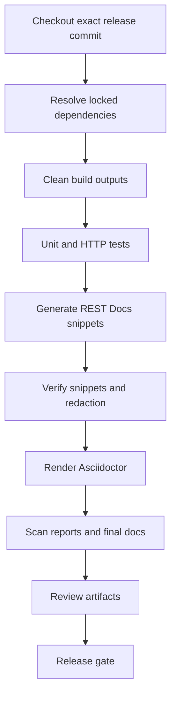

# Chạy bộ test hồi quy trước khi phát hành

## 1. Vì sao cần regression suite cho Spring REST Docs?

Trong module **SPRING_REST_DOCS**, tài liệu REST API được tạo từ HTTP tests với MockMvc, WebTestClient hoặc REST Assured. Các test vừa xác minh hành vi endpoint vừa sinh snippets cho request, response, payload, parameters và headers. Tài liệu thường được ghép bằng Asciidoctor và đóng gói cùng ứng dụng hoặc phát hành riêng.

Một thay đổi nhỏ trước release có thể ảnh hưởng nhiều lớp:
- Spring Boot, Spring Framework hoặc Spring REST Docs được nâng version.
- Jackson/JSON serialization thay đổi cách biểu diễn payload.
- Controller advice thay status hoặc error schema.
- Security filter thay authentication/authorization response.
- Operation identifier hoặc descriptor đổi làm snippet bị thiếu.
- Preprocessor thay URI, header hoặc body.
- Asciidoctor plugin đổi version hoặc include path.
- Build task chạy sai thứ tự khiến tài liệu dùng snippet cũ.

Regression suite xác nhận API contract, generated snippets và tài liệu đã render vẫn nhất quán sau thay đổi. Build xanh chỉ có ý nghĩa khi suite bao phủ các outcome quan trọng và chạy trên source/dependency mới nhất.

## 2. Xác định phạm vi regression trước release

Không nên chỉ chạy happy path. Lập ma trận endpoint và outcome:

| Nhóm | Kịch bản cần có | Bằng chứng |
| --- | --- | --- |
| Success | 200/201/204 theo contract | Status, headers, response fields |
| Validation | Body thiếu/sai field | Error status, violations, error code |
| Authentication | Thiếu/sai credential | 401 và challenge/header |
| Authorization | Không đủ quyền | 403 và error payload |
| Resource | Không tồn tại | 404, Problem Details hoặc schema riêng |
| State conflict | Trạng thái không cho phép | 409 và mã lỗi ổn định |
| Rate limit | Vượt ngưỡng | 429, Retry-After nếu có |
| Server failure | Lỗi không dự kiến | 5xx an toàn, không lộ stack trace |
| Query/path | Boundary, encoding, optional params | Request snippets và parameter descriptors |
| Headers | Required/optional headers | Request/response header snippets |
| Payload | Nested object, array, null, empty | Field descriptors và examples |
| Security | Token/cookie/PII trong fixture | Masking và artifact scan |

Ma trận phải theo contract thực tế. Không bắt buộc mọi endpoint có mọi status; chọn outcome có ý nghĩa và boundary có rủi ro.

## 3. Tách các tầng kiểm thử

Một regression suite hiệu quả có nhiều tầng:

1. **Unit tests:** logic mapping, custom preprocessor, helper tạo descriptor.
2. **HTTP slice/integration tests:** endpoint, filters, controller advice, validation và security.
3. **REST Docs tests:** descriptors khớp recorded request/response và sinh đủ snippets.
4. **Documentation build:** Asciidoctor include đúng snippets và render thành công.
5. **Artifact verification:** kiểm tra nội dung cuối, không có marker nhạy cảm hoặc snippet stale.

MockMvc phù hợp cho MVC slice/integration; WebTestClient phù hợp với WebFlux hoặc setup hỗ trợ; REST Assured phù hợp khi cần test qua HTTP server thực hoặc dùng filter DSL. Chọn client phản ánh boundary muốn kiểm tra. Không cần chạy cả ba integration cho mọi endpoint nếu không tăng coverage.

## 4. Xác minh contract HTTP trước khi ghi tài liệu

Documentation test phải assert response thực tế trước hoặc cùng chuỗi thao tác document:

```java
mockMvc.perform(get("/api/orders/{id}", "ORD-42")
        .accept(MediaType.APPLICATION_JSON))
    .andExpect(status().isOk())
    .andExpect(content().contentTypeCompatibleWith(
            MediaType.APPLICATION_JSON))
    .andExpect(jsonPath("$.orderId").value("ORD-42"))
    .andExpect(jsonPath("$.status").value("CONFIRMED"))
    .andDo(document("orders-get",
        responseFields(
            fieldWithPath("orderId").description("Mã đơn hàng"),
            fieldWithPath("status").description("Trạng thái đơn hàng")
        )
    ));
```

Regression suite cần assert những gì client dựa vào: status, Content-Type, required headers, JSON paths, error codes, pagination metadata, links hoặc Location. REST Docs descriptor bổ sung kiểm tra payload được mô tả đầy đủ; nó không thay thế assertion nghiệp vụ.

Với error responses, assert cả HTTP status và field status trong Problem Details nếu schema có field đó. Kiểm tra code ổn định thay vì phụ thuộc message có thể bản địa hóa.

## 5. Kiểm tra operation identifiers và generated snippets

Operation identifier là đường dẫn thư mục chứa snippets. Đổi identifier có thể khiến Asciidoctor include bị gãy dù test HTTP vẫn pass.

```java
.andDo(document("orders-get-success", ...));
.andDo(document("orders-get-not-found", ...));
.andDo(document("orders-cancel-conflict", ...));
```

Trước release, xác minh:
- Mỗi operation cần tài liệu có test tạo snippet.
- Identifier ổn định, duy nhất và theo naming convention.
- Có đủ http-request, http-response và các field/header snippets cần thiết.
- Descriptor không thiếu field mới hoặc khai báo field không còn tồn tại.
- Không có file snippet stale từ test đã bị xóa/đổi tên.
- Asciidoctor include đúng identifier và output directory.

Nên tạo generated-snippets trong thư mục build sạch để tránh file cũ làm suite có vẻ thành công. Không lưu snippets sinh tự động vào source folder nếu build dùng output directory riêng.

## 6. Kiểm tra preprocessing sau thay đổi

Preprocessor có thể ảnh hưởng snippet dù HTTP contract không đổi:

| Processor | Điều cần xác minh |
| --- | --- |
| prettyPrint() | JSON/XML parse được và cấu trúc không đổi |
| modifyHeaders() | Chỉ header được phép bị thay/xóa |
| replacePattern() | Secret marker biến mất, field khác giữ nguyên |
| modifyUris() | Scheme/host/port đúng, path/query giữ nguyên |
| Custom processor | Input rỗng, malformed, nested và array theo policy |

Đừng chỉ snapshot raw text nếu whitespace hoặc key order có thể thay đổi hợp lệ. Với JSON, parse thành tree và so sánh invariants. Với masking, xác minh placeholder đúng JSON path và marker gốc không còn trong snippet.

REST Docs preprocessing không bảo vệ application logs, JUnit XML hoặc HTTP wire logs. Artifact scan cần bao gồm các kênh có khả năng lưu raw exchange.

## 7. Regression cho error contract và security

Các thay đổi exception handler hoặc Spring Security có thể làm error response đổi mà happy-path tests không phát hiện. Bao phủ:
- Validation error qua Bean Validation và controller advice.
- Domain errors như not found/conflict.
- 401 từ authentication entry point.
- 403 từ access denied handler.
- Fallback 500 không lộ exception message hoặc stack trace.
- Correlation ID nhất quán giữa response header/body nếu contract yêu cầu.
- Không trả password hash, token hoặc field nhạy cảm.
- Error Content-Type và error code đúng contract.

Một số lỗi xảy ra trước DispatcherServlet, ví dụ gateway, reverse proxy hoặc security filter. Test controller advice không chứng minh các boundary này. Nếu gateway/security component thuộc phạm vi release, thêm integration tests ở đúng boundary.

## 8. Chạy build từ trạng thái sạch

Regression cần chạy trên generated output mới. Với Gradle, quy trình điển hình:

```bash
./gradlew clean test
./gradlew asciidoctor
```

Nếu task Asciidoctor phụ thuộc trực tiếp vào test task và snippet output đã cấu hình, có thể dùng lifecycle task tổng hợp:

```bash
./gradlew clean build
```

Với Maven, dùng lifecycle phase đã cấu hình để chạy tests trước Asciidoctor/documentation packaging. Tên plugin/task phụ thuộc dự án; kiểm tra dependency graph và output directory thực tế.

Không chạy Asciidoctor trước documentation tests. Không cho verification chạy song song với task sinh snippets nếu cùng đọc một output directory. Build sạch giúp phát hiện include thiếu thay vì dùng file từ lần chạy trước.

## 9. Dependency upgrade và compatibility matrix

Khi nâng Spring Boot, Spring Framework, Spring REST Docs, JUnit, Jackson hoặc Asciidoctor, kiểm tra compatibility thay vì nâng độc lập từng artifact không theo BOM.

| Thành phần | Điều cần kiểm tra |
| --- | --- |
| JDK | Toolchain và target bytecode |
| Spring Boot/Framework | MockMvc/WebTestClient, exception handling, converters |
| Spring REST Docs | Preprocessors, descriptors và generated snippets |
| JUnit | Test discovery, extensions, lifecycle |
| Jackson | JSON naming, null handling, date/time serialization |
| Validation provider | Constraint behavior và error mapping |
| Spring Security | 401/403 handlers và filter ordering |
| Asciidoctor plugin | Include paths, attributes và rendered output |
| REST Assured | Filter integration và HTTP client behavior |

Ưu tiên dependency management/BOM được dự án hỗ trợ. Không ép version REST Docs hoặc Spring Framework không tương thích chỉ để lấy tính năng mới.

Sau upgrade, review dependency report và changelog chính thức cho breaking changes. Regression suite xác nhận behavior của dự án; nó không thay thế việc đọc migration notes.

## 10. Kiểm tra tính ổn định và khả năng chạy lặp lại

Regression suite nên tạo output có thể tái lập:
- Dùng fixture cố định, không phụ thuộc dữ liệu production.
- Chuẩn hóa timestamp, UUID và request ID nếu chúng không phải nội dung cần kiểm chứng.
- Không phụ thuộc thứ tự test hoặc shared mutable state.
- Dọn output trước khi sinh snippets.
- Không gọi external service không ổn định nếu integration không yêu cầu.
- Dùng clock/test data provider cố định cho response có thời gian.
- Đặt locale/time zone nhất quán khi serialization phụ thuộc môi trường.

Nếu snippet thay đổi mỗi lần chạy, code review khó phân biệt thay đổi contract với dữ liệu ngẫu nhiên. Đừng chuẩn hóa giá trị động nếu nó là behavior client cần biết; khi đó mô tả format/range và giữ assertion phù hợp.

## 11. Kiểm tra Asciidoctor và tài liệu render

Sau khi snippets được sinh, build tài liệu hoàn chỉnh. Kiểm tra:
- Tất cả include target tồn tại.
- Attributes như snippets trỏ đúng output directory.
- Không có operation section rỗng do thiếu snippet.
- Code block, table và cross-reference render đúng.
- Error snippets nằm đúng section và có status/outcome rõ.
- Link tới API reference/problem type không sai.
- Tài liệu không chứa hostname local, secret marker hoặc fixture nhạy cảm.

Ví dụ include:

```adoc
= Order API
:snippets: build/generated-snippets

== Lấy đơn hàng

=== Thành công
include::{snippets}/orders-get-success/http-response.adoc[]

=== Không tìm thấy
include::{snippets}/orders-get-not-found/http-response.adoc[]
include::{snippets}/orders-get-not-found/response-fields.adoc[]
```

Không chỉ xác nhận task exit code 0; review artifact HTML/PDF cuối nếu đó là thứ phát hành.

## 12. Artifact scan và regression security

Trước publish, scan generated snippets, JUnit reports, captured logs và tài liệu render để tìm marker giả từ test fixture:

```text
test-secret-marker-987
test-session-marker-42
```

Nếu marker xuất hiện trong artifact public, pipeline phải fail. Tránh regex quá rộng gây false positive; ưu tiên marker đặc trưng và rule theo loại artifact. Không dùng credential thật để kiểm tra redaction.

Kiểm tra access control và retention của CI artifacts. Report nội bộ vẫn có thể chứa stack trace hoặc thông tin môi trường; không upload công khai chỉ vì generated documentation đã được mask.

## 13. CI pipeline trước phát hành

Một pipeline tham khảo:



Mỗi bước cần fail fast khi contract hoặc artifact sai. Nếu test và snippet generation dùng cùng task, giữ dependency rõ ràng. Nếu tách task, khai báo generated snippets là output/input để build tool lập thứ tự đúng.

Chạy trên commit chính xác sẽ phát hành. Lưu commit SHA, JDK và dependency versions trong build metadata để tái tạo kết quả.

## 14. Phân loại regression failure

| Dấu hiệu | Nhóm lỗi có thể gặp | Hướng điều tra |
| --- | --- | --- |
| HTTP assertion fail | API behavior/fixture | Controller, service, data setup |
| responseFields fail | Contract/schema drift | Payload và descriptors |
| Snippet thiếu | Operation ID/test discovery | Test chạy và identifier |
| Snippet cũ còn | Output không clean | Clean task và output directory |
| Asciidoctor include fail | Path/attribute/dependency order | Snippets path và task graph |
| URI/header snippet đổi | Preprocessor/config upgrade | Policy và generated output |
| JSON snapshot đổi | Serializer/Jackson/config | JSON tree và contract |
| 401/403 thay đổi | Security config/filter order | Entry point/access denied |
| Secret scan fail | Logging/redaction gap | Nguồn ghi marker |
| Test flaky | Clock, UUID, shared state | Fixture và test isolation |

Không tự động cập nhật snapshot hoặc descriptor chỉ để build xanh. Trước tiên xác định thay đổi là bug, contract change có chủ đích hay khác biệt presentation.

## 15. Checklist release gate

- [ ] Chạy trên đúng release commit và dependency set.
- [ ] Build output được clean trước khi sinh snippets.
- [ ] Success và error outcomes quan trọng đều có regression test.
- [ ] Status, headers, payload và error codes được assert.
- [ ] Controller advice và security handlers được kiểm tra đúng boundary.
- [ ] Strict descriptors phát hiện schema drift ở contract quan trọng.
- [ ] Operation identifiers duy nhất và include targets tồn tại.
- [ ] Preprocessor transformations giữ invariants đã định nghĩa.
- [ ] Generated snippets không stale và không chứa secret marker.
- [ ] JUnit reports/logs được kiểm tra theo policy.
- [ ] Asciidoctor render từ snippets của lần build hiện tại.
- [ ] Artifact cuối được scan và review.
- [ ] JDK/dependency versions và commit SHA được ghi nhận.
- [ ] Không có regression failure chưa được giải thích hoặc waiver rõ ràng.

## 16. Bài thực hành

Giả lập nâng Spring REST Docs hoặc Spring Boot trước release:

1. Ghi nhận commit, JDK và dependency versions.
2. Lập ma trận success, validation, unauthorized, forbidden, not-found, conflict và server error.
3. Chạy clean build và lưu generated snippets.
4. Xác minh status, Content-Type, headers, response fields và operation identifiers.
5. Thay đổi descriptor có chủ đích để quan sát regression test fail khi schema drift.
6. Thay operation identifier để quan sát Asciidoctor include fail.
7. Thử masking với marker giả và kiểm tra snippet/report.
8. Chạy Asciidoctor sau khi snippets mới được tạo; review output.
9. Chạy test lặp lại để phát hiện timestamp/UUID hoặc shared state gây diff.
10. Tạo CI gate gồm test, snippet verification, document build và artifact scan.
11. Review diff, phân loại thay đổi thành API contract, presentation hoặc dependency behavior.
12. Chỉ đánh dấu regression pass khi mọi failure đã được giải thích và artifact cuối tương ứng đúng commit phát hành.

**Tiêu chí hoàn thành:** xây dựng regression matrix cho success/error/security; chạy clean test và snippet generation đúng thứ tự; xác minh descriptors, preprocessors, operation IDs và Asciidoctor; kiểm tra compatibility khi nâng dependency; scan reports/artifacts; đưa các bước thành release gate có thể tái lập.

## Tài liệu tham khảo

- [Spring REST Docs — Getting Started](https://docs.spring.io/spring-restdocs/reference/getting-started/index.html): cấu hình test và sinh snippets.
- [Spring REST Docs — Documenting Your API](https://docs.spring.io/spring-restdocs/reference/documenting-your-api.html): request, response, payload, headers và preprocessors.
- [Gradle — Java testing](https://docs.gradle.org/current/userguide/java_testing.html): test task, reports và test execution.
- [Gradle — Build lifecycle](https://docs.gradle.org/current/userguide/build_lifecycle.html): task dependencies và thứ tự build.
- [Spring Boot — Upgrading](https://docs.spring.io/spring-boot/reference/upgrading/index.html): hướng dẫn nâng cấp Spring Boot.
