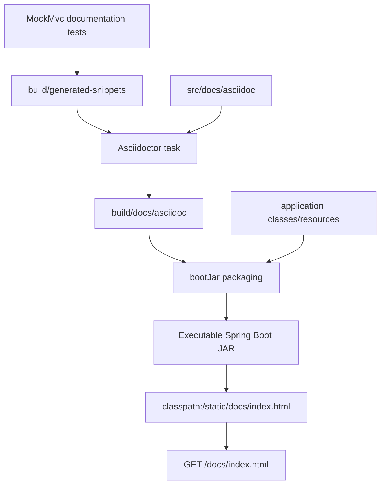

# Build tài liệu Asciidoctor rồi đóng gói vào JAR

## Mục tiêu bài thực hành

Trong module **SPRING_REST_DOCS**, documentation tests tạo snippet từ HTTP exchange đã được kiểm chứng. Asciidoctor ghép snippet với nội dung AsciiDoc để tạo API reference dạng HTML. Ở bước hoàn thiện, nhóm có thể đóng gói HTML cùng ứng dụng Spring Boot trong executable JAR để tài liệu được triển khai đồng bộ với phiên bản API.

Bài thực hành xây dựng luồng hoàn chỉnh: chạy documentation tests, tạo snippet, chạy Asciidoctor, đưa HTML vào JAR, kiểm tra archive và truy cập tài liệu qua HTTP. Trọng tâm là giữ task graph chính xác, tránh dependency cycle giữa test, resources và Asciidoctor.

Sau bài này, bạn có thể:

- Tổ chức AsciiDoc source và generated snippets.
- Cấu hình Gradle để chạy test trước Asciidoctor.
- Đóng gói HTML vào Spring Boot JAR tại classpath:/static/docs.
- Tránh dependency cycle khi tích hợp task.
- Kiểm tra nội dung JAR và URL phục vụ tài liệu.
- Tổ chức quy trình Maven/CI theo cùng nguyên tắc.

## 1. Kiến trúc đầu ra mong muốn

Giả sử ứng dụng Spring Boot có endpoint sản phẩm và tài liệu HTML cần được phục vụ tại /docs/index.html.



Sau build, cấu trúc logic trong JAR cần có:

```text
BOOT-INF/
├── classes/
│   ├── application.properties
│   └── static/
│       └── docs/
│           ├── index.html
│           ├── css/
│           └── images/
└── lib/
    └── ...
```

Spring Boot mặc định phục vụ static resources từ classpath locations như /static. Vì vậy, file static/docs/index.html trong classpath thường được truy cập qua /docs/index.html. Nếu ứng dụng thay đổi static resource locations hoặc servlet context path, URL thực tế sẽ khác và cần kiểm tra cấu hình.

## 2. Chuẩn bị source tài liệu

Một cấu trúc project tham khảo:

```text
spring-rest-docs-demo/
├── build.gradle
├── src/
│   ├── main/
│   │   ├── java/
│   │   └── resources/
│   ├── test/
│   │   └── java/
│   │       └── ProductDocumentationTest.java
│   └── docs/
│       └── asciidoc/
│           ├── index.adoc
│           └── products.adoc
└── build/
    ├── generated-snippets/
    └── docs/
        └── asciidoc/
```

src/docs/asciidoc chứa tài liệu nguồn do nhóm viết. build/generated-snippets được tạo bởi documentation tests. build/docs/asciidoc là output HTML sau khi Asciidoctor chạy.

Không nên commit generated-snippets hoặc HTML build output nếu quy ước repository không yêu cầu. Chúng thường là build artifacts có thể tái tạo từ source và test.

## 3. Viết documentation test tạo snippet

Ví dụ MockMvc test:

```java
@SpringBootTest
@AutoConfigureMockMvc
@AutoConfigureRestDocs
class ProductDocumentationTest {

    @Autowired
    MockMvc mockMvc;

    @Test
    void getProduct() throws Exception {
        mockMvc.perform(get("/api/products/{id}", 501)
                .accept(MediaType.APPLICATION_JSON))
            .andExpect(status().isOk())
            .andExpect(jsonPath("$.id").value(501))
            .andExpect(jsonPath("$.name").value("Keyboard"))
            .andDo(document("products-get",
                pathParameters(
                    parameterWithName("id")
                        .description("Mã sản phẩm.")
                ),
                responseFields(
                    fieldWithPath("id")
                        .description("Mã sản phẩm."),
                    fieldWithPath("name")
                        .description("Tên sản phẩm.")
                )));
    }
}
```

Test phải kiểm tra hành vi endpoint trước khi document. Nếu status hoặc body sai, test thất bại và build không nên tiếp tục tới bước đóng gói artifact.

Sau khi chạy test, snippet dự kiến:

```text
build/generated-snippets/
└── products-get/
    ├── http-request.adoc
    ├── http-response.adoc
    ├── path-parameters.adoc
    └── response-fields.adoc
```

Tên file cụ thể phụ thuộc những snippet mà test yêu cầu.

## 4. Viết AsciiDoc include snippets

File index.adoc:

```asciidoc
= Product Service API
:toc:
:toclevels: 2
:sectnums:

Tài liệu REST API được sinh từ các HTTP documentation tests.

include::products.adoc[]
```

File products.adoc:

```asciidoc
== Products

=== Get product

Operation này trả về thông tin sản phẩm theo ID.

==== Path parameters
include::{snippets}/products-get/path-parameters.adoc[]

==== HTTP request
include::{snippets}/products-get/http-request.adoc[]

==== HTTP response
include::{snippets}/products-get/http-response.adoc[]

==== Response fields
include::{snippets}/products-get/response-fields.adoc[]
```

Attribute snippets sẽ được cấu hình ở Asciidoctor task để trỏ tới generated-snippets root. Include path gồm operation ID và snippet name.

## 5. Cấu hình Gradle

Ví dụ dùng Groovy DSL:

```groovy
plugins {
    id 'java'
    id 'org.springframework.boot' version '3.4.0'
    id 'io.spring.dependency-management' version '1.1.6'
    id 'org.asciidoctor.jvm.convert' version '4.0.4'
}

configurations {
    asciidoctorExt
}

dependencies {
    testImplementation 'org.springframework.boot:spring-boot-starter-test'
    testImplementation 'org.springframework.restdocs:spring-restdocs-mockmvc'
    asciidoctorExt 'org.springframework.restdocs:spring-restdocs-asciidoctor'
}

ext {
    snippetsDir = file("$buildDir/generated-snippets")
}

tasks.test {
    useJUnitPlatform()
    outputs.dir snippetsDir
}

tasks.named('asciidoctor') {
    configurations 'asciidoctorExt'
    inputs.dir snippetsDir
    dependsOn tasks.test
    attributes 'snippets': snippetsDir
}

tasks.named('bootJar') {
    dependsOn tasks.named('asciidoctor')
    from(tasks.named('asciidoctor').get().outputDir) {
        into 'static/docs'
    }
}
```

Đây là cấu hình minh họa; hãy đồng bộ phiên bản Spring Boot, Spring REST Docs và plugin Asciidoctor với dependency management của project.

### 5.1. Vì sao bootJar phụ thuộc asciidoctor?

Khi chạy bootJar, Gradle phải bảo đảm Asciidoctor đã hoàn tất trước khi lấy output HTML để đóng gói. Quan hệ task:

```text
bootJar
  └── asciidoctor
        └── test
```

Task test tạo snippets; Asciidoctor dùng snippets để tạo HTML; bootJar thêm HTML vào archive.

### 5.2. Tránh dependency cycle qua processResources

Không nên tùy tiện cấu hình processResources phụ thuộc asciidoctor trong khi asciidoctor lại phụ thuộc test. Trong Java build, test thường phụ thuộc classes; classes phụ thuộc processResources. Chuỗi có thể trở thành:

```text
test
 -> testClasses
 -> classes
 -> processResources
 -> asciidoctor
 -> test
```

Đây là dependency cycle. Đưa output Asciidoctor trực tiếp vào bootJar như ví dụ trên tránh việc chèn task tài liệu vào nhánh resources mà test cần để khởi chạy.

Nếu dự án có yêu cầu khác, hãy xem task graph thực tế và chọn một điểm đóng gói không tạo vòng phụ thuộc.

### 5.3. Khai báo output/input rõ ràng

Khai báo snippetsDir là output của test giúp Gradle biết test tạo ra artifact nào. Khai báo inputs.dir trong asciidoctor giúp task nhận diện dữ liệu đầu vào và hỗ trợ incremental build.

Nếu test không chạy vì up-to-date nhưng snippet directory bị xóa thủ công, cần xử lý output state phù hợp, ví dụ clean build hoặc điều chỉnh task outputs/inputs để bảo đảm snippet tồn tại khi Asciidoctor chạy.

## 6. Chạy build và kiểm tra output HTML

Chạy toàn bộ pipeline:

```bash
./gradlew clean test asciidoctor bootJar
```

Hoặc nếu bootJar đã dependsOn asciidoctor:

```bash
./gradlew clean bootJar
```

Kiểm tra HTML bằng PowerShell:

```powershell
Get-ChildItem -Recurse build/docs/asciidoc
Test-Path build/docs/asciidoc/index.html
```

Trên Linux/macOS:

```bash
find build/docs/asciidoc -type f
test -f build/docs/asciidoc/index.html
```

Nếu index.html không tồn tại, kiểm tra source document name, task outputDir, task dependency và log Asciidoctor. Không tiếp tục đóng gói khi output chưa được tạo đầy đủ.

## 7. Kiểm tra nội dung executable JAR

Sau khi bootJar thành công, xác định file JAR trong build/libs:

```powershell
Get-ChildItem build/libs/*.jar
```

Dùng lệnh jar để liệt kê nội dung:

```bash
jar tf build/libs/spring-rest-docs-demo.jar
```

Tìm đường dẫn:

```text
BOOT-INF/classes/static/docs/index.html
BOOT-INF/classes/static/docs/products.html
```

Tên file JAR và tên trang phụ thuộc cấu hình project. Điều cần xác minh là HTML nằm dưới BOOT-INF/classes/static/docs/ trong executable Spring Boot JAR.

Có thể kiểm tra tự động:

```bash
jar tf build/libs/spring-rest-docs-demo.jar | grep 'BOOT-INF/classes/static/docs/index.html'
```

Nếu không thấy file, xác minh outputDir của Asciidoctor, đường dẫn from(...) trong bootJar, into 'static/docs', task dependency và sự tồn tại của HTML trước khi đóng gói.

## 8. Chạy ứng dụng và truy cập tài liệu

Chạy executable JAR:

```bash
java -jar build/libs/spring-rest-docs-demo.jar
```

Nếu ứng dụng chạy port mặc định và không có context path, thử:

```text
http://localhost:8080/docs/index.html
```

Kiểm tra bằng curl:

```bash
curl -I http://localhost:8080/docs/index.html
```

Kết quả mong đợi là HTTP 200 và Content-Type phù hợp với HTML. Nếu ứng dụng có context path, reverse proxy prefix hoặc static resource mapping tùy chỉnh, URL sẽ thay đổi.

### 8.1. Kiểm tra asset và relative links

Trang index có thể tải CSS, ảnh hoặc liên kết tới trang con. Kiểm tra CSS, ảnh và font nằm trong cùng static/docs tree; link tới trang con không trỏ nhầm root; snippet đã được resolve trong HTML; navigation không phụ thuộc đường dẫn file trên máy build.

Thử truy cập trực tiếp một asset và một trang con qua HTTP, không chỉ mở file index.

## 9. Maven: nguyên tắc tích hợp tương đương

Với Maven, mục tiêu giống Gradle nhưng dùng lifecycle và plugin khác:

1. Documentation tests chạy trong test/verify và tạo target/generated-snippets.
2. Asciidoctor Maven Plugin đọc source và snippets, tạo HTML trong target/generated-docs.
3. Trước package, copy HTML vào target/classes/static/docs.
4. Maven JAR/Spring Boot plugin đóng gói target/classes vào JAR.

Ví dụ cấu hình copy-resources về mặt ý tưởng:

```xml
<execution>
  <id>copy-api-docs</id>
  <phase>prepare-package</phase>
  <goals>
    <goal>copy-resources</goal>
  </goals>
  <configuration>
    <outputDirectory>target/classes/static/docs</outputDirectory>
    <resources>
      <resource>
        <directory>target/generated-docs</directory>
        <filtering>false</filtering>
      </resource>
    </resources>
  </configuration>
</execution>
```

Đảm bảo execution Asciidoctor chạy trước execution copy-resources (hoặc dùng phase/dependency phù hợp) để copy không chạy trước khi HTML tồn tại. Kiểm tra effective POM và Maven lifecycle thực tế.

Chạy:

```bash
./mvnw clean verify
```

Sau đó kiểm tra JAR:

```bash
jar tf target/application.jar
```

Tìm BOOT-INF/classes/static/docs/index.html. Với Maven, dùng output directory thực tế của plugin, không dùng đường dẫn build/docs/asciidoc của ví dụ Gradle.

## 10. Tích hợp CI

Pipeline CI tối thiểu cần:

1. Checkout đúng commit.
2. Cài JDK tương thích.
3. Chạy clean bootJar hoặc Maven verify.
4. Xác minh executable JAR tồn tại.
5. Xác minh archive chứa static/docs/index.html.
6. Có thể khởi chạy ứng dụng smoke test và gọi /docs/index.html.
7. Lưu JAR như artifact gắn với commit/version.

Ví dụ GitHub Actions:

```yaml
name: Build Spring REST Docs application

on:
  pull_request:
  push:
    branches: [main]

jobs:
  build:
    runs-on: ubuntu-latest
    steps:
      - uses: actions/checkout@v4

      - uses: actions/setup-java@v4
        with:
          distribution: temurin
          java-version: '21'

      - name: Build executable JAR with API docs
        run: ./gradlew clean bootJar

      - name: Verify docs are packaged
        shell: bash
        run: |
          jar tf build/libs/spring-rest-docs-demo.jar | grep -q 'BOOT-INF/classes/static/docs/index.html'

      - name: Upload application artifact
        uses: actions/upload-artifact@v4
        with:
          name: spring-rest-docs-app
          path: build/libs/spring-rest-docs-demo.jar
```

Đây là workflow minh họa. Trong repository thật, dùng tên JAR xác định nếu có nhiều archive, và cấu hình quyền publish riêng cho branch/tag release.

## 11. Kiểm tra chất lượng và bảo mật

- [ ] Documentation tests đã pass.
- [ ] Snippets được sinh từ cùng commit đang build.
- [ ] Asciidoctor hoàn tất và index.html tồn tại.
- [ ] Executable JAR chứa static/docs/index.html.
- [ ] Trang được phục vụ qua URL dự kiến.
- [ ] CSS, ảnh, link và trang con hoạt động.
- [ ] Không có token, password, cookie thật hoặc dữ liệu cá nhân trong snippet.
- [ ] Tài liệu không công bố endpoint nội bộ ngoài phạm vi.
- [ ] Version/commit của tài liệu khớp ứng dụng.
- [ ] CI lưu đúng JAR đã kiểm tra.

Tài liệu nằm trong cùng JAR giúp phiên bản API và API reference được triển khai đồng bộ. Tuy nhiên, nếu nội dung chỉ dành cho nội bộ, cần bảo vệ endpoint truy cập docs bằng network policy hoặc security configuration phù hợp; static resource mặc định có thể được truy cập công khai trong ứng dụng.

## 12. Lỗi thường gặp

| Triệu chứng | Nguyên nhân có thể | Cách xử lý |
| --- | --- | --- |
| Asciidoctor không tìm thấy snippet | Test chưa chạy hoặc snippetsDir sai | Kiểm tra test output và attribute snippets |
| index.html không được tạo | Sai source file hoặc task chưa chạy | Kiểm tra Asciidoctor log và outputDir |
| JAR không có static/docs | bootJar không lấy output hoặc path sai | Kiểm tra from(outputDir) và archive path |
| bootJar chạy trước Asciidoctor | Thiếu dependsOn | Khai báo bootJar phụ thuộc asciidoctor |
| Gradle báo circular dependency | Asciidoctor gắn vào processResources trong khi phụ thuộc test | Đóng gói trực tiếp output vào bootJar |
| JAR có HTML nhưng URL 404 | Static resource path, context path hoặc security rule sai | Kiểm tra classpath location và mapping |
| index hiển thị nhưng CSS lỗi | Asset path sai hoặc chưa được copy | Kiểm tra relative path và archive entries |
| Build local được nhưng CI thiếu docs | CI gọi task khác hoặc artifact path sai | Chạy bootJar và xác minh archive trong CI |
| JAR chứa snippet cũ | Output cũ hoặc test không chạy lại | Clean build và kiểm tra task inputs/outputs |
| Maven copy file trước Asciidoctor | Execution order/phase không phù hợp | Điều chỉnh phase hoặc thứ tự execution |

## 13. Bài thực hành tổng hợp

1. Tạo Spring Boot project có endpoint GET /api/products/{id}.
2. Viết MockMvc documentation test kiểm tra status và response fields.
3. Tạo index.adoc include http-request, http-response, path-parameters và response-fields.
4. Cấu hình Gradle Asciidoctor output vào build/docs/asciidoc.
5. Cấu hình bootJar phụ thuộc asciidoctor và đóng gói output vào static/docs.
6. Chạy clean bootJar.
7. Kiểm tra JAR chứa BOOT-INF/classes/static/docs/index.html.
8. Chạy JAR và truy cập /docs/index.html.
9. Thử cố ý bỏ dependsOn hoặc đổi sai output path; quan sát lỗi rồi sửa.
10. Thêm CI step xác minh archive và lưu executable JAR.

**Câu hỏi tự đánh giá**

1. Vì sao generated snippets cần được tạo trước Asciidoctor?
2. Asciidoctor output directory khác snippetsDir như thế nào?
3. Vì sao bootJar là điểm phù hợp để đóng gói HTML trong ví dụ Gradle?
4. Dependency cycle có thể xuất hiện thế nào nếu gắn Asciidoctor vào processResources?
5. Đường dẫn classpath nào khiến Spring Boot phục vụ docs dưới /docs?
6. Làm thế nào xác minh HTML thực sự nằm trong executable JAR?
7. Vì sao cần smoke test URL sau khi chạy JAR?
8. Khi nào tài liệu đóng gói cùng ứng dụng cần được bảo vệ bằng security policy?

## Tài liệu tham khảo chính thức

- [Spring REST Docs — Getting Started](https://docs.spring.io/spring-restdocs/tutorial/getting-started/index.html): cấu hình test và sinh snippet.
- [Spring REST Docs — Asciidoctor Integration](https://docs.spring.io/spring-restdocs/reference/getting-started/documentation-snippets.html): include snippets trong tài liệu.
- [Asciidoctor Gradle Plugin](https://docs.asciidoctor.org/gradle-plugin/latest/): cấu hình task Asciidoctor.
- [Gradle — Task Dependencies](https://docs.gradle.org/current/userguide/controlling_task_execution.html): dependsOn, task graph và thứ tự thực thi.
- [Spring Boot — Static Content](https://docs.spring.io/spring-boot/reference/web/servlet.html): phục vụ static resources trong ứng dụng web.
- [Spring Boot Gradle Plugin](https://docs.spring.io/spring-boot/gradle-plugin/packaging.html): đóng gói executable archive.
- [Spring Boot Maven Plugin](https://docs.spring.io/spring-boot/maven-plugin/packaging.html): đóng gói executable JAR bằng Maven.

**Kết luận thực hành:** Hãy để documentation tests tạo snippet, Asciidoctor ghép HTML, rồi đóng gói output vào executable JAR tại static/docs. Với Gradle, gắn dependency từ bootJar tới asciidoctor và lấy trực tiếp output directory vào archive; tránh tạo vòng phụ thuộc qua processResources. Cuối cùng, kiểm tra archive entries và chạy ứng dụng để xác minh tài liệu truy cập được tại URL đã chọn.
