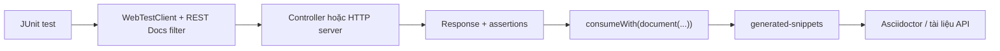

# Cấu hình WebTestClient với `documentationConfiguration`

## 1. Mục tiêu và bối cảnh

Trong **Spring REST Docs**, tài liệu REST API được tạo từ những tương tác HTTP đã được kiểm thử. Nhờ đó, ví dụ request/response và các mô tả field trong tài liệu được kiểm tra cùng lúc với hành vi của ứng dụng. Với ứng dụng dùng **Spring WebFlux**, `WebTestClient` là một lựa chọn thuận tiện để gửi request, kiểm tra response và thu thập dữ liệu sinh snippet.

Bài này thuộc chương **WebTestClient** của module **SPRING_REST_DOCS**. Sau bài học, bạn có thể:

- Giải thích vai trò của `documentationConfiguration(...)` và `document(...)`.
- Cấu hình `WebTestClient` cùng `RestDocumentationExtension` trong JUnit 5.
- Áp dụng cấu hình cho controller, `ApplicationContext` hoặc máy chủ HTTP đang chạy.
- Tùy biến cách ghi request/response và dùng snippet trong Asciidoctor, Gradle, CI.
- Nhận biết các lỗi cấu hình khiến test chạy thành công nhưng không tạo tài liệu.

> **Phạm vi:** Ví dụ dùng Java, JUnit 5 và Spring REST Docs với `WebTestClient`. API và phiên bản dependency cần đồng bộ với Spring Framework/Spring Boot mà dự án đang dùng.

## 2. `documentationConfiguration` giải quyết việc gì?

Một `WebTestClient` thông thường chỉ gửi request và đưa về kết quả để test xác nhận. Để Spring REST Docs ghi nhận giao dịch HTTP, ta thêm một **`ExchangeFilterFunction`** do `documentationConfiguration(restDocumentation)` cung cấp vào lúc xây dựng client:

```java
WebTestClient client = WebTestClient.bindToController(new ExampleController())
    .configureClient()
    .filter(documentationConfiguration(restDocumentation))
    .build();
```

Trong đó:

| Thành phần | Vai trò |
| --- | --- |
| `RestDocumentationContextProvider` | Cung cấp ngữ cảnh tài liệu cho test hiện tại; JUnit 5 có thể truyền thông qua `RestDocumentationExtension`. |
| `documentationConfiguration(provider)` | Tạo bộ cấu hình REST Docs để gắn vào `WebTestClient` dưới dạng filter. |
| `.configureClient()` | Chuyển từ cấu hình server giả lập của `bindToController`/`bindToApplicationContext` sang phần cấu hình client để thêm filter. |
| `.filter(...)` | Đăng ký xử lý request và response phục vụ tài liệu. |
| `document("identifier", snippets...)` | Được gọi khi tiêu thụ kết quả test, ghi các snippet của **chính request đó**. |

Luồng xử lý có thể hình dung như sau:



**Phân biệt hai thao tác:** `documentationConfiguration(...)` được thực hiện **một lần khi tạo client**; còn `document(...)` được gọi **ở từng test cần sinh tài liệu**. Chỉ thêm filter mà không gọi `document(...)` trong test sẽ chưa đủ để tạo snippet cho operation mong muốn.

## 3. Chuẩn bị dependency

Ví dụ với Gradle (Groovy DSL), trong dự án Spring Boot đã có WebFlux:

```groovy
dependencies {
    implementation 'org.springframework.boot:spring-boot-starter-webflux'
    testImplementation 'org.springframework.boot:spring-boot-starter-test'
    testImplementation 'org.springframework.restdocs:spring-restdocs-webtestclient'
}
```

Spring Boot thường quản lý phiên bản các dependency tương ứng. Nếu không dùng Spring Boot, hãy tự chọn phiên bản Spring REST Docs tương thích với Spring Framework và JUnit của dự án. `WebTestClient` và các thành phần WebFlux cần hiện diện trên classpath của test.

Hai static import quan trọng:

```java
import static org.springframework.restdocs.webtestclient.WebTestClientRestDocumentation.documentationConfiguration;
import static org.springframework.restdocs.webtestclient.WebTestClientRestDocumentation.document;
```

Không nhầm chúng với những hàm `document` hoặc `documentationConfiguration` dành riêng cho `MockMvc` hay REST Assured.

## 4. Ví dụ hoàn chỉnh với JUnit 5 và `bindToController`

Ví dụ sau kiểm thử một endpoint WebFlux đơn giản. Không cần khởi động HTTP server thật: `WebTestClient` liên kết trực tiếp tới controller, gửi GET, xác nhận response rồi sinh tài liệu.

```java
import java.util.Map;

import org.junit.jupiter.api.BeforeEach;
import org.junit.jupiter.api.Test;
import org.junit.jupiter.api.extension.ExtendWith;
import org.springframework.http.MediaType;
import org.springframework.restdocs.RestDocumentationContextProvider;
import org.springframework.restdocs.RestDocumentationExtension;
import org.springframework.test.web.reactive.server.WebTestClient;
import org.springframework.web.bind.annotation.GetMapping;
import org.springframework.web.bind.annotation.RestController;
import reactor.core.publisher.Mono;

import static org.springframework.restdocs.payload.PayloadDocumentation.fieldWithPath;
import static org.springframework.restdocs.payload.PayloadDocumentation.responseFields;
import static org.springframework.restdocs.webtestclient.WebTestClientRestDocumentation.document;
import static org.springframework.restdocs.webtestclient.WebTestClientRestDocumentation.documentationConfiguration;

@ExtendWith(RestDocumentationExtension.class)
class GreetingApiDocumentationTest {

    private WebTestClient client;

    @BeforeEach
    void setUp(RestDocumentationContextProvider restDocumentation) {
        this.client = WebTestClient.bindToController(new GreetingController())
            .configureClient()
            .filter(documentationConfiguration(restDocumentation))
            .build();
    }

    @Test
    void documentsGetGreeting() {
        this.client.get()
            .uri("/api/greetings")
            .accept(MediaType.APPLICATION_JSON)
            .exchange()
            .expectStatus().isOk()
            .expectBody()
            .json("{\"message\":\"Xin chào\"}")
            .consumeWith(document("greetings/get",
                responseFields(
                    fieldWithPath("message").description("Lời chào trả về")
                )
            ));
    }

    @RestController
    static class GreetingController {

        @GetMapping(path = "/api/greetings",
                    produces = MediaType.APPLICATION_JSON_VALUE)
        public Mono<Map<String, String>> getGreeting() {
            return Mono.just(Map.of("message", "Xin chào"));
        }
    }
}
```

Trình tự cần chú ý:

1. `@ExtendWith(RestDocumentationExtension.class)` kích hoạt hỗ trợ Spring REST Docs cho JUnit 5.
2. Tham số `RestDocumentationContextProvider` được extension cấp cho `@BeforeEach`.
3. `bindToController(...).configureClient().filter(...).build()` tạo client đã cài filter tài liệu.
4. `exchange()` thực hiện request; `expectStatus()` và `json(...)` kiểm tra kết quả.
5. `consumeWith(document("greetings/get", ...))` yêu cầu REST Docs ghi snippet với định danh `greetings/get`. `responseFields(...)` mô tả cấu trúc JSON và giúp test phát hiện field không được mô tả hoặc mô tả không khớp với payload.

Khi test chạy thành công và thư mục đầu ra đã được cấu hình, các snippet thường nằm dưới `build/generated-snippets/greetings/get/` (Gradle) hoặc `target/generated-snippets/greetings/get/` (Maven). Những tệp tiêu biểu gồm `http-request.adoc`, `http-response.adoc`, `request-body.adoc`, `response-body.adoc`, và `response-fields.adoc`. Danh sách thực tế phụ thuộc snippet mặc định và snippet bạn truyền vào `document(...)`.

## 5. Các cách tạo `WebTestClient`

Phần `documentationConfiguration(...)` giữ nguyên, nhưng API khởi tạo client phụ thuộc kiểu test:

### 5.1. Kiểm thử một hoặc vài controller

```java
WebTestClient client = WebTestClient.bindToController(new GreetingController())
    .configureClient()
    .filter(documentationConfiguration(restDocumentation))
    .build();
```

Phù hợp với test tập trung vào cách controller xử lý request/response, không cần chạy toàn bộ ứng dụng. Nếu controller cần dependency, hãy cung cấp dependency thật hoặc test double một cách tường minh.

### 5.2. Kiểm thử bằng WebFlux `ApplicationContext`

```java
WebTestClient client = WebTestClient.bindToApplicationContext(context)
    .configureClient()
    .filter(documentationConfiguration(restDocumentation))
    .build();
```

`context` là `ApplicationContext` Spring mà test đã tạo, chẳng hạn thông qua `@WebFluxTest` hoặc một cấu hình WebFlux phù hợp. Cách này dùng routing, codec, controller và bean trong context được kiểm thử. Hãy inject context và khai báo `RestDocumentationExtension` trong test như ví dụ trước.

### 5.3. Kiểm thử HTTP server thật

```java
WebTestClient client = WebTestClient.bindToServer()
    .baseUrl("http://localhost:" + port)
    .filter(documentationConfiguration(restDocumentation))
    .build();
```

`port` phải là cổng thực tế của server đã khởi động (ví dụ từ `@LocalServerPort` trong integration test Spring Boot). `bindToServer()` trả về client builder trực tiếp, vì vậy **không gọi `.configureClient()`** ở nhánh này. Lựa chọn này hữu ích khi muốn tài liệu phản ánh đầy đủ filter HTTP, middleware và cấu hình runtime của ứng dụng.

## 6. Tùy biến request và response trước khi tạo snippet

Nhiều test nhận JSON ở dạng một dòng khiến snippet khó đọc. Có thể đặt bộ tiền xử lý mặc định ngay trong filter:

```java
import static org.springframework.restdocs.operation.preprocess.Preprocessors.prettyPrint;

// Bên trong @BeforeEach, sau khi đã có restDocumentation:
this.client = WebTestClient.bindToController(new GreetingController())
    .configureClient()
    .filter(documentationConfiguration(restDocumentation)
        .operationPreprocessors()
            .withRequestDefaults(prettyPrint())
            .withResponseDefaults(prettyPrint()))
    .build();
```

`prettyPrint()` định dạng payload của các snippet để dễ đọc; nó không thay đổi dữ liệu HTTP mà ứng dụng nhận hoặc trả về trong quá trình test. Bạn cũng có thể dùng các preprocessor khác để loại bỏ header thay đổi liên tục, che token nhạy cảm hoặc chuẩn hóa giá trị ví dụ trước khi đưa tài liệu vào repository.

Một nguyên tắc thực tế: **ẩn hoặc chuẩn hóa dữ liệu chỉ ở tài liệu, vẫn giữ assertion kiểm thử chính xác**. Ví dụ nếu `Authorization` chứa token thật, hãy loại token khỏi snippet hay thay bằng giá trị minh họa; đừng để bí mật đi vào tài liệu được publish.

## 7. Sinh snippet cho tham số, header và payload

Sau khi filter đã được cài, mỗi test có thể bổ sung các descriptor phù hợp với HTTP operation:

```java
import static org.springframework.restdocs.headers.HeaderDocumentation.headerWithName;
import static org.springframework.restdocs.headers.HeaderDocumentation.requestHeaders;
import static org.springframework.restdocs.payload.PayloadDocumentation.fieldWithPath;
import static org.springframework.restdocs.payload.PayloadDocumentation.requestFields;
import static org.springframework.restdocs.payload.PayloadDocumentation.responseFields;
import static org.springframework.restdocs.request.RequestDocumentation.parameterWithName;
import static org.springframework.restdocs.request.RequestDocumentation.pathParameters;

// Ví dụ minh họa: endpoint POST /api/items/{category} phải tồn tại
// và response phải có JSON chứa trường id.
client.post()
    .uri("/api/items/{category}", "books")
    .header("X-Request-Id", "req-001")
    .contentType(MediaType.APPLICATION_JSON)
    .bodyValue(Map.of("name", "Spring REST Docs"))
    .exchange()
    .expectStatus().isCreated()
    .expectBody()
    .consumeWith(document("items/create",
        pathParameters(
            parameterWithName("category").description("Nhóm sản phẩm")
        ),
        requestHeaders(
            headerWithName("X-Request-Id").description("Mã truy vết request")
        ),
        requestFields(
            fieldWithPath("name").description("Tên sản phẩm")
        ),
        responseFields(
            fieldWithPath("id").description("Mã sản phẩm vừa tạo")
        )
    ));
```

Đây là đoạn code **minh họa cấu trúc test**, không phải test độc lập có thể chạy ngay: cần một endpoint POST tương ứng và response đáp ứng các descriptor. Với query string, sử dụng snippet mô tả query parameter tương ứng với phiên bản Spring REST Docs của dự án. Descriptor vừa tạo nội dung mô tả API, vừa giúp phát hiện payload thay đổi mà test chưa cập nhật tài liệu.

## 8. Đưa snippet vào Asciidoctor và CI

Spring REST Docs sinh *đoạn tài liệu* (snippet), không tự tạo toàn bộ cấu trúc trang API. Chẳng hạn, trong một file `.adoc` có thể viết:

```asciidoc
= Greeting API
:snippets: build/generated-snippets

== GET /api/greetings

=== HTTP request
include::{snippets}/greetings/get/http-request.adoc[]

=== HTTP response
include::{snippets}/greetings/get/http-response.adoc[]

=== Response fields
include::{snippets}/greetings/get/response-fields.adoc[]
```

Thuộc tính `:snippets:` phải được đặt theo đường dẫn đúng với vị trí của file Asciidoctor hoặc được truyền từ cấu hình build. Để Gradle luôn tạo snippet trước khi dựng tài liệu, có thể nối các task như sau (giả sử plugin Asciidoctor đã khai báo và tạo task `asciidoctor`):

```groovy
def snippetsDir = layout.buildDirectory.dir("generated-snippets")

tasks.named("test") {
    outputs.dir(snippetsDir)
}

tasks.named("asciidoctor") {
    inputs.dir(snippetsDir)
    dependsOn(tasks.named("test"))
    attributes "snippets": snippetsDir.get().asFile
}
```

Khi đó file Asciidoctor có thể dùng `include::{snippets}/...`, với giá trị `snippets` được build truyền vào. Trong CI, chạy bộ test và tác vụ dựng tài liệu, ví dụ `./gradlew clean test asciidoctor` khi dự án đã cấu hình plugin và task tương ứng. Nếu assertion hoặc descriptor sai, test thất bại và CI không nên xuất bản tài liệu cũ như tài liệu mới.

Markdown cũng có thể liên kết tới các snippet hoặc đưa nội dung snippet đã sinh vào một bước tổng hợp tài liệu, nhưng cần cấu hình bước đó trong build; Markdown thuần không tự xử lý chỉ thị `include::` của Asciidoctor.

## 9. Lỗi thường gặp và cách xử lý

| Hiện tượng | Kiểm tra và khắc phục |
| --- | --- |
| Test chạy nhưng không thấy snippet | Kiểm tra đã thêm `.filter(documentationConfiguration(...))` vào **đúng client** đang thực hiện request và đã gọi `.consumeWith(document(...))` chưa. |
| `RestDocumentationContextProvider` không được cung cấp | Với JUnit 5, thêm `@ExtendWith(RestDocumentationExtension.class)` và bảo đảm `spring-restdocs-webtestclient` có mặt trong test runtime. |
| Không gọi được `.filter(...)` sau `bindToController` | Cần `.configureClient()` trước khi cấu hình filter. Với `bindToServer()`, filter được thêm trực tiếp. |
| Thiếu `response-fields.adoc` | Trong operation tương ứng, truyền `responseFields(...)` vào `document(...)`. |
| Test lỗi vì field thiếu hoặc thừa | Đối chiếu descriptor với JSON thực tế; mô tả đủ các field, dùng `.optional()` hoặc `.ignored()` khi thật sự phù hợp với hợp đồng API. |
| `include::` không tìm thấy tệp | Kiểm tra thư mục snippet Gradle/Maven, identifier trong `document(...)`, đường dẫn `:snippets:` và việc task dựng tài liệu phụ thuộc vào task test. |
| Tài liệu chứa host `localhost`, cổng ngẫu nhiên hoặc token | Chuẩn hóa URI và dữ liệu nhạy cảm trong cấu hình REST Docs/preprocessor dành cho tài liệu. |

## 10. Bài thực hành gợi ý

1. Chạy ví dụ `GreetingApiDocumentationTest` và kiểm tra `http-request.adoc`, `http-response.adoc`, `response-fields.adoc`.
2. Bật `prettyPrint()` và so sánh snippet response trước và sau.
3. Thêm một field `language` vào JSON trả về mà chưa cập nhật `responseFields(...)`; quan sát test thất bại, rồi bổ sung descriptor và chạy lại.
4. Đưa ba snippet GET vào một trang Asciidoctor, cấu hình task build để trang luôn được dựng từ kết quả test mới.

**Kết quả mong đợi:** Bạn có một `WebTestClient` được cấu hình bằng `documentationConfiguration`, một kiểm thử HTTP tạo snippet có kiểm chứng, và một quy trình đưa snippet vào tài liệu API. Đây là nền tảng để tiếp tục tài liệu hóa request body, response body, query/path parameter và header của những API phức tạp hơn.
