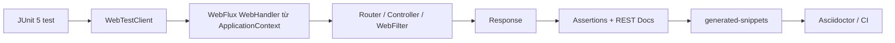

# Bind WebTestClient vào ApplicationContext

## 1. Mục tiêu bài học

Trong module **SPRING_REST_DOCS**, chúng ta dùng các bài kiểm thử HTTP để tạo tài liệu REST API có thể kiểm chứng. Với ứng dụng Spring WebFlux, `WebTestClient` có thể gửi request tới một ứng dụng được dựng ngay trong quá trình kiểm thử, xác nhận response, sau đó phối hợp với **Spring REST Docs** để tạo snippet về request, response, payload, tham số và header. Những snippet này có thể được đưa vào Asciidoctor/Markdown trong quy trình build và CI.

Bài học thuộc chương **WebTestClient**, tập trung vào cách **bind WebTestClient vào `ApplicationContext`** bằng `WebTestClient.bindToApplicationContext(context)`. Sau khi học, bạn có thể:

- Giải thích ý nghĩa của việc bind vào `ApplicationContext` và khi nào nên dùng.
- Chuẩn bị WebFlux `ApplicationContext` cho kiểm thử HTTP mà không khởi động cổng mạng.
- Kết hợp `bindToApplicationContext` với `documentationConfiguration` và `document` của Spring REST Docs.
- Viết một bài test JUnit 5 sinh snippet cho path parameter và JSON response.
- Tổ chức snippet để dựng tài liệu API bằng Asciidoctor và kiểm tra trong CI.
- Chẩn đoán các lỗi thường gặp liên quan đến bean, định tuyến, REST Docs và security.

## 2. `bindToApplicationContext` là gì?

`ApplicationContext` của Spring chứa những bean mà ứng dụng đã khai báo hoặc được cấu hình tự động, chẳng hạn controller, router, codec, `WebFilter`, exception handler và các thành phần liên quan đến web. Đối với **WebFlux**, `WebTestClient.bindToApplicationContext(context)` xây dựng môi trường xử lý HTTP dựa trên các bean WebFlux trong context đó.

Ví dụ tối giản:

```java
WebTestClient client = WebTestClient
    .bindToApplicationContext(applicationContext)
    .build();
```

`WebTestClient` sẽ đi qua hệ thống xử lý request của WebFlux được dựng từ context. **Không cần ứng dụng lắng nghe ở `localhost` và không cần cổng TCP**. Điều này phù hợp với các bài test tích hợp tầng web, nơi ta muốn kiểm tra routing, mã trạng thái, header, nội dung trả về và các web component thực sự hiện diện trong test context.



Không nên nhầm các chế độ khởi tạo client:

| Cách khởi tạo | Đối tượng xử lý request | Khi nào dùng |
| --- | --- | --- |
| `bindToController(controller)` | Controller được chỉ định và hạ tầng test tối thiểu | Test gọn, chủ động cung cấp controller và dependency |
| **`bindToApplicationContext(context)`** | WebFlux handler, routing và các bean nằm trong context | Kiểm thử cách tầng web hoạt động với cấu hình Spring |
| `bindToServer().baseUrl(url)` | Server HTTP thật đang chạy ở URL đã cho | Kiểm thử qua kết nối mạng và môi trường triển khai gần thực tế hơn |

**Giới hạn quan trọng:** `bindToApplicationContext` chỉ phản ánh những bean **đã được nạp vào test context**. Nếu test dùng cấu hình slice như `@WebFluxTest`, những phần bị loại khỏi slice sẽ không tự xuất hiện trong kết quả kiểm thử.

## 3. Chuẩn bị dependency và Spring context

Trong dự án Spring Boot có WebFlux, các dependency kiểm thử tối thiểu có thể được khai báo như sau (Gradle Groovy DSL):

```groovy
dependencies {
    implementation 'org.springframework.boot:spring-boot-starter-webflux'
    testImplementation 'org.springframework.boot:spring-boot-starter-test'
    testImplementation 'org.springframework.restdocs:spring-restdocs-webtestclient'
}
```

Spring Boot thường quản lý phiên bản của các thư viện đi kèm. Nếu không dùng Spring Boot, hãy bảo đảm Spring Framework, Spring REST Docs, Reactor, JUnit 5 và thư viện JSON/codec tương thích với nhau.

Để `bindToApplicationContext` hoạt động trong ví dụ không dùng Spring Boot test slice, ta sẽ tạo context bằng:

- `@SpringJUnitConfig`: chạy test với Spring TestContext Framework và nạp lớp cấu hình chỉ định.
- `@Configuration` và `@EnableWebFlux`: đăng ký cấu hình hạ tầng Spring WebFlux.
- `@Bean`: đưa controller cần kiểm thử vào context.
- `@Autowired ApplicationContext`: cung cấp context cho `WebTestClient`.

Đối với dự án Spring Boot thực tế, một lựa chọn khác là `@WebFluxTest` cùng các bean hoặc mock cần thiết. Hai cách đều phải tạo được WebFlux `ApplicationContext` trước khi bind client.

## 4. Ví dụ hoàn chỉnh: Spring WebFlux + JUnit 5 + REST Docs

Giả sử ứng dụng có endpoint `GET /api/books/{id}` trả về:

```json
{
  "id": 7,
  "title": "Spring REST Docs"
}
```

Test sau chứa đầy đủ cấu hình WebFlux, controller và tài liệu hóa response. Có thể đặt lớp vào `src/test/java` trong dự án đã có các dependency ở phần trên.

```java
import java.util.Map;

import org.junit.jupiter.api.BeforeEach;
import org.junit.jupiter.api.Test;
import org.junit.jupiter.api.extension.ExtendWith;
import org.springframework.beans.factory.annotation.Autowired;
import org.springframework.context.ApplicationContext;
import org.springframework.context.annotation.Bean;
import org.springframework.context.annotation.Configuration;
import org.springframework.http.MediaType;
import org.springframework.restdocs.RestDocumentationContextProvider;
import org.springframework.restdocs.RestDocumentationExtension;
import org.springframework.test.context.junit.jupiter.SpringJUnitConfig;
import org.springframework.test.web.reactive.server.WebTestClient;
import org.springframework.web.bind.annotation.GetMapping;
import org.springframework.web.bind.annotation.PathVariable;
import org.springframework.web.bind.annotation.RestController;
import org.springframework.web.reactive.config.EnableWebFlux;
import reactor.core.publisher.Mono;

import static org.springframework.restdocs.payload.PayloadDocumentation.fieldWithPath;
import static org.springframework.restdocs.payload.PayloadDocumentation.responseFields;
import static org.springframework.restdocs.request.RequestDocumentation.parameterWithName;
import static org.springframework.restdocs.request.RequestDocumentation.pathParameters;
import static org.springframework.restdocs.webtestclient.WebTestClientRestDocumentation.document;
import static org.springframework.restdocs.webtestclient.WebTestClientRestDocumentation.documentationConfiguration;

@SpringJUnitConfig(BookWebFluxDocumentationTest.WebFluxConfig.class)
@ExtendWith(RestDocumentationExtension.class)
class BookWebFluxDocumentationTest {

    @Autowired
    private ApplicationContext applicationContext;

    private WebTestClient client;

    @BeforeEach
    void setUp(RestDocumentationContextProvider restDocumentation) {
        this.client = WebTestClient.bindToApplicationContext(applicationContext)
            .configureClient()
            .filter(documentationConfiguration(restDocumentation))
            .build();
    }

    @Test
    void documentsGetBook() {
        this.client.get()
            .uri("/api/books/{id}", 7)
            .accept(MediaType.APPLICATION_JSON)
            .exchange()
            .expectStatus().isOk()
            .expectHeader().contentTypeCompatibleWith(MediaType.APPLICATION_JSON)
            .expectBody()
            .jsonPath("$.id").isEqualTo(7)
            .jsonPath("$.title").isEqualTo("Spring REST Docs")
            .consumeWith(document("books/get-by-id",
                pathParameters(
                    parameterWithName("id").description("Mã sách cần tra cứu")
                ),
                responseFields(
                    fieldWithPath("id").description("Mã sách"),
                    fieldWithPath("title").description("Tên sách")
                )
            ));
    }

    @Configuration
    @EnableWebFlux
    static class WebFluxConfig {
        @Bean
        BookController bookController() {
            return new BookController();
        }
    }

    @RestController
    static class BookController {
        @GetMapping(
            path = "/api/books/{id}",
            produces = MediaType.APPLICATION_JSON_VALUE
        )
        public Mono<Map<String, Object>> getBook(@PathVariable("id") long id) {
            return Mono.just(Map.of(
                "id", id,
                "title", "Spring REST Docs"
            ));
        }
    }
}
```

Đoạn test thể hiện ba phần có mục đích khác nhau:

1. **Tạo context:** `@SpringJUnitConfig` nạp `WebFluxConfig`. `@EnableWebFlux` đăng ký các thành phần WebFlux và `@Bean` đưa `BookController` vào context. Spring TestContext Framework inject `ApplicationContext` vào trường của test.
2. **Bind và bật tài liệu:** `bindToApplicationContext(applicationContext)` lấy cấu hình WebFlux từ Spring; `configureClient().filter(documentationConfiguration(restDocumentation))` đưa khả năng ghi tài liệu REST Docs vào client trước khi gọi `build()`. `RestDocumentationExtension` cung cấp `RestDocumentationContextProvider` cho phương thức `@BeforeEach`.
3. **Kiểm tra và tạo snippet:** test gọi URI có biến `{id}`, xác nhận status/header/payload và dùng `consumeWith(document(...))` để sinh tài liệu cho operation `books/get-by-id`.

Mỗi mô tả trong `pathParameters(...)` và `responseFields(...)` gắn với một phần của hợp đồng API. Khi payload thay đổi hoặc field không còn khớp, kiểm thử tài liệu có thể thất bại, nhắc nhóm cập nhật cả test lẫn tài liệu.

> **Lưu ý về visibility:** Controller trong ví dụ là bean do test đăng ký rõ ràng. Đối với ứng dụng thật, hãy để Spring nạp controller và những bean liên quan theo cơ chế cấu hình thông thường của ứng dụng; không phải tạo thêm một controller thứ hai chỉ để sinh tài liệu.

## 5. Chọn ApplicationContext phù hợp với mục tiêu test

### 5.1. Context tối giản cho một chức năng web

Ví dụ `@SpringJUnitConfig` ở trên tạo context có phạm vi rõ ràng và chạy nhanh. Cách này phù hợp khi cần kiểm tra endpoint cùng codec, định tuyến, exception handler hoặc web filter do test cấu hình. Các dependency của controller có thể được đưa vào `@Bean` riêng hoặc thay bằng test double.

### 5.2. Spring Boot WebFlux slice với `@WebFluxTest`

Một dự án Spring Boot có thể nạp phần lớn cấu hình web thông qua một test slice:

```java
@WebFluxTest(controllers = BookController.class)
@ExtendWith(RestDocumentationExtension.class)
class BookControllerDocumentationTest {

    @Autowired
    ApplicationContext context;

    WebTestClient client;

    @BeforeEach
    void setUp(RestDocumentationContextProvider restDocumentation) {
        client = WebTestClient.bindToApplicationContext(context)
            .configureClient()
            .filter(documentationConfiguration(restDocumentation))
            .build();
    }

    // Các @Test gọi client.get()/post()/... và consumeWith(document(...)).
    // Cần cung cấp mock/test bean cho dependency của BookController nếu có.
}
```

Đây là **mẫu cấu hình**, giả định ứng dụng đã có `BookController` và đã import các annotation, class và static method tương ứng. `@WebFluxTest` tập trung vào tầng web, vì vậy service, repository hoặc các bean nghiệp vụ không được nạp sẽ cần mock/test bean phù hợp. Với Spring Boot, `@WebFluxTest` tự tích hợp cơ chế Spring TestContext; không cần tự thêm `@SpringJUnitConfig`.

### 5.3. Khi phải chạy HTTP server thật

Nếu cần kiểm tra cách ứng dụng hoạt động qua mạng, proxy, port được cấp động hoặc server thực, hãy dùng:

```java
WebTestClient client = WebTestClient.bindToServer()
    .baseUrl("http://localhost:" + port)
    .filter(documentationConfiguration(restDocumentation))
    .build();
```

Ở chế độ `bindToServer`, `filter(...)` nằm trực tiếp trên client builder nên **không có bước `configureClient()`**. Ngược lại, `bindToApplicationContext` trả về cấu hình mock server nên cần gọi `configureClient()` trước khi gắn REST Docs filter.

## 6. Bổ sung mô tả request, response, tham số và header

Khi client đã được cấu hình, bạn có thể thêm descriptor ở từng test mà không cần thay đổi cách bind. Ví dụ, với một endpoint `POST /api/books` có thực trong context:

```java
import static org.springframework.restdocs.headers.HeaderDocumentation.headerWithName;
import static org.springframework.restdocs.headers.HeaderDocumentation.requestHeaders;
import static org.springframework.restdocs.payload.PayloadDocumentation.requestFields;
import static org.springframework.restdocs.payload.PayloadDocumentation.fieldWithPath;

client.post()
    .uri("/api/books")
    .header("X-Request-Id", "demo-123")
    .contentType(MediaType.APPLICATION_JSON)
    .bodyValue(Map.of("title", "Spring REST Docs"))
    .exchange()
    .expectStatus().isCreated()
    .expectBody()
    .consumeWith(document("books/create",
        requestHeaders(
            headerWithName("X-Request-Id").description("Mã theo dõi request")
        ),
        requestFields(
            fieldWithPath("title").description("Tên sách được tạo")
        )
    ));
```

Đây là ví dụ **minh họa thêm descriptor**, không phải test chạy độc lập; bạn cần xây dựng endpoint POST tương ứng trả về status 201. Với request chứa query parameter, dùng snippet chuyên cho query parameter của phiên bản Spring REST Docs đang sử dụng. Với response JSON, thêm `responseFields(...)` để tài liệu hóa các field trả về. Có thể mô tả request/response headers, path parameters, payload và body theo đúng hợp đồng API mà không thay đổi lệnh `bindToApplicationContext(...)`.

Để snippet dễ đọc hơn, có thể định dạng JSON ở bước ghi tài liệu:

```java
import static org.springframework.restdocs.operation.preprocess.Preprocessors.prettyPrint;

client = WebTestClient.bindToApplicationContext(applicationContext)
    .configureClient()
    .filter(documentationConfiguration(restDocumentation)
        .operationPreprocessors()
            .withRequestDefaults(prettyPrint())
            .withResponseDefaults(prettyPrint()))
    .build();
```

Các operation preprocessor xử lý dữ liệu **đưa vào snippet**, không sửa dữ liệu mà ứng dụng thực sự nhận hay trả về. Có thể dùng thêm preprocessor để che token, header hoặc dữ liệu nhạy cảm trước khi đưa tài liệu lên kho mã nguồn.

## 7. Đưa snippet vào tài liệu Asciidoctor và CI

Khi test mẫu chạy thành công, operation `books/get-by-id` có thể sinh các file như:

```text
build/generated-snippets/
└── books/
    └── get-by-id/
        ├── http-request.adoc
        ├── http-response.adoc
        ├── path-parameters.adoc
        └── response-fields.adoc
```

Đây là **một phần** danh sách: Spring REST Docs còn có thể sinh những snippet mặc định khác, ví dụ `curl-request.adoc`, `request-body.adoc` và `response-body.adoc`. Với Maven, thư mục phổ biến là `target/generated-snippets` thay vì `build/generated-snippets`.

Ví dụ sử dụng trong file Asciidoctor:

```asciidoc
= Book API
:snippets: build/generated-snippets

== Tra cứu một sách

=== Request
include::{snippets}/books/get-by-id/http-request.adoc[]

=== Path parameters
include::{snippets}/books/get-by-id/path-parameters.adoc[]

=== Response
include::{snippets}/books/get-by-id/http-response.adoc[]

=== Response fields
include::{snippets}/books/get-by-id/response-fields.adoc[]
```

Đường dẫn `:snippets:` chỉ là ví dụ; hãy điều chỉnh theo vị trí file Asciidoctor hoặc truyền thuộc tính này từ cấu hình build. Trong Gradle, có thể cho task dựng tài liệu phụ thuộc vào việc chạy test (giả sử đã cấu hình plugin Asciidoctor và task `asciidoctor`):

```groovy
def snippetsDir = layout.buildDirectory.dir("generated-snippets")

tasks.named("test") {
    outputs.dir(snippetsDir)
}

tasks.named("asciidoctor") {
    dependsOn(tasks.named("test"))
    inputs.dir(snippetsDir)
    attributes "snippets": snippetsDir.get().asFile
}
```

Sau khi cấu hình đầy đủ plugin, trong CI có thể chạy `./gradlew clean test asciidoctor`. Để tránh xuất bản tài liệu lỗi thời, pipeline cần kết thúc không thành công khi test tài liệu thất bại. Với Markdown, có thể liên kết tới snippet hoặc dùng một bước build để đưa nội dung snippet vào trang; chỉ thị `include::` ở trên thuộc cú pháp Asciidoctor, không phải Markdown thuần.

## 8. Lỗi thường gặp

| Hiện tượng | Nguyên nhân khả dĩ và cách xử lý |
| --- | --- |
| Gọi `bindToApplicationContext` rồi nhận 404 | Kiểm tra controller/router đã được nạp vào **context test** và mapping URI/HTTP method có đúng hay không. |
| Context khởi tạo thất bại vì thiếu bean | `@WebFluxTest` hoặc cấu hình tối giản chưa tạo dependency của controller; bổ sung bean/mock phù hợp với mục tiêu test. |
| Không có hạ tầng xử lý WebFlux | Với context viết tay, bật `@EnableWebFlux` và đăng ký controller/router; kiểm tra dependency Spring WebFlux. |
| Response 401/403 ngoài mong đợi | Context chứa security filter hoặc chính sách xác thực; thiết lập thông tin xác thực/test security phù hợp, không tự động bỏ qua security. |
| `RestDocumentationContextProvider` không được inject | Với JUnit 5, cần `RestDocumentationExtension` và dependency `spring-restdocs-webtestclient` trong test runtime. |
| `filter(...)` không khả dụng ngay sau `bindToApplicationContext(...)` | Gọi `configureClient()` để chuyển sang client builder trước khi gắn filter. |
| Test pass nhưng không có snippet | Kiểm tra `document(...)` đã được gọi trong `consumeWith(...)` trên đúng request, và client đã có REST Docs filter. |
| Không có `path-parameters.adoc` hoặc `response-fields.adoc` | Thêm đúng `pathParameters(...)` hoặc `responseFields(...)` vào operation và chạy lại test. |
| Tài liệu không tìm thấy snippet | Kiểm tra identifier `books/get-by-id`, output directory, tác vụ test và thuộc tính `snippets` của Asciidoctor. |
| Hành vi khác với môi trường production | Test context có thể thiếu filter, service, cấu hình hoặc middleware; mở rộng phạm vi context hay chuyển sang `bindToServer` khi cần kiểm chứng HTTP end-to-end. |

## 9. Thực hành

1. Chạy `BookWebFluxDocumentationTest` và tìm các snippet sinh ra cho `books/get-by-id`.
2. Bỏ `@Bean BookController` khỏi cấu hình test, chạy lại và giải thích vì sao request không còn được route tới controller.
3. Khôi phục controller rồi thay đổi tên field `title` trong response nhưng không sửa `responseFields(...)`. Quan sát lỗi kiểm thử tài liệu và cập nhật descriptor tương ứng.
4. Thử bật `prettyPrint()`; so sánh nội dung `http-response.adoc` trước và sau.
5. Dựng một trang Asciidoctor cho endpoint, đặt task build phụ thuộc vào test và kiểm tra việc CI phát hiện hợp đồng API không còn khớp.

## 10. Ghi nhớ

- `bindToApplicationContext(context)` cho `WebTestClient` sử dụng **hạ tầng WebFlux trong Spring ApplicationContext** để xử lý HTTP mà không cần server TCP.
- Khi dùng REST Docs với kiểu bind này, hãy cấu hình `.configureClient().filter(documentationConfiguration(restDocumentation))` trước `build()`.
- Dùng `@ExtendWith(RestDocumentationExtension.class)` để cung cấp ngữ cảnh REST Docs cho JUnit 5; gọi `document(...)` tại test cần sinh snippet.
- Độ chính xác của tài liệu phụ thuộc vào **những bean và cấu hình có mặt trong test context** và các assertion/descriptor mà test thực sự xác nhận.
- Đưa snippet vào Asciidoctor/Markdown thông qua build, buộc CI chạy test trước khi công bố tài liệu, để thay đổi trong API được phát hiện sớm.
