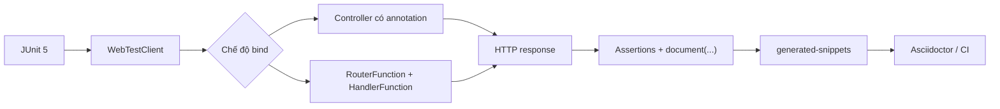

# Bind trực tiếp vào controller hoặc router

## 1. Mục tiêu và tình huống sử dụng

Trong module **SPRING_REST_DOCS**, tài liệu REST API được tạo từ những bài kiểm thử HTTP: test gửi request, xác nhận response, rồi Spring REST Docs ghi lại các snippet có thể đưa vào Asciidoctor hoặc Markdown. Cách làm này giúp ví dụ trong tài liệu bám sát hành vi đã kiểm chứng của ứng dụng và có thể được chạy lại khi build, CI.

Với **Spring WebFlux**, `WebTestClient` không bắt buộc phải kết nối đến server thật. Nó có thể gửi request trực tiếp tới:

- Một hoặc nhiều **controller được khai báo bằng annotation** thông qua `WebTestClient.bindToController(...)`.
- Một **functional router** thông qua `WebTestClient.bindToRouterFunction(...)`.

Bài này thuộc chương **WebTestClient** và giải thích cách dùng cả hai chế độ, kết hợp với `documentationConfiguration(...)` và `document(...)` để sinh tài liệu HTTP.

Sau bài học, bạn sẽ có thể tạo test độc lập cho controller hoặc router, mô tả path parameter/header/payload, chọn phạm vi kiểm thử phù hợp và liên kết snippet vào tài liệu dựng bằng Asciidoctor.

## 2. Hiểu cơ chế bind trực tiếp

Các lời gọi `bindToController` và `bindToRouterFunction` xây dựng một **môi trường WebFlux giả lập ở tầng HTTP**, xử lý request bên trong quá trình test. Không mở cổng mạng và không cần khởi động server Netty/Tomcat.



Hai kiểu lập trình WebFlux khác nhau ở cách định nghĩa endpoint:

| Tiêu chí | `bindToController(...)` | `bindToRouterFunction(...)` |
| --- | --- | --- |
| Đầu vào | Object controller, ví dụ `new BookController()` | `RouterFunction<ServerResponse>` |
| Khai báo đường dẫn | `@GetMapping`, `@PostMapping`, `@RequestMapping`... | `RouterFunctions.route`, `RequestPredicates.GET`, `POST`... |
| Nơi lấy biến đường dẫn | `@PathVariable` trong tham số method | `ServerRequest.pathVariable(...)` |
| Nơi tạo response | Giá trị trả về của controller, ví dụ `Mono<Map<...>>` | `ServerResponse` từ handler function |
| Phạm vi kiểm thử | Controller và hạ tầng WebFlux được tạo cho test | Router function, handler function và hạ tầng WebFlux được tạo cho test |
| Cấu hình REST Docs | `.configureClient().filter(documentationConfiguration(...))` | Tương tự |

So với `bindToApplicationContext(context)`, hai cách bind trực tiếp **không nạp toàn bộ bean của ứng dụng**. Điều đó làm test tập trung và thường nhanh hơn, nhưng bạn cần tự cung cấp các dependency, filter, advice hoặc codec cần thiết cho tình huống đang kiểm thử.

## 3. Chuẩn bị dependency và công cụ

Ví dụ dưới đây dùng Java, JUnit 5, Spring WebFlux và Spring REST Docs. Với dự án Spring Boot có Gradle Groovy DSL:

```groovy
dependencies {
    implementation 'org.springframework.boot:spring-boot-starter-webflux'
    testImplementation 'org.springframework.boot:spring-boot-starter-test'
    testImplementation 'org.springframework.restdocs:spring-restdocs-webtestclient'
}
```

Spring Boot thường quản lý phiên bản dependency. Nếu không sử dụng Spring Boot, hãy cấu hình Spring WebFlux, Spring Test, JUnit 5, Reactor và Spring REST Docs ở những phiên bản tương thích. Các ví dụ dùng `Map` để tránh phải tạo thêm DTO; một dự án thực tế nên có model/DTO thích hợp và kiểm thử hợp đồng API tương ứng.

Hai static import dùng chung cho việc tạo tài liệu:

```java
import static org.springframework.restdocs.webtestclient.WebTestClientRestDocumentation.documentationConfiguration;
import static org.springframework.restdocs.webtestclient.WebTestClientRestDocumentation.document;
```

Đây là API REST Docs **dành cho WebTestClient**; không trộn lẫn với các static import của `MockMvcRestDocumentation` hoặc REST Assured.

## 4. Ví dụ đầy đủ: bind trực tiếp vào controller

Giả sử một controller WebFlux cung cấp `GET /api/books/{id}` và trả về sách có hai field `id`, `title`. Ta tạo controller ngay trong test, bind vào `WebTestClient` và ghi snippet của response.

```java
import java.util.Map;

import org.junit.jupiter.api.BeforeEach;
import org.junit.jupiter.api.Test;
import org.junit.jupiter.api.extension.ExtendWith;
import org.springframework.http.MediaType;
import org.springframework.restdocs.RestDocumentationContextProvider;
import org.springframework.restdocs.RestDocumentationExtension;
import org.springframework.test.web.reactive.server.WebTestClient;
import org.springframework.web.bind.annotation.GetMapping;
import org.springframework.web.bind.annotation.PathVariable;
import org.springframework.web.bind.annotation.RestController;
import reactor.core.publisher.Mono;

import static org.springframework.restdocs.payload.PayloadDocumentation.fieldWithPath;
import static org.springframework.restdocs.payload.PayloadDocumentation.responseFields;
import static org.springframework.restdocs.request.RequestDocumentation.parameterWithName;
import static org.springframework.restdocs.request.RequestDocumentation.pathParameters;
import static org.springframework.restdocs.webtestclient.WebTestClientRestDocumentation.document;
import static org.springframework.restdocs.webtestclient.WebTestClientRestDocumentation.documentationConfiguration;

@ExtendWith(RestDocumentationExtension.class)
class BookControllerDocumentationTest {

    private WebTestClient client;

    @BeforeEach
    void setUp(RestDocumentationContextProvider documentation) {
        client = WebTestClient.bindToController(new BookController())
            .configureClient()
            .filter(documentationConfiguration(documentation))
            .build();
    }

    @Test
    void documentsBookById() {
        client.get()
            .uri("/api/books/{id}", 42)
            .accept(MediaType.APPLICATION_JSON)
            .exchange()
            .expectStatus().isOk()
            .expectHeader().contentTypeCompatibleWith(MediaType.APPLICATION_JSON)
            .expectBody()
            .jsonPath("$.id").isEqualTo(42)
            .jsonPath("$.title").isEqualTo("Spring REST Docs")
            .consumeWith(document("books/get-by-id-controller",
                pathParameters(
                    parameterWithName("id").description("Mã sách cần tra cứu")
                ),
                responseFields(
                    fieldWithPath("id").description("Mã sách"),
                    fieldWithPath("title").description("Tên sách")
                )
            ));
    }

    @RestController
    static class BookController {
        @GetMapping(
            path = "/api/books/{id}",
            produces = MediaType.APPLICATION_JSON_VALUE
        )
        public Mono<Map<String, Object>> getBook(@PathVariable("id") long id) {
            return Mono.just(Map.of(
                "id", id,
                "title", "Spring REST Docs"
            ));
        }
    }
}
```

Luồng của test:

1. `RestDocumentationExtension` quản lý ngữ cảnh tạo tài liệu cho từng bài test; JUnit 5 truyền `RestDocumentationContextProvider` vào `@BeforeEach`.
2. `bindToController(new BookController())` tạo WebFlux handler có mapping từ controller được truyền vào.
3. `configureClient()` mở bước tùy chỉnh client; `filter(documentationConfiguration(documentation))` thêm khả năng thu thập giao dịch HTTP cho Spring REST Docs.
4. `exchange()` thực hiện request; các assertion kiểm tra status, media type và JSON.
5. `consumeWith(document("books/get-by-id-controller", ...))` sinh snippet cho operation, bao gồm `path-parameters.adoc` và `response-fields.adoc`.

**Vì sao cần `configureClient()`?** Phương thức `bindToController` trả về một `ControllerSpec` để cấu hình môi trường server mô phỏng. Sau khi chuyển sang client builder bằng `configureClient()`, ta mới có thể đăng ký `ExchangeFilterFunction` do Spring REST Docs cung cấp.

> Không gọi `document(...)` trong test nghĩa là chưa yêu cầu xuất snippet cho operation đó, dù filter REST Docs đã được cài vào client.

## 5. Ví dụ đầy đủ: bind trực tiếp vào functional router

Trong phong cách **functional endpoints** của WebFlux, một `RouterFunction<ServerResponse>` quyết định request nào được xử lý; một handler function nhận `ServerRequest` và trả về `Mono<ServerResponse>`. Không cần khai báo `@RestController`.

Ví dụ sau tài liệu hóa `GET /api/notes/{id}`. Router và handler được tạo ngay trong `@BeforeEach` rồi truyền cho `bindToRouterFunction(...)`.

```java
import java.util.Map;

import org.junit.jupiter.api.BeforeEach;
import org.junit.jupiter.api.Test;
import org.junit.jupiter.api.extension.ExtendWith;
import org.springframework.http.MediaType;
import org.springframework.restdocs.RestDocumentationContextProvider;
import org.springframework.restdocs.RestDocumentationExtension;
import org.springframework.test.web.reactive.server.WebTestClient;
import org.springframework.web.reactive.function.server.RouterFunction;
import org.springframework.web.reactive.function.server.RouterFunctions;
import org.springframework.web.reactive.function.server.RequestPredicates;
import org.springframework.web.reactive.function.server.ServerResponse;

import static org.springframework.restdocs.payload.PayloadDocumentation.fieldWithPath;
import static org.springframework.restdocs.payload.PayloadDocumentation.responseFields;
import static org.springframework.restdocs.request.RequestDocumentation.parameterWithName;
import static org.springframework.restdocs.request.RequestDocumentation.pathParameters;
import static org.springframework.restdocs.webtestclient.WebTestClientRestDocumentation.document;
import static org.springframework.restdocs.webtestclient.WebTestClientRestDocumentation.documentationConfiguration;

@ExtendWith(RestDocumentationExtension.class)
class NoteRouterDocumentationTest {

    private WebTestClient client;

    @BeforeEach
    void setUp(RestDocumentationContextProvider documentation) {
        RouterFunction<ServerResponse> router = RouterFunctions.route(
            RequestPredicates.GET("/api/notes/{id}"),
            request -> ServerResponse.ok()
                .contentType(MediaType.APPLICATION_JSON)
                .bodyValue(Map.of(
                    "id", Long.parseLong(request.pathVariable("id")),
                    "content", "Ghi chú mẫu"
                ))
        );

        client = WebTestClient.bindToRouterFunction(router)
            .configureClient()
            .filter(documentationConfiguration(documentation))
            .build();
    }

    @Test
    void documentsNoteById() {
        client.get()
            .uri("/api/notes/{id}", 15)
            .accept(MediaType.APPLICATION_JSON)
            .exchange()
            .expectStatus().isOk()
            .expectBody()
            .jsonPath("$.id").isEqualTo(15)
            .jsonPath("$.content").isEqualTo("Ghi chú mẫu")
            .consumeWith(document("notes/get-by-id-router",
                pathParameters(
                    parameterWithName("id").description("Mã ghi chú")
                ),
                responseFields(
                    fieldWithPath("id").description("Mã ghi chú"),
                    fieldWithPath("content").description("Nội dung ghi chú")
                )
            ));
    }
}
```

Điểm đặc trưng của kiểu router:

- `RequestPredicates.GET("/api/notes/{id}")` khai báo HTTP method và path.
- `request.pathVariable("id")` lấy biến đã được router khớp từ URI.
- `ServerResponse.ok().contentType(...).bodyValue(...)` tạo HTTP response.
- `bindToRouterFunction(router)` tạo server mô phỏng từ router đã chỉ định; sau đó dùng **cùng một cơ chế REST Docs** như với controller.

Các handler có thể gọi service được inject qua constructor hoặc truyền vào khi tạo router. Trong bài test trực tiếp, cần cung cấp dependency ấy một cách tường minh. Nếu router production phụ thuộc cấu hình/bean khác, hãy đưa các thành phần cần thiết vào test hoặc cân nhắc `bindToApplicationContext(...)`.

## 6. Chọn kiểu bind phù hợp và hiểu giới hạn

Hai kiểu bind trực tiếp rất hữu ích để kiểm thử hợp đồng HTTP ở phạm vi nhỏ. Tuy nhiên, chúng không tự kiểm tra toàn bộ cấu hình của ứng dụng.

| Nhu cầu | Lựa chọn phù hợp | Ghi chú |
| --- | --- | --- |
| Kiểm tra mapping và JSON do một `@RestController` trả về | `bindToController` | Có thể tạo controller với fake/mock service |
| Kiểm tra `RouterFunction` và handler WebFlux | `bindToRouterFunction` | Phù hợp với functional endpoint |
| Kiểm tra routing/filter/exception handler là bean của Spring | `bindToApplicationContext` | Chỉ có những bean thực sự nằm trong context test |
| Kiểm tra luồng HTTP qua port/server đang chạy | `bindToServer` | Gửi request qua mạng đến ứng dụng |

Ví dụ: nếu production dùng một `WebFilter` để kiểm tra authentication, test tạo bằng `bindToController(new BookController())` sẽ không tự nhiên có bộ lọc đó. Một test trả 200 trong chế độ bind trực tiếp **không chứng minh** route production bỏ qua xác thực. Khi test nhằm chứng minh cấu hình security, filter chain hoặc behavior tích hợp, hãy dựng đủ cấu hình hoặc dùng kiểu test phù hợp hơn.

Với controller có dependency:

```java
BookService fakeService = new FakeBookService();
BookController controller = new BookController(fakeService);

WebTestClient client = WebTestClient.bindToController(controller)
    .configureClient()
    .filter(documentationConfiguration(documentation))
    .build();
```

Đoạn trên minh họa **cách truyền dependency qua constructor**, giả định `BookController(BookService)` và `FakeBookService` tồn tại trong dự án; không sử dụng chung với controller độc lập không có constructor này ở mục 4. Mục đích là kiểm soát dữ liệu phản hồi để các ví dụ tài liệu ổn định giữa các lần chạy.

## 7. Tùy biến snippet request/response

Spring REST Docs cung cấp các descriptor để tài liệu hóa hành vi HTTP và kiểm tra thay đổi:

| Loại nội dung | API snippet thường dùng | File sinh ra |
| --- | --- | --- |
| Biến trên đường dẫn | `pathParameters(parameterWithName(...))` | `path-parameters.adoc` |
| Query parameter | `queryParameters(parameterWithName(...))` | `query-parameters.adoc` |
| Request header | `requestHeaders(headerWithName(...))` | `request-headers.adoc` |
| Response header | `responseHeaders(headerWithName(...))` | `response-headers.adoc` |
| Field của request JSON | `requestFields(fieldWithPath(...))` | `request-fields.adoc` |
| Field của response JSON | `responseFields(fieldWithPath(...))` | `response-fields.adoc` |

Ví dụ minh họa cấu trúc một test POST sau khi đã thêm endpoint `POST /api/books` vào controller hoặc router:

```java
import static org.springframework.restdocs.headers.HeaderDocumentation.headerWithName;
import static org.springframework.restdocs.headers.HeaderDocumentation.requestHeaders;
import static org.springframework.restdocs.payload.PayloadDocumentation.requestFields;

client.post()
    .uri("/api/books")
    .header("X-Request-Id", "test-request-001")
    .contentType(MediaType.APPLICATION_JSON)
    .bodyValue(Map.of("title", "Spring REST Docs"))
    .exchange()
    .expectStatus().isCreated()
    .expectBody()
    .consumeWith(document("books/create",
        requestHeaders(
            headerWithName("X-Request-Id").description("Mã truy vết request")
        ),
        requestFields(
            fieldWithPath("title").description("Tên sách được tạo")
        )
    ));
```

Đây là **đoạn minh họa**, không phải test độc lập: endpoint POST và phản hồi 201 phải được cài đặt trước. Nếu API trả về JSON, nên bổ sung assertion và `responseFields(...)` tương ứng. Khi tài liệu hóa field, hãy mô tả chính xác tất cả field bắt buộc trong payload; với field tùy chọn, dùng descriptor `.optional()` khi phù hợp với hợp đồng API.

Bạn cũng có thể tiền xử lý snippet để JSON dễ đọc hơn mà không làm thay đổi HTTP operation trong test:

```java
import static org.springframework.restdocs.operation.preprocess.Preprocessors.prettyPrint;

client = WebTestClient.bindToController(new BookController())
    .configureClient()
    .filter(documentationConfiguration(documentation)
        .operationPreprocessors()
            .withRequestDefaults(prettyPrint())
            .withResponseDefaults(prettyPrint()))
    .build();
```

Trong đoạn này `documentation` là `RestDocumentationContextProvider` và `BookController` là controller ở mục 4. Với router, thay `bindToController(new BookController())` bằng `bindToRouterFunction(router)`. Khi xuất tài liệu, có thể dùng preprocessor để loại token hoặc giá trị riêng tư khỏi snippet; assertion của test vẫn nên kiểm tra dữ liệu thực tế.

## 8. Sinh tài liệu Asciidoctor từ snippet

Khi chạy test ở mục 4 và 5, Spring REST Docs có thể tạo các thư mục theo identifier của từng `document(...)`:

```text
build/generated-snippets/
├── books/
│   └── get-by-id-controller/
│       ├── http-request.adoc
│       ├── http-response.adoc
│       ├── path-parameters.adoc
│       └── response-fields.adoc
└── notes/
    └── get-by-id-router/
        ├── http-request.adoc
        ├── http-response.adoc
        ├── path-parameters.adoc
        └── response-fields.adoc
```

Đây là các file **tiêu biểu**, không phải toàn bộ: một số snippet mặc định khác như `curl-request.adoc`, `request-body.adoc` và `response-body.adoc` có thể được tạo tùy operation và cấu hình. Với Maven, thư mục đầu ra thông thường là `target/generated-snippets`.

Một file Asciidoctor có thể ghép snippet được kiểm chứng:

```asciidoc
= Books and Notes API
:snippets: build/generated-snippets

== Lấy một sách

=== HTTP request
include::{snippets}/books/get-by-id-controller/http-request.adoc[]

=== Path parameters
include::{snippets}/books/get-by-id-controller/path-parameters.adoc[]

=== HTTP response
include::{snippets}/books/get-by-id-controller/http-response.adoc[]

=== Response fields
include::{snippets}/books/get-by-id-controller/response-fields.adoc[]

== Lấy một ghi chú

include::{snippets}/notes/get-by-id-router/http-request.adoc[]
include::{snippets}/notes/get-by-id-router/http-response.adoc[]
include::{snippets}/notes/get-by-id-router/response-fields.adoc[]
```

Đường dẫn `:snippets:` phải tương ứng với nơi Asciidoctor resolve đường dẫn; trong build thực tế, nên truyền giá trị này từ plugin và điều chỉnh theo vị trí file. Ví dụ cấu hình Gradle khi **đã cài Asciidoctor plugin** và có task `asciidoctor`:

```groovy
def snippetsDir = layout.buildDirectory.dir("generated-snippets")

tasks.named("test") {
    outputs.dir(snippetsDir)
}

tasks.named("asciidoctor") {
    dependsOn(tasks.named("test"))
    inputs.dir(snippetsDir)
    attributes "snippets": snippetsDir.get().asFile
}
```

Trong CI, chạy test trước khi tạo tài liệu, ví dụ `./gradlew clean test asciidoctor` sau khi đã cấu hình plugin/task tương ứng. Nếu assertion HTTP hoặc descriptor không khớp, test nên khiến pipeline thất bại và ngăn tài liệu cũ bị xuất bản như kết quả mới. Với Markdown thuần, cần bước riêng để liên kết hoặc ghép nội dung snippet; cú pháp `include::` là của Asciidoctor.

## 9. Lỗi thường gặp và cách giải quyết

| Hiện tượng | Kiểm tra và xử lý |
| --- | --- |
| Test nhận 404 với `bindToController` | Kiểm tra controller truyền vào có `@RestController`/`@RequestMapping` đúng và URI, HTTP method khớp mapping. |
| Router trả 404 | Kiểm tra `RouterFunction` đã được truyền cho `bindToRouterFunction` và `RequestPredicates` có khớp method/path không. |
| Method handler có dependency null | Truyền dependency qua constructor, dùng mock/fake service hoặc chọn test có Spring context để inject bean. |
| Filter/security của ứng dụng không chạy | Bind trực tiếp chỉ xây dựng môi trường WebFlux theo cấu hình test; thêm filter/advice được kiểm thử hoặc chuyển sang `bindToApplicationContext` khi cần. |
| Không gọi được `.filter(...)` sau `bindToController` | Gọi `.configureClient()` rồi mới `.filter(documentationConfiguration(...))`. Tương tự cho `bindToRouterFunction`. |
| Không inject được `RestDocumentationContextProvider` | Kiểm tra `@ExtendWith(RestDocumentationExtension.class)`, JUnit 5 và dependency `spring-restdocs-webtestclient`. |
| Test HTTP pass nhưng không sinh snippet | Bảo đảm client đang dùng có REST Docs filter và test gọi `.consumeWith(document(...))`. |
| Thiếu `response-fields.adoc` hoặc `path-parameters.adoc` | Thêm đúng `responseFields(...)` hoặc `pathParameters(...)` vào `document(...)` và chạy lại test. |
| Mô tả field sai khiến test thất bại | Xem JSON trả về, cập nhật descriptor và assertion; dùng `.optional()` chỉ khi field thực sự tùy chọn. |
| `include::` không tìm thấy file | Kiểm tra identifier, đường dẫn generated snippets, thuộc tính `snippets` và sự phụ thuộc giữa task test và task Asciidoctor. |

## 10. Bài thực hành và tự kiểm tra

1. Chạy `BookControllerDocumentationTest`, xem các file snippet của `books/get-by-id-controller` và đối chiếu request/response với assertion.
2. Đổi đối số URI trong test từ `.uri("/api/books/{id}", 42)` thành `.uri("/api/books/{id}", 99)`. Quan sát field `id` trong JSON thay đổi và cập nhật assertion hợp lý.
3. Chạy `NoteRouterDocumentationTest`, rồi đổi `RequestPredicates.GET` thành `POST` nhưng giữ test GET để xem cách báo lỗi 404 và điều chỉnh test/router.
4. Thêm một field `author` vào response nhưng chưa thêm `fieldWithPath("author")`. Xem test tài liệu phát hiện field chưa được mô tả, rồi sửa descriptor.
5. Dùng `prettyPrint()` trên một trong hai client và kiểm tra thay đổi định dạng trong `http-response.adoc`.
6. Tạo trang Asciidoctor gồm cả controller và router, sau đó đưa việc chạy test và dựng tài liệu vào pipeline CI.

## 11. Ghi nhớ

- `bindToController(...)` dành cho controller dùng annotation, còn `bindToRouterFunction(...)` dành cho functional routing của Spring WebFlux.
- Cả hai chế độ xử lý HTTP bên trong test, không đòi hỏi server TCP hay toàn bộ `ApplicationContext`.
- Để sinh snippet với REST Docs, cấu hình `.configureClient().filter(documentationConfiguration(context))` khi xây dựng client và gọi `.consumeWith(document("operation-id", ...))` trong test.
- Một snippet có ích vừa thể hiện ví dụ HTTP vừa giúp kiểm tra hợp đồng request/response thông qua các descriptor.
- Kết quả chỉ phản ánh controller/router, dependency và hạ tầng thực sự được đưa vào test; kiểm thử tích hợp rộng hơn cần môi trường tương ứng.
- Gắn việc chạy test với bước dựng Asciidoctor/Markdown trong build và CI để tài liệu được cập nhật cùng thay đổi API.
