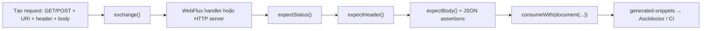

# Exchange request và xác nhận response

## 1. Mục tiêu bài học

Trong module **SPRING_REST_DOCS**, tài liệu REST API được tạo từ các tương tác HTTP có kiểm chứng: bài kiểm thử gửi request, kiểm tra response và yêu cầu Spring REST Docs xuất snippet cho tài liệu Asciidoctor/Markdown. Cách làm này giúp phát hiện sớm khi một endpoint thay đổi trạng thái HTTP, header hoặc payload mà tài liệu chưa được cập nhật.

Bài thuộc chương **WebTestClient** và tập trung vào chuỗi thao tác quan trọng nhất: **tạo request → gọi `exchange()` → xác nhận response → ghi snippet**. Sau bài này, bạn có thể:

- Dùng `get()`, `post()`, `uri()`, `header()`, `accept()`, `contentType()` và `bodyValue()` để tạo request.
- Giải thích vì sao `exchange()` là ranh giới thực thi request và phân biệt nó với các bước assertion.
- Kiểm tra status, response header, JSON body, danh sách kết quả và response không có body.
- Kết hợp JUnit 5, Spring WebFlux `WebTestClient` và Spring REST Docs để sinh snippet request/response/payload/header/tham số.
- Chọn cách xác nhận phù hợp với JSON thông thường hoặc phản hồi phát liên tục (streaming).
- Đưa snippet đã kiểm chứng vào Asciidoctor và quy trình build, CI.

## 2. Chuỗi xử lý request–response của WebTestClient

`WebTestClient` cung cấp một API thao tác theo chuỗi (fluent API). Bạn cấu hình request ở phía client, thực thi request, sau đó lần lượt đưa ra các kỳ vọng về response:

```java
client.get()
    .uri("/api/books/{id}", 42)
    .accept(MediaType.APPLICATION_JSON)
    .exchange()
    .expectStatus().isOk()
    .expectHeader().contentTypeCompatibleWith(MediaType.APPLICATION_JSON)
    .expectBody()
    .jsonPath("$.id").isEqualTo(42);
```

Ví dụ trên giả định `client` đã được tạo, và endpoint `GET /api/books/42` tồn tại. Điểm cốt lõi:

1. **Trước `exchange()`**: định nghĩa phương thức HTTP, URI, request header và request body (nếu có).
2. **Tại `exchange()`**: `WebTestClient` gửi request tới môi trường đã bind (controller/router, `ApplicationContext` hoặc HTTP server) và trả về đối tượng cho phép kiểm tra response.
3. **Sau `exchange()`**: `expectStatus()`, `expectHeader()` và `expectBody()` đưa ra những assertion. Một assertion không đúng sẽ làm test thất bại.
4. **Khi dùng REST Docs**: `consumeWith(document(...))` nhận kết quả HTTP của test và tạo snippet tương ứng với operation đã mô tả.



`exchange()` là phương thức **thực hiện request**, không phải phép so sánh dữ liệu. Khác với `WebClient` phục vụ giao tiếp HTTP thông thường, `WebTestClient` bổ sung sẵn API assertion dành cho kiểm thử. Vì vậy không cần gọi `retrieve()` để đọc response trong chuỗi test như ví dụ này.

## 3. Các phương thức thường dùng

| Giai đoạn | API | Ý nghĩa |
| --- | --- | --- |
| Khởi tạo request | `client.get()`, `post()`, `put()`, `patch()`, `delete()` | Chọn HTTP method |
| Xác định đích | `.uri("/api/books/{id}", 42)` | Tạo URI và thay biến đường dẫn |
| Request headers | `.header("X-Request-Id", "req-001")` | Gửi header nghiệp vụ |
| Nội dung mong muốn | `.accept(MediaType.APPLICATION_JSON)` | Khai báo `Accept` |
| Kiểu body gửi lên | `.contentType(MediaType.APPLICATION_JSON)` | Khai báo `Content-Type` |
| Body request | `.bodyValue(object)` | Mã hóa object thành request body qua codec |
| Thực thi | `.exchange()` | Gửi request và nhận `ResponseSpec` |
| Mã phản hồi | `.expectStatus().isOk()` | Kiểm tra HTTP 200 |
| Response headers | `.expectHeader().valueEquals("Location", "...")` | Kiểm tra giá trị header |
| Response body | `.expectBody().jsonPath("$.id").isEqualTo(42)` | Kiểm tra JSON path |
| Tài liệu hóa | `.expectBody().consumeWith(document("books/get", ...))` | Tạo snippet từ operation |

Không phải request nào cũng có body: đối với GET, bạn thường chỉ cần URI, header và `exchange()`. Với POST/PUT/PATCH, dùng `contentType(...)` và `bodyValue(...)` khi gửi JSON. `Accept` mô tả loại response mà client mong muốn, còn `Content-Type` mô tả kiểu dữ liệu trong request body.

## 4. Chuẩn bị JUnit 5 và Spring REST Docs

Giả sử dự án Spring Boot có Spring WebFlux. Với Gradle (Groovy DSL), các dependency cơ bản là:

```groovy
dependencies {
    implementation 'org.springframework.boot:spring-boot-starter-webflux'
    testImplementation 'org.springframework.boot:spring-boot-starter-test'
    testImplementation 'org.springframework.restdocs:spring-restdocs-webtestclient'
}
```

Spring Boot thường quản lý phiên bản các dependency. Với dự án tự quản lý dependency, hãy chọn những phiên bản Spring WebFlux, Spring Test, Spring REST Docs và JUnit tương thích. Các ví dụ sau dùng Java 9+ (do có `Map.of`) và JUnit 5.

Đối với test chỉ tập trung vào controller, ta có thể khởi tạo client như sau:

```java
@ExtendWith(RestDocumentationExtension.class)
class ExampleDocumentationTest {

    private WebTestClient client;

    @BeforeEach
    void setUp(RestDocumentationContextProvider restDocumentation) {
        this.client = WebTestClient.bindToController(new ExampleController())
            .configureClient()
            .filter(documentationConfiguration(restDocumentation))
            .build();
    }
}
```

Đây là cấu trúc minh họa: `ExampleController`, các import và các phương thức test được bổ sung ở ví dụ hoàn chỉnh bên dưới. `RestDocumentationExtension` cung cấp ngữ cảnh tài liệu cho JUnit 5. `documentationConfiguration(restDocumentation)` gắn filter Spring REST Docs vào client; `document(...)` ở từng test sẽ chỉ định operation và các snippet cần tạo.

Khi dùng `bindToApplicationContext(context)`, cấu hình vẫn theo mẫu `.configureClient().filter(...).build()`. Khi dùng `bindToServer()`, có thể gọi `.filter(...)` trực tiếp trên client builder và không cần `configureClient()`.

## 5. Ví dụ đầy đủ: xác nhận GET và POST rồi sinh tài liệu

Để tập trung vào request và response, ví dụ dùng controller WebFlux đơn giản, không kết nối cơ sở dữ liệu. Hai endpoint minh họa:

- `GET /api/books/{id}` trả về status `200 OK` và JSON có `id`, `title`.
- `POST /api/books` nhận JSON có `title`, trả về status `201 Created`, header `Location` và JSON sách vừa tạo.

Bạn có thể đặt test sau vào `src/test/java` của dự án đã cấu hình dependency ở mục 4:

```java
import java.net.URI;
import java.util.Map;

import org.junit.jupiter.api.BeforeEach;
import org.junit.jupiter.api.Test;
import org.junit.jupiter.api.extension.ExtendWith;
import org.springframework.http.HttpHeaders;
import org.springframework.http.MediaType;
import org.springframework.http.ResponseEntity;
import org.springframework.restdocs.RestDocumentationContextProvider;
import org.springframework.restdocs.RestDocumentationExtension;
import org.springframework.test.web.reactive.server.WebTestClient;
import org.springframework.web.bind.annotation.GetMapping;
import org.springframework.web.bind.annotation.PathVariable;
import org.springframework.web.bind.annotation.PostMapping;
import org.springframework.web.bind.annotation.RequestBody;
import org.springframework.web.bind.annotation.RestController;
import reactor.core.publisher.Mono;

import static org.springframework.restdocs.headers.HeaderDocumentation.headerWithName;
import static org.springframework.restdocs.headers.HeaderDocumentation.requestHeaders;
import static org.springframework.restdocs.headers.HeaderDocumentation.responseHeaders;
import static org.springframework.restdocs.payload.PayloadDocumentation.fieldWithPath;
import static org.springframework.restdocs.payload.PayloadDocumentation.requestFields;
import static org.springframework.restdocs.payload.PayloadDocumentation.responseFields;
import static org.springframework.restdocs.request.RequestDocumentation.parameterWithName;
import static org.springframework.restdocs.request.RequestDocumentation.pathParameters;
import static org.springframework.restdocs.webtestclient.WebTestClientRestDocumentation.document;
import static org.springframework.restdocs.webtestclient.WebTestClientRestDocumentation.documentationConfiguration;

@ExtendWith(RestDocumentationExtension.class)
class BookExchangeDocumentationTest {

    private WebTestClient client;

    @BeforeEach
    void setUp(RestDocumentationContextProvider restDocumentation) {
        client = WebTestClient.bindToController(new BookController())
            .configureClient()
            .filter(documentationConfiguration(restDocumentation))
            .build();
    }

    @Test
    void getBookChecksResponseAndDocumentsIt() {
        client.get()
            .uri("/api/books/{id}", 42)
            .accept(MediaType.APPLICATION_JSON)
            .exchange()
            .expectStatus().isOk()
            .expectHeader().contentTypeCompatibleWith(MediaType.APPLICATION_JSON)
            .expectBody()
            .jsonPath("$.id").isEqualTo(42)
            .jsonPath("$.title").isEqualTo("Spring REST Docs")
            .consumeWith(document("books/get",
                pathParameters(
                    parameterWithName("id").description("Mã sách cần lấy")
                ),
                responseFields(
                    fieldWithPath("id").description("Mã sách"),
                    fieldWithPath("title").description("Tên sách")
                )
            ));
    }

    @Test
    void createBookChecksResponseAndDocumentsIt() {
        client.post()
            .uri("/api/books")
            .header("X-Request-Id", "req-001")
            .contentType(MediaType.APPLICATION_JSON)
            .accept(MediaType.APPLICATION_JSON)
            .bodyValue(Map.of("title", "Spring REST Docs"))
            .exchange()
            .expectStatus().isCreated()
            .expectHeader().valueEquals(HttpHeaders.LOCATION, "/api/books/42")
            .expectHeader().contentTypeCompatibleWith(MediaType.APPLICATION_JSON)
            .expectBody()
            .jsonPath("$.id").isEqualTo(42)
            .jsonPath("$.title").isEqualTo("Spring REST Docs")
            .consumeWith(document("books/create",
                requestHeaders(
                    headerWithName("X-Request-Id")
                        .description("Mã dùng để theo dõi request")
                ),
                requestFields(
                    fieldWithPath("title").description("Tên sách mới")
                ),
                responseHeaders(
                    headerWithName(HttpHeaders.LOCATION)
                        .description("URI của tài nguyên vừa tạo")
                ),
                responseFields(
                    fieldWithPath("id").description("Mã sách được tạo"),
                    fieldWithPath("title").description("Tên sách")
                )
            ));
    }

    @RestController
    static class BookController {

        @GetMapping(
            path = "/api/books/{id}",
            produces = MediaType.APPLICATION_JSON_VALUE
        )
        public Mono<Map<String, Object>> getBook(
                @PathVariable("id") long id) {
            return Mono.just(Map.of(
                "id", id,
                "title", "Spring REST Docs"
            ));
        }

        @PostMapping(
            path = "/api/books",
            consumes = MediaType.APPLICATION_JSON_VALUE,
            produces = MediaType.APPLICATION_JSON_VALUE
        )
        public Mono<ResponseEntity<Map<String, Object>>> createBook(
                @RequestBody Mono<Map<String, String>> requestBody) {
            return requestBody.map(body -> {
                Map<String, Object> result = Map.of(
                    "id", 42,
                    "title", body.get("title")
                );
                return ResponseEntity
                    .created(URI.create("/api/books/42"))
                    .body(result);
            });
        }
    }
}
```

Mỗi bài test bắt đầu bằng cách xây dựng request, chỉ thực sự gửi request khi gọi `exchange()`, sau đó kiểm tra các đặc điểm phải đúng:

- **GET:** `expectStatus().isOk()` xác nhận 200; `contentTypeCompatibleWith` cho phép media type tương thích với JSON (kể cả các tham số media type như charset); `jsonPath` so sánh dữ liệu thực tế trong response.
- **POST:** `bodyValue(...)` gửi JSON đầu vào; `expectStatus().isCreated()` xác nhận 201; `valueEquals(HttpHeaders.LOCATION, ...)` kiểm tra URI tài nguyên mới; các `jsonPath` xác nhận dữ liệu trả về.
- **REST Docs:** `document("books/get", ...)` và `document("books/create", ...)` tạo hai thư mục snippet độc lập. Các descriptor mô tả biến đường dẫn, field request/response và header cần công bố.

Hai operation trong ví dụ này có dữ liệu cố định để tài liệu ổn định qua mỗi lần chạy. Trong ứng dụng thật, bạn cần tự cung cấp fixture hoặc test double cho service/repository và xác nhận response theo hợp đồng API thực tế.

## 6. Chọn assertion phù hợp với response

### 6.1. HTTP status

Bạn có thể kiểm tra status bằng các hàm như:

```java
// Một trong các kỳ vọng sau tùy endpoint:
.expectStatus().isOk()                 // 200
.expectStatus().isCreated()            // 201
.expectStatus().isNoContent()          // 204
.expectStatus().isNotFound()           // 404
.expectStatus().is4xxClientError()     // nhóm 4xx
.expectStatus().is5xxServerError()     // nhóm 5xx
.expectStatus().valueEquals(202)       // giá trị cụ thể
```

Những dòng trên là **các lựa chọn minh họa**, không thể nối tất cả vào một response vì phần lớn điều kiện xung đột. Với API có hợp đồng rõ ràng, nên xác nhận mã trạng thái cụ thể. Assertions theo nhóm 4xx/5xx hữu ích khi muốn kiểm tra loại lỗi, nhưng không thay cho kiểm tra mã lỗi chính xác khi mã đó là một phần của hợp đồng API.

### 6.2. Response headers

`expectHeader()` cho phép kiểm tra header khi response có các thuộc tính quan trọng:

```java
client.post()
    .uri("/api/books")
    .contentType(MediaType.APPLICATION_JSON)
    .bodyValue(Map.of("title", "Spring REST Docs"))
    .exchange()
    .expectStatus().isCreated()
    .expectHeader().valueEquals("Location", "/api/books/42");
```

Đoạn minh họa sử dụng controller POST ở mục 5. Trong endpoint khác, header có thể là `ETag`, `Cache-Control` hoặc một request correlation id. Nếu cần đưa header vào tài liệu API, dùng `requestHeaders(...)` hoặc `responseHeaders(...)` cùng `headerWithName(...)` trong `document(...)`.

### 6.3. JSON body, đường dẫn JSON và đối chiếu nội dung

Với JSON, hai cách kiểm tra thường gặp:

```java
client.get()
    .uri("/api/books/{id}", 42)
    .exchange()
    .expectStatus().isOk()
    .expectBody()
    .jsonPath("$.id").isEqualTo(42)
    .jsonPath("$.title").isEqualTo("Spring REST Docs");
```

```java
client.get()
    .uri("/api/books/{id}", 42)
    .exchange()
    .expectStatus().isOk()
    .expectBody()
    .json("{\"id\":42,\"title\":\"Spring REST Docs\"}");
```

`jsonPath(...)` kiểm tra những phần cần quan tâm của JSON; `json(...)` đối chiếu với một biểu diễn JSON mong đợi theo cơ chế so sánh JSON của Spring Test. Hãy dùng `responseFields(...)` của REST Docs để mô tả các field trong tài liệu, vì assertion chỉ kiểm tra một vài giá trị **không tự sinh** bảng mô tả field.

### 6.4. Response không có body

Với endpoint DELETE trả về 204, có thể dùng:

```java
client.delete()
    .uri("/api/books/{id}", 42)
    .exchange()
    .expectStatus().isNoContent()
    .expectBody().isEmpty();
```

Đoạn này giả định API đã có endpoint DELETE trả 204. `isEmpty()` giúp phát hiện trường hợp ứng dụng vô tình trả payload khi hợp đồng yêu cầu body rỗng.

### 6.5. Response là danh sách

Khi endpoint trả về JSON array, có thể parse thành danh sách DTO thay vì chỉ so sánh chuỗi:

```java
client.get()
    .uri("/api/books")
    .exchange()
    .expectStatus().isOk()
    .expectBodyList(BookDto.class)
    .hasSize(2);
```

Đây là đoạn minh họa, yêu cầu endpoint `GET /api/books` và lớp `BookDto` có thể được codec của test deserialize. Nếu API trả về danh sách, cần thêm descriptor phù hợp cho các phần tử array khi viết snippet; chẳng hạn đường dẫn `[].id` và `[].title` trong `responseFields(...)`.

## 7. Phân biệt kiểm tra response body thông thường với streaming

`expectBody()` phù hợp với response hữu hạn vì body được lấy để kiểm tra. Với server-sent events (SSE) hoặc Flux phát liên tục, thay vì cố lấy hết response, hãy dùng `returnResult(...)` và kiểm tra luồng bằng Reactor Test:

```java
import org.springframework.test.web.reactive.server.FluxExchangeResult;
import reactor.test.StepVerifier;

FluxExchangeResult<String> result = client.get()
    .uri("/api/updates")
    .accept(MediaType.TEXT_EVENT_STREAM)
    .exchange()
    .expectStatus().isOk()
    .returnResult(String.class);

StepVerifier.create(result.getResponseBody())
    .expectNextCount(2)
    .thenCancel()
    .verify();
```

Ví dụ này yêu cầu endpoint `/api/updates` thực sự phát ít nhất hai phần tử SSE và test có dependency `reactor-test`. `thenCancel()` thích hợp với luồng không kết thúc. Response streaming thường cần cách tài liệu hóa riêng và dữ liệu mẫu hữu hạn; không nên để quy trình sinh snippet chờ vô hạn với `expectBody()`. Đối với API HTTP JSON hữu hạn, chuỗi `expectBody().consumeWith(document(...))` ở mục 5 là lựa chọn phổ biến.

## 8. Tạo snippet kiểm chứng bằng Spring REST Docs

Sau khi xác nhận response, gọi `consumeWith(document(...))` với identifier của operation và descriptor cần thiết:

```java
.expectBody()
.jsonPath("$.id").isEqualTo(42)
.consumeWith(document("books/get",
    pathParameters(
        parameterWithName("id").description("Mã sách cần lấy")
    ),
    responseFields(
        fieldWithPath("id").description("Mã sách"),
        fieldWithPath("title").description("Tên sách")
    )
));
```

Đây là đoạn cuối của chuỗi GET trong mục 5; nó cần client đã được cài REST Docs filter. Kết hợp descriptor và assertion có ý nghĩa khác nhau:

| Việc thực hiện | Cơ chế | Ý nghĩa |
| --- | --- | --- |
| Xác nhận status | `expectStatus()` | Phát hiện thay đổi mã HTTP |
| Xác nhận header | `expectHeader()` | Phát hiện header sai/thiếu |
| Xác nhận dữ liệu JSON | `jsonPath()`, `json()` | Phát hiện giá trị hoặc cấu trúc không khớp |
| Mô tả request/response | `requestFields()`, `responseFields()`, `pathParameters()`... | Sinh bảng tài liệu và kiểm tra mô tả hợp đồng API |
| Lưu snippet | `document("operation-id", ...)` | Ghi các tệp AsciiDoc của operation |

Trong chế độ mặc định, mô tả field bằng `responseFields(...)` nghiêm ngặt: field xuất hiện nhưng chưa được mô tả thường làm test tài liệu thất bại. Field tùy chọn có thể dùng `.optional()`, field cần bỏ khỏi bảng mô tả có thể dùng `.ignored()` khi điều đó phù hợp với hợp đồng API. Tránh dùng relaxed descriptor chỉ để che giấu thay đổi API mà nhóm cần biết.

### Tùy biến dữ liệu ghi vào snippet

Nếu JSON trên một dòng khó đọc, áp dụng preprocessor vào filter:

```java
import static org.springframework.restdocs.operation.preprocess.Preprocessors.prettyPrint;

client = WebTestClient.bindToController(new BookController())
    .configureClient()
    .filter(documentationConfiguration(restDocumentation)
        .operationPreprocessors()
            .withRequestDefaults(prettyPrint())
            .withResponseDefaults(prettyPrint()))
    .build();
```

`prettyPrint()` tác động tới nội dung được xuất **vào snippet**, không sửa request/response mà ứng dụng xử lý. Tương tự, bạn có thể cấu hình preprocessor để thay token, xóa header nhạy cảm hoặc chuẩn hóa host/port ngẫu nhiên trước khi đưa ví dụ HTTP vào tài liệu chia sẻ.

## 9. Đưa snippet vào Asciidoctor, Gradle và CI

Khi test thành công, các operation ở mục 5 thường sinh những tệp như:

```text
build/generated-snippets/
└── books/
    ├── get/
    │   ├── http-request.adoc
    │   ├── http-response.adoc
    │   ├── path-parameters.adoc
    │   └── response-fields.adoc
    └── create/
        ├── http-request.adoc
        ├── http-response.adoc
        ├── request-headers.adoc
        ├── request-fields.adoc
        ├── response-headers.adoc
        └── response-fields.adoc
```

Đây là danh sách **tệp tiêu biểu**, không nhất thiết đầy đủ; Spring REST Docs cũng có thể tạo `curl-request.adoc`, `request-body.adoc`, `response-body.adoc` và snippet khác theo cấu hình. Khi dùng Maven, thư mục đầu ra thường là `target/generated-snippets`.

Ví dụ Asciidoctor:

```asciidoc
= Book API
:snippets: build/generated-snippets

== Tra cứu sách

include::{snippets}/books/get/http-request.adoc[]
include::{snippets}/books/get/path-parameters.adoc[]
include::{snippets}/books/get/http-response.adoc[]
include::{snippets}/books/get/response-fields.adoc[]

== Tạo sách

include::{snippets}/books/create/http-request.adoc[]
include::{snippets}/books/create/request-headers.adoc[]
include::{snippets}/books/create/request-fields.adoc[]
include::{snippets}/books/create/http-response.adoc[]
include::{snippets}/books/create/response-headers.adoc[]
include::{snippets}/books/create/response-fields.adoc[]
```

Đường dẫn của `:snippets:` cần được điều chỉnh theo cách Asciidoctor resolve file hoặc truyền từ build. Với Gradle, giả sử plugin Asciidoctor đã được cài và có task `asciidoctor`:

```groovy
def snippetsDir = layout.buildDirectory.dir("generated-snippets")

tasks.named("test") {
    outputs.dir(snippetsDir)
}

tasks.named("asciidoctor") {
    dependsOn(tasks.named("test"))
    inputs.dir(snippetsDir)
    attributes "snippets": snippetsDir.get().asFile
}
```

Trong CI, chạy các bài test trước khi dựng trang, ví dụ `./gradlew clean test asciidoctor` khi những task trên đã được cấu hình. Nếu mã HTTP, header hay body khác kỳ vọng, test thất bại, từ đó ngăn xuất bản tài liệu không còn khớp. Với Markdown thuần, cần một bước tích hợp riêng để liên kết hoặc đưa nội dung snippet vào tài liệu: chỉ thị `include::` là cú pháp Asciidoctor.

## 10. Lỗi thường gặp và cách chẩn đoán

| Hiện tượng | Nguyên nhân và cách xử lý |
| --- | --- |
| Test nhận 404 thay vì 200 | Kiểm tra URI, HTTP method, path variable và controller/router đã được bind vào client. |
| POST trả 415 Unsupported Media Type | Kiểm tra `contentType(MediaType.APPLICATION_JSON)`, body thực gửi, `consumes` và codec JSON. |
| POST trả 406 Not Acceptable | Kiểm tra `Accept` trong request và định dạng `produces` của endpoint. |
| `jsonPath(...)` không tìm được field | In/quan sát response để đối chiếu JSON path với cấu trúc thật; kiểm tra field có lồng trong object hay array. |
| JSON đúng nhưng test header vẫn lỗi | Header thực tế có thể vắng mặt hoặc khác giá trị; kiểm tra `Location`, `Content-Type` và các giá trị được server trả về. |
| Test HTTP pass nhưng không sinh snippet | Kiểm tra `documentationConfiguration(...)` đã được gắn vào đúng client và có gọi `consumeWith(document(...))`. |
| `responseFields(...)` báo field chưa được mô tả | API đã thêm field hoặc descriptor chưa đầy đủ; cập nhật tài liệu theo hợp đồng, tránh bỏ kiểm tra một cách tùy tiện. |
| Trùng đường dẫn snippet giữa nhiều test | Chọn identifier riêng và ổn định cho từng operation (ví dụ `books/get`, `books/create`); tránh ghi đè cùng identifier khi test chạy đồng thời. |
| Body là SSE/Flux không kết thúc khiến test treo | Kiểm tra bằng `returnResult(...)` và StepVerifier hoặc thiết kế dữ liệu tài liệu hữu hạn. |
| Asciidoctor báo thiếu file `.adoc` | Kiểm tra identifier, thư mục snippet, thao tác test trước build và thuộc tính `snippets` trong task. |

## 11. Bài thực hành

1. Chạy `BookExchangeDocumentationTest` và xác nhận test GET tạo `books/get/http-response.adoc`, test POST tạo `books/create/response-headers.adoc`.
2. Đổi `expectStatus().isCreated()` ở test POST thành `isOk()`; quan sát test thất bại vì server đang trả 201, rồi khôi phục assertion đúng.
3. Sửa `Location` trong controller thành `/api/books/99` nhưng giữ assertion `/api/books/42`; xem cách `expectHeader()` phát hiện lỗi.
4. Thêm field `author` vào JSON GET nhưng chưa khai báo trong `responseFields(...)`; xem lỗi của REST Docs, sau đó cập nhật descriptor.
5. Bật `prettyPrint()` để xem snippet trước và sau khi format. Kiểm tra rằng kết quả assertion vẫn như cũ.
6. Tạo một trang Asciidoctor ghép tài liệu GET và POST. Cho pipeline chạy test và dựng tài liệu, bảo đảm lỗi kiểm thử khiến pipeline thất bại.

## 12. Ghi nhớ

- `exchange()` thực thi request. Các lời gọi `expectStatus()`, `expectHeader()` và `expectBody()` xác nhận response.
- Với JSON hữu hạn, dùng `jsonPath`/`json` để kiểm tra nội dung, rồi `consumeWith(document(...))` để ghi snippet của operation đã kiểm thử.
- Khi gửi JSON, phân biệt rõ `contentType(...)` của request body và `accept(...)` của response mong muốn.
- Assertions và REST Docs descriptor bổ sung cho nhau: assertions kiểm tra trạng thái/giá trị; descriptor tạo bảng tài liệu và kiểm tra các phần được mô tả trong hợp đồng API.
- Với streaming, cân nhắc `returnResult(...)` và cơ chế kiểm tra `Flux` thay vì chờ toàn bộ body.
- Tài liệu sinh ra chỉ đáng tin khi test có assertion phù hợp, descriptor phản ánh đúng hợp đồng và build/CI luôn chạy test trước khi xuất bản snippet.
