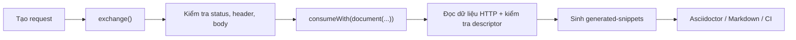

# `consumeWith(document(...))` để sinh snippet

## 1. Bài toán: biến một HTTP test thành tài liệu có thể kiểm chứng

Trong module **SPRING_REST_DOCS**, mục tiêu là tạo tài liệu REST API từ những request và response đã được bài kiểm thử HTTP xác nhận. Spring REST Docs hỗ trợ các công cụ như MockMvc, WebTestClient và REST Assured; các snippet sinh ra có thể được biên soạn thành tài liệu Asciidoctor/Markdown và tích hợp vào build, CI.

Ở chương **WebTestClient**, sau khi cấu hình client với Spring REST Docs, thao tác trực tiếp quyết định **một request có được ghi thành snippet hay không** chính là:

```java
.expectBody()
.consumeWith(document("books/get-by-id"));
```

Bài này đào sâu cách dùng `consumeWith(document(...))`: thời điểm thực thi, các tham số của `document`, descriptor dùng để mô tả hợp đồng HTTP, vị trí tệp sinh ra và cách xử lý khi test hoặc việc xuất snippet bị lỗi.

Kết thúc bài, bạn có thể:

- Phân biệt `exchange()`, các lệnh `expect...()` và `consumeWith(document(...))`.
- Dùng `document("operation-id", ...)` để tạo snippet mặc định và snippet mô tả request/response.
- Tài liệu hóa JSON body, path parameter, request/response header trong test JUnit 5 bằng WebTestClient.
- Đặt identifier ổn định để Asciidoctor tìm được snippet và tránh ghi đè giữa các test.
- Hiểu vì sao descriptor nghiêm ngặt giúp phát hiện API thay đổi, và đưa quá trình sinh tài liệu vào CI.

## 2. `consumeWith` và `document` thực hiện những việc khác nhau

Xem chuỗi gọi sau:

```java
client.get()
    .uri("/api/books/{id}", 42)
    .accept(MediaType.APPLICATION_JSON)
    .exchange()
    .expectStatus().isOk()
    .expectBody()
    .jsonPath("$.id").isEqualTo(42)
    .consumeWith(document("books/get-by-id"));
```

Giả định `client` đã được gắn filter REST Docs và endpoint GET tồn tại. Vai trò của các bước:

| Thành phần | Công việc |
| --- | --- |
| `get().uri(...).accept(...)` | Xây dựng request HTTP. |
| `exchange()` | Thực hiện request tới controller/router, ApplicationContext hoặc HTTP server đã cấu hình. |
| `expectStatus()`, `expectBody()`, `jsonPath()` | Kiểm tra status và dữ liệu response; điều kiện sai khiến test thất bại. |
| **`consumeWith(...)`** | Tiêu thụ kết quả request/response để chạy một callback. |
| **`document("books/get-by-id", ...)`** | Cung cấp callback của Spring REST Docs, dùng thông tin HTTP và descriptor để ghi snippet vào thư mục operation. |



**Điểm cần nhớ:** `consumeWith` là API của phần kiểm thử response, còn `document` là callback do thư viện `spring-restdocs-webtestclient` cung cấp. Nếu bạn chỉ cấu hình REST Docs filter mà **không gọi `document(...)` cho operation**, snippet mong muốn sẽ không tự xuất hiện. Nếu assertion trước `consumeWith` thất bại, chuỗi test bị ngắt và bước tài liệu hóa phía sau không được thực hiện.

Trong các ví dụ này, `consumeWith(...)` nằm sau `expectBody()` để callback có kết quả trao đổi HTTP đã được đọc, phù hợp với response JSON hữu hạn. Với response không có body, `expectBody().isEmpty()` giúp kiểm tra payload rỗng; việc kết hợp assertion đó với callback tài liệu phải tuân theo kiểu trả về của API Spring Test trong phiên bản dự án. Đối với streaming response không kết thúc, cần cách kiểm thử/ghi mẫu riêng vì việc lấy toàn bộ body có thể không hoàn tất.

## 3. Chuẩn bị WebTestClient cho Spring REST Docs

### 3.1. Dependency

Ví dụ dùng Java, Spring WebFlux, JUnit 5 và Spring REST Docs. Trong dự án Spring Boot quản lý phiên bản thư viện, khai báo Gradle Groovy DSL như sau:

```groovy
dependencies {
    implementation 'org.springframework.boot:spring-boot-starter-webflux'
    testImplementation 'org.springframework.boot:spring-boot-starter-test'
    testImplementation 'org.springframework.restdocs:spring-restdocs-webtestclient'
}
```

Nếu dự án không dùng Spring Boot dependency management, hãy chọn phiên bản Spring Framework, Spring REST Docs, JUnit 5 và codec JSON tương thích nhau.

### 3.2. Cài REST Docs filter

Khi bind trực tiếp vào controller, tạo client trong `@BeforeEach` như sau:

```java
import static org.springframework.restdocs.webtestclient.WebTestClientRestDocumentation.document;
import static org.springframework.restdocs.webtestclient.WebTestClientRestDocumentation.documentationConfiguration;

@ExtendWith(RestDocumentationExtension.class)
class ExampleDocumentationTest {

    private WebTestClient client;

    @BeforeEach
    void setUp(RestDocumentationContextProvider restDocumentation) {
        client = WebTestClient.bindToController(new ExampleController())
            .configureClient()
            .filter(documentationConfiguration(restDocumentation))
            .build();
    }
}
```

Đây là đoạn giải thích cấu hình, giả định có các import JUnit/WebTestClient/REST Docs và `ExampleController`. Lớp test hoàn chỉnh ở mục 4 sẽ khai báo các phần đó.

Hai thao tác cần tách bạch:

1. `documentationConfiguration(restDocumentation)` được gắn **lúc khởi tạo client**, cung cấp khả năng thu thập thông tin HTTP và kết nối với ngữ cảnh REST Docs cho mỗi test.
2. `document("identifier", ...)` được gọi **trên từng request cần tài liệu hóa**, chọn nơi ghi snippet và các descriptor tùy chọn.

Với `bindToApplicationContext(context)` và `bindToRouterFunction(router)`, trình tự cấu hình filter vẫn là `configureClient().filter(...).build()`. Với `bindToServer()`, filter được gắn trực tiếp lên client builder, không cần `configureClient()`.

## 4. Ví dụ đầy đủ: tạo snippet cho GET và POST

Ví dụ sau có hai operation:

- `GET /api/books/{id}` trả về status 200 và JSON có `id`, `title`.
- `POST /api/books` nhận JSON có `title`, trả về status 201, header `Location` và JSON sách vừa tạo.

Mỗi test đều gọi `consumeWith(document(...))` **sau** khi xác nhận response, vì vậy tài liệu được tạo từ giao dịch HTTP cụ thể mà test đã thực thi.

```java
import java.net.URI;
import java.util.Map;

import org.junit.jupiter.api.BeforeEach;
import org.junit.jupiter.api.Test;
import org.junit.jupiter.api.extension.ExtendWith;
import org.springframework.http.HttpHeaders;
import org.springframework.http.MediaType;
import org.springframework.http.ResponseEntity;
import org.springframework.restdocs.RestDocumentationContextProvider;
import org.springframework.restdocs.RestDocumentationExtension;
import org.springframework.test.web.reactive.server.WebTestClient;
import org.springframework.web.bind.annotation.GetMapping;
import org.springframework.web.bind.annotation.PathVariable;
import org.springframework.web.bind.annotation.PostMapping;
import org.springframework.web.bind.annotation.RequestBody;
import org.springframework.web.bind.annotation.RestController;
import reactor.core.publisher.Mono;

import static org.springframework.restdocs.headers.HeaderDocumentation.headerWithName;
import static org.springframework.restdocs.headers.HeaderDocumentation.requestHeaders;
import static org.springframework.restdocs.headers.HeaderDocumentation.responseHeaders;
import static org.springframework.restdocs.payload.PayloadDocumentation.fieldWithPath;
import static org.springframework.restdocs.payload.PayloadDocumentation.requestFields;
import static org.springframework.restdocs.payload.PayloadDocumentation.responseFields;
import static org.springframework.restdocs.request.RequestDocumentation.parameterWithName;
import static org.springframework.restdocs.request.RequestDocumentation.pathParameters;
import static org.springframework.restdocs.webtestclient.WebTestClientRestDocumentation.document;
import static org.springframework.restdocs.webtestclient.WebTestClientRestDocumentation.documentationConfiguration;

@ExtendWith(RestDocumentationExtension.class)
class BookSnippetDocumentationTest {

    private WebTestClient client;

    @BeforeEach
    void setUp(RestDocumentationContextProvider restDocumentation) {
        client = WebTestClient.bindToController(new BookController())
            .configureClient()
            .filter(documentationConfiguration(restDocumentation))
            .build();
    }

    @Test
    void getBookCreatesSnippets() {
        client.get()
            .uri("/api/books/{id}", 101)
            .accept(MediaType.APPLICATION_JSON)
            .exchange()
            .expectStatus().isOk()
            .expectHeader().contentTypeCompatibleWith(MediaType.APPLICATION_JSON)
            .expectBody()
            .jsonPath("$.id").isEqualTo(101)
            .jsonPath("$.title").isEqualTo("Spring REST Docs")
            .consumeWith(document("books/get-by-id",
                pathParameters(
                    parameterWithName("id").description("Mã sách cần tra cứu")
                ),
                responseFields(
                    fieldWithPath("id").description("Mã sách"),
                    fieldWithPath("title").description("Tên sách")
                )
            ));
    }

    @Test
    void createBookCreatesSnippets() {
        client.post()
            .uri("/api/books")
            .header("X-Request-Id", "trace-001")
            .contentType(MediaType.APPLICATION_JSON)
            .accept(MediaType.APPLICATION_JSON)
            .bodyValue(Map.of("title", "Spring REST Docs"))
            .exchange()
            .expectStatus().isCreated()
            .expectHeader().valueEquals(HttpHeaders.LOCATION, "/api/books/101")
            .expectBody()
            .jsonPath("$.id").isEqualTo(101)
            .jsonPath("$.title").isEqualTo("Spring REST Docs")
            .consumeWith(document("books/create",
                requestHeaders(
                    headerWithName("X-Request-Id")
                        .description("Mã truy vết HTTP request")
                ),
                requestFields(
                    fieldWithPath("title").description("Tên sách cần tạo")
                ),
                responseHeaders(
                    headerWithName(HttpHeaders.LOCATION)
                        .description("URI của sách vừa được tạo")
                ),
                responseFields(
                    fieldWithPath("id").description("Mã sách mới"),
                    fieldWithPath("title").description("Tên sách")
                )
            ));
    }

    @RestController
    static class BookController {

        @GetMapping(
            path = "/api/books/{id}",
            produces = MediaType.APPLICATION_JSON_VALUE
        )
        public Mono<Map<String, Object>> getBook(@PathVariable("id") long id) {
            Map<String, Object> body = Map.of(
                "id", id,
                "title", "Spring REST Docs"
            );
            return Mono.just(body);
        }

        @PostMapping(
            path = "/api/books",
            consumes = MediaType.APPLICATION_JSON_VALUE,
            produces = MediaType.APPLICATION_JSON_VALUE
        )
        public Mono<ResponseEntity<Map<String, Object>>> createBook(
                @RequestBody Mono<Map<String, String>> input) {
            return input.map(data -> {
                Map<String, Object> body = Map.of(
                    "id", 101,
                    "title", data.get("title")
                );
                return ResponseEntity
                    .created(URI.create("/api/books/101"))
                    .body(body);
            });
        }
    }
}
```

Phân tích test GET:

1. `.uri("/api/books/{id}", 101)` cung cấp URI template để REST Docs có cơ sở nhận ra `id` là path parameter.
2. `.exchange()` gửi request; `expectStatus()`, `expectHeader()` và `jsonPath()` kiểm tra hợp đồng response.
3. `document("books/get-by-id", ...)` đặt identifier. `pathParameters(...)` sinh bảng mô tả path parameter; `responseFields(...)` sinh bảng mô tả JSON response.

Phân tích test POST:

1. Request có `Content-Type: application/json`, body JSON và header `X-Request-Id`.
2. Response được kiểm tra có status `201 Created`, `Location` đúng và JSON chứa `id`/`title`.
3. `requestHeaders(...)`, `requestFields(...)`, `responseHeaders(...)`, `responseFields(...)` cung cấp mô tả tương ứng cho tài liệu. Chúng cũng giúp phát hiện một số trường hợp request/response không còn khớp hợp đồng đã khai báo.

Ví dụ cố định ID và tên sách để snippet ổn định qua mỗi lần chạy. Trong hệ thống thực tế, hãy dùng fixture hoặc test double để kiểm soát dữ liệu. Sau đó mở rộng test cho validation, lỗi 4xx/5xx và các endpoint khác theo đúng API.

## 5. Cú pháp `document("identifier", snippets...)`

### 5.1. Identifier: tên của một operation

Tham số đầu tiên xác định thư mục của bộ snippet được sinh. Ví dụ:

```java
document("books/get-by-id");
document("books/create");
document("books/get-not-found");
```

Đây là các callback `document` có thể truyền cho `consumeWith(...)` trong các test khác nhau, không phải ba lời gọi độc lập tạo snippet ngay lập tức. Với đường dẫn operation `books/get-by-id`, kết quả thường nằm trong:

```text
build/generated-snippets/books/get-by-id/
```

Sử dụng identifier rõ nghĩa, ổn định và duy nhất cho mỗi tình huống được tài liệu hóa. Nếu nhiều test cùng ghi vào một identifier và chạy song song, các tệp có thể bị ghi đè hoặc khiến tài liệu không dự đoán được. Tách operation thành `books/get-by-id`, `books/create`, `books/create-invalid` khi request hoặc response cần mô tả khác nhau.

### 5.2. Snippet mặc định và snippet tự khai báo

Chỉ cần `document("books/get-by-id")` là REST Docs đã có thể sinh các snippet mặc định mô tả giao dịch HTTP. Những snippet thường gặp gồm:

| Tên tệp | Dữ liệu đưa vào tài liệu |
| --- | --- |
| `http-request.adoc` | Request HTTP dạng văn bản. |
| `http-response.adoc` | Response HTTP dạng văn bản. |
| `curl-request.adoc` | Lệnh `curl` mô phỏng request. |
| `httpie-request.adoc` | Lệnh HTTPie mô phỏng request. |
| `request-body.adoc` | Payload request (nếu operation có body phù hợp). |
| `response-body.adoc` | Payload response (nếu operation có body phù hợp). |

Danh sách thực tế phụ thuộc phiên bản và cấu hình snippet mặc định. Khi truyền `responseFields(...)`, `pathParameters(...)` hoặc descriptor khác vào `document(...)`, bạn bổ sung các snippet có bảng mô tả và kiểm chứng cấu trúc.

### 5.3. Các descriptor thường dùng

| Loại thông tin | Ví dụ descriptor | Snippet tạo ra |
| --- | --- | --- |
| Path parameter | `pathParameters(parameterWithName("id").description("Mã sách"))` | `path-parameters.adoc` |
| Query parameter | `queryParameters(parameterWithName("page").description("Trang cần xem"))` | `query-parameters.adoc` |
| Request header | `requestHeaders(headerWithName("X-Request-Id").description("Mã truy vết"))` | `request-headers.adoc` |
| Response header | `responseHeaders(headerWithName("Location").description("URI mới"))` | `response-headers.adoc` |
| Request JSON field | `requestFields(fieldWithPath("title").description("Tên sách"))` | `request-fields.adoc` |
| Response JSON field | `responseFields(fieldWithPath("id").description("Mã sách"))` | `response-fields.adoc` |

Ví dụ query parameter áp dụng cho API có request như `GET /api/books?page=1`; endpoint/test phải thật sự gửi tham số tương ứng. Spring REST Docs các phiên bản cũ hơn có thể sử dụng API `requestParameters(...)` thay vì `queryParameters(...)`; hãy đối chiếu đúng phiên bản dependency của dự án.

Trong tài liệu hóa JSON, đường dẫn descriptor có thể chỉ tới object lồng nhau hoặc phần tử trong array:

```java
responseFields(
    fieldWithPath("id").description("Mã đơn hàng"),
    fieldWithPath("customer.name").description("Tên khách hàng"),
    fieldWithPath("items[].sku").description("Mã sản phẩm ở từng dòng"),
    fieldWithPath("items[].quantity").description("Số lượng ở từng dòng")
);
```

Đây là descriptor minh họa cho response có đúng cấu trúc `id`, `customer` và `items`, không áp dụng trực tiếp cho JSON sách trong mục 4. Nếu response có field bắt buộc chưa được mô tả, REST Docs thường báo lỗi thay vì im lặng bỏ qua.

## 6. Descriptor nghiêm ngặt bảo vệ hợp đồng API như thế nào?

Spring REST Docs không chỉ chép lại response thành ví dụ. Nhiều descriptor kiểm tra các trường, header hoặc tham số tương ứng có thực sự xuất hiện trong giao dịch HTTP hay không.

Giả sử test GET ở mục 4 khai báo:

```java
responseFields(
    fieldWithPath("id").description("Mã sách"),
    fieldWithPath("title").description("Tên sách")
)
```

Nếu controller trả thêm trường `author`:

```json
{
  "id": 101,
  "title": "Spring REST Docs",
  "author": "Nhóm biên soạn"
}
```

Test với `responseFields(...)` nghiêm ngặt sẽ báo field chưa được mô tả; điều này buộc người viết đánh giá việc bổ sung `author` có thuộc hợp đồng công khai hay không. Nếu có, bổ sung descriptor mới:

```java
fieldWithPath("author").description("Tác giả của sách")
```

Hai cơ chế bổ sung khi hợp đồng cho phép:

- `.optional()`: đánh dấu field có thể vắng mặt trong một số response hợp lệ, chẳng hạn `fieldWithPath("subtitle").optional()`.
- `.ignored()`: khai báo một field mà test vẫn nhận biết nhưng không đưa vào bảng tài liệu, ví dụ trường nội bộ được nhóm chủ động bỏ qua.

Các biến thể `relaxedResponseFields(...)` hoặc `relaxedRequestFields(...)` có thể giảm độ nghiêm ngặt, nhưng nên chỉ dùng khi chủ động tài liệu hóa một phần payload. Lạm dụng relaxed descriptor khiến thay đổi quan trọng trong API khó được test tài liệu phát hiện.

Lưu ý rằng **descriptor không thay thế assertion nghiệp vụ**. Ví dụ `fieldWithPath("id")` mô tả và xác nhận sự tồn tại/hình dạng field; `jsonPath("$.id").isEqualTo(101)` kiểm tra giá trị cụ thể. Khi cả hai cùng có trong test, tài liệu và hành vi được kiểm tra tốt hơn.

## 7. Tùy chỉnh snippet trước khi ghi

### 7.1. Tiền xử lý riêng cho một operation

Bạn có thể đưa preprocessor vào `document(...)` để JSON được định dạng dễ đọc hơn:

```java
import static org.springframework.restdocs.operation.preprocess.Preprocessors.preprocessRequest;
import static org.springframework.restdocs.operation.preprocess.Preprocessors.preprocessResponse;
import static org.springframework.restdocs.operation.preprocess.Preprocessors.prettyPrint;

// Đoạn cuối của một test đã kiểm tra response JSON:
.expectBody()
.consumeWith(document("books/create",
    preprocessRequest(prettyPrint()),
    preprocessResponse(prettyPrint()),
    requestFields(
        fieldWithPath("title").description("Tên sách")
    )
));
```

Đoạn này minh họa một phần chuỗi test cho POST có request JSON chứa `title`; các assertion, endpoint và filter phải được cấu hình ở phần trước của test. `preprocessRequest` và `preprocessResponse` sửa **nội dung dùng để tạo snippet**, không thay đổi dữ liệu HTTP mà controller đã nhận hoặc trả về.

### 7.2. Cấu hình mặc định cho mọi operation của client

Khi nhiều test cần cùng định dạng, đặt preprocessor tại thời điểm cấu hình REST Docs:

```java
import static org.springframework.restdocs.operation.preprocess.Preprocessors.prettyPrint;

client = WebTestClient.bindToController(new BookController())
    .configureClient()
    .filter(documentationConfiguration(restDocumentation)
        .operationPreprocessors()
            .withRequestDefaults(prettyPrint())
            .withResponseDefaults(prettyPrint()))
    .build();
```

Đây là phần khởi tạo client thay cho cấu hình ở `@BeforeEach` trong mục 4. Khi tài liệu có dữ liệu nhạy cảm, có thể dùng các preprocessor thích hợp để che token, xóa header chứa bí mật hoặc chuẩn hóa hostname/port; nên xem snippet đã tạo để chắc chắn không lộ thông tin trước khi đưa lên kho mã nguồn.

## 8. Xem và đưa snippet vào Asciidoctor/Markdown

Sau khi chạy hai test ở mục 4, với Gradle các file có thể được tạo theo cấu trúc:

```text
build/generated-snippets/
└── books/
    ├── get-by-id/
    │   ├── http-request.adoc
    │   ├── http-response.adoc
    │   ├── path-parameters.adoc
    │   └── response-fields.adoc
    └── create/
        ├── http-request.adoc
        ├── http-response.adoc
        ├── request-headers.adoc
        ├── request-fields.adoc
        ├── response-headers.adoc
        └── response-fields.adoc
```

Đây là các file **tiêu biểu**, không phải toàn bộ snippet mặc định. Với Maven, thư mục thường gặp là `target/generated-snippets`. Phải chạy test thành công trước khi tìm các file này.

Trang Asciidoctor có thể sử dụng trực tiếp nội dung snippet:

```asciidoc
= Book REST API
:snippets: build/generated-snippets

== Tra cứu sách

=== HTTP request
include::{snippets}/books/get-by-id/http-request.adoc[]

=== Path parameters
include::{snippets}/books/get-by-id/path-parameters.adoc[]

=== HTTP response
include::{snippets}/books/get-by-id/http-response.adoc[]

=== Response fields
include::{snippets}/books/get-by-id/response-fields.adoc[]

== Tạo sách

include::{snippets}/books/create/http-request.adoc[]
include::{snippets}/books/create/request-headers.adoc[]
include::{snippets}/books/create/request-fields.adoc[]
include::{snippets}/books/create/http-response.adoc[]
include::{snippets}/books/create/response-headers.adoc[]
include::{snippets}/books/create/response-fields.adoc[]
```

Thuộc tính `:snippets:` phải đúng với thư mục đầu ra và vị trí Asciidoctor resolve file. Trong dự án thật, nên truyền đường dẫn snippet từ build. Với Gradle và plugin Asciidoctor đã cài sẵn:

```groovy
def snippetsDir = layout.buildDirectory.dir("generated-snippets")

tasks.named("test") {
    outputs.dir(snippetsDir)
}

tasks.named("asciidoctor") {
    inputs.dir(snippetsDir)
    dependsOn(tasks.named("test"))
    attributes "snippets": snippetsDir.get().asFile
}
```

Khi đã cấu hình task tương ứng, CI có thể chạy `./gradlew clean test asciidoctor`. Nếu assertion hoặc descriptor trong `document(...)` thất bại, tác vụ test phải dừng việc xuất bản tài liệu không còn khớp. Markdown thuần không xử lý `include::` của Asciidoctor; nếu dùng Markdown, cần công cụ build hoặc bước chèn nội dung snippet riêng.

## 9. Sự cố thường gặp khi dùng `consumeWith(document(...))`

| Hiện tượng | Cách kiểm tra |
| --- | --- |
| Test HTTP pass nhưng không thấy snippet | Xem đã gọi `consumeWith(document(...))` và đã thêm REST Docs filter vào **đúng client** thực hiện request hay chưa. |
| `RestDocumentationContextProvider` không được truyền | Với JUnit 5, kiểm tra `@ExtendWith(RestDocumentationExtension.class)` và dependency `spring-restdocs-webtestclient`. |
| Biên dịch không tìm thấy `document(...)` | Import tĩnh `WebTestClientRestDocumentation.document`, không dùng bản dành riêng cho MockMvc. |
| `document(...)` không được chạy | Kiểm tra assertion trước `consumeWith(...)` có thất bại hay test có kết thúc sớm không. |
| `path-parameters.adoc` không xuất hiện | Dùng `pathParameters(...)` với URI template có biến `{id}` và tên tham số khớp. |
| `response-fields.adoc` không xuất hiện | Truyền `responseFields(...)` vào đúng `document(...)`; xác minh response là JSON hợp lệ. |
| Test thất bại vì field dư hoặc thiếu | So khớp payload thực với các `fieldWithPath(...)`, cập nhật mô tả hoặc đánh dấu optional/ignored có chủ đích. |
| Không thấy file sau khi chạy Gradle | Xem đường dẫn `build/generated-snippets`, test đã thật sự chạy chưa và cấu hình output directory của REST Docs. |
| Asciidoctor báo không tìm được snippet | Kiểm tra identifier, thư mục snippets, cú pháp `include::{snippets}/...[]` và dependency task Asciidoctor → test. |
| Tài liệu lộ token hoặc có cổng ngẫu nhiên | Chuẩn hóa HTTP request/response bằng preprocessor và kiểm tra file `.adoc` đã sinh trước khi publish. |
| Hai test tạo nội dung khác nhau trong cùng operation | Cấp identifier riêng cho từng scenario, nhất là khi chạy test song song. |

## 10. Thực hành từng bước

1. Chạy `BookSnippetDocumentationTest` và kiểm tra ít nhất các snippet `books/get-by-id/http-response.adoc`, `books/get-by-id/response-fields.adoc`, `books/create/request-fields.adoc`.
2. Xóa `.consumeWith(document(...))` ở test GET rồi chạy lại từ thư mục output sạch; xác nhận test vẫn có thể pass nhưng không xuất snippet cho operation GET đó.
3. Khôi phục `document(...)`. Thêm field `author` vào response GET mà không bổ sung `fieldWithPath("author")`; quan sát test tài liệu thất bại và cập nhật descriptor.
4. Thêm `preprocessResponse(prettyPrint())` vào `document(...)` của GET; so sánh `http-response.adoc` trước và sau.
5. Đổi identifier GET thành `books/find-by-id` và cập nhật đường dẫn `include::` của trang Asciidoctor; giải thích vì sao phải sửa cả hai nơi.
6. Cấu hình tác vụ build để test sinh snippet trước khi Asciidoctor tạo tài liệu và thử một assertion sai để kiểm tra CI dừng đúng lúc.

## 11. Ghi nhớ

- `exchange()` thực hiện HTTP request; `expect...()` xác nhận response; **`consumeWith(document(...))` kích hoạt ghi snippet của operation**.
- Client phải được cấu hình với `documentationConfiguration(restDocumentation)`; `document(...)` chọn identifier và các descriptor cho từng request.
- Dùng `requestFields`, `responseFields`, `pathParameters`, `requestHeaders`, `responseHeaders` và các descriptor liên quan để kiểm chứng nội dung hợp đồng API, ngoài những ví dụ HTTP mặc định.
- Tạo identifier ổn định và duy nhất; sử dụng cùng identifier trong đường dẫn snippet của Asciidoctor.
- Kết hợp assertions, descriptor nghiêm ngặt và build/CI chạy test trước khi dựng tài liệu để Spring REST Docs thực sự tạo ra tài liệu REST API **có thể kiểm chứng**.
