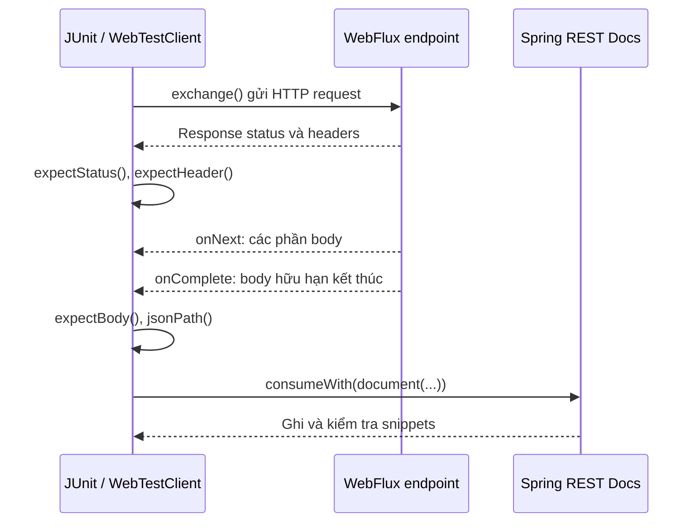

# Reactive response và thời điểm tạo snippet

## 1. Mục tiêu bài học

Trong module **SPRING_REST_DOCS**, chúng ta tạo tài liệu REST API có thể kiểm chứng từ các bài kiểm thử HTTP dùng MockMvc, WebTestClient hoặc REST Assured. Test xác nhận request/response thật, Spring REST Docs sinh snippet cho payload, tham số và header, sau đó build hoặc CI ghép các snippet thành tài liệu Asciidoctor/Markdown.

Ở chương **WebTestClient**, một chi tiết đặc biệt quan trọng là **response trong Spring WebFlux có thể được tạo bất đồng bộ**. Controller có thể trả về `Mono<T>`, `Flux<T>`, chuỗi JSON hữu hạn hoặc một luồng liên tục như Server-Sent Events (SSE). Vì thế, việc đã nhận được status `200 OK` không đồng nghĩa body đã phát xong và có thể được ghi đầy đủ vào snippet.

Bài **“Reactive response và thời điểm tạo snippet”** giúp bạn:

- Phân biệt thời điểm thực thi `exchange()`, xác nhận status/header, tiêu thụ body và ghi snippet bằng `consumeWith(document(...))`.
- Hiểu điều kiện hoàn tất của `Mono` và `Flux`, cùng ảnh hưởng của `onComplete`, `onError`, timeout và cancellation lên kiểm thử tài liệu.
- Viết test JUnit 5 sinh snippet cho response reactive **hữu hạn**, gồm JSON object từ `Mono` và JSON array từ `Flux`.
- Kiểm tra luồng SSE không kết thúc mà không chờ `expectBody()` gom toàn bộ dữ liệu.
- Thiết kế dữ liệu mẫu xác định, tên operation ổn định và các bước Asciidoctor/CI phù hợp.

## 2. Response reactive có những mốc thời gian nào?

`WebTestClient` sử dụng cùng mô hình HTTP ở cấp request và response, nhưng cách nhận body tùy thuộc publisher mà controller trả về. Hãy xem ví dụ:

```java
client.get()
    .uri("/api/status")
    .exchange()
    .expectStatus().isOk()
    .expectBody()
    .jsonPath("$.state").isEqualTo("ready")
    .consumeWith(document("reactive/status"));
```

Giả sử client đã được gắn Spring REST Docs filter và endpoint `/api/status` trả JSON. Các mốc cần phân biệt:

| Mốc | Diễn giải | Ý nghĩa đối với tài liệu |
| --- | --- | --- |
| Tạo request | `get()`, `uri()`, `accept()`… khai báo HTTP request | Chưa có response để tạo snippet |
| Thực hiện `exchange()` | Client thực hiện request và có `ResponseSpec` để kiểm tra kết quả HTTP | Response body có thể vẫn đang phát |
| Kiểm tra status/header | `expectStatus()` và `expectHeader()` xác nhận thông tin response | Thành công ở mốc này chưa bảo đảm JSON body hợp lệ hoặc đã hoàn tất |
| Tiêu thụ body | `expectBody()` thu thập response hữu hạn, `jsonPath()` xác nhận nội dung | Có dữ liệu body để tài liệu hóa |
| Gọi `consumeWith(document(...))` | REST Docs xử lý giao dịch HTTP và descriptor tại vị trí callback được gọi | Snippet được ghi khi callback chạy thành công |
| Dựng tài liệu | Asciidoctor/Markdown tham chiếu các tệp sinh ra từ test | Build cần phụ thuộc vào kết quả test mới |



Sơ đồ thể hiện **luồng thành công của response hữu hạn**. Trình tự phát status/body trong thực tế tùy cách server/codec chuẩn bị dữ liệu, nhưng điểm cần giữ là việc **có status** khác với việc **đã nhận hết body**. Đối với `Flux` không kết thúc, mốc `onComplete` không xuất hiện, nên mô hình gom toàn bộ body không thích hợp.

**Tránh một hiểu lầm:** `document(...)` không tự đăng ký chờ publisher hoàn tất ở mọi loại test. Trong chuỗi `expectBody().consumeWith(document(...))`, body hữu hạn đã được WebTestClient tiêu thụ để tạo `ExchangeResult`; Spring REST Docs sử dụng kết quả đó khi callback được gọi. Không nên coi `document(...)` là một subscriber độc lập dành cho luồng vô hạn.

## 3. Mono, Flux hữu hạn và Flux streaming khác nhau ra sao?

| Kiểu phản hồi của endpoint | Đặc tính publisher | Chiến lược kiểm tra và sinh snippet |
| --- | --- | --- |
| `Mono<BookDto>` trả một JSON object | Tối đa một phần tử rồi hoàn tất, hoặc phát lỗi | `expectBody()` → kiểm tra JSON → `consumeWith(document(...))` |
| `Mono<Void>` trả body rỗng | Hoàn tất không phát phần tử | Kiểm tra status và body rỗng; chọn callback tài liệu hợp với API kiểm thử |
| `Flux<BookDto>` với `application/json`, hữu hạn | Phát nhiều phần tử rồi hoàn tất, thường được encode thành JSON array | Gom response hữu hạn bằng `expectBody()`, mô tả các phần tử array |
| `Flux<ServerSentEvent<?>>` hoặc SSE không kết thúc | Phát sự kiện theo thời gian, có thể không `onComplete` | Dùng `returnResult(...)`/`StepVerifier` kiểm tra một số sự kiện và hủy subscription; lập mẫu tài liệu hữu hạn riêng |
| `Flux` kết thúc bằng `onError` | Một số phần tử có thể đã phát trước lỗi | Test phải xử lý lỗi; không xem một response dở dang là tài liệu thành công |

Trong Reactive Streams, publisher có thể gửi `onNext` (dữ liệu), rồi một trong hai tín hiệu kết thúc: `onComplete` hoặc `onError`. Khi consumer hủy subscription trước khi hoàn tất, nó không có toàn bộ body. Điều này giải thích vì sao **thời điểm tạo tài liệu cần dựa vào một response hữu hạn, xác định và đã kiểm tra**, không chỉ dựa vào thời điểm endpoint bắt đầu phát dữ liệu.

Một `Flux` **không đồng nghĩa** streaming SSE. Với `produces = application/json`, nhiều phần tử hữu hạn có thể được mã hóa thành **một mảng JSON**. Ngược lại, `text/event-stream` hoặc `application/x-ndjson` truyền các đơn vị dữ liệu theo thời gian và thường được kiểm thử như một luồng.

## 4. Chuẩn bị Spring REST Docs với WebTestClient

Trong dự án Spring Boot dùng WebFlux và JUnit 5, ví dụ dependency Gradle (Groovy DSL):

```groovy
dependencies {
    implementation 'org.springframework.boot:spring-boot-starter-webflux'
    testImplementation 'org.springframework.boot:spring-boot-starter-test'
    testImplementation 'org.springframework.restdocs:spring-restdocs-webtestclient'
    testImplementation 'io.projectreactor:reactor-test'
}
```

`reactor-test` cung cấp `StepVerifier` cho phần kiểm tra streaming. Spring Boot thường quản lý phiên bản dependency; nếu không dùng Spring Boot, hãy chọn phiên bản Spring Framework, Spring REST Docs, Reactor và JUnit tương thích.

Để sinh snippet, test JUnit 5 cần:

1. `@ExtendWith(RestDocumentationExtension.class)` để có ngữ cảnh tài liệu cho từng test.
2. `WebTestClient` đã gắn filter `documentationConfiguration(restDocumentation)`.
3. Một request thực sự được `exchange()`, có các assertion phù hợp.
4. Callback `document("operation-id", snippets...)` được gọi tại nơi có kết quả HTTP cần tài liệu hóa.

Ví dụ khi bind trực tiếp controller:

```java
@BeforeEach
void setUp(RestDocumentationContextProvider restDocumentation) {
    client = WebTestClient.bindToController(new ReactiveController())
        .configureClient()
        .filter(documentationConfiguration(restDocumentation))
        .build();
}
```

Đây là phần của một test JUnit 5; lớp controller và import đầy đủ được trình bày ở mục tiếp theo. Lệnh `configureClient()` cần thiết khi bắt đầu với `bindToController(...)`, `bindToRouterFunction(...)` hoặc `bindToApplicationContext(...)`. Nếu bind tới server thật bằng `bindToServer()`, bạn cấu hình filter trực tiếp trên client builder.

## 5. Ví dụ chạy được: Mono phản hồi trễ và Flux hữu hạn

Ví dụ dưới đây có hai endpoint:

- `GET /api/status` trả một `Mono` phát JSON sau một khoảng trễ ngắn.
- `GET /api/books` trả `Flux` gồm hai phần tử; do response là `application/json` và Flux **hữu hạn**, body được xem như một mảng JSON.

Khoảng trễ mô phỏng sự bất đồng bộ, không sử dụng `Thread.sleep(...)`. Thời gian chờ của test cần đủ cho publisher hoàn tất trên môi trường CI.

```java
import java.time.Duration;
import java.util.Map;

import org.junit.jupiter.api.BeforeEach;
import org.junit.jupiter.api.Test;
import org.junit.jupiter.api.extension.ExtendWith;
import org.springframework.http.MediaType;
import org.springframework.restdocs.RestDocumentationContextProvider;
import org.springframework.restdocs.RestDocumentationExtension;
import org.springframework.test.web.reactive.server.WebTestClient;
import org.springframework.web.bind.annotation.GetMapping;
import org.springframework.web.bind.annotation.RestController;
import reactor.core.publisher.Flux;
import reactor.core.publisher.Mono;

import static org.springframework.restdocs.payload.PayloadDocumentation.fieldWithPath;
import static org.springframework.restdocs.payload.PayloadDocumentation.responseFields;
import static org.springframework.restdocs.webtestclient.WebTestClientRestDocumentation.document;
import static org.springframework.restdocs.webtestclient.WebTestClientRestDocumentation.documentationConfiguration;

@ExtendWith(RestDocumentationExtension.class)
class ReactiveResponseDocumentationTest {

    private WebTestClient client;

    @BeforeEach
    void setUp(RestDocumentationContextProvider restDocumentation) {
        this.client = WebTestClient.bindToController(new ReactiveController())
            .configureClient()
            .filter(documentationConfiguration(restDocumentation))
            .responseTimeout(Duration.ofSeconds(5))
            .build();
    }

    @Test
    void documentsMonoAfterBodyIsAvailable() {
        client.get()
            .uri("/api/status")
            .accept(MediaType.APPLICATION_JSON)
            .exchange()
            .expectStatus().isOk()
            .expectHeader()
                .contentTypeCompatibleWith(MediaType.APPLICATION_JSON)
            .expectBody()
            .jsonPath("$.state").isEqualTo("ready")
            .consumeWith(document("reactive/status",
                responseFields(
                    fieldWithPath("state")
                        .description("Trạng thái của dịch vụ")
                )
            ));
    }

    @Test
    void documentsFiniteFluxAsJsonArray() {
        client.get()
            .uri("/api/books")
            .accept(MediaType.APPLICATION_JSON)
            .exchange()
            .expectStatus().isOk()
            .expectBody()
            .jsonPath("$[0].id").isEqualTo(1)
            .jsonPath("$[1].id").isEqualTo(2)
            .jsonPath("$[0].title").isEqualTo("REST Docs")
            .jsonPath("$[1].title").isEqualTo("WebFlux")
            .consumeWith(document("reactive/books",
                responseFields(
                    fieldWithPath("[].id")
                        .description("Mã của từng sách"),
                    fieldWithPath("[].title")
                        .description("Tên của từng sách")
                )
            ));
    }

    @RestController
    static class ReactiveController {

        @GetMapping(
            path = "/api/status",
            produces = MediaType.APPLICATION_JSON_VALUE
        )
        public Mono<Map<String, String>> status() {
            return Mono.delay(Duration.ofMillis(30))
                .map(ignored -> Map.of("state", "ready"));
        }

        @GetMapping(
            path = "/api/books",
            produces = MediaType.APPLICATION_JSON_VALUE
        )
        public Flux<Map<String, Object>> books() {
            return Flux.just(
                Map.of("id", 1, "title", "REST Docs"),
                Map.of("id", 2, "title", "WebFlux")
            ).delayElements(Duration.ofMillis(20));
        }
    }
}
```

### 5.1. Vì sao ví dụ Mono tạo snippet đúng thời điểm?

`Mono.delay(...)` trì hoãn việc phát dữ liệu trong ví dụ; `exchange()` khởi động xử lý request, nhưng không thể chỉ dựa vào status để kết luận đã nhận JSON. `expectBody()` thu thập body của response hữu hạn, `jsonPath("$.state")` xác nhận giá trị, rồi `consumeWith(document("reactive/status", ...))` chạy. Snippet phản ánh JSON `{"state":"ready"}` mà test đã quan sát.

Việc sử dụng `responseFields(fieldWithPath("state"))` còn kiểm tra cấu trúc payload dùng làm tài liệu. Nếu controller trả field mới mà descriptor không mô tả, test tài liệu nghiêm ngặt có thể thất bại.

### 5.2. Vì sao ví dụ Flux cần hoàn tất?

`Flux.just(...).delayElements(...)` phát tuần tự hai sách rồi hoàn tất. Khi response được mã hóa dưới dạng JSON array, `expectBody()` thu thập các phần tử cho đến khi body kết thúc; các JSONPath `$[0].id`, `$[1].id` được kiểm tra trên mảng hoàn chỉnh. `fieldWithPath("[].id")` và `fieldWithPath("[].title")` mô tả field của **các phần tử mảng**, thay vì viết descriptor riêng cho mỗi vị trí.

Nếu controller vô tình thay Flux hữu hạn bằng một Flux không kết thúc, việc chờ body hoàn tất sẽ không còn đúng kỳ vọng. Test có thể bị timeout hoặc chờ quá lâu, và bộ snippet hoàn chỉnh sẽ không được sinh ra như kịch bản thành công.

> **Lưu ý:** Mốc thời gian 20–30 ms ở ví dụ chỉ minh họa publisher phát bất đồng bộ. Test không cần đo chính xác những khoảng trễ này; tính đúng đắn nằm ở nội dung HTTP và các tín hiệu hoàn tất của publisher.

## 6. Khi nào một snippet được ghi, và khi nào không?

Giả sử test có chuỗi:

```java
client.get()
    .uri("/api/status")
    .exchange()
    .expectStatus().isOk()
    .expectBody()
    .jsonPath("$.state").isEqualTo("ready")
    .consumeWith(document("reactive/status",
        responseFields(
            fieldWithPath("state").description("Trạng thái dịch vụ")
        )
    ));
```

Hãy phân tích các tình huống:

| Tình huống | Điều gì xảy ra với test? | Kết luận về snippet |
| --- | --- | --- |
| Status 200, JSON hợp lệ, body hoàn tất | Assertions pass và callback được gọi | REST Docs có thể ghi snippet đầy đủ |
| Status 500, test mong 200 | Assertion status thất bại trước callback | Callback trong chuỗi trên không chạy |
| Status đúng nhưng `jsonPath` thiếu field | Assertion body thất bại trước callback | Không được xem là operation đã tài liệu hóa thành công |
| Body hữu hạn nhưng descriptor `responseFields` thiếu field bắt buộc | Callback được gọi nhưng kiểm tra snippet thất bại | Test tài liệu thất bại; cần cập nhật hợp đồng |
| Publisher phát lỗi khi body đang được đọc | Kiểm tra/tiêu thụ body có thể thất bại | Không xuất bản snippet dở dang như tài liệu hợp lệ |
| Publisher không `onComplete` | Gom toàn bộ body không thể kết thúc bình thường | Chọn chiến lược kiểm tra streaming hoặc tạo dữ liệu mẫu hữu hạn |

Hãy phân biệt **thời điểm một tệp xuất hiện trên đĩa** với **tính hợp lệ của tài liệu**. Một test đang chạy có thể đã ghi một vài snippet trước khi một test khác thất bại; vì vậy pipeline phải coi kết quả build là thành công **chỉ khi toàn bộ các test cần thiết pass**. Nên tạo snippet trong thư mục build sạch để tránh đưa file cũ từ lần chạy trước vào tài liệu mới.

### Tách assertion khỏi tài liệu được không?

`document(...)` có thể ghi snippet mặc định dù test kiểm tra rất ít thông tin; nhưng tài liệu như vậy không chứng minh đầy đủ hợp đồng API. Một test tài liệu chất lượng thường kiểm tra status, header và những giá trị JSON quan trọng **trước** callback, đồng thời dùng descriptor nghiêm ngặt cho field/parameter:

```java
.expectStatus().isOk()
.expectBody()
.jsonPath("$.state").isEqualTo("ready")
.consumeWith(document("reactive/status",
    responseFields(fieldWithPath("state").description("Trạng thái"))
));
```

Descriptor giúp phát hiện field đã đổi, còn `jsonPath` giúp xác nhận giá trị nghiệp vụ. Cả hai bổ sung cho nhau.

## 7. Luồng SSE không kết thúc: kiểm tra có giới hạn, không gom toàn bộ body

Một endpoint SSE có thể giữ kết nối HTTP mở và phát sự kiện liên tục. Ví dụ một controller:

```java
import java.time.Duration;
import org.springframework.http.MediaType;
import org.springframework.web.bind.annotation.GetMapping;
import org.springframework.web.bind.annotation.RestController;
import reactor.core.publisher.Flux;

@RestController
class TickController {

    @GetMapping(
        path = "/api/ticks",
        produces = MediaType.TEXT_EVENT_STREAM_VALUE
    )
    public Flux<String> ticks() {
        return Flux.interval(Duration.ofMillis(50))
            .map(number -> "tick-" + number);
    }
}
```

`Flux.interval(...)` phát liên tục cho đến khi subscription bị hủy. Test muốn kiểm tra hai sự kiện đầu tiên nên dùng `returnResult(...)` thay vì `expectBody()`:

```java
import java.time.Duration;
import org.springframework.http.MediaType;
import org.springframework.test.web.reactive.server.FluxExchangeResult;
import reactor.test.StepVerifier;

// client đã bind vào TickController hoặc server có /api/ticks
FluxExchangeResult<String> result = client.get()
    .uri("/api/ticks")
    .accept(MediaType.TEXT_EVENT_STREAM)
    .exchange()
    .expectStatus().isOk()
    .expectHeader()
        .contentTypeCompatibleWith(MediaType.TEXT_EVENT_STREAM)
    .returnResult(String.class);

StepVerifier.create(result.getResponseBody())
    .expectNext("tick-0", "tick-1")
    .thenCancel()
    .verify(Duration.ofSeconds(3));
```

Ở đây:

- `returnResult(String.class)` cho phép truy cập luồng body đã decode, không đợi toàn bộ SSE kết thúc.
- `StepVerifier` xác nhận **hai sự kiện đầu tiên**, sau đó chủ động `thenCancel()` để giải phóng subscription.
- `verify(Duration.ofSeconds(3))` đặt giới hạn thời gian cho bước kiểm tra, tránh test chờ vô hạn nếu sự kiện không đến.

**Đoạn test SSE chỉ kiểm tra hành vi streaming; nó không tự sinh snippet qua `document(...)`.** Không nên gắn giả định rằng `returnResult(...)` cộng `StepVerifier` sẽ tạo tệp `http-response.adoc` cho một kết nối SSE vô hạn.

Nếu cần tài liệu về endpoint SSE, có thể viết phần mô tả hợp đồng định dạng `text/event-stream` và lấy **một mẫu hữu hạn có kiểm soát** trong test hoặc fixture tài liệu chuyên biệt. Mẫu ấy phải minh họa đúng định dạng event của API production, được kiểm tra bằng assertion và ghi nhận rõ là mẫu giới hạn sự kiện. Không biến một stream vô hạn thành `expectBody()` chỉ để cố sinh snippet HTTP hoàn chỉnh.

### Phân biệt lỗi publisher với lỗi HTTP status

Một handler có thể thiết lập status 200 rồi publisher mới phát `onError`. Khi đó kiểm tra `expectStatus().isOk()` có thể pass nhưng body không hoàn tất hợp lệ. Với publisher hữu hạn, kiểm tra body và descriptor sẽ giúp phát hiện nhiều lỗi mà kiểm tra status đơn lẻ bỏ qua. Với stream, cần kiểm tra tín hiệu `onNext`/`onError`/`onComplete` đúng với hợp đồng qua `StepVerifier`.

## 8. Tài liệu hóa JSON array, header và payload ở các thời điểm phù hợp

Với response JSON hữu hạn ở mục 5, REST Docs tạo snippet khi test đã có toàn bộ dữ liệu cần mô tả. Một số descriptor thường dùng:

| Thành phần HTTP | Descriptor Spring REST Docs | Snippet |
| --- | --- | --- |
| Biến đường dẫn | `pathParameters(parameterWithName("id").description(...))` | `path-parameters.adoc` |
| Query parameter | `queryParameters(parameterWithName("page").description(...))` | `query-parameters.adoc` |
| Header gửi lên | `requestHeaders(headerWithName("X-Request-Id").description(...))` | `request-headers.adoc` |
| Header trả về | `responseHeaders(headerWithName("ETag").description(...))` | `response-headers.adoc` |
| Field của JSON request | `requestFields(fieldWithPath("title").description(...))` | `request-fields.adoc` |
| Field của JSON response | `responseFields(fieldWithPath("[].title").description(...))` | `response-fields.adoc` |

Đây là bảng API minh họa: mỗi descriptor chỉ được đưa vào `document(...)` khi request/response thực sự có thông tin đó. Ví dụ test POST có request JSON và trả JSON thì `requestFields(...)`/`responseFields(...)` cần phản ánh payload đã được codec xử lý. Một số phiên bản cũ của Spring REST Docs dùng API `requestParameters(...)` để tài liệu hóa request parameter; chọn tên API theo dependency thực tế.

### Preprocessor chỉ thay đổi dữ liệu dùng để ghi snippet

JSON array nhiều phần tử hoặc object lồng nhau khó đọc khi chỉ có một dòng. Có thể đặt preprocessor trước khi sinh tài liệu:

```java
import static org.springframework.restdocs.operation.preprocess.Preprocessors.prettyPrint;

client = WebTestClient.bindToController(new ReactiveController())
    .configureClient()
    .filter(documentationConfiguration(restDocumentation)
        .operationPreprocessors()
            .withRequestDefaults(prettyPrint())
            .withResponseDefaults(prettyPrint()))
    .build();
```

`prettyPrint()` định dạng payload **trong snippet**, không thay đổi tín hiệu reactive hoặc dữ liệu HTTP mà controller đã tạo ra. Có thể dùng preprocessor khác để loại token, header nhạy cảm hay chuẩn hóa host và port trong tài liệu. Đảm bảo assertion vẫn kiểm tra dữ liệu thật, còn nội dung xuất bản không chứa bí mật.

## 9. Đường dẫn snippet và quy trình Asciidoctor/CI

Khi test ở mục 5 chạy thành công, Spring REST Docs có thể tạo các tệp tiêu biểu:

```text
build/generated-snippets/
└── reactive/
    ├── status/
    │   ├── http-request.adoc
    │   ├── http-response.adoc
    │   └── response-fields.adoc
    └── books/
        ├── http-request.adoc
        ├── http-response.adoc
        └── response-fields.adoc
```

`curl-request.adoc`, `httpie-request.adoc`, `request-body.adoc` hoặc `response-body.adoc` cũng có thể xuất hiện tùy phiên bản và cấu hình; danh sách trên không đầy đủ. Với Maven, thư mục thường là `target/generated-snippets`.

Một trang Asciidoctor có thể ghép các snippet từ Mono và Flux hữu hạn:

```asciidoc
= Reactive API
:snippets: build/generated-snippets

== Trạng thái dịch vụ

include::{snippets}/reactive/status/http-request.adoc[]
include::{snippets}/reactive/status/http-response.adoc[]
include::{snippets}/reactive/status/response-fields.adoc[]

== Danh sách sách

include::{snippets}/reactive/books/http-request.adoc[]
include::{snippets}/reactive/books/http-response.adoc[]
include::{snippets}/reactive/books/response-fields.adoc[]
```

Thuộc tính `:snippets:` phải trỏ đến đúng đường dẫn theo cấu hình Asciidoctor, thường nên được truyền từ build. Để chạy test trước khi dựng tài liệu, trong Gradle (sau khi đã áp dụng plugin Asciidoctor và có task `asciidoctor`):

```groovy
def snippetsDir = layout.buildDirectory.dir("generated-snippets")

tasks.named("test") {
    outputs.dir(snippetsDir)
}

tasks.named("asciidoctor") {
    dependsOn(tasks.named("test"))
    inputs.dir(snippetsDir)
    attributes "snippets": snippetsDir.get().asFile
}
```

Ví dụ lệnh CI khi các plugin/task đã được cấu hình: `./gradlew clean test asciidoctor`. Bước `clean` giúp tránh nhầm snippet cũ với kết quả mới; bước `test` tạo snippet và phải pass trước khi dựng trang. Với Markdown thuần, cú pháp `include::` không được xử lý trực tiếp; cần công cụ build để chèn snippet hoặc đưa liên kết tới tệp được sinh.

## 10. Lỗi thường gặp và cách chẩn đoán

| Hiện tượng | Nguyên nhân khả dĩ và hướng xử lý |
| --- | --- |
| `expectStatus().isOk()` pass nhưng body assertion fail | Status/header đã được xác nhận nhưng dữ liệu reactive phát sau đó khác kỳ vọng; kiểm tra publisher, codec và JSON thực tế. |
| `expectBody()` chờ lâu hoặc timeout | Endpoint trả Flux không kết thúc, publisher bị treo, hoặc quá trình phát chậm; dùng `returnResult(...)` với stream hoặc điều chỉnh fixture hữu hạn. |
| `Flux` hữu hạn nhưng JSON array chưa đủ phần tử | Kiểm tra `onComplete`, lỗi phát sinh ở giữa stream, việc take/cancel, và assertion trên từng phần tử. |
| Test body fail nên không có snippet | `consumeWith(document(...))` nằm sau assertion; sửa test/endpoint để phản ánh hợp đồng đúng trước khi xuất bản. |
| Descriptor `responseFields(...)` báo field thừa | JSON có field chưa được mô tả; cập nhật mô tả hoặc dùng `.ignored()`/`.optional()` có chủ đích. |
| Test SSE dùng `expectBody()` không kết thúc | Stream mở vô hạn; kiểm tra bằng `returnResult(...)` và `StepVerifier.thenCancel()` thay cho gom toàn body. |
| `StepVerifier` không nhận đủ event | Kiểm tra URI, media type, delay, scheduler và liệu subscription có bị hủy quá sớm hay không. |
| Thư mục snippet trống | Kiểm tra REST Docs filter, callback `document(...)`, identifier và test có thật sự chạy pass không. |
| Asciidoctor lấy snippet của lần chạy trước | Dùng thư mục build sạch, chạy test trước khi dựng tài liệu và xác nhận đường dẫn `snippets`. |
| Tài liệu đưa dữ liệu ngẫu nhiên hoặc token nhạy cảm | Dùng fixture ổn định và preprocessor thích hợp trước khi xuất bản. |

## 11. Bài thực hành

1. Chạy `ReactiveResponseDocumentationTest`. Mở `reactive/status/http-response.adoc` và `reactive/books/response-fields.adoc` để đối chiếu với JSON đã kiểm tra.
2. Tăng độ trễ `Mono.delay` rồi giảm thời gian chờ của client để quan sát ảnh hưởng của timeout; đưa cấu hình về giá trị ổn định sau bài tập.
3. Bổ sung field `author` vào một sách nhưng chưa thêm `fieldWithPath("[].author")`; xem REST Docs phát hiện khác biệt và sửa descriptor.
4. Thay `Flux.just(...)` bằng publisher không kết thúc trong bản test thực hành, quan sát tác động lên `expectBody()` rồi khôi phục Flux hữu hạn.
5. Tạo endpoint SSE `/api/ticks` và dùng `StepVerifier` kiểm tra hai event rồi hủy subscription; giải thích vì sao test SSE này không sinh snippet qua `document(...)`.
6. Thêm `prettyPrint()` cho response JSON, dựng trang Asciidoctor bằng quy trình `clean test asciidoctor` và xác minh file đầu ra được cập nhật sau thay đổi code.

## 12. Ghi nhớ

- `exchange()` thực hiện request, nhưng kiểm tra **status** không chứng minh **body reactive đã hoàn tất**.
- Với `Mono` hoặc `Flux` **hữu hạn**, dùng `expectBody()` để thu thập và xác nhận payload, sau đó `consumeWith(document(...))` để sinh snippet từ giao dịch đã kiểm tra.
- Khi publisher phát `onError` hoặc không `onComplete`, cần kiểm tra luồng theo hợp đồng thay vì xem phần body dở dang là tài liệu thành công.
- SSE/streaming có thể được xác nhận bằng `returnResult(...)` và `StepVerifier` cùng giới hạn thời gian và cancellation; chúng không tự tạo snippet REST Docs.
- Descriptor kiểm tra cấu trúc payload, assertion kiểm tra hành vi; dùng dữ liệu mẫu xác định, identifier ổn định và quy trình build/CI chạy test thành công trước khi xuất bản tài liệu.
