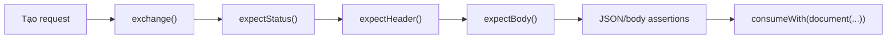

# Chuỗi expectStatus, expectHeader và expectBody

## 1. Mục tiêu bài học

Trong module **SPRING_REST_DOCS**, tài liệu REST API được tạo từ các bài kiểm thử HTTP có thể chạy lại. Test gửi request, xác nhận response và dùng Spring REST Docs sinh snippet cho request, response, payload, tham số và header. Snippet có thể được biên soạn thành Asciidoctor/Markdown rồi đưa vào build, CI.

Trong chương **WebTestClient**, ba nhóm assertion thường được nối liên tiếp sau `exchange()` là:

- **`expectStatus()`**: xác nhận mã trạng thái HTTP.
- **`expectHeader()`**: xác nhận header của response.
- **`expectBody()`**: đọc và xác nhận nội dung response body.

Bài học giải thích cách nối ba nhóm assertion, chọn phép kiểm tra phù hợp, xử lý JSON/body rỗng và kết hợp kết quả với `consumeWith(document(...))`.

## 2. Nhìn toàn bộ chuỗi fluent API

Một request GET điển hình:

```java
client.get()
    .uri("/api/books/{id}", 42)
    .accept(MediaType.APPLICATION_JSON)
    .exchange()
    .expectStatus().isOk()
    .expectHeader().contentTypeCompatibleWith(MediaType.APPLICATION_JSON)
    .expectBody()
    .jsonPath("$.id").isEqualTo(42)
    .jsonPath("$.title").isEqualTo("Spring REST Docs");
```

`client` là `WebTestClient` đã được cấu hình và endpoint tương ứng phải tồn tại. Chuỗi trên có các giai đoạn:

| Giai đoạn | API | Nhiệm vụ |
| --- | --- | --- |
| Tạo request | `get()`, `uri()`, `accept()`, `header()`, `bodyValue()` | Khai báo HTTP method, URL, request header và body. |
| Gửi request | `exchange()` | Thực hiện HTTP exchange và trả về `ResponseSpec`. |
| Xác nhận response | `expectStatus()`, `expectHeader()`, `expectBody()` | Kiểm tra status, header và nội dung trả về. |
| Tài liệu hóa | `consumeWith(document(...))` | Ghi snippet từ kết quả exchange và descriptor. |



**Thứ tự có ý nghĩa:** `expectStatus()` và `expectHeader()` làm việc với thông tin response; `expectBody()` chuyển sang giai đoạn đọc body. Khi assertion thất bại, test dừng tại điều kiện không đạt và các bước sau thường không được thực hiện. Vì vậy, hãy đặt `consumeWith(document(...))` sau những assertion quan trọng nếu chỉ muốn tài liệu hóa response đáp ứng hợp đồng.

## 3. Chuẩn bị WebTestClient và Spring REST Docs

Trong dự án Spring Boot dùng Spring WebFlux, JUnit 5 và Spring REST Docs, Gradle Groovy DSL có thể khai báo:

```groovy
dependencies {
    implementation 'org.springframework.boot:spring-boot-starter-webflux'
    testImplementation 'org.springframework.boot:spring-boot-starter-test'
    testImplementation 'org.springframework.restdocs:spring-restdocs-webtestclient'
}
```

Spring Boot thường quản lý phiên bản dependency tương thích. Nếu dự án không dùng Spring Boot dependency management, hãy chọn phiên bản Spring Framework, Spring REST Docs, JUnit và Reactor tương thích nhau.

Ví dụ cấu hình client trực tiếp với controller:

```java
@ExtendWith(RestDocumentationExtension.class)
class ExampleDocumentationTest {
    private WebTestClient client;

    @BeforeEach
    void setUp(RestDocumentationContextProvider restDocumentation) {
        client = WebTestClient.bindToController(new ExampleController())
            .configureClient()
            .filter(documentationConfiguration(restDocumentation))
            .build();
    }
}
```

Đây là phần cấu hình của một test class; controller, import và test được bổ sung ở mục 7. `RestDocumentationExtension` cung cấp ngữ cảnh tài liệu cho JUnit 5; `documentationConfiguration(...)` tạo REST Docs filter gắn vào client. Với `bindToApplicationContext(...)` hoặc `bindToRouterFunction(...)`, cấu hình filter theo cùng mẫu. Với `bindToServer()`, filter có thể được gắn trực tiếp trên client builder mà không cần `configureClient()`.

## 4. expectStatus(): kiểm tra HTTP status

HTTP status mô tả kết quả xử lý request. Nên kiểm tra mã cụ thể khi đó là một phần của hợp đồng API.

```java
client.get()
    .uri("/api/books/42")
    .exchange()
    .expectStatus().isOk();
```

Các assertion thường dùng:

| Assertion | Mã hoặc nhóm status |
| --- | --- |
| `isOk()` | 200 OK |
| `isCreated()` | 201 Created |
| `isAccepted()` | 202 Accepted |
| `isNoContent()` | 204 No Content |
| `isBadRequest()` | 400 Bad Request |
| `isUnauthorized()` | 401 Unauthorized |
| `isForbidden()` | 403 Forbidden |
| `isNotFound()` | 404 Not Found |
| `is4xxClientError()` | Bất kỳ mã 4xx |
| `is5xxServerError()` | Bất kỳ mã 5xx |
| `valueEquals(202)` | Mã cụ thể do bạn chỉ định |

Có thể dùng assertion theo nhóm khi chỉ quan tâm response thuộc nhóm lỗi client/server. Tuy nhiên, nếu API quy định endpoint tạo tài nguyên phải trả 201, `isCreated()` thể hiện hợp đồng rõ hơn một assertion tổng quát.

Ví dụ test trường hợp không tìm thấy:

```java
client.get()
    .uri("/api/books/{id}", 9999)
    .exchange()
    .expectStatus().isNotFound();
```

Đoạn này giả định endpoint trả 404 khi sách không tồn tại. Trong test thực tế, cần thiết lập fixture hoặc mock service để nhánh 404 được kích hoạt một cách xác định.

## 5. expectHeader(): kiểm tra response header

Header chứa metadata quan trọng như kiểu nội dung, URI tài nguyên vừa tạo, cache policy, ETag hoặc mã truy vết. Dùng `expectHeader()` để xác nhận giá trị server trả về.

### 5.1. Kiểm tra Content-Type

```java
client.get()
    .uri("/api/books/42")
    .accept(MediaType.APPLICATION_JSON)
    .exchange()
    .expectStatus().isOk()
    .expectHeader()
        .contentTypeCompatibleWith(MediaType.APPLICATION_JSON);
```

`contentTypeCompatibleWith(...)` phù hợp khi media type tương thích có thể mang tham số như charset. Nếu cần so sánh chính xác một giá trị media type cụ thể, chọn assertion phù hợp với phiên bản Spring Test đang dùng.

### 5.2. Kiểm tra header theo giá trị

```java
client.post()
    .uri("/api/books")
    .contentType(MediaType.APPLICATION_JSON)
    .bodyValue(Map.of("title", "Spring REST Docs"))
    .exchange()
    .expectStatus().isCreated()
    .expectHeader().valueEquals("Location", "/api/books/42");
```

Ví dụ yêu cầu endpoint POST trả status 201 và header `Location` trỏ tới tài nguyên mới.

Một số phép kiểm tra khác:

```java
.expectHeader().exists("ETag")
.expectHeader().doesNotExist("X-Debug-Only")
.expectHeader().valueMatches("Cache-Control", ".*no-store.*")
```

Đây là những lựa chọn minh họa trong các chuỗi test riêng. Đối chiếu chữ ký API với phiên bản Spring Test của dự án; không nối tất cả vào cùng một response vì điều kiện có thể xung đột.

### 5.3. Kiểm tra header theo logic tùy biến

Với header có nhiều giá trị hoặc quy tắc phức tạp, có thể dùng `expectHeader().value(...)` với một assertion thích hợp. Hãy làm rõ header có bắt buộc, có thể vắng mặt hay có nhiều giá trị theo hợp đồng API.

## 6. expectBody(): kiểm tra nội dung response

Sau khi xác nhận status/header, dùng `expectBody()` cho response body hữu hạn. Tùy kiểu dữ liệu, có nhiều cách xác nhận.

### 6.1. JSONPath: kiểm tra các field cần thiết

```java
client.get()
    .uri("/api/books/{id}", 42)
    .exchange()
    .expectStatus().isOk()
    .expectBody()
    .jsonPath("$.id").isEqualTo(42)
    .jsonPath("$.title").isEqualTo("Spring REST Docs");
```

JSONPath hữu ích khi chỉ cần xác nhận các field quan trọng. Có thể kiểm tra object lồng nhau, phần tử mảng và thuộc tính:

```java
.expectBody()
.jsonPath("$.author.name").isEqualTo("Lan")
.jsonPath("$.items.length()").isEqualTo(2)
.jsonPath("$.items[0].sku").isEqualTo("BOOK-01");
```

Đây là ví dụ minh họa cho JSON có `author` và `items`; cần thay path/giá trị theo response thực tế.

### 6.2. So sánh JSON

```java
client.get()
    .uri("/api/books/42")
    .exchange()
    .expectStatus().isOk()
    .expectBody()
    .json("{\"id\":42,\"title\":\"Spring REST Docs\"}");
```

`json(...)` so sánh body theo nội dung JSON; cơ chế so sánh có thể cho phép thứ tự thuộc tính object khác nhau. Dùng JSONPath nếu chỉ tập trung vào một số field; dùng JSON mẫu nếu muốn xác nhận nội dung response tổng thể.

### 6.3. Deserialize thành kiểu Java

```java
client.get()
    .uri("/api/books/42")
    .exchange()
    .expectStatus().isOk()
    .expectBody(BookDto.class)
    .value(book -> {
        assertThat(book.getId()).isEqualTo(42);
        assertThat(book.getTitle()).isEqualTo("Spring REST Docs");
    });
```

Đây là mẫu minh họa dùng AssertJ và giả định `BookDto` có getter tương ứng. Cách này hữu ích khi test có logic assertion trên object Java thay vì nhiều JSONPath riêng lẻ.

### 6.4. Body rỗng

Với endpoint DELETE trả 204:

```java
client.delete()
    .uri("/api/books/{id}", 42)
    .exchange()
    .expectStatus().isNoContent()
    .expectBody().isEmpty();
```

`isEmpty()` xác nhận response không có payload. Nếu hợp đồng API yêu cầu 204, hãy kiểm tra cả status và body rỗng.

### 6.5. Body dạng chuỗi hoặc byte

Khi endpoint trả văn bản thuần:

```java
client.get()
    .uri("/api/health/text")
    .exchange()
    .expectStatus().isOk()
    .expectBody(String.class)
    .isEqualTo("ready");
```

Khi cần kiểm tra byte array, có thể dùng `expectBody(byte[].class)` rồi xác nhận độ dài hoặc nội dung đã mã hóa. Chọn kiểu body assertion tương ứng với media type và hợp đồng endpoint.

## 7. Ví dụ tích hợp: assertion và snippet trong cùng test

Ví dụ sau ghép cả ba nhóm assertion với Spring REST Docs. Hai operation dùng cùng controller:

- `GET /api/books/{id}` trả status 200 và JSON.
- `POST /api/books` nhận JSON, trả status 201, header `Location` và JSON tài nguyên mới.

```java
import java.net.URI;
import java.util.Map;

import org.junit.jupiter.api.BeforeEach;
import org.junit.jupiter.api.Test;
import org.junit.jupiter.api.extension.ExtendWith;
import org.springframework.http.HttpHeaders;
import org.springframework.http.MediaType;
import org.springframework.http.ResponseEntity;
import org.springframework.restdocs.RestDocumentationContextProvider;
import org.springframework.restdocs.RestDocumentationExtension;
import org.springframework.test.web.reactive.server.WebTestClient;
import org.springframework.web.bind.annotation.GetMapping;
import org.springframework.web.bind.annotation.PathVariable;
import org.springframework.web.bind.annotation.PostMapping;
import org.springframework.web.bind.annotation.RequestBody;
import org.springframework.web.bind.annotation.RestController;
import reactor.core.publisher.Mono;

import static org.springframework.restdocs.headers.HeaderDocumentation.headerWithName;
import static org.springframework.restdocs.headers.HeaderDocumentation.requestHeaders;
import static org.springframework.restdocs.headers.HeaderDocumentation.responseHeaders;
import static org.springframework.restdocs.payload.PayloadDocumentation.fieldWithPath;
import static org.springframework.restdocs.payload.PayloadDocumentation.requestFields;
import static org.springframework.restdocs.payload.PayloadDocumentation.responseFields;
import static org.springframework.restdocs.request.RequestDocumentation.parameterWithName;
import static org.springframework.restdocs.request.RequestDocumentation.pathParameters;
import static org.springframework.restdocs.webtestclient.WebTestClientRestDocumentation.document;
import static org.springframework.restdocs.webtestclient.WebTestClientRestDocumentation.documentationConfiguration;

@ExtendWith(RestDocumentationExtension.class)
class BookApiDocumentationTest {
    private WebTestClient client;

    @BeforeEach
    void setUp(RestDocumentationContextProvider restDocumentation) {
        client = WebTestClient.bindToController(new BookController())
            .configureClient()
            .filter(documentationConfiguration(restDocumentation))
            .build();
    }

    @Test
    void getBookChecksStatusHeaderBodyAndDocumentsIt() {
        client.get()
            .uri("/api/books/{id}", 42)
            .accept(MediaType.APPLICATION_JSON)
            .exchange()
            .expectStatus().isOk()
            .expectHeader()
                .contentTypeCompatibleWith(MediaType.APPLICATION_JSON)
            .expectBody()
            .jsonPath("$.id").isEqualTo(42)
            .jsonPath("$.title").isEqualTo("Spring REST Docs")
            .consumeWith(document("books/get",
                pathParameters(
                    parameterWithName("id").description("Mã sách")
                ),
                responseFields(
                    fieldWithPath("id").description("Mã sách"),
                    fieldWithPath("title").description("Tên sách")
                )
            ));
    }

    @Test
    void createBookChecksStatusHeaderBodyAndDocumentsIt() {
        client.post()
            .uri("/api/books")
            .header("X-Request-Id", "req-001")
            .contentType(MediaType.APPLICATION_JSON)
            .accept(MediaType.APPLICATION_JSON)
            .bodyValue(Map.of("title", "Spring REST Docs"))
            .exchange()
            .expectStatus().isCreated()
            .expectHeader().valueEquals(HttpHeaders.LOCATION, "/api/books/42")
            .expectHeader()
                .contentTypeCompatibleWith(MediaType.APPLICATION_JSON)
            .expectBody()
            .jsonPath("$.id").isEqualTo(42)
            .jsonPath("$.title").isEqualTo("Spring REST Docs")
            .consumeWith(document("books/create",
                requestHeaders(
                    headerWithName("X-Request-Id")
                        .description("Mã truy vết request")
                ),
                requestFields(
                    fieldWithPath("title").description("Tên sách")
                ),
                responseHeaders(
                    headerWithName(HttpHeaders.LOCATION)
                        .description("URI của sách mới")
                ),
                responseFields(
                    fieldWithPath("id").description("Mã sách"),
                    fieldWithPath("title").description("Tên sách")
                )
            ));
    }

    @RestController
    static class BookController {
        @GetMapping(
            path = "/api/books/{id}",
            produces = MediaType.APPLICATION_JSON_VALUE
        )
        public Mono<Map<String, Object>> getBook(@PathVariable("id") long id) {
            return Mono.just(Map.of(
                "id", id,
                "title", "Spring REST Docs"
            ));
        }

        @PostMapping(
            path = "/api/books",
            consumes = MediaType.APPLICATION_JSON_VALUE,
            produces = MediaType.APPLICATION_JSON_VALUE
        )
        public Mono<ResponseEntity<Map<String, Object>>> createBook(
                @RequestBody Mono<Map<String, String>> input) {
            return input.map(body -> {
                Map<String, Object> result = Map.of(
                    "id", 42,
                    "title", body.get("title")
                );
                return ResponseEntity
                    .created(URI.create("/api/books/42"))
                    .body(result);
            });
        }
    }
}
```

Thứ tự trong test GET và POST đều theo cùng nguyên tắc: tạo request; gọi `exchange()` một lần; xác nhận status; xác nhận header; xác nhận JSON body; cuối cùng gọi `consumeWith(document(...))` để ghi snippet.

`BookController` trả dữ liệu cố định để ví dụ có thể lặp lại. Hãy cung cấp fixture/test double phù hợp trong dự án thật và đảm bảo response thay đổi có chủ đích.

## 8. Kết hợp assertion với descriptor REST Docs

Assertion và descriptor có vai trò bổ sung nhau:

| Mục đích | Assertion WebTestClient | Descriptor REST Docs |
| --- | --- | --- |
| Mã trạng thái | `expectStatus().isCreated()` | HTTP response snippet thể hiện status thực tế |
| Kiểu nội dung | `expectHeader().contentTypeCompatibleWith(...)` | `responseHeaders(...)` mô tả header cần công bố |
| Giá trị JSON | `jsonPath("$.id").isEqualTo(42)` | `responseFields(fieldWithPath("id")...)` mô tả field |
| Path parameter | URI template và request thực thi | `pathParameters(parameterWithName("id")...)` |
| Request body | Body gửi qua `bodyValue(...)` | `requestFields(...)` mô tả payload |
| Request/response header | `header(...)`, `expectHeader()` | `requestHeaders(...)`, `responseHeaders(...)` |

`jsonPath("$.id").isEqualTo(42)` kiểm tra giá trị cụ thể; `fieldWithPath("id").description("Mã sách")` mô tả field và xác nhận field xuất hiện trong payload. Nếu API thêm `author` mà descriptor `responseFields(...)` chưa cập nhật, test tài liệu nghiêm ngặt có thể thất bại. Đó là tín hiệu để nhóm đánh giá thay đổi hợp đồng.

Với field có thể vắng mặt hợp lệ, dùng `.optional()` khi đúng với hợp đồng. Chỉ dùng `.ignored()` hoặc relaxed descriptor nếu chủ đích tài liệu hóa một phần payload đã xác định, không dùng để che thay đổi chưa được xem xét.

## 9. Lưu ý về body hữu hạn và streaming

`expectBody()` phù hợp với response hữu hạn như object JSON, mảng JSON hoặc văn bản. Với body là `Flux` hữu hạn và được encode thành JSON array, test có thể thu thập body hoàn chỉnh rồi dùng JSONPath hoặc response field descriptor.

Đối với SSE hoặc stream không kết thúc, `expectBody()` có thể chờ mãi hoặc hết timeout vì publisher không phát `onComplete`. Khi cần xác nhận một số sự kiện, dùng `returnResult(...)` kết hợp Reactor `StepVerifier`, giới hạn thời gian và cancellation:

```java
FluxExchangeResult<String> result = client.get()
    .uri("/api/events")
    .accept(MediaType.TEXT_EVENT_STREAM)
    .exchange()
    .expectStatus().isOk()
    .returnResult(String.class);

StepVerifier.create(result.getResponseBody())
    .expectNext("event-1", "event-2")
    .thenCancel()
    .verify(Duration.ofSeconds(3));
```

Đây là ví dụ minh họa cần endpoint SSE phát đúng hai sự kiện đầu tiên và dependency `reactor-test`. Test kiểm tra hành vi stream; không nên giả định nó tự tạo snippet REST Docs qua `consumeWith(document(...))` như response body hữu hạn. Nếu tài liệu hóa SSE, chuẩn bị mẫu hữu hạn có kiểm soát, phản ánh đúng định dạng event của API.

## 10. Lỗi thường gặp và cách khắc phục

| Hiện tượng | Nguyên nhân và cách xử lý |
| --- | --- |
| Status không như mong đợi | Kiểm tra HTTP method, URI, fixture, validation và xử lý exception của endpoint. |
| Header `Location` không khớp | Kiểm tra URI tài nguyên do server tạo; đừng chỉ thay assertion để làm test pass. |
| `Content-Type` khác mong muốn | Đối chiếu `produces`, codec và `Accept` request; dùng assertion tương thích nếu tham số media type được phép. |
| JSONPath không tìm thấy field | Quan sát JSON thực tế, sửa path theo object/array lồng nhau hoặc xác nhận endpoint trả đúng DTO. |
| Body rỗng ngoài ý muốn | Kiểm tra handler, return type, reactive publisher và cấu hình serialization. |
| Test pass nhưng không có snippet | Kiểm tra client có filter `documentationConfiguration(...)` và test có gọi `consumeWith(document(...))`. |
| Snippet thiếu bảng field/header | Bổ sung descriptor `responseFields`, `requestFields`, `requestHeaders` hoặc `responseHeaders`. |
| Test dừng trước callback document | Một assertion status/header/body phía trước đã thất bại; xử lý lỗi gốc trước khi xem snippet. |
| Body streaming bị timeout | Không gom toàn stream bằng `expectBody()`; dùng `returnResult(...)`/`StepVerifier` để kiểm tra có giới hạn. |
| Asciidoctor không thấy snippet | Kiểm tra identifier, generated-snippets directory và task test phải chạy trước task dựng tài liệu. |

## 11. Đưa snippet vào Asciidoctor và CI

Với hai operation của ví dụ, snippet thường được tổ chức theo identifier:

```text
build/generated-snippets/
└── books/
    ├── get/
    │   ├── http-request.adoc
    │   ├── http-response.adoc
    │   ├── path-parameters.adoc
    │   └── response-fields.adoc
    └── create/
        ├── http-request.adoc
        ├── http-response.adoc
        ├── request-headers.adoc
        ├── request-fields.adoc
        ├── response-headers.adoc
        └── response-fields.adoc
```

Đây là những tệp tiêu biểu; snippet mặc định như `curl-request.adoc`, `request-body.adoc` hoặc `response-body.adoc` còn tùy cấu hình và nội dung request/response.

Một trang Asciidoctor có thể ghép kết quả:

```asciidoc
= Book API
:snippets: build/generated-snippets

== Đọc sách
include::{snippets}/books/get/http-request.adoc[]
include::{snippets}/books/get/http-response.adoc[]
include::{snippets}/books/get/response-fields.adoc[]

== Tạo sách
include::{snippets}/books/create/http-request.adoc[]
include::{snippets}/books/create/request-headers.adoc[]
include::{snippets}/books/create/request-fields.adoc[]
include::{snippets}/books/create/http-response.adoc[]
include::{snippets}/books/create/response-headers.adoc[]
include::{snippets}/books/create/response-fields.adoc[]
```

Đường dẫn `:snippets:` phải đúng với vị trí Asciidoctor resolve file hoặc được truyền từ build. Với Gradle khi plugin Asciidoctor và task `asciidoctor` đã được khai báo:

```groovy
def snippetsDir = layout.buildDirectory.dir("generated-snippets")

tasks.named("test") {
    outputs.dir(snippetsDir)
}

tasks.named("asciidoctor") {
    dependsOn(tasks.named("test"))
    inputs.dir(snippetsDir)
    attributes "snippets": snippetsDir.get().asFile
}
```

Trong CI, chạy `./gradlew clean test asciidoctor` khi các task đã được cấu hình. Nếu assertion hoặc descriptor thất bại, task test phải thất bại và ngăn bước dựng/publish tài liệu tiếp tục như thể API đã được kiểm chứng. Markdown thuần cần bước build riêng để chèn hoặc liên kết snippet; cú pháp `include::` thuộc Asciidoctor.

## 12. Bài thực hành

1. Chạy `BookApiDocumentationTest`; quan sát test GET kiểm tra 200, `Content-Type`, `id` và `title` trước khi tạo snippet.
2. Đổi `isCreated()` của test POST thành `isOk()`; xác nhận test phát hiện status sai và khôi phục assertion theo hợp đồng 201.
3. Thay giá trị `Location` trong controller thành `/api/books/99` nhưng giữ assertion cũ; quan sát `expectHeader()` bắt lỗi.
4. Thêm field `author` vào JSON GET mà chưa thêm descriptor; xem REST Docs phát hiện field chưa được mô tả, rồi cập nhật `responseFields(...)`.
5. Thêm test DELETE trả 204 và body rỗng; xác nhận cả `expectStatus().isNoContent()` lẫn `expectBody().isEmpty()`.
6. Ghép snippet GET/POST vào trang Asciidoctor và cho CI chạy test trước khi dựng tài liệu.

## 13. Ghi nhớ

- `exchange()` gửi request; `expectStatus()` xác nhận mã HTTP; `expectHeader()` xác nhận metadata; `expectBody()` xác nhận payload.
- Chọn assertion cụ thể theo hợp đồng API. Status 201, header `Location` và JSON field đều có thể quan trọng với thao tác tạo tài nguyên.
- Callback `consumeWith(document(...))` nên nằm sau các assertion chính cần đạt.
- Assertion WebTestClient xác nhận hành vi và giá trị; descriptor REST Docs mô tả request/response thành snippet và kiểm tra những phần hợp đồng được khai báo.
- Dùng `expectBody()` cho response hữu hạn; với SSE/streaming, kiểm tra publisher có giới hạn thay vì đợi toàn bộ body.
- Build/CI cần chạy test thành công trước khi dựng và xuất bản tài liệu để snippet gắn với response đã kiểm chứng.
