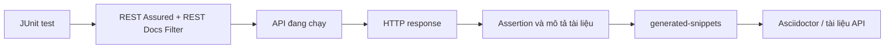

# Thêm dependency `spring-restdocs-restassured`

## 1. Vai trò của dependency trong Spring REST Docs

**Spring REST Docs** tạo tài liệu API từ các bài kiểm thử HTTP đã chạy thực tế. Khi dùng **REST Assured** để gửi request và kiểm tra response, module tích hợp cần thêm là:

```text
org.springframework.restdocs:spring-restdocs-restassured
```

Module này cung cấp bộ lọc (`Filter`) để thu thập request/response và tạo **snippet** tài liệu trong lúc bài kiểm thử chạy. Nó kết nối hai nhóm chức năng khác nhau:

| Thành phần | Trách nhiệm |
| --- | --- |
| `io.rest-assured:rest-assured` | Gửi HTTP request, nhận response và viết assertion theo cú pháp `given` / `when` / `then`. |
| `org.springframework.restdocs:spring-restdocs-restassured` | Tích hợp REST Assured với Spring REST Docs qua `documentationConfiguration(...)` và `document(...)`. |
| `org.springframework.boot:spring-boot-starter-test` (với Spring Boot) | Cung cấp nền tảng chạy kiểm thử, trong đó có JUnit Jupiter và các tiện ích kiểm thử Spring. |
| Asciidoctor/Markdown (bước sau) | Ghép các snippet đã sinh thành tài liệu API để đọc hoặc xuất bản. |

Điểm cần phân biệt: thêm dependency **chưa tự tạo tài liệu**. Phải cấu hình bộ lọc REST Docs trong kiểm thử, gọi `document(...)` cho request cần mô tả và chạy kiểm thử thành công. Các snippet sau đó mới có thể được nhúng vào Asciidoctor hoặc đưa vào quy trình build/CI.



## 2. Thêm dependency bằng Gradle

Trong ứng dụng **Spring Boot** đã cấu hình quản lý phiên bản dependency (thường qua Spring Boot BOM), bổ sung vào `build.gradle`:

```groovy
dependencies {
    testImplementation 'org.springframework.boot:spring-boot-starter-test'
    testImplementation 'io.rest-assured:rest-assured'
    testImplementation 'org.springframework.restdocs:spring-restdocs-restassured'
}
```

Với `build.gradle.kts` (Kotlin DSL), cú pháp tương đương là:

```kotlin
dependencies {
    testImplementation("org.springframework.boot:spring-boot-starter-test")
    testImplementation("io.rest-assured:rest-assured")
    testImplementation("org.springframework.restdocs:spring-restdocs-restassured")
}
```

`testImplementation` đặt các thư viện trên **test classpath**. Chúng được dùng khi chạy kiểm thử, không phải là chức năng mà ứng dụng cần đóng gói để phục vụ HTTP request trong môi trường production.

Nếu dự án không sử dụng Spring Boot BOM hoặc một cơ chế quản lý phiên bản tương đương, cần khai báo phiên bản tương thích cho các dependency (hoặc import BOM thích hợp). Không sao chép ví dụ không có version vào dự án Gradle thuần rồi kỳ vọng Gradle tự chọn phiên bản.

## 3. Thêm dependency bằng Maven

Trong dự án dùng `spring-boot-starter-parent` hoặc đã import `spring-boot-dependencies` BOM, bổ sung vào phần `<dependencies>` của `pom.xml`:

```xml
<dependencies>
    <dependency>
        <groupId>org.springframework.boot</groupId>
        <artifactId>spring-boot-starter-test</artifactId>
        <scope>test</scope>
    </dependency>

    <dependency>
        <groupId>io.rest-assured</groupId>
        <artifactId>rest-assured</artifactId>
        <scope>test</scope>
    </dependency>

    <dependency>
        <groupId>org.springframework.restdocs</groupId>
        <artifactId>spring-restdocs-restassured</artifactId>
        <scope>test</scope>
    </dependency>
</dependencies>
```

`<scope>test</scope>` có cùng ý nghĩa với `testImplementation` của Gradle: chỉ tham gia biên dịch và chạy mã kiểm thử. Nếu ứng dụng đã khai báo `spring-boot-starter-test` hoặc `rest-assured`, chỉ cần thêm những mục còn thiếu; không khai báo trùng lặp.

Trong dự án Maven không có Spring Boot dependency management, phải cung cấp phiên bản phù hợp hoặc import BOM. Riêng Spring REST Docs có thể được quản lý bằng `org.springframework.restdocs:spring-restdocs-bom`; cần bảo đảm phiên bản BOM phù hợp với Spring Framework, Spring Boot và bộ thư viện kiểm thử của dự án. Nên ưu tiên bộ phiên bản do nền tảng đang sử dụng quản lý thay vì ghép tùy ý các bản mới nhất.

## 4. Kiểm tra phiên bản và dependency đã được tải

Các ví dụ phía trên cố ý không chốt số phiên bản, vì nó phụ thuộc vào nhánh Spring Boot/Spring REST Docs của dự án. Thực hiện theo thứ tự sau:

1. Xác định phiên bản Spring Boot (hoặc Spring Framework) và cơ chế quản lý phiên bản của dự án.
2. Chọn dòng Spring REST Docs tương thích; sử dụng version do BOM quản lý nếu BOM đã khai báo artifact này.
3. Kiểm tra REST Assured, JUnit và các dependency liên quan được resolve thống nhất; tránh ép phiên bản chỉ để xử lý một lỗi import.
4. Chạy kiểm thử và xác nhận snippet được tạo, vì dependency resolve thành công chưa chứng minh cấu hình tài liệu đúng.

Một số lệnh kiểm tra hữu ích (chạy từ thư mục dự án):

```bash
# Gradle: xem các dependency của test runtime
./gradlew dependencies --configuration testRuntimeClasspath

# Maven: xem dependency tree của hai nhóm thư viện
mvn dependency:tree -Dincludes=org.springframework.restdocs,io.rest-assured
```

Trên Windows có thể dùng `gradlew.bat` thay cho `./gradlew`. Khi dùng Gradle Kotlin DSL, cấu hình `testRuntimeClasspath` vẫn mang tên như trên.

> **Lưu ý:** REST Docs hỗ trợ nhiều công cụ kiểm thử HTTP. `spring-restdocs-restassured` dành cho REST Assured; nếu kiểm thử trực tiếp bằng Spring MVC `MockMvc` hoặc reactive `WebTestClient` thì dùng module tích hợp tương ứng (`spring-restdocs-mockmvc` hoặc `spring-restdocs-webtestclient`). Không cần thêm cả ba module khi dự án chỉ dùng một công cụ.

## 5. Ví dụ tối thiểu: REST Assured sinh snippet

Giả sử ứng dụng Spring Boot đang có endpoint `GET /api/books/{id}`, khi gọi với `42` sẽ trả về HTTP 200 và JSON:

```json
{
  "id": 42,
  "title": "Spring REST Docs"
}
```

Sau khi thêm các dependency ở trên, tạo kiểm thử JUnit Jupiter dưới `src/test/java`:

```java
import io.restassured.builder.RequestSpecBuilder;
import io.restassured.http.ContentType;
import io.restassured.specification.RequestSpecification;
import org.junit.jupiter.api.BeforeEach;
import org.junit.jupiter.api.Test;
import org.junit.jupiter.api.extension.ExtendWith;
import org.springframework.boot.test.context.SpringBootTest;
import org.springframework.boot.test.web.server.LocalServerPort;
import org.springframework.restdocs.RestDocumentationContextProvider;
import org.springframework.restdocs.RestDocumentationExtension;

import static io.restassured.RestAssured.given;
import static org.springframework.restdocs.payload.PayloadDocumentation.fieldWithPath;
import static org.springframework.restdocs.payload.PayloadDocumentation.responseFields;
import static org.springframework.restdocs.request.RequestDocumentation.parameterWithName;
import static org.springframework.restdocs.request.RequestDocumentation.pathParameters;
import static org.springframework.restdocs.restassured.RestAssuredRestDocumentation.document;
import static org.springframework.restdocs.restassured.RestAssuredRestDocumentation.documentationConfiguration;

@SpringBootTest(webEnvironment = SpringBootTest.WebEnvironment.RANDOM_PORT)
@ExtendWith(RestDocumentationExtension.class)
class BookApiDocumentationTest {

    @LocalServerPort
    private int port;

    private RequestSpecification specification;

    @BeforeEach
    void setUp(RestDocumentationContextProvider restDocumentation) {
        this.specification = new RequestSpecBuilder()
                .setPort(this.port)
                .addFilter(documentationConfiguration(restDocumentation))
                .build();
    }

    @Test
    void documentGetBook() {
        given(this.specification)
                .accept(ContentType.JSON)
                .filter(document("books-get",
                        pathParameters(
                                parameterWithName("id").description("Mã sách cần lấy")),
                        responseFields(
                                fieldWithPath("id").description("Mã sách"),
                                fieldWithPath("title").description("Tên sách"))))
        .when()
                .get("/api/books/{id}", 42)
        .then()
                .statusCode(200);
    }
}
```

*Ví dụ sử dụng cách import `@LocalServerPort` của Spring Boot 3.x; với phiên bản nền tảng khác, đối chiếu API tương ứng. Endpoint `GET /api/books/{id}` là điều kiện giả định của ví dụ và phải tồn tại trong ứng dụng để test chạy thành công.*

Các bước xảy ra trong bài kiểm thử:

1. `@SpringBootTest(webEnvironment = RANDOM_PORT)` khởi chạy server nhúng trên một cổng ngẫu nhiên; `@LocalServerPort` nhận đúng cổng đó.
2. `RestDocumentationExtension` cấp `RestDocumentationContextProvider` cho `@BeforeEach`.
3. `documentationConfiguration(restDocumentation)` đăng ký filter cấu hình REST Docs vào `RequestSpecification`.
4. `document("books-get", ...)` khai báo mã snippet và mô tả path parameter cùng các trường JSON response; REST Docs kiểm tra các trường được mô tả có mặt trong phản hồi.
5. REST Assured gửi request và xác nhận HTTP 200; khi tài liệu hợp lệ, REST Docs ghi các snippet cho `books-get`.

Một vị trí thường gặp của kết quả là:

```text
build/generated-snippets/books-get/       # Gradle
target/generated-snippets/books-get/      # Maven
```

Tùy phiên bản và cấu hình output directory, vị trí thực tế có thể khác. Các file thường được tạo bao gồm `http-request.adoc`, `http-response.adoc`, `curl-request.adoc` và `response-fields.adoc`. Ví dụ `response-fields.adoc` được sinh vì bài kiểm thử đã gọi `responseFields(...)`.

**Lưu ý về kiểm chứng:** nếu API trả về trường khác với mô tả hoặc thiếu trường bắt buộc, bước sinh tài liệu có thể khiến kiểm thử thất bại. Đây chính là ưu điểm của Spring REST Docs: thay đổi trong API được phát hiện qua test và mô tả tài liệu.

## 6. Đưa snippet vào tài liệu Asciidoctor và build

Khi đã có snippet, có thể nhúng chúng vào một file `.adoc`:

```asciidoc
= API sách

== Lấy sách theo ID

=== HTTP request
include::{snippets}/books-get/http-request.adoc[]

=== HTTP response
include::{snippets}/books-get/http-response.adoc[]

=== Các trường response
include::{snippets}/books-get/response-fields.adoc[]
```

Thuộc tính `{snippets}` cần được cấu hình trỏ đến thư mục snippet của build (ví dụ `build/generated-snippets` hoặc `target/generated-snippets`). Phần tích hợp Asciidoctor có thể thực hiện ở bước tiếp theo, nhưng cần bảo đảm thứ tự thực thi:

```text
test  ->  generated-snippets  ->  asciidoctor  ->  tài liệu HTML/PDF
```

Trong CI, chạy kiểm thử sinh tài liệu **trước** tác vụ đóng gói tài liệu. Nếu test thất bại, nên để pipeline thất bại thay vì xuất bản tài liệu cũ. Markdown cũng có thể tham chiếu hoặc xử lý nội dung snippet bằng công cụ build phù hợp, nhưng snippet do REST Docs sinh ra thường ở định dạng AsciiDoc.

## 7. Lỗi thường gặp khi thêm dependency

| Triệu chứng | Nguyên nhân cần kiểm tra | Cách xử lý |
| --- | --- | --- |
| `Could not find ... spring-restdocs-restassured` hoặc Maven báo thiếu version | Chưa có repository hoặc chưa quản lý phiên bản artifact. | Kiểm tra Maven Central/repository nội bộ, BOM hoặc phiên bản được khai báo. |
| Không import được `RestAssuredRestDocumentation` | Artifact chưa xuất hiện trong test classpath, hoặc IDE chưa đồng bộ dependency. | Kiểm tra `testImplementation`/`test` scope và refresh Gradle/Maven. |
| `ClassNotFoundException`/`NoClassDefFoundError` liên quan REST Assured | Thiếu `io.rest-assured:rest-assured` hoặc xung đột phiên bản dependency. | Khai báo REST Assured trực tiếp và xem dependency tree. |
| Test HTTP chạy nhưng không thấy `generated-snippets` | Chưa gắn filter REST Docs, chưa gọi `document(...)`, hoặc output directory khác dự kiến. | Kiểm tra `documentationConfiguration`, `document` và thư mục output. |
| Test lỗi do `responseFields(...)` | JSON response không khớp mô tả tài liệu hoặc content type không đúng. | Xem response thực tế và cập nhật API/tài liệu theo hợp đồng mong muốn. |
| `Connection refused` hoặc test gọi sai cổng | API chưa khởi chạy hoặc test không truyền cổng ngẫu nhiên. | Dùng `RANDOM_PORT` cùng `@LocalServerPort`, hoặc bảo đảm server mục tiêu đang chạy. |

Với JUnit 5, cần có cấu hình để Gradle/Maven chạy JUnit Jupiter (Spring Boot starter test thường đã hỗ trợ). Nếu test không được chạy thì cũng không có snippet nào được tạo.

## 8. Checklist hoàn thành

- [ ] Đã thêm `org.springframework.restdocs:spring-restdocs-restassured` vào **test scope**.
- [ ] Đã có REST Assured và JUnit Jupiter trên test classpath.
- [ ] Đã resolve phiên bản nhất quán với Spring Boot/Spring Framework của dự án.
- [ ] Đã cấu hình `documentationConfiguration(...)` và gắn `document(...)` vào ít nhất một HTTP test.
- [ ] Đã chạy kiểm thử thành công và nhìn thấy file `.adoc` sinh ra.
- [ ] Đã cấu hình bước biên soạn tài liệu sau khi kiểm thử hoàn tất nếu cần xuất bản qua build/CI.

Khi các điều kiện trên được đáp ứng, dependency `spring-restdocs-restassured` đã được tích hợp đúng và có thể tiếp tục mô tả request body, response body, query parameter, path parameter và header cho những endpoint khác.
