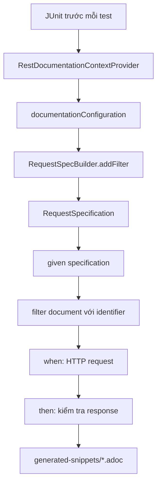

# Cấu hình `RequestSpecification` với `documentationConfiguration`

## 1. Vì sao cần cấu hình `RequestSpecification`?

Trong **Spring REST Docs**, tài liệu REST API được sinh từ các bài kiểm thử HTTP chạy thành công, vì vậy ví dụ request, response, payload, parameter và header có thể đối chiếu với hành vi thực tế của ứng dụng. Ở chương **REST Assured**, cầu nối giữa công cụ gửi HTTP request và Spring REST Docs là `RequestSpecification` được gắn bộ lọc `documentationConfiguration(...)`.

`io.restassured.specification.RequestSpecification` mô tả những thiết lập dùng chung khi REST Assured thực hiện request: địa chỉ server, cổng, base path, header mặc định, kiểu nội dung, xác thực và các HTTP filter. Thay vì lặp lại những thiết lập này cho mọi endpoint, ta xây dựng specification trong phần chuẩn bị kiểm thử rồi truyền nó vào lệnh `given(...)`.

Trong trường hợp dùng Spring REST Docs, có **hai bộ lọc phục vụ hai mục đích khác nhau**:

| Thành phần | Chức năng |
| --- | --- |
| `documentationConfiguration(restDocumentation)` | Cấu hình môi trường ghi tài liệu cho REST Assured; thường gắn vào `RequestSpecification` dùng chung. |
| `document("identifier", ...)` | Chỉ định request nào cần sinh tài liệu, tên nhóm snippet và các nội dung cần mô tả; thường gắn tại từng HTTP test. |

Việc thêm `documentationConfiguration(...)` **chưa tự sinh tài liệu cho mọi request**. Bài kiểm thử còn cần gọi `document(...)`, thực hiện request thật và chạy đến kết quả thành công.



## 2. Dependency và import cần thiết

Ví dụ trong bài sử dụng **Spring Boot 3.x**, **JUnit Jupiter (JUnit 5)** và REST Assured. Khi dự án đã được Spring Boot BOM quản lý phiên bản, có thể khai báo bằng Gradle:

```groovy
dependencies {
    testImplementation 'org.springframework.boot:spring-boot-starter-test'
    testImplementation 'io.rest-assured:rest-assured'
    testImplementation 'org.springframework.restdocs:spring-restdocs-restassured'
}

tasks.named('test') {
    useJUnitPlatform()
}
```

Với Maven, ba artifact trên cần có `<scope>test</scope>`; phiên bản phải được quản lý bởi BOM/parent phù hợp hoặc khai báo trực tiếp. Trong một dự án không dùng Spring Boot, vẫn có thể kết hợp REST Assured và Spring REST Docs với JUnit Jupiter; điều kiện là phải có một HTTP server để gửi request đến và một `RestDocumentationContextProvider` hợp lệ.

Các API quan trọng là:

```java
import io.restassured.builder.RequestSpecBuilder;
import io.restassured.specification.RequestSpecification;
import org.springframework.restdocs.RestDocumentationContextProvider;

import static org.springframework.restdocs.restassured.RestAssuredRestDocumentation.documentationConfiguration;
import static org.springframework.restdocs.restassured.RestAssuredRestDocumentation.document;
```

`RestDocumentationContextProvider` do phần tích hợp kiểm thử Spring REST Docs cung cấp. Với JUnit 5, dùng `@ExtendWith(RestDocumentationExtension.class)` trên lớp test; extension có thể đưa provider vào tham số phương thức `@BeforeEach`.

## 3. Cấu hình cơ bản với `RequestSpecBuilder`

Đây là phần cốt lõi của cấu hình:

```java
private RequestSpecification specification;

@BeforeEach
void setUp(RestDocumentationContextProvider restDocumentation) {
    this.specification = new RequestSpecBuilder()
            .setBaseUri("http://localhost")
            .setPort(port)
            .setBasePath("/api")
            .addHeader("Accept", "application/json")
            .addFilter(documentationConfiguration(restDocumentation))
            .build();
}
```

Ở đây, `port` là cổng HTTP ứng dụng thực sự đang lắng nghe; ví dụ hoàn chỉnh bên dưới lấy nó bằng `@LocalServerPort`. Tác dụng của từng dòng:

1. `new RequestSpecBuilder()` bắt đầu cấu hình một request specification mới.
2. `setBaseUri("http://localhost")` chọn địa chỉ server; phù hợp với bài test tích hợp chạy trên máy cục bộ.
3. `setPort(port)` đưa request đến đúng cổng mà test server sử dụng.
4. `setBasePath("/api")` thêm tiền tố `/api` cho đường dẫn gọi từ test, giúp test dùng `/books/{id}` thay vì lặp lại `/api/books/{id}`.
5. `addHeader("Accept", "application/json")` yêu cầu server trả JSON theo HTTP content negotiation.
6. `addFilter(documentationConfiguration(restDocumentation))` kết nối REST Assured với ngữ cảnh Spring REST Docs của test hiện tại.
7. `build()` trả về `RequestSpecification` có thể truyền trực tiếp vào `given(...)`.

**Quan trọng:** `documentationConfiguration(...)` có được từ static import của `RestAssuredRestDocumentation`, không phải method thuộc `RequestSpecBuilder`. Chính `addFilter(...)` mới đưa cấu hình này vào chuỗi filter của REST Assured.

Các thiết lập base URI/base path chỉ là ví dụ. Nếu test gọi một API ở server đã chạy sẵn, cần dùng hostname/cổng thật của môi trường test. Nếu dự án không có tiền tố `/api`, không thiết lập `setBasePath("/api")`.

## 4. Ví dụ tích hợp hoàn chỉnh: ghi tài liệu endpoint GET

Giả sử Spring Boot ứng dụng có endpoint `GET /api/books/{id}`; với `id = 42` nó trả về HTTP 200 cùng JSON:

```json
{
  "id": 42,
  "title": "Spring REST Docs",
  "available": true
}
```

Kiểm thử sau đây vừa kiểm tra HTTP response, vừa sinh tài liệu từ request có thật:

```java
import io.restassured.builder.RequestSpecBuilder;
import io.restassured.http.ContentType;
import io.restassured.specification.RequestSpecification;
import org.junit.jupiter.api.BeforeEach;
import org.junit.jupiter.api.Test;
import org.junit.jupiter.api.extension.ExtendWith;
import org.springframework.boot.test.context.SpringBootTest;
import org.springframework.boot.test.web.server.LocalServerPort;
import org.springframework.restdocs.RestDocumentationContextProvider;
import org.springframework.restdocs.RestDocumentationExtension;

import static io.restassured.RestAssured.given;
import static org.hamcrest.Matchers.equalTo;
import static org.springframework.restdocs.payload.PayloadDocumentation.fieldWithPath;
import static org.springframework.restdocs.payload.PayloadDocumentation.responseFields;
import static org.springframework.restdocs.request.RequestDocumentation.parameterWithName;
import static org.springframework.restdocs.request.RequestDocumentation.pathParameters;
import static org.springframework.restdocs.restassured.RestAssuredRestDocumentation.document;
import static org.springframework.restdocs.restassured.RestAssuredRestDocumentation.documentationConfiguration;

@SpringBootTest(webEnvironment = SpringBootTest.WebEnvironment.RANDOM_PORT)
@ExtendWith(RestDocumentationExtension.class)
class BookRestAssuredDocumentationTest {

    @LocalServerPort
    private int port;

    private RequestSpecification specification;

    @BeforeEach
    void setUp(RestDocumentationContextProvider restDocumentation) {
        this.specification = new RequestSpecBuilder()
                .setBaseUri("http://localhost")
                .setPort(port)
                .setBasePath("/api")
                .addHeader("Accept", "application/json")
                .addFilter(documentationConfiguration(restDocumentation))
                .build();
    }

    @Test
    void getBookGeneratesDocumentation() {
        given(this.specification)
                .accept(ContentType.JSON)
                .filter(document("books-get",
                        pathParameters(
                                parameterWithName("id")
                                        .description("Mã sách cần truy xuất")),
                        responseFields(
                                fieldWithPath("id").description("Mã sách"),
                                fieldWithPath("title").description("Tên sách"),
                                fieldWithPath("available")
                                        .description("Sách còn được cung cấp hay không"))))
        .when()
                .get("/books/{id}", 42)
        .then()
                .statusCode(200)
                .body("id", equalTo(42))
                .body("title", equalTo("Spring REST Docs"));
    }
}
```

**Các điểm cần quan sát:**

- `@SpringBootTest(webEnvironment = RANDOM_PORT)` khởi động HTTP server nhúng trên một cổng ngẫu nhiên, tránh xung đột cổng; `@LocalServerPort` đưa giá trị đó vào trường `port`.
- `@ExtendWith(RestDocumentationExtension.class)` thiết lập ngữ cảnh sinh tài liệu cho JUnit 5; `@BeforeEach` nhận đúng provider gắn với lượt test.
- `.addFilter(documentationConfiguration(restDocumentation))` được cấu hình **một lần cho specification của mỗi test**, do đó các request dùng specification đều có môi trường REST Docs.
- `.filter(document("books-get", ...))` chỉ được gắn trên request muốn tạo snippet; `books-get` là tên thư mục nhóm snippet.
- `.get("/books/{id}", 42)` kết hợp base path `/api` và tham số `42` để gọi `/api/books/42`. Nếu đã cấu hình base path thì không thêm `/api` một lần nữa vào `.get(...)`.
- `pathParameters(...)` và `responseFields(...)` mô tả path parameter và các field JSON. Spring REST Docs kiểm tra mô tả này dựa trên exchange được ghi lại; nếu JSON hoặc tài liệu không khớp, test có thể thất bại.

Ví dụ trên là một **integration test có điều kiện đầu vào**: ứng dụng phải thật sự cung cấp endpoint và dữ liệu tương ứng. Nếu response được tạo ngẫu nhiên hoặc lấy từ database thay đổi, cần chuẩn bị fixture ổn định để các assertion luôn đúng. Import `@LocalServerPort` trong ví dụ thuộc Spring Boot 3.x; với phiên bản Spring Boot khác hãy dùng API phù hợp của dòng đó.

## 5. Dùng lại specification với nhiều endpoint

Khi đã cấu hình `this.specification` trong `@BeforeEach`, có thể sử dụng một kiểu cấu hình chung cho nhiều bài kiểm thử:

```java
@Test
void getBooks() {
    given(this.specification)
            .filter(document("books-list"))
    .when()
            .get("/books")
    .then()
            .statusCode(200);
}

@Test
void getBookById() {
    given(this.specification)
            .filter(document("books-get"))
    .when()
            .get("/books/{id}", 42)
    .then()
            .statusCode(200);
}
```

Hai test dùng cùng cách cấu hình server và bộ lọc nhưng có **identifier riêng** là `books-list` và `books-get`. Điều này giúp các snippet được lưu theo từng thao tác API. Nếu cần mô tả path parameter cho `getBookById`, nên thêm `pathParameters(...)` như ví dụ đầy đủ phía trên.

Ngoài `given(this.specification)`, REST Assured còn cho phép viết `given().spec(this.specification)`. Hai cách có cùng mục đích: áp dụng cấu hình đã định nghĩa vào request hiện tại. Ví dụ:

```java
given()
        .spec(this.specification)
        .filter(document("books-list"))
.when()
        .get("/books")
.then()
        .statusCode(200);
```

Nên tạo specification mới trong `@BeforeEach`, thay vì lưu một `RequestSpecification` `static` dùng chung mọi lớp test. Cách này giữ các thiết lập như cổng server, filter và ngữ cảnh tài liệu đúng với mỗi lần chạy test, đặc biệt khi bộ kiểm thử chạy song song.

## 6. Cấu hình header, body và thông tin riêng cho từng request

`RequestSpecification` nên chứa các giá trị thực sự dùng chung. Các yếu tố chỉ liên quan một API có thể đặt ở ngay lời gọi `given(...)`:

```java
given(this.specification)
        .contentType(ContentType.JSON)
        .header("X-Request-Id", "docs-test-001")
        .body("{\"title\":\"Spring REST Docs\"}")
        .filter(document("books-create"))
.when()
        .post("/books")
.then()
        .statusCode(201);
```

Đoạn này minh họa cấu hình request cho endpoint giả định `POST /api/books`; ứng dụng phải hỗ trợ endpoint và trả HTTP 201 thì test mới đạt. `contentType(ContentType.JSON)` báo kiểu **request body**, còn `accept(ContentType.JSON)` hoặc header `Accept` báo kiểu response mong muốn. Chúng không thay thế cho nhau.

Khi tài liệu hóa header và payload, thêm các descriptor phù hợp vào `document(...)`:

```java
.filter(document("books-create",
        requestHeaders(
                headerWithName("X-Request-Id")
                        .description("Mã theo dõi request")),
        requestFields(
                fieldWithPath("title")
                        .description("Tên sách cần tạo"))))
```

Các static import cần bổ sung cho ví dụ này là `RequestDocumentation.requestHeaders`, `RequestDocumentation.headerWithName` và `PayloadDocumentation.requestFields`/`fieldWithPath`. Chỉ mô tả các header và field thực sự hiện diện trong request tương ứng; với header tùy chọn hoặc payload có cấu trúc thay đổi, cần dùng các tùy chọn descriptor phù hợp thay vì tạo mô tả không chính xác.

**Không đưa thông tin nhạy cảm vào snippet công khai.** Đối với token, cookie phiên đăng nhập và dữ liệu cá nhân, hãy tạo dữ liệu giả cho test hoặc dùng tính năng preprocess của Spring REST Docs để xóa/che thông tin trước khi sinh tài liệu. Không hard-code credential thật trong test hay ví dụ tài liệu.

## 7. Tìm và sử dụng snippet đã sinh

Sau khi test chứa `document("books-get", ...)` chạy thành công, tùy cấu hình build và Spring REST Docs, đường dẫn thường là:

```text
build/generated-snippets/books-get/       # Gradle
target/generated-snippets/books-get/      # Maven
```

Các snippet thường gặp:

| File | Nội dung |
| --- | --- |
| `http-request.adoc` | HTTP request dưới dạng có thể đọc. |
| `http-response.adoc` | HTTP response đã nhận. |
| `curl-request.adoc` | Ví dụ lệnh `curl` tương ứng. |
| `path-parameters.adoc` | Bảng mô tả path parameter nếu có `pathParameters(...)`. |
| `response-fields.adoc` | Bảng mô tả response JSON nếu có `responseFields(...)`. |

Tùy phiên bản và cấu hình, tập snippet có thể thay đổi. Từ thư mục đã tạo, có thể đưa snippet vào một tài liệu Asciidoctor:

```asciidoc
= API Books

== Lấy sách

=== Request
include::{snippets}/books-get/http-request.adoc[]

=== Path parameters
include::{snippets}/books-get/path-parameters.adoc[]

=== Response fields
include::{snippets}/books-get/response-fields.adoc[]
```

Build phải cấu hình `{snippets}` tới thư mục snippet thực tế. Trong CI, thứ tự cần bảo đảm là **chạy HTTP tests → sinh snippet → biên soạn tài liệu Asciidoctor/Markdown → xuất bản**. Không xuất bản snippet của lần chạy cũ khi kiểm thử hiện tại thất bại.

## 8. Lỗi cấu hình thường gặp và cách xử lý

| Hiện tượng | Nguyên nhân khả dĩ | Cách kiểm tra và khắc phục |
| --- | --- | --- |
| Không tìm thấy `documentationConfiguration` | Thiếu `spring-restdocs-restassured` hoặc import từ sai lớp. | Kiểm tra test dependency và static import `RestAssuredRestDocumentation.documentationConfiguration`. |
| `RestDocumentationContextProvider` không được cung cấp | Chưa đăng ký `RestDocumentationExtension` cho JUnit 5 hoặc cấu hình JUnit không đúng. | Thêm `@ExtendWith(RestDocumentationExtension.class)` và bảo đảm JUnit Jupiter chạy test. |
| HTTP test chạy nhưng không có snippet | Chỉ dùng `documentationConfiguration(...)` mà chưa gắn `document(...)`, hoặc đang xem sai thư mục output. | Thêm `filter(document("..."))` cho request cần tài liệu và kiểm tra `generated-snippets`. |
| Lỗi khi dùng `document(...)` | Request thiếu cấu hình REST Docs hoặc có filter bị loại bỏ khi tạo specification khác. | Đảm bảo request đang dùng chính specification có `documentationConfiguration(...)`. |
| Kết quả HTTP 404 dù endpoint tồn tại | `setBasePath("/api")` và đường dẫn `.get("/api/...")` làm lặp tiền tố, hoặc sai host/cổng. | Kiểm tra URL cuối cùng; dùng `.get("/books/{id}", 42)` (không có `/api`) khi base path đã là `/api`. |
| `Connection refused` | Test server chưa chạy hoặc `setPort(...)` không khớp cổng thực. | Kết hợp `RANDOM_PORT` và `@LocalServerPort`, hoặc xác minh server bên ngoài đang lắng nghe. |
| Test thất bại khi mô tả response | Tên field/parameter trong `responseFields(...)` hoặc `pathParameters(...)` không khớp HTTP thực tế. | Xem response, request và cập nhật descriptor hoặc sửa endpoint theo hợp đồng API. |
| Snippet của nhiều test ghi đè nhau | Các test dùng trùng identifier hoặc dùng chung trạng thái cấu hình trong chạy song song. | Đặt identifier riêng cho từng endpoint/trường hợp và khởi tạo specification theo từng test. |

Khi debug, hãy xác nhận riêng **ba lớp vấn đề**: dependency có được tải không, REST Assured có gửi đúng URL và nhận đúng HTTP response không, rồi filter REST Docs có sinh snippet đúng tên không. Nếu sai ở lớp trước, xử lý trước khi tìm lỗi ở bước tạo tài liệu.

## 9. Checklist thực hành

- [ ] Đã có `rest-assured`, `spring-restdocs-restassured` và nền tảng JUnit trên test classpath.
- [ ] Đã bật tích hợp REST Docs qua `RestDocumentationExtension` và nhận `RestDocumentationContextProvider`.
- [ ] Đã tạo `RequestSpecification` với base URI, port, base path và header phù hợp.
- [ ] Đã gắn `.addFilter(documentationConfiguration(restDocumentation))` trước khi gọi `build()`.
- [ ] Đã dùng specification đó trong `given(...)` và gắn `document("identifier", ...)` cho request cần mô tả.
- [ ] Đã kiểm tra response thực tế và nhìn thấy các file `.adoc` trong `generated-snippets`.
- [ ] Đã đưa bước sinh snippet vào trước bước biên soạn tài liệu trong build/CI nếu dự án có xuất bản tài liệu API.

Một `RequestSpecification` được cấu hình đúng là nền tảng để viết những bài kiểm thử REST Assured ngắn gọn, nhất quán và sinh tài liệu có thể kiểm chứng bằng Spring REST Docs. Sau khi thiết lập được bộ lọc `documentationConfiguration(...)`, có thể mở rộng `document(...)` để mô tả request body, response body, path/query parameter và header theo từng hợp đồng API.
