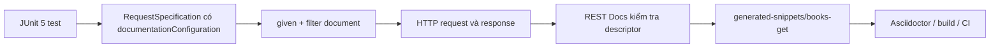

# REST Assured: sử dụng `.filter(document(...))` để sinh tài liệu API

## 1. Mục đích và vị trí của `document(...)`

Trong **Spring REST Docs**, tài liệu REST API được tạo ra từ các trao đổi HTTP diễn ra trong bài kiểm thử. Điều này giúp ví dụ request, response và mô tả dữ liệu được kiểm chứng cùng với hành vi của API. Spring REST Docs có thể tích hợp với **MockMvc**, **WebTestClient** hoặc **REST Assured**; phần này tập trung vào REST Assured.

Khi sử dụng REST Assured, lời gọi quan trọng là:

```java
given(this.specification)
        .filter(document("books-get"))
.when()
        .get("/books/42")
.then()
        .statusCode(200);
```

`document(...)` là phương thức tĩnh thuộc `org.springframework.restdocs.restassured.RestAssuredRestDocumentation`. Phương thức trả về bộ lọc tài liệu cho REST Assured; `.filter(...)` đăng ký bộ lọc đó cho request đang được xây dựng. Khi REST Assured thực hiện HTTP request, filter nhận thông tin trao đổi HTTP và Spring REST Docs tạo các **snippet** dạng AsciiDoc trong thư mục tài liệu được cấu hình.

| Thành phần | Vai trò |
| --- | --- |
| `given(...)` | Bắt đầu cấu hình request và áp dụng `RequestSpecification` dùng chung. |
| `.filter(document("books-get"))` | Đánh dấu request cần ghi tài liệu và đặt mã định danh nhóm snippet là `books-get`. |
| `.when().get(...)` | Thực hiện trao đổi HTTP thật. |
| `.then().statusCode(200)` | Xác minh hành vi API bằng assertion. |

**Không nhầm lẫn hai loại filter:** `documentationConfiguration(restDocumentation)` cấu hình **ngữ cảnh tài liệu** cho REST Assured; còn `document("identifier", ...)` xác định **request nào sẽ được tài liệu hóa** và những snippet mô tả cần tạo. Trong thực hành thông thường, filter cấu hình được thêm ở `@BeforeEach`, filter `document` được thêm trong từng test.



Lưu ý: filter có thể xử lý trao đổi HTTP trước khi assertion ở `.then()` kết thúc. Vì vậy, **sự tồn tại của một file snippet không có nghĩa test đã pass**. Để phát hành tài liệu đáng tin cậy, pipeline phải yêu cầu các kiểm thử liên quan thành công.

## 2. Điều kiện trước khi gọi `document(...)`

Trong dự án Spring Boot sử dụng BOM để quản lý phiên bản, cần các dependency ở **test scope**. Ví dụ Gradle Groovy DSL:

```groovy
dependencies {
    testImplementation 'org.springframework.boot:spring-boot-starter-test'
    testImplementation 'io.rest-assured:rest-assured'
    testImplementation 'org.springframework.restdocs:spring-restdocs-restassured'
}

tasks.named('test') {
    useJUnitPlatform()
}
```

Nếu dùng Maven, khai báo các artifact tương ứng với `<scope>test</scope>`. Khi không dùng Spring Boot BOM hoặc cơ chế quản lý dependency khác, phải cung cấp phiên bản phù hợp. Tránh kết hợp tùy tiện Spring REST Docs, REST Assured và Spring Boot thuộc các dòng không tương thích.

Tiếp đó, tạo `RequestSpecification` có filter cấu hình REST Docs. Với JUnit Jupiter, `RestDocumentationExtension` cung cấp `RestDocumentationContextProvider` cho mỗi lượt test:

```java
@SpringBootTest(webEnvironment = SpringBootTest.WebEnvironment.RANDOM_PORT)
@ExtendWith(RestDocumentationExtension.class)
class BookDocumentationTest {

    @LocalServerPort
    int port;

    RequestSpecification specification;

    @BeforeEach
    void setUp(RestDocumentationContextProvider restDocumentation) {
        this.specification = new RequestSpecBuilder()
                .setBaseUri("http://localhost")
                .setPort(port)
                .setBasePath("/api")
                .addFilter(documentationConfiguration(restDocumentation))
                .build();
    }
}
```

Đoạn khung trên cần các import của Spring Boot Test, JUnit 5, REST Assured và Spring REST Docs như ví dụ hoàn chỉnh bên dưới. `@LocalServerPort` trong ví dụ dùng đường dẫn import của Spring Boot 3.x. Giá trị `port` phải lấy từ server mà bài test thực sự khởi chạy; nếu kiểm thử API chạy ở địa chỉ khác, thay base URI và port cho phù hợp.

Trong ngữ cảnh này, `setBasePath("/api")` làm cho `.get("/books/{id}")` gọi tới `/api/books/{id}`. Không lặp thêm `/api` trong đường dẫn của từng request.

## 3. Cú pháp `document(...)` và các snippet descriptor

### 3.1. Cú pháp tối thiểu

```java
.filter(document("books-list"))
```

Tham số đầu tiên là **identifier**. Identifier được dùng làm tên thư mục con chứa snippet, ví dụ:

```text
build/generated-snippets/books-list/http-request.adoc
build/generated-snippets/books-list/http-response.adoc
```

Đối với Maven, vị trí mặc định thường là `target/generated-snippets`. Cấu hình build có thể chỉ định một đường dẫn khác. Các snippet mặc định thường bao gồm `curl-request.adoc`, `http-request.adoc`, `http-response.adoc`, `httpie-request.adoc`, `request-body.adoc` và `response-body.adoc`; tên và tập file cụ thể phụ thuộc phiên bản và cấu hình REST Docs.

Identifier nên có nghĩa và ổn định, chẳng hạn `books-list`, `books-get`, `books-create` hoặc `books-get-not-found`. Không dùng cùng một identifier cho nhiều test khác nhau chạy song song vì kết quả có thể bị ghi đè hoặc khó phân biệt. Tránh đưa dữ liệu ngẫu nhiên vào identifier nếu tài liệu Asciidoctor cần tham chiếu thư mục bằng tên cố định.

### 3.2. Cú pháp có mô tả thành phần HTTP

```java
.filter(document("books-get",
        pathParameters(
                parameterWithName("id").description("Mã sách cần truy xuất")),
        responseFields(
                fieldWithPath("id").description("Mã sách"),
                fieldWithPath("title").description("Tên sách"))))
```

Các descriptor cho phép REST Docs tạo thêm những bảng tài liệu và xác thực cấu trúc dữ liệu tương ứng. Một số nhóm thường dùng:

| Kiểu dữ liệu | API mô tả | Snippet thường gặp |
| --- | --- | --- |
| Path parameter | `pathParameters(parameterWithName(...))` | `path-parameters.adoc` |
| Query parameter | `queryParameters(parameterWithName(...))` (REST Docs 3.x) | `query-parameters.adoc` |
| Request header | `requestHeaders(headerWithName(...))` | `request-headers.adoc` |
| Response header | `responseHeaders(headerWithName(...))` | `response-headers.adoc` |
| JSON request body | `requestFields(fieldWithPath(...))` | `request-fields.adoc` |
| JSON response body | `responseFields(fieldWithPath(...))` | `response-fields.adoc` |

Các phương thức này nằm ở các lớp tương ứng: `RequestDocumentation` cho parameter; `HeaderDocumentation` cho header; `PayloadDocumentation` cho field. Đừng import nhầm `requestHeaders` từ `RequestDocumentation`: API header thuộc `HeaderDocumentation`.

Với phiên bản Spring REST Docs cũ, cú pháp tài liệu hóa query/form parameter có thể sử dụng `requestParameters(...)` thay cho `queryParameters(...)`. Hãy kiểm tra API đúng với phiên bản thư viện của dự án.

Mặc định, `responseFields(...)` và `requestFields(...)` kiểm tra descriptor theo nội dung payload. Khi có field không được mô tả hoặc field bắt buộc được mô tả nhưng vắng mặt, quá trình tạo snippet có thể làm test thất bại. Có thể dùng `.optional()` cho field thực sự tùy chọn, `.ignored()` cho field không cần đưa vào bảng, hoặc các biến thể `relaxed...Fields(...)` khi có chủ đích cho phép trường ngoài danh sách.

## 4. Ví dụ đầy đủ: GET sách theo ID

Giả sử API đang chạy có endpoint `GET /api/books/{id}`. Khi nhận `id = 42`, server trả HTTP 200, `Content-Type: application/json` và response:

```json
{
  "id": 42,
  "title": "Spring REST Docs",
  "available": true
}
```

Dưới đây là một integration test JUnit 5 sử dụng REST Assured, gắn filter `document(...)` và mô tả kết quả:

```java
import io.restassured.builder.RequestSpecBuilder;
import io.restassured.http.ContentType;
import io.restassured.specification.RequestSpecification;
import org.junit.jupiter.api.BeforeEach;
import org.junit.jupiter.api.Test;
import org.junit.jupiter.api.extension.ExtendWith;
import org.springframework.boot.test.context.SpringBootTest;
import org.springframework.boot.test.web.server.LocalServerPort;
import org.springframework.restdocs.RestDocumentationContextProvider;
import org.springframework.restdocs.RestDocumentationExtension;

import static io.restassured.RestAssured.given;
import static org.hamcrest.Matchers.equalTo;
import static org.springframework.restdocs.payload.PayloadDocumentation.fieldWithPath;
import static org.springframework.restdocs.payload.PayloadDocumentation.responseFields;
import static org.springframework.restdocs.request.RequestDocumentation.parameterWithName;
import static org.springframework.restdocs.request.RequestDocumentation.pathParameters;
import static org.springframework.restdocs.restassured.RestAssuredRestDocumentation.document;
import static org.springframework.restdocs.restassured.RestAssuredRestDocumentation.documentationConfiguration;

@SpringBootTest(webEnvironment = SpringBootTest.WebEnvironment.RANDOM_PORT)
@ExtendWith(RestDocumentationExtension.class)
class BookDocumentationTest {

    @LocalServerPort
    private int port;

    private RequestSpecification specification;

    @BeforeEach
    void setUp(RestDocumentationContextProvider restDocumentation) {
        this.specification = new RequestSpecBuilder()
                .setBaseUri("http://localhost")
                .setPort(port)
                .setBasePath("/api")
                .addFilter(documentationConfiguration(restDocumentation))
                .build();
    }

    @Test
    void documentGetBook() {
        given(this.specification)
                .accept(ContentType.JSON)
                .pathParam("id", 42)
                .filter(document("books-get",
                        pathParameters(
                                parameterWithName("id")
                                        .description("Mã sách cần truy xuất")),
                        responseFields(
                                fieldWithPath("id").description("Mã sách"),
                                fieldWithPath("title").description("Tên sách"),
                                fieldWithPath("available")
                                        .description("Sách hiện còn cung cấp hay không"))))
        .when()
                .get("/books/{id}")
        .then()
                .statusCode(200)
                .body("id", equalTo(42))
                .body("title", equalTo("Spring REST Docs"));
    }
}
```

Diễn biến của test theo thứ tự:

1. `@SpringBootTest(RANDOM_PORT)` khởi động server cho bài kiểm thử; `@LocalServerPort` cấp cổng kết nối.
2. `RestDocumentationExtension` tạo ngữ cảnh REST Docs; `@BeforeEach` dùng ngữ cảnh này để thêm `documentationConfiguration(...)` vào specification.
3. `given(this.specification)` áp dụng host, port, base path và bộ lọc cấu hình; `.pathParam("id", 42)` khai báo giá trị thay thế vào URL.
4. `.filter(document("books-get", ...))` đăng ký bộ lọc ghi tài liệu cho lần gọi này, kèm descriptor của path parameter và response JSON.
5. `.when().get("/books/{id}")` gửi request tới `http://localhost:<port>/api/books/42`; filter thu thập trao đổi HTTP và xử lý snippet.
6. `.then().statusCode(200).body(...)` xác minh API trả về dữ liệu mong đợi; các assertion độc lập với việc khai báo descriptor và đều cần được kiểm tra.

Ví dụ chỉ chạy thành công khi ứng dụng thật sự có endpoint và dữ liệu phù hợp. Nên nạp fixture hoặc tạo dữ liệu test ổn định; không dùng giả định `id = 42` nếu môi trường test không bảo đảm sách đó tồn tại.

Với cấu hình Gradle thông thường, có thể kiểm tra thư mục kết quả:

```text
build/generated-snippets/books-get/
  curl-request.adoc
  http-request.adoc
  http-response.adoc
  path-parameters.adoc
  response-fields.adoc
  ...
```

`path-parameters.adoc` và `response-fields.adoc` xuất hiện do test đã khai báo các descriptor tương ứng. Những snippet khác tùy bộ mặc định và cấu hình. Có file snippet chưa chứng minh tài liệu chính xác; hãy kiểm tra kết quả test và nội dung file.

## 5. Tài liệu hóa POST: request body và header

`document(...)` cũng áp dụng cho `POST`, `PUT`, `PATCH` và `DELETE`. Ví dụ endpoint giả định `POST /api/books` nhận JSON có trường `title`, header `X-Trace-Id` và trả HTTP 201:

```java
given(this.specification)
        .contentType(ContentType.JSON)
        .accept(ContentType.JSON)
        .header("X-Trace-Id", "docs-123")
        .body("{\"title\":\"Spring REST Docs\"}")
        .filter(document("books-create",
                requestHeaders(
                        headerWithName("X-Trace-Id")
                                .description("Mã theo dõi request")),
                requestFields(
                        fieldWithPath("title")
                                .description("Tên sách cần tạo"))))
.when()
        .post("/books")
.then()
        .statusCode(201);
```

Ví dụ cần bổ sung các static import:

```java
import static org.springframework.restdocs.headers.HeaderDocumentation.headerWithName;
import static org.springframework.restdocs.headers.HeaderDocumentation.requestHeaders;
import static org.springframework.restdocs.payload.PayloadDocumentation.fieldWithPath;
import static org.springframework.restdocs.payload.PayloadDocumentation.requestFields;
```

`Content-Type` mô tả kiểu **request body** gửi đến server; `Accept` thể hiện kiểu response client mong muốn. Trong ví dụ, chỉ `X-Trace-Id` và trường `title` được mô tả. Nếu muốn đưa `Content-Type` vào bảng request headers, thêm descriptor `headerWithName("Content-Type")` và kiểm tra header thực tế của request. Khi API trả JSON, có thể thêm `responseFields(...)` để tài liệu hóa payload trả về.

Đối với request có dữ liệu nhạy cảm như `Authorization`, cookie hoặc mật khẩu, chỉ dùng giá trị giả trong test. Nếu tài liệu sẽ phát hành, cần cấu hình các `OperationPreprocessor` phù hợp để loại bỏ hoặc che dữ liệu nhạy cảm trước khi ghi snippet. Dữ liệu công khai trong tài liệu phải được kiểm tra giống như dữ liệu xuất bản khác.

## 6. Kết hợp nhiều snippet, định danh và tiền xử lý

Một lần `document(...)` có thể nhận nhiều descriptor. Chẳng hạn, với `GET /api/books/{id}?lang=vi`, có thể tài liệu hóa đồng thời path parameter, query parameter và response:

```java
given(this.specification)
        .pathParam("id", 42)
        .queryParam("lang", "vi")
        .filter(document("books-get-localized",
                pathParameters(
                        parameterWithName("id").description("Mã sách")),
                queryParameters(
                        parameterWithName("lang").description("Mã ngôn ngữ")),
                responseFields(
                        fieldWithPath("id").description("Mã sách"),
                        fieldWithPath("title").description("Tên sách"),
                        fieldWithPath("available").description("Trạng thái cung cấp"))))
.when()
        .get("/books/{id}")
.then()
        .statusCode(200);
```

Ví dụ này dành cho phiên bản có `RequestDocumentation.queryParameters`; cần static import `queryParameters` và `parameterWithName`. Tùy API thật, có thể bỏ `queryParam` hoặc điều chỉnh payload/descriptor. Hãy bảo đảm tên descriptor khớp đúng request được gửi và phản hồi nhận được.

Nếu cần chuẩn hóa cách hiển thị JSON trong snippet, Spring REST Docs hỗ trợ bộ tiền xử lý như `preprocessRequest(prettyPrint())` và `preprocessResponse(prettyPrint())`. Tùy overload `document(...)` của phiên bản đang dùng, có thể thêm hai bộ tiền xử lý và các descriptor:

```java
.filter(document("books-get",
        preprocessRequest(prettyPrint()),
        preprocessResponse(prettyPrint()),
        responseFields(
                fieldWithPath("id").description("Mã sách"),
                fieldWithPath("title").description("Tên sách"),
                fieldWithPath("available").description("Trạng thái cung cấp"))))
```

Đoạn này cần các static import `preprocessRequest`, `preprocessResponse`, `prettyPrint` từ `org.springframework.restdocs.operation.preprocess.Preprocessors`. `prettyPrint()` phục vụ trình bày; việc test pass vẫn cần assertion và dữ liệu trả về đúng. Nếu test có nhiều endpoint, giữ identifier riêng để tài liệu dễ tra cứu và để các file không bị ghi đè.

## 7. Nhúng snippet vào tài liệu và build/CI

Spring REST Docs tạo snippet dạng AsciiDoc, không tự tạo một trang tài liệu hoàn chỉnh. Ví dụ file `src/docs/asciidoc/api.adoc` có thể nhúng các snippet từ test ở mục 4:

```asciidoc
= Books API

== Lấy sách theo ID

=== HTTP request
include::{snippets}/books-get/http-request.adoc[]

=== Path parameters
include::{snippets}/books-get/path-parameters.adoc[]

=== Response fields
include::{snippets}/books-get/response-fields.adoc[]

=== HTTP response
include::{snippets}/books-get/http-response.adoc[]
```

Thuộc tính Asciidoctor `{snippets}` cần được cấu hình trỏ đến `build/generated-snippets` hoặc `target/generated-snippets` theo dự án. Có thể dùng Markdown làm phần trình bày và triển khai công cụ build để chèn snippet, nhưng các file snippet mặc định của REST Docs thường dùng cú pháp AsciiDoc nên việc đưa nguyên văn vào Markdown cần bước xử lý tương ứng.

Quy trình build/CI nên đảm bảo thứ tự:

```text
JUnit/REST Assured tests
        ↓
Spring REST Docs document filters
        ↓
generated-snippets/*.adoc
        ↓
Asciidoctor (hoặc bước biên soạn tài liệu tương đương)
        ↓
Tài liệu xuất bản
```

Không dùng kết quả của lần chạy trước nếu test hiện tại thất bại. Điều kiện xuất bản nên bao gồm việc chạy thành công các bài kiểm thử HTTP sinh tài liệu và bước biên soạn tài liệu.

## 8. Phân biệt những lỗi thường gặp

| Hiện tượng | Nguyên nhân cần kiểm tra | Cách giải quyết |
| --- | --- | --- |
| IDE không tìm thấy `document(...)` | Chưa có dependency hoặc thiếu static import. | Thêm `spring-restdocs-restassured` ở test scope; import `RestAssuredRestDocumentation.document`. |
| Test chạy được nhưng không có snippet | Request chưa gắn `document(...)`, filter cấu hình thiếu hoặc xem sai output directory. | Kiểm tra cả `documentationConfiguration(...)` và `.filter(document(...))` trên request; xem thư mục output thực tế. |
| `document(...)` báo lỗi ngữ cảnh tài liệu | `RequestSpecification` không dùng cấu hình từ `RestDocumentationContextProvider`. | Đăng ký `RestDocumentationExtension` và `addFilter(documentationConfiguration(restDocumentation))` trong `@BeforeEach`. |
| Test thất bại vì field không được mô tả | `requestFields(...)`/`responseFields(...)` thiếu descriptor hoặc tên field không khớp JSON. | Xem payload thực tế; thêm, sửa descriptor hoặc dùng `.optional()` khi dữ liệu thật sự tùy chọn. |
| Không có `path-parameters.adoc` | Test không khai báo `pathParameters(...)` hoặc URL không được nhận diện đúng. | Kiểm tra URI template `/books/{id}`, cách truyền path parameter và descriptor. |
| Trùng dữ liệu snippet giữa các case | Nhiều test dùng chung identifier, đặc biệt khi chạy song song. | Đặt tên theo endpoint và tình huống, ví dụ `books-get-200`, `books-get-404`. |
| File snippet đã xuất hiện nhưng CI vẫn đỏ | Filter sinh snippet trước khi assertion HTTP hoặc kiểm tra descriptor hoàn tất. | Xem kết quả kiểm thử, không dựa vào việc file tồn tại để kết luận thành công. |
| API trả 404 thay vì 200 | URL bị lặp base path hoặc dữ liệu fixture không tồn tại. | Kiểm tra base URI, port, base path, URI template và dữ liệu test. |

### Checklist trước khi hoàn thành

- [ ] REST Assured, JUnit Jupiter và `spring-restdocs-restassured` nằm trong test classpath.
- [ ] `RestDocumentationExtension` cung cấp `RestDocumentationContextProvider` và `RequestSpecification` chứa `documentationConfiguration(...)`.
- [ ] Mỗi endpoint muốn tài liệu hóa được gắn `.filter(document("identifier", ...))` tại request tương ứng.
- [ ] Các descriptor `pathParameters`, `queryParameters`, `requestHeaders`, `requestFields` hoặc `responseFields` phản ánh đúng HTTP thực tế.
- [ ] Test xác minh status code và những giá trị nghiệp vụ quan trọng, sau đó chạy thành công.
- [ ] `generated-snippets` có các file cần thiết và các lệnh `include::{snippets}/...[]` tham chiếu đúng identifier.
- [ ] Build/CI chạy test trước khi biên soạn và xuất bản tài liệu.

`filter(document(...))` là điểm gắn **mô tả tài liệu vào từng HTTP request** trong REST Assured. Khi kết hợp với `RequestSpecification`, `documentationConfiguration(...)` và assertion chính xác, nó cho phép sinh tài liệu có thể kiểm chứng cho request, response, payload, tham số và header ngay trong quá trình kiểm thử Spring REST Docs.
