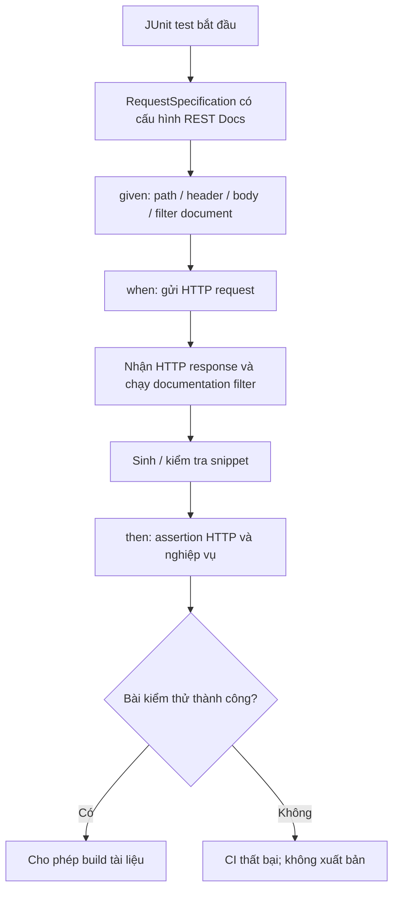
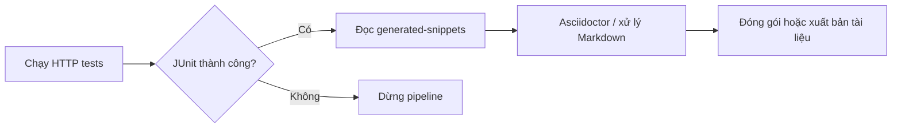

# Đặt request, assertion và `document` trong đúng thứ tự với REST Assured

## 1. Thứ tự chuẩn khi vừa kiểm thử vừa sinh tài liệu

**Spring REST Docs** tạo tài liệu REST API từ các bài kiểm thử HTTP, giúp các ví dụ request, response, payload, tham số và header được kiểm chứng cùng với API. Spring REST Docs hỗ trợ **MockMvc**, **WebTestClient** và **REST Assured**; bài này tập trung vào cách sắp xếp lệnh trong REST Assured để vừa gửi request, vừa tạo snippet, vừa kiểm tra kết quả.

Trong cú pháp REST Assured, mẫu thường dùng là:

```java
given(this.specification)
        .pathParam("id", 42)
        .filter(document("books-get"))
.when()
        .get("/books/{id}")
.then()
        .statusCode(200);
```

Có **hai loại thứ tự cần phân biệt**:

1. **Thứ tự viết trong DSL:** `given(...)` để chuẩn bị request và gắn filter; `when()` để thực hiện HTTP; `then()` để đưa ra assertion đối với response.
2. **Thứ tự thực thi:** filter `document(...)` được đăng ký trong phần chuẩn bị request, nhưng thực sự xử lý trao đổi HTTP khi request được gửi và response được nhận. Các assertion của `then()` thường diễn ra sau đó. Vì vậy, một snippet có thể được ghi ra **trước khi một assertion phía sau thất bại**.



Điểm quan trọng: **đặt `.filter(document(...))` trước `when()` là đúng**, ngay cả khi về mặt nghiệp vụ ta muốn kiểm tra response trước khi phát hành tài liệu. Việc kiểm soát phát hành nằm ở kết quả kiểm thử và quy trình build/CI, không phải bằng cách cố chuyển `document(...)` xuống sau `.then()`.

## 2. Mỗi lệnh nằm ở đâu và có trách nhiệm gì?

| Vị trí | Nội dung | Vì sao đặt tại đây? |
| --- | --- | --- |
| `@BeforeEach` | Tạo `RequestSpecification` với `documentationConfiguration(restDocumentation)` | Chuẩn bị ngữ cảnh Spring REST Docs và cấu hình HTTP dùng chung cho test. |
| `given(...)` | URI parameter, query parameter, header, content type, request body | Tất cả đều là dữ liệu **trước khi gửi request**. |
| `given(...).filter(document(...))` | Tên snippet và các descriptor cần tài liệu hóa | Filter phải được đăng ký trước khi thực thi request để quan sát đúng cặp request/response. |
| `when().get/post/...` | Gửi HTTP và nhận response | Đây là điểm phát sinh trao đổi HTTP thật. |
| `then().statusCode/...` | Assertion về status, header và nội dung trả về | Kiểm tra hợp đồng API và kết quả nghiệp vụ sau khi có response. |
| Build/CI sau test | Tập hợp snippet, chạy Asciidoctor/Markdown pipeline | Chỉ sử dụng tài liệu từ các lượt kiểm thử đã thành công. |

Ví dụ `document("books-get", responseFields(...))` vừa yêu cầu tạo snippet, vừa kiểm tra trường JSON theo các descriptor. Nó **không thay thế** `.statusCode(200)` hoặc `.body("id", equalTo(42))`: một API có thể có đúng các trường JSON nhưng trả sai HTTP status hoặc giá trị nghiệp vụ.

## 3. Chuẩn bị dependency và `RequestSpecification`

Ví dụ bên dưới sử dụng **Spring Boot 3.x, JUnit Jupiter và REST Assured**. Nếu dự án đã dùng Spring Boot BOM/parent quản lý dependency, có thể khai báo trong `build.gradle`:

```groovy
dependencies {
    testImplementation 'org.springframework.boot:spring-boot-starter-test'
    testImplementation 'io.rest-assured:rest-assured'
    testImplementation 'org.springframework.restdocs:spring-restdocs-restassured'
}

tasks.named('test') {
    useJUnitPlatform()
}
```

Với Maven, dùng các artifact tương ứng ở `<scope>test</scope>`. Nếu không có BOM/parent quản lý phiên bản, phải khai báo phiên bản thích hợp, đồng bộ giữa Spring Boot, Spring REST Docs và REST Assured. Các dependency này phục vụ kiểm thử, không cần đưa lên runtime production chỉ để tạo tài liệu API.

`documentationConfiguration(...)` và `document(...)` đều là phương thức tĩnh của lớp `RestAssuredRestDocumentation`, nhưng thực hiện hai vai trò riêng:

```java
import static org.springframework.restdocs.restassured.RestAssuredRestDocumentation.documentationConfiguration;
import static org.springframework.restdocs.restassured.RestAssuredRestDocumentation.document;
```

Trong JUnit 5, đăng ký `RestDocumentationExtension` rồi nhận `RestDocumentationContextProvider` ở `@BeforeEach`. Tạo mới `RequestSpecification` cho mỗi test để bảo đảm đúng cổng HTTP và ngữ cảnh tài liệu:

```java
@BeforeEach
void setUp(RestDocumentationContextProvider restDocumentation) {
    this.specification = new RequestSpecBuilder()
            .setBaseUri("http://localhost")
            .setPort(this.port)
            .setBasePath("/api")
            .addFilter(documentationConfiguration(restDocumentation))
            .build();
}
```

Trong cấu hình này, filter cấu hình được gắn một lần vào specification; ở mỗi test, filter `document(...)` được gắn trên **request cần tạo snippet**. Không nên chia sẻ một specification có trạng thái mutable giữa nhiều test chạy song song.

## 4. Ví dụ GET hoàn chỉnh: cấu hình → tài liệu → request → assertion

Giả sử ứng dụng có `GET /api/books/{id}`. Với ID `42`, endpoint trả HTTP 200, `Content-Type: application/json` và JSON:

```json
{
  "id": 42,
  "title": "Spring REST Docs",
  "available": true
}
```

Ví dụ integration test đầy đủ:

```java
import io.restassured.builder.RequestSpecBuilder;
import io.restassured.http.ContentType;
import io.restassured.specification.RequestSpecification;
import org.junit.jupiter.api.BeforeEach;
import org.junit.jupiter.api.Test;
import org.junit.jupiter.api.extension.ExtendWith;
import org.springframework.boot.test.context.SpringBootTest;
import org.springframework.boot.test.web.server.LocalServerPort;
import org.springframework.restdocs.RestDocumentationContextProvider;
import org.springframework.restdocs.RestDocumentationExtension;

import static io.restassured.RestAssured.given;
import static org.hamcrest.Matchers.equalTo;
import static org.springframework.restdocs.payload.PayloadDocumentation.fieldWithPath;
import static org.springframework.restdocs.payload.PayloadDocumentation.responseFields;
import static org.springframework.restdocs.request.RequestDocumentation.parameterWithName;
import static org.springframework.restdocs.request.RequestDocumentation.pathParameters;
import static org.springframework.restdocs.restassured.RestAssuredRestDocumentation.document;
import static org.springframework.restdocs.restassured.RestAssuredRestDocumentation.documentationConfiguration;

@SpringBootTest(webEnvironment = SpringBootTest.WebEnvironment.RANDOM_PORT)
@ExtendWith(RestDocumentationExtension.class)
class BookApiDocumentationTest {

    @LocalServerPort
    private int port;

    private RequestSpecification specification;

    @BeforeEach
    void setUp(RestDocumentationContextProvider restDocumentation) {
        this.specification = new RequestSpecBuilder()
                .setBaseUri("http://localhost")
                .setPort(this.port)
                .setBasePath("/api")
                .addFilter(documentationConfiguration(restDocumentation))
                .build();
    }

    @Test
    void getBookProducesVerifiedDocumentation() {
        given(this.specification)
                // Bước 1: định nghĩa request trước khi gửi
                .accept(ContentType.JSON)
                .pathParam("id", 42)
                // Bước 2: đăng ký filter và descriptor REST Docs
                .filter(document("books-get",
                        pathParameters(
                                parameterWithName("id")
                                        .description("Mã sách cần xem")),
                        responseFields(
                                fieldWithPath("id").description("Mã sách"),
                                fieldWithPath("title").description("Tên sách"),
                                fieldWithPath("available")
                                        .description("Sách còn được cung cấp hay không"))))
        .when()
                // Bước 3: thực hiện HTTP request
                .get("/books/{id}")
        .then()
                // Bước 4: assertion sau khi có response
                .statusCode(200)
                .contentType(ContentType.JSON)
                .body("id", equalTo(42))
                .body("title", equalTo("Spring REST Docs"))
                .body("available", equalTo(true));
    }
}
```

Giải thích chi tiết:

1. `RANDOM_PORT` khởi chạy server nhúng; `@LocalServerPort` cung cấp cổng thật. `@BeforeEach` tạo specification có base path `/api`.
2. `given(this.specification)` áp dụng cấu hình server và REST Docs; `.pathParam("id", 42)` cung cấp biến URL trước khi gửi request.
3. `.filter(document("books-get", ...))` đăng ký bộ lọc và mô tả path parameter cùng toàn bộ các trường response đã biết.
4. `.when().get("/books/{id}")` gửi `GET /api/books/42`; không lặp tiền tố `/api` vì base path đã có.
5. Filter Spring REST Docs tạo các snippet và kiểm tra descriptor khi xử lý trao đổi HTTP.
6. `.then()` yêu cầu status 200, content type JSON và các giá trị cụ thể; test chỉ thành công khi các kiểm tra tương ứng đều đạt.

Endpoint và JSON là dữ liệu **giả định cho mục đích học tập**. Để chạy test này trong dự án thật, cần triển khai endpoint và chuẩn bị fixture đảm bảo sách 42 tồn tại. Import `@LocalServerPort` trên đây dùng API Spring Boot 3.x; dùng import phù hợp nếu dự án chạy dòng khác.

## 5. Ví dụ POST: xác minh body và tài liệu hóa request/response

Với `POST`, payload và header cũng phải được khai báo **trước `when()`**. Giả sử `POST /api/books` nhận:

```http
POST /api/books HTTP/1.1
Content-Type: application/json
Accept: application/json
X-Trace-Id: docs-test-1

{"title":"Spring REST Docs"}
```

API giả định trả HTTP 201 và JSON `{"id":100,"title":"Spring REST Docs"}`. Có thể thêm test sau vào lớp ở mục 4, đồng thời bổ sung static import của `HeaderDocumentation` và `PayloadDocumentation`:

```java
import static org.springframework.restdocs.headers.HeaderDocumentation.headerWithName;
import static org.springframework.restdocs.headers.HeaderDocumentation.requestHeaders;
import static org.springframework.restdocs.payload.PayloadDocumentation.requestFields;
```

```java
@Test
void createBookProducesVerifiedDocumentation() {
    given(this.specification)
            // Request phải hoàn chỉnh trước when()
            .contentType(ContentType.JSON)
            .accept(ContentType.JSON)
            .header("X-Trace-Id", "docs-test-1")
            .body("{\"title\":\"Spring REST Docs\"}")
            .filter(document("books-create",
                    requestHeaders(
                            headerWithName("X-Trace-Id")
                                    .description("Mã truy vết request")),
                    requestFields(
                            fieldWithPath("title")
                                    .description("Tên sách cần tạo")),
                    responseFields(
                            fieldWithPath("id").description("Mã sách mới"),
                            fieldWithPath("title").description("Tên sách mới"))))
    .when()
            .post("/books")
    .then()
            // Kiểm tra kết quả HTTP sau khi đã thực hiện request
            .statusCode(201)
            .contentType(ContentType.JSON)
            .body("title", equalTo("Spring REST Docs"));
}
```

`requestHeaders(...)` tạo mô tả header; `requestFields(...)` và `responseFields(...)` mô tả payload. Đối với Spring REST Docs, các header descriptor thuộc `org.springframework.restdocs.headers.HeaderDocumentation`, không thuộc `RequestDocumentation`. Nếu server trả thêm trường khác trong response JSON, `responseFields(...)` mặc định yêu cầu mô tả cả trường đó hoặc điều chỉnh descriptor phù hợp.

`contentType(ContentType.JSON)` đặt kiểu request body; `accept(ContentType.JSON)` thông báo kiểu response mong muốn. Chúng có mục đích khác nhau. Nếu ID do server sinh ra không cố định, chỉ cần assert sự tồn tại/kiểu dữ liệu của ID hoặc dùng matcher phù hợp, thay vì cố định `100` vào test. Ví dụ trên cố ý không assert ID cụ thể để tránh phụ thuộc vào bộ đếm database.

## 6. Những cách sắp xếp dễ gây sai sót

### 6.1. Cố đặt `document(...)` sau `then()`

```java
// Sai ý tưởng: lúc này request đã được gửi và response đang được assertion.
given(this.specification)
.when()
        .get("/books/42")
.then()
        .statusCode(200);

// Không thể gắn filter cho request vừa gửi bằng cách tiếp tục
// gọi .filter(document(...)) ở cuối chuỗi assertion phía trên.
```

`.filter(...)` dùng để cấu hình request; nó phải xuất hiện khi đang xây dựng request, trước khi thực hiện `when().get(...)` hoặc `when().post(...)`. Sau `then()` là giai đoạn khai báo assertion với `ValidatableResponse`; không thể coi đây là giai đoạn quay lại đăng ký filter cho request đã hoàn tất.

### 6.2. Chỉ thêm `documentationConfiguration(...)` mà quên `document(...)`

```java
given(this.specification)
.when()
        .get("/books/42")
.then()
        .statusCode(200);
```

Test trên có thể pass nhưng không yêu cầu tạo bộ snippet mang identifier cụ thể. Thêm `.filter(document("books-get"))` trước `when()` cho request cần tài liệu hóa. Ngược lại, `document(...)` cũng cần request được gắn ngữ cảnh REST Docs hợp lệ thông qua `documentationConfiguration(...)`.

### 6.3. Coi tài liệu hóa là assertion đầy đủ

```java
given(this.specification)
        .filter(document("books-get"))
.when()
        .get("/books/42");
```

Request vẫn có thể tạo snippet dù không kiểm tra status hoặc kết quả nghiệp vụ. Nên thêm `.then().statusCode(...)` và assertion cho dữ liệu quan trọng. Với các descriptor `requestFields(...)`/`responseFields(...)`, Spring REST Docs kiểm tra cấu trúc payload; việc đó không bảo đảm status code, định dạng nghiệp vụ hay quyền truy cập đúng.

### 6.4. Tái sử dụng identifier cho các tình huống khác nhau

```java
// Trong test trả HTTP 200:
given(this.specification)
        .filter(document("books-get-200"))
.when()
        .get("/books/{id}", 42)
.then()
        .statusCode(200);

// Trong test riêng trả HTTP 404:
given(this.specification)
        .filter(document("books-get-404"))
.when()
        .get("/books/{id}", 999)
.then()
        .statusCode(404);
```

Hai chuỗi trên minh họa **hai test độc lập**; dữ liệu mẫu phải bảo đảm ID `42` tồn tại và ID `999` không tồn tại. Không gắn hai filter `document(...)` vào cùng một request. Nếu hai bài test dùng chung identifier, đặc biệt khi chạy song song, snippet có thể bị ghi đè hoặc phản ánh tình huống không mong muốn. Có thể dùng tên cố định theo phương thức, endpoint và tình huống (`books-get-200`, `books-get-404`, `books-create-201`).

## 7. Nếu assertion hoặc descriptor thất bại thì chuyện gì xảy ra?

| Trường hợp | Kết quả cần hiểu | Hành động |
| --- | --- | --- |
| HTTP trả 404 nhưng test yêu cầu 200 | `statusCode(200)` thất bại; một số snippet có thể đã được ghi bởi filter. | Sửa API/fixture hoặc assertion theo hợp đồng mong muốn; CI không được xuất bản tài liệu từ test thất bại. |
| HTTP 200 nhưng JSON thiếu `title` được mô tả | `responseFields(...)` có thể thất bại khi filter xử lý response. | Kiểm tra response thực tế, sửa API hoặc descriptor; chỉ dùng `.optional()` khi field thực sự tùy chọn. |
| HTTP 200 nhưng `title` trả giá trị sai | Descriptor có thể hợp lệ, nhưng `.body("title", equalTo(...))` thất bại. | Giữ assertion nghiệp vụ, không chỉ phụ thuộc vào việc có file snippet. |
| Có `document(...)` nhưng không có thư mục snippet | Có thể chưa cấu hình REST Docs, request không thực hiện hoặc thư mục output khác. | Kiểm tra `RestDocumentationExtension`, `documentationConfiguration`, đường dẫn output và kết quả test. |
| Snippet đã sinh nhưng test đỏ | Filter có thể chạy trước assertion hoặc tạo lỗi trong bước tài liệu hóa. | Kiểm tra báo cáo JUnit trước khi chạy Asciidoctor và phát hành tài liệu. |

Các snippet là **sản phẩm trung gian của một lần chạy kiểm thử**. Điều kiện đáng tin cậy để dùng chúng là lượt kiểm thử toàn bộ đã thành công. Nếu framework hay build giữ lại snippet của lần chạy trước, cần bảo đảm artifact xuất bản chỉ lấy từ kết quả build hiện hành, tránh che giấu lỗi bằng tài liệu cũ.

## 8. Từ kiểm thử HTTP tới tài liệu Asciidoctor/Markdown và CI

Nếu test ở mục 4 chạy thành công, thư mục snippet thường có dạng:

```text
build/generated-snippets/books-get/    # Gradle, khi dùng thư mục mặc định phổ biến
  http-request.adoc
  http-response.adoc
  curl-request.adoc
  path-parameters.adoc
  response-fields.adoc

target/generated-snippets/books-get/   # Maven, thư mục mặc định phổ biến
```

Tên và vị trí thực tế phụ thuộc phiên bản/cấu hình build. Nhúng snippet vào tài liệu Asciidoctor bằng thuộc tính `{snippets}` đã trỏ tới thư mục kết quả:

```asciidoc
= Books API

== Lấy sách theo ID

=== Request
include::{snippets}/books-get/http-request.adoc[]

=== Path parameters
include::{snippets}/books-get/path-parameters.adoc[]

=== Response fields
include::{snippets}/books-get/response-fields.adoc[]

=== Response
include::{snippets}/books-get/http-response.adoc[]
```

Thứ tự trong **tài liệu** có thể chọn theo nhu cầu người đọc; thứ tự thực hiện trong **kiểm thử** vẫn là `given → when → then`. Nếu muốn biên soạn Markdown, cần công cụ xử lý/biến đổi nội dung `.adoc` phù hợp; không mặc định Markdown hiểu các chỉ thị `include::` của Asciidoctor.

Trong CI, thiết lập quan hệ phụ thuộc giữa các tác vụ:



Với Gradle, tác vụ biên soạn Asciidoctor cần phụ thuộc vào `test` (hoặc tác vụ test chuyên biệt tạo snippet). Với Maven, cấu hình plugin để bước sinh snippet chạy trước bước biên soạn tài liệu theo lifecycle. Không nên cấu hình pipeline bỏ qua lỗi test rồi vẫn phát hành tài liệu.

## 9. Thực hành kiểm tra thứ tự và checklist

Thực hiện lần lượt trên một API test có fixture ổn định:

1. Gắn `documentationConfiguration(...)` vào `RequestSpecification` ở phần chuẩn bị test.
2. Tạo một GET test với `.pathParam(...)`, `.filter(document("books-get", ...))`, `.when().get(...)`, rồi `.then().statusCode(...).body(...)`.
3. Chạy test, quan sát các snippet trong thư mục `generated-snippets`, đối chiếu HTTP request/response với API thật.
4. Thử thay `.statusCode(200)` thành mã không đúng để thấy **test thất bại dù có thể đã có snippet**. Khôi phục assertion đúng trước khi hoàn tất.
5. Thử mô tả sai một response field để thấy descriptor cũng tham gia kiểm chứng. Khôi phục mô tả khớp API.
6. Chỉ khi test pass, chạy bước biên soạn tài liệu rồi kiểm tra các `include::{snippets}/...[]` hoạt động.

Checklist cuối cùng:

- [ ] Đã cấu hình REST Docs đúng trên `RequestSpecification` trước khi gửi HTTP.
- [ ] Đã đặt toàn bộ request parameters, headers và body trong phần `given(...)`.
- [ ] Đã gắn `.filter(document("identifier", ...))` **trước** `when()`.
- [ ] Đã gửi request bằng `when().get/post/put/delete(...)` với host, base path và URI đúng.
- [ ] Đã assertion status code và các giá trị quan trọng trong `then()`.
- [ ] Đã mô tả payload, parameter và header khớp dữ liệu thật; mỗi tình huống có identifier riêng.
- [ ] Đã xác nhận test thành công trước khi dùng snippet để biên soạn và xuất bản tài liệu.

Thứ tự cần nhớ là **chuẩn bị request và `document` → thực hiện HTTP → assertion response → chỉ xuất bản khi test pass**. Cách sắp xếp này giúp Spring REST Docs và REST Assured cùng bảo vệ hợp đồng REST API: tài liệu được tạo từ HTTP thật, còn bài kiểm thử xác minh cả cấu trúc dữ liệu lẫn hành vi nghiệp vụ.
