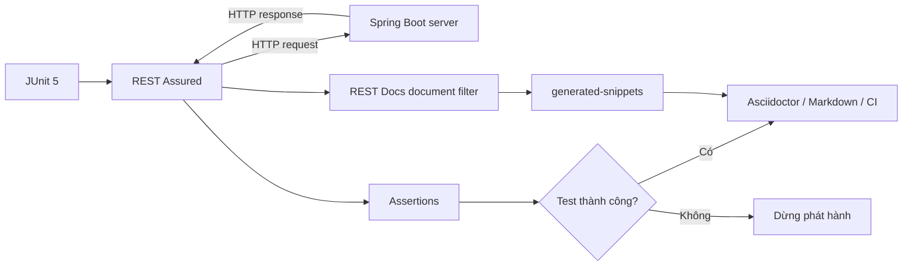

# Document request và response của endpoint thật bằng REST Assured

## 1. Mục tiêu: tài liệu phản ánh đúng HTTP mà API xử lý

**Spring REST Docs** tạo tài liệu REST API từ các bài kiểm thử HTTP có thể chạy lại. Trong chương **REST Assured**, chúng ta dùng REST Assured gọi một endpoint trên HTTP server đang chạy, kiểm tra kết quả bằng assertion, rồi để Spring REST Docs sinh các snippet cho request, response, payload, tham số và header. Các snippet được biên soạn bằng Asciidoctor hoặc công cụ xử lý Markdown và đưa vào build/CI.

“Endpoint thật” ở đây có nghĩa là **có HTTP server tiếp nhận request và trả response**. Bài kiểm thử không tự viết một đoạn JSON giả rồi gắn nhãn response. Để bài thực hành có thể lặp lại, endpoint có thể sử dụng dữ liệu mẫu cố định hoặc database test; không cần gọi môi trường production hay API của bên thứ ba.

Một quy trình có thể kiểm chứng gồm bốn bước:

1. Khởi động ứng dụng trên HTTP server của môi trường kiểm thử.
2. Dùng REST Assured gửi request thật đến đúng URL, method, header và body.
3. Dùng `.filter(document("...", ...))` tạo snippet từ trao đổi HTTP, đồng thời dùng `.then()` kiểm tra status, header và nội dung response.
4. Chỉ dùng snippet để biên soạn/xuất bản khi các bài kiểm thử liên quan đã chạy thành công.



| Điều cần kiểm chứng | REST Assured / Spring REST Docs thực hiện |
| --- | --- |
| Server trả đúng HTTP status | `.then().statusCode(200)` hoặc `statusCode(201)` |
| Response có đúng dữ liệu nghiệp vụ | `.then().body(...)` với các matcher |
| Request gửi đúng path/header/body | `given(...)` và snippet HTTP request thực tế |
| Mô tả cấu trúc JSON chính xác | `requestFields(...)` và `responseFields(...)` |
| Tài liệu được sinh từ lần chạy hiện tại | `document("identifier", ...)` và pipeline kiểm tra kết quả test |

Snippet **không thay thế assertion**. Một filter có thể tạo file trong lúc trao đổi HTTP diễn ra, ngay cả khi assertion ở bước `then()` sau đó thất bại. Vì vậy, việc thấy file `.adoc` không đủ để kết luận tài liệu hợp lệ.

## 2. Chuẩn bị một endpoint thực tế có dữ liệu ổn định

Ví dụ tự chứa dưới đây dành cho **Java 17 và Spring Boot 3.x**. Ứng dụng cung cấp hai endpoint:

| Method và path | Kết quả mong đợi |
| --- | --- |
| `GET /api/books/42` | HTTP 200 và JSON mô tả sách 42 |
| `GET /api/books/999` | HTTP 404, không có payload nghiệp vụ |
| `POST /api/books` | HTTP 201, response JSON và header `Location` |

Trong một ứng dụng học tập, có thể tạo lớp `src/main/java/com/example/docs/DocsExampleApplication.java` như sau:

```java
package com.example.docs;

import java.net.URI;
import org.springframework.boot.SpringApplication;
import org.springframework.boot.autoconfigure.SpringBootApplication;
import org.springframework.http.ResponseEntity;
import org.springframework.web.bind.annotation.GetMapping;
import org.springframework.web.bind.annotation.PathVariable;
import org.springframework.web.bind.annotation.PostMapping;
import org.springframework.web.bind.annotation.RequestBody;
import org.springframework.web.bind.annotation.RequestMapping;
import org.springframework.web.bind.annotation.RestController;

@SpringBootApplication
public class DocsExampleApplication {

    public static void main(String[] args) {
        SpringApplication.run(DocsExampleApplication.class, args);
    }

    public record BookResponse(long id, String title, boolean available) {}
    public record CreateBookRequest(String title) {}

    @RestController
    @RequestMapping("/api/books")
    public static class BookController {

        @GetMapping("/{id}")
        public ResponseEntity<BookResponse> find(@PathVariable long id) {
            if (id != 42L) {
                return ResponseEntity.notFound().build();
            }
            return ResponseEntity.ok(
                    new BookResponse(42L, "Spring REST Docs", true));
        }

        @PostMapping
        public ResponseEntity<BookResponse> create(
                @RequestBody CreateBookRequest request) {
            BookResponse created = new BookResponse(100L, request.title(), true);
            return ResponseEntity
                    .created(URI.create("/api/books/100"))
                    .body(created);
        }
    }
}
```

Đây là **controller thực sự nhận HTTP request** khi Spring Boot chạy. Dữ liệu trả về cố định để bài test minh họa ổn định. Trong dự án production, endpoint thường gọi service/repository, lưu dữ liệu, xác thực quyền truy cập và xử lý validation; khi viết tài liệu bằng test vẫn cần thiết lập fixture để biết trước kết quả có thể xác minh. Ví dụ trên là mẫu học tập, chưa triển khai tính năng lưu sách và chưa thực hiện validation đầu vào.

Với Gradle đã dùng Spring Boot plugin và dependency management tương ứng, cần các dependency:

```groovy
dependencies {
    implementation 'org.springframework.boot:spring-boot-starter-web'

    testImplementation 'org.springframework.boot:spring-boot-starter-test'
    testImplementation 'io.rest-assured:rest-assured'
    testImplementation 'org.springframework.restdocs:spring-restdocs-restassured'
}

tasks.named('test') {
    useJUnitPlatform()
}
```

Nếu dùng Maven, các artifact kiểm thử tương ứng nằm trong `<scope>test</scope>`, còn `spring-boot-starter-web` là dependency của ứng dụng. Khi không có Spring Boot BOM/parent quản lý phiên bản, cần khai báo các version tương thích. Trong dự án có sẵn endpoint thật, không cần tạo controller ví dụ này; hãy chọn một endpoint có dữ liệu kiểm thử có thể tái hiện.

## 3. Khởi động server và cấu hình Spring REST Docs

`@SpringBootTest(webEnvironment = RANDOM_PORT)` chạy ứng dụng trên cổng HTTP ngẫu nhiên. `@LocalServerPort` đưa cổng đó vào test; REST Assured sử dụng cổng thật để gửi request. `RestDocumentationExtension` quản lý ngữ cảnh tài liệu của từng bài kiểm thử JUnit 5.

Trong `@BeforeEach`, tạo `RequestSpecification` và gắn bộ lọc cấu hình bằng `documentationConfiguration(restDocumentation)`:

```java
private RequestSpecification specification;

@BeforeEach
void setUp(RestDocumentationContextProvider restDocumentation) {
    this.specification = new RequestSpecBuilder()
            .setBaseUri("http://localhost")
            .setPort(this.port)
            .addFilter(documentationConfiguration(restDocumentation))
            .build();
}
```

Hai API dễ nhầm lẫn có vai trò riêng:

- `documentationConfiguration(...)` cấu hình REST Docs cho request specification và ngữ cảnh test; thường gắn một lần khi chuẩn bị mỗi test.
- `document("books-get", ...)` gắn vào **request muốn tạo tài liệu**; tên `books-get` là identifier, tức tên thư mục snippet của lần ghi tài liệu đó.

Các câu lệnh đặt request, chẳng hạn `.pathParam(...)`, `.header(...)`, `.contentType(...)`, `.body(...)` và `.filter(document(...))`, nằm trong phần `given(...)` **trước `when()`**. Lời gọi HTTP xảy ra tại `when().get(...)` hoặc `when().post(...)`. Assertion `.then()` chạy sau khi response đã được nhận.

## 4. Test GET: document cả request và response đã nhận

Dưới đây là lớp kiểm thử có thể đặt ở `src/test/java/com/example/docs/BookApiDocumentationTest.java`. Nó gửi HTTP tới ứng dụng thật, tài liệu hóa path parameter, request header, response header và các field JSON. Phần code khớp với controller ở mục 2:

```java
package com.example.docs;

import io.restassured.builder.RequestSpecBuilder;
import io.restassured.http.ContentType;
import io.restassured.specification.RequestSpecification;
import org.junit.jupiter.api.BeforeEach;
import org.junit.jupiter.api.Test;
import org.junit.jupiter.api.extension.ExtendWith;
import org.springframework.boot.test.context.SpringBootTest;
import org.springframework.boot.test.web.server.LocalServerPort;
import org.springframework.restdocs.RestDocumentationContextProvider;
import org.springframework.restdocs.RestDocumentationExtension;

import static io.restassured.RestAssured.given;
import static org.hamcrest.Matchers.equalTo;
import static org.springframework.restdocs.headers.HeaderDocumentation.headerWithName;
import static org.springframework.restdocs.headers.HeaderDocumentation.requestHeaders;
import static org.springframework.restdocs.headers.HeaderDocumentation.responseHeaders;
import static org.springframework.restdocs.payload.PayloadDocumentation.fieldWithPath;
import static org.springframework.restdocs.payload.PayloadDocumentation.requestFields;
import static org.springframework.restdocs.payload.PayloadDocumentation.responseFields;
import static org.springframework.restdocs.request.RequestDocumentation.parameterWithName;
import static org.springframework.restdocs.request.RequestDocumentation.pathParameters;
import static org.springframework.restdocs.restassured.RestAssuredRestDocumentation.document;
import static org.springframework.restdocs.restassured.RestAssuredRestDocumentation.documentationConfiguration;

@SpringBootTest(webEnvironment = SpringBootTest.WebEnvironment.RANDOM_PORT)
@ExtendWith(RestDocumentationExtension.class)
class BookApiDocumentationTest {

    @LocalServerPort
    private int port;

    private RequestSpecification specification;

    @BeforeEach
    void setUp(RestDocumentationContextProvider restDocumentation) {
        this.specification = new RequestSpecBuilder()
                .setBaseUri("http://localhost")
                .setPort(this.port)
                .addFilter(documentationConfiguration(restDocumentation))
                .build();
    }

    @Test
    void documentGetBook() {
        given(this.specification)
                .accept(ContentType.JSON)
                .pathParam("id", 42)
                .filter(document("books-get",
                        requestHeaders(
                                headerWithName("Accept")
                                        .description("Kiểu response client chấp nhận")),
                        pathParameters(
                                parameterWithName("id")
                                        .description("Mã sách cần lấy")),
                        responseHeaders(
                                headerWithName("Content-Type")
                                        .description("Kiểu dữ liệu trả về")),
                        responseFields(
                                fieldWithPath("id")
                                        .description("Mã sách"),
                                fieldWithPath("title")
                                        .description("Tên sách"),
                                fieldWithPath("available")
                                        .description("Sách còn được cung cấp hay không"))))
        .when()
                .get("/api/books/{id}")
        .then()
                .statusCode(200)
                .contentType(ContentType.JSON)
                .body("id", equalTo(42))
                .body("title", equalTo("Spring REST Docs"))
                .body("available", equalTo(true));
    }

    @Test
    void documentCreateBook() {
        given(this.specification)
                .contentType(ContentType.JSON)
                .accept(ContentType.JSON)
                .body("{\"title\":\"Tài liệu REST Docs\"}")
                .filter(document("books-create",
                        requestFields(
                                fieldWithPath("title")
                                        .description("Tên sách cần tạo")),
                        responseHeaders(
                                headerWithName("Location")
                                        .description("Đường dẫn tài nguyên vừa tạo")),
                        responseFields(
                                fieldWithPath("id").description("Mã sách mới"),
                                fieldWithPath("title").description("Tên sách mới"),
                                fieldWithPath("available")
                                        .description("Trạng thái cung cấp sách"))))
        .when()
                .post("/api/books")
        .then()
                .statusCode(201)
                .contentType(ContentType.JSON)
                .header("Location", "/api/books/100")
                .body("id", equalTo(100))
                .body("title", equalTo("Tài liệu REST Docs"));
    }
}
```

Trong test GET, REST Assured gửi **`GET /api/books/42` đến server đang chạy**. Với controller ví dụ, nội dung trao đổi HTTP minh họa như sau (một số header/cách trình bày có thể khác tùy server):

```http
GET /api/books/42 HTTP/1.1
Host: localhost:PORT
Accept: application/json

HTTP/1.1 200 OK
Content-Type: application/json

{"id":42,"title":"Spring REST Docs","available":true}
```

REST Assured nhận response và `.then()` kiểm tra status, content type, ID, tên và trạng thái sách. Spring REST Docs đồng thời tạo snippet từ **request/response mà filter quan sát được**, không lấy nội dung từ đoạn HTTP minh họa trên.

Ở test POST, request có `Content-Type: application/json` và body JSON. Server nhận body qua `@RequestBody`, trả về HTTP 201, `Location: /api/books/100` và JSON kết quả. `requestFields(...)` mô tả request body; `responseHeaders(...)` mô tả `Location`; `responseFields(...)` mô tả response body. Test còn assertion trực tiếp các giá trị quan trọng.

Hai test dùng hai identifier **`books-get`** và **`books-create`**, giúp các nhóm snippet không ghi đè nhau. Với một ứng dụng hiện có, nên đặt identifier theo endpoint và tình huống nghiệp vụ, chẳng hạn `books-get-200`, `books-get-404` và `books-create-201`.

## 5. Mỗi snippet được sinh từ đâu?

Sau khi kiểm thử thành công, Spring REST Docs thường ghi snippet trong thư mục `build/generated-snippets` (Gradle) hoặc `target/generated-snippets` (Maven), trừ khi dự án cấu hình vị trí khác.

```text
build/generated-snippets/
├── books-get/
│   ├── curl-request.adoc
│   ├── http-request.adoc
│   ├── http-response.adoc
│   ├── request-headers.adoc
│   ├── path-parameters.adoc
│   ├── response-headers.adoc
│   └── response-fields.adoc
└── books-create/
    ├── http-request.adoc
    ├── http-response.adoc
    ├── request-fields.adoc
    ├── response-headers.adoc
    └── response-fields.adoc
```

Cây thư mục chỉ liệt kê **một số file tiêu biểu**. Tùy phiên bản và cấu hình, REST Docs có thể tạo thêm snippet mặc định như `httpie-request.adoc`, `request-body.adoc` và `response-body.adoc`.

| Snippet | Nguồn dữ liệu | Ý nghĩa |
| --- | --- | --- |
| `http-request.adoc` | HTTP request gửi thực tế | Method, URI, header và body theo định dạng được ghi nhận. |
| `http-response.adoc` | HTTP response nhận thực tế | Status, header, payload trong response. |
| `curl-request.adoc` | HTTP request đã thực hiện | Ví dụ lệnh `curl` để tái hiện thao tác. |
| `path-parameters.adoc` | `pathParameters(...)` | Bảng mô tả biến URI template như `{id}`. |
| `request-headers.adoc` | `requestHeaders(...)` | Bảng mô tả header của client. |
| `request-fields.adoc` | `requestFields(...)` | Bảng mô tả cấu trúc JSON đầu vào. |
| `response-headers.adoc` | `responseHeaders(...)` | Bảng mô tả header trả về. |
| `response-fields.adoc` | `responseFields(...)` | Bảng mô tả cấu trúc JSON đầu ra. |

`requestFields(...)` và `responseFields(...)` mặc định kiểm tra mức độ bao phủ của descriptor với các field JSON. Nếu thêm một field mới vào response mà chưa mô tả, hoặc thiếu một field bắt buộc đã mô tả, quá trình tạo tài liệu có thể khiến test thất bại. Có thể sử dụng `.optional()` cho trường thực sự không bắt buộc hoặc `.ignored()` cho trường muốn kiểm chứng nhưng không hiển thị trong bảng; chỉ dùng cơ chế mô tả linh hoạt khi hiểu rõ hợp đồng API.

## 6. Endpoint có lỗi hoặc response rỗng thì document thế nào?

Không phải endpoint thật nào cũng trả HTTP 200 và JSON. Ví dụ controller ở mục 2 trả HTTP 404 khi `id` khác `42`. Với trường hợp này, có thể bổ sung một test riêng vào `BookApiDocumentationTest`:

```java
@Test
void documentBookNotFound() {
    given(this.specification)
            .pathParam("id", 999)
            .filter(document("books-get-404",
                    pathParameters(
                            parameterWithName("id")
                                    .description("Mã sách không tồn tại"))))
    .when()
            .get("/api/books/{id}")
    .then()
            .statusCode(404);
}
```

`ResponseEntity.notFound().build()` trong ví dụ không tạo payload JSON nghiệp vụ, vì vậy **không** thêm `responseFields(...)` yêu cầu các trường `id`, `title`, `available`. Trong API thật, nếu response lỗi dùng `ProblemDetail` hoặc một envelope JSON riêng, hãy mô tả **đúng** các field của response lỗi thay vì tái sử dụng descriptor của response thành công.

Tương tự, với `204 No Content`, có thể document HTTP status và response headers nhưng không áp descriptor JSON cho body rỗng. Với endpoint `POST` trả `201 Created`, header `Location` có giá trị thực tế cần được kiểm chứng nếu là một phần hợp đồng API.

## 7. Đảm bảo request/response mẫu có thể tái hiện

Endpoint thật thường phụ thuộc database, đồng hồ hệ thống, token đăng nhập hoặc dịch vụ ngoài. Khi dùng các dữ liệu không ổn định, test dễ đỏ bất chợt và snippet cũng dễ thay đổi ngoài ý muốn.

### 7.1. Chuẩn bị trạng thái và assertion ổn định

- **Dữ liệu fixture:** tạo sách trước test hoặc dùng bộ dữ liệu kiểm thử riêng; tránh dựa vào record tình cờ tồn tại trong database của người khác.
- **Cổng server:** dùng `RANDOM_PORT` và `@LocalServerPort` thay vì cố định 8080 để giảm xung đột.
- **Tính độc lập:** mỗi test nên chuẩn bị dữ liệu của riêng mình, đặc biệt với POST/DELETE và khi chạy song song.
- **Assertion có ý nghĩa:** kiểm tra status, header và field then chốt; nếu ID được hệ thống sinh ngẫu nhiên, dùng matcher kiểm tra kiểu/định dạng hoặc lấy ID từ fixture thay vì hard-code.
- **Lỗi phải rõ ràng:** một test thất bại do status sai, body sai hoặc descriptor sai đều là tín hiệu cần xử lý trước khi xuất bản tài liệu.

### 7.2. Chuẩn hóa ví dụ HTTP trước khi đưa ra ngoài

Snippet có thể chứa cổng ngẫu nhiên, tên host nội bộ, token hoặc header mang giá trị nhạy cảm. Spring REST Docs hỗ trợ tiền xử lý bằng `OperationPreprocessor`, chẳng hạn:

```java
import static org.springframework.restdocs.operation.preprocess.Preprocessors.modifyHeaders;
import static org.springframework.restdocs.operation.preprocess.Preprocessors.modifyUris;
import static org.springframework.restdocs.operation.preprocess.Preprocessors.preprocessRequest;
import static org.springframework.restdocs.operation.preprocess.Preprocessors.preprocessResponse;
import static org.springframework.restdocs.operation.preprocess.Preprocessors.prettyPrint;
```

```java
.filter(document("books-get-public",
        preprocessRequest(
                modifyUris().scheme("https").host("api.example.com").removePort(),
                modifyHeaders().remove("Authorization")),
        preprocessResponse(prettyPrint()),
        pathParameters(
                parameterWithName("id").description("Mã sách")),
        responseFields(
                fieldWithPath("id").description("Mã sách"),
                fieldWithPath("title").description("Tên sách"),
                fieldWithPath("available").description("Trạng thái cung cấp"))))
```

Đây là minh họa **thay thế cho filter `document(...)` trong test GET**, không phải lời gọi cần gắn thêm cùng request với filter cũ. `modifyUris(...)` biến URL minh họa thành domain công khai, `modifyHeaders().remove("Authorization")` loại token khỏi snippet và `prettyPrint()` chỉ định dạng response dễ đọc. Để an toàn, còn cần xem xét cookie, trường body và header khác; luôn dùng credential giả trong kiểm thử. Tiền xử lý thay đổi nội dung snippet dùng để hiển thị, không thay đổi logic HTTP thật mà server vừa xử lý.

## 8. Đưa tài liệu HTTP vào Asciidoctor/Markdown và CI

Ví dụ `src/docs/asciidoc/api.adoc` nhúng snippet từ test GET và POST:

```asciidoc
= Books API

== Lấy sách theo ID

=== Request
include::{snippets}/books-get/http-request.adoc[]

=== Path parameters
include::{snippets}/books-get/path-parameters.adoc[]

=== Response fields
include::{snippets}/books-get/response-fields.adoc[]

=== Response
include::{snippets}/books-get/http-response.adoc[]

== Tạo sách

=== Request fields
include::{snippets}/books-create/request-fields.adoc[]

=== Response headers
include::{snippets}/books-create/response-headers.adoc[]

=== Response fields
include::{snippets}/books-create/response-fields.adoc[]
```

Thuộc tính `{snippets}` cần được cấu hình trỏ đến thư mục `generated-snippets` thực tế. Các chỉ thị `include::...[]` là cú pháp Asciidoctor; nếu dự án biên soạn bằng Markdown, phải có bước chuyển đổi hoặc công cụ nhúng nội dung tương ứng.

Để CI xuất bản đúng tài liệu, thứ tự các tác vụ cần là:

```text
Chạy ứng dụng trong test + REST Assured HTTP tests
    -> Kiểm tra toàn bộ assertion và descriptor
    -> Xác nhận test thành công
    -> Dùng generated-snippets của lần build hiện tại
    -> Chạy Asciidoctor / xử lý Markdown
    -> Đóng gói hoặc phát hành tài liệu
```

Trong Gradle, bước Asciidoctor cần phụ thuộc tác vụ test tạo snippet; trong Maven, sắp xếp các plugin theo lifecycle để test hoàn tất trước khi tổng hợp tài liệu. Nếu bài kiểm thử thất bại, CI nên dừng và không phát hành những file snippet còn sót lại từ lần chạy trước.

## 9. Lỗi thường gặp và cách xác minh

| Biểu hiện | Khả năng gây lỗi | Hướng kiểm tra |
| --- | --- | --- |
| `Connection refused` | Chưa có HTTP server hoặc cổng test sai. | Dùng `@SpringBootTest(RANDOM_PORT)` cùng `@LocalServerPort`, kiểm tra base URI. |
| HTTP 404 ngoài dự kiến | Sai path, path parameter, base path hoặc fixture chưa có dữ liệu. | Đọc `http-request.adoc` và đối chiếu endpoint đang chạy. |
| Có response nhưng không tạo snippet | Request thiếu `.filter(document(...))`, thiếu cấu hình REST Docs hoặc dùng nhầm specification. | Kiểm tra `documentationConfiguration(...)`, `document(...)` và output directory. |
| `RestDocumentationContextProvider` không được inject | Thiếu JUnit 5 extension/cấu hình test phù hợp. | Đăng ký `@ExtendWith(RestDocumentationExtension.class)`; kiểm tra JUnit Jupiter. |
| Test thất bại khi thêm field JSON | Descriptor `responseFields(...)` không bao phủ payload hoặc field bắt buộc vắng mặt. | So sánh payload thật và descriptor; sửa cả API hoặc tài liệu theo hợp đồng mong muốn. |
| Test POST trả 400/415 | Body/header chưa đúng định dạng server yêu cầu. | Kiểm tra `@RequestBody`, `.body(...)`, `.contentType(ContentType.JSON)` và validation. |
| Snippet chứa host/cổng nội bộ hoặc token | Chưa chuẩn hóa dữ liệu trước khi biên soạn tài liệu. | Dùng bộ tiền xử lý REST Docs và dữ liệu giả; kiểm tra thủ công snippet. |
| Snippet có file nhưng test đỏ | Filter có thể ghi file trước assertion thất bại. | Căn cứ kết quả chạy JUnit, không chỉ dựa vào sự tồn tại của `.adoc`. |
| Asciidoctor báo không tìm thấy file | Sai identifier, thư mục snippet hoặc thứ tự build. | Kiểm tra `{snippets}`, tên file, và dependency giữa tác vụ test với tài liệu. |

### Checklist hoàn thành

- [ ] Endpoint được chạy trong HTTP server test hoặc môi trường tích hợp có thể tái hiện.
- [ ] REST Assured gửi đúng method, path, header và body tới endpoint thật.
- [ ] `RequestSpecification` có `documentationConfiguration(...)` và request cần ghi tài liệu có `document("identifier", ...)`.
- [ ] `requestFields`, `responseFields`, tham số và header được mô tả theo HTTP thật, không suy đoán JSON.
- [ ] Assertion xác nhận status, header và dữ liệu nghiệp vụ quan trọng.
- [ ] Test GET, POST và tình huống lỗi được đặt identifier riêng khi cần tài liệu hóa.
- [ ] Đã kiểm tra snippet để loại thông tin nhạy cảm và chuẩn hóa URL hiển thị.
- [ ] Chỉ biên soạn/xuất bản tài liệu từ build có các bài kiểm thử thành công.

Khi REST Assured gọi endpoint thật và Spring REST Docs ghi lại chính trao đổi HTTP đó, tài liệu API có một nguồn kiểm chứng rõ ràng. Kết hợp descriptor, assertion, dữ liệu kiểm thử ổn định và build/CI giúp phát hiện khi request hoặc response thay đổi mà tài liệu chưa được cập nhật.
