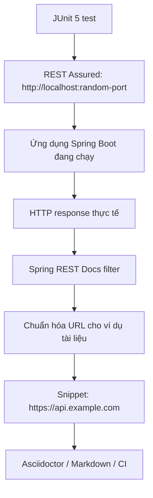

# Thiết lập host, port và scheme cho tài liệu Spring REST Docs với REST Assured

## 1. Cần phân biệt địa chỉ gọi API và địa chỉ trình bày trong tài liệu

Trong **Spring REST Docs**, dữ liệu của tài liệu API đến từ các bài kiểm thử HTTP được thực thi. Công cụ gửi request có thể là **MockMvc**, **WebTestClient** hoặc **REST Assured**; chương này sử dụng REST Assured để gọi server qua HTTP thật và tạo snippet cho request, response, payload, tham số và header.

Khi chạy integration test, ứng dụng Spring Boot thường lắng nghe tại một cổng ngẫu nhiên, chẳng hạn:

```text
http://localhost:51327/api/greetings/42
```

Nhưng người đọc tài liệu cần địa chỉ API sẽ sử dụng trong môi trường công khai:

```text
https://api.example.com/api/greetings/42
```

**Không cần gửi request test đến địa chỉ công khai để tài liệu hiển thị địa chỉ đó.** REST Assured quyết định nơi kết nối thật; Spring REST Docs cho phép cấu hình hoặc tiền xử lý URL xuất hiện trong các snippet.

| Thành phần URL | Ví dụ trong HTTP test | Ví dụ muốn công bố | Ý nghĩa |
| --- | --- | --- | --- |
| Scheme | `http` | `https` | Giao thức URL mà client dùng. |
| Host | `localhost` | `api.example.com` | Tên máy đích, không chứa scheme hoặc port. |
| Port | `51327` | `443` hoặc ẩn khi mặc định | Cổng dịch vụ. |
| Path | `/api/greetings/42` | `/api/greetings/42` | Tài nguyên REST đang được gọi. |

Trong ví dụ của bài, `api.example.com` là **tên miền minh họa**. Khi đưa vào dự án thật, dùng hostname do nhóm vận hành API cung cấp, đồng thời xác nhận đường dẫn và giao thức trong môi trường sẽ xuất bản.



Việc chuẩn hóa URL chỉ nên tác động đến **bản ghi tài liệu**. Các assertion vẫn phải đánh giá response của HTTP request đã thực thi.

## 2. Ba lớp cấu hình cần hiểu

Trong bài kiểm thử REST Assured, host/port/scheme có thể được khai báo ở những lớp sau:

| Lớp | API tiêu biểu | Ảnh hưởng |
| --- | --- | --- |
| REST Assured, kết nối thực tế | `RequestSpecBuilder.setBaseUri(...)`, `setPort(...)`, `setBasePath(...)` | Địa chỉ thực sự nhận HTTP request của bài test. |
| Spring REST Docs, URI tài liệu | `documentationConfiguration(provider).uris().withScheme(...).withHost(...).withPort(...)` | Địa chỉ sử dụng trong các ví dụ URI do REST Docs tạo. |
| Spring REST Docs, tiền xử lý | `preprocessRequest(modifyUris().scheme(...).host(...).removePort())` | Điều chỉnh URI được ghi trong snippet của request cụ thể. |

Một số ví dụ còn sử dụng `RestAssured.baseURI` hoặc `RestAssured.port` ở mức global. Với tài liệu kiểm thử chạy song song, `RequestSpecification` được tạo trong `@BeforeEach` thường dễ kiểm soát hơn vì không phụ thuộc vào giá trị global có thể bị test khác thay đổi.

**Mối quan hệ quan trọng:** `setBaseUri` dùng để **kết nối**; `withHost` hoặc `modifyUris().host` dùng để **trình bày tài liệu**. Không thay `setBaseUri("http://localhost")` thành `setBaseUri("https://api.example.com")` chỉ với mục đích sửa URL trong snippet, vì điều đó làm test gửi HTTP đến một server khác.

## 3. Chuẩn bị ví dụ Spring Boot có endpoint thật

Ví dụ sử dụng **Java 17, Spring Boot 3.x, JUnit Jupiter và REST Assured**. Nếu Spring Boot parent/BOM quản lý phiên bản của dự án, khai báo trong `build.gradle` như sau:

```groovy
dependencies {
    implementation 'org.springframework.boot:spring-boot-starter-web'

    testImplementation 'org.springframework.boot:spring-boot-starter-test'
    testImplementation 'io.rest-assured:rest-assured'
    testImplementation 'org.springframework.restdocs:spring-restdocs-restassured'
}

tasks.named('test') {
    useJUnitPlatform()
}
```

Trong Maven, dùng dependency tương ứng, đặt `spring-boot-starter-test`, `rest-assured` và `spring-restdocs-restassured` trong `<scope>test</scope>`. Nếu không dùng BOM hoặc dependency management của Spring Boot, phải chỉ định phiên bản thư viện tương thích.

Tạo endpoint tối thiểu ở `src/main/java/com/example/docs/DocsApplication.java`:

```java
package com.example.docs;

import org.springframework.boot.SpringApplication;
import org.springframework.boot.autoconfigure.SpringBootApplication;
import org.springframework.http.ResponseEntity;
import org.springframework.web.bind.annotation.GetMapping;
import org.springframework.web.bind.annotation.PathVariable;
import org.springframework.web.bind.annotation.RestController;

@SpringBootApplication
public class DocsApplication {

    public static void main(String[] args) {
        SpringApplication.run(DocsApplication.class, args);
    }

    public record Greeting(long id, String message) {}

    @RestController
    public static class GreetingController {
        @GetMapping("/api/greetings/{id}")
        public ResponseEntity<Greeting> get(@PathVariable long id) {
            if (id != 42L) {
                return ResponseEntity.notFound().build();
            }
            return ResponseEntity.ok(new Greeting(42L, "Xin chào"));
        }
    }
}
```

Đây là một HTTP endpoint có thể kiểm thử, với dữ liệu phản hồi cố định để dễ tái hiện. Trong ứng dụng thật, dữ liệu thường đến từ service/database; khi ấy nên chuẩn bị fixture trước mỗi bài test để không phụ thuộc trạng thái ngẫu nhiên của môi trường.

## 4. Cấu hình địa chỉ kết nối HTTP thực trong REST Assured

Để chạy test với server nhúng, sử dụng `@SpringBootTest(webEnvironment = RANDOM_PORT)` và `@LocalServerPort`. Phần thiết lập request nằm trong `@BeforeEach`:

```java
@LocalServerPort
private int port;

private RequestSpecification specification;

@BeforeEach
void setUp(RestDocumentationContextProvider restDocumentation) {
    this.specification = new RequestSpecBuilder()
            .setBaseUri("http://localhost")
            .setPort(this.port)
            .setBasePath("/api")
            .addFilter(documentationConfiguration(restDocumentation))
            .build();
}
```

Ý nghĩa:

1. `setBaseUri("http://localhost")` quy định **scheme HTTP** và **host local** cho kết nối.
2. `setPort(this.port)` nhận đúng cổng thực mà server Spring Boot vừa được cấp.
3. `setBasePath("/api")` thêm tiền tố `/api` cho những đường dẫn trong test; request chỉ cần gọi `/greetings/{id}`.
4. `documentationConfiguration(restDocumentation)` đăng ký filter cấu hình REST Docs; bản thân nó chưa xác định request nào cần sinh snippet.
5. `document("greetings-get", ...)` sẽ được gắn trong test qua `.filter(...)` trước `when()`.

Khi `basePath` đã là `/api`, không gọi `.get("/api/greetings/{id}")` vì có thể tạo đường dẫn lặp `/api/api/greetings/{id}`.

Trong dự án gọi **server HTTPS thật**, địa chỉ kết nối phải dùng `https://...` và cổng HTTPS hợp lệ:

```java
new RequestSpecBuilder()
        .setBaseUri("https://staging-api.example.com")
        .setPort(8443)
        .build();
```

Ví dụ đó chỉ phù hợp khi có server staging thực sự tại địa chỉ và cổng tương ứng, đồng thời test có cấu hình chứng chỉ TLS hợp lệ. Cấu hình **scheme công bố** trong tài liệu không tự biến server HTTP cục bộ thành server HTTPS.

## 5. Cách 1: đặt scheme, host và port trong `documentationConfiguration`

Với cấu hình REST Docs sử dụng API `uris()`, có thể đặt địa chỉ URI trong snippet ngay khi dựng `RequestSpecification`:

```java
this.specification = new RequestSpecBuilder()
        .setBaseUri("http://localhost")
        .setPort(this.port)
        .setBasePath("/api")
        .addFilter(documentationConfiguration(restDocumentation)
                .uris()
                    .withScheme("https")
                    .withHost("api.example.com")
                    .withPort(443))
        .build();
```

Thứ tự lệnh trên thể hiện sự khác nhau rõ ràng:

- **Request thật** vẫn gửi đến `http://localhost:<random-port>/api/...` nhờ `setBaseUri` và `setPort`.
- **URL trong tài liệu** được cấu hình theo `https`, `api.example.com` và cổng HTTPS `443` qua `uris()`.
- Giá trị `443` là cổng HTTPS chuẩn. Cách hiển thị cổng mặc định trong snippet cụ thể tùy bộ tạo snippet; khi cần chắc chắn không có phần `:port`, xem phương pháp `removePort()` ở mục 7.

Cách cấu hình này phù hợp khi **nhiều HTTP test của cùng một lớp hoặc module dùng chung địa chỉ tài liệu**. Nếu module có nhiều public hostname, các bộ test có thể thiết lập hostname khác nhau theo phạm vi API; không nên dùng một địa chỉ sai cho mọi dịch vụ.

**Không nhầm với DNS hoặc reverse proxy:** `api.example.com` ở đây chỉ là hostname dùng để trình bày ví dụ. REST Docs không kiểm tra tên miền đó có thực sự trỏ đến server production và không tự xác nhận TLS certificate. Thông tin domain/scheme cần được xác nhận từ cấu hình triển khai API.

## 6. Bài test đầy đủ: request local, snippet dùng host công khai

Đặt lớp sau tại `src/test/java/com/example/docs/GreetingDocumentationTest.java`:

```java
package com.example.docs;

import io.restassured.builder.RequestSpecBuilder;
import io.restassured.http.ContentType;
import io.restassured.specification.RequestSpecification;
import org.junit.jupiter.api.BeforeEach;
import org.junit.jupiter.api.Test;
import org.junit.jupiter.api.extension.ExtendWith;
import org.springframework.boot.test.context.SpringBootTest;
import org.springframework.boot.test.web.server.LocalServerPort;
import org.springframework.restdocs.RestDocumentationContextProvider;
import org.springframework.restdocs.RestDocumentationExtension;

import static io.restassured.RestAssured.given;
import static org.hamcrest.Matchers.equalTo;
import static org.springframework.restdocs.payload.PayloadDocumentation.fieldWithPath;
import static org.springframework.restdocs.payload.PayloadDocumentation.responseFields;
import static org.springframework.restdocs.request.RequestDocumentation.parameterWithName;
import static org.springframework.restdocs.request.RequestDocumentation.pathParameters;
import static org.springframework.restdocs.restassured.RestAssuredRestDocumentation.document;
import static org.springframework.restdocs.restassured.RestAssuredRestDocumentation.documentationConfiguration;

@SpringBootTest(webEnvironment = SpringBootTest.WebEnvironment.RANDOM_PORT)
@ExtendWith(RestDocumentationExtension.class)
class GreetingDocumentationTest {

    @LocalServerPort
    private int port;

    private RequestSpecification specification;

    @BeforeEach
    void setUp(RestDocumentationContextProvider restDocumentation) {
        this.specification = new RequestSpecBuilder()
                // HTTP thực sự gọi local server trên cổng ngẫu nhiên.
                .setBaseUri("http://localhost")
                .setPort(this.port)
                .setBasePath("/api")
                // URI hiển thị trong tài liệu.
                .addFilter(documentationConfiguration(restDocumentation)
                        .uris()
                            .withScheme("https")
                            .withHost("api.example.com")
                            .withPort(443))
                .build();
    }

    @Test
    void documentGetGreetingWithPublicUri() {
        given(this.specification)
                .accept(ContentType.JSON)
                .pathParam("id", 42)
                .filter(document("greetings-get",
                        pathParameters(
                                parameterWithName("id")
                                        .description("Mã lời chào")),
                        responseFields(
                                fieldWithPath("id")
                                        .description("Mã lời chào"),
                                fieldWithPath("message")
                                        .description("Nội dung lời chào"))))
        .when()
                .get("/greetings/{id}")
        .then()
                .statusCode(200)
                .contentType(ContentType.JSON)
                .body("id", equalTo(42))
                .body("message", equalTo("Xin chào"));
    }
}
```

Khi chạy, test thực hiện lần lượt:

1. Spring Boot khởi chạy HTTP server và cấp một cổng trống cho lần kiểm thử này.
2. REST Assured tạo request tới `http://localhost:<port>/api/greetings/42`.
3. `document("greetings-get", ...)` xử lý request/response thực, kiểm tra descriptor và sinh snippet.
4. REST Docs dùng cấu hình URI công khai khi trình bày URI trong snippet thích hợp, chẳng hạn ví dụ `curl`.
5. Assertion xác nhận HTTP 200 và JSON có `id = 42`, `message = "Xin chào"`.

Ví dụ này yêu cầu endpoint và dữ liệu đúng như mã nguồn ở mục 3. Nếu dự án đang dùng Spring Boot khác 3.x, đường dẫn import `@LocalServerPort` và chi tiết API kiểm thử có thể khác, cần đối chiếu theo phiên bản đang sử dụng.

Trong snippet `curl-request.adoc`, một URL minh họa mong muốn là:

```bash
curl 'https://api.example.com/api/greetings/42' -i -X GET \
    -H 'Accept: application/json'
```

Đây là **minh họa kết quả**, không phải chuỗi byte được bảo đảm giống hệt giữa mọi phiên bản Spring REST Docs. Tên file, bố cục và cách hiện cổng có thể khác theo cấu hình. Giá trị thật cần kiểm tra là URL công bố phải dùng `https://api.example.com` thay vì `http://localhost:<random-port>`.

## 7. Cách 2: chuẩn hóa URI bằng request preprocessor

Một lựa chọn khác là giữ cấu hình REST Docs cơ bản trong `@BeforeEach` rồi dùng `OperationRequestPreprocessor` cho từng request. Phương pháp này phù hợp nếu chỉ một số endpoint hoặc tình huống cần một URL hiển thị khác.

Để minh họa, thay **filter `document(...)` ở test GET** bằng:

```java
given(this.specification)
        .accept(ContentType.JSON)
        .pathParam("id", 42)
        .filter(document("greetings-get",
                preprocessRequest(
                        modifyUris()
                                .scheme("https")
                                .host("api.example.com")
                                .removePort()),
                preprocessResponse(prettyPrint()),
                pathParameters(
                        parameterWithName("id")
                                .description("Mã lời chào")),
                responseFields(
                        fieldWithPath("id")
                                .description("Mã lời chào"),
                        fieldWithPath("message")
                                .description("Nội dung lời chào"))))
.when()
        .get("/greetings/{id}")
.then()
        .statusCode(200)
        .body("id", equalTo(42));
```

Thêm các static import:

```java
import static org.springframework.restdocs.operation.preprocess.Preprocessors.modifyUris;
import static org.springframework.restdocs.operation.preprocess.Preprocessors.preprocessRequest;
import static org.springframework.restdocs.operation.preprocess.Preprocessors.preprocessResponse;
import static org.springframework.restdocs.operation.preprocess.Preprocessors.prettyPrint;
```

Giải thích từng thao tác:

| API | Hiệu ứng trên snippet |
| --- | --- |
| `modifyUris().scheme("https")` | Hiển thị giao thức HTTPS trong URL tài liệu. |
| `.host("api.example.com")` | Thay hostname local thành tên miền ví dụ. |
| `.removePort()` | Xóa cổng ngẫu nhiên khỏi URI được tài liệu hóa. |
| `preprocessResponse(prettyPrint())` | Định dạng payload trong snippet response để dễ đọc, khi định dạng hỗ trợ. |

Khi dùng cách 2, trong `@BeforeEach` có thể chỉ giữ:

```java
.addFilter(documentationConfiguration(restDocumentation))
```

Không cần áp dụng đồng thời cả cấu hình `uris().with...` lẫn `modifyUris()` cho cùng một mục đích. Nếu một dự án chủ ý dùng cả hai, phải hiểu rõ thứ tự và mức ưu tiên biến đổi, rồi kiểm tra nội dung snippet sau cùng.

**Ranh giới của preprocessor:** nó biến đổi nội dung được ghi vào tài liệu; nó không đổi nơi REST Assured kết nối, không cấu hình TLS trên server và không kiểm chứng rằng hostname công bố có thể truy cập. Với token, cookie hoặc thông tin nhạy cảm, cần thêm bộ tiền xử lý thích hợp để loại bỏ/che giá trị trước khi phát hành. Không đặt credential thật vào test.

## 8. Những trường hợp dễ gây nhầm lẫn về scheme, host và port

### 8.1. HTTPS công khai chạy sau reverse proxy

Trong nhiều hệ thống, client ngoài Internet gọi:

```text
https://api.example.com/api/greetings/42
```

Trong khi service nội bộ được proxy chuyển tiếp qua HTTP:

```text
http://127.0.0.1:8080/api/greetings/42
```

Tài liệu API dành cho client nên dùng URL **công khai được bảo đảm hỗ trợ**. Không suy ra URL public từ địa chỉ server nhúng hoặc một header do test tình cờ gửi. Cấu hình reverse proxy, `X-Forwarded-Proto` và `Forwarded` là vấn đề riêng của hạ tầng triển khai; URI trong snippet cần được chọn theo hợp đồng mà client thực sự sử dụng.

### 8.2. Cổng mặc định và cổng không mặc định

| URL mong muốn | Scheme | Host | Port |
| --- | --- | --- | --- |
| `https://api.example.com/books` | `https` | `api.example.com` | Mặc định `443`; thường không hiện trong URL. |
| `http://api.example.com/books` | `http` | `api.example.com` | Mặc định `80`; thường không hiện trong URL. |
| `https://api.example.com:8443/books` | `https` | `api.example.com` | `8443`, phải thể hiện khi client cần kết nối cổng này. |

Khi dùng cổng không mặc định cho tài liệu, thiết lập rõ `withPort(8443)` hoặc giữ cổng phù hợp trong bước tiền xử lý. Khi không muốn in cổng mặc định, `modifyUris().removePort()` là cách thể hiện ý định rõ ràng.

### 8.3. Base path và URL đầy đủ

Với `setBasePath("/api")`, gọi `.get("/greetings/{id}")` là phù hợp. Nếu đã ghi toàn bộ `/api/greetings/{id}` trong lệnh `.get(...)`, có thể bỏ `setBasePath`. Nếu backend public dùng tiền tố `/v1` mà test nội bộ không có tiền tố đó, việc sửa **host/scheme/port** chưa đủ: cần thiết kế cách tài liệu hóa đường dẫn public, kiểm tra cách rewrite của gateway và các preprocessor tương ứng. Không tự thay path khi chưa xác minh routing thực tế.

### 8.4. Vô tình gọi môi trường công khai

```java
// Không dùng cách này chỉ để đổi địa chỉ hiện trên tài liệu.
new RequestSpecBuilder()
        .setBaseUri("https://api.example.com")
        .build();
```

Cấu hình trên làm HTTP test gửi request ra ngoài thật. Nó chỉ đúng nếu đang chủ ý chạy integration test với server công khai, có quyền truy cập và dữ liệu kiểm thử riêng. Nếu mục tiêu chỉ là chuẩn hóa ví dụ, hãy giữ địa chỉ kết nối local/staging và dùng API URI của Spring REST Docs.

## 9. Kiểm tra snippet và đưa vào Asciidoctor/Markdown

Sau khi chạy test, Spring REST Docs thường tạo các file trong `build/generated-snippets` (Gradle) hoặc `target/generated-snippets` (Maven); có thể thay đổi vị trí bằng cấu hình build:

```text
build/generated-snippets/greetings-get/
  curl-request.adoc
  http-request.adoc
  http-response.adoc
  path-parameters.adoc
  response-fields.adoc
  ...
```

**Cách kiểm tra đúng việc chuẩn hóa host/port/scheme:**

1. Mở `curl-request.adoc`; kiểm tra URL dùng `https://api.example.com` và path được công bố.
2. Mở `http-request.adoc`; kiểm tra URI và header `Host` theo định dạng snippet được sinh. Không suy đoán rằng file nào cũng biểu diễn URL theo cùng cách.
3. Mở `http-response.adoc`; kiểm tra status và JSON đến từ endpoint thật, không sửa response chỉ để làm ví dụ “đẹp”.
4. Xác nhận `path-parameters.adoc`, `response-fields.adoc` phản ánh descriptor của request/response.
5. Xác nhận **toàn bộ bài kiểm thử đã pass**. Việc file tồn tại chưa chứng minh assertion đều thành công.

Ví dụ tài liệu Asciidoctor `src/docs/asciidoc/api.adoc`:

```asciidoc
= Greeting API

== Lấy lời chào

=== HTTP request
include::{snippets}/greetings-get/http-request.adoc[]

=== curl
include::{snippets}/greetings-get/curl-request.adoc[]

=== Path parameters
include::{snippets}/greetings-get/path-parameters.adoc[]

=== Response
include::{snippets}/greetings-get/http-response.adoc[]

=== Response fields
include::{snippets}/greetings-get/response-fields.adoc[]
```

Thuộc tính `{snippets}` phải trỏ đến đúng thư mục generated snippets mà build hiện tại tạo ra. Nếu dự án phát hành tài liệu ở định dạng Markdown, cần bước chuyển đổi/nhúng AsciiDoc phù hợp; Markdown thuần không tự xử lý `include::...[]`.

Trong **CI**, giữ quan hệ phụ thuộc:

```text
Khởi động ứng dụng test và chạy REST Assured
  -> Xác nhận assertion và snippet descriptors thành công
  -> Kiểm tra URI công bố / không lộ dữ liệu nhạy cảm
  -> Biên soạn Asciidoctor hoặc Markdown
  -> Đóng gói / phát hành tài liệu
```

Nếu test thất bại, pipeline cần dừng trước bước xuất bản để tránh đưa snippet cũ hoặc chưa được xác minh vào tài liệu chính thức.

## 10. Lỗi thường gặp

| Hiện tượng | Nguyên nhân khả dĩ | Cách xử lý |
| --- | --- | --- |
| Snippet hiển thị `localhost:<random-port>` | Mới cấu hình `setBaseUri/setPort` cho REST Assured nhưng chưa chuẩn hóa URI của REST Docs. | Dùng `documentationConfiguration(...).uris()` hoặc `preprocessRequest(modifyUris()...)`. |
| Test bị `Connection refused` | `setPort(...)` không khớp cổng server đang chạy hoặc server chưa khởi động. | Dùng `RANDOM_PORT` kết hợp `@LocalServerPort`, kiểm tra base URI. |
| Test gọi sang API public ngoài ý muốn | Đặt host công bố trong `setBaseUri` thay vì cấu hình snippet. | Khôi phục base URI của môi trường test; chuẩn hóa URI trong REST Docs. |
| Tài liệu hiện sai `http` thay vì `https` | Chưa dùng `withScheme("https")` hoặc `modifyUris().scheme("https")`. | Cập nhật scheme của tài liệu và xem lại `curl-request.adoc`. |
| URL công bố còn cổng ngẫu nhiên | Chưa xử lý port hoặc đang dùng địa chỉ thực của test. | Dùng `withPort(...)` cho cổng public phù hợp hoặc `removePort()` nếu cần bỏ cổng. |
| Lệnh `curl` trong tài liệu bị 404 | Sai base path hoặc gateway có rewrite path khác với service nội bộ. | Đối chiếu chính xác URL public với routing thực tế. |
| Không có thư mục `greetings-get` | Thiếu filter `document(...)`, test chưa chạy hoặc output directory khác. | Kiểm tra `RestDocumentationExtension`, `documentationConfiguration`, `document` và build output. |
| Có snippet nhưng test đỏ | Filter đã chạy trước assertion thất bại hoặc descriptor không khớp. | Xem kết quả JUnit, sửa API/test/descriptor trước khi phát hành. |
| Snippet chứa token, cookie hoặc host nội bộ | Chưa tiền xử lý và rà soát nội dung công bố. | Thêm preprocessor phù hợp, dùng dữ liệu giả và kiểm tra snippet. |

## 11. Checklist thực hành

- [ ] Đã xác định **địa chỉ server mà bài test thật sự gọi** và **địa chỉ API công bố**.
- [ ] Đã cấu hình `setBaseUri(...)`, `setPort(...)` và `setBasePath(...)` đúng với môi trường kiểm thử.
- [ ] Đã gắn `documentationConfiguration(restDocumentation)` vào specification của REST Assured.
- [ ] Đã dùng `uris().withScheme(...).withHost(...).withPort(...)` hoặc `modifyUris()` để chuẩn hóa địa chỉ tài liệu.
- [ ] Đã gắn `document("identifier", ...)` trước `when()` và kiểm tra HTTP status/body bằng assertion.
- [ ] Đã kiểm tra `curl-request.adoc` và `http-request.adoc` có scheme, host, port và path công bố đúng.
- [ ] Đã xác nhận dữ liệu trong response và các descriptor được ghi từ HTTP thực tế.
- [ ] Đã loại thông tin nhạy cảm và đảm bảo build/CI chỉ xuất bản tài liệu từ test thành công.

Một HTTP test có thể chạy an toàn trên `http://localhost:<random-port>` trong khi tài liệu mô tả `https://api.example.com`. Cấu hình tách biệt **địa chỉ kết nối** và **địa chỉ xuất hiện trong snippet** là nền tảng để tạo tài liệu REST API ổn định, dễ dùng và có thể kiểm chứng với Spring REST Docs.
