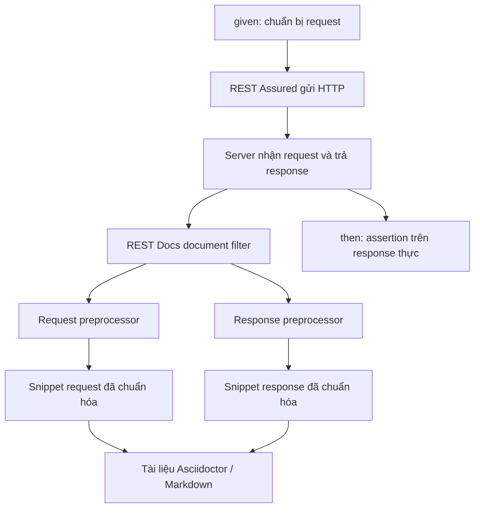

# Tiền xử lý request và response trong REST Assured filter

## 1. Vì sao cần tiền xử lý trước khi ghi tài liệu?

**Spring REST Docs** tạo tài liệu REST API từ các HTTP test đã thực thi bằng MockMvc, WebTestClient hoặc REST Assured. Với REST Assured, filter `document(...)` quan sát request được gửi và response nhận về, rồi tạo các snippet cho request, response, payload, tham số và header.

Trong thực tế, dữ liệu HTTP thô đôi khi không phù hợp để đưa nguyên trạng vào tài liệu. Request có thể chứa `Authorization`, cookie phiên đăng nhập, hostname nội bộ hoặc giá trị truy vết của một lần chạy. Response có thể chứa ID sinh ngẫu nhiên, liên kết nội bộ hoặc JSON khó đọc. Spring REST Docs cung cấp **Operation Preprocessors** để thay đổi bản request/response dùng cho tài liệu trước khi sinh snippet.

Điều cần phân biệt: preprocessor biến đổi bản ghi được dùng để **document**; nó không thay đổi request đã gửi đến server hoặc response mà ứng dụng trả về. Các assertion REST Assured vẫn đánh giá trao đổi HTTP thật.



Những trường hợp thường cần tiền xử lý:

| Tình huống | Xử lý phù hợp |
| --- | --- |
| Bỏ token khỏi tài liệu | `preprocessRequest(modifyHeaders().remove("Authorization"))` |
| Định dạng JSON dễ đọc | `preprocessRequest(prettyPrint())` hoặc `preprocessResponse(prettyPrint())` |
| Chuẩn hóa host, scheme, port | `modifyUris()` trong request/response preprocessor |
| Thay giá trị nhạy cảm trong nội dung | `replacePattern(...)` hoặc custom `ContentModifier` |
| Loại bỏ hoặc chuẩn hóa header | `modifyHeaders()` với `remove`, `set`, `add` |
| Ẩn liên kết hypermedia để nhấn mạnh cách điều hướng | `maskLinks(...)` |

## 2. Hai cách cấu hình preprocessor

Spring REST Docs cho phép áp dụng tiền xử lý tại hai phạm vi:

**Theo từng request:** truyền `OperationRequestPreprocessor` và/hoặc `OperationResponsePreprocessor` trực tiếp vào overload `document(...)`. Đây là lựa chọn phù hợp khi chỉ một endpoint cần che token, thay hostname hoặc chuẩn hóa payload.

**Mặc định cho toàn bộ test dùng chung cấu hình:** thêm request/response defaults vào `documentationConfiguration(...).operationPreprocessors()` trong `@BeforeEach`. Đây là lựa chọn phù hợp khi mọi snippet trong lớp test cần cùng quy tắc, chẳng hạn luôn xóa `Authorization` và pretty print response.

| Phạm vi | Ưu điểm | Cần lưu ý |
| --- | --- | --- |
| Trong `document(...)` | Quy tắc hiển thị rõ ngay tại test và có thể tùy biến theo endpoint. | Dễ lặp lại nếu nhiều test dùng cùng một quy tắc. |
| Cấu hình defaults | Dùng chung quy tắc và giảm lặp code. | Mọi snippet sử dụng specification đó đều bị áp dụng; phải bảo đảm quy tắc an toàn với tất cả endpoint. |

Hai cách có thể kết hợp: cấu hình những bước chuẩn hóa chung trong defaults rồi bổ sung bước riêng tại `document(...)` nếu API cụ thể cần. Cần kiểm tra thứ tự áp dụng và kết quả snippet để tránh một bước sau vô tình ghi đè kết quả của bước trước.

## 3. Dependency và cấu hình REST Assured cơ bản

Ví dụ sử dụng Spring Boot 3.x, JUnit Jupiter và REST Assured. Khi dự án đã có Spring Boot BOM quản lý version, có thể khai báo Gradle:

```groovy
dependencies {
    testImplementation 'org.springframework.boot:spring-boot-starter-test'
    testImplementation 'io.rest-assured:rest-assured'
    testImplementation 'org.springframework.restdocs:spring-restdocs-restassured'
}

tasks.named('test') {
    useJUnitPlatform()
}
```

Trong Maven, các dependency kiểm thử tương ứng nằm trong `<scope>test</scope>`. Nếu dự án không dùng BOM/parent quản lý version, phải khai báo version tương thích giữa Spring Boot, Spring REST Docs và REST Assured.

Với JUnit 5, REST Assured cần một `RequestSpecification` có filter cấu hình REST Docs:

```java
@SpringBootTest(webEnvironment = SpringBootTest.WebEnvironment.RANDOM_PORT)
@ExtendWith(RestDocumentationExtension.class)
class AccountDocumentationTest {

    @LocalServerPort
    private int port;

    private RequestSpecification specification;

    @BeforeEach
    void setUp(RestDocumentationContextProvider restDocumentation) {
        this.specification = new RequestSpecBuilder()
                .setBaseUri("http://localhost")
                .setPort(this.port)
                .setBasePath("/api")
                .addFilter(documentationConfiguration(restDocumentation))
                .build();
    }
}
```

`RANDOM_PORT` khởi động server HTTP cho test; `@LocalServerPort` cung cấp cổng thực. `documentationConfiguration(restDocumentation)` thiết lập ngữ cảnh Spring REST Docs. Mỗi request cần được ghi tài liệu sẽ gắn thêm `document(...)` trong phần `given(...)`, trước `when()`.

## 4. Tiền xử lý riêng từng request bằng `document(...)`

Các static import thường dùng:

```java
import static org.springframework.restdocs.operation.preprocess.Preprocessors.modifyHeaders;
import static org.springframework.restdocs.operation.preprocess.Preprocessors.prettyPrint;
import static org.springframework.restdocs.operation.preprocess.Preprocessors.preprocessRequest;
import static org.springframework.restdocs.operation.preprocess.Preprocessors.preprocessResponse;
```

Ví dụ một API nhận `GET /api/accounts/42`. Request thật có header `Authorization`, nhưng tài liệu công khai không nên chứa token:

```java
@Test
void documentAccount() {
    given(this.specification)
            .accept(ContentType.JSON)
            .header("Authorization", "Bearer test-secret-token")
            .filter(document("accounts-get",
                    preprocessRequest(
                            modifyHeaders().remove("Authorization")),
                    preprocessResponse(prettyPrint()),
                    pathParameters(
                            parameterWithName("id").description("Mã tài khoản")),
                    responseFields(
                            fieldWithPath("id").description("Mã tài khoản"),
                            fieldWithPath("displayName").description("Tên hiển thị"))))
    .when()
            .get("/accounts/{id}", 42)
    .then()
            .statusCode(200)
            .body("id", equalTo(42));
}
```

Trong ví dụ này:

1. REST Assured gửi request thật cùng `Authorization: Bearer test-secret-token` đến server.
2. `preprocessRequest(modifyHeaders().remove("Authorization"))` loại header khỏi bản request dùng để document.
3. `preprocessResponse(prettyPrint())` định dạng body response trước khi ghi snippet.
4. `pathParameters(...)` và `responseFields(...)` tạo các snippet mô tả cấu trúc request/response.
5. `.then()` vẫn kiểm tra response thật. Nếu server trả sai status hoặc dữ liệu, test vẫn thất bại.

Overload REST Assured có dạng `document(identifier, requestPreprocessor, responsePreprocessor, snippets...)`. Có thể chỉ truyền một preprocessor nếu chỉ cần xử lý request hoặc response. Tham số mô tả snippet có thể được truyền tiếp sau các preprocessor.

**Lưu ý:** giá trị token trong ví dụ là dữ liệu giả. Không sử dụng token, mật khẩu, cookie hoặc dữ liệu cá nhân thật trong test fixture. Việc xóa một header khỏi snippet không bảo đảm các bản sao của giá trị đó không xuất hiện trong body, URL, log hoặc header khác; phải kiểm tra toàn bộ dữ liệu được document.

## 5. Cấu hình preprocessor mặc định cho mọi request/response

Nếu lớp test muốn mọi request đều bỏ `Authorization` và mọi response đều được pretty print, cấu hình defaults ngay khi tạo specification:

```java
@BeforeEach
void setUp(RestDocumentationContextProvider restDocumentation) {
    this.specification = new RequestSpecBuilder()
            .setBaseUri("http://localhost")
            .setPort(this.port)
            .setBasePath("/api")
            .addFilter(documentationConfiguration(restDocumentation)
                    .operationPreprocessors()
                        .withRequestDefaults(
                                modifyHeaders().remove("Authorization"))
                        .withResponseDefaults(prettyPrint()))
            .build();
}
```

Sau đó, mỗi test chỉ cần khai báo phần mô tả đặc thù:

```java
given(this.specification)
        .filter(document("accounts-get",
                pathParameters(
                        parameterWithName("id").description("Mã tài khoản")),
                responseFields(
                        fieldWithPath("id").description("Mã tài khoản"),
                        fieldWithPath("displayName").description("Tên hiển thị"))))
.when()
        .get("/accounts/{id}", 42)
.then()
        .statusCode(200);
```

`withRequestDefaults(...)` đăng ký những bước áp dụng cho mọi request được tài liệu hóa qua configurer này; `withResponseDefaults(...)` đăng ký các bước mặc định cho response. API này thuộc `RestDocumentationConfigurer` và được hỗ trợ trong tích hợp REST Assured.

Chỉ đưa vào defaults những quy tắc đúng với toàn bộ các endpoint. Ví dụ, không nên xóa mọi header `Content-Type` nếu tài liệu cần thể hiện định dạng request/response. Nếu một test cần document `Authorization` trong tài liệu nội bộ có kiểm soát, hãy cấu hình phạm vi riêng thay vì vô tình áp dụng quy tắc mặc định xung đột.

## 6. Những preprocessor tích hợp sẵn thường dùng

### 6.1. Định dạng JSON với `prettyPrint()`

`prettyPrint()` định dạng payload của request hoặc response để snippet dễ đọc. Có thể áp dụng riêng:

```java
.filter(document("orders-get",
        preprocessResponse(prettyPrint()),
        responseFields(
                fieldWithPath("id").description("Mã đơn hàng"),
                fieldWithPath("status").description("Trạng thái"))))
```

Hoặc dùng `preprocessRequest(prettyPrint())` nếu body request cũng cần định dạng. Pretty print chỉ thay đổi cách trình bày nội dung được ghi lại; không sửa response mà ứng dụng đã gửi cho client.

### 6.2. Thêm, đặt hoặc xóa header với `modifyHeaders()`

`modifyHeaders()` hỗ trợ biến đổi header của request/response. Ví dụ:

```java
preprocessRequest(
        modifyHeaders()
                .remove("Authorization")
                .remove("Cookie")
                .set("Host", "api.example.com"))
```

Trong tài liệu công khai, hãy cân nhắc có nên giữ header `Host` đã được chuẩn hóa hay không. Chỉ thêm hoặc đặt header để thể hiện đúng hợp đồng client phải dùng; không tạo ra một request mẫu có header mâu thuẫn với URL.

### 6.3. Chuẩn hóa URI bằng `modifyUris()`

Khi test gửi request đến `http://localhost:<random-port>`, tài liệu có thể cần thể hiện địa chỉ public:

```java
preprocessRequest(
        modifyUris()
                .scheme("https")
                .host("api.example.com")
                .removePort())
```

Preprocessor thay URI trong snippet; nó không đổi địa chỉ mà REST Assured kết nối. Tên miền `api.example.com` chỉ là ví dụ, cần thay bằng domain đã được xác nhận của API.

### 6.4. Thay pattern với `replacePattern(...)`

Đối với dữ liệu trong body, có thể dùng biểu thức chính quy để thay các chuỗi có cấu trúc ổn định. Ví dụ sau thay một chuỗi API key dạng giả định:

```java
preprocessRequest(
        replacePattern(
                Pattern.compile("api-key-[A-Za-z0-9]+"),
                "api-key-[REDACTED]"))
```

Phải import `java.util.regex.Pattern` và static import `replacePattern`. Kiểm tra pattern có bắt đúng toàn bộ giá trị nhạy cảm mà không làm hỏng dữ liệu hợp lệ. Regex không phải bộ phân tích JSON: nếu cấu trúc dữ liệu phức tạp hoặc tên trường có nhiều dạng, hãy cân nhắc custom content modifier để xử lý có chủ đích.

### 6.5. Che liên kết hypermedia với `maskLinks(...)`

Với response HAL/hypermedia, nếu muốn hướng người đọc sử dụng relation thay vì hard-code URL, `maskLinks(...)` có thể thay giá trị `href` trong liên kết. Ví dụ:

```java
preprocessResponse(maskLinks())
```

Có thể chọn chuỗi thay thế khác theo overload của API. Chỉ dùng với response có cấu trúc link mà Spring REST Docs nhận diện; không sử dụng để che mọi URL nếu client cần biết URL mẫu cụ thể để tích hợp.

## 7. Kết hợp nhiều bước và thứ tự áp dụng

Một preprocessor có thể gồm nhiều thao tác. Ví dụ, request cần bỏ token, chuẩn hóa URL và định dạng JSON; response cần định dạng nội dung:

```java
.filter(document("orders-create",
        preprocessRequest(
                modifyHeaders().remove("Authorization"),
                modifyUris().scheme("https").host("api.example.com").removePort(),
                prettyPrint()),
        preprocessResponse(prettyPrint()),
        requestFields(
                fieldWithPath("productId").description("Mã sản phẩm"),
                fieldWithPath("quantity").description("Số lượng")),
        responseFields(
                fieldWithPath("id").description("Mã đơn hàng"),
                fieldWithPath("status").description("Trạng thái đơn hàng"))))
```

Danh sách thao tác được áp dụng theo thứ tự truyền vào. Chọn thứ tự sao cho phép biến đổi sau không làm hỏng kết quả của phép biến đổi trước. Chẳng hạn, cần chỉnh header trước khi lưu snippet và thay URI trước khi tạo ví dụ `curl`.

Không được dùng preprocessor để làm cho descriptor “trông như đúng” khi endpoint trả dữ liệu sai. Nếu response thực tế có `status = PENDING` nhưng assertion nghiệp vụ yêu cầu `CONFIRMED`, test phải thất bại; pretty print hoặc thay pattern không được dùng để che lỗi hợp đồng.

## 8. Viết preprocessor tùy chỉnh khi built-in chưa đủ

Nếu cần biến đổi nội dung có cấu trúc, có thể implement `ContentModifier` rồi dùng với `ContentModifyingOperationPreprocessor`, hoặc implement `OperationPreprocessor` nếu phải thay đổi cả request/response metadata. Ví dụ dưới đây minh họa một `ContentModifier` đơn giản thay một chuỗi email trong nội dung:

```java
import java.nio.charset.StandardCharsets;
import java.nio.charset.Charset;
import org.springframework.http.MediaType;
import org.springframework.restdocs.operation.preprocess.ContentModifier;

public class EmailRedactionModifier implements ContentModifier {

    @Override
    public byte[] modifyContent(byte[] originalContent, MediaType contentType) {
        Charset charset = contentType != null && contentType.getCharset() != null
                ? contentType.getCharset()
                : StandardCharsets.UTF_8;
        String body = new String(originalContent, charset);
        String sanitized = body.replace("private@example.test", "user@example.test");
        return sanitized.getBytes(charset);
    }
}
```

Dùng với content-modifying preprocessor:

```java
import org.springframework.restdocs.operation.preprocess.ContentModifyingOperationPreprocessor;
import static org.springframework.restdocs.operation.preprocess.Preprocessors.preprocessResponse;

preprocessResponse(
        new ContentModifyingOperationPreprocessor(new EmailRedactionModifier()))
```

`ContentModifier` nhận `byte[] originalContent` và `MediaType contentType`; tham số content type có thể là `null`. Ví dụ chọn charset từ media type nếu có và dùng UTF-8 làm mặc định. Trong hệ thống thực, modifier cần cân nhắc JSON escaping, giá trị lặp lại và trường dữ liệu lồng nhau. Không dùng cách thay chuỗi thô cho payload nhị phân hoặc nội dung multipart. Với JSON phức tạp, cân nhắc parse thành cây JSON, thay các node theo tên trường rồi serialize lại.

Nếu cần can thiệp thêm vào method, URI, headers hoặc metadata của operation, implement `OperationPreprocessor` và xử lý `OperationRequest`/`OperationResponse` theo API. Giữ nguyên thuộc tính không cần thay đổi và viết test riêng cho preprocessor tùy chỉnh trước khi áp dụng hàng loạt.

## 9. Kiểm tra kết quả snippet và bảo vệ dữ liệu

Sau khi test chạy, các snippet thường được tạo ở:

```text
build/generated-snippets/accounts-get/       # Gradle
target/generated-snippets/accounts-get/      # Maven
```

Kiểm tra ít nhất:

| File | Điều cần xem |
| --- | --- |
| `http-request.adoc` | `Authorization`/`Cookie` đã được loại bỏ chưa; URI/Host có đúng bản công bố không. |
| `curl-request.adoc` | URL và header có thể dùng làm ví dụ cho client không; có lộ token không. |
| `request-body.adoc` | Dữ liệu nhạy cảm trong payload đã được che đúng chưa. |
| `http-response.adoc` | Status, header và body vẫn mô tả đúng response nhận được. |
| `response-body.adoc` | JSON có dễ đọc và giá trị đã được chuẩn hóa đúng chưa. |
| `request-fields.adoc` / `response-fields.adoc` | Descriptor mô tả đúng cấu trúc API, không che mất lỗi schema. |

Tiền xử lý để công bố không thay thế bảo mật ở test. Nên dùng token giả, dữ liệu fixture không nhạy cảm và chỉ che các giá trị không phù hợp với tài liệu. Không ghi credential thật vào log, snippet, CI artifact hoặc repository.

Một quy trình hợp lý:

1. Gửi request thật bằng REST Assured.
2. Để filter tạo bản ghi request/response.
3. Tiền xử lý nội dung dùng cho tài liệu.
4. Kiểm tra descriptor và assertion đối với trao đổi HTTP.
5. Xem snippet sau cùng để xác nhận dữ liệu đã được loại bỏ/chuẩn hóa như mong đợi.
6. Chỉ chuyển snippet thành tài liệu chính thức khi toàn bộ test pass.

## 10. Tích hợp Asciidoctor và CI

Ví dụ tài liệu Asciidoctor có thể nhúng các snippet:

```asciidoc
= Accounts API

== Lấy tài khoản

=== HTTP request
include::{snippets}/accounts-get/http-request.adoc[]

=== Request headers
include::{snippets}/accounts-get/request-headers.adoc[]

=== HTTP response
include::{snippets}/accounts-get/http-response.adoc[]

=== Response fields
include::{snippets}/accounts-get/response-fields.adoc[]
```

Thuộc tính `{snippets}` phải trỏ đúng thư mục được build tạo ra. Nếu xuất bản bằng Markdown, cần bước chuyển đổi hoặc cơ chế nhúng snippet AsciiDoc phù hợp; các directive `include::...[]` là cú pháp Asciidoctor.

Trong CI, giữ thứ tự:

```text
REST Assured HTTP tests
    -> document filter + preprocessors
    -> generated-snippets
    -> test result validation
    -> Asciidoctor / Markdown conversion
    -> package / publish
```

Build phải dừng nếu test hoặc descriptor thất bại. Filter có thể sinh file trước khi assertion cuối cùng kết luận test thất bại, do đó không phát hành chỉ dựa trên sự hiện diện của thư mục snippet. Nên dùng artifact của đúng build hiện tại, tránh trộn snippet cũ còn sót lại.

## 11. Lỗi thường gặp

| Hiện tượng | Nguyên nhân có thể | Hướng giải quyết |
| --- | --- | --- |
| `preprocessRequest` không tìm thấy | Thiếu static import hoặc dependency Spring REST Docs không đúng. | Kiểm tra `org.springframework.restdocs.operation.preprocess.Preprocessors`. |
| Header nhạy cảm vẫn xuất hiện | Preprocessor được đặt nhầm ở response, sai tên header hoặc test dùng một filter khác. | Dùng `preprocessRequest(modifyHeaders().remove("Authorization"))` trong đúng `document(...)`; đọc lại `http-request.adoc`. |
| Response JSON vẫn một dòng | Chưa áp dụng `preprocessResponse(prettyPrint())` hoặc content type không được nhận diện là JSON. | Xem content type thực, thêm response preprocessor và kiểm tra snippet. |
| URL tài liệu vẫn là localhost | Chưa dùng `modifyUris()` hoặc áp dụng preprocessor không đúng request. | Kiểm tra `curl-request.adoc` và request URI sau tiền xử lý. |
| Regex che thiếu dữ liệu | Pattern không bao phủ các dạng giá trị/escaping khác nhau. | Viết test cho pattern; cân nhắc parse payload theo cấu trúc thay vì regex. |
| Snippet response bị mất giá trị cần thiết | Quy tắc remove/replace áp dụng quá rộng hoặc sai thứ tự. | Thu hẹp preprocessor và kiểm tra payload sau từng bước. |
| Defaults ảnh hưởng endpoint không mong muốn | Đặt quy tắc ở `withRequestDefaults`/`withResponseDefaults` dù chỉ một API cần. | Chuyển quy tắc sang `document(...)` riêng của endpoint đó. |
| Có snippet nhưng test thất bại | Filter ghi snippet trước assertion hoặc descriptor hoàn tất. | Đọc kết quả JUnit; không xuất bản tài liệu từ test không pass. |

## 12. Checklist thực hành

- [ ] Đã phân biệt dữ liệu HTTP thật với bản request/response dùng để document.
- [ ] Đã quyết định preprocessor áp dụng theo từng request hay theo defaults.
- [ ] Đã đặt request preprocessor trong `preprocessRequest(...)` và response preprocessor trong `preprocessResponse(...)`.
- [ ] Đã sử dụng đúng built-in như `prettyPrint`, `modifyHeaders`, `modifyUris`, `replacePattern` hoặc `maskLinks`.
- [ ] Đã kiểm tra header, URI và body trong snippet sau khi tiền xử lý.
- [ ] Đã giữ assertion trên response thật và descriptor phản ánh đúng schema API.
- [ ] Đã dùng dữ liệu giả, không để lộ token/cookie/PII trong test artifact.
- [ ] Đã chỉ biên soạn và phát hành tài liệu khi test và build đều thành công.

Tiền xử lý giúp Spring REST Docs tạo ví dụ HTTP dễ đọc, nhất quán và an toàn để công bố mà vẫn giữ kiểm chứng dựa trên request/response thực. Với REST Assured, chỉ cần gắn preprocessor vào `document(...)` hoặc cấu hình defaults trong `documentationConfiguration(...)`; phần assertion vẫn tiếp tục xác minh hành vi của API.

## Tài liệu tham khảo

- [Spring REST Docs – Customizing requests and responses](https://docs.spring.io/spring-restdocs/reference/customizing-requests-and-responses.html)
- [Spring REST Docs – Reference documentation](https://docs.spring.io/spring-restdocs/docs/current/reference/htmlsingle/)
- [Spring REST Docs 3.0.6 – RestAssuredRestDocumentation API](https://docs.spring.io/spring-restdocs/docs/current/api/org/springframework/restdocs/restassured/RestAssuredRestDocumentation.html)
- [Spring REST Docs 3.0.6 – Preprocessors API](https://docs.spring.io/spring-restdocs/docs/current/api/org/springframework/restdocs/operation/preprocess/Preprocessors.html)
- [Spring REST Docs – OperationPreprocessor API](https://docs.spring.io/spring-restdocs/docs/current/api/org/springframework/restdocs/operation/preprocess/OperationPreprocessor.html)
