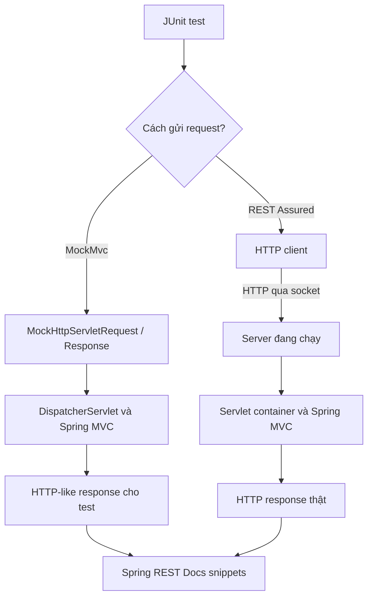

# Phân biệt kiểm thử tích hợp và kiểm thử qua MockMvc

## 1. Hai cách kiểm thử HTTP có mức độ bao phủ khác nhau

Trong Spring REST Docs, tài liệu REST API được sinh từ các bài kiểm thử HTTP với **MockMvc**, **WebTestClient** hoặc **REST Assured**. Cả hai cách trong bài đều có thể chạy controller và tạo snippet mô tả request/response, nhưng chúng kiểm tra hệ thống ở những ranh giới khác nhau.

- **MockMvc** thực thi quy trình xử lý Spring MVC thông qua `DispatcherServlet`, sử dụng các đối tượng request/response giả lập của `spring-test`. Nó không cần một Servlet container đang chạy và không gửi HTTP qua socket.
- **REST Assured với server đang chạy** hoạt động như một HTTP client thực sự: gửi request đến host/port của ứng dụng, đọc response qua HTTP và kiểm tra bằng DSL `given / when / then`.

Vì vậy, MockMvc thích hợp để kiểm tra nhanh lớp web và sinh tài liệu ở cấp Spring MVC. REST Assured kết hợp `@SpringBootTest(webEnvironment = RANDOM_PORT)` thích hợp khi cần kiểm chứng ứng dụng qua HTTP với server/container thực sự đang chạy.



**Điểm phân biệt cốt lõi:** MockMvc không phải là một HTTP server giả mở cổng cho client kết nối. Nó gọi trực tiếp hạ tầng xử lý request Spring MVC bằng các đối tượng Servlet mock. REST Assured trong bài này gửi request đến một server đang lắng nghe ở địa chỉ thật.

## 2. So sánh theo mục tiêu kiểm thử

| Tiêu chí | MockMvc | REST Assured + live server |
| --- | --- | --- |
| Cách gửi request | Tạo request bằng Spring MVC Test API. | HTTP client gửi qua host/port đến server đang chạy. |
| HTTP server/container | Không cần khởi động container. | Cần ứng dụng/server đang chạy, thường là embedded server. |
| Spring MVC dispatch | Có, qua `DispatcherServlet`. | Có, thông qua server thực tế. |
| Network, TCP và TLS | Không kiểm tra transport mạng thật. | Có thể kiểm tra giao tiếp HTTP/TLS trong phạm vi môi trường test. |
| Bộ lọc và cấu hình web | Kiểm tra các Filter được cấu hình cho MockMvc; không tự động chứng minh mọi cấu hình của container production. | Kiểm tra đường đi request qua server và filter/container được bật trong cấu hình ứng dụng test. |
| Tốc độ và tài nguyên | Thường nhanh, không cần mở server/port. | Thường tốn tài nguyên và thời gian hơn do khởi động server, kết nối HTTP. |
| Hành vi phụ thuộc container | Không đại diện đầy đủ hành vi container thật. | Có thể phát hiện khác biệt từ embedded container và cấu hình runtime. |
| Dữ liệu test | Có thể dùng `@WebMvcTest`, mock service hoặc Spring context. | Thường dùng `@SpringBootTest` với database/container phụ trợ hoặc fixture. |
| Spring REST Docs module | `spring-restdocs-mockmvc`. | `spring-restdocs-restassured`. |

MockMvc vẫn là một dạng **integration testing trong phạm vi Spring MVC**, không phải chỉ gọi trực tiếp method controller như unit test thuần. Ngược lại, REST Assured chỉ đảm bảo có HTTP client; mức độ tích hợp phụ thuộc server đích mà test gọi. Trong bài này, cụm “REST Assured integration test” nghĩa là REST Assured gọi ứng dụng Spring Boot được khởi chạy bằng live server.

## 3. MockMvc kiểm tra gì và có giới hạn nào?

MockMvc thực hiện quá trình xử lý request của Spring MVC, nên có thể kiểm tra:

- Mapping URL và HTTP method tới handler.
- Binding path/query parameter, header, form và JSON body.
- Message converter, validation, `@ControllerAdvice`, `@ExceptionHandler`.
- Spring Security integration nếu security filter chain được cấu hình vào MockMvc.
- Status code, response header, JSON/XML/body và model của Spring MVC.
- Các Servlet Filter được đăng ký với MockMvc.

Tuy nhiên, vì không có server/container thực, MockMvc không kiểm tra TCP, TLS handshake, cổng server, kết nối qua reverse proxy hay hành vi riêng của Servlet container. Một số khác biệt có thể liên quan context path, session cookie, async/error/forward dispatch hoặc JSP rendering. Nếu ứng dụng phụ thuộc các yếu tố này, cần một bài test với live server để xác nhận hành vi cuối cùng.

MockMvc có hai cách thiết lập phổ biến:

| Cách thiết lập | Đặc điểm |
| --- | --- |
| `standaloneSetup(controller)` | Tập trung vào một hoặc vài controller; test tự cấu hình các thành phần cần thiết như controller advice, converter hoặc filter. Phù hợp kiểm tra web layer có kiểm soát. |
| `webAppContextSetup(context)` | Dùng `WebApplicationContext` và cấu hình Spring MVC đã nạp. Phù hợp khi cần kiểm tra các thành phần Spring MVC được cấu hình trong application context. |

Với Spring Boot, `@WebMvcTest` thường được dùng cho slice test của web layer; `@AutoConfigureMockMvc` dùng để tạo MockMvc trong một test context rộng hơn như `@SpringBootTest` với mock web environment. Việc dùng `@SpringBootTest` không tự động có nghĩa là server đã chạy: cần chọn `webEnvironment = RANDOM_PORT` hoặc `DEFINED_PORT` nếu muốn live server.

## 4. REST Assured với live server kiểm tra thêm điều gì?

REST Assured gửi HTTP request bằng HTTP client thông thường. Khi kết hợp với:

```java
@SpringBootTest(webEnvironment = SpringBootTest.WebEnvironment.RANDOM_PORT)
```

Spring Boot khởi động ứng dụng trên một cổng ngẫu nhiên; `@LocalServerPort` cung cấp cổng đó cho test. REST Assured cấu hình base URI, port và gửi request vào server.

Cách này kiểm tra thêm được các thành phần trên đường đi của request qua server:

- Server khởi động, binding port và nhận kết nối HTTP.
- Servlet container thực tế được ứng dụng sử dụng trong test.
- Serialization/deserialization và response qua HTTP client/server thật.
- Filter/container integration, session cookie, header và redirect trong môi trường đang chạy.
- Cấu hình host, port, HTTPS/TLS hoặc reverse proxy nếu test được thiết lập để sử dụng các thành phần đó.

Không nên kết luận một test `RANDOM_PORT` đã kiểm tra production infrastructure nếu test không chạy reverse proxy, TLS termination, load balancer, database hoặc dịch vụ ngoài giống môi trường production. Kiểm thử live server có ranh giới rộng hơn MockMvc, nhưng phạm vi vẫn do test environment quyết định.

## 5. Cùng một endpoint, hai cách viết test tài liệu hóa

Giả sử ứng dụng có endpoint `GET /api/books/{id}` trả JSON khi sách tồn tại:

```json
{
  "id": 42,
  "title": "Spring REST Docs"
}
```

Các descriptor như `pathParameters(...)` và `responseFields(...)` là `Snippet` của Spring REST Docs. Có thể truyền trực tiếp chúng vào `document(...)` trong mỗi test như các ví dụ sau.

### 5.1. Viết bằng MockMvc

Dependency tích hợp cần có ở test scope là:

```groovy
testImplementation 'org.springframework.boot:spring-boot-starter-test'
testImplementation 'org.springframework.restdocs:spring-restdocs-mockmvc'
```

Ví dụ JUnit 5 với `WebApplicationContext`:

```java
@SpringBootTest
@ExtendWith(RestDocumentationExtension.class)
class BookMockMvcDocumentationTest {

    @Autowired
    private WebApplicationContext context;

    private MockMvc mockMvc;

    @BeforeEach
    void setUp(RestDocumentationContextProvider restDocumentation) {
        this.mockMvc = MockMvcBuilders.webAppContextSetup(this.context)
                .apply(documentationConfiguration(restDocumentation))
                .build();
    }

    @Test
    void documentGetBook() throws Exception {
        this.mockMvc.perform(get("/api/books/{id}", 42)
                        .accept(MediaType.APPLICATION_JSON))
                .andExpect(status().isOk())
                .andExpect(jsonPath("$.id").value(42))
                .andDo(document("books-get-mockmvc",
                        pathParameters(
                                parameterWithName("id").description("Mã sách")),
                        responseFields(
                                fieldWithPath("id").description("Mã sách"),
                                fieldWithPath("title").description("Tên sách"))));
    }
}
```

Các static import và import cần có:

```java
import static org.springframework.restdocs.mockmvc.MockMvcRestDocumentation.document;
import static org.springframework.restdocs.mockmvc.MockMvcRestDocumentation.documentationConfiguration;
import static org.springframework.test.web.servlet.request.MockMvcRequestBuilders.get;
import static org.springframework.test.web.servlet.result.MockMvcResultMatchers.jsonPath;
import static org.springframework.test.web.servlet.result.MockMvcResultMatchers.status;
import static org.springframework.restdocs.request.RequestDocumentation.parameterWithName;
import static org.springframework.restdocs.request.RequestDocumentation.pathParameters;
import static org.springframework.restdocs.payload.PayloadDocumentation.fieldWithPath;
import static org.springframework.restdocs.payload.PayloadDocumentation.responseFields;

import org.springframework.beans.factory.annotation.Autowired;
import org.springframework.boot.test.context.SpringBootTest;
import org.springframework.http.MediaType;
import org.springframework.restdocs.RestDocumentationExtension;
import org.springframework.restdocs.RestDocumentationContextProvider;
import org.springframework.test.web.servlet.setup.MockMvcBuilders;
import org.springframework.test.web.servlet.MockMvc;
import org.springframework.web.context.WebApplicationContext;
import org.junit.jupiter.api.BeforeEach;
```

Ví dụ không cần cổng HTTP vì MockMvc xử lý request bằng đối tượng mock. Ở đây `@SpringBootTest` nạp context rộng và test tự dựng MockMvc với `WebApplicationContext`. Nếu chỉ cần kiểm thử controller, có thể chọn `@WebMvcTest(BookController.class)` và cung cấp mock cho các collaborator. Một lựa chọn khác là để Spring Boot tự cấu hình MockMvc bằng `@AutoConfigureMockMvc`; khi kết hợp với REST Docs, hãy dùng cơ chế auto-configuration REST Docs của Spring Boot hoặc cấu hình thủ công theo một cách nhất quán, tránh cấu hình cùng filter hai lần. Không thêm cả `@WebMvcTest` và `@SpringBootTest` lên cùng một lớp.

### 5.2. Viết bằng REST Assured và live server

Dependency kiểm thử chuyển sang module REST Docs dành cho REST Assured:

```groovy
testImplementation 'org.springframework.boot:spring-boot-starter-test'
testImplementation 'io.rest-assured:rest-assured'
testImplementation 'org.springframework.restdocs:spring-restdocs-restassured'
```

Ví dụ:

```java
@SpringBootTest(webEnvironment = SpringBootTest.WebEnvironment.RANDOM_PORT)
@ExtendWith(RestDocumentationExtension.class)
class BookRestAssuredDocumentationTest {

    @LocalServerPort
    private int port;

    private RequestSpecification specification;

    @BeforeEach
    void setUp(RestDocumentationContextProvider restDocumentation) {
        this.specification = new RequestSpecBuilder()
                .setBaseUri("http://localhost")
                .setPort(this.port)
                .addFilter(documentationConfiguration(restDocumentation))
                .build();
    }

    @Test
    void documentGetBook() {
        given(this.specification)
                .accept(ContentType.JSON)
                .filter(document("books-get-restassured",
                        pathParameters(
                                parameterWithName("id").description("Mã sách")),
                        responseFields(
                                fieldWithPath("id").description("Mã sách"),
                                fieldWithPath("title").description("Tên sách"))))
        .when()
                .get("/api/books/{id}", 42)
        .then()
                .statusCode(200)
                .body("id", equalTo(42))
                .body("title", equalTo("Spring REST Docs"));
    }
}
```

Các static import thường dùng:

```java
import static io.restassured.RestAssured.given;
import static org.hamcrest.Matchers.equalTo;
import static org.springframework.restdocs.restassured.RestAssuredRestDocumentation.document;
import static org.springframework.restdocs.restassured.RestAssuredRestDocumentation.documentationConfiguration;
```

Các kiểu/annotation cần import gồm `RequestSpecBuilder`, `RequestSpecification`, `ContentType`, `SpringBootTest`, `LocalServerPort`, `RestDocumentationContextProvider`, `RestDocumentationExtension`, `BeforeEach` và `Test`. Ví dụ cần endpoint thật đang được ứng dụng cung cấp và dữ liệu 42 tồn tại.

**Chú ý về identifier:** hai test dùng `books-get-mockmvc` và `books-get-restassured`. Nếu dùng chung output directory và identifier giống nhau, snippet có thể bị ghi đè hoặc lẫn nguồn. Khi muốn so sánh hai cách, giữ identifier riêng hoặc cấu hình output directory riêng.

## 6. Cấu hình Spring REST Docs khác nhau ở đâu?

| Thành phần | MockMvc | REST Assured |
| --- | --- | --- |
| Artifact tích hợp | `spring-restdocs-mockmvc` | `spring-restdocs-restassured` |
| Tạo cấu hình tài liệu | `MockMvcRestDocumentation.document(...)` và `documentationConfiguration(...)` áp vào MockMvc builder | `RestAssuredRestDocumentation.document(...)` và `documentationConfiguration(...)` gắn vào `RequestSpecification` |
| Gắn bước document | `.andDo(document("id", ...))` | `.filter(document("id", ...))` trước `when()` |
| Thực hiện request | `mockMvc.perform(...)` | `given(...).when().get/post(...)` |
| Assertion | `.andExpect(...)` | `.then().statusCode(...).body(...)` |
| Loại request/response | Mock Servlet API | HTTP request/response thật qua server đang chạy |

Các descriptor như `pathParameters`, `requestFields`, `responseFields`, `requestHeaders` và `responseHeaders` được dùng chung từ các package tương ứng của Spring REST Docs. Nhưng cách cấu hình và cách gắn filter phụ thuộc từng module tích hợp.

Không dùng `RestAssuredRestDocumentation.document(...)` trong chuỗi `MockMvc.perform(...)`; cũng không dùng `.andDo(...)` của MockMvc trên một REST Assured request. Hai cách có API tích hợp khác nhau.

## 7. Hiểu đúng `@AutoConfigureRestDocs` và `@AutoConfigureMockMvc`

Với Spring Boot, có thể dùng `@AutoConfigureRestDocs` để cấu hình tích hợp Spring REST Docs cho test được auto-configure. Spring Boot cung cấp hỗ trợ cho MockMvc, REST Assured và WebTestClient. Annotation này có thể thay đổi output directory và host/scheme/port trong URI tài liệu theo thuộc tính cấu hình.

Tuy nhiên:

- `@AutoConfigureMockMvc` tạo/cấu hình MockMvc trong test context; nó không khởi động HTTP server thật.
- `@SpringBootTest(webEnvironment = MOCK)` cùng MockMvc vẫn không tương đương `RANDOM_PORT`.
- `@SpringBootTest(webEnvironment = RANDOM_PORT)` khởi động live server; đây là lựa chọn phù hợp cho bài REST Assured HTTP integration test.
- Dùng `@AutoConfigureRestDocs` theo cách Spring Boot hỗ trợ để giảm cấu hình thủ công; không đồng thời cấu hình hai lần những filter/bean cùng mục đích nếu không hiểu rõ kết hợp đó.

Spring Boot có auto-configuration REST Docs cho MockMvc, REST Assured và WebTestClient. Đọc tài liệu đúng phiên bản Spring Boot đang dùng vì thuộc tính annotation và cách tự cấu hình test có thể thay đổi giữa các dòng phát hành.

Hãy chọn một cơ chế cấu hình REST Docs rõ ràng trong mỗi lớp test. Nếu dùng JUnit `RestDocumentationExtension` + `documentationConfiguration(...)` thủ công, giữ cấu hình nhất quán. Nếu sử dụng auto-configuration của Spring Boot, làm theo cấu hình module và phiên bản Boot đang dùng.

## 8. Khi nào nên chọn cách nào?

| Tình huống | Lựa chọn thường phù hợp | Lý do |
| --- | --- | --- |
| Nhiều controller cần xác minh mapping, validation, JSON contract | MockMvc | Tốc độ tốt, kiểm soát response và assertion chính xác ở Spring MVC. |
| Muốn cô lập web layer khỏi database/service ngoài | MockMvc kết hợp mock collaborator | Phản hồi nhanh và lỗi dễ định vị. |
| Cần xác minh ứng dụng khởi động, cổng server và HTTP exchange | REST Assured + `RANDOM_PORT` | Gửi request thật tới server đang chạy. |
| Cần xác minh cookie/session, container filter hoặc redirect với server | REST Assured integration test | Kiểm tra đường đi HTTP/Servlet trong runtime test. |
| Cần kiểm tra TLS, reverse proxy hoặc API gateway | Test môi trường có thành phần đó | MockMvc không kiểm tra transport/proxy thật. |
| Muốn test nhiều tình huống JSON/validation với tốc độ cao | MockMvc | Tránh khởi động server cho từng nhóm test. |
| Muốn kiểm chứng client gọi API theo góc nhìn bên ngoài | REST Assured | Dùng HTTP client để quan sát response như client thông thường. |

Không cần chọn duy nhất một loại cho toàn dự án. Một chiến lược hợp lý thường có nhiều MockMvc test bao phủ controller contract và một số REST Assured integration test kiểm tra các đường đi HTTP quan trọng.

## 9. Kết hợp cả hai trong chiến lược sinh tài liệu

Khi cùng một endpoint được tài liệu hóa bằng cả MockMvc và REST Assured, nên quyết định rõ nguồn snippet chính thức. Có thể dùng:

- MockMvc để tạo tài liệu chi tiết cho nhiều trạng thái, validation và response field của API.
- REST Assured để tạo một tập ví dụ đại diện xác minh request/response qua HTTP thật.

Không nên để hai bài test tự động ghi vào cùng identifier. Ví dụ:

```text
generated-snippets/
  books-get-mockmvc/
  books-get-restassured/
  books-create-mockmvc/
  books-create-restassured/
```

Nếu tài liệu xuất bản chỉ cần một ví dụ cho mỗi endpoint, chọn nguồn thích hợp rồi include đúng snippet đó trong Asciidoctor. Nếu cần so sánh, ghi rõ trong tài liệu một ví dụ đến từ MockMvc và ví dụ kia đến từ live HTTP test. Điều này giúp người đọc hiểu phạm vi xác minh của ví dụ và tránh nhân đôi nội dung.

## 10. Snippet, Asciidoctor và CI

Các snippet của Spring REST Docs thường được lưu ở `build/generated-snippets` (Gradle) hoặc `target/generated-snippets` (Maven), tùy cấu hình. Có thể nhúng vào Asciidoctor:

```asciidoc
= Books API

== Lấy sách - Spring MVC test
include::{snippets}/books-get-mockmvc/http-request.adoc[]
include::{snippets}/books-get-mockmvc/http-response.adoc[]
include::{snippets}/books-get-mockmvc/response-fields.adoc[]

== Lấy sách - HTTP integration test
include::{snippets}/books-get-restassured/http-request.adoc[]
include::{snippets}/books-get-restassured/http-response.adoc[]
include::{snippets}/books-get-restassured/response-fields.adoc[]
```

Nếu tài liệu chỉ công bố một nguồn, bỏ phần còn lại để không làm trang API dài không cần thiết. Markdown thuần không xử lý cú pháp `include::{snippets}/...[]`; cần bước chuyển đổi/nhúng nội dung thích hợp.

Trong CI, thứ tự nên là:

```text
MockMvc tests / REST Assured live-server tests
        -> descriptor validation và assertions
        -> generated snippets
        -> Asciidoctor / Markdown conversion
        -> publish documentation
```

Snippet có thể được ghi trước khi assertion cuối cùng thất bại. Vì vậy CI phải kiểm tra kết quả test trước khi biên soạn và xuất bản; không coi sự tồn tại của thư mục snippet là bằng chứng các bài test đã pass.

## 11. Lỗi thường gặp

| Hiện tượng | Nguyên nhân | Cách khắc phục |
| --- | --- | --- |
| Nghĩ rằng MockMvc kiểm tra cổng hoặc TLS | MockMvc không khởi động Servlet container và không gửi qua TCP. | Viết thêm REST Assured test với live server hoặc test môi trường triển khai. |
| `Connection refused` với REST Assured | Server chưa khởi động hoặc port không đúng. | Dùng `RANDOM_PORT` và `@LocalServerPort`; kiểm tra host/base path. |
| MockMvc không có context path như server thật | Mock request không tự dựng toàn bộ context/container behavior. | Thiết lập request context phù hợp hoặc xác minh thêm bằng live server. |
| Dùng sai `document(...)` API | Nhầm `MockMvcRestDocumentation` với `RestAssuredRestDocumentation`. | Chọn đúng artifact và API cho công cụ đang test. |
| Không tìm thấy snippet | Chưa cấu hình REST Docs hoặc chưa gọi `andDo(document(...))`/`.filter(document(...))`. | Kiểm tra filter cấu hình và điểm gắn document của đúng module. |
| Snippet của hai test ghi đè | Trùng identifier và output directory. | Dùng identifier hoặc output directory riêng. |
| Dùng `@AutoConfigureMockMvc` nhưng kỳ vọng live server | Annotation tạo MockMvc, không phải HTTP listener. | Đổi sang `RANDOM_PORT` và REST Assured nếu cần server thật. |
| Test có snippet nhưng báo đỏ | Filter có thể ghi snippet trước assertion thất bại. | Chỉ xuất bản sau khi toàn bộ test pass. |

## 12. Checklist chọn chiến lược

- [ ] Đã xác định cần kiểm tra Spring MVC request handling hay HTTP exchange qua live server.
- [ ] Với MockMvc, đã dùng `spring-restdocs-mockmvc`, `MockMvcRestDocumentation.document(...)` và `andDo(...)`.
- [ ] Với REST Assured, đã dùng `spring-restdocs-restassured`, server live và `RestAssuredRestDocumentation.document(...)` trong `.filter(...)`.
- [ ] Không nhầm `@AutoConfigureMockMvc` với `@SpringBootTest(RANDOM_PORT)`.
- [ ] Đã đặt identifier/output directory riêng khi cùng endpoint sinh snippet theo hai cách.
- [ ] Đã kiểm tra status, header, payload và descriptor tương ứng với response thật.
- [ ] CI chỉ biên soạn và phát hành tài liệu sau khi các bài test liên quan thành công.

MockMvc và REST Assured không phải hai công cụ cạnh tranh để làm cùng một việc trong mọi trường hợp. MockMvc giúp kiểm chứng Spring MVC ở mức request handling nhanh và có kiểm soát; REST Assured với live server xác minh thêm đường đi HTTP qua server đang chạy. Dùng kết hợp đúng phạm vi sẽ tạo tài liệu Spring REST Docs có chiều sâu mà vẫn giữ được tốc độ và độ tin cậy của bộ kiểm thử.

## Tài liệu tham khảo

- [Spring Framework – MockMvc vs End-to-End Tests](https://docs.spring.io/spring/reference/testing/mockmvc/vs-end-to-end-integration-tests.html)
- [Spring Framework – MockMvc](https://docs.spring.io/spring-framework/reference/6.2/testing/mockmvc.html)
- [Spring Boot – Auto-configured Spring REST Docs Tests](https://docs.spring.io/spring-boot/3.5/reference/testing/spring-boot-applications.html)
- [Spring REST Docs – Reference Documentation](https://docs.spring.io/spring-restdocs/docs/current/reference/htmlsingle/)
