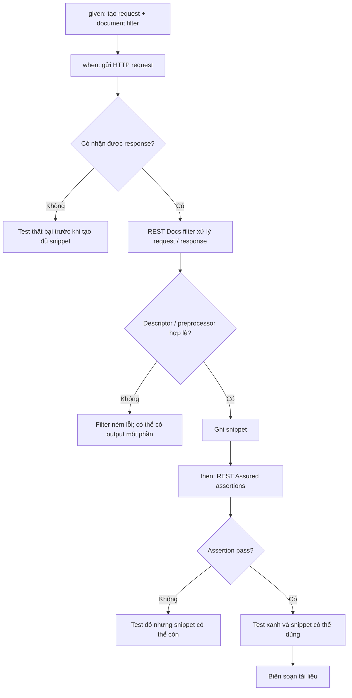
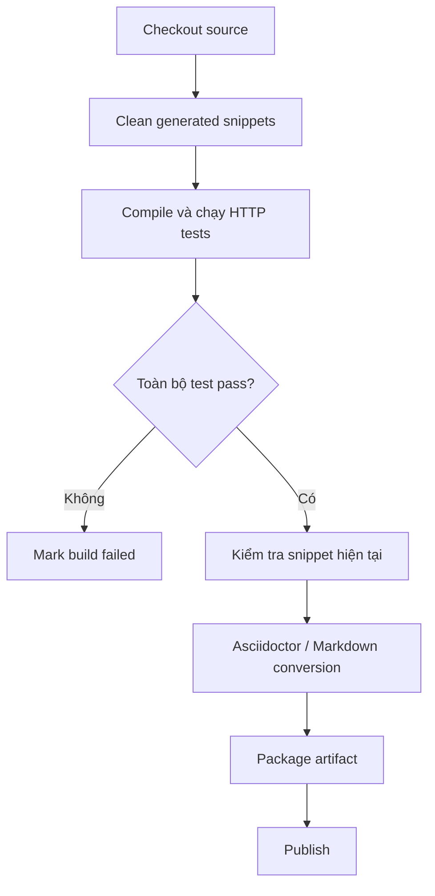

# Xử lý lỗi snippet khi assertion thất bại

## 1. Vì sao test đỏ nhưng snippet vẫn có?

Spring REST Docs sinh tài liệu REST API từ các bài kiểm thử HTTP bằng MockMvc, WebTestClient hoặc REST Assured. Khi dùng REST Assured, filter `document(...)` quan sát HTTP request và response rồi tạo snippet; phần `.then()` của REST Assured tiếp tục kiểm tra status, header và nội dung response.

Một điểm rất dễ gây nhầm là **snippet có thể được ghi trước khi assertion cuối cùng được đánh giá**. Ví dụ:

```java
given(this.specification)
        .filter(document("books-get"))
.when()
        .get("/api/books/42")
.then()
        .statusCode(200)
        .body("title", equalTo("Spring REST Docs"));
```

Sau khi server trả response, REST Docs filter có thể đã ghi `http-request.adoc`, `http-response.adoc` và các snippet được yêu cầu. Sau đó REST Assured mới kiểm tra status và body. Nếu server trả HTTP 500 hoặc tiêu đề khác mong đợi, test thất bại nhưng các file snippet có thể vẫn tồn tại.

Vì vậy, không thể suy ra “test pass” từ việc thấy thư mục `generated-snippets` hoặc file `.adoc`. Cần phân biệt trạng thái của **bài kiểm thử** với trạng thái của **artifact tài liệu**.



## 2. Những loại lỗi và thời điểm chúng xuất hiện

Không phải mọi lỗi đều tạo ra cùng một kết quả. Hãy xác định lỗi xuất hiện ở giai đoạn nào:

| Loại lỗi | Thời điểm thường xảy ra | Kết quả đối với snippet |
| --- | --- | --- |
| Không kết nối được server, DNS lỗi hoặc connection refused | REST Assured gửi request | Không có trao đổi HTTP hoàn chỉnh; thường không tạo bộ snippet hoàn chỉnh. |
| Server trả 4xx/5xx ngoài mong đợi | Filter xử lý response trước `.then()` | Snippet request/response có thể được ghi, dù assertion status phía sau sẽ thất bại. |
| Assertion status/body/header thất bại | `.then()` sau khi filter xử lý response | Snippet thường đã được ghi; test vẫn đỏ. |
| Descriptor thiếu field hoặc mô tả field không có trong JSON | REST Docs xử lý operation | Filter có thể ném `SnippetException` hoặc lỗi tài liệu; một số file đã tạo trước đó có thể còn lại. |
| Request/response preprocessor lỗi | Trong filter trước khi ghi snippet tương ứng | Snippet có thể không được tạo hoặc chỉ có một phần. |
| Nhiều test dùng cùng identifier | Trong hoặc sau nhiều lần chạy test | File có thể bị ghi đè hoặc phản ánh lần chạy sau; khó xác định nguồn. |
| Test bị bỏ qua hoặc không được chạy | Test discovery / filter của JUnit | Không có snippet mới cho test đó; file cũ có thể vẫn nằm trên đĩa. |

Điều quan trọng là **REST Docs kiểm tra descriptor** và **REST Assured kiểm tra hành vi** là hai lớp kiểm chứng liên quan nhưng khác nhau. `responseFields(...)` có thể xác nhận cấu trúc JSON theo mô tả, còn `.statusCode(200)` xác nhận mã HTTP. Cần giữ cả hai khi chúng cùng thuộc hợp đồng API.

## 3. Ví dụ: assertion thất bại nhưng snippet đã được ghi

Giả sử endpoint trả HTTP 200 với JSON:

```json
{
  "id": 42,
  "title": "Spring REST Docs"
}
```

Test dưới đây cố ý kỳ vọng sai để minh họa:

```java
@Test
void documentBookWithWrongAssertion() {
    given(this.specification)
            .accept(ContentType.JSON)
            .filter(document("books-get-demo",
                    responseFields(
                            fieldWithPath("id").description("Mã sách"),
                            fieldWithPath("title").description("Tên sách"))))
    .when()
            .get("/api/books/42")
    .then()
            .statusCode(201); // Sai: endpoint thực tế trả 200.
}
```

Trình tự có thể xảy ra:

1. REST Assured gửi GET đến server và nhận HTTP 200.
2. REST Docs filter xử lý operation và sinh snippet cho `books-get-demo`.
3. `.then().statusCode(201)` so sánh với status thực tế 200 và ném assertion error.
4. JUnit đánh dấu test thất bại; các snippet đã ghi không tự động bị xóa.

Trong thư mục output, có thể vẫn thấy `http-request.adoc`, `http-response.adoc`, `response-fields.adoc` hoặc các snippet mặc định khác. Chúng chỉ là dữ liệu ghi được trong lần chạy test thất bại; **không được đưa vào tài liệu phát hành**.

Sau khi minh họa, sửa assertion đúng với hợp đồng API:

```java
.then()
        .statusCode(200)
        .body("id", equalTo(42))
        .body("title", equalTo("Spring REST Docs"));
```

Không sửa assertion chỉ để làm test xanh nếu API đang có lỗi. Trước tiên xác định status và body mong muốn theo hợp đồng, sau đó điều chỉnh endpoint hoặc test cho đúng.

## 4. Descriptor thất bại cũng có thể để lại output dở dang

REST Docs kiểm tra các descriptor như `requestFields(...)`, `responseFields(...)`, `pathParameters(...)` và `requestHeaders(...)`. Ví dụ response thực tế có thêm field `author`, nhưng test chỉ mô tả `id` và `title`:

```json
{
  "id": 42,
  "title": "Spring REST Docs",
  "author": "Example Author"
}
```

```java
given(this.specification)
        .filter(document("books-get-invalid-fields",
                responseFields(
                        fieldWithPath("id").description("Mã sách"),
                        fieldWithPath("title").description("Tên sách"))))
.when()
        .get("/api/books/42")
.then()
        .statusCode(200);
```

Với descriptor chặt chẽ mặc định, REST Docs có thể báo field chưa được mô tả. Tương tự, nếu tài liệu khai báo một field bắt buộc nhưng response không có field đó, operation cũng có thể thất bại. Lỗi này đến từ quá trình tạo snippet, trước hoặc trong lúc xử lý response; không nhất thiết đợi `.then()`.

Hướng khắc phục:

- Nếu `author` thuộc hợp đồng response, bổ sung `fieldWithPath("author").description(...)`.
- Nếu field chỉ xuất hiện trong một số response, xem xét `.optional()` khi nó thực sự là tùy chọn.
- Nếu field cần kiểm chứng nhưng không cần hiện trong bảng tài liệu, cân nhắc `.ignored()` và giải thích lý do trong code.
- Dùng `relaxedResponseFields(...)` chỉ khi chấp nhận có các field ngoài danh sách mô tả. Không dùng relaxed descriptor để che một thay đổi schema chưa được xem xét.

Ví dụ descriptor đầy đủ:

```java
responseFields(
        fieldWithPath("id").description("Mã sách"),
        fieldWithPath("title").description("Tên sách"),
        fieldWithPath("author").description("Tác giả"))
```

Một khi descriptor đã được cập nhật, chạy lại test trên response thật để xác nhận cả schema và assertion nghiệp vụ đều pass.

## 5. Đừng coi file snippet còn sót lại là output của lần chạy hiện tại

Một nguyên nhân phổ biến khiến tài liệu sai là **snippet cũ vẫn còn trong output directory**. Ví dụ:

1. Build hôm qua chạy thành công và tạo `build/generated-snippets/books-get/http-response.adoc`.
2. Hôm nay test `books-get` thất bại trước khi tạo snippet mới.
3. File của hôm qua vẫn tồn tại.
4. Tác vụ Asciidoctor hoặc người phát triển đọc nhầm file cũ và tưởng rằng test hôm nay đã tạo ra nó.

Do đó, output directory phải được quản lý theo từng lần build. Có ba nguyên tắc:

**Xóa output sinh tự động trước khi chạy test cần sinh lại tài liệu.** Chỉ xóa thư mục snippet do build quản lý, không xóa source `.adoc`, Markdown hoặc tài liệu người viết.

**Tách output theo build/test suite khi cần chạy song song.** Ví dụ, các task test khác nhau có thể dùng thư mục riêng để tránh ghi đè snippet.

**Chỉ biên soạn từ output của build hiện tại đã pass.** Không tái sử dụng file cũ sau một lần test thất bại.

## 6. Dọn snippet trước test bằng Gradle

Ví dụ dưới đây định nghĩa một thư mục snippet rõ ràng và một task xóa riêng. Task `test` phụ thuộc `cleanSnippets`, do đó thư mục snippet được làm sạch trước khi test bắt đầu:

```groovy
plugins {
    id 'java'
    id 'org.springframework.boot' version '3.5.0'
    id 'org.asciidoctor.jvm.convert' version '3.3.2'
}

def snippetsDir = layout.buildDirectory.dir('generated-snippets')

tasks.register('cleanSnippets', Delete) {
    delete snippetsDir
}

tasks.named('test') {
    dependsOn tasks.named('cleanSnippets')
    outputs.dir snippetsDir
    useJUnitPlatform()
}

tasks.named('asciidoctor') {
    dependsOn tasks.named('test')
    inputs.dir snippetsDir
    attributes 'snippets': snippetsDir.get().asFile.absolutePath
}
```

Đây là ví dụ quan hệ task; phiên bản plugin Spring Boot/Asciidoctor và cấu hình dependency cần lấy theo dự án. Spring REST Docs/JUnit extension phải được cấu hình để ghi vào đúng `snippetsDir` này. Với cấu hình mặc định của Spring REST Docs 3.0 trong dự án Gradle, output thường nằm ở `build/generated-snippets`; nếu thay đổi vị trí, đồng bộ giữa extension/configurer, task test và thuộc tính Asciidoctor.

Lệnh thường dùng:

```bash
# Làm sạch build và chạy test trước khi biên soạn tài liệu
./gradlew clean test asciidoctor

# Chạy riêng một nhóm test nhưng vẫn làm sạch snippet trước
./gradlew cleanSnippets test --tests '*BookDocumentationTest'
```

Lưu ý: nếu một task khác cũng ghi snippet vào cùng thư mục, cần đưa task đó vào cùng quan hệ làm sạch và thứ tự build. Tránh chạy hai task test song song cùng ghi một identifier vào một thư mục chung.

## 7. Dọn snippet trước test bằng Maven

Với Maven, cách đơn giản và dễ hiểu là chạy lifecycle bắt đầu từ `clean`:

```bash
mvn clean test
mvn clean verify
```

`mvn clean` xóa thư mục `target` theo chuẩn build Maven, bao gồm `target/generated-snippets` nếu dự án dùng output mặc định này. Sau đó `test` chạy lại các bài kiểm thử; `verify` có thể chạy thêm plugin/tác vụ biên soạn tài liệu đã được liên kết trong lifecycle.

Nếu dự án ghi snippet ra một thư mục nằm ngoài `target`, `mvn clean` không tự xóa thư mục đó. Cần cấu hình Maven Clean Plugin để xóa đúng generated directory và xác nhận không trỏ nhầm vào thư mục source.

Khi chạy chọn lọc một test, vẫn cần bảo đảm snippet của các test không chạy không bị hiểu nhầm là output mới. Có thể dùng thư mục theo execution/build hoặc xóa thư mục snippet trước lượt test chọn lọc.

## 8. Chỉ cho phép Asciidoctor chạy khi test thành công

Trong Gradle, khai báo `asciidoctor` phụ thuộc `test` giúp Gradle dừng task downstream khi `test` thất bại. Quan hệ:

```text
cleanSnippets -> test -> asciidoctor -> package/publish
```

Trong Maven, nối plugin tạo tài liệu sau pha kiểm thử phù hợp và giữ nguyên hành vi fail-fast. Đừng đặt lệnh biên soạn tài liệu ở một job CI độc lập mà job đó tải về snippet cũ hoặc artifact chưa được xác nhận từ build vừa chạy.

Một pipeline CI dễ kiểm soát:



Nếu pipeline có bước upload artifact để phục vụ debug khi test đỏ, hãy đánh dấu rõ artifact đó là **diagnostic output**, không phải tài liệu được phê duyệt. Job publish phải phụ thuộc vào kết quả test và build tài liệu thành công.

## 9. Kiểm tra lỗi theo đúng giai đoạn

Khi một bài test tài liệu hóa thất bại, hãy đi theo thứ tự:

1. **Xác định test có gửi được request không.** Kiểm tra log server, base URI, port, request method và path. Nếu connection lỗi, xử lý server/kết nối trước.
2. **Đọc response thật.** Xác nhận status code, header, Content-Type và JSON. Không vội sửa descriptor theo suy đoán.
3. **Đọc exception của Spring REST Docs.** Nếu lỗi báo undocumented/missing field, sửa descriptor hoặc API theo hợp đồng đã thống nhất.
4. **Đọc assertion của REST Assured.** Nếu response có snippet nhưng `.then()` đỏ, sửa API/test assertion theo kết quả mong đợi.
5. **Kiểm tra output directory.** Xác nhận file thuộc lần chạy hiện tại, không phải file sót lại.
6. **Chạy lại từ output sạch.** Chỉ khi test pass mới cho phép Asciidoctor và bước publish chạy.

| Thông báo/hiện tượng | Câu hỏi đầu tiên cần đặt ra |
| --- | --- |
| `Connection refused` | Server đã khởi động và test có đúng port không? |
| `Expected status code <200> but was <500>` | Server trả lỗi gì, và response snippet đang ghi điều gì? |
| `Field ... is not documented` | Response có field mới nào chưa được mô tả? |
| `Fields with the following paths were not found` | Descriptor có yêu cầu field không xuất hiện trong response không? |
| `SnippetException` | Exception đến từ descriptor, preprocessor, identifier hay thao tác ghi file? |
| Asciidoctor không tìm thấy include | Test có chạy, identifier có đúng, output directory có sạch và đúng không? |

## 10. Những thói quen nên áp dụng

- Dùng identifier riêng cho từng endpoint và từng tình huống (`books-get-200`, `books-get-404`).
- Giữ assertion về status, dữ liệu nghiệp vụ và header; đừng dựa duy nhất vào descriptor của REST Docs.
- Không dùng `relaxedResponseFields` chỉ để làm test xanh khi schema vừa thay đổi mà chưa được review.
- Dọn generated snippets trước lượt test sinh tài liệu; không xóa source documentation.
- Dùng output directory riêng khi test suite chạy song song hoặc sinh tài liệu cho nhiều phiên bản API.
- Kiểm tra snippet sau tiền xử lý để không lộ token, cookie hoặc dữ liệu nhạy cảm.
- Cho task Asciidoctor/package/publish phụ thuộc vào task test thành công.
- Không dùng file snippet từ build cũ để thay thế kết quả của test vừa thất bại.

## 11. Checklist xử lý test đỏ

- [ ] Đã xác định lỗi xảy ra khi gửi request, trong REST Docs filter hay ở assertion `.then()`.
- [ ] Đã xem response thực tế và đọc exception đầy đủ.
- [ ] Đã kiểm tra descriptor path/header/request fields/response fields so với dữ liệu thật.
- [ ] Đã xác nhận assertion nghiệp vụ vẫn phản ánh hợp đồng API.
- [ ] Đã dọn output generated trước lượt chạy mới hoặc dùng thư mục theo build.
- [ ] Đã kiểm tra snippet được sinh từ đúng lần chạy hiện tại.
- [ ] Đã chạy test lại và toàn bộ test liên quan pass.
- [ ] Chỉ sau đó mới chạy biên soạn, đóng gói và phát hành tài liệu.

Snippet là sản phẩm trung gian được ghi trong quá trình xử lý HTTP, còn kết quả test mới là tín hiệu quyết định tài liệu có được chấp nhận hay không. Khi dọn output đúng cách, giữ assertion và chặn bước publish khi test đỏ, dự án tránh được tình trạng tài liệu nhìn có vẻ đầy đủ nhưng thực chất được tạo từ một lần kiểm thử thất bại.
