# `@AutoConfigureRestDocs` và tự cấu hình trong test

## 1. Bối cảnh và mục tiêu

Trong chương **Spring Boot** của học phần **Spring REST Docs (`SPRING_REST_DOCS`)**, mục tiêu là tạo tài liệu REST API từ những bài kiểm thử HTTP thực sự chạy được. Mỗi khi test thực hiện request, kiểm tra response và gọi Spring REST Docs, framework tạo các *snippet* phản ánh giao tiếp HTTP mà ứng dụng vừa xử lý. Nhờ đó, tài liệu có thể được kiểm chứng cùng mã nguồn trong build và CI.

`@AutoConfigureRestDocs` là điểm tích hợp Spring Boot giúp chuẩn bị môi trường Spring REST Docs cho test. Ta vẫn viết các assertion và mô tả request/response, nhưng không phải lặp lại phần khởi tạo `RestDocumentationExtension` và gắn `documentationConfiguration(...)` thủ công trong từng lớp test.

Sau bài này, bạn có thể:

- Giải thích `@AutoConfigureRestDocs` tự cấu hình gì, và phần nào vẫn do test chịu trách nhiệm.
- Kết hợp annotation này với `@WebMvcTest`, `@WebFluxTest` hoặc `@SpringBootTest` phù hợp.
- Cấu hình thư mục snippet, URI xuất hiện trong tài liệu, định dạng và quy tắc sinh snippet.
- Viết test sinh tài liệu cho path parameter, header, JSON response; hiểu vì sao tài liệu sai lệch làm test thất bại.
- Nối snippet vào Asciidoctor/Markdown và đưa bước sinh tài liệu vào build, CI.
- Nhận biết khác biệt giữa Spring Boot 3.x và Spring Boot 4.x.

## 2. `@AutoConfigureRestDocs` giải quyết vấn đề nào?

Không có Spring Boot auto-configuration, test sử dụng Spring REST Docs thường cần tự tạo `RestDocumentationContextProvider` qua JUnit extension và cấu hình client kiểm thử (ví dụ `MockMvcBuilders.webAppContextSetup(context).apply(documentationConfiguration(restDocumentation))`). Cách này hữu ích khi cần kiểm soát hoàn toàn test client, nhưng gây lặp cấu hình khi đã dùng Spring Boot Test.

Với `@AutoConfigureRestDocs`, Spring Boot đưa phần tích hợp Spring REST Docs vào `ApplicationContext` của test và tùy biến client kiểm thử do Boot quản lý. Luồng điển hình:

```mermaid
flowchart LR
    A["JUnit + Spring Boot test"] --> B["@AutoConfigureRestDocs"]
    B --> C["MockMvc / WebTestClient"]
    C --> D["HTTP request + assertions"]
    D --> E["document(...) + descriptors"]
    E --> F["generated-snippets"]
    F --> G["Asciidoctor / Markdown"]
    G --> H["HTML/PDF trong build, CI"]
```



Điểm quan trọng: **annotation chuẩn bị môi trường sinh tài liệu, nhưng không tự viết mô tả API**. Trong cấu hình thông thường, cần gọi `document(...)` tại bước xử lý kết quả của request. Trường hợp riêng ở mục 6 cho phép cấu hình `RestDocumentationResultHandler` để ghi snippet mặc định cho mọi request qua `MockMvc`.

### Những gì được cấu hình và những gì không

| Thành phần | Vai trò của Spring Boot / `@AutoConfigureRestDocs` | Việc của người viết test |
| --- | --- | --- |
| Test context | Nạp cấu hình Spring REST Docs vào context của test. | Chọn `@WebMvcTest`, `@WebFluxTest` hoặc `@SpringBootTest`. |
| HTTP test client | Tích hợp REST Docs với `MockMvc` hoặc `WebTestClient` được Boot quản lý. | Inject client và gửi request. |
| Nơi xuất snippet | Mặc định `build/generated-snippets` (Gradle) hoặc `target/generated-snippets` (Maven); có thể đổi bằng `outputDir`. | Đồng bộ đường dẫn với tác vụ xuất tài liệu. |
| URI hiển thị | Có thể đặt `uriScheme`, `uriHost`, `uriPort`. | Dùng tên host, scheme, port mang ý nghĩa tài liệu. |
| Nội dung tài liệu | Cung cấp nền tảng để ghi request/response. | Dùng `document(...)` và descriptor cho field, header, parameter. |
| Xuất HTML/Markdown | Không tự biên soạn trang tài liệu hoàn chỉnh. | Cấu hình Asciidoctor hoặc pipeline Markdown. |

`@AutoConfigureRestDocs` **không thay thế** `@WebMvcTest`, `@WebFluxTest`, `@AutoConfigureMockMvc` hay `@SpringBootTest`. Những annotation đó quyết định thành phần ứng dụng và test client nào được khởi tạo; `@AutoConfigureRestDocs` bổ sung khả năng ghi tài liệu.

## 3. Phụ thuộc và phạm vi phiên bản

Các ví dụ Java chính trong bài dùng **Spring Boot 3.5 và Spring REST Docs 3.x**, JUnit Jupiter. Với Gradle (Groovy DSL), một ứng dụng Spring MVC đã dùng Spring Boot có thể thêm:

```groovy
dependencies {
    testImplementation 'org.springframework.boot:spring-boot-starter-test'
    testImplementation 'org.springframework.restdocs:spring-restdocs-mockmvc'
}
```

Spring Boot quản lý các phiên bản tương thích qua dependency management/BOM. Với WebFlux, dùng `spring-restdocs-webtestclient`; với REST Assured, dùng `spring-restdocs-restassured`. Chỉ thêm tích hợp thực sự sử dụng, đồng thời bảo đảm có các starter HTTP tương ứng (`spring-boot-starter-web` hoặc `spring-boot-starter-webflux`).

### Chú ý khi nâng cấp Spring Boot

| Chủ đề | Spring Boot 3.5 | Spring Boot 4.x |
| --- | --- | --- |
| Import `@AutoConfigureRestDocs` | `org.springframework.boot.test.autoconfigure.restdocs.AutoConfigureRestDocs` | `org.springframework.boot.restdocs.test.autoconfigure.AutoConfigureRestDocs` |
| Import `@WebMvcTest` | `org.springframework.boot.test.autoconfigure.web.servlet.WebMvcTest` | `org.springframework.boot.webmvc.test.autoconfigure.WebMvcTest` |
| Import `@WebFluxTest` | `org.springframework.boot.test.autoconfigure.web.reactive.WebFluxTest` | `org.springframework.boot.webflux.test.autoconfigure.WebFluxTest` |
| REST Assured được Boot tự cấu hình qua annotation | Có `RequestSpecification` đã cấu hình REST Docs khi có phụ thuộc thích hợp. | `@AutoConfigureRestDocs` tập trung vào `MockMvc` và `WebTestClient`; nếu dùng REST Assured, cấu hình tích hợp bằng API của Spring REST Docs. |

Khi nâng lên Boot 4, cần cập nhật các import và khai báo các mô-đun test phù hợp với phiên bản đang chạy. Không sao chép import Boot 3.x nguyên trạng sang Boot 4.x. Mã ở các mục 4–7 ghi rõ trường hợp sử dụng.

## 4. Ví dụ đầy đủ: `@WebMvcTest` + `MockMvc`

Giả sử có endpoint `GET /api/orders/{id}` trả JSON:

```json
{
  "id": 42,
  "status": "PAID"
}
```

Các lớp ứng dụng (đặt trong cùng package, ví dụ `com.example.orders`):

```java
import org.springframework.web.bind.annotation.GetMapping;
import org.springframework.web.bind.annotation.PathVariable;
import org.springframework.web.bind.annotation.RequestMapping;
import org.springframework.web.bind.annotation.RestController;

@RestController
@RequestMapping("/api/orders")
class OrderController {
    private final OrderService orderService;

    OrderController(OrderService orderService) {
        this.orderService = orderService;
    }

    @GetMapping("/{id}")
    OrderResponse getById(@PathVariable long id) {
        return orderService.getById(id);
    }
}

interface OrderService {
    OrderResponse getById(long id);
}

record OrderResponse(long id, String status) {}
```

Ở test, `@WebMvcTest` chỉ tải phần MVC liên quan controller, vì vậy mock `OrderService` để test không phải kết nối database hay hệ thống khác:

```java
import org.junit.jupiter.api.Test;
import org.springframework.beans.factory.annotation.Autowired;
import org.springframework.boot.test.autoconfigure.restdocs.AutoConfigureRestDocs;
import org.springframework.boot.test.autoconfigure.web.servlet.WebMvcTest;
import org.springframework.http.HttpHeaders;
import org.springframework.http.MediaType;
import org.springframework.test.context.bean.override.mockito.MockitoBean;
import org.springframework.test.web.servlet.MockMvc;

import static org.mockito.BDDMockito.given;
import static org.springframework.restdocs.headers.HeaderDocumentation.headerWithName;
import static org.springframework.restdocs.headers.HeaderDocumentation.requestHeaders;
import static org.springframework.restdocs.mockmvc.MockMvcRestDocumentation.document;
import static org.springframework.restdocs.mockmvc.RestDocumentationRequestBuilders.get;
import static org.springframework.restdocs.payload.PayloadDocumentation.fieldWithPath;
import static org.springframework.restdocs.payload.PayloadDocumentation.responseFields;
import static org.springframework.restdocs.request.RequestDocumentation.parameterWithName;
import static org.springframework.restdocs.request.RequestDocumentation.pathParameters;
import static org.springframework.test.web.servlet.result.MockMvcResultMatchers.jsonPath;
import static org.springframework.test.web.servlet.result.MockMvcResultMatchers.status;

@WebMvcTest(OrderController.class)
@AutoConfigureRestDocs(
    outputDir = "build/generated-snippets",
    uriScheme = "https",
    uriHost = "api.example.com",
    uriPort = 443
)
class OrderDocumentationTest {

    @Autowired
    MockMvc mockMvc;

    @MockitoBean
    OrderService orderService;

    @Test
    void getOrderById() throws Exception {
        given(orderService.getById(42L))
            .willReturn(new OrderResponse(42L, "PAID"));

        mockMvc.perform(
                get("/api/orders/{id}", 42L)
                    .accept(MediaType.APPLICATION_JSON)
            )
            .andExpect(status().isOk())
            .andExpect(jsonPath("$.id").value(42))
            .andExpect(jsonPath("$.status").value("PAID"))
            .andDo(document("orders-get",
                pathParameters(
                    parameterWithName("id").description("ID của đơn hàng")
                ),
                requestHeaders(
                    headerWithName(HttpHeaders.ACCEPT)
                        .description("Định dạng phản hồi mong muốn")
                ),
                responseFields(
                    fieldWithPath("id").description("ID đơn hàng"),
                    fieldWithPath("status").description("Trạng thái đơn hàng")
                )
            ));
    }
}
```

**Đọc lần lượt đoạn test:**

1. `@WebMvcTest(OrderController.class)` tạo MVC test slice; `@MockitoBean` thay collaborator của controller bằng Mockito mock.
2. `@AutoConfigureRestDocs` kết nối Spring REST Docs với `MockMvc` được inject. `uriHost`, `uriScheme` và `uriPort` chỉ định cách URI xuất hiện trong snippet, **không đổi địa chỉ máy chủ thực sự nhận request**.
3. `RestDocumentationRequestBuilders.get(...)` giữ thông tin URI template `/api/orders/{id}` để `pathParameters(...)` có thể mô tả `id`. Đây là lựa chọn an toàn khi ghi tài liệu path parameter bằng MockMvc.
4. Các lệnh `andExpect(...)` kiểm thử hành vi; `andDo(document(...))` sinh snippet và kiểm tra những trường mà test đã mô tả.
5. Thư mục `build/generated-snippets/orders-get/` sẽ có các file mô tả HTTP request/response, curl, path parameter, request header và response field tương ứng (mặc định định dạng AsciiDoc).

Nếu sau này API trả thêm trường JSON nhưng test vẫn dùng `responseFields(...)` theo chế độ chặt chẽ, Spring REST Docs sẽ phát hiện trường chưa được mô tả và làm test thất bại. Tương tự, mô tả một trường bắt buộc không có trong response cũng gây lỗi. Đó là cơ chế giúp tài liệu gắn với hành vi thực tế, dù người viết test vẫn cần bảo đảm assertion và ngữ nghĩa mô tả đúng.

### Chọn kiểu test phù hợp

| Kiểu test | Khi nên dùng | Cấu hình thường gặp |
| --- | --- | --- |
| MVC slice | Tài liệu hợp đồng HTTP của một controller, phụ thuộc có thể mock. | `@WebMvcTest(Controller.class)` + `@AutoConfigureRestDocs` |
| Ứng dụng MVC đầy đủ nhưng không mở cổng | Muốn kiểm tra filter, security, serialization hoặc nhiều bean phối hợp. | `@SpringBootTest` + `@AutoConfigureMockMvc` + `@AutoConfigureRestDocs` |
| Reactive slice | Controller/handler WebFlux, không cần mở máy chủ thật. | `@WebFluxTest` + `@AutoConfigureRestDocs` |
| HTTP thật | Muốn thử stack mạng của ứng dụng trên cổng ngẫu nhiên. | `@SpringBootTest(webEnvironment = RANDOM_PORT)` và client phù hợp; REST Assured auto-config ở Boot 3.5. |

`@WebMvcTest` hoặc `@WebFluxTest` thường chạy nhanh hơn kiểm thử toàn ứng dụng. Tuy nhiên, nếu API phụ thuộc cơ chế bảo mật, filter hay cấu hình ngoài slice, cần đưa các thành phần liên quan vào test hoặc dùng `@SpringBootTest` để kiểm chứng đúng đường đi của request.

## 5. Các thuộc tính cấu hình

`@AutoConfigureRestDocs` hỗ trợ những thuộc tính chính sau:

| Thuộc tính | Ý nghĩa | Mặc định |
| --- | --- | --- |
| `outputDir` | Thư mục xuất các snippet. | Chuỗi rỗng: Boot chọn thư mục mặc định theo build tool. |
| `value` | Alias của `outputDir`; ví dụ `@AutoConfigureRestDocs("build/generated-snippets")`. | Chuỗi rỗng. |
| `uriScheme` | Scheme trong URI tài liệu sinh ra. | `http` |
| `uriHost` | Host trong URI tài liệu sinh ra. | `localhost` |
| `uriPort` | Port trong URI tài liệu sinh ra. | `8080` |

Ví dụ đưa URI tài liệu về địa chỉ công khai:

```java
@AutoConfigureRestDocs(
    outputDir = "build/generated-snippets",
    uriScheme = "https",
    uriHost = "api.example.com",
    uriPort = 443
)
```

Đây là thông tin **trình bày trong snippet**; không cấp HTTPS cho ứng dụng, không đổi `@LocalServerPort` và không khiến request trong test gửi đến `api.example.com`. Các thuộc tính annotation được ánh xạ tới nhóm cấu hình test `spring.test.restdocs`. Khi không có lý do riêng, giữ `outputDir` mặc định để tương thích với cấu hình build thông dụng.

## 6. Tùy biến nâng cao cho `MockMvc`

### 6.1. Thay đổi định dạng và cách ghi snippet

Các thuộc tính annotation chỉ xử lý đường dẫn và URI. Với tùy chỉnh sâu hơn, định nghĩa bean triển khai `RestDocsMockMvcConfigurationCustomizer`. Ví dụ chuyển template snippet sang Markdown:

```java
import org.springframework.boot.test.autoconfigure.restdocs.RestDocsMockMvcConfigurationCustomizer;
import org.springframework.boot.test.context.TestConfiguration;
import org.springframework.restdocs.mockmvc.MockMvcRestDocumentationConfigurer;
import org.springframework.restdocs.templates.TemplateFormats;

@TestConfiguration(proxyBeanMethods = false)
class RestDocsMarkdownConfiguration
        implements RestDocsMockMvcConfigurationCustomizer {

    @Override
    public void customize(MockMvcRestDocumentationConfigurer configurer) {
        configurer.snippets().withTemplateFormat(TemplateFormats.markdown());
    }
}
```

Đưa cấu hình vào test bằng `@Import(RestDocsMarkdownConfiguration.class)`. Với định dạng Markdown, các snippet được ghi bằng template Markdown; pipeline xuất tài liệu phải sử dụng đúng định dạng này. Nếu tài liệu chính là AsciiDoc và sử dụng `include::{snippets}/.../*.adoc[]`, hãy giữ template AsciiDoc mặc định.

### 6.2. Tự ghi snippet mặc định cho mọi `MockMvc` request

Có thể đăng ký một `RestDocumentationResultHandler` bean:

```java
import org.springframework.boot.test.context.TestConfiguration;
import org.springframework.context.annotation.Bean;
import org.springframework.restdocs.mockmvc.RestDocumentationResultHandler;

import static org.springframework.restdocs.mockmvc.MockMvcRestDocumentation.document;

@TestConfiguration(proxyBeanMethods = false)
class DocumentEveryRequestConfiguration {

    @Bean
    RestDocumentationResultHandler restDocumentation() {
        return document("{class-name}/{method-name}");
    }
}
```

Khi cấu hình này được import vào test, Spring Boot gắn handler vào `MockMvc` qua `alwaysDo(...)`. Kết quả là mỗi lệnh `perform(...)` phát sinh các snippet mặc định, với tên thư mục dựa trên tên lớp và phương thức test. Cách này hữu ích nếu muốn ghi nhật ký tài liệu rộng, nhưng không thay thế các descriptor như `responseFields(...)` hoặc `pathParameters(...)` để kiểm chứng hợp đồng API. Chọn tên thư mục ổn định và tránh hai test cùng ghi đè một vị trí snippet.

### 6.3. Khi nào cần cấu hình thủ công?

Nếu ứng dụng tự dựng `MockMvc` bằng `MockMvcBuilders.standaloneSetup(...)` hoặc `webAppContextSetup(...)` thay vì inject client do Boot quản lý, phần tùy biến của `@AutoConfigureRestDocs` không tự áp dụng lên instance tự tạo. Khi đó cần gắn `MockMvcRestDocumentation.documentationConfiguration(restDocumentation)` trực tiếp và cung cấp `RestDocumentationContextProvider` qua `RestDocumentationExtension`, hoặc quay lại dùng `MockMvc` do Boot inject.

Không trộn hai cơ chế cấu hình lên cùng client nếu không thật sự cần, vì có thể phát sinh cấu hình hoặc handler trùng lặp.

## 7. Tự cấu hình với `WebTestClient` và REST Assured

### 7.1. WebFlux + `WebTestClient`

Trong ứng dụng reactive, `@AutoConfigureRestDocs` tích hợp với `WebTestClient` do Boot quản lý. Ví dụ dưới đây dành cho Boot 3.5, giả sử `StatusController` có endpoint `GET /health` trả JSON `{"status":"UP"}`:

```java
import org.junit.jupiter.api.Test;
import org.springframework.beans.factory.annotation.Autowired;
import org.springframework.boot.test.autoconfigure.restdocs.AutoConfigureRestDocs;
import org.springframework.boot.test.autoconfigure.web.reactive.WebFluxTest;
import org.springframework.test.web.reactive.server.WebTestClient;

import static org.springframework.restdocs.payload.PayloadDocumentation.fieldWithPath;
import static org.springframework.restdocs.payload.PayloadDocumentation.responseFields;
import static org.springframework.restdocs.webtestclient.WebTestClientRestDocumentation.document;

@WebFluxTest(StatusController.class)
@AutoConfigureRestDocs
class StatusDocumentationTest {

    @Autowired
    WebTestClient webTestClient;

    @Test
    void health() {
        webTestClient.get().uri("/health")
            .exchange()
            .expectStatus().isOk()
            .expectBody()
            .jsonPath("$.status").isEqualTo("UP")
            .consumeWith(document("health",
                responseFields(
                    fieldWithPath("status").description("Tình trạng dịch vụ")
                )
            ));
    }
}
```

Giống `MockMvc`, test sử dụng client đã inject và gọi `document(...)` ở bước tiêu thụ response. Muốn tùy chỉnh encoding hoặc template, dùng `RestDocsWebTestClientConfigurationCustomizer`. Với WebFlux slice, cần có controller/handler thật trong test context; `@AutoConfigureRestDocs` không tự tạo endpoint.

### 7.2. REST Assured với Spring Boot 3.5

Spring Boot 3.5 còn có tích hợp auto-configuration cho REST Assured. Khi bổ sung `spring-restdocs-restassured`, annotation cung cấp bean `RequestSpecification` đã chuẩn bị cho REST Docs:

```java
import io.restassured.specification.RequestSpecification;
import org.junit.jupiter.api.Test;
import org.springframework.beans.factory.annotation.Autowired;
import org.springframework.boot.test.autoconfigure.restdocs.AutoConfigureRestDocs;
import org.springframework.boot.test.context.SpringBootTest;
import org.springframework.boot.test.web.server.LocalServerPort;

import static io.restassured.RestAssured.given;
import static org.springframework.restdocs.restassured.RestAssuredRestDocumentation.document;

@SpringBootTest(webEnvironment = SpringBootTest.WebEnvironment.RANDOM_PORT)
@AutoConfigureRestDocs
class HttpDocumentationTest {

    @Autowired
    RequestSpecification documentationSpec;

    @LocalServerPort
    int port;

    @Test
    void health() {
        given(documentationSpec)
            .filter(document("health-http"))
        .when()
            .port(port)
            .get("/health")
        .then()
            .statusCode(200);
    }
}
```

REST Assured gọi một HTTP server thật ở cổng ngẫu nhiên, khác với `MockMvc` xử lý request trong bộ máy MVC giả lập. **Trên Spring Boot 4.x, không giả định rằng `@AutoConfigureRestDocs` sẽ tự cung cấp `RequestSpecification`**: tài liệu Boot 4 chỉ mô tả auto-configuration cho `MockMvc` và `WebTestClient`. Khi cần REST Assured trên Boot 4, hãy gắn filter tài liệu theo hướng dẫn của phiên bản Spring REST Docs đang dùng.

## 8. Đưa snippet vào tài liệu và CI

Các snippet từ test chỉ là *mảnh* tài liệu. Muốn xuất trang API hoàn chỉnh, cần một tài liệu nguồn (thường là AsciiDoc) chứa phần giới thiệu, các nhóm endpoint và lệnh include các snippet.

Với Gradle đã sử dụng Spring Boot và plugin `org.asciidoctor.jvm.convert`, có thể nối các tác vụ theo cấu hình minh họa sau:

```groovy
configurations {
    asciidoctorExt
}

dependencies {
    testImplementation 'org.springframework.restdocs:spring-restdocs-mockmvc'
    asciidoctorExt 'org.springframework.restdocs:spring-restdocs-asciidoctor'
}

ext {
    snippetsDir = file('build/generated-snippets')
}

tasks.named('test') {
    outputs.dir snippetsDir
}

tasks.named('asciidoctor') {
    inputs.dir snippetsDir
    configurations 'asciidoctorExt'
    dependsOn test
}
```

Phần trên là đoạn bổ sung vào build đã áp dụng plugin Java, Spring Boot và Asciidoctor; chọn phiên bản Asciidoctor/AsciidoctorJ phù hợp với REST Docs. Nếu dùng `@AutoConfigureRestDocs(outputDir = "...")`, đường dẫn đó phải khớp `snippetsDir` trong build.

Ví dụ `src/docs/asciidoc/index.adoc`:

```asciidoc
= API đơn hàng
:toc: left

== Lấy chi tiết đơn hàng

=== Request
include::{snippets}/orders-get/http-request.adoc[]

=== Path parameters
include::{snippets}/orders-get/path-parameters.adoc[]

=== Request headers
include::{snippets}/orders-get/request-headers.adoc[]

=== Response
include::{snippets}/orders-get/http-response.adoc[]
include::{snippets}/orders-get/response-fields.adoc[]
```

Pipeline mong muốn:

1. Chạy test tài liệu (`./gradlew test` hoặc tương ứng với Maven); nếu assertion hoặc descriptor thất bại thì dừng.
2. Kiểm tra snippet được ghi vào `build/generated-snippets/orders-get/`.
3. Chạy `./gradlew asciidoctor` để kết hợp snippet với các file `.adoc` và sinh HTML.
4. Trong CI, chạy lại tác vụ sinh tài liệu từ mã nguồn và test hiện tại; chỉ xuất bản artifact khi toàn bộ bước trên thành công.

Với Markdown, có thể dùng `TemplateFormats.markdown()` như mục 6, sau đó ghép các snippet `.md` vào tài liệu bằng công cụ build thích hợp. Không đưa trực tiếp một file `.adoc` vào vị trí mà hệ thống chỉ hiểu Markdown.

## 9. Sự cố thường gặp và cách chẩn đoán

| Hiện tượng | Nguyên nhân thường gặp | Hướng xử lý |
| --- | --- | --- |
| Không có file trong `generated-snippets` | Chưa gọi `document(...)`; test không chạy; thiếu `spring-restdocs-mockmvc`/`-webtestclient`. | Kiểm tra dependencies, test runner, vị trí `andDo`/`consumeWith` và đường dẫn `outputDir`. |
| `NullPointerException` khi gọi `mockMvc.perform(...)` | Client chưa được inject hay cấu hình test không khởi tạo `MockMvc`. | Dùng `@WebMvcTest` hoặc `@SpringBootTest` kết hợp `@AutoConfigureMockMvc`, rồi inject client. |
| Test báo thiếu/mới xuất hiện field trong tài liệu | `responseFields(...)` không khớp JSON thật. | Sửa descriptor hoặc sửa hợp đồng API; dùng `optional()` và `ignored()` có chủ đích. |
| Không tài liệu hóa được `{id}` | Test không giữ URI template cho path parameter. | Dùng `RestDocumentationRequestBuilders.get("/.../{id}", id)`. |
| URI trong `curl-request` là `http://localhost:8080` | Đang dùng giá trị mặc định của REST Docs. | Cấu hình `uriScheme`, `uriHost`, `uriPort` nếu muốn URI công khai. |
| `@WebMvcTest` không nạp service của controller | MVC test slice chỉ nạp một phần context. | Mock bằng `@MockitoBean`, import cấu hình cần thiết hoặc đổi sang `@SpringBootTest`. |
| Spring Boot 4 không tìm thấy import cũ | Đường dẫn package test thay đổi. | Dùng import Boot 4 ở bảng phiên bản và dependency test tương ứng. |
| REST Assured trên Boot 4 không inject được `RequestSpecification` | Không còn cùng auto-configuration như Boot 3.5. | Cấu hình filter REST Docs cho REST Assured trực tiếp. |
| Asciidoctor không tìm thấy snippet | Tên `document("...")`, thư mục hoặc tác vụ build không khớp. | So sánh đường dẫn thực tế với `include::{snippets}/...[]` và bắt `asciidoctor` phụ thuộc `test`. |

Một test tài liệu tốt nên kiểm tra cả HTTP status, nội dung nghiệp vụ quan trọng và phần mô tả hợp đồng API. Khi endpoint mới thêm trường hoặc đổi tên tham số, việc test thất bại là tín hiệu cần xem lại tài liệu hoặc thực thi API, không phải lý do để mặc định chuyển tất cả descriptor sang chế độ `relaxed`.

## 10. Bài thực hành

Mở rộng ví dụ đơn hàng bằng endpoint `GET /api/orders?status=PAID`. Hãy viết test với `@WebMvcTest` và `@AutoConfigureRestDocs`, dùng `queryParameters(parameterWithName("status").description(...))` để ghi tham số truy vấn; dùng `responseFields(...)` để mô tả từng trường trong mảng JSON kết quả. Kiểm tra ba tình huống:

1. Test thành công sẽ tạo snippet `query-parameters.adoc` và `response-fields.adoc` trong thư mục đặt tên cho endpoint.
2. Đổi query parameter của request thành `state` nhưng giữ descriptor `status`: test tài liệu phải phát hiện sai lệch.
3. Sửa descriptor khớp API rồi chạy build Asciidoctor để trang kết quả chứa thông tin mới.

**Tiêu chí hoàn thành:** test chạy được bằng một lệnh build; mỗi snippet có tên ổn định; thay đổi hợp đồng API ngoài mô tả khiến test báo lỗi; tài liệu HTML/Markdown lấy nội dung từ snippet mới sinh, không sao chép thủ công request/response.

## Tài liệu tham khảo

- [Spring Boot 3.5 — Auto-configured Spring REST Docs Tests](https://docs.spring.io/spring-boot/3.5/reference/testing/spring-boot-applications.html#testing.spring-boot-applications.auto-configured-spring-rest-docs)
- [Spring Boot 3.5 — `AutoConfigureRestDocs` API](https://docs.spring.io/spring-boot/3.5/api/java/org/springframework/boot/test/autoconfigure/restdocs/AutoConfigureRestDocs.html)
- [Spring Boot 4.x — Testing Spring Boot Applications](https://docs.spring.io/spring-boot/reference/testing/spring-boot-applications.html)
- [Spring Boot 4.x — `AutoConfigureRestDocs` API](https://docs.spring.io/spring-boot/api/java/org/springframework/boot/restdocs/test/autoconfigure/AutoConfigureRestDocs.html)
- [Spring REST Docs — Getting Started](https://docs.spring.io/spring-restdocs/tutorial/getting-started/index.html)
- [Spring REST Docs — Documenting Query Parameters](https://docs.spring.io/spring-restdocs/reference/documenting-your-api/query-parameters.html)
