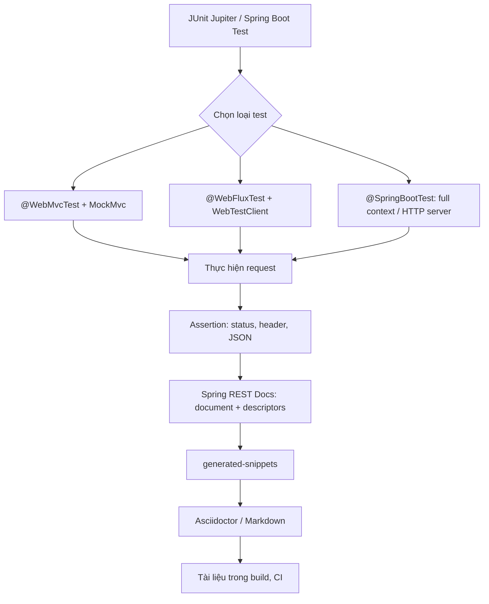

# Tích hợp Spring Boot Test với Spring REST Docs

## 1. Mục tiêu học tập và phạm vi

Trong chương **Spring Boot** của học phần **Spring REST Docs (`SPRING_REST_DOCS`)**, bài này trình bày cách đưa việc tạo tài liệu REST API vào cùng vòng đời với các bài kiểm thử HTTP của Spring Boot. Spring REST Docs tạo các đoạn tài liệu nhỏ (*snippet*) từ request và response mà test thực sự gửi/nhận; sau đó nhóm phát triển dùng Asciidoctor hoặc Markdown để ghép các snippet thành tài liệu có thể xuất bản.

Điểm mạnh của cách làm này là **tài liệu được ràng buộc với bài kiểm thử**: nếu endpoint đổi JSON field, path/query parameter hay header mà mô tả trong test chưa cập nhật, test có thể thất bại ngay trong build hoặc CI. Tuy nhiên, Spring REST Docs không tự hiểu ý nghĩa nghiệp vụ; người viết test vẫn phải kiểm tra đúng hành vi và viết mô tả chính xác.

Sau khi học, bạn có thể:

- Chọn đúng môi trường Spring Boot Test cho API MVC, WebFlux và API chạy qua HTTP thật.
- Cài các module Spring REST Docs tương ứng với `MockMvc`, `WebTestClient` và REST Assured.
- Cấu hình test slice hoặc full application test, inject HTTP client, mock phụ thuộc và sinh snippet.
- Tài liệu hóa request/response, path/query parameter, request/response header và JSON payload.
- Cấu hình Gradle hoặc Maven để sinh tài liệu Asciidoctor/Markdown từ các snippet, tích hợp kiểm tra vào CI.
- Chẩn đoán lỗi thường gặp: snippet không sinh, tài liệu sai lệch, thiếu bean, sai URI template hoặc build dùng lại snippet cũ.

Các ví dụ Java hoàn chỉnh bên dưới chủ yếu nhắm **Spring Boot 3.5, Spring REST Docs 3.x, Java 17+ và JUnit Jupiter**. Spring Boot 4.x thay đổi một số package và module test; phần 3 giải thích cách chuyển đổi để tránh sao chép import không tương thích.

## 2. Tích hợp nằm ở đâu trong vòng đời kiểm thử?

Spring Boot Test chịu trách nhiệm khởi tạo ứng dụng hoặc một phần ứng dụng và cung cấp client để thực hiện HTTP request. Spring REST Docs gắn vào client này, nhận request/response vừa chạy, rồi xuất snippet khi test gọi `document(...)`.



Một test tài liệu có ba trách nhiệm liên quan nhưng khác nhau:

1. **Dựng dữ liệu và môi trường kiểm thử:** tạo controller/service cần thiết, mock dependency hoặc khởi chạy toàn bộ Spring Boot context.
2. **Khẳng định hành vi HTTP:** kiểm tra status, JSON, header hoặc lỗi trả về; không coi việc sinh snippet là bằng chứng duy nhất cho tính đúng đắn.
3. **Mô tả hợp đồng API:** khai báo `pathParameters(...)`, `queryParameters(...)`, `requestFields(...)`, `responseFields(...)`, `requestHeaders(...)` và `responseHeaders(...)` trong `document(...)`.

Các đoạn HTTP request/response, cURL và mô tả field được ghi vào thư mục snippet. Bước xuất HTML hoặc Markdown đọc những file này, còn bước CI chạy lại test để phát hiện tài liệu không còn khớp API.

### Chọn loại kiểm thử

| Kiểu kiểm thử | Dùng khi | Client phổ biến | Đặc điểm |
| --- | --- | --- | --- |
| `@WebMvcTest(Controller.class)` | Kiểm tra hợp đồng HTTP của Spring MVC controller, mock service phía sau. | `MockMvc` | Nhanh, chỉ khởi tạo phần MVC cần thiết; không kiểm tra toàn bộ tích hợp với database/hạ tầng. |
| `@SpringBootTest` + `@AutoConfigureMockMvc` | Cần filter, security, bean và cấu hình Spring MVC của toàn ứng dụng, nhưng không cần mở cổng thật. | `MockMvc` | Bám sát cấu hình ứng dụng hơn; khởi tạo context lớn hơn. |
| `@WebFluxTest(Controller.class)` | Kiểm tra Spring WebFlux controller với dependency được mock. | `WebTestClient` | Tập trung vào reactive web slice, không mở cổng HTTP thật. |
| `@SpringBootTest(webEnvironment = RANDOM_PORT)` | Cần kiểm tra HTTP qua server thực, container networking, filter hoặc serialization end-to-end. | REST Assured, `WebTestClient` hoặc HTTP client phù hợp | Chậm hơn và cần quản lý dữ liệu, cổng ngẫu nhiên, phụ thuộc bên ngoài. |

**Quy tắc chọn:** dùng test slice cho nhiều hợp đồng endpoint nhỏ, sau đó bổ sung một số full integration test khi rủi ro nằm ở security, filter, converter hoặc cấu hình runtime. Không cần khởi động server thật chỉ để sinh snippet cho mọi endpoint.

## 3. Thiết lập dependencies và tương thích phiên bản

### 3.1. Spring MVC + MockMvc với Gradle

Với project Spring Boot 3.5 có `spring-boot-starter-web` và plugin Spring Boot, thêm các dependency test:

```groovy
dependencies {
    implementation 'org.springframework.boot:spring-boot-starter-web'

    testImplementation 'org.springframework.boot:spring-boot-starter-test'
    testImplementation 'org.springframework.restdocs:spring-restdocs-mockmvc'
}

tasks.named('test') {
    useJUnitPlatform()
}
```

`spring-boot-starter-test` cung cấp Spring Test, JUnit Jupiter, MockMvc và Mockito trong môi trường Spring MVC; `spring-restdocs-mockmvc` cung cấp lớp tích hợp ghi tài liệu. Khi dùng dependency management/BOM của Spring Boot, các version được quản lý phù hợp nên không cần gắn version riêng cho từng artifact.

Với Maven, dependency cốt lõi tương ứng là:

```xml
<dependency>
    <groupId>org.springframework.boot</groupId>
    <artifactId>spring-boot-starter-test</artifactId>
    <scope>test</scope>
</dependency>
<dependency>
    <groupId>org.springframework.restdocs</groupId>
    <artifactId>spring-restdocs-mockmvc</artifactId>
    <scope>test</scope>
</dependency>
```

Các lựa chọn khác:

| Client dùng trong test | Thư viện tích hợp Spring REST Docs | Cấu hình Spring Boot Test điển hình |
| --- | --- | --- |
| `MockMvc` | `spring-restdocs-mockmvc` | `@WebMvcTest` hoặc `@SpringBootTest` + `@AutoConfigureMockMvc` |
| `WebTestClient` | `spring-restdocs-webtestclient` | `@WebFluxTest` hoặc reactive `@SpringBootTest` |
| REST Assured | `spring-restdocs-restassured` | `@SpringBootTest(webEnvironment = RANDOM_PORT)` |

Các thư viện trên là **cơ chế tích hợp khác nhau**. Không cần thêm cả ba vào một module chỉ để tài liệu hóa API bằng một client.

### 3.2. `@AutoConfigureRestDocs` và Spring Boot 3.5/4.x

Trong Spring Boot 3.5, sử dụng:

```java
import org.springframework.boot.test.autoconfigure.restdocs.AutoConfigureRestDocs;
import org.springframework.boot.test.autoconfigure.web.servlet.WebMvcTest;
import org.springframework.boot.test.autoconfigure.web.servlet.AutoConfigureMockMvc;
```

Spring Boot 4.x đã tách lại các module/package test; những import tương đương chuyển thành:

```java
import org.springframework.boot.restdocs.test.autoconfigure.AutoConfigureRestDocs;
import org.springframework.boot.webmvc.test.autoconfigure.WebMvcTest;
import org.springframework.boot.webmvc.test.autoconfigure.AutoConfigureMockMvc;
```

Với ứng dụng WebFlux, `WebFluxTest` của Boot 3.5 nằm trong `org.springframework.boot.test.autoconfigure.web.reactive`; Boot 4.x chuyển sang `org.springframework.boot.webflux.test.autoconfigure`. Khi nâng cấp, đối chiếu tài liệu và dependency test của **đúng phiên bản Spring Boot** đang dùng. Những ví dụ `@AutoConfigureRestDocs` ở phần 4–7 dùng import Boot 3.5.

Mục đích của `@AutoConfigureRestDocs` là tích hợp Spring REST Docs vào test client do Boot quản lý và cho phép cấu hình thư mục snippet cùng scheme/host/port của URI trong tài liệu. Annotation **không tự tạo descriptor hoặc trang HTML**. Test vẫn phải gọi `document(...)`, trừ khi ta chủ động cài handler ghi snippet mặc định cho mọi request.

## 4. Ví dụ end-to-end: Spring MVC controller và hai bài test sinh tài liệu

Giả sử API quản lý sách có hai endpoint:

- `GET /api/books/{id}?view=full` — trả thông tin sách; mô tả path/query parameter, request header và JSON response.
- `POST /api/books` — nhận JSON và tạo sách; mô tả request payload, response payload và `Location` header.

Hai endpoint này đủ để minh họa các nhóm snippet quan trọng trong Spring REST Docs mà không cần cơ sở dữ liệu thật.

### 4.1. Controller mẫu

Tạo `BookController.java` trong package `com.example.books`:

```java
package com.example.books;

import java.net.URI;
import org.springframework.http.ResponseEntity;
import org.springframework.web.bind.annotation.GetMapping;
import org.springframework.web.bind.annotation.PathVariable;
import org.springframework.web.bind.annotation.PostMapping;
import org.springframework.web.bind.annotation.RequestBody;
import org.springframework.web.bind.annotation.RequestMapping;
import org.springframework.web.bind.annotation.RequestParam;
import org.springframework.web.bind.annotation.RestController;

@RestController
@RequestMapping("/api/books")
public class BookController {
    private final BookService books;

    public BookController(BookService books) {
        this.books = books;
    }

    @GetMapping("/{id}")
    public BookResponse find(
            @PathVariable long id,
            @RequestParam(defaultValue = "full") String view) {
        return books.find(id, view);
    }

    @PostMapping
    public ResponseEntity<BookResponse> create(
            @RequestBody NewBookRequest request) {
        BookResponse result = books.create(request);
        return ResponseEntity.created(
            URI.create("/api/books/" + result.id())
        ).body(result);
    }

    public record NewBookRequest(String title, String author) {}
    public record BookResponse(long id, String title, String author) {}
}

interface BookService {
    BookController.BookResponse find(long id, String view);
    BookController.BookResponse create(BookController.NewBookRequest request);
}
```

Ở ví dụ này, `BookService` chỉ là interface để test có thể mock. Trong ứng dụng thực, service có implementation riêng và có thể gọi repository hoặc các service khác.

### 4.2. Test GET bằng `@WebMvcTest` + `MockMvc`

```java
package com.example.books;

import org.junit.jupiter.api.Test;
import org.springframework.beans.factory.annotation.Autowired;
import org.springframework.boot.test.autoconfigure.restdocs.AutoConfigureRestDocs;
import org.springframework.boot.test.autoconfigure.web.servlet.WebMvcTest;
import org.springframework.http.HttpHeaders;
import org.springframework.http.MediaType;
import org.springframework.test.context.bean.override.mockito.MockitoBean;
import org.springframework.test.web.servlet.MockMvc;

import static org.mockito.BDDMockito.given;
import static org.springframework.restdocs.headers.HeaderDocumentation.headerWithName;
import static org.springframework.restdocs.headers.HeaderDocumentation.requestHeaders;
import static org.springframework.restdocs.mockmvc.MockMvcRestDocumentation.document;
import static org.springframework.restdocs.mockmvc.RestDocumentationRequestBuilders.get;
import static org.springframework.restdocs.payload.PayloadDocumentation.fieldWithPath;
import static org.springframework.restdocs.payload.PayloadDocumentation.responseFields;
import static org.springframework.restdocs.request.RequestDocumentation.parameterWithName;
import static org.springframework.restdocs.request.RequestDocumentation.pathParameters;
import static org.springframework.restdocs.request.RequestDocumentation.queryParameters;
import static org.springframework.test.web.servlet.result.MockMvcResultMatchers.jsonPath;
import static org.springframework.test.web.servlet.result.MockMvcResultMatchers.status;

@WebMvcTest(BookController.class)
@AutoConfigureRestDocs(outputDir = "build/generated-snippets")
class BookDocumentationTest {

    @Autowired
    MockMvc mockMvc;

    @MockitoBean
    BookService bookService;

    @Test
    void findBook() throws Exception {
        given(bookService.find(42L, "full"))
            .willReturn(new BookController.BookResponse(
                42L, "Clean Code", "Robert C. Martin"
            ));

        mockMvc.perform(
                get("/api/books/{id}", 42L)
                    .queryParam("view", "full")
                    .accept(MediaType.APPLICATION_JSON)
            )
            .andExpect(status().isOk())
            .andExpect(jsonPath("$.id").value(42))
            .andExpect(jsonPath("$.title").value("Clean Code"))
            .andDo(document("books-find",
                pathParameters(
                    parameterWithName("id")
                        .description("Mã định danh của sách")
                ),
                queryParameters(
                    parameterWithName("view")
                        .description("Kiểu hiển thị; full là mặc định")
                ),
                requestHeaders(
                    headerWithName(HttpHeaders.ACCEPT)
                        .description("Định dạng response mà client chấp nhận")
                ),
                responseFields(
                    fieldWithPath("id").description("ID sách"),
                    fieldWithPath("title").description("Tiêu đề sách"),
                    fieldWithPath("author").description("Tác giả")
                )
            ));
    }
}
```

Giải thích các điểm quan trọng:

1. `@WebMvcTest(BookController.class)` chỉ tạo MVC test slice. `@MockitoBean` thay thế `BookService` bằng mock, giúp response ổn định và không phụ thuộc database.
2. `@AutoConfigureRestDocs` gắn REST Docs vào `MockMvc` đã được Spring Boot tạo. `outputDir` trỏ nơi ghi snippet.
3. `RestDocumentationRequestBuilders.get(...)` lưu được URI template `/api/books/{id}`. Nhờ vậy `pathParameters(...)` biết `id` xuất hiện ở đâu; dùng builder HTTP thông thường không giữ đủ thông tin template có thể dẫn đến lỗi tài liệu hóa path parameter.
4. `andExpect(...)` kiểm tra giá trị HTTP thực; `andDo(document(...))` sinh snippet và kiểm tra các descriptor đã khai báo.
5. `responseFields(...)` mặc định nghiêm ngặt: field bất ngờ không được mô tả hoặc field bắt buộc không tồn tại sẽ khiến test không đạt.

Khi test thành công, thư mục `build/generated-snippets/books-find/` chứa những snippet như `http-request.adoc`, `http-response.adoc`, `curl-request.adoc`, `path-parameters.adoc`, `query-parameters.adoc`, `request-headers.adoc` và `response-fields.adoc`.

### 4.3. Test POST để tài liệu hóa request/response payload và header

Trong cùng `BookDocumentationTest`, bổ sung method sau, cùng các static import cần thiết:

```java
import static org.springframework.restdocs.headers.HeaderDocumentation.responseHeaders;
import static org.springframework.restdocs.mockmvc.RestDocumentationRequestBuilders.post;
import static org.springframework.restdocs.payload.PayloadDocumentation.requestFields;
import static org.springframework.restdocs.operation.preprocess.Preprocessors.preprocessRequest;
import static org.springframework.restdocs.operation.preprocess.Preprocessors.preprocessResponse;
import static org.springframework.restdocs.operation.preprocess.Preprocessors.prettyPrint;
import static org.springframework.test.web.servlet.result.MockMvcResultMatchers.header;

@Test
void createBook() throws Exception {
    String payload = """
        {"title":"Clean Code","author":"Robert C. Martin"}
        """;

    given(bookService.create(
        new BookController.NewBookRequest(
            "Clean Code", "Robert C. Martin"
        )
    )).willReturn(new BookController.BookResponse(
        42L, "Clean Code", "Robert C. Martin"
    ));

    mockMvc.perform(
            post("/api/books")
                .contentType(MediaType.APPLICATION_JSON)
                .accept(MediaType.APPLICATION_JSON)
                .content(payload)
        )
        .andExpect(status().isCreated())
        .andExpect(header().string(HttpHeaders.LOCATION, "/api/books/42"))
        .andExpect(jsonPath("$.id").value(42))
        .andDo(document("books-create",
            preprocessRequest(prettyPrint()),
            preprocessResponse(prettyPrint()),
            requestFields(
                fieldWithPath("title").description("Tên sách"),
                fieldWithPath("author").description("Tác giả")
            ),
            responseHeaders(
                headerWithName(HttpHeaders.LOCATION)
                    .description("Đường dẫn đến tài nguyên vừa tạo")
            ),
            responseFields(
                fieldWithPath("id").description("ID sách mới"),
                fieldWithPath("title").description("Tên sách"),
                fieldWithPath("author").description("Tác giả")
            )
        ));
}
```

`requestFields(...)` kiểm tra cấu trúc request body, còn `responseFields(...)` kiểm tra response body. `responseHeaders(...)` mô tả `Location` trong phản hồi `201 Created`. `preprocessRequest(prettyPrint())` và `preprocessResponse(prettyPrint())` làm JSON trong tài liệu dễ đọc mà không thay đổi dữ liệu request được controller xử lý.

Chỉ nên dùng `optional()` cho field thực sự tùy chọn; `ignored()` cho field hiện diện nhưng không cần trình bày; `relaxedRequestFields(...)` hoặc `relaxedResponseFields(...)` khi chủ động chấp nhận phần dư. Lạm dụng chế độ `relaxed` làm mất khả năng phát hiện thay đổi hợp đồng.

## 5. Full application test: `@SpringBootTest` + `@AutoConfigureMockMvc`

Test slice ở mục 4 giúp lặp nhanh. Khi request cần đi qua chuỗi filter, security hoặc cấu hình runtime đầy đủ, ta có thể chuyển sang test context toàn ứng dụng:

```java
import org.junit.jupiter.api.Test;
import org.springframework.beans.factory.annotation.Autowired;
import org.springframework.boot.test.autoconfigure.restdocs.AutoConfigureRestDocs;
import org.springframework.boot.test.autoconfigure.web.servlet.AutoConfigureMockMvc;
import org.springframework.boot.test.context.SpringBootTest;
import org.springframework.test.web.servlet.MockMvc;

import static org.springframework.restdocs.mockmvc.MockMvcRestDocumentation.document;
import static org.springframework.test.web.servlet.request.MockMvcRequestBuilders.get;
import static org.springframework.test.web.servlet.result.MockMvcResultMatchers.status;

@SpringBootTest
@AutoConfigureMockMvc
@AutoConfigureRestDocs
class ApplicationDocumentationTest {

    @Autowired
    MockMvc mockMvc;

    @Test
    void health() throws Exception {
        mockMvc.perform(get("/actuator/health"))
            .andExpect(status().isOk())
            .andDo(document("application-health"));
    }
}
```

Ví dụ này **giả định ứng dụng đã bật endpoint `/actuator/health` cho test**, có dependency Actuator và cấu hình security cho phép gọi endpoint tương ứng. Không có các điều kiện đó, thay request bằng một endpoint đang hiện diện trong ứng dụng.

`@SpringBootTest` khởi tạo application context đầy đủ, còn `@AutoConfigureMockMvc` tạo client `MockMvc` để kiểm thử trong process, thường không mở cổng HTTP. `@AutoConfigureRestDocs` tích hợp bộ ghi tài liệu vào client này.

Khi Spring Security được bật, không nên mặc định tắt filter chỉ để test qua. Hãy cấu hình identity/mock authentication thích hợp (ví dụ các tiện ích `spring-security-test`) và tài liệu hóa response `401/403` nếu chúng là một phần hợp đồng API. Tách test lỗi, quyền truy cập và tình huống thành công để snippet rõ ràng.

## 6. Tích hợp với Spring WebFlux và `WebTestClient`

Ứng dụng reactive dùng `spring-boot-starter-webflux` cùng `spring-restdocs-webtestclient`. Với `@WebFluxTest` và `@AutoConfigureRestDocs`, Spring Boot cung cấp `WebTestClient` đã được cấu hình để Spring REST Docs ghi snippet.

Giả sử ứng dụng có controller:

```java
import java.util.Map;
import org.springframework.web.bind.annotation.GetMapping;
import org.springframework.web.bind.annotation.RestController;
import reactor.core.publisher.Mono;

@RestController
class StatusController {
    @GetMapping("/api/status")
    Mono<Map<String, String>> status() {
        return Mono.just(Map.of("status", "UP"));
    }
}
```

Test tài liệu:

```java
import org.junit.jupiter.api.Test;
import org.springframework.beans.factory.annotation.Autowired;
import org.springframework.boot.test.autoconfigure.restdocs.AutoConfigureRestDocs;
import org.springframework.boot.test.autoconfigure.web.reactive.WebFluxTest;
import org.springframework.test.web.reactive.server.WebTestClient;

import static org.springframework.restdocs.payload.PayloadDocumentation.fieldWithPath;
import static org.springframework.restdocs.payload.PayloadDocumentation.responseFields;
import static org.springframework.restdocs.webtestclient.WebTestClientRestDocumentation.document;

@WebFluxTest(StatusController.class)
@AutoConfigureRestDocs
class StatusDocumentationTest {

    @Autowired
    WebTestClient client;

    @Test
    void status() {
        client.get().uri("/api/status")
            .exchange()
            .expectStatus().isOk()
            .expectBody()
            .jsonPath("$.status").isEqualTo("UP")
            .consumeWith(document("status-get",
                responseFields(
                    fieldWithPath("status")
                        .description("Tình trạng hiện tại của dịch vụ")
                )
            ));
    }
}
```

Điểm khác so với `MockMvc`: WebTestClient sinh request qua API reactive `exchange()`, thực hiện assertion bằng `expectStatus()/expectBody()` và xuất snippet bằng `consumeWith(document(...))`. Trong dự án WebFlux có filter reactive hoặc security phức tạp, vẫn cần bảo đảm test slice nạp đủ cấu hình cần kiểm tra.

## 7. REST Assured khi cần HTTP server thật

REST Assured thích hợp khi muốn kiểm tra API trên cổng thật, kể cả phần mạng mà `MockMvc` không đi qua. Thêm:

```groovy
dependencies {
    testImplementation 'org.springframework.restdocs:spring-restdocs-restassured'
}
```

Có thể tích hợp trực tiếp với Spring REST Docs bằng `RestDocumentationExtension` và filter `documentationConfiguration(...)`. Cách này không phụ thuộc vào việc phiên bản Spring Boot cụ thể có auto-configure bean REST Assured `RequestSpecification` hay không.

Ví dụ dưới đây giả định ứng dụng có `GET /api/status` trả mã `200`:

```java
import io.restassured.builder.RequestSpecBuilder;
import io.restassured.specification.RequestSpecification;
import org.junit.jupiter.api.BeforeEach;
import org.junit.jupiter.api.Test;
import org.junit.jupiter.api.extension.ExtendWith;
import org.springframework.boot.test.context.SpringBootTest;
import org.springframework.boot.test.web.server.LocalServerPort;
import org.springframework.restdocs.RestDocumentationContextProvider;
import org.springframework.restdocs.junit.jupiter.RestDocumentationExtension;

import static io.restassured.RestAssured.given;
import static org.hamcrest.Matchers.equalTo;
import static org.springframework.restdocs.restassured.RestAssuredRestDocumentation.document;
import static org.springframework.restdocs.restassured.RestAssuredRestDocumentation.documentationConfiguration;

@SpringBootTest(webEnvironment = SpringBootTest.WebEnvironment.RANDOM_PORT)
@ExtendWith(RestDocumentationExtension.class)
class StatusHttpDocumentationTest {

    @LocalServerPort
    int port;

    RequestSpecification specification;

    @BeforeEach
    void setUp(RestDocumentationContextProvider documentation) {
        this.specification = new RequestSpecBuilder()
            .addFilter(documentationConfiguration(documentation))
            .build();
    }

    @Test
    void statusOverHttp() {
        given(this.specification)
            .port(port)
            .filter(document("status-over-http"))
        .when()
            .get("/api/status")
        .then()
            .statusCode(200)
            .body("status", equalTo("UP"));
    }
}
```

Trong ví dụ, `@SpringBootTest(RANDOM_PORT)` khởi chạy server thật; `@LocalServerPort` nhận cổng đã chọn để tránh xung đột trên máy build; `RequestSpecBuilder` gắn filter ghi tài liệu. Vì sử dụng HTTP thật, test cần dữ liệu dự đoán được và không được phụ thuộc ngầm vào trạng thái môi trường bên ngoài.

**Lưu ý phiên bản:** Spring Boot 3.5 có hỗ trợ REST Assured trong hệ sinh thái auto-configuration của Spring REST Docs. Khi nâng lên Spring Boot 4.x, cần kiểm tra hướng dẫn auto-configuration cụ thể; ví dụ cấu hình filter trực tiếp phía trên là cách làm tường minh.

## 8. Cấu hình snippet và tạo trang tài liệu

### 8.1. Đường dẫn, URI và quy ước đặt tên

Với Gradle, Spring REST Docs thông thường ghi snippet ở `build/generated-snippets`; với Maven là `target/generated-snippets`. Có thể chỉ định đích ngay trên annotation:

```java
@AutoConfigureRestDocs(
    outputDir = "build/generated-snippets",
    uriScheme = "https",
    uriHost = "api.example.com",
    uriPort = 443
)
```

Các thuộc tính `uriScheme`, `uriHost` và `uriPort` dùng để biểu diễn URI trong snippet, ví dụ để `curl-request.adoc` hiển thị host công khai. Chúng **không đổi endpoint mà test đang gọi**, không mở TLS và không chuyển client sang một server ngoài.

Đặt ID `document("books-find")` theo endpoint/hành vi thay vì tên test ngẫu nhiên. Với test tham số hóa, tránh nhiều test ghi cùng thư mục trừ khi chủ động muốn dùng chung đầu ra. Không commit snippet cũ làm nguồn sự thật nếu CI có thể tạo lại từ test.

### 8.2. Biên soạn Asciidoctor với Gradle

Áp dụng plugin `org.asciidoctor.jvm.convert` phù hợp với phiên bản build đang dùng và bổ sung phần cấu hình sau vào `build.gradle`:

```groovy
configurations {
    asciidoctorExt
}

dependencies {
    asciidoctorExt 'org.springframework.restdocs:spring-restdocs-asciidoctor'
}

ext {
    snippetsDir = file('build/generated-snippets')
}

tasks.named('test') {
    outputs.dir snippetsDir
}

tasks.named('asciidoctor') {
    configurations 'asciidoctorExt'
    inputs.dir snippetsDir
    dependsOn tasks.named('test')
}
```

`spring-restdocs-asciidoctor` hỗ trợ Asciidoctor nhận biết snippet và tạo bảng mô tả field/parameter/header khi include. Hãy đồng bộ `snippetsDir` với `outputDir` đã cấu hình trong test; thay đổi một bên mà quên bên kia sẽ khiến Asciidoctor không tìm thấy snippet.

Tạo file `src/docs/asciidoc/index.adoc`:

```asciidoc
= API quản lý sách
:toc: left

== Lấy thông tin sách

=== HTTP request
include::{snippets}/books-find/http-request.adoc[]

=== Path và query parameters
include::{snippets}/books-find/path-parameters.adoc[]
include::{snippets}/books-find/query-parameters.adoc[]

=== Header
include::{snippets}/books-find/request-headers.adoc[]

=== HTTP response
include::{snippets}/books-find/http-response.adoc[]
include::{snippets}/books-find/response-fields.adoc[]

== Tạo sách

=== HTTP request
include::{snippets}/books-create/http-request.adoc[]
include::{snippets}/books-create/request-fields.adoc[]

=== HTTP response
include::{snippets}/books-create/http-response.adoc[]
include::{snippets}/books-create/response-headers.adoc[]
include::{snippets}/books-create/response-fields.adoc[]
```

Chạy `./gradlew clean test asciidoctor`. `test` tạo snippet; `asciidoctor` kết hợp chúng thành HTML. Việc chạy `clean` khi xác minh pipeline giúp tránh tài liệu vô tình dùng lại snippet còn sót của lần build trước. Trong một CI đã dùng build cache, hãy khai báo outputs/inputs chính xác để Gradle biết khi nào cần chạy lại tác vụ.

### 8.3. Với Maven hoặc Markdown

Trên Maven, liên kết bước kiểm thử (Surefire/Failsafe theo cách phân tầng test) với plugin `asciidoctor-maven-plugin`, dùng thư mục `target/generated-snippets` làm nguồn cho Asciidoctor. Cần cấu hình giai đoạn plugin chạy **sau** các test tạo snippet, đồng thời đóng gói/xuất bản HTML như artifact của CI.

Nếu sản phẩm yêu cầu Markdown thay vì AsciiDoc, Spring REST Docs cho phép thay template snippet bằng `TemplateFormats.markdown()` thông qua customizer của bộ tích hợp test, sau đó dùng pipeline ghép các file `.md`. Các chỉ thị `include::{snippets}/...adoc[]` phía trên thuộc Asciidoctor, nên không thể đưa thẳng vào trình xử lý Markdown thông thường rồi kỳ vọng chúng tự được giải quyết.

## 9. Dữ liệu kiểm thử, tính ổn định và bảo mật tài liệu

Test sinh tài liệu phải **tái lập được** trên máy cá nhân lẫn CI:

- **Không phụ thuộc ID ngẫu nhiên hoặc thời gian hiện tại** trong snippet nếu không có bước cố định hóa dữ liệu; dùng stub/mock hoặc seed dữ liệu đã biết.
- **Không chèn secret vào snippet**: giá trị `Authorization`, cookie, token, khóa API và dữ liệu cá nhân cần được thay thế hoặc loại khỏi request/response hiển thị. Có thể dùng các `OperationPreprocessor` như `modifyHeaders()` hoặc `modifyParameters()` khi cần, nhưng vẫn phải giữ assertion kiểm tra đúng nghiệp vụ.
- **Không bỏ qua cơ chế xác thực chỉ để có status 200**: khi endpoint yêu cầu quyền, tạo security context hợp lệ và kiểm tra cả tình huống bị từ chối phù hợp.
- **Không để tác vụ xuất tài liệu chạy trước test**: trang HTML có thể bị sinh từ snippet cũ, dù test hiện tại đã thất bại.
- **Không chọn full context cho mọi trường hợp**: tận dụng `@WebMvcTest`/`@WebFluxTest` khi chỉ cần test contract; chạy full integration test khi muốn kiểm tra đúng cấu hình hệ thống.

Ngoài happy path, nên có test cho `400 Bad Request` (validation), `401 Unauthorized`/`403 Forbidden` (security), `404 Not Found` và trường hợp lỗi nghiệp vụ nếu đây là phần hợp đồng API công khai. Chúng có thể dùng các ID tài liệu riêng như `books-find-not-found` để người đọc phân biệt request thành công và request lỗi.

## 10. Sự cố thường gặp

| Triệu chứng | Nguyên nhân khả dĩ | Cách xử lý |
| --- | --- | --- |
| Không có `generated-snippets` | Chưa gọi `document(...)`, test không chạy hoặc thiếu module REST Docs tương ứng. | Kiểm tra test report, dependencies, `andDo(...)`/`consumeWith(...)` và `outputDir`. |
| `MockMvc` không inject được | Dùng `@SpringBootTest` nhưng quên `@AutoConfigureMockMvc`; hoặc không chạy trong MVC test context. | Thêm annotation phù hợp, tránh tạo client thủ công thiếu config. |
| `@WebMvcTest` báo thiếu bean service | Slice không nạp các service thông thường. | Dùng `@MockitoBean` hoặc import bean cần kiểm tra; cân nhắc full context. |
| Test tài liệu báo path parameter không có | Builder request không giữ URI template. | Dùng `RestDocumentationRequestBuilders.get("/.../{id}", id)`. |
| Test báo field chưa được tài liệu hóa | `responseFields(...)` hoặc `requestFields(...)` thiếu descriptor, hoặc API thay đổi. | Xem JSON thực tế, thêm/sửa descriptor hoặc điều chỉnh API. |
| Asciidoctor báo thiếu file `.adoc` | Test không sinh snippet, tên `document(...)` sai hoặc build trỏ nhầm thư mục. | Kiểm tra thư mục thật và wiring `dependsOn test`. |
| URI trong cURL là `localhost:8080` | Đang dùng URI mặc định của REST Docs. | Đặt `uriScheme`, `uriHost`, `uriPort` cho URI muốn trình bày. |
| Sau khi nâng Boot, import REST Docs test bị lỗi | Spring Boot 4 di chuyển package/module test. | Cập nhật import và dependency theo tài liệu đúng major version. |
| Endpoint có security trả `401/403` ngoài dự kiến | Test không tạo principal hoặc token phù hợp. | Cấu hình test authentication và kiểm tra security filter. |
| REST Assured dùng cổng cứng gây xung đột trên CI | Có nhiều test chạy song song hoặc cổng đã bị chiếm. | Dùng `RANDOM_PORT`, lấy cổng từ `@LocalServerPort`. |

## 11. Bài thực hành

Từ ví dụ `BookController`, hãy triển khai thêm `GET /api/books?author=...` và `DELETE /api/books/{id}`. Lập test tài liệu theo hai tầng: dùng `@WebMvcTest` để mô tả các endpoint với mock service và dùng ít nhất một `@SpringBootTest` để kiểm tra filter/security của ứng dụng.

Thực hiện theo thứ tự:

1. Thêm test `GET /api/books?author=...`, mô tả `queryParameters(...)` và cấu trúc danh sách sách trả về bằng `responseFields(...)`.
2. Thêm test `DELETE` kiểm tra `204 No Content`, mô tả path parameter và khẳng định response không có body.
3. Cố ý đổi một field JSON ở controller nhưng giữ descriptor cũ, quan sát test tài liệu thất bại.
4. Cập nhật descriptor, chạy `./gradlew clean test asciidoctor`, mở HTML và kiểm tra các phần mới.
5. Thêm một job CI chạy test và sinh tài liệu; chỉ publish HTML khi các bước thành công.

**Điều kiện hoàn thành:** mỗi endpoint có test HTTP và snippet ổn định; tài liệu request/response, parameter, payload và header được sinh từ test; khi có thay đổi hợp đồng chưa cập nhật, CI phát hiện được; không có thông tin nhạy cảm thật trong snippet.

## 12. Tài liệu tham khảo

- [Spring Boot — Testing Spring Boot Applications](https://docs.spring.io/spring-boot/reference/testing/spring-boot-applications.html)
- [Spring Boot 3.5 — Spring REST Docs auto-configuration](https://docs.spring.io/spring-boot/3.5/reference/testing/spring-boot-applications.html)
- [Spring REST Docs — Reference](https://docs.spring.io/spring-restdocs/reference/)
- [Spring REST Docs — Getting Started](https://docs.spring.io/spring-restdocs/tutorial/getting-started/index.html)
- [Spring REST Docs — Documenting Your API](https://docs.spring.io/spring-restdocs/reference/documenting-your-api/index.html)
- [Spring REST Docs — Customizing Requests and Responses](https://docs.spring.io/spring-restdocs/reference/customizing-requests-and-responses.html)
