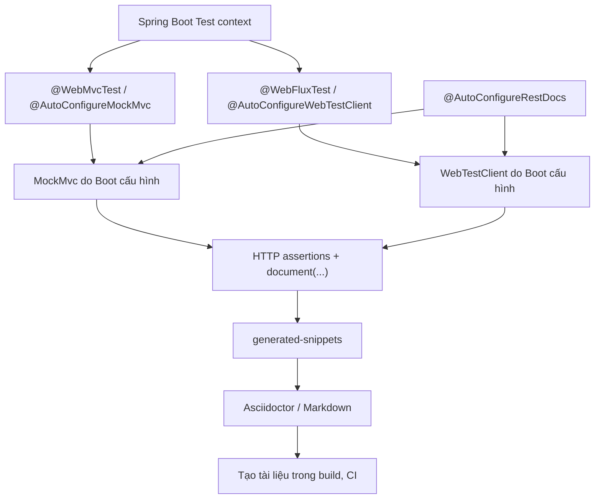

# Cấu hình MockMvc hoặc WebTestClient do Boot cung cấp

## 1. Bối cảnh và mục tiêu

Trong chương **Spring Boot** của học phần **Spring REST Docs (`SPRING_REST_DOCS`)**, chúng ta dùng bài kiểm thử HTTP để tạo tài liệu REST API có thể kiểm chứng. Thay vì tự dựng một HTTP client mới trong mỗi test, Spring Boot Test có thể **cung cấp `MockMvc` hoặc `WebTestClient` đã được tích hợp Spring REST Docs**. Nhờ đó, việc kiểm thử status, header, body, path/query parameter và sinh snippet nằm trong cùng một luồng chạy.

Bài này tập trung vào câu hỏi: *khi nào nên dùng client do Spring Boot cung cấp và cấu hình nó ở đâu?* Nội dung áp dụng cho việc viết snippet request/response/payload, biên soạn Asciidoctor/Markdown và đưa tài liệu vào build hoặc CI. Ví dụ Java sử dụng **Spring Boot 3.5, Spring REST Docs 3.x, JUnit Jupiter và Java 17+**; phần riêng giải thích điểm khác trên Boot 4.x.

Sau bài học, bạn sẽ:

- Chọn `@WebMvcTest`/`@AutoConfigureMockMvc` hoặc `@WebFluxTest`/`@AutoConfigureWebTestClient` đúng loại ứng dụng.
- Hiểu `@AutoConfigureRestDocs` tác động lên client được Spring Boot cấu hình như thế nào.
- Phân biệt tùy chỉnh URI/thư mục xuất snippet với tùy chỉnh sâu bằng `RestDocsMockMvcConfigurationCustomizer` và `RestDocsWebTestClientConfigurationCustomizer`.
- Tạo quy tắc xử lý snippet chung cho nhiều test mà vẫn giữ được descriptor kiểm chứng API.
- Tránh những lỗi thường gặp khi tự tạo `MockMvc`/`WebTestClient` làm mất bộ lọc REST Docs, hoặc khi chuyển giữa Spring Boot 3.x và 4.x.

## 2. Phân biệt client HTTP, cấu hình Spring Boot và cấu hình REST Docs

`MockMvc` mô phỏng chu trình request/response ở tầng Spring MVC bên trong ứng dụng, không cần mở cổng server. `WebTestClient` là API kiểm thử HTTP định hướng reactive: nó có thể liên kết với ứng dụng WebFlux trong bộ nhớ hoặc kết nối tới một server đang chạy.

Spring Boot thường chuẩn bị client dựa trên kiểu test. `@AutoConfigureRestDocs` **bổ sung bộ ghi tài liệu vào client được Boot quản lý**; annotation này không thay thế việc tạo client, không tạo endpoint và không tự biết field nào cần mô tả.



### Ma trận cấu hình test client

| Mục tiêu test | Annotation khởi tạo context/client | Client inject bằng `@Autowired` | Có cần server thật? |
| --- | --- | --- | --- |
| Spring MVC controller riêng lẻ | `@WebMvcTest(MyController.class)` + `@AutoConfigureRestDocs` | `MockMvc` | Không |
| Spring MVC toàn ứng dụng | `@SpringBootTest` + `@AutoConfigureMockMvc` + `@AutoConfigureRestDocs` | `MockMvc` | Không |
| Spring WebFlux controller riêng lẻ | `@WebFluxTest(MyController.class)` + `@AutoConfigureRestDocs` | `WebTestClient` | Không |
| Spring WebFlux toàn ứng dụng, mock web | `@SpringBootTest` + `@AutoConfigureWebTestClient` + `@AutoConfigureRestDocs` | `WebTestClient` | Không |
| Ứng dụng qua HTTP thật | `@SpringBootTest(webEnvironment = RANDOM_PORT)`, client được cấu hình phù hợp và REST Docs | `WebTestClient` hoặc REST Assured | Có |

Các annotation bên trên biểu thị cách dùng điển hình. `@WebMvcTest` chỉ nạp phần MVC, còn `@WebFluxTest` chỉ nạp phần WebFlux. Nếu controller cần service, repository hoặc cấu hình không thuộc slice, hãy dùng mock/test configuration hoặc chuyển sang full-context test. Riêng `@SpringBootTest` mặc định không tự đảm bảo có `MockMvc`: muốn inject nó, cần `@AutoConfigureMockMvc`.

> **Ranh giới quan trọng:** dùng client được inject từ Spring Boot thì tận dụng được các customizer do Boot áp dụng. Nếu tự gọi `MockMvcBuilders.standaloneSetup(...)` hoặc `WebTestClient.bindToController(...)`, instance mới đó không mặc nhiên kế thừa phần tích hợp REST Docs của client do Boot tạo.

## 3. Chuẩn bị dependencies theo kiểu ứng dụng

Với ứng dụng Spring MVC sử dụng Gradle (Groovy DSL) và Spring Boot 3.5:

```groovy
dependencies {
    implementation 'org.springframework.boot:spring-boot-starter-web'
    testImplementation 'org.springframework.boot:spring-boot-starter-test'
    testImplementation 'org.springframework.restdocs:spring-restdocs-mockmvc'
}

tasks.named('test') {
    useJUnitPlatform()
}
```

Với ứng dụng reactive WebFlux, thay `spring-boot-starter-web` bằng `spring-boot-starter-webflux` và `spring-restdocs-mockmvc` bằng `spring-restdocs-webtestclient`. Dùng dependency management hoặc BOM của Spring Boot để giữ các thư viện kiểm thử tương thích.

| Kiểu client | Dependency Spring REST Docs | API gọi sinh tài liệu |
| --- | --- | --- |
| `MockMvc` | `org.springframework.restdocs:spring-restdocs-mockmvc` | `.andDo(document("id", ...))` |
| `WebTestClient` | `org.springframework.restdocs:spring-restdocs-webtestclient` | `.expectBody().consumeWith(document("id", ...))` |
| REST Assured (để so sánh) | `org.springframework.restdocs:spring-restdocs-restassured` | `given(...).filter(document("id", ...))` |

REST Assured gửi request qua HTTP thật; không dùng `MockMvc` hay `WebTestClient` làm client. Bài này tập trung vào hai client đầu tiên và đường cấu hình của Spring Boot.

## 4. Cấu hình cơ bản với `@AutoConfigureRestDocs`

`@AutoConfigureRestDocs` chuẩn bị tích hợp Spring REST Docs trên client do Boot cấu hình. Nó hỗ trợ một số tùy chọn có thể đặt ngay trên test class:

```java
@AutoConfigureRestDocs(
    outputDir = "build/generated-snippets",
    uriScheme = "https",
    uriHost = "api.example.com",
    uriPort = 443
)
```

| Thuộc tính | Công dụng | Giá trị mặc định |
| --- | --- | --- |
| `outputDir` | Nơi lưu các snippet từ test. | Với Gradle thường là `build/generated-snippets`; với Maven là `target/generated-snippets`. |
| `value` | Tên ngắn (alias) của `outputDir`. | Chuỗi rỗng; Boot chọn đường dẫn mặc định. |
| `uriScheme` | Scheme hiển thị trong URI được tài liệu hóa. | `http` |
| `uriHost` | Host hiển thị trong snippet. | `localhost` |
| `uriPort` | Port hiển thị trong snippet. | `8080` |

Đặt `uriScheme="https"` và `uriPort=443` nhằm tạo URI như `https://api.example.com/api/items` trong snippet, **không** làm test kết nối ra host đó, không bật TLS và cũng không thay đổi cổng thực tế của ứng dụng. Với cổng mặc định của scheme (80 cho HTTP, 443 cho HTTPS), REST Docs có thể bỏ phần `:port` khi hiển thị URL.

Các thuộc tính annotation thuộc nhóm `spring.test.restdocs` trong cơ chế cấu hình test Spring Boot. Khi dùng Asciidoctor, hãy giữ `outputDir` trùng thư mục mà tác vụ dựng tài liệu sử dụng.

### Client được cấu hình khi nào?

1. JUnit bắt đầu test và Spring Test dựng `ApplicationContext` theo các annotation như `@WebMvcTest` hoặc `@WebFluxTest`.
2. Spring Boot tạo `MockMvc`/`WebTestClient`, áp dụng cấu hình test tương ứng.
3. `@AutoConfigureRestDocs` nạp phần hỗ trợ REST Docs và áp dụng `documentationConfiguration(...)` lên client của Boot. Với cấu hình này, thông thường không cần thêm `RestDocumentationExtension` trong test class.
4. Test inject client, gửi request và kiểm tra response.
5. Lệnh `document(...)` ghi các snippet của request/response đã kiểm tra.

Spring REST Docs **không tự sinh mô tả cho mọi request chỉ vì có annotation**. Muốn tạo snippet theo hợp đồng cụ thể, cần gọi `document(...)`, hoặc cài cơ chế ghi mặc định cho mọi lần tương tác như mục 7.

## 5. Ví dụ MockMvc do Spring Boot cung cấp

Giả sử ứng dụng Spring MVC có endpoint `GET /api/catalog/{id}`. Trong package `com.example.catalog`, controller tối giản:

```java
package com.example.catalog;

import org.springframework.web.bind.annotation.GetMapping;
import org.springframework.web.bind.annotation.PathVariable;
import org.springframework.web.bind.annotation.RequestMapping;
import org.springframework.web.bind.annotation.RestController;

@RestController
@RequestMapping("/api/catalog")
class CatalogController {

    @GetMapping("/{id}")
    ItemResponse find(@PathVariable long id) {
        return new ItemResponse(id, "Bàn phím cơ");
    }

    record ItemResponse(long id, String name) {}
}
```

Test `@WebMvcTest` sử dụng `MockMvc` đã có sẵn trong context:

```java
package com.example.catalog;

import org.junit.jupiter.api.Test;
import org.springframework.beans.factory.annotation.Autowired;
import org.springframework.boot.test.autoconfigure.restdocs.AutoConfigureRestDocs;
import org.springframework.boot.test.autoconfigure.web.servlet.WebMvcTest;
import org.springframework.http.HttpHeaders;
import org.springframework.http.MediaType;
import org.springframework.test.web.servlet.MockMvc;

import static org.springframework.restdocs.headers.HeaderDocumentation.headerWithName;
import static org.springframework.restdocs.headers.HeaderDocumentation.requestHeaders;
import static org.springframework.restdocs.mockmvc.MockMvcRestDocumentation.document;
import static org.springframework.restdocs.mockmvc.RestDocumentationRequestBuilders.get;
import static org.springframework.restdocs.payload.PayloadDocumentation.fieldWithPath;
import static org.springframework.restdocs.payload.PayloadDocumentation.responseFields;
import static org.springframework.restdocs.request.RequestDocumentation.parameterWithName;
import static org.springframework.restdocs.request.RequestDocumentation.pathParameters;
import static org.springframework.test.web.servlet.result.MockMvcResultMatchers.jsonPath;
import static org.springframework.test.web.servlet.result.MockMvcResultMatchers.status;

@WebMvcTest(CatalogController.class)
@AutoConfigureRestDocs(
    uriScheme = "https",
    uriHost = "api.example.com",
    uriPort = 443
)
class CatalogDocumentationTest {

    @Autowired
    MockMvc mockMvc;

    @Test
    void find() throws Exception {
        mockMvc.perform(
                get("/api/catalog/{id}", 7)
                    .accept(MediaType.APPLICATION_JSON)
            )
            .andExpect(status().isOk())
            .andExpect(jsonPath("$.id").value(7))
            .andExpect(jsonPath("$.name").value("Bàn phím cơ"))
            .andDo(document("catalog-find",
                pathParameters(
                    parameterWithName("id")
                        .description("Mã định danh của mặt hàng")
                ),
                requestHeaders(
                    headerWithName(HttpHeaders.ACCEPT)
                        .description("Định dạng phản hồi mong muốn")
                ),
                responseFields(
                    fieldWithPath("id").description("Mã mặt hàng"),
                    fieldWithPath("name").description("Tên mặt hàng")
                )
            ));
    }
}
```

Test nêu trên dùng chính `MockMvc` Boot inject. `RestDocumentationRequestBuilders.get(...)` giữ URI template để `pathParameters(...)` biết `id` là tham số đường dẫn. Các lệnh `andExpect(...)` xác minh response, còn `andDo(document(...))` tạo tài liệu và kiểm chứng các descriptor.

Khi dùng Gradle, sau khi test thành công, các file trong `build/generated-snippets/catalog-find/` có thể bao gồm:

```text
catalog-find/
  curl-request.adoc
  http-request.adoc
  http-response.adoc
  httpie-request.adoc
  request-body.adoc
  response-body.adoc
  path-parameters.adoc
  request-headers.adoc
  response-fields.adoc
```

Sáu snippet cơ bản (`curl-request`, `http-request`, `http-response`, `httpie-request`, `request-body`, `response-body`) được tạo mặc định; các snippet `path-parameters`, `request-headers`, `response-fields` xuất hiện khi test khai báo bộ descriptor tương ứng. Nếu response JSON thêm một field chưa mô tả, `responseFields(...)` ở chế độ chặt chẽ sẽ phát hiện sai lệch và khiến test không đạt.

### Khi cần full application context

Với filter, Spring Security hoặc converter được cấu hình ở phạm vi ứng dụng, dùng:

```java
@SpringBootTest
@AutoConfigureMockMvc
@AutoConfigureRestDocs
class FullCatalogDocumentationTest {
    @Autowired
    MockMvc mockMvc;
    // Viết test perform/andExpect/andDo như ví dụ trên.
}
```

`@SpringBootTest` nạp nhiều bean hơn `@WebMvcTest`, nên test thường chậm hơn nhưng có thể kiểm tra các thành phần thực được dùng trong runtime. Nếu bật security, request có thể cần user/token giả lập phù hợp; `@AutoConfigureRestDocs` không tự vượt qua filter xác thực.

## 6. Tùy biến REST Docs cho `MockMvc` bằng bean của Boot

Khi các thuộc tính `@AutoConfigureRestDocs` chưa đủ, Spring Boot cung cấp interface `RestDocsMockMvcConfigurationCustomizer`. Một bean triển khai interface này được gọi **trước khi cấu hình REST Docs được gắn vào `MockMvc`**, nên có thể thống nhất encoding, template, snippet mặc định hoặc preprocessor cho nhiều test.

Ví dụ lớp cấu hình dùng riêng cho test:

```java
package com.example.catalog;

import org.springframework.boot.test.autoconfigure.restdocs.RestDocsMockMvcConfigurationCustomizer;
import org.springframework.boot.test.context.TestConfiguration;
import org.springframework.http.HttpHeaders;
import org.springframework.restdocs.mockmvc.MockMvcRestDocumentationConfigurer;

import static org.springframework.restdocs.operation.preprocess.Preprocessors.modifyHeaders;
import static org.springframework.restdocs.operation.preprocess.Preprocessors.prettyPrint;

@TestConfiguration(proxyBeanMethods = false)
class CatalogRestDocsConfiguration
        implements RestDocsMockMvcConfigurationCustomizer {

    @Override
    public void customize(MockMvcRestDocumentationConfigurer configurer) {
        configurer.snippets().withEncoding("UTF-8");
        configurer.operationPreprocessors()
            .withRequestDefaults(
                modifyHeaders().remove(HttpHeaders.AUTHORIZATION)
            )
            .withResponseDefaults(prettyPrint());
    }
}
```

Import vào lớp test:

```java
import org.springframework.context.annotation.Import;

@WebMvcTest(CatalogController.class)
@AutoConfigureRestDocs
@Import(CatalogRestDocsConfiguration.class)
class CatalogDocumentationTest {
    // ...
}
```

Ý nghĩa các tùy chỉnh:

- `withEncoding("UTF-8")` đặt encoding của snippet.
- `modifyHeaders().remove(HttpHeaders.AUTHORIZATION)` loại header Authorization khỏi request **được đưa vào tài liệu**, tránh rò rỉ token trong snippet; không tắt xác thực hoặc thay đổi request mà controller xử lý.
- `withResponseDefaults(prettyPrint())` trình bày response body có thể định dạng (ví dụ JSON) dễ đọc hơn.

Nếu muốn dùng template Markdown thay cho AsciiDoc, có thể thay cấu hình snippet bằng:

```java
import org.springframework.restdocs.templates.TemplateFormats;

// Trong phương thức customize(...):
configurer.snippets()
    .withEncoding("UTF-8")
    .withTemplateFormat(TemplateFormats.markdown());
```

Sau khi đổi định dạng, build phải lấy các file `.md` phù hợp; những lệnh `include::{snippets}/...adoc[]` của Asciidoctor sẽ không còn khớp. Nên chọn một định dạng thống nhất cho cả test và pipeline xuất tài liệu.

**Lưu ý phạm vi bean:** `@TestConfiguration` đặt ngoài test class không mặc nhiên được nạp như cấu hình ứng dụng bình thường; dùng `@Import(...)` để test slice hoặc full-context test nhận đúng customizer. Điều này giúp các thay đổi về snippet chỉ tác động đến nhóm test tài liệu cần thiết.

## 7. Ghi snippet mặc định cho mọi thao tác `MockMvc`

Trong ví dụ phần 5, từng test chủ động gọi `andDo(document(...))`. Khi muốn mọi thao tác `mockMvc.perform(...)` đều sinh sáu snippet cơ bản, có thể khai báo bean `RestDocumentationResultHandler`:

```java
import org.springframework.boot.test.context.TestConfiguration;
import org.springframework.context.annotation.Bean;
import org.springframework.restdocs.mockmvc.RestDocumentationResultHandler;

import static org.springframework.restdocs.mockmvc.MockMvcRestDocumentation.document;

@TestConfiguration(proxyBeanMethods = false)
class AutomaticMvcSnippetConfiguration {

    @Bean
    RestDocumentationResultHandler automaticDocumentation() {
        return document("{class-name}/{method-name}");
    }
}
```

Khi import cấu hình này vào context có `@AutoConfigureRestDocs`, Spring Boot sử dụng `MockMvc`'s `alwaysDo(...)` để gắn handler. Ví dụ test `find()` trong `CatalogDocumentationTest` sinh snippet ở thư mục đặt theo tên lớp và phương thức test dù không gọi `andDo(...)` tường minh.

Đây là cơ chế hữu ích khi muốn ghi các request/response cho mọi test trong một nhóm. Tuy vậy:

- Nó chỉ ghi **snippet mặc định**, không tự suy ra mô tả `pathParameters`, `responseFields` hay logic nghiệp vụ.
- Test vẫn phải có assertion và descriptor rõ ràng cho API được công bố. Có thể thêm `andDo(document("catalog-find", ...))` cho trường hợp cần tài liệu hóa chi tiết, nhưng như vậy một request có thể sinh hai bộ snippet ở hai thư mục.
- Tên `{class-name}/{method-name}` phù hợp với test thông thường; test tham số hóa hoặc nhiều lần ghi trong một method cần quy ước tránh trùng vị trí đầu ra.

Với nhóm test tài liệu hóa hợp đồng công khai, việc **chủ động gọi `document("endpoint-id", descriptors...)`** thường dễ kiểm soát hơn khi ánh xạ một endpoint với một mục trong tài liệu.

## 8. WebTestClient do Boot cung cấp: cấu hình và sinh snippet

Ví dụ WebFlux riêng, dùng package `com.example.status` để tránh trộn ứng dụng MVC và reactive. Controller:

```java
package com.example.status;

import java.util.Map;
import org.springframework.web.bind.annotation.GetMapping;
import org.springframework.web.bind.annotation.RestController;
import reactor.core.publisher.Mono;

@RestController
class StatusController {

    @GetMapping("/api/status")
    Mono<Map<String, String>> status() {
        return Mono.just(Map.of("status", "UP"));
    }
}
```

Test dùng `WebTestClient` Boot inject:

```java
package com.example.status;

import org.junit.jupiter.api.Test;
import org.springframework.beans.factory.annotation.Autowired;
import org.springframework.boot.test.autoconfigure.restdocs.AutoConfigureRestDocs;
import org.springframework.boot.test.autoconfigure.web.reactive.WebFluxTest;
import org.springframework.http.MediaType;
import org.springframework.test.web.reactive.server.WebTestClient;

import static org.springframework.restdocs.payload.PayloadDocumentation.fieldWithPath;
import static org.springframework.restdocs.payload.PayloadDocumentation.responseFields;
import static org.springframework.restdocs.webtestclient.WebTestClientRestDocumentation.document;

@WebFluxTest(StatusController.class)
@AutoConfigureRestDocs
class StatusDocumentationTest {

    @Autowired
    WebTestClient client;

    @Test
    void status() {
        client.get().uri("/api/status")
            .accept(MediaType.APPLICATION_JSON)
            .exchange()
            .expectStatus().isOk()
            .expectBody()
            .jsonPath("$.status").isEqualTo("UP")
            .consumeWith(document("status-get",
                responseFields(
                    fieldWithPath("status")
                        .description("Trạng thái hiện tại của dịch vụ")
                )
            ));
    }
}
```

`MockMvc` kết thúc bằng `.andDo(document(...))`, còn `WebTestClient` dùng `.consumeWith(document(...))` trên kết quả body. Trong cả hai trường hợp, các assertion phải kiểm chứng hành vi trước hoặc cùng giai đoạn ghi snippet.

### Tùy biến REST Docs cho `WebTestClient`

Với cấu hình chung như encoding, template hoặc preprocessor, dùng `RestDocsWebTestClientConfigurationCustomizer`:

```java
package com.example.status;

import org.springframework.boot.test.autoconfigure.restdocs.RestDocsWebTestClientConfigurationCustomizer;
import org.springframework.boot.test.context.TestConfiguration;
import org.springframework.restdocs.webtestclient.WebTestClientRestDocumentationConfigurer;

import static org.springframework.restdocs.operation.preprocess.Preprocessors.prettyPrint;

@TestConfiguration(proxyBeanMethods = false)
class StatusRestDocsConfiguration
        implements RestDocsWebTestClientConfigurationCustomizer {

    @Override
    public void customize(WebTestClientRestDocumentationConfigurer configurer) {
        configurer.snippets().withEncoding("UTF-8");
        configurer.operationPreprocessors()
            .withResponseDefaults(prettyPrint());
    }
}
```

Và nạp lớp cấu hình vào test:

```java
import org.springframework.context.annotation.Import;

@WebFluxTest(StatusController.class)
@AutoConfigureRestDocs
@Import(StatusRestDocsConfiguration.class)
class StatusDocumentationTest {
    // ...
}
```

Customizer này tác động đến **bộ cấu hình Spring REST Docs**. Nếu cần thay đổi chính client builder (ví dụ cấu hình timeout, base URL cho client phù hợp hoặc consumer mặc định), Spring Boot còn có `WebTestClientBuilderCustomizer`. Hai interface này phục vụ hai tầng cấu hình khác nhau.

### Ghi snippet trên mọi `WebTestClient` exchange

Spring Boot có thể áp dụng một bean `WebTestClientBuilderCustomizer` để gắn consumer sau mỗi lần client nhận kết quả:

```java
import org.springframework.boot.test.context.TestConfiguration;
import org.springframework.boot.test.web.reactive.server.WebTestClientBuilderCustomizer;
import org.springframework.context.annotation.Bean;

import static org.springframework.restdocs.webtestclient.WebTestClientRestDocumentation.document;

@TestConfiguration(proxyBeanMethods = false)
class AutomaticWebTestClientSnippetConfiguration {

    @Bean
    WebTestClientBuilderCustomizer automaticDocumentation() {
        return builder -> builder.entityExchangeResultConsumer(
            document("{class-name}/{method-name}")
        );
    }
}
```

Import bean này trong test có `@AutoConfigureRestDocs` để nhận các snippet mặc định cho các exchange của client do Boot dựng. Tương tự `alwaysDo(...)` bên MockMvc, cách này **không tự sinh descriptor kiểm chứng request/response fields**. Khi tài liệu hóa API cụ thể, vẫn nên ghi `consumeWith(document("status-get", responseFields(...)))` và đặt ID có chủ đích.

### WebTestClient gắn với server thật

Với `@SpringBootTest(webEnvironment = RANDOM_PORT)`, `WebTestClient` có thể gửi HTTP tới cổng local của ứng dụng, thay vì gọi controller trong bộ nhớ. Lúc này cần kiểm tra client đã được Boot cấu hình thích hợp, có dependency `spring-webflux` trên classpath và cơ chế ghi REST Docs đã được áp dụng. Khác biệt đặc biệt quan trọng:

- Client **bound to application context** phù hợp khi muốn kiểm thử handler/controller mà không mở cổng.
- Client **bound to running server** phù hợp khi muốn kiểm chứng HTTP network stack; giá trị scheme/host/port xuất hiện trong tài liệu cần được xử lý để không vô tình xuất bản `localhost` và cổng ngẫu nhiên.
- Với request tới server thật, các `OperationPreprocessor` như `modifyUris()` có thể thay địa chỉ hiển thị trong snippet, nhưng không thay đổi địa chỉ mà client thực tế đã truy cập.

## 9. Khi nào cần tạo client thủ công?

Boot tự cấu hình client là lựa chọn gọn khi dùng các annotation Spring Boot Test. Tuy nhiên, có dự án tạo trực tiếp `MockMvc` hoặc `WebTestClient` để tùy chỉnh thành phần kiểm thử:

```java
// MockMvc được dựng riêng:
MockMvc manualMvc = MockMvcBuilders.standaloneSetup(controller).build();

// WebTestClient được dựng riêng:
WebTestClient manualClient = WebTestClient.bindToController(controller).build();
```

**Hai instance trong ví dụ chưa được cấu hình Spring REST Docs.** `@AutoConfigureRestDocs` chỉ tùy biến client mà Spring Boot tạo và quản lý; nó không tự nhận diện để sửa mọi client do test tạo thêm.

Khi cần tự dựng client, có hai hướng:

1. Ưu tiên đổi thiết kế test để sử dụng `@Autowired MockMvc` hoặc `@Autowired WebTestClient` do Boot tạo, sau đó dùng customizer/bean phù hợp.
2. Nếu bắt buộc dựng client, cấu hình thủ công bằng Spring REST Docs:
   - `MockMvcBuilders...apply(MockMvcRestDocumentation.documentationConfiguration(restDocumentation))`.
   - `WebTestClient.bindTo...configureClient().filter(WebTestClientRestDocumentation.documentationConfiguration(restDocumentation)).build()`.

Với cấu hình thủ công thông thường, `restDocumentation` là `RestDocumentationContextProvider` do `RestDocumentationExtension` cung cấp cho JUnit Jupiter. Khi trộn với `@AutoConfigureRestDocs`, cần xác định rõ client nào đang nhận cấu hình để không xuất snippet hai lần hoặc tạo các đường dẫn trùng nhau.

## 10. Kết nối các snippet với tài liệu và CI

Sau khi test thành công, Spring REST Docs ghi snippet AsciiDoc mặc định ở `build/generated-snippets` hoặc `target/generated-snippets`. File nguồn Asciidoctor có thể dẫn các phần:

```asciidoc
= Catalog API
:toc: left

== Lấy mặt hàng

=== HTTP request
include::{snippets}/catalog-find/http-request.adoc[]

=== Path parameters
include::{snippets}/catalog-find/path-parameters.adoc[]

=== Request headers
include::{snippets}/catalog-find/request-headers.adoc[]

=== HTTP response
include::{snippets}/catalog-find/http-response.adoc[]
include::{snippets}/catalog-find/response-fields.adoc[]
```

Nếu dùng Gradle và plugin `org.asciidoctor.jvm.convert`, đặt thư mục snippet thành input của tác vụ `asciidoctor` và bắt nó phụ thuộc vào `test`:

```groovy
configurations {
    asciidoctorExt
}

dependencies {
    asciidoctorExt 'org.springframework.restdocs:spring-restdocs-asciidoctor'
}

ext {
    snippetsDir = file('build/generated-snippets')
}

tasks.named('test') {
    outputs.dir snippetsDir
}

tasks.named('asciidoctor') {
    configurations 'asciidoctorExt'
    inputs.dir snippetsDir
    dependsOn tasks.named('test')
}
```

Cấu hình trên là **phần bổ sung** cho build đã có plugin Java, Spring Boot, Asciidoctor và dependency `spring-restdocs-mockmvc` hoặc `spring-restdocs-webtestclient`. Với Maven, ý tưởng tương tự: chạy test để tạo `target/generated-snippets`, sau đó chạy Asciidoctor Maven Plugin ở giai đoạn phù hợp.

Trong CI, thứ tự đáng tin cậy là: checkout mã nguồn → chạy test tài liệu → sinh tài liệu → đóng gói/publish HTML. Khi cần xác minh toàn bộ pipeline, thử build sạch (`./gradlew clean test asciidoctor`) để tránh tình huống trang HTML lặng lẽ lấy snippet cũ từ lần chạy trước. Đảm bảo các phần tài liệu sử dụng cùng tên `document("...")` và cùng thư mục output mà test đã ghi.

## 11. Các lỗi cấu hình thường gặp

| Hiện tượng | Nguyên nhân có thể | Cách xử lý |
| --- | --- | --- |
| Inject `MockMvc` thất bại trong `@SpringBootTest` | Chưa bật `@AutoConfigureMockMvc`. | Thêm annotation và xác nhận ứng dụng là Spring MVC. |
| Không có snippet sau khi chạy test | Chưa gọi `document(...)`, thiếu dependency Spring REST Docs, hoặc client tự tạo chưa gắn cấu hình. | Kiểm tra `andDo`/`consumeWith`, dependency, kiểu client đang được dùng và `outputDir`. |
| `RestDocsMockMvcConfigurationCustomizer` không có hiệu lực | Bean cấu hình không nằm trong test context. | Thêm `@Import(...)` hoặc đặt `@TestConfiguration` đúng phạm vi test. |
| `RestDocsWebTestClientConfigurationCustomizer` không chạy | Test dùng instance `WebTestClient` tự tạo, hoặc customizer không được nạp. | Inject client của Boot và kiểm tra bean trong context. |
| `MockMvc` trong test không đi qua filter mong muốn | Đang dùng slice hoặc `standaloneSetup` chưa có filter/security cấu hình như runtime. | Dùng `@SpringBootTest` + `@AutoConfigureMockMvc` hoặc nạp filter cần test. |
| Test báo không tìm thấy path parameter | Dùng builder không giữ lại URI template. | Dùng `RestDocumentationRequestBuilders.get("/.../{id}", id)`. |
| Test báo field chưa được mô tả | `responseFields`/`requestFields` không khớp payload thực. | Kiểm tra JSON và cập nhật descriptor hay hợp đồng API; không tắt kiểm tra một cách tùy tiện. |
| Sinh hai bộ snippet cho một request | Đã bật handler/consumer mặc định và thêm `document(...)` thủ công. | Quy hoạch thư mục và quyết định cách sinh snippet cho từng nhóm test. |
| File `.adoc` không tìm thấy sau khi chuyển sang Markdown | `TemplateFormats.markdown()` tạo file `.md` trong khi Asciidoctor đang include `.adoc`. | Đồng bộ template và công cụ biên soạn tài liệu. |
| URI trong cURL là `localhost` và port test | Chưa cấu hình URI dùng để trình bày, hoặc đang kiểm thử server thật bằng cổng ngẫu nhiên. | Đặt `uriScheme/uriHost/uriPort` hoặc dùng preprocessor phù hợp. |
| Boot 4 không tìm thấy package Boot 3 | Module và package auto-configuration/test đã thay đổi. | Cập nhật import và dependency theo đúng phiên bản. |

## 12. Lưu ý cho Spring Boot 4.x

Spring Boot 4 tách lại nhiều module và package. Tên của một số annotation, interface vẫn quen thuộc nhưng **đường dẫn import thay đổi**:

| Kiểu | Spring Boot 3.5 | Spring Boot 4.x |
| --- | --- | --- |
| `@AutoConfigureRestDocs` | `org.springframework.boot.test.autoconfigure.restdocs.AutoConfigureRestDocs` | `org.springframework.boot.restdocs.test.autoconfigure.AutoConfigureRestDocs` |
| `RestDocsMockMvcConfigurationCustomizer` | `org.springframework.boot.test.autoconfigure.restdocs.RestDocsMockMvcConfigurationCustomizer` | `org.springframework.boot.restdocs.test.autoconfigure.RestDocsMockMvcConfigurationCustomizer` |
| `RestDocsWebTestClientConfigurationCustomizer` | `org.springframework.boot.test.autoconfigure.restdocs.RestDocsWebTestClientConfigurationCustomizer` | `org.springframework.boot.restdocs.test.autoconfigure.RestDocsWebTestClientConfigurationCustomizer` |
| `@WebMvcTest` | `org.springframework.boot.test.autoconfigure.web.servlet.WebMvcTest` | `org.springframework.boot.webmvc.test.autoconfigure.WebMvcTest` |
| `@WebFluxTest` | `org.springframework.boot.test.autoconfigure.web.reactive.WebFluxTest` | `org.springframework.boot.webflux.test.autoconfigure.WebFluxTest` |

Spring Boot 4.x có module test Spring REST Docs riêng, với artifact `org.springframework.boot:spring-boot-restdocs`; cần bảo đảm module này và các dependency web test tương ứng được đưa vào test classpath. `@AutoConfigureRestDocs` của Boot 4 hỗ trợ tích hợp `MockMvc` và `WebTestClient`; nếu cần REST Assured, cấu hình filter Spring REST Docs theo API tương ứng thay vì giả định Boot có bean `RequestSpecification` tự động như ở Boot 3.5.

Khi nâng cấp major version, hãy kiểm tra cả API, dependency Gradle/Maven và bản Spring REST Docs phù hợp. Đổi import đơn lẻ có thể chưa đủ khi cấu trúc starter hoặc module test thay đổi.

## 13. Bài thực hành

Mở rộng ví dụ `CatalogController` với endpoint `GET /api/catalog?category=keyboard` trả danh sách hai mặt hàng. Thực hiện các bước:

1. Viết `@WebMvcTest` inject `MockMvc` và `@AutoConfigureRestDocs` để mô tả `queryParameters(...)`, `responseFields(...)`; kiểm tra status và JSON trước khi gọi `document(...)`.
2. Tạo `RestDocsMockMvcConfigurationCustomizer` đặt encoding UTF-8, pretty-print response; import bean vào lớp test và xác minh snippet được định dạng theo cấu hình.
3. Cấu hình `uriScheme=https`, `uriHost=api.example.com`, `uriPort=443`. So sánh `curl-request.adoc` trước/sau và xác nhận request test vẫn xử lý trong `MockMvc`.
4. Dựng một endpoint tương đương bằng `WebFlux` và `WebTestClient` trong module reactive, sử dụng `RestDocsWebTestClientConfigurationCustomizer`. So sánh `andDo(...)` với `consumeWith(...)`.
5. Cố ý thêm một JSON field chưa khai báo trong `responseFields(...)` rồi chạy lại test. Sau khi quan sát lỗi, cập nhật descriptor và chạy build Asciidoctor để tái sinh tài liệu.

**Tiêu chí hoàn thành:** cả hai kiểu test đều dùng client do Boot inject; snippet có tên ổn định và nội dung đúng với request/response; cấu hình tùy chỉnh có hiệu lực; các tham số/header/payload được mô tả; build/CI thất bại khi test tài liệu sai và chỉ xuất bản tài liệu sau khi test thành công.

## 14. Nguồn tham khảo

- [Spring Boot 3.5 — Testing Spring Boot Applications, Auto-configured Spring REST Docs Tests](https://docs.spring.io/spring-boot/3.5/reference/testing/spring-boot-applications.html)
- [Spring Boot 3.5 — API của AutoConfigureRestDocs](https://docs.spring.io/spring-boot/3.5/api/java/org/springframework/boot/test/autoconfigure/restdocs/AutoConfigureRestDocs.html)
- [Spring Boot 3.5 — RestDocsMockMvcConfigurationCustomizer](https://docs.spring.io/spring-boot/3.5/api/java/org/springframework/boot/test/autoconfigure/restdocs/RestDocsMockMvcConfigurationCustomizer.html)
- [Spring Boot 3.5 — RestDocsWebTestClientConfigurationCustomizer](https://docs.spring.io/spring-boot/3.5/api/java/org/springframework/boot/test/autoconfigure/restdocs/RestDocsWebTestClientConfigurationCustomizer.html)
- [Spring Boot 4 — Testing Spring Boot Applications](https://docs.spring.io/spring-boot/reference/testing/spring-boot-applications.html)
- [Spring Boot 4 — AutoConfigureRestDocs API](https://docs.spring.io/spring-boot/api/java/org/springframework/boot/restdocs/test/autoconfigure/AutoConfigureRestDocs.html)
- [Spring REST Docs — Configuration: Default Snippets](https://docs.spring.io/spring-restdocs/reference/configuration/default-snippets.html)
- [Spring REST Docs — Configuration: Documented URIs](https://docs.spring.io/spring-restdocs/reference/configuration/uris.html)
- [Spring REST Docs — Customizing Requests and Responses](https://docs.spring.io/spring-restdocs/reference/customizing-requests-and-responses.html)
