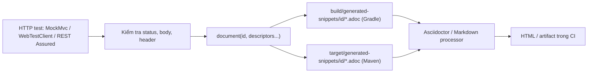

# Thư mục snippet mặc định theo Gradle và Maven

## 1. Tại sao cần hiểu thư mục snippet?

Trong chương **Spring Boot** của học phần **Spring REST Docs (`SPRING_REST_DOCS`)**, tài liệu REST API được tạo từ các bài kiểm thử HTTP thực sự chạy bằng `MockMvc`, `WebTestClient` hoặc REST Assured. Những bài kiểm thử này vừa xác nhận request/response, vừa tạo ra các *snippet* để biên soạn tài liệu Asciidoctor hoặc Markdown trong build và CI. Nếu test ghi snippet ở một đường dẫn nhưng công cụ dựng tài liệu đọc đường dẫn khác, pipeline sẽ thất bại hoặc sử dụng lại kết quả cũ.

Với tích hợp Spring Boot Test thông dụng, thư mục sinh snippet mặc định phụ thuộc vào công cụ build:

| Build tool | Thư mục snippet mặc định | Ví dụ file |
| --- | --- | --- |
| **Gradle** | `build/generated-snippets` | `build/generated-snippets/books-get/http-response.adoc` |
| **Maven** | `target/generated-snippets` | `target/generated-snippets/books-get/http-response.adoc` |

Đây là **đầu ra do test tạo**, nằm dưới thư mục build của module chạy test. Nó khác với file nguồn tài liệu như `src/docs/asciidoc/index.adoc` và khác với output HTML của Asciidoctor. Phần `generated-snippets` được tạo hoặc cập nhật khi các test có cấu hình Spring REST Docs và lệnh `document(...)` chạy thành công.

Sau bài học, bạn có thể:

- Xác định thư mục mặc định của Gradle/Maven và đọc cấu trúc thư mục theo operation ID.
- Viết test sinh snippet cho request, response, path/query parameter, header và JSON payload.
- Kết nối test output với Asciidoctor bằng Gradle hoặc Maven, bảo đảm thứ tự test → tài liệu.
- Đổi `outputDir` đúng cách và hiểu ảnh hưởng tới tài liệu, build cache và CI.
- Chẩn đoán lỗi sai đường dẫn, multi-module, test chạy song song và snippet còn sót.

Ví dụ Java sử dụng **Spring Boot 3.5**, Spring REST Docs 3.x, Java 17+ và JUnit Jupiter. Trên Spring Boot 4.x, đường dẫn import của một số annotation test thay đổi; cần sử dụng dependency và API đúng với phiên bản ứng dụng.

## 2. Đường đi từ kiểm thử tới file tài liệu



Hai thành phần quyết định đường dẫn của từng snippet:

1. **Thư mục gốc**: do tích hợp Spring REST Docs cấu hình; khi dùng Spring Boot Test thông dụng sẽ là `build/generated-snippets` trên Gradle, `target/generated-snippets` trên Maven, trừ khi bạn ghi đè.
2. **Tên operation**: tham số đầu tiên của `document(...)`, ví dụ `document("books-get", ...)`. Lệnh này tạo các file bên trong `generated-snippets/books-get/`.

Đường dẫn sinh ra có dạng:

```text
<thư mục build>/generated-snippets/<operation-id>/<snippet-name>.adoc
```

Ví dụ, `document("books/get-success")` tạo thư mục lồng nhau `generated-snippets/books/get-success/`. Dấu `/` trong operation ID có ý nghĩa như một phần của đường dẫn con; người viết tài liệu phải sử dụng đúng đường dẫn khi include file.

### Snippet nào được sinh?

| Nhóm snippet | Ví dụ | Điều kiện |
| --- | --- | --- |
| HTTP request và response | `http-request.adoc`, `http-response.adoc` | Các snippet mặc định khi `document(...)` được gọi. |
| Lệnh gọi minh họa | `curl-request.adoc`, `httpie-request.adoc` | Các snippet mặc định của định dạng AsciiDoc. |
| Phần body | `request-body.adoc`, `response-body.adoc` | Các snippet mặc định; nội dung có thể rỗng với request/response không có body. |
| Path/query parameter | `path-parameters.adoc`, `query-parameters.adoc` | Khi test khai báo `pathParameters(...)` hoặc `queryParameters(...)`. |
| Header | `request-headers.adoc`, `response-headers.adoc` | Khi test khai báo `requestHeaders(...)` hoặc `responseHeaders(...)`. |
| JSON payload fields | `request-fields.adoc`, `response-fields.adoc` | Khi test khai báo `requestFields(...)` hoặc `responseFields(...)`. |

Nếu test chỉ có `document("books-get")`, Spring REST Docs không suy ra lời giải thích cho field hay header. Chúng phải được khai báo trong descriptor tương ứng. Mục đích của descriptor còn là kiểm tra sự hiện diện và sự khớp của phần API được mô tả, để thay đổi ngoài dự kiến có thể làm test thất bại.

## 3. Ví dụ Spring Boot sinh snippet với đường dẫn mặc định

Tạo một Spring MVC controller đơn giản trong `src/main/java/com/example/books/BookController.java`:

```java
package com.example.books;

import org.springframework.web.bind.annotation.GetMapping;
import org.springframework.web.bind.annotation.PathVariable;
import org.springframework.web.bind.annotation.RequestMapping;
import org.springframework.web.bind.annotation.RestController;

@RestController
@RequestMapping("/api/books")
public class BookController {
    @GetMapping("/{id}")
    public BookResponse find(@PathVariable long id) {
        return new BookResponse(id, "Clean Code");
    }

    public record BookResponse(long id, String title) {}
}
```

Viết test trong `src/test/java/com/example/books/BookDocumentationTest.java`:

```java
package com.example.books;

import org.junit.jupiter.api.Test;
import org.springframework.beans.factory.annotation.Autowired;
import org.springframework.boot.test.autoconfigure.restdocs.AutoConfigureRestDocs;
import org.springframework.boot.test.autoconfigure.web.servlet.WebMvcTest;
import org.springframework.http.MediaType;
import org.springframework.test.web.servlet.MockMvc;

import static org.springframework.restdocs.mockmvc.MockMvcRestDocumentation.document;
import static org.springframework.restdocs.mockmvc.RestDocumentationRequestBuilders.get;
import static org.springframework.restdocs.payload.PayloadDocumentation.fieldWithPath;
import static org.springframework.restdocs.payload.PayloadDocumentation.responseFields;
import static org.springframework.restdocs.request.RequestDocumentation.parameterWithName;
import static org.springframework.restdocs.request.RequestDocumentation.pathParameters;
import static org.springframework.test.web.servlet.result.MockMvcResultMatchers.jsonPath;
import static org.springframework.test.web.servlet.result.MockMvcResultMatchers.status;

@WebMvcTest(BookController.class)
@AutoConfigureRestDocs // Để Boot chọn thư mục snippet mặc định.
class BookDocumentationTest {

    @Autowired
    MockMvc mockMvc;

    @Test
    void findBook() throws Exception {
        mockMvc.perform(
                get("/api/books/{id}", 42)
                    .accept(MediaType.APPLICATION_JSON)
            )
            .andExpect(status().isOk())
            .andExpect(jsonPath("$.id").value(42))
            .andExpect(jsonPath("$.title").value("Clean Code"))
            .andDo(document("books-get",
                pathParameters(
                    parameterWithName("id").description("ID của sách")
                ),
                responseFields(
                    fieldWithPath("id").description("Mã định danh sách"),
                    fieldWithPath("title").description("Tiêu đề sách")
                )
            ));
    }
}
```

Với Gradle, thêm các dependency cần thiết vào `build.gradle` (Groovy DSL):

```groovy
dependencies {
    implementation 'org.springframework.boot:spring-boot-starter-web'
    testImplementation 'org.springframework.boot:spring-boot-starter-test'
    testImplementation 'org.springframework.restdocs:spring-restdocs-mockmvc'
}

tasks.named('test') {
    useJUnitPlatform()
}
```

Khi chạy `./gradlew test`, nếu test thành công, các file sẽ xuất hiện dưới `build/generated-snippets/books-get/`. Còn với Maven và các dependency tương đương, chạy `./mvnw test` sẽ sinh dưới `target/generated-snippets/books-get/`.

Điểm cần chú ý trong test:

- `@WebMvcTest` yêu cầu Spring MVC test context, còn `@AutoConfigureRestDocs` gắn Spring REST Docs vào `MockMvc` do Boot tạo. Không cần tự tạo `MockMvcBuilders`.
- `RestDocumentationRequestBuilders.get(...)` giữ lại URI template để `pathParameters(...)` mô tả được biến `id`.
- `andExpect(...)` kiểm tra hành vi trả về; `andDo(document(...))` ghi snippet theo ID `books-get` và kiểm tra các trường đã khai báo.
- Trong annotation **không ghi `outputDir`**. Spring Boot chọn đường dẫn mặc định theo môi trường build thay vì bắt mọi dự án phải dùng cùng một tên thư mục `build`.

## 4. Cấu trúc thư mục sau khi chạy test

Ví dụ trên Gradle:

```text
book-service/
├── build.gradle
├── src/
│   ├── main/java/com/example/books/BookController.java
│   ├── test/java/com/example/books/BookDocumentationTest.java
│   └── docs/asciidoc/index.adoc
└── build/
    └── generated-snippets/
        └── books-get/
            ├── curl-request.adoc
            ├── http-request.adoc
            ├── http-response.adoc
            ├── httpie-request.adoc
            ├── request-body.adoc
            ├── response-body.adoc
            ├── path-parameters.adoc
            └── response-fields.adoc
```

Ví dụ tương ứng trên Maven:

```text
book-service/
├── pom.xml
├── src/
│   └── ...
└── target/
    └── generated-snippets/
        └── books-get/
            ├── http-request.adoc
            ├── http-response.adoc
            ├── path-parameters.adoc
            └── response-fields.adoc
```

Sơ đồ Maven chỉ rút gọn một số file để dễ đọc; với cùng cấu hình snippet và test, bộ file sinh ra có nguyên tắc giống Gradle.

Đường dẫn cần phân biệt:

| Thành phần | Ai quyết định? | Ví dụ |
| --- | --- | --- |
| Thư mục build của module | Gradle/Maven và cấu hình project. | `build/`, `target/` |
| Thư mục snippet gốc | Tích hợp REST Docs; có thể cấu hình `outputDir`. | `build/generated-snippets/` |
| Operation ID | Lệnh `document("...")` trong test. | `books-get/` |
| Snippet file | Loại snippet và template format được chọn. | `response-fields.adoc` |
| Tài liệu nguồn | Người viết tài liệu. | `src/docs/asciidoc/index.adoc` |
| Tài liệu cuối cùng | Tác vụ Asciidoctor/Markdown. | `build/docs/asciidoc/` hoặc `target/generated-docs/` |

**Không nên sửa thủ công file trong `generated-snippets`.** Đây là artifact có thể tái sinh từ test và có thể bị ghi đè bởi lần chạy tiếp theo. Phần diễn giải dài, lời giới thiệu, quy tắc nghiệp vụ và ví dụ hướng dẫn nên nằm trong file AsciiDoc/Markdown nguồn.

## 5. Dùng `{snippets}` để include file trong Asciidoctor

Tạo file `src/docs/asciidoc/index.adoc`:

```asciidoc
= API quản lý sách
:toc: left

== Lấy thông tin sách

=== HTTP request
include::{snippets}/books-get/http-request.adoc[]

=== Path parameters
include::{snippets}/books-get/path-parameters.adoc[]

=== HTTP response
include::{snippets}/books-get/http-response.adoc[]

=== Response fields
include::{snippets}/books-get/response-fields.adoc[]
```

`{snippets}` là attribute Asciidoctor được cấu hình trỏ tới **thư mục snippet gốc**. Nó không phải literal của Spring Boot, và không phải URL endpoint. Nếu đang dùng Gradle và file nằm ở `build/generated-snippets/books-get/http-response.adoc`, attribute phải giải quyết về `build/generated-snippets`; phần còn lại `books-get/http-response.adoc` đến từ nội dung lệnh include.

Khi thay operation ID từ `document("books-get")` sang `document("books/get-by-id")`, cần sửa include thành:

```asciidoc
include::{snippets}/books/get-by-id/http-response.adoc[]
```

Đặt tên ID ổn định theo endpoint và kết quả nghiệp vụ, ví dụ `books/get-success`, `books/get-not-found` hoặc `books/create-success`. Hạn chế tên phụ thuộc vào method test dễ đổi, trừ khi có quy ước tự động hóa rõ ràng.

## 6. Gradle: liên kết test output và Asciidoctor

Giả sử project đã áp dụng các plugin Java, Spring Boot và `org.asciidoctor.jvm.convert` với phiên bản tương thích. Trong `build.gradle`, có thể bổ sung cấu hình:

```groovy
configurations {
    asciidoctorExt
}

dependencies {
    testImplementation 'org.springframework.restdocs:spring-restdocs-mockmvc'
    asciidoctorExt 'org.springframework.restdocs:spring-restdocs-asciidoctor'
}

def snippetsDir = layout.buildDirectory.dir('generated-snippets')

tasks.named('test') {
    useJUnitPlatform()
    outputs.dir snippetsDir
}

tasks.named('asciidoctor') {
    dependsOn tasks.named('test')
    inputs.dir snippetsDir
    configurations 'asciidoctorExt'
    attributes 'snippets': snippetsDir.get().asFile
}
```

Ba mối quan hệ quan trọng:

1. `outputs.dir snippetsDir` khai báo rằng test ghi file vào thư mục snippet. Khi dùng Gradle cache hoặc phân tích up-to-date, thông tin này là một phần của mô hình task.
2. `dependsOn tasks.named('test')` bảo đảm test chạy trước khi dựng tài liệu. Nếu task chuyên biệt như `integrationTest` mới sinh snippet, phải phụ thuộc task đó.
3. `inputs.dir snippetsDir` và attribute `snippets` giúp Asciidoctor theo dõi thay đổi và tìm đúng các file cần include.

Chạy một lượt từ trạng thái sạch:

```bash
./gradlew clean test asciidoctor
```

Tác vụ `clean` dọn output cũ của project, `test` tạo lại snippet và `asciidoctor` dựng HTML. Vị trí HTML phụ thuộc cấu hình plugin, thường ở `build/docs/asciidoc/` nếu giữ cấu hình thông dụng. Để đưa trang HTML vào JAR, cần cấu hình thêm task sao chép từ output Asciidoctor vào resources hoặc bootJar; điều này **không tự xảy ra** chỉ vì đã sinh snippet.

### Nếu project dùng Kotlin DSL

Các lệnh bên trên là cú pháp Groovy DSL; với `build.gradle.kts`, quan hệ task được viết theo kiểu:

```kotlin
val snippetsDir = layout.buildDirectory.dir("generated-snippets")

tasks.test {
    useJUnitPlatform()
    outputs.dir(snippetsDir)
}

tasks.named("asciidoctor") {
    dependsOn(tasks.test)
    inputs.dir(snippetsDir)
}
```

Đoạn Kotlin DSL thể hiện quan hệ task; cấu hình extension Asciidoctor và attribute `snippets` cần dùng API Kotlin DSL tương ứng với phiên bản plugin đang cài.

## 7. Maven: đọc snippet từ `target/generated-snippets`

Với Maven, khai báo dependency test trong `pom.xml`:

```xml
<dependencies>
    <dependency>
        <groupId>org.springframework.boot</groupId>
        <artifactId>spring-boot-starter-test</artifactId>
        <scope>test</scope>
    </dependency>
    <dependency>
        <groupId>org.springframework.restdocs</groupId>
        <artifactId>spring-restdocs-mockmvc</artifactId>
        <scope>test</scope>
    </dependency>
</dependencies>
```

Phần plugin Asciidoctor dưới đây là ví dụ dành cho Maven project đã quản lý version Spring REST Docs bằng property `spring-restdocs.version` (ví dụ qua Spring Boot parent):

```xml
<build>
    <plugins>
        <plugin>
            <groupId>org.asciidoctor</groupId>
            <artifactId>asciidoctor-maven-plugin</artifactId>
            <version>3.1.1</version>
            <dependencies>
                <dependency>
                    <groupId>org.springframework.restdocs</groupId>
                    <artifactId>spring-restdocs-asciidoctor</artifactId>
                    <version>${spring-restdocs.version}</version>
                </dependency>
            </dependencies>
            <executions>
                <execution>
                    <id>build-api-docs</id>
                    <phase>prepare-package</phase>
                    <goals>
                        <goal>process-asciidoc</goal>
                    </goals>
                    <configuration>
                        <sourceDirectory>${project.basedir}/src/docs/asciidoc</sourceDirectory>
                        <outputDirectory>${project.build.directory}/generated-docs</outputDirectory>
                        <backend>html</backend>
                        <attributes>
                            <snippets>${project.build.directory}/generated-snippets</snippets>
                        </attributes>
                    </configuration>
                </execution>
            </executions>
        </plugin>
    </plugins>
</build>
```

`${project.build.directory}` thông thường giải quyết thành `target`. Vì plugin Asciidoctor được gắn vào phase `prepare-package`, nó chạy sau phase `test` trong vòng đời Maven chuẩn: phù hợp khi các test sinh snippet thuộc Surefire test suite. Cần cung cấp giá trị `spring-restdocs.version` hợp lệ nếu project không kế thừa property này, và chọn phiên bản Asciidoctor Maven Plugin phù hợp với build hiện tại.

Chạy:

```bash
# Chạy test tạo snippet:
./mvnw clean test

# Chạy lifecycle có bước dựng tài liệu:
./mvnw clean verify
```

Trường hợp dùng Failsafe để chạy integration test ở các phase `integration-test`/`verify` cần chú ý: `prepare-package` diễn ra **trước** các phase này. Nếu snippet được tạo bởi integration test, không nên gắn Asciidoctor vào `prepare-package`; hãy cấu hình dựng tài liệu sau các test đó, hoặc chạy goal dựng tài liệu riêng sau `mvn verify`. Tránh việc `prepare-package` vô tình đọc snippet còn lại từ phiên build trước.

Trong môi trường Windows, chạy `mvnw.cmd` nếu dự án dùng Maven Wrapper. Khi muốn xuất bản HTML sau build, lấy từ `target/generated-docs` theo cấu hình minh họa.

## 8. Thay đổi `outputDir` và đồng bộ đường dẫn

Đường dẫn mặc định tiện dụng nhưng không bắt buộc. Có thể đổi thư mục ở ngay lớp test Spring Boot:

```java
@WebMvcTest(BookController.class)
@AutoConfigureRestDocs(outputDir = "build/custom-rest-docs")
class BookDocumentationTest {
    // ...
}
```

Lúc này Gradle không còn nhận snippet ở `build/generated-snippets`; test sẽ ghi vào `build/custom-rest-docs` theo working directory của quá trình chạy. Bạn phải đổi thư mục trong cấu hình tài liệu cho khớp:

```groovy
def snippetsDir = file('build/custom-rest-docs')

tasks.named('test') {
    outputs.dir snippetsDir
}

tasks.named('asciidoctor') {
    inputs.dir snippetsDir
    dependsOn tasks.named('test')
    attributes 'snippets': snippetsDir
}
```

Với Maven, cấu hình tương đương là `@AutoConfigureRestDocs(outputDir = "target/custom-rest-docs")`, và attribute Asciidoctor `<snippets>${project.build.directory}/custom-rest-docs</snippets>`. Điều quan trọng là **giá trị outputDir của test và đường dẫn input của công cụ biên soạn phải thống nhất**.

Nếu cần cấu hình lại URI hiển thị trong snippet mà giữ nguyên thư mục, có thể dùng:

```java
@AutoConfigureRestDocs(
    uriScheme = "https",
    uriHost = "api.example.com",
    uriPort = 443
)
```

Những tùy chọn `uriScheme`, `uriHost`, `uriPort` chỉ thay cách URL được ghi trong snippet. Chúng không đổi thư mục output, không yêu cầu mở server thật và không khiến `MockMvc` gửi request tới host công khai.

### Phân biệt output directory với template format

| Câu hỏi | Phần cấu hình |
| --- | --- |
| Snippet ghi vào `build` hay `target`? | Build tool và output directory của Spring REST Docs. |
| Snippet nằm trong thư mục con nào? | Operation ID của `document("...")`. |
| Snippet dùng đuôi `.adoc` hay `.md`? | Template format, mặc định là AsciiDoc. |
| HTML xuất ra đâu? | Output của Asciidoctor, độc lập với output snippet. |

Để sinh snippet Markdown, có thể cấu hình `TemplateFormats.markdown()` bằng `RestDocsMockMvcConfigurationCustomizer` (hoặc customizer phù hợp cho WebTestClient). Khi đổi template sang Markdown, thư mục gốc có thể vẫn là `build/generated-snippets`; chỉ định dạng và phần mở rộng file đổi thành `.md`. Công cụ Markdown cần có quy trình ghép các file đó; Asciidoctor không tự hiểu các câu lệnh include `.adoc` cũ.

## 9. Dự án nhiều module và test chạy song song

Trong dự án Gradle nhiều module:

```text
system/
├── settings.gradle
├── catalog-service/
│   ├── build.gradle
│   └── build/generated-snippets/catalog-get/...
└── order-service/
    ├── build.gradle
    └── build/generated-snippets/orders-get/...
```

Test chạy ở `catalog-service` thường tạo snippet bên trong `catalog-service/build/generated-snippets`, không phải `system/build/generated-snippets`. Maven multi-module có cơ chế tương ứng: mỗi module có thư mục `target/generated-snippets` của chính nó.

Với hệ thống nhiều service, có hai cách thường dùng:

- **Tài liệu riêng từng module:** mỗi module có test và Asciidoctor task/plugin lấy snippet từ thư mục của mình. Cách này giúp build độc lập.
- **Tài liệu hợp nhất:** module chuyên trách tài liệu đọc snippet từ các module khác. Cần khai báo phụ thuộc task và dùng nhiều attribute như `{catalog-snippets}`, `{order-snippets}`, thay vì giả định tất cả đã được chép về thư mục root.

Tránh để hai bài test song song ghi cùng operation ID trên cùng output directory, ví dụ hai test đều dùng `document("books-get")` nhưng request khác nhau. Chúng có thể ghi đè file của nhau hoặc để lại kết quả không xác định. Đặt ID theo tình huống: `books/get-success`, `books/get-not-found`, `books/create-success`. Nếu có test chuyên dụng ở task `integrationTest`, cân nhắc output directory riêng và nối đúng task sinh snippet với task biên soạn.

## 10. Tích hợp CI: kiểm thử phải đi trước xuất tài liệu

Một pipeline tạo tài liệu đáng tin cậy nên:

1. Bắt đầu từ mã nguồn và cấu hình build hiện tại, ưu tiên workspace sạch khi xác minh pipeline.
2. Chạy các test có `document(...)`. Nếu assertion hoặc descriptor thất bại, job phải dừng.
3. Đọc snippet được tạo bởi **chính test vừa chạy** và sinh HTML hoặc Markdown.
4. Chỉ lưu hoặc xuất bản artifact tài liệu khi cả bước test lẫn bước biên soạn thành công.

Ví dụ GitHub Actions cho dự án Gradle một module, đã cấu hình task `asciidoctor`:

```yaml
name: Build REST API docs
on:
  push:
  pull_request:

jobs:
  documentation:
    runs-on: ubuntu-latest
    steps:
      - uses: actions/checkout@v4
      - uses: actions/setup-java@v4
        with:
          distribution: temurin
          java-version: '17'
      - name: Test and build documentation
        run: ./gradlew --no-daemon clean test asciidoctor
      - name: Upload documentation artifact
        uses: actions/upload-artifact@v4
        with:
          name: rest-api-docs
          path: build/docs/asciidoc/
```

Đường dẫn artifact giả định Asciidoctor xuất ra `build/docs/asciidoc`. Dự án nhiều module hoặc cấu hình output riêng phải thay đường dẫn theo kết quả thực. Với Maven, có thể dùng `./mvnw -B clean verify` khi tài liệu đã được gắn đúng phase; artifact ở `target/generated-docs` nếu dùng cấu hình phần 7.

Chạy build sạch hữu ích khi muốn loại trừ snippet từ lần chạy cũ. Nếu dùng Gradle build cache hoặc Maven plugin incremental, vẫn cần khai báo đúng nguồn sinh snippet và thứ tự task. Không phát hành tài liệu từ job chạy `-x test` hoặc `-DskipTests` nếu các snippet cần thiết chỉ được sinh trong bài test.

## 11. Lỗi đường dẫn thường gặp

| Hiện tượng | Nguyên nhân thường gặp | Cách giải quyết |
| --- | --- | --- |
| Không có thư mục `generated-snippets` | Chưa gọi `document(...)`, test không chạy, thiếu dependency hoặc REST Docs chưa được tích hợp client. | Xem test report, vị trí `andDo(...)`/`consumeWith(...)`, `@AutoConfigureRestDocs` và dependencies. |
| Có `http-response.adoc` nhưng thiếu `response-fields.adoc` | Test chưa khai báo `responseFields(...)`. | Thêm descriptor phù hợp, chạy lại test. |
| Gradle có snippet trong `build`, nhưng Asciidoctor tìm `target` | Sao chép cấu hình Maven hoặc attribute sai. | Trỏ attribute `snippets` đến `build/generated-snippets`. |
| Maven có snippet trong `target`, nhưng Asciidoctor tìm `build` | Sao chép cấu hình Gradle. | Dùng `${project.build.directory}/generated-snippets`. |
| Snippet nằm trong module con | Test chạy từ subproject/module con. | Kiểm tra `<module>/build` hoặc `<module>/target`; sửa đường dẫn nguồn tài liệu. |
| Include của Asciidoctor không tồn tại | `document(...)` đã đổi ID; tên thư mục trong include chưa đổi. | Đối chiếu file thực tế và chuỗi `include::{snippets}/...[]`. |
| HTML còn dữ liệu cũ | Test chưa chạy lại, output chưa được làm sạch hoặc task tài liệu không phụ thuộc test. | Chạy clean build; cấu hình dependency và input/output của task. |
| Test song song làm snippet lẫn nhau | Cùng operation ID và cùng output directory. | Tách operation ID hoặc thư mục theo tình huống/module. |
| Sau khi chọn Markdown, không còn file `.adoc` | Template đã sinh `.md`. | Đồng bộ template và hệ thống include/biên soạn Markdown. |
| CI chỉ có một vài endpoint | Test tạo snippet của module/task khác không được gọi. | Ràng buộc đúng toàn bộ task sinh snippet vào build tài liệu. |

### Chẩn đoán một trường hợp cụ thể

Giả sử test cấu hình:

```java
@AutoConfigureRestDocs(outputDir = "build/api-snippets")

// Trong phương thức test:
.andDo(document("books/get",
    responseFields(
        fieldWithPath("id").description("ID sách")
    )
));
```

Nhưng tài liệu vẫn include:

```asciidoc
include::{snippets}/books-get/response-fields.adoc[]
```

Ở đây có **hai sai lệch**:

- Gốc output của test là `build/api-snippets`, trong khi build có thể vẫn đặt `{snippets}` bằng `build/generated-snippets`.
- `document("books/get")` tạo thư mục `books/get`, không phải `books-get`.

Sửa attribute `snippets` trỏ tới `build/api-snippets` và sửa include:

```asciidoc
include::{snippets}/books/get/response-fields.adoc[]
```

Hãy kiểm tra file vừa sinh thực tế trước khi sửa build; đừng phỏng đoán đường dẫn từ URL endpoint hay tên phương thức test.

## 12. Bài thực hành

Thực hành với `BookController` và `BookDocumentationTest` ở mục 3:

1. Thêm dependency REST Docs MockMvc, chạy `./gradlew clean test`; xác nhận tồn tại `build/generated-snippets/books-get/http-response.adoc` và `response-fields.adoc`.
2. Viết `src/docs/asciidoc/index.adoc` có các phần include request, response, path parameters và response fields. Gắn plugin/task Asciidoctor theo mục 6 rồi chạy `./gradlew clean test asciidoctor`.
3. Đổi `@AutoConfigureRestDocs(outputDir = "build/custom-rest-docs")`; kiểm tra trước và sau khi sửa `snippetsDir` trong Gradle. Giải thích vì sao chỉ sửa annotation là chưa đủ.
4. Tạo project Maven tương đương, chạy `./mvnw clean test` và xác nhận snippet nằm trong `target/generated-snippets`. Thêm Asciidoctor Maven Plugin để dựng HTML từ các file này.
5. Tạo thêm test cho `GET /api/books/{id}` khi không tìm thấy sách, dùng operation ID `books/get-not-found` và kiểm tra hai tình huống không ghi chồng snippet.
6. Đưa task kiểm thử và dựng tài liệu vào CI; thử cố ý thêm field JSON không mô tả để bảo đảm test lỗi và job không phát hành tài liệu sai.

**Tiêu chí hoàn thành:** phân biệt được thư mục snippet mặc định của Gradle và Maven; tìm đúng file theo operation ID; test tạo snippet có assertion và descriptor; Asciidoctor/Markdown lấy đúng file từ output của test; thay đổi đường dẫn hoặc hợp đồng API được kiểm tra trong build và CI.

## 13. Tài liệu tham khảo

- [Spring Boot 3.5 — Testing Spring Boot Applications](https://docs.spring.io/spring-boot/3.5/reference/testing/spring-boot-applications.html)
- [Spring Boot 3.5 — AutoConfigureRestDocs API](https://docs.spring.io/spring-boot/3.5/api/java/org/springframework/boot/test/autoconfigure/restdocs/AutoConfigureRestDocs.html)
- [Spring REST Docs — Getting Started](https://docs.spring.io/spring-restdocs/tutorial/getting-started/index.html)
- [Spring REST Docs — Configuration: Default Snippets](https://docs.spring.io/spring-restdocs/reference/configuration/default-snippets.html)
- [Spring REST Docs — Documenting Your API](https://docs.spring.io/spring-restdocs/reference/documenting-your-api/index.html)
- [Spring REST Docs — Asciidoctor integration](https://docs.spring.io/spring-restdocs/reference/)
