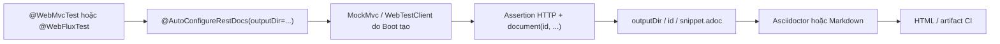

# Cấu hình output directory trong test slice

## 1. Bài toán: test slice tạo snippet ở đâu?

Trong chương **Spring Boot** của học phần **Spring REST Docs (`SPRING_REST_DOCS`)**, chúng ta tạo tài liệu REST API có thể kiểm chứng từ bài kiểm thử HTTP chạy bằng `MockMvc`, `WebTestClient` hoặc REST Assured. Các test dùng `document(...)` để xuất snippet cho request, response, JSON payload, path/query parameter và header. Sau đó Asciidoctor hoặc một quy trình Markdown ghép những snippet này thành trang tài liệu và đưa vào build, CI.

Khi sử dụng **test slice** như `@WebMvcTest` hoặc `@WebFluxTest`, câu hỏi quan trọng là: *Spring REST Docs sẽ ghi những snippet đó vào thư mục nào, và làm sao để công cụ dựng tài liệu đọc đúng thư mục?*

Đường dẫn phổ biến khi dùng Spring Boot Test theo cấu hình thông thường:

| Build tool | Thư mục snippet mặc định | Khi cần tách riêng một nhóm test |
| --- | --- | --- |
| Gradle | `build/generated-snippets` | Ví dụ: `build/generated-snippets/catalog-mvc` |
| Maven | `target/generated-snippets` | Ví dụ: `target/generated-snippets/catalog-mvc` |

Với Spring Boot, thuộc tính `outputDir` của `@AutoConfigureRestDocs` cho phép chỉ định rõ thư mục gốc của snippet trong một test class. Nếu bạn đặt `@AutoConfigureRestDocs(outputDir = "build/generated-snippets/catalog-mvc")`, các snippet từ những operation như `document("products-find")` sẽ được ghi dưới `build/generated-snippets/catalog-mvc/products-find/`. Việc cấu hình này **không làm thay đổi endpoint, HTTP response hoặc phạm vi bean được nạp của test slice**.

**Mục tiêu sau bài học:** biết cách chọn đường dẫn cho test slice MVC và WebFlux; kiểm tra file thực tế sau khi test; đồng bộ output directory với Gradle, Maven, Asciidoctor và CI; tránh ghi đè snippet khi nhiều test chạy song song; xử lý các lỗi thường gặp do cấu hình đường dẫn.

Các ví dụ dùng **Spring Boot 3.5, Spring REST Docs 3.x, JUnit Jupiter và Java 17+**. Spring Boot 4.x có một số thay đổi về package và module test, được nêu riêng ở phần 10.

## 2. Đường đi từ test slice tới tài liệu



Hai cấp đường dẫn phải được phân biệt:

1. **Output directory (thư mục gốc)** do Spring REST Docs sử dụng. Trong test Spring Boot, có thể chỉ định qua `@AutoConfigureRestDocs(outputDir = "...")`.
2. **Operation ID** được truyền vào `document("...")`. Đây là thư mục con chứa snippet của một request/response được tài liệu hóa.

Ví dụ trên Gradle:

```java
@AutoConfigureRestDocs(outputDir = "build/generated-snippets/catalog-mvc")

// Trong một test MockMvc:
.andDo(document("products-find", responseFields(
    fieldWithPath("id").description("Mã sản phẩm"),
    fieldWithPath("name").description("Tên sản phẩm")
)));
```

Cấu trúc kết quả điển hình:

```text
build/
  generated-snippets/
    catalog-mvc/                  <- outputDir
      products-find/              <- document("products-find")
        curl-request.adoc
        http-request.adoc
        http-response.adoc
        httpie-request.adoc
        request-body.adoc
        response-body.adoc
        response-fields.adoc
```

Mặc định, Spring REST Docs tạo một bộ snippet HTTP cơ bản khi `document(...)` chạy. Các snippet dạng bảng như `response-fields.adoc`, `request-fields.adoc`, `path-parameters.adoc` và `request-headers.adoc` chỉ xuất hiện khi có các descriptor tương ứng.

**Đừng nhầm tên folder với URL API.** Request tới `GET /api/products/27` không tự tạo thư mục `api/products/27`. Folder con được đặt bằng operation ID `products-find`, hoặc một tên khác mà người viết test chọn.

### Test slice là gì, và điều gì không đổi khi cấu hình thư mục?

| Test slice | Phần ứng dụng được nạp | Client dùng để ghi tài liệu |
| --- | --- | --- |
| `@WebMvcTest(ProductController.class)` | Controller và các bean web/MVC phù hợp với slice; service thông thường cần mock hoặc import riêng. | `MockMvc` |
| `@WebFluxTest(StatusController.class)` | Controller và các bean web/reactive phù hợp với slice; service thông thường cần mock hoặc import riêng. | `WebTestClient` |

`@AutoConfigureRestDocs` hỗ trợ tích hợp Spring REST Docs với client do Boot tạo. `outputDir` chỉ quyết định **nơi ghi artifact**. Nó không chuyển `@WebMvcTest` thành `@SpringBootTest`, không bật HTTP server thật, không làm thay đổi security filter và không tự tạo descriptor cho tài liệu.

## 3. Cấu hình test slice MVC với `MockMvc`

### 3.1. Dependencies

Với Gradle Groovy DSL trong ứng dụng Spring MVC đã áp dụng plugin Spring Boot và dependency management:

```groovy
dependencies {
    implementation 'org.springframework.boot:spring-boot-starter-web'
    testImplementation 'org.springframework.boot:spring-boot-starter-test'
    testImplementation 'org.springframework.restdocs:spring-restdocs-mockmvc'
}

tasks.named('test') {
    useJUnitPlatform()
}
```

Spring Boot quản lý phiên bản test dependencies tương thích khi project dùng BOM/parent phù hợp. `spring-restdocs-mockmvc` là module kết nối REST Docs với `MockMvc`; việc tạo snippet không đòi hỏi chạy ứng dụng trên một cổng thật.

### 3.2. Controller minh họa

Ví dụ tệp `src/main/java/com/example/catalog/ProductController.java`:

```java
package com.example.catalog;

import java.net.URI;
import org.springframework.http.ResponseEntity;
import org.springframework.web.bind.annotation.GetMapping;
import org.springframework.web.bind.annotation.PathVariable;
import org.springframework.web.bind.annotation.PostMapping;
import org.springframework.web.bind.annotation.RequestBody;
import org.springframework.web.bind.annotation.RequestMapping;
import org.springframework.web.bind.annotation.RequestParam;
import org.springframework.web.bind.annotation.RestController;

@RestController
@RequestMapping("/api/products")
class ProductController {

    @GetMapping("/{id}")
    ProductResponse find(
            @PathVariable long id,
            @RequestParam(defaultValue = "vi") String locale) {
        return new ProductResponse(id, "Bút máy", locale);
    }

    @PostMapping
    ResponseEntity<ProductResponse> create(@RequestBody NewProduct request) {
        ProductResponse created =
            new ProductResponse(27L, request.name(), "vi");
        return ResponseEntity.created(
            URI.create("/api/products/" + created.id())
        ).body(created);
    }

    record NewProduct(String name) {}
    record ProductResponse(long id, String name, String locale) {}
}
```

Ở đây controller trả dữ liệu cố định để test dễ tái lập. Trong ứng dụng thật, controller có thể gọi service hoặc repository; vì `@WebMvcTest` chỉ nạp một phần context, cần sử dụng `@MockitoBean` cho các service không được tạo trong slice.

### 3.3. Test đặt output riêng cho slice

Tạo `src/test/java/com/example/catalog/ProductDocumentationTest.java`:

```java
package com.example.catalog;

import org.junit.jupiter.api.Test;
import org.springframework.beans.factory.annotation.Autowired;
import org.springframework.boot.test.autoconfigure.restdocs.AutoConfigureRestDocs;
import org.springframework.boot.test.autoconfigure.web.servlet.WebMvcTest;
import org.springframework.http.HttpHeaders;
import org.springframework.http.MediaType;
import org.springframework.test.web.servlet.MockMvc;

import static org.springframework.restdocs.headers.HeaderDocumentation.headerWithName;
import static org.springframework.restdocs.headers.HeaderDocumentation.requestHeaders;
import static org.springframework.restdocs.headers.HeaderDocumentation.responseHeaders;
import static org.springframework.restdocs.mockmvc.MockMvcRestDocumentation.document;
import static org.springframework.restdocs.mockmvc.RestDocumentationRequestBuilders.get;
import static org.springframework.restdocs.mockmvc.RestDocumentationRequestBuilders.post;
import static org.springframework.restdocs.payload.PayloadDocumentation.fieldWithPath;
import static org.springframework.restdocs.payload.PayloadDocumentation.requestFields;
import static org.springframework.restdocs.payload.PayloadDocumentation.responseFields;
import static org.springframework.restdocs.request.RequestDocumentation.parameterWithName;
import static org.springframework.restdocs.request.RequestDocumentation.pathParameters;
import static org.springframework.restdocs.request.RequestDocumentation.queryParameters;
import static org.springframework.test.web.servlet.result.MockMvcResultMatchers.header;
import static org.springframework.test.web.servlet.result.MockMvcResultMatchers.jsonPath;
import static org.springframework.test.web.servlet.result.MockMvcResultMatchers.status;

@WebMvcTest(ProductController.class)
@AutoConfigureRestDocs(
    outputDir = "build/generated-snippets/catalog-mvc"
)
class ProductDocumentationTest {

    @Autowired
    MockMvc mockMvc;

    @Test
    void findProduct() throws Exception {
        mockMvc.perform(
                get("/api/products/{id}", 27L)
                    .queryParam("locale", "vi")
                    .accept(MediaType.APPLICATION_JSON)
            )
            .andExpect(status().isOk())
            .andExpect(jsonPath("$.id").value(27))
            .andExpect(jsonPath("$.name").value("Bút máy"))
            .andDo(document("products-find",
                pathParameters(
                    parameterWithName("id")
                        .description("ID của sản phẩm")
                ),
                queryParameters(
                    parameterWithName("locale")
                        .description("Ngôn ngữ phản hồi")
                ),
                requestHeaders(
                    headerWithName(HttpHeaders.ACCEPT)
                        .description("Định dạng phản hồi mong muốn")
                ),
                responseFields(
                    fieldWithPath("id").description("ID sản phẩm"),
                    fieldWithPath("name").description("Tên sản phẩm"),
                    fieldWithPath("locale").description("Ngôn ngữ phản hồi")
                )
            ));
    }

    @Test
    void createProduct() throws Exception {
        mockMvc.perform(
                post("/api/products")
                    .contentType(MediaType.APPLICATION_JSON)
                    .accept(MediaType.APPLICATION_JSON)
                    .content("{\"name\":\"Bút máy\"}")
            )
            .andExpect(status().isCreated())
            .andExpect(header().string(
                HttpHeaders.LOCATION, "/api/products/27"
            ))
            .andDo(document("products-create",
                requestFields(
                    fieldWithPath("name")
                        .description("Tên sản phẩm cần tạo")
                ),
                responseHeaders(
                    headerWithName(HttpHeaders.LOCATION)
                        .description("Đường dẫn đến sản phẩm mới")
                ),
                responseFields(
                    fieldWithPath("id").description("ID sản phẩm mới"),
                    fieldWithPath("name").description("Tên sản phẩm"),
                    fieldWithPath("locale").description("Ngôn ngữ phản hồi")
                )
            ));
    }
}
```

Sau khi chạy test, cả hai operation dùng **chung output root** nhưng có **hai thư mục con khác nhau**:

```text
build/generated-snippets/catalog-mvc/
  products-find/
    http-request.adoc
    http-response.adoc
    path-parameters.adoc
    query-parameters.adoc
    request-headers.adoc
    response-fields.adoc
    ...
  products-create/
    http-request.adoc
    http-response.adoc
    request-fields.adoc
    response-headers.adoc
    response-fields.adoc
    ...
```

Các file snippet mặc định khác (như cURL, HTTPie và body) cũng được tạo, nhưng sơ đồ trên chỉ liệt kê những file cần quan sát.

**Các điểm cần hiểu:**

1. `@WebMvcTest` tạo slice MVC; `@AutoConfigureRestDocs` tích hợp bộ ghi snippet và đặt output root. Hai annotation có trách nhiệm riêng.
2. `@Autowired MockMvc` nhận client do Boot quản lý. Nếu tự dựng một instance bằng `MockMvcBuilders.standaloneSetup(...)`, instance đó không tự được áp dụng cấu hình REST Docs của Boot.
3. `RestDocumentationRequestBuilders.get(...)` giữ URI template `/api/products/{id}`, cần thiết cho `pathParameters(...)`.
4. `andExpect(...)` xác nhận response; `andDo(document(...))` tạo snippet và kiểm tra descriptor. `responseFields(...)` mặc định yêu cầu mô tả các field JSON không bị bỏ qua.
5. Giá trị `outputDir` dùng lại trên các test cùng class; operation ID `products-find` hoặc `products-create` quyết định folder riêng cho từng request.

## 4. Test slice WebFlux với `WebTestClient`

Với ứng dụng reactive, dùng `spring-boot-starter-webflux`, `spring-boot-starter-test` và `spring-restdocs-webtestclient`. Không cần thay đổi chức năng của `WebTestClient` để cấu hình thư mục: vẫn sử dụng `@AutoConfigureRestDocs(outputDir = "...")` nhưng đặt đường dẫn cho nhóm reactive.

Controller ở package riêng `com.example.status`:

```java
package com.example.status;

import java.util.Map;
import org.springframework.web.bind.annotation.GetMapping;
import org.springframework.web.bind.annotation.RestController;
import reactor.core.publisher.Mono;

@RestController
class StatusController {

    @GetMapping("/api/status")
    Mono<Map<String, String>> status() {
        return Mono.just(Map.of("status", "UP"));
    }
}
```

Test:

```java
package com.example.status;

import org.junit.jupiter.api.Test;
import org.springframework.beans.factory.annotation.Autowired;
import org.springframework.boot.test.autoconfigure.restdocs.AutoConfigureRestDocs;
import org.springframework.boot.test.autoconfigure.web.reactive.WebFluxTest;
import org.springframework.test.web.reactive.server.WebTestClient;

import static org.springframework.restdocs.payload.PayloadDocumentation.fieldWithPath;
import static org.springframework.restdocs.payload.PayloadDocumentation.responseFields;
import static org.springframework.restdocs.webtestclient.WebTestClientRestDocumentation.document;

@WebFluxTest(StatusController.class)
@AutoConfigureRestDocs(
    outputDir = "build/generated-snippets/status-webflux"
)
class StatusDocumentationTest {

    @Autowired
    WebTestClient client;

    @Test
    void status() {
        client.get().uri("/api/status")
            .exchange()
            .expectStatus().isOk()
            .expectBody()
            .jsonPath("$.status").isEqualTo("UP")
            .consumeWith(document("status-get",
                responseFields(
                    fieldWithPath("status")
                        .description("Trạng thái của dịch vụ")
                )
            ));
    }
}
```

Kết quả được ghi dưới `build/generated-snippets/status-webflux/status-get/`. Đây là ví dụ Gradle; dự án Maven có thể chỉ định `target/generated-snippets/status-webflux` tương ứng.

So sánh hai client:

| Đặc điểm | MockMvc | WebTestClient |
| --- | --- | --- |
| Cách tạo client trong slice | `@WebMvcTest` | `@WebFluxTest` |
| Cách khẳng định response | `andExpect(...)` | `expectStatus()`, `expectBody()` |
| Bước ghi snippet | `andDo(document(...))` | `consumeWith(document(...))` |
| Chỉ định output root | `@AutoConfigureRestDocs(outputDir = "...")` | Cùng annotation này |
| Đường dẫn operation | `outputDir` + `document("id")` | Cùng nguyên tắc |

Không nên dùng ví dụ reactive này trực tiếp trong một dự án chỉ cài `spring-boot-starter-web`; cần có runtime, dependency và test slice WebFlux tương ứng.

## 5. Chọn output root: chung cho module hay tách theo test slice?

Một dự án có thể tổ chức output directory theo hai cách:

| Tổ chức | Ví dụ | Lợi ích | Điều cần kiểm soát |
| --- | --- | --- | --- |
| **Một thư mục chung** | `build/generated-snippets` | Dễ cấu hình một attribute `{snippets}` trong Asciidoctor. | Operation ID phải duy nhất cho các test tạo tài liệu. |
| **Thư mục riêng theo slice/nhóm test** | `build/generated-snippets/catalog-mvc`, `build/generated-snippets/status-webflux` | Dễ cô lập output giữa các nhóm test hoặc task khác nhau. | Mỗi thư mục cần attribute nguồn hoặc bước gom tài liệu rõ ràng. |

Đa số module đơn giản có thể dùng đường dẫn mặc định và đặt operation ID ổn định. Chỉ nên tách output root khi có lý do rõ ràng, chẳng hạn hai nhóm test sử dụng task độc lập, chạy song song hoặc được xuất bản thành hai bộ tài liệu.

Ví dụ nên tránh:

```java
// Hai test khác nhau cùng dùng một output root và operation ID:
document("products-find", responseFields(/* bản A */));
document("products-find", responseFields(/* bản B */));
```

Nếu cả hai test chạy cùng lúc, chúng có thể ghi đè cùng các file. Nếu chúng chạy lần lượt, output cuối cùng cũng có thể phụ thuộc thứ tự chạy. Hãy đặt ID khác nhau (`products-find-success`, `products-find-not-found`) hoặc chia output root theo nhóm test có ý nghĩa.

### Đường dẫn tương đối hay tuyệt đối?

`outputDir = "build/generated-snippets/catalog-mvc"` là **đường dẫn tương đối** được giải quyết theo working directory của tiến trình chạy test. Với cấu hình Gradle thường gặp, đó là thư mục project/module. Maven thông thường cũng chạy test trong context của module. Tuy nhiên, nếu task test đã tùy chỉnh working directory, tên đường dẫn này có thể được giải quyết khác; hãy kiểm tra file thực tế để xác nhận.

Đường dẫn tuyệt đối có thể chạy nhưng làm test khó tái lập giữa máy lập trình viên, Windows/Linux và CI. Nên đặt output dưới thư mục build riêng của module, tránh ghi vào `src/main`, `src/test` hoặc thư mục nguồn được commit.

## 6. Đồng bộ outputDir với Gradle Asciidoctor

Giả sử các test MVC ở mục 3 ghi vào `build/generated-snippets/catalog-mvc`. Trong `build.gradle` (Groovy DSL) đã áp dụng plugin Java, Spring Boot và `org.asciidoctor.jvm.convert`, bổ sung:

```groovy
configurations {
    asciidoctorExt
}

dependencies {
    testImplementation 'org.springframework.restdocs:spring-restdocs-mockmvc'
    asciidoctorExt 'org.springframework.restdocs:spring-restdocs-asciidoctor'
}

def catalogSnippets = layout.buildDirectory.dir(
    'generated-snippets/catalog-mvc'
)

tasks.named('test') {
    useJUnitPlatform()
    outputs.dir catalogSnippets
}

tasks.named('asciidoctor') {
    dependsOn tasks.named('test')
    inputs.dir catalogSnippets
    configurations 'asciidoctorExt'
    attributes 'snippets': catalogSnippets.get().asFile
}
```

Giải thích các thành phần:

- `outputs.dir catalogSnippets` khai báo vị trí file do task test sinh. Điều này giúp Gradle theo dõi đầu ra của task và là thông tin quan trọng khi dùng up-to-date check hoặc build cache.
- `dependsOn test` bảo đảm tác vụ dựng tài liệu không chạy trước test tạo snippet.
- `inputs.dir catalogSnippets` khiến Gradle nhận ra Asciidoctor phụ thuộc vào snippet.
- `attributes 'snippets': ...` định nghĩa attribute Asciidoctor `{snippets}` trỏ đến thư mục root đúng với annotation của test.

Đây là phần cấu hình bổ sung; dự án phải cài plugin Asciidoctor và các dependency Spring Boot cần thiết từ trước.

Tạo `src/docs/asciidoc/index.adoc`:

```asciidoc
= Catalog API
:toc: left

== Xem sản phẩm

=== Request
include::{snippets}/products-find/http-request.adoc[]
include::{snippets}/products-find/path-parameters.adoc[]
include::{snippets}/products-find/query-parameters.adoc[]
include::{snippets}/products-find/request-headers.adoc[]

=== Response
include::{snippets}/products-find/http-response.adoc[]
include::{snippets}/products-find/response-fields.adoc[]

== Tạo sản phẩm

=== Request body
include::{snippets}/products-create/request-fields.adoc[]

=== Response
include::{snippets}/products-create/http-response.adoc[]
include::{snippets}/products-create/response-headers.adoc[]
include::{snippets}/products-create/response-fields.adoc[]
```

Vì attribute `{snippets}` đã trỏ tới `build/generated-snippets/catalog-mvc`, các lệnh include chỉ cần thêm `products-find/...` và `products-create/...`. Nếu test đổi `outputDir` mà Gradle vẫn dùng đường dẫn cũ, Asciidoctor sẽ không thấy snippet mới hoặc có thể đọc nhầm file còn sót từ lần build trước.

Chạy kiểm tra từ trạng thái sạch:

```bash
./gradlew clean test asciidoctor
```

### Khi dự án có nhiều slice/output root

Nếu cùng module có cả `catalog-mvc` và `status-webflux`, cần quyết định cách ghép tài liệu:

1. **Một trang chung:** khai báo hai attribute như `catalog-snippets`, `status-snippets` và dùng đúng attribute ở từng lệnh include.
2. **Hai bộ tài liệu riêng:** tạo task hoặc cấu hình tài liệu riêng cho MVC và WebFlux, đầu vào của mỗi task là output root tương ứng.

Khi chọn một trang chung, giả sử đã cấu hình các attribute:

```asciidoc
include::{catalog-snippets}/products-find/http-response.adoc[]
include::{status-snippets}/status-get/http-response.adoc[]
```

Tên attribute ở đây do dự án đặt. Asciidoctor không tự tìm tất cả các thư mục con có snippet nếu bạn chưa cấu hình nơi cần đọc.

## 7. Đồng bộ outputDir với Maven

Maven thông thường ghi snippet mặc định dưới `target/generated-snippets`. Khi muốn tách riêng MVC slice, dùng một đường dẫn phù hợp với Maven:

```java
@WebMvcTest(ProductController.class)
@AutoConfigureRestDocs(
    outputDir = "target/generated-snippets/catalog-mvc"
)
class ProductDocumentationTest {
    // Các bài test như mục 3.
}
```

Trong `pom.xml` của ứng dụng Spring Boot đã có parent/BOM quản lý versions, khai báo dependency test:

```xml
<dependency>
    <groupId>org.springframework.boot</groupId>
    <artifactId>spring-boot-starter-test</artifactId>
    <scope>test</scope>
</dependency>
<dependency>
    <groupId>org.springframework.restdocs</groupId>
    <artifactId>spring-restdocs-mockmvc</artifactId>
    <scope>test</scope>
</dependency>
```

Ví dụ phần cấu hình Asciidoctor Maven Plugin (cần chọn version phù hợp trong project và bảo đảm property `spring-restdocs.version` có giá trị):

```xml
<build>
    <plugins>
        <plugin>
            <groupId>org.asciidoctor</groupId>
            <artifactId>asciidoctor-maven-plugin</artifactId>
            <version>3.1.1</version>
            <dependencies>
                <dependency>
                    <groupId>org.springframework.restdocs</groupId>
                    <artifactId>spring-restdocs-asciidoctor</artifactId>
                    <version>${spring-restdocs.version}</version>
                </dependency>
            </dependencies>
            <executions>
                <execution>
                    <id>api-docs</id>
                    <phase>prepare-package</phase>
                    <goals>
                        <goal>process-asciidoc</goal>
                    </goals>
                    <configuration>
                        <sourceDirectory>${project.basedir}/src/docs/asciidoc</sourceDirectory>
                        <outputDirectory>${project.build.directory}/generated-docs</outputDirectory>
                        <backend>html</backend>
                        <attributes>
                            <snippets>${project.build.directory}/generated-snippets/catalog-mvc</snippets>
                        </attributes>
                    </configuration>
                </execution>
            </executions>
        </plugin>
    </plugins>
</build>
```

Trong Maven, `${project.build.directory}` thường giải quyết thành `target`. Attribute `snippets` được đặt trùng với output root mà test sinh ra. Vì Asciidoctor chạy ở phase `prepare-package`, nó có thể sử dụng snippet từ những test được Surefire chạy trong phase `test`.

**Lưu ý về integration test:** Nếu snippet được tạo bởi Failsafe trong các phase `integration-test`/`verify`, `prepare-package` sẽ diễn ra quá sớm. Hãy chuyển bước dựng tài liệu sang sau những test đó (hoặc gọi goal dựng tài liệu riêng sau `mvn verify`). Mối quan hệ thứ tự quan trọng hơn tên thư mục.

Chạy:

```bash
# Test tạo snippet:
./mvnw clean test

# Toàn bộ lifecycle đến bước dựng tài liệu:
./mvnw clean verify
```

Trong môi trường Windows, dùng `mvnw.cmd` nếu project sử dụng Maven Wrapper.

## 8. Tùy biến theo test class, nhiều module và các tác vụ test riêng

### Cùng module, nhiều test class

Nếu nhiều lớp test cùng dùng:

```java
@AutoConfigureRestDocs(
    outputDir = "build/generated-snippets/catalog-mvc"
)
```

thì tất cả các lớp này ghi vào cùng output root. Cách này hợp lý nếu tên `document("...")` là duy nhất, ví dụ:

| Test class | Operation ID | Thư mục con |
| --- | --- | --- |
| `ProductDocumentationTest` | `products-find` | `catalog-mvc/products-find` |
| `ProductErrorsDocumentationTest` | `products-not-found` | `catalog-mvc/products-not-found` |
| `ProductCreateDocumentationTest` | `products-create` | `catalog-mvc/products-create` |

Nếu hai test cùng đặt `document("products-find")` nhưng ghi response khác nhau, các file có thể bị ghi đè trong quá trình chạy song song. Chia operation ID theo kết quả thành công/thất bại là một cách tránh xung đột.

### Dự án Gradle/Maven nhiều module

Trong Gradle multi-project:

```text
system/
  catalog-service/
    build/generated-snippets/catalog-mvc/...
  billing-service/
    build/generated-snippets/billing-mvc/...
```

Trong Maven reactor, mỗi module thường có thư mục `target/generated-snippets` của riêng mình. Đừng giả định rằng các bài test nằm trong module con sẽ ghi snippet về `build/generated-snippets` hoặc `target/generated-snippets` ở repository root.

Khi có module `api-docs` biên soạn tài liệu tập trung, phải truyền cho Asciidoctor đường dẫn đầy đủ đến output của các module và ràng buộc tác vụ test của từng module chạy trước. Nếu xuất bản tài liệu riêng từng service, mỗi service tự dùng output của mình sẽ dễ bảo trì hơn.

### Test task riêng (ví dụ `integrationTest`)

Giả sử một nhóm test ghi snippet từ task `integrationTest`, còn task `test` chạy unit/slice tests. Nếu task Asciidoctor chỉ phụ thuộc `test`, các snippet từ `integrationTest` có thể chưa được sinh. Hãy khai báo rõ dependency của task biên soạn:

```groovy
tasks.named('asciidoctor') {
    dependsOn tasks.named('test')
    dependsOn tasks.named('integrationTest')
}
```

Đoạn trên giả định project **đã tạo** task `integrationTest`. Nên dùng thư mục riêng cho output mỗi task, chẳng hạn `generated-snippets/unit` và `generated-snippets/integration`, rồi đưa cả hai làm input của pipeline tài liệu nếu cần. Tránh để các task chạy đồng thời ghi chung operation ID tại một đường dẫn.

## 9. Kiểm tra và chẩn đoán đường dẫn

Trước hết, xác định ba giá trị: **test đang chạy trong module nào**, **outputDir nào có hiệu lực**, và **operation ID nào được truyền vào document(...)**.

Giả sử test MVC có:

```java
@AutoConfigureRestDocs(
    outputDir = "build/generated-snippets/catalog-mvc"
)

// Trong bài test:
.andDo(document("products-find", responseFields(
    fieldWithPath("id").description("Mã sản phẩm"),
    fieldWithPath("name").description("Tên sản phẩm"),
    fieldWithPath("locale").description("Ngôn ngữ")
)));
```

File cần có sau khi test chạy thành công:

```text
build/generated-snippets/catalog-mvc/products-find/response-fields.adoc
```

Nếu `response-fields.adoc` không xuất hiện, không nên lập tức thay `outputDir`. Hãy kiểm tra test có chạy hay không và `andDo(document(...))` có thực sự được thực hiện không. Nếu test thất bại trước bước ghi tài liệu, không có gì bảo đảm snippet sẽ được tạo.

| Hiện tượng | Nguyên nhân thường gặp | Hướng khắc phục |
| --- | --- | --- |
| Không tìm thấy folder output | Test không chạy; thiếu module REST Docs; quên `document(...)`; đường dẫn relative được giải quyết ở vị trí khác. | Xem test report, dependency, working directory và `outputDir` thực tế. |
| Chỉ có `http-request.adoc`/`http-response.adoc`, thiếu `response-fields.adoc` | Chưa khai báo `responseFields(...)` hoặc test ghi snippet ở operation khác. | Thêm descriptor đúng và kiểm tra operation ID. |
| Asciidoctor báo thiếu file trong `catalog-mvc` | Attribute `snippets` vẫn trỏ folder mặc định hoặc chỉ sai đường dẫn con. | Đồng bộ attribute với `outputDir`; kiểm tra chuỗi `document("...")`. |
| Build HTML còn dữ liệu cũ | Task dựng tài liệu không phụ thuộc test, hoặc còn snippet cũ sau lần build trước. | Chạy clean build, khai báo input/output và thứ tự task. |
| Test slice inject `MockMvc` thất bại | Không phải MVC slice hoặc tạo client bằng cơ chế không tương ứng. | Dùng `@WebMvcTest`; khi full context cần `@AutoConfigureMockMvc`. |
| WebFlux test không sinh snippet | Dùng `WebTestClient` tự dựng chưa tích hợp REST Docs, hoặc thiếu `consumeWith(document(...))`. | Inject client do Boot tạo, kiểm tra `@AutoConfigureRestDocs` và `spring-restdocs-webtestclient`. |
| Chạy song song cho kết quả không ổn định | Nhiều test dùng chung output root và operation ID. | Đặt ID riêng hoặc tách output theo task/slice. |
| Sau khi đổi sang Maven vẫn ghi dưới `build` | Annotation đang hard-code `outputDir = "build/..."`. | Đổi sang `target/...` hoặc chọn chiến lược output thống nhất có kiểm soát. |
| Test sinh `.md` nhưng Asciidoctor include `.adoc` | Đã đổi template format sang Markdown. | Đồng bộ template format với công cụ biên soạn tài liệu. |
| CI chỉ sinh một nửa endpoint | Job chưa chạy đủ test task/module chứa các operation liên quan. | Bổ sung các task phụ thuộc và kiểm tra artifact sau build. |

### Sai lệch cả output root lẫn operation ID

Test:

```java
@AutoConfigureRestDocs(outputDir = "build/docs-snippets")

// ...
.andDo(document("products/find", responseFields(
    fieldWithPath("id").description("ID"),
    fieldWithPath("name").description("Tên"),
    fieldWithPath("locale").description("Ngôn ngữ")
)));
```

Asciidoctor lại đang dùng:

```asciidoc
include::{snippets}/products-find/response-fields.adoc[]
```

Có hai điểm phải sửa: attribute `{snippets}` cần trỏ đến `build/docs-snippets`, và đường dẫn include cần đổi thành:

```asciidoc
include::{snippets}/products/find/response-fields.adoc[]
```

Để tìm lỗi một cách chắc chắn, đi từ **tệp thực tế vừa sinh** trở lại cấu hình Asciidoctor. URL của endpoint, tên controller và tên method test không quyết định vị trí file nếu operation ID được đặt độc lập.

## 10. Tương thích phiên bản và định dạng snippet

### Spring Boot 3.5 và Spring Boot 4.x

Các ví dụ trong bài dùng import Boot 3.5:

```java
import org.springframework.boot.test.autoconfigure.restdocs.AutoConfigureRestDocs;
import org.springframework.boot.test.autoconfigure.web.servlet.WebMvcTest;
import org.springframework.boot.test.autoconfigure.web.reactive.WebFluxTest;
```

Trong Spring Boot 4.x, các package tương ứng:

```java
import org.springframework.boot.restdocs.test.autoconfigure.AutoConfigureRestDocs;
import org.springframework.boot.webmvc.test.autoconfigure.WebMvcTest;
import org.springframework.boot.webflux.test.autoconfigure.WebFluxTest;
```

Spring Boot 4.x đã tách lại các module test; cần khai báo đúng dependency dành cho REST Docs, MVC hoặc WebFlux theo phiên bản. **Nguyên tắc outputDir + operation ID không thay đổi**, nhưng không thể chỉ thay mỗi số version và giữ toàn bộ import của Boot 3.5.

### AsciiDoc và Markdown

Mặc định, Spring REST Docs sinh snippet dưới dạng `.adoc`. Nếu cấu hình template Markdown bằng `TemplateFormats.markdown()`, các snippet được sinh thành `.md` nhưng **output directory có thể giữ nguyên**. Điều này chứng tỏ có ba thứ độc lập:

- `outputDir`: folder gốc đặt snippet.
- `document("operation-id", ...)`: folder con và các descriptor quyết định những snippet được tạo.
- `TemplateFormats`: định dạng của từng snippet.

Khi dùng Markdown, cần công cụ ghép snippet Markdown riêng; các lệnh `include::{snippets}/...adoc[]` là cú pháp Asciidoctor và không tự được trình đọc Markdown phổ thông giải quyết.

## 11. Đưa kết quả vào CI

Trong CI, nên chạy test tạo snippet và dựng tài liệu trong cùng pipeline để tránh việc tài liệu lấy dữ liệu cũ:

```yaml
name: REST API documentation
on:
  push:
  pull_request:

jobs:
  docs:
    runs-on: ubuntu-latest
    steps:
      - uses: actions/checkout@v4
      - uses: actions/setup-java@v4
        with:
          distribution: temurin
          java-version: '17'
      - name: Run tests and build Asciidoctor output
        run: ./gradlew --no-daemon clean test asciidoctor
      - name: Upload documentation
        uses: actions/upload-artifact@v4
        with:
          name: rest-api-docs
          path: build/docs/asciidoc/
```

Ví dụ giả định build có task `asciidoctor` và output HTML ở `build/docs/asciidoc/`. Nếu project nhiều module hoặc dùng output khác, thay đúng task và artifact path thực tế. Task Asciidoctor cần phụ thuộc các test tạo snippet; bước upload chỉ thực hiện khi test và dựng tài liệu đã thành công.

Với Maven, chạy `./mvnw -B clean verify` khi goal biên soạn được cấu hình ở phase sau các test cần thiết. Trường hợp dùng integration test chạy muộn, cần điều chỉnh thời điểm dựng tài liệu theo phần 7.

Không nên đổi đường dẫn output tùy hứng giữa local và CI vì đường dẫn tương đối phụ thuộc working directory. Nếu cần đổi để phục vụ môi trường riêng, hãy kiểm tra lại đường dẫn sinh file, cấu hình Asciidoctor và artifact upload trong cùng thay đổi.

## 12. Bài thực hành

Sử dụng `ProductController` và `ProductDocumentationTest` ở mục 3:

1. Thêm `@AutoConfigureRestDocs(outputDir = "build/generated-snippets/catalog-mvc")`, chạy test và xác nhận `products-find/http-response.adoc` cùng `products-create/request-fields.adoc` xuất hiện đúng dưới output root.
2. Tạo file Asciidoctor `src/docs/asciidoc/index.adoc` có include cho hai operation. Cấu hình `attributes 'snippets'` trỏ tới thư mục `catalog-mvc` rồi chạy `./gradlew clean test asciidoctor`.
3. Đổi output root thành `build/custom-rest-docs` nhưng giữ cấu hình Asciidoctor cũ. Quan sát sự khác biệt, sau đó cập nhật nguồn snippet và thử build sạch.
4. Viết một test WebFlux với `@WebFluxTest` và output root `build/generated-snippets/status-webflux`. So sánh cách `MockMvc` và `WebTestClient` ghi snippet.
5. Thử tạo hai operation cùng ID và cùng thư mục; sau đó tách ID để loại bỏ khả năng ghi đè.
6. Chuyển dự án minh họa sang Maven, dùng `target/generated-snippets/catalog-mvc` và cấu hình plugin Asciidoctor tương ứng. Xác minh HTML được sinh từ snippet của lần chạy test mới.

**Tiêu chí hoàn thành:** xác định chính xác được output directory có hiệu lực; biết tìm snippet theo operation ID; phân biệt output root của test slice MVC/WebFlux với tài liệu cuối cùng; đường dẫn của Gradle/Maven/Asciidoctor đồng bộ; CI phát hiện sai lệch hợp đồng API thay vì xuất bản snippet cũ.

## 13. Tài liệu tham khảo

- [Spring Boot 3.5 — Testing Spring Boot Applications](https://docs.spring.io/spring-boot/3.5/reference/testing/spring-boot-applications.html)
- [Spring Boot 3.5 — AutoConfigureRestDocs API](https://docs.spring.io/spring-boot/3.5/api/java/org/springframework/boot/test/autoconfigure/restdocs/AutoConfigureRestDocs.html)
- [Spring Boot 4 — AutoConfigureRestDocs API](https://docs.spring.io/spring-boot/api/java/org/springframework/boot/restdocs/test/autoconfigure/AutoConfigureRestDocs.html)
- [Spring REST Docs — Getting Started](https://docs.spring.io/spring-restdocs/tutorial/getting-started/index.html)
- [Spring REST Docs — Documenting Your API](https://docs.spring.io/spring-restdocs/reference/documenting-your-api/index.html)
- [Spring REST Docs — Configuration: Default Snippets](https://docs.spring.io/spring-restdocs/reference/configuration/default-snippets.html)
- [Spring REST Docs — Configuration: Documented URIs](https://docs.spring.io/spring-restdocs/reference/configuration/uris.html)
