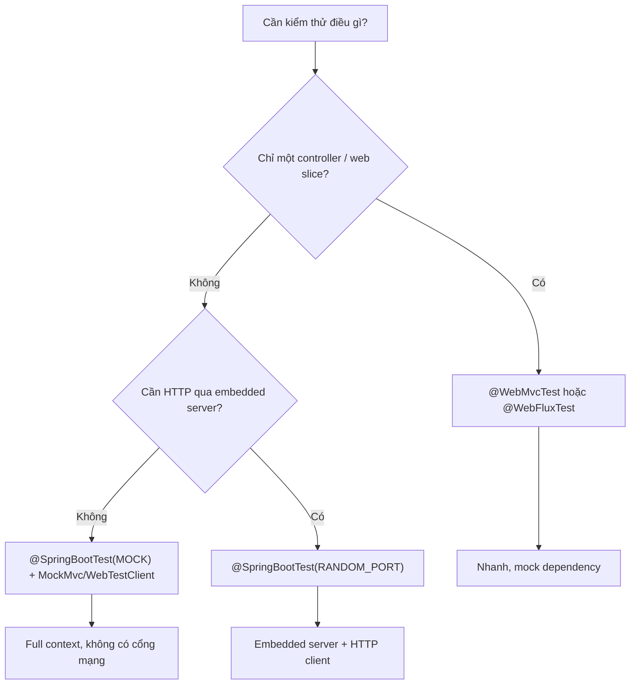
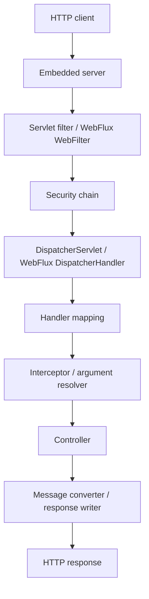

# Khởi động ứng dụng đầy đủ khi cần kiểm tra routing thật

## 1. Khi nào test cần khởi động toàn bộ ứng dụng?

Trong chương **Spring Boot** của học phần **Spring REST Docs (`SPRING_REST_DOCS`)**, tài liệu REST API được sinh từ các bài kiểm thử HTTP có thể chạy lại. Với test slice, ta tập trung một controller và mock phần phụ thuộc. Nhưng có những lỗi chỉ xuất hiện khi request đi qua cấu hình ứng dụng thực tế: route được đăng ký bởi nhiều controller, servlet filter, Spring Security, interceptor, converter, error handler, WebFlux filter chain hoặc cấu hình embedded server.

Khi cần xác minh đường đi request trong ứng dụng đã ghép đầy đủ, hãy cân nhắc `@SpringBootTest` thay vì chỉ dùng `@WebMvcTest` hoặc `@WebFluxTest`. Nếu mục tiêu là cho client gửi HTTP qua cổng của embedded server, cấu hình:

```java
@SpringBootTest(
    webEnvironment = SpringBootTest.WebEnvironment.RANDOM_PORT
)
```

`RANDOM_PORT` yêu cầu Spring Boot khởi động web server trên một cổng được cấp động. Test client gửi request tới server đó, qua stack HTTP của ứng dụng. Đây là khác biệt quan trọng so với cấu hình mặc định `MOCK`, vốn dựng web application context cho test nhưng không khởi động embedded server nghe trên cổng mạng.

Trong bài này, ta kết hợp full application test với Spring REST Docs để vừa kiểm tra routing thật trong embedded server, vừa tạo snippet cho request, response, parameter, header và payload. Phạm vi là routing bên trong ứng dụng đang chạy; kiểm tra DNS công khai, load balancer, ingress hoặc reverse proxy ngoài ứng dụng cần môi trường tích hợp riêng.

Sau bài học, bạn có thể:

- Phân biệt `MOCK`, `RANDOM_PORT`, `DEFINED_PORT` và `NONE` của `@SpringBootTest`.
- Quyết định khi nào test slice đủ dùng và khi nào cần khởi động toàn bộ ứng dụng.
- Viết test `RANDOM_PORT` với `WebTestClient` hoặc REST Assured và sinh snippet bằng Spring REST Docs.
- Kiểm thử route, filter, security, content negotiation và xử lý lỗi qua embedded server.
- Quản lý cổng, dữ liệu test, transaction, output directory và CI để kết quả ổn định.

Ví dụ chủ yếu dùng **Spring Boot 3.5, Spring REST Docs 3.x, JUnit Jupiter và Java 17+**. Spring Boot 4.x có thay đổi về module/package test, do đó cần dùng import đúng major version.

## 2. Phân biệt các chế độ web environment

`@SpringBootTest` hỗ trợ nhiều chế độ tạo môi trường web:

| Chế độ | Điều gì được khởi tạo? | Có embedded server lắng nghe cổng? | Khi phù hợp |
| --- | --- | --- | --- |
| `MOCK` (mặc định) | Web application context dạng mock nếu ứng dụng có web stack. | Không. | Test tích hợp Spring context, có thể kết hợp `MockMvc` hoặc `WebTestClient` gắn với context. |
| `RANDOM_PORT` | Ứng dụng khởi động trong embedded server trên cổng được cấp động. | Có. | Kiểm tra HTTP qua server thật của ứng dụng mà không cố định cổng. |
| `DEFINED_PORT` | Ứng dụng khởi động trên cổng cấu hình trong môi trường. | Có. | Môi trường kiểm thử cần cổng cố định và được quản lý. |
| `NONE` | Application context không phải web environment. | Không. | Test logic cấu hình/service không cần HTTP. |

Sơ đồ lựa chọn:



**Không phải cứ muốn kiểm tra routing là phải dùng `RANDOM_PORT`.** Nếu chỉ cần xác nhận mapping/controller trong Spring MVC, `@WebMvcTest` có thể đủ. Nếu cần tất cả bean, filter và cấu hình cùng một context nhưng không cần socket, `@SpringBootTest` với `MOCK` và `@AutoConfigureMockMvc` vẫn phù hợp. Chọn `RANDOM_PORT` khi chính việc gửi request qua embedded server là một phần yêu cầu kiểm chứng.

## 3. Những lớp routing cần kiểm tra qua server

Một request HTTP có thể đi qua nhiều lớp trước khi tới method controller:



Trong servlet stack, filter có thể chặn request trước DispatcherServlet; Spring Security thường được tích hợp qua filter chain; handler mapping chọn controller theo path, HTTP method, header và điều kiện khác. Trong WebFlux, các thành phần tương ứng có pipeline reactive. Full application test giúp các cấu hình này cùng tham gia xử lý request.

Một số ví dụ chỉ có thể được kiểm tra đầy đủ khi dùng server:

- Nhiều controller cùng đăng ký route hoặc có xung đột mapping.
- Filter thực tế thêm/cắt header, trace ID, CORS hoặc từ chối request.
- Spring Security áp dụng authentication/authorization qua filter chain.
- Cấu hình converter, serialization, content negotiation hoặc error handler toàn ứng dụng.
- Ứng dụng phục vụ context path, redirect hoặc cơ chế HTTP phụ thuộc container.

`RANDOM_PORT` chỉ khởi động embedded server của ứng dụng. Nếu kiến trúc triển khai còn có API gateway, ingress, reverse proxy, service mesh hoặc load balancer, các thành phần ngoài tiến trình Spring Boot không tự được kiểm tra. Muốn xác minh chúng, cần triển khai một môi trường integration/e2e tương ứng.

## 4. Dependencies và cấu trúc ví dụ

Ví dụ servlet MVC dùng Gradle Groovy DSL:

```groovy
dependencies {
    implementation 'org.springframework.boot:spring-boot-starter-web'
    testImplementation 'org.springframework.boot:spring-boot-starter-test'
    testImplementation 'org.springframework.restdocs:spring-restdocs-restassured'
}

tasks.named('test') {
    useJUnitPlatform()
}
```

Trong phần MVC bên dưới, REST Assured là client HTTP gửi request đến embedded servlet server. Spring REST Docs có module `spring-restdocs-restassured` để tạo snippet từ các lần gọi đó. Với reactive application, dùng `spring-boot-starter-webflux` và `spring-restdocs-webtestclient`; phần 7 minh họa riêng cách dùng `WebTestClient`.

Nếu dùng WebTestClient trong ứng dụng WebFlux, thay module tích hợp:

```groovy
testImplementation 'org.springframework.restdocs:spring-restdocs-webtestclient'
```

Các ví dụ cần dùng JUnit Jupiter. Spring Boot dependency management nên quản lý phiên bản các artifact tương thích, tránh gắn một phiên bản Spring REST Docs không tương thích với Spring Boot đang dùng.

## 5. Ví dụ MVC: full application + RANDOM_PORT + REST Assured

Giả sử ứng dụng có một endpoint kiểm tra đơn hàng. Controller mẫu:

```java
package com.example.orders;

import org.springframework.http.HttpStatus;
import org.springframework.web.bind.annotation.GetMapping;
import org.springframework.web.bind.annotation.PathVariable;
import org.springframework.web.bind.annotation.RequestMapping;
import org.springframework.web.bind.annotation.RestController;
import org.springframework.web.server.ResponseStatusException;

@RestController
@RequestMapping("/api/orders")
class OrderController {

    @GetMapping("/{id}")
    OrderResponse find(@PathVariable long id) {
        if (id != 42L) {
            throw new ResponseStatusException(HttpStatus.NOT_FOUND);
        }
        return new OrderResponse(42L, "PAID");
    }

    record OrderResponse(long id, String status) {}
}
```

Giả sử ứng dụng có class cấu hình Spring Boot được tìm thấy từ package gốc `com.example.orders`. Test full application:

```java
package com.example.orders;

import org.junit.jupiter.api.Test;
import org.springframework.beans.factory.annotation.Autowired;
import org.springframework.boot.test.context.SpringBootTest;
import org.springframework.boot.test.autoconfigure.restdocs.AutoConfigureRestDocs;
import io.restassured.specification.RequestSpecification;

import static io.restassured.RestAssured.given;
import static org.hamcrest.Matchers.equalTo;
import static org.springframework.restdocs.payload.PayloadDocumentation.fieldWithPath;
import static org.springframework.restdocs.payload.PayloadDocumentation.responseFields;
import static org.springframework.restdocs.request.RequestDocumentation.parameterWithName;
import static org.springframework.restdocs.request.RequestDocumentation.pathParameters;
import static org.springframework.restdocs.restassured.RestAssuredRestDocumentation.document;

@SpringBootTest(
    webEnvironment = SpringBootTest.WebEnvironment.RANDOM_PORT
)
@AutoConfigureRestDocs(outputDir = "build/generated-snippets/orders-http")
class OrderHttpDocumentationTest {

    @Autowired
    RequestSpecification documentationSpec;

    @Test
    void getOrder() {
        given(documentationSpec)
            .filter(document("orders-get",
                pathParameters(
                    parameterWithName("id").description("ID đơn hàng")
                ),
                responseFields(
                    fieldWithPath("id").description("Mã đơn hàng"),
                    fieldWithPath("status").description("Trạng thái đơn hàng")
                )
            ))
        .when()
            .get("/api/orders/{id}", 42)
        .then()
            .statusCode(200)
            .body("id", equalTo(42))
            .body("status", equalTo("PAID"));
    }
}
```

Trong ví dụ, `RANDOM_PORT` khởi chạy ứng dụng trên cổng ngẫu nhiên; `@AutoConfigureRestDocs` tích hợp Spring REST Docs với `RequestSpecification` do Spring Boot cung cấp khi REST Assured có trên test classpath. REST Assured gửi request tới cổng ứng dụng được Boot quản lý và filter `document(...)` tạo snippet. Không cần tự hard-code địa chỉ hoặc cổng trong test.

Nếu test có request assertion thành công, snippet nằm dưới:

```text
build/generated-snippets/
  orders-http/
    orders-get/
      http-request.adoc
      http-response.adoc
      path-parameters.adoc
      response-fields.adoc
      ...
```

### Kiểm tra route không tồn tại

Route không tìm thấy là một phần hợp đồng HTTP đáng kiểm tra. Có thể thêm test riêng:

```java
@Test
void unknownOrderReturns404() {
    given(documentationSpec)
        .filter(document("orders-get-not-found"))
    .when()
        .get("/api/orders/{id}", 999)
    .then()
        .statusCode(404);
}
```

Ví dụ chỉ sinh snippet mặc định cho response lỗi. Nếu ứng dụng dùng một cấu trúc lỗi chuẩn như `ProblemDetail` hoặc DTO riêng, thêm descriptor response fields phù hợp với API Spring REST Docs REST Assured của phiên bản đang dùng để tài liệu hóa hợp đồng đó.

## 6. Phân biệt MOCK, RANDOM_PORT và WebTestClient binding

Trong các dự án, `WebTestClient` có thể được tạo theo nhiều cách. Tên client giống nhau nhưng đường request có thể khác:

| Cách sử dụng | Request được xử lý ở đâu? | Kiểm tra embedded server? |
| --- | --- | --- |
| `@WebFluxTest` + client do Boot inject | WebFlux test context/slice | Không |
| `@SpringBootTest(MOCK)` + `@AutoConfigureWebTestClient` | Mock web environment | Không có server lắng nghe cổng |
| `@SpringBootTest(RANDOM_PORT)` + `@AutoConfigureWebTestClient` | Embedded server đang chạy | Có |
| `WebTestClient.bindToController(...)` | Controller bind trực tiếp trong test | Không |
| `WebTestClient.bindToServer()` | Server tại địa chỉ base URL | Có, nếu địa chỉ trỏ tới server thực |

Vì thế, nhìn thấy `WebTestClient` trong test không đủ để kết luận rằng request đã đi qua server. Cần xem `webEnvironment` và cách tạo/bind client.

`@LocalServerPort` hữu ích khi test phải tự cấu hình một HTTP client khác. Không hard-code cổng như `8080` trong test `RANDOM_PORT`, vì cổng đã được hệ thống cấp động và có thể khác nhau giữa các lần chạy.

## 7. Dùng WebTestClient khi ứng dụng dùng WebFlux

Với ứng dụng reactive, dùng `spring-boot-starter-webflux` và `spring-restdocs-webtestclient`. `@SpringBootTest(RANDOM_PORT)` vẫn khởi động embedded server; `@AutoConfigureWebTestClient` cung cấp client dùng để gọi server đó, còn `@AutoConfigureRestDocs` gắn cơ chế ghi snippet.

```java
package com.example.orders;

import org.junit.jupiter.api.Test;
import org.springframework.beans.factory.annotation.Autowired;
import org.springframework.boot.test.context.SpringBootTest;
import org.springframework.boot.test.autoconfigure.restdocs.AutoConfigureRestDocs;
import org.springframework.boot.test.autoconfigure.web.reactive.AutoConfigureWebTestClient;
import org.springframework.test.web.reactive.server.WebTestClient;

import static org.springframework.restdocs.payload.PayloadDocumentation.fieldWithPath;
import static org.springframework.restdocs.payload.PayloadDocumentation.responseFields;
import static org.springframework.restdocs.webtestclient.WebTestClientRestDocumentation.document;

@SpringBootTest(
    webEnvironment = SpringBootTest.WebEnvironment.RANDOM_PORT
)
@AutoConfigureWebTestClient
@AutoConfigureRestDocs(outputDir = "build/generated-snippets/status-http")
class StatusHttpDocumentationTest {

    @Autowired
    WebTestClient webTestClient;

    @Test
    void getStatus() {
        webTestClient.get()
            .uri("/api/status")
            .exchange()
            .expectStatus().isOk()
            .expectBody()
            .jsonPath("$.status").isEqualTo("UP")
            .consumeWith(document("status-get",
                responseFields(
                    fieldWithPath("status")
                        .description("Trạng thái hiện tại của dịch vụ")
                )
            ));
    }
}
```

Ví dụ giả định đây là ứng dụng WebFlux có endpoint `GET /api/status` trả JSON `{"status":"UP"}`. `WebTestClient` có thể dùng cho server thật hoặc mock web context; ở đây điều quyết định là `webEnvironment = RANDOM_PORT`, không phải chỉ tên client. Với MVC servlet server ở mục 5, REST Assured là minh họa chính.

## 8. Routing, security và header: các trường hợp nên có test riêng

Khi mục tiêu là xác minh routing thật qua toàn bộ context, đừng chỉ kiểm tra happy path. Một bộ test tài liệu có thể gồm:

| Trường hợp | Điều cần xác minh | Snippet hữu ích |
| --- | --- | --- |
| Route thành công | Mapping đúng path + method, status và JSON body đúng. | `http-request`, `http-response`, `path-parameters`, `response-fields` |
| Sai HTTP method | 404/405 theo cấu hình routing và error handling. | `http-request`, `http-response` |
| Route không tồn tại | 404 và schema error nếu có. | `http-response`, `response-fields` |
| Chưa xác thực | Security filter trả 401 hoặc redirect theo policy. | `http-request`, `http-response`, `response-headers` |
| Không đủ quyền | Security chain trả 403. | `http-request`, `http-response` |
| Header/content negotiation | `Accept`/`Content-Type` ảnh hưởng converter/response. | `request-headers`, `response-headers`, `http-response` |
| Context path hoặc prefix | Request tới đúng route khi ứng dụng có base path. | `http-request`, `http-response` |

Nếu Spring Security được bật, test phải gửi authentication hợp lệ cho happy path (ví dụ bearer token test hoặc cơ chế test authentication thích hợp). Đối với test `401/403`, không bổ sung thông tin xác thực và ghi đúng response mà client nhận. Không loại filter chỉ để mọi test đều thành công; như vậy sẽ bỏ qua chính phần routing/security muốn kiểm tra.

Nếu tài liệu hóa header `Authorization`, không đưa token thật vào snippet. Dùng token giả dành riêng cho test và preprocessor để loại/che giá trị nhạy cảm trước khi ghi tài liệu. Snippet là artifact có thể được lưu trong CI hoặc publish, nên cần kiểm tra cả request headers và response bodies.

## 9. Cấu hình URI trong snippet khi dùng RANDOM_PORT

Server ngẫu nhiên có port không cố định. Nếu để nguyên URI mặc định, snippet có thể chứa `localhost` hoặc cổng test; đôi khi điều này không phải địa chỉ mà người đọc API công khai nên sử dụng.

`@AutoConfigureRestDocs` có thể cấu hình URI hiển thị:

```java
@AutoConfigureRestDocs(
    outputDir = "build/generated-snippets/orders-http",
    uriScheme = "https",
    uriHost = "api.example.com",
    uriPort = 443
)
```

Các giá trị này tác động **URI được tạo trong snippet**, không bật HTTPS cho embedded server, không thay đổi cổng đang nghe và không đổi địa chỉ client đã gọi. Nếu test thực tế dùng HTTP trên cổng ngẫu nhiên nhưng snippet mô tả endpoint HTTPS công khai, đây là cách tách địa chỉ kiểm thử với địa chỉ công bố.

Với REST Assured hoặc trường hợp cần biến đổi URI riêng, có thể dùng operation preprocessor như `modifyUris()`. Cũng nên định dạng payload:

```java
import static org.springframework.restdocs.operation.preprocess.Preprocessors.preprocessRequest;
import static org.springframework.restdocs.operation.preprocess.Preprocessors.preprocessResponse;
import static org.springframework.restdocs.operation.preprocess.Preprocessors.prettyPrint;

// Đặt trong document(...):
document("orders-get",
    preprocessRequest(prettyPrint()),
    preprocessResponse(prettyPrint()),
    responseFields(/* descriptors */)
)
```

Preprocessor chỉ điều chỉnh bản ghi tài liệu. Không nhầm việc che header/đổi URI trong snippet với thay đổi request hoặc response thực tế của ứng dụng.

## 10. Dữ liệu kiểm thử và ranh giới transaction

Một khác biệt quan trọng giữa `MockMvc` chạy trong test thread và client gửi HTTP tới `RANDOM_PORT` là request được xử lý ở một thread khác qua server đang chạy. Vì vậy, không được mặc định rằng `@Transactional` trên test sẽ rollback dữ liệu mà server đã ghi.

Ví dụ: test tạo một đơn hàng bằng HTTP POST; controller gọi service và transaction được mở ở thread xử lý request. Khi response trả về, transaction của request có thể đã commit. Transaction test bao quanh method test không tự động bao trùm transaction độc lập đó. Nếu dữ liệu không được dọn, lần chạy tiếp theo có thể thất bại hoặc trả kết quả khác.

Chiến lược để test ổn định:

- Dùng dữ liệu có ID cố định và namespace riêng theo test, tránh phụ thuộc trạng thái dùng chung.
- Dọn dữ liệu đã tạo bằng API dọn test, repository hoặc fixture ở bước teardown phù hợp.
- Dùng database riêng cho test (ví dụ Testcontainers) nếu cần xác minh persistence thực tế.
- Cô lập test song song: tránh hai test cùng sửa một bản ghi hoặc dùng cùng operation ID để ghi snippet khác nhau.
- Không gọi dịch vụ production bên ngoài; dùng mock server hoặc môi trường tích hợp kiểm soát được.

`RANDOM_PORT` có giá trị khi muốn kiểm tra stack thực, nhưng làm thời gian khởi động và quản lý trạng thái dữ liệu tốn kém hơn test slice. Không cần chuyển mọi test endpoint sang full server; giữ phần lớn test nhanh ở slice và dùng full integration test cho đường đi cần được xác minh.

## 11. Tổ chức snippet, Asciidoctor và CI

Với Gradle, `@AutoConfigureRestDocs(outputDir = "build/generated-snippets/orders-http")` cần khớp với thư mục đầu vào Asciidoctor:

```groovy
configurations {
    asciidoctorExt
}

dependencies {
    testImplementation 'org.springframework.restdocs:spring-restdocs-restassured'
    asciidoctorExt 'org.springframework.restdocs:spring-restdocs-asciidoctor'
}

def snippetsDir = layout.buildDirectory.dir(
    'generated-snippets/orders-http'
)

tasks.named('test') {
    useJUnitPlatform()
    outputs.dir snippetsDir
}

tasks.named('asciidoctor') {
    dependsOn tasks.named('test')
    inputs.dir snippetsDir
    configurations 'asciidoctorExt'
    attributes 'snippets': snippetsDir.get().asFile
}
```

Tài liệu nguồn `src/docs/asciidoc/orders.adoc`:

```asciidoc
= Orders API
:toc: left

== Get an order

=== Request
include::{snippets}/orders-get/http-request.adoc[]
include::{snippets}/orders-get/path-parameters.adoc[]

=== Response
include::{snippets}/orders-get/http-response.adoc[]
include::{snippets}/orders-get/response-fields.adoc[]

== Order not found
include::{snippets}/orders-get-not-found/http-response.adoc[]
```

Chạy pipeline sạch:

```bash
./gradlew clean test asciidoctor
```

Nếu full-server test được đặt ở task riêng như `integrationTest`, hãy khai báo `asciidoctor` phụ thuộc task đó và đánh dấu đúng thư mục snippet là output/input. Nếu chạy tất cả cùng task `test`, cần bảo đảm task thực sự chứa test `RANDOM_PORT`.

Job CI chỉ nên upload HTML sau khi test tài liệu và Asciidoctor thành công. Không dùng `-x test` hoặc `-DskipTests` nếu snippet hiện tại chỉ do test tạo. Khi dùng cổng động, không đưa port của lần chạy test vào file nguồn tài liệu; dùng URI cấu hình cho địa chỉ công bố như phần 9.

## 12. Lỗi thường gặp khi kiểm tra routing thật

| Hiện tượng | Nguyên nhân | Cách xử lý |
| --- | --- | --- |
| `@LocalServerPort` không được inject | Test không chạy với `RANDOM_PORT` hoặc không có web server. | Chọn `@SpringBootTest(webEnvironment = RANDOM_PORT)` và kiểm tra web application type. |
| Port cố định bị chiếm | Nhiều test hoặc tiến trình dùng cùng cổng. | Dùng `RANDOM_PORT`; chỉ dùng `DEFINED_PORT` khi đã quản lý cổng rõ ràng. |
| Inject được `WebTestClient` nhưng request không đi qua server | Client được bind vào mock context hoặc controller thay vì server. | Kiểm tra `webEnvironment` và cơ chế tạo/bind client. |
| Endpoint trả 404 dù controller tồn tại | Component scan, context path, servlet path hoặc profile cấu hình route khác. | Kiểm tra class ứng dụng gốc, mapping, context path và profile test. |
| Endpoint trả 401/403 trong test | Security filter chain hoạt động và test chưa xác thực. | Tạo test identity/token hợp lệ hoặc tài liệu hóa đúng response bị từ chối. |
| Dữ liệu tạo từ test còn lại sau khi test kết thúc | Transaction của request server không thuộc transaction test method. | Dọn dữ liệu riêng, dùng fixture/database test và tránh giả định rollback tự động. |
| Snippet chứa port ngẫu nhiên | Đang ghi URI thực của test server. | Cấu hình URI tài liệu hóa hoặc preprocessor đổi URI. |
| Asciidoctor không tìm thấy snippet | Output directory hoặc operation ID không khớp; test chưa chạy. | So sánh file sinh thực tế với `{snippets}` và `include`. |
| Test full context quá chậm | Dùng server thật cho mọi endpoint nhỏ. | Giữ test slice cho kiểm tra controller và giới hạn số full integration test. |
| Test không ổn định khi chạy song song | Dữ liệu chia sẻ hoặc operation ID bị trùng. | Cô lập dữ liệu, đặt ID duy nhất, hoặc giới hạn concurrency có chủ đích. |

## 13. Bài thực hành

Mở rộng `OrderController` để hỗ trợ:

- `GET /api/orders/{id}`: trả thông tin đơn hàng.
- `POST /api/orders`: tạo đơn hàng, trả `201 Created` và header `Location`.
- `GET /api/orders/{id}/items`: trả danh sách mặt hàng.

Thực hiện:

1. Viết test slice `@WebMvcTest` cho controller, kiểm tra mapping/JSON cơ bản và tạo snippet.
2. Viết một full application test `@SpringBootTest(RANDOM_PORT)` dùng `WebTestClient`; xác minh ít nhất một route thành công, một route không tồn tại và một header của response.
3. Nếu có security, tạo test 401/403 cùng request hợp lệ. Không vô hiệu hóa filter trong full-server test.
4. Tạo test POST có dữ liệu ghi xuống database test; xác minh dữ liệu qua API GET và dọn dữ liệu sau test để chứng minh không phụ thuộc rollback của transaction test.
5. Đặt output riêng dưới `build/generated-snippets/orders-http`, dùng URI công khai trong snippet và nối Asciidoctor.
6. Chạy `./gradlew clean test asciidoctor` trong CI. Cố ý đổi mapping hoặc response field mà không cập nhật descriptor để quan sát pipeline thất bại.

**Tiêu chí hoàn thành:** biết giải thích vì sao chọn `RANDOM_PORT` thay vì `MOCK`; client thật gửi request qua embedded server; routing, filter và response được xác minh bằng assertion; snippet mô tả đúng hợp đồng API; dữ liệu test được cô lập; CI chỉ xuất tài liệu sau khi kiểm thử thành công.

## 14. Tài liệu tham khảo

- [Spring Boot 3.5 — Testing Spring Boot Applications](https://docs.spring.io/spring-boot/3.5/reference/testing/spring-boot-applications.html)
- [Spring Boot 3.5 — Auto-configured Spring REST Docs Tests](https://docs.spring.io/spring-boot/3.5/reference/testing/spring-boot-applications.html)
- [Spring Boot 3.5 — AutoConfigureWebTestClient API](https://docs.spring.io/spring-boot/3.5/api/java/org/springframework/boot/test/autoconfigure/web/reactive/AutoConfigureWebTestClient.html)
- [Spring REST Docs — Getting Started](https://docs.spring.io/spring-restdocs/tutorial/getting-started/index.html)
- [Spring REST Docs — Documenting Your API](https://docs.spring.io/spring-restdocs/reference/documenting-your-api/index.html)
- [Spring REST Docs — Customizing Requests and Responses](https://docs.spring.io/spring-restdocs/reference/customizing-requests-and-responses.html)
