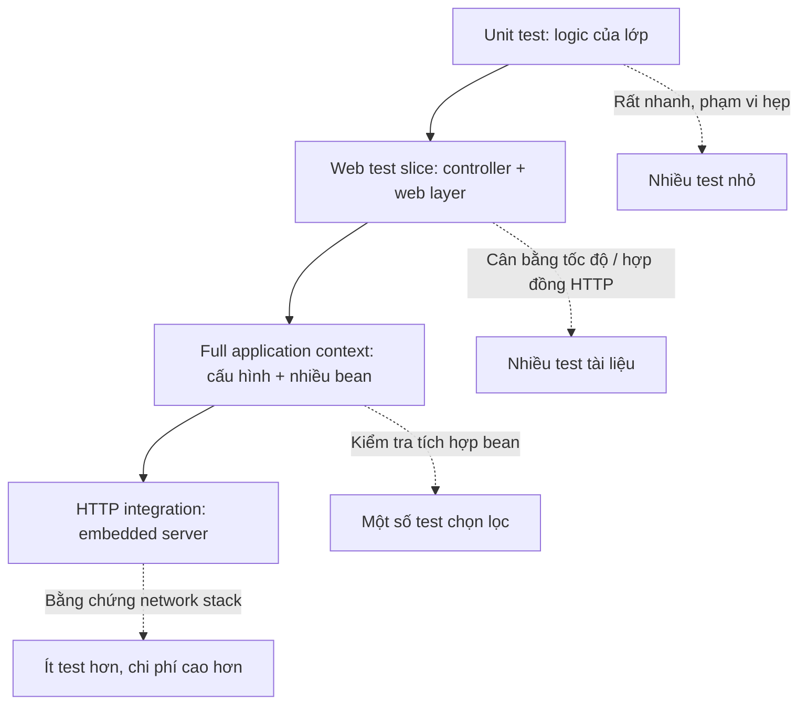

# Test slice và đánh đổi giữa tốc độ với bằng chứng

## 1. Vì sao cần chọn đúng tầng kiểm thử?

Trong chương **Spring Boot** của học phần **Spring REST Docs (`SPRING_REST_DOCS`)**, các bài kiểm thử HTTP tạo ra snippet cho request, response, payload, parameter và header. Tài liệu sinh từ snippet giúp nhóm phát triển công bố hợp đồng API có thể kiểm chứng. Tuy nhiên, chất lượng của tài liệu phụ thuộc trực tiếp vào phạm vi mà test thực sự chạy.

`@WebMvcTest` và `@WebFluxTest` là các *test slice*: chúng khởi tạo một phần Spring ApplicationContext phục vụ tầng web. Nhờ nạp ít bean hơn so với toàn bộ ứng dụng, chúng thường chạy nhanh, dễ cô lập và phù hợp để kiểm tra nhiều endpoint. Đổi lại, chúng không chứng minh rằng mọi service, repository, filter, cấu hình production hay embedded server đều hoạt động đúng khi ghép lại.

Một test slice có thể chứng minh khá tốt rằng:

- Route được ánh xạ đúng trong MVC/WebFlux context mà test đã nạp.
- Controller xử lý request, tham số, header và payload đúng với các dependency giả lập.
- Response status, JSON và các descriptor REST Docs khớp với kết quả mà controller trả về.

Nhưng test slice không tự chứng minh rằng:

- Toàn bộ dependency thật, database, message broker hoặc dịch vụ ngoài kết nối được.
- Tất cả filter/security/interceptor của ứng dụng đã được nạp đúng.
- Servlet container hoặc reactive server thực xử lý request qua network như dự kiến.
- Các route khác không gây xung đột khi toàn bộ ứng dụng được khởi động.

Vì vậy, **tốc độ test và độ rộng của bằng chứng là hai yếu tố phải cân bằng**. Không nên chọn một loại test cho mọi mục đích. Nên dùng test slice để kiểm tra hợp đồng HTTP ở quy mô lớn, rồi bổ sung một số test full-context hoặc HTTP thật tại những ranh giới có rủi ro tích hợp cao.

Ví dụ dùng **Spring Boot 3.5, Spring REST Docs 3.x, JUnit Jupiter và Java 17+**. Với Boot 4.x, một số package/module test thay đổi; hãy dùng import tương ứng với major version của dự án.

## 2. Bốn cấp độ bằng chứng thường gặp

| Cấp độ | Cấu hình tiêu biểu | Bằng chứng chính | Giới hạn chính |
| --- | --- | --- | --- |
| Test logic đơn vị | JUnit + đối tượng Java, không dựng Spring context | Logic nghiệp vụ của một lớp khi dependency được kiểm soát. | Không kiểm tra mapping HTTP hoặc cấu hình Spring. |
| Web test slice | `@WebMvcTest` hoặc `@WebFluxTest` | Controller, mapping, binding, serialization và web advice được nạp trong slice. | Phần lớn dependency phía sau được mock; không chứng minh toàn bộ ứng dụng. |
| Full application context, mock web | `@SpringBootTest` + `@AutoConfigureMockMvc` hoặc `@AutoConfigureWebTestClient` | Nhiều bean/cấu hình ứng dụng cùng được tạo và đi qua client test trong context. | Không có embedded server thực lắng nghe cổng mạng ở chế độ `MOCK`. |
| HTTP integration test | `@SpringBootTest(webEnvironment = RANDOM_PORT)` + HTTP client | Request đi qua embedded server và stack HTTP của ứng dụng. | Chậm hơn, quản lý dữ liệu/cổng khó hơn; vẫn chưa kiểm tra hạ tầng ngoài tiến trình. |

Sơ đồ sau thể hiện mức độ mở rộng thường gặp:



Các cấp độ không thay thế hoàn toàn nhau. Một test HTTP qua server thật vẫn có thể không phát hiện lỗi nghiệp vụ nếu dữ liệu đầu vào không đại diện; test slice nhanh vẫn rất có giá trị nếu nó kiểm tra đúng ranh giới và có assertion cụ thể.

## 3. Test slice thực sự khởi tạo những gì?

### 3.1. MVC slice với `@WebMvcTest`

`@WebMvcTest(ProductController.class)` tập trung vào Spring MVC component, chẳng hạn controller, MVC infrastructure, message converter và các thành phần web liên quan. Nó không tự khởi tạo mọi service/repository của ứng dụng. Dependency của controller thường được thay bằng mock hoặc được import có chủ đích.

Ví dụ controller:

```java
package com.example.catalog;

import org.springframework.web.bind.annotation.GetMapping;
import org.springframework.web.bind.annotation.PathVariable;
import org.springframework.web.bind.annotation.RequestMapping;
import org.springframework.web.bind.annotation.RestController;

@RestController
@RequestMapping("/api/products")
class ProductController {
    private final ProductService service;

    ProductController(ProductService service) {
        this.service = service;
    }

    @GetMapping("/{id}")
    ProductResponse find(@PathVariable long id) {
        return service.find(id);
    }
}

interface ProductService {
    ProductResponse find(long id);
}

record ProductResponse(long id, String name) {}
```

Test slice mock service và tài liệu hóa response:

```java
package com.example.catalog;

import org.junit.jupiter.api.Test;
import org.springframework.beans.factory.annotation.Autowired;
import org.springframework.boot.test.autoconfigure.restdocs.AutoConfigureRestDocs;
import org.springframework.boot.test.autoconfigure.web.servlet.WebMvcTest;
import org.springframework.http.MediaType;
import org.springframework.test.context.bean.override.mockito.MockitoBean;
import org.springframework.test.web.servlet.MockMvc;

import static org.mockito.BDDMockito.given;
import static org.springframework.restdocs.mockmvc.MockMvcRestDocumentation.document;
import static org.springframework.restdocs.mockmvc.RestDocumentationRequestBuilders.get;
import static org.springframework.restdocs.payload.PayloadDocumentation.fieldWithPath;
import static org.springframework.restdocs.payload.PayloadDocumentation.responseFields;
import static org.springframework.restdocs.request.RequestDocumentation.parameterWithName;
import static org.springframework.restdocs.request.RequestDocumentation.pathParameters;
import static org.springframework.test.web.servlet.result.MockMvcResultMatchers.jsonPath;
import static org.springframework.test.web.servlet.result.MockMvcResultMatchers.status;

@WebMvcTest(ProductController.class)
@AutoConfigureRestDocs(outputDir = "build/generated-snippets/catalog-slice")
class ProductControllerDocumentationTest {

    @Autowired
    MockMvc mockMvc;

    @MockitoBean
    ProductService service;

    @Test
    void findProduct() throws Exception {
        given(service.find(27L))
            .willReturn(new ProductResponse(27L, "Bút máy"));

        mockMvc.perform(
                get("/api/products/{id}", 27L)
                    .accept(MediaType.APPLICATION_JSON)
            )
            .andExpect(status().isOk())
            .andExpect(jsonPath("$.id").value(27))
            .andExpect(jsonPath("$.name").value("Bút máy"))
            .andDo(document("products-find",
                pathParameters(
                    parameterWithName("id")
                        .description("Mã định danh sản phẩm")
                ),
                responseFields(
                    fieldWithPath("id").description("ID sản phẩm"),
                    fieldWithPath("name").description("Tên sản phẩm")
                )
            ));
    }
}
```

Test trên cung cấp bằng chứng cho hành vi HTTP của controller trong MVC slice với kết quả service đã được định trước. Nó kiểm tra route `GET /api/products/{id}`, binding path variable, JSON response, status và sự khớp của `responseFields`. Nó **không** kiểm tra implementation thật của `ProductService` hay khả năng đọc dữ liệu từ database.

### 3.2. Reactive slice với `@WebFluxTest`

Với WebFlux, dùng `@WebFluxTest`, `WebTestClient` và dependency `spring-restdocs-webtestclient`. Ví dụ:

```java
package com.example.status;

import java.util.Map;
import org.springframework.web.bind.annotation.GetMapping;
import org.springframework.web.bind.annotation.RestController;
import reactor.core.publisher.Mono;

@RestController
class StatusController {
    @GetMapping("/api/status")
    Mono<Map<String, String>> status() {
        return Mono.just(Map.of("status", "UP"));
    }
}
```

Test:

```java
package com.example.status;

import org.junit.jupiter.api.Test;
import org.springframework.beans.factory.annotation.Autowired;
import org.springframework.boot.test.autoconfigure.restdocs.AutoConfigureRestDocs;
import org.springframework.boot.test.autoconfigure.web.reactive.WebFluxTest;
import org.springframework.test.web.reactive.server.WebTestClient;

import static org.springframework.restdocs.payload.PayloadDocumentation.fieldWithPath;
import static org.springframework.restdocs.payload.PayloadDocumentation.responseFields;
import static org.springframework.restdocs.webtestclient.WebTestClientRestDocumentation.document;

@WebFluxTest(StatusController.class)
@AutoConfigureRestDocs(outputDir = "build/generated-snippets/status-slice")
class StatusControllerDocumentationTest {

    @Autowired
    WebTestClient client;

    @Test
    void status() {
        client.get().uri("/api/status")
            .exchange()
            .expectStatus().isOk()
            .expectBody()
            .jsonPath("$.status").isEqualTo("UP")
            .consumeWith(document("status-get",
                responseFields(
                    fieldWithPath("status")
                        .description("Trạng thái dịch vụ")
                )
            ));
    }
}
```

WebFlux slice cũng có giới hạn tương tự: các service phụ thuộc không tự động xuất hiện trong context. Dùng mock cho dependency không thuộc web slice, và chỉ import cấu hình thực sự liên quan đến điều đang kiểm tra.

## 4. Vì sao test slice thường chạy nhanh hơn?

Test slice thường tạo ít bean hơn so với `@SpringBootTest`. Điều đó có thể giảm thời gian khởi động context, giảm cấu hình test, giảm số hệ thống phụ thuộc cần dựng và giúp nguyên nhân thất bại dễ khoanh vùng.

| Khía cạnh | Test slice | Full application / HTTP thật |
| --- | --- | --- |
| Khởi động context | Chọn lọc bean web | Nhiều bean ứng dụng hoặc toàn bộ context |
| Dependency phía sau | Thường mock hoặc import chọn lọc | Có thể dùng implementation thật |
| Database/broker | Thường không cần | Có thể cần hoặc dùng container |
| HTTP server | Mock web context | Có thể bật embedded server với `RANDOM_PORT` |
| Tốc độ lặp lại | Thường nhanh hơn | Thường chậm hơn |
| Phạm vi kiểm tra | Hẹp, tập trung | Rộng hơn, nhiều tương tác hơn |
| Khoanh vùng lỗi | Thường dễ hơn | Có thể liên quan nhiều bean/hạ tầng |

Đây là xu hướng, không phải cam kết thời gian cố định. Một slice có thể nặng nếu import nhiều cấu hình; một full-context test có thể tái sử dụng context giữa các method và chạy nhanh hơn dự kiến. Hãy đo thời gian build thực tế thay vì suy đoán chỉ từ annotation.

## 5. Đánh đổi: bằng chứng nào bị mất khi mock dependency?

Mock là cách cô lập hữu ích, nhưng nó thay đổi bản chất của điều được kiểm tra.

Ví dụ:

```java
given(service.find(27L))
    .willReturn(new ProductResponse(27L, "Bút máy"));
```

Test có thể chứng minh controller ánh xạ giá trị service trả về thành JSON đúng và status phù hợp. Nhưng nó không chứng minh:

- Service thật truy vấn dữ liệu đúng.
- Repository mapping hoặc transaction hoạt động.
- Database có schema và dữ liệu tương thích.
- Quy tắc nghiệp vụ trong service trả cùng kết quả với dữ liệu production.
- Các bean thật được Spring ghép đúng trong full application context.

Vì vậy, test slice không nên được mô tả như bằng chứng end-to-end cho endpoint. Trong tài liệu phát triển nội bộ, có thể ghi rõ test đang mock dependency nào và những hành vi nào được bao phủ bởi integration test khác.

Mặt khác, mock không khiến tài liệu REST Docs vô giá trị. Khi mục tiêu của test là hợp đồng HTTP của controller, dữ liệu giả có kiểm soát giúp snippet ổn định và dễ đọc. Cần tránh dùng dữ liệu mock quá đơn giản làm che khuất các nhánh response quan trọng, chẳng hạn null, collection rỗng, validation error hoặc trạng thái không tìm thấy.

## 6. Chọn test slice hay full context?

### 6.1. Dùng test slice khi...

- Muốn xác minh mapping, binding, validation, status và JSON contract của một controller.
- Muốn tạo snippet cho nhiều API route với dữ liệu được kiểm soát và chạy thường xuyên.
- Service/repository có thể mock để tập trung vào lớp HTTP.
- Lỗi cần phát hiện chủ yếu thuộc controller, MVC/WebFlux configuration được nạp trong slice hoặc serialization web.

### 6.2. Dùng full application context khi...

- Cần xác minh nhiều bean được Spring ghép với nhau, chẳng hạn controller → service → repository.
- Security/filter/interceptor quan trọng nhưng không có trong slice hoặc muốn kiểm tra cấu hình thật được import toàn ứng dụng.
- Có nhiều controller/route và cần phát hiện vấn đề do cấu hình toàn cục.
- Cần xác nhận property, profile, converter, advice hoặc component scan đang được sử dụng đúng.

Full context ở chế độ `MOCK` vẫn chưa có embedded server. Khi muốn kiểm tra request qua cổng thật, chọn `RANDOM_PORT` và HTTP client phù hợp.

### 6.3. Dùng HTTP integration test khi...

- Routing hoặc filter phụ thuộc servlet/reactive server.
- Cần xác nhận HTTP stack, cổng, context path hoặc server-specific behavior.
- API cần được gọi qua network bởi một client thực.
- Một lỗi chỉ xuất hiện khi request đi qua toàn bộ server chain.

Không cần chuyển toàn bộ test sang `RANDOM_PORT`. Mỗi test HTTP thật có thể cần dữ liệu, cổng, cleanup và thời gian boot nhiều hơn; hãy dành nó cho các ranh giới có giá trị bằng chứng cao.

## 7. Tổ chức bộ test tài liệu theo mục tiêu bằng chứng

Một bộ test REST Docs có thể chia thành các nhóm với operation ID rõ ràng:

| Nhóm | Ví dụ operation ID | Tầng test phù hợp | Điều cần chứng minh |
| --- | --- | --- | --- |
| API contract thành công | `products-find-success` | Web slice | Mapping, binding, JSON và header công khai |
| Validation lỗi | `products-create-invalid` | Web slice | 400, field error, error payload |
| Resource không tồn tại | `products-find-not-found` | Web slice hoặc full context tùy error handler | 404 và schema lỗi |
| Security | `products-find-unauthenticated`, `products-find-forbidden` | Slice có security config phù hợp hoặc full context | 401/403, challenge/header và policy |
| Persistence integration | `products-create-persisted` | Full context hoặc HTTP thật + database test | Dữ liệu được lưu và truy vấn lại |
| HTTP server behavior | `products-routing-http` | `RANDOM_PORT` | Filter chain/server/routing qua cổng |

Một operation ID nên đại diện cho một trường hợp tài liệu hóa có ý nghĩa. Tránh để test slice và full integration test cùng ghi một ID vào cùng output directory, vì kết quả có thể bị ghi đè. Có thể dùng các thư mục riêng như `build/generated-snippets/slice` và `build/generated-snippets/http`, hoặc đặt operation ID phân biệt rõ.

### Tổ chức các nhóm snippet

```text
build/generated-snippets/
  slice/
    products-find-success/
      http-request.adoc
      http-response.adoc
      response-fields.adoc
    products-create-invalid/
      http-request.adoc
      http-response.adoc
  http/
    products-routing-http/
      http-request.adoc
      http-response.adoc
```

Trang Asciidoctor có thể include hai nhóm bằng attribute khác nhau:

```asciidoc
== Tìm sản phẩm: contract test
include::{slice-snippets}/products-find-success/http-request.adoc[]
include::{slice-snippets}/products-find-success/http-response.adoc[]

== Routing qua embedded server
include::{http-snippets}/products-routing-http/http-request.adoc[]
include::{http-snippets}/products-routing-http/http-response.adoc[]
```

Không nhất thiết phải tổ chức đúng cấu trúc ví dụ này. Điều quan trọng là test task và build task dùng đường dẫn rõ ràng, không ghi trùng output.

## 8. REST Docs có làm test slice trở thành bằng chứng mạnh hơn không?

Spring REST Docs bổ sung một cơ chế quan trọng: descriptor có thể khiến test thất bại nếu payload thực tế không khớp những field đã mô tả. Ví dụ:

```java
responseFields(
    fieldWithPath("id").description("ID sản phẩm"),
    fieldWithPath("name").description("Tên sản phẩm")
)
```

Nếu controller bắt đầu trả thêm `price` mà test không mô tả hoặc đánh dấu tùy chọn/bỏ qua một cách có chủ đích, snippet generation có thể thất bại. Điều này giúp phát hiện tài liệu không còn đầy đủ so với response mà test quan sát được.

Nhưng REST Docs **không tự mở rộng phạm vi test**. Nếu service đang mock, descriptor chỉ kiểm tra response do controller tạo ra từ giá trị mock. Nếu test slice không nạp security filter, snippet cũng không chứng minh security chain production hoạt động. REST Docs giúp ràng buộc nội dung tài liệu với response mà test đã quan sát, không biến test slice thành full integration test.

Để tăng chất lượng bằng chứng:

1. Có assertion về status, payload và header cần thiết, không chỉ gọi `document(...)`.
2. Dùng descriptor cho các field/parameter/header thuộc hợp đồng công khai.
3. Dùng dữ liệu test bao phủ response thành công và các response lỗi quan trọng.
4. Dùng ít nhất một số full-context/HTTP test ở những ranh giới mà test slice không bao phủ.
5. Dùng CI chạy lại test và dựng tài liệu từ snippet mới, không lấy snippet cũ.

## 9. Security và filter: tránh kết luận quá mức

`@WebMvcTest` thường có thể nạp cấu hình security liên quan tùy dependencies và auto-configuration, nhưng không nên giả định mọi filter của ứng dụng đều có trong slice. Cần kiểm tra test context đã có filter/chain nào; nếu cần xác minh cấu hình security toàn cục, cân nhắc `@SpringBootTest` cùng `@AutoConfigureMockMvc` hoặc `RANDOM_PORT`.

Một chiến lược hợp lý:

| Kiểm thử | Tầng gợi ý | Bằng chứng |
| --- | --- | --- |
| Controller trả 200 khi dữ liệu hợp lệ | Web slice | Hợp đồng controller |
| Validation trả 400 | Web slice | Binding/validation/error response |
| Rule phân quyền ở service | Unit/service test | Quy tắc authorization của logic |
| Security filter chain trả 401/403 | Full context hoặc HTTP test | Cấu hình authentication/authorization được lắp trong ứng dụng |
| CORS/header do filter thêm | Full context/HTTP test nếu filter không thuộc slice | Filter thực sự xử lý response |

Khi ghi snippet có `Authorization` hoặc cookie, không dùng credential thật. Dùng token giả chỉ dành cho test và loại/che header nhạy cảm ở bước preprocess trước khi lưu snippet. Việc ẩn token trong tài liệu không thay thế assertion rằng security filter đã áp dụng đúng.

## 10. Chi phí, độ ổn định và khả năng bảo trì

| Yếu tố | Test slice | Full context / HTTP thật |
| --- | --- | --- |
| Thời gian chạy | Thường thấp | Thường cao hơn |
| Số dependency cần dựng | Ít, mock được nhiều | Có thể nhiều hơn |
| Độ cô lập | Cao | Phụ thuộc cấu hình và dữ liệu |
| Tính ổn định của snippet | Dễ kiểm soát khi dữ liệu mock cố định | Cần quản lý dữ liệu, thời gian, port và hệ thống phụ thuộc |
| Khả năng phát hiện lỗi tích hợp | Giới hạn | Rộng hơn |
| Công sức bảo trì | Ít cấu hình hơn, nhưng cần cập nhật mock khi contract/service thay đổi | Cần fixture, cleanup, môi trường và thời gian build |

Để giữ full integration test ổn định:

- Dùng `RANDOM_PORT` thay vì cổng cố định khi cần nhiều tiến trình/test chạy trên cùng máy.
- Cố định dữ liệu hoặc tạo dữ liệu riêng cho mỗi test; không phụ thuộc dữ liệu chia sẻ chưa được dọn.
- Không giả định `@Transactional` của test tự rollback transaction được mở trong thread xử lý HTTP server.
- Không gọi dịch vụ production bên ngoài; dùng database/container hoặc mock server có thể tái lập.
- Đặt operation ID duy nhất; không để các test song song ghi vào cùng snippet folder.

Đối với test slice, tránh mock mọi thứ đến mức chỉ còn kiểm tra một response dựng sẵn mà không xác minh hành vi controller. Mock đúng ranh giới phụ thuộc, vẫn kiểm tra binding, validation, mapping và response thực tế từ MVC/WebFlux layer.

## 11. Cấu hình CI theo chiến lược phân tầng

Có thể tách hai nhóm test:

| Task | Nội dung | Khi chạy |
| --- | --- | --- |
| `test` | Unit test và web slice tạo snippet contract | Mỗi pull request/commit |
| `integrationTest` | Full context hoặc HTTP test qua `RANDOM_PORT` | Mỗi pull request quan trọng, nightly hoặc trước release tùy chi phí |
| `asciidoctor` | Ghép snippet từ các nhóm test đã chạy | Sau task test tạo snippet |

Ví dụ Gradle Groovy DSL với output riêng:

```groovy
def sliceSnippets = layout.buildDirectory.dir(
    'generated-snippets/slice'
)
def httpSnippets = layout.buildDirectory.dir(
    'generated-snippets/http'
)

tasks.named('test') {
    useJUnitPlatform()
    outputs.dir sliceSnippets
}

tasks.register('integrationTest', Test) {
    description = 'Runs full application HTTP integration tests.'
    group = 'verification'
    testClassesDirs = sourceSets.test.output.classesDirs
    classpath = sourceSets.test.runtimeClasspath
    useJUnitPlatform()
    outputs.dir httpSnippets
    shouldRunAfter tasks.named('test')
}

tasks.named('asciidoctor') {
    dependsOn tasks.named('test')
    dependsOn tasks.named('integrationTest')
    inputs.dir sliceSnippets
    inputs.dir httpSnippets
}
```

Đây là cấu hình minh họa về quan hệ task/output. Với project thực tế, nên tạo source set riêng cho `integrationTest` thay vì dùng chung `sourceSets.test` như ví dụ tối giản; sau đó cấu hình test classpath, test classes và annotation `outputDir` tương ứng. Nếu một nhóm test không chạy trong pull request, tài liệu CI không nên include snippet chỉ do nhóm đó tạo trừ khi artifact đó được tải từ một build đã xác minh.

Pipeline có thể chạy:

```bash
./gradlew clean test integrationTest asciidoctor
```

Nếu chi phí full integration test cao, có thể tách job nhanh cho PR và job rộng hơn theo lịch hoặc trước phát hành. Khi làm vậy, ghi rõ artifact tài liệu của mỗi job được tạo từ những nhóm bằng chứng nào và tránh hợp nhất snippet chưa được sinh lại.

## 12. Sai lầm thường gặp

| Sai lầm | Hệ quả | Cách khắc phục |
| --- | --- | --- |
| Coi `@WebMvcTest` là test toàn ứng dụng | Bỏ sót wiring/service/security/filter ngoài slice. | Ghi rõ ranh giới test; bổ sung full-context test khi cần. |
| Mock mọi dependency nhưng gọi kết quả là end-to-end | Bằng chứng không phản ánh implementation thật phía sau controller. | Gọi đúng tên contract test; kiểm tra service/repository ở tầng riêng. |
| Dùng `RANDOM_PORT` cho mọi endpoint | Build chậm, dữ liệu/cổng khó quản lý. | Giữ phần lớn endpoint test ở slice; dùng server test cho rủi ro tích hợp có ý nghĩa. |
| Chỉ sinh snippet mà không assertion | File tài liệu tồn tại nhưng hành vi HTTP có thể sai. | Kiểm tra status/body/header trước khi document. |
| Chỉ mô tả happy path | Tài liệu bỏ qua 400/401/403/404 quan trọng. | Thêm operation ID riêng cho các response lỗi thuộc hợp đồng. |
| Nghĩ REST Docs kiểm tra service mock | Nhầm lẫn phạm vi bằng chứng. | Nhận diện rõ dữ liệu mock và các bài test service/integration độc lập. |
| Slice không có security filter nhưng kết luận security đúng | Bỏ sót cơ chế bảo vệ thực. | Chạy test với security config thật trong full context hoặc HTTP. |
| Hai nhóm test ghi cùng operation ID | Snippet có thể bị ghi đè khi chạy song song. | Tách output root hoặc đặt ID riêng theo tình huống. |
| Publish snippet từ build cũ | Tài liệu không khớp source/test hiện tại. | Chạy test tạo snippet và build tài liệu trong pipeline có dependency rõ ràng. |

## 13. Bài thực hành

Với API sản phẩm, hãy tạo ba nhóm test sau:

1. **Web slice contract:** dùng `@WebMvcTest` kiểm tra `GET /api/products/{id}`, `POST /api/products` và validation error. Mock service, nhưng xác minh status, JSON, header và descriptor REST Docs.
2. **Service integration:** dùng full application context để kiểm tra service/repository với database test, xác minh quy tắc nghiệp vụ và transaction.
3. **HTTP integration:** chọn một route quan trọng chạy bằng `@SpringBootTest(RANDOM_PORT)`, dùng REST Assured hoặc `WebTestClient` phù hợp stack để xác minh filter/routing qua embedded server.

Gắn operation ID khác nhau cho từng trường hợp, ví dụ `products-find-slice`, `products-create-invalid-slice`, `products-create-http`. Tạo tài liệu Asciidoctor có mục ghi rõ mỗi ví dụ được sinh từ tầng test nào. Chạy build sạch và ghi nhận thời gian của từng task.

**Tiêu chí hoàn thành:** giải thích được test slice chứng minh gì và không chứng minh gì; chọn đúng tầng cho mỗi rủi ro; snippet được tạo từ assertion và descriptor thực tế; không nhầm test mock dependency với end-to-end; CI tái tạo tài liệu từ kết quả test hợp lệ.

## 14. Tài liệu tham khảo

- [Spring Boot 3.5 — Testing Spring Boot Applications](https://docs.spring.io/spring-boot/3.5/reference/testing/spring-boot-applications.html)
- [Spring Boot 3.5 — Testing Slices](https://docs.spring.io/spring-boot/3.5/reference/testing/spring-boot-applications.html#testing.spring-boot-applications.autoconfigured-tests)
- [Spring Boot — @WebMvcTest API](https://docs.spring.io/spring-boot/3.5/api/java/org/springframework/boot/test/autoconfigure/web/servlet/WebMvcTest.html)
- [Spring Boot — @WebFluxTest API](https://docs.spring.io/spring-boot/3.5/api/java/org/springframework/boot/test/autoconfigure/web/reactive/WebFluxTest.html)
- [Spring REST Docs — Getting Started](https://docs.spring.io/spring-restdocs/tutorial/getting-started/index.html)
- [Spring REST Docs — Documenting Your API](https://docs.spring.io/spring-restdocs/reference/documenting-your-api/index.html)
- [Spring REST Docs — Customizing Requests and Responses](https://docs.spring.io/spring-restdocs/reference/customizing-requests-and-responses.html)
