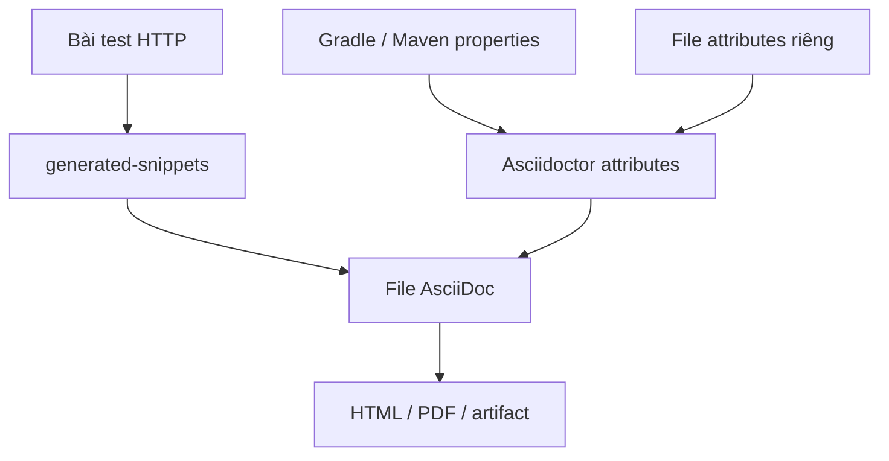

# Đặt thuộc tính tài liệu trong build thay vì mã nghiệp vụ

## 1. Vì sao nên cấu hình tài liệu ở build?

Trong chương **Spring Boot** của học phần **Spring REST Docs (SPRING_REST_DOCS)**, các bài kiểm thử HTTP tạo snippet mô tả request, response, payload, parameter và header. Các snippet thường được ghép thành tài liệu bằng Asciidoctor; dự án cũng có thể biên soạn Markdown từ cùng nguồn dữ liệu.

Khi biên soạn tài liệu, ta thường cần các giá trị như thư mục chứa snippet, tên dịch vụ, phiên bản API, base URL công khai, tên môi trường và đường dẫn file mẫu. Đây là **thuộc tính phục vụ biên soạn và đóng gói tài liệu**. Nên khai báo chúng trong build (Gradle/Maven) hoặc file attribute riêng, sau đó truyền vào Asciidoctor/Markdown processor. Controller, service và logic nghiệp vụ nên tập trung vào hành vi ứng dụng; không cần biết tài liệu sẽ được xuất bản trên host nào.

| Dữ liệu | Ví dụ | Nơi phù hợp |
| --- | --- | --- |
| Cấu hình runtime | Database URL, context path, feature flag ảnh hưởng hành vi | Spring configuration/profile |
| Cấu hình kiểm thử HTTP | @ActiveProfiles("test"), RANDOM_PORT, mock data | Test class và cấu hình test |
| Thuộc tính trình bày tài liệu | snippets, api-version, api-base-url, environment-label | Build script hoặc file attributes |

Không nên đưa api-base-url chỉ để hiển thị tài liệu vào application.yml nếu ứng dụng không sử dụng nó để gửi request hoặc định tuyến. Nếu ứng dụng thực sự gọi dịch vụ đối tác, base URL runtime của dịch vụ đó vẫn thuộc cấu hình ứng dụng. Một giá trị có thể dùng ở cả hai nơi, nhưng mỗi mục đích cần nguồn cấu hình riêng.

Sau bài học, bạn có thể phân biệt Asciidoctor attributes với Spring Boot properties; truyền thư mục snippet, phiên bản API và base URL từ Gradle/Maven; dùng file attributes để tách nội dung khỏi build script; ghi đè giá trị theo môi trường; và tích hợp các thuộc tính vào CI mà không làm lộ secret.

Ví dụ dùng **Spring Boot 3.5, Spring REST Docs 3.x, Gradle và Maven**. Cú pháp plugin có thể khác theo phiên bản plugin build, vì vậy cần đồng bộ với phiên bản dự án đang dùng.

## 2. Asciidoctor attribute là gì?

Asciidoctor attribute là một biến có tên được thay thế trong khi xử lý tài liệu. Có thể khai báo ngay trong file AsciiDoc:

```asciidoc
:doctype: book
:toc: left
:api-version: v1

= Catalog API {api-version}

Tài liệu này mô tả hợp đồng API phiên bản {api-version}.
```

Hoặc truyền attribute từ command line/build plugin. Cách thứ hai hữu ích khi một tài liệu nguồn được dùng ở nhiều môi trường hoặc nhiều phiên bản API.

File nguồn có thể tham chiếu:

```asciidoc
= {service-name} API
:toc: left

Phiên bản API: {api-version}
Base URL: {api-base-url}
Môi trường: {environment-label}
```

snippets là tên attribute thường được Spring REST Docs Asciidoctor extension sử dụng để include snippet. Các attribute như service-name, api-version hoặc api-base-url do dự án định nghĩa. Asciidoctor chỉ thay giá trị đã được cung cấp; nó không tự suy ra ý nghĩa nghiệp vụ của biến.



Build kết hợp snippet do test tạo và attribute do build/file cấu hình cung cấp. Kết quả có thể mang tiêu đề, phiên bản, URL và nhãn môi trường khác nhau mà không sửa controller hay service.

## 3. Giữ thuộc tính tài liệu ngoài mã nghiệp vụ

Controller nên tập trung vào route và xử lý request:

```java
@RestController
@RequestMapping("/api/catalog")
class CatalogController {
    @GetMapping("/{id}")
    CatalogItem find(@PathVariable long id) {
        return catalogService.find(id);
    }
}
```

Không nên đặt các hằng số chỉ phục vụ trình bày tài liệu trong controller:

```java
// Không nên đặt cấu hình tài liệu trong mã nghiệp vụ:
static final String DOCS_BASE_URL = "https://api.example.com";
static final String DOCS_VERSION = "v1";
```

Host công khai và nhãn phiên bản tài liệu không quyết định cách controller xử lý request. Đặt chúng trong file attributes:

```properties
service-name=Catalog
api-version=v1
api-base-url=https://api.example.com
environment-label=Public API
```

File nguồn index.adoc chỉ tham chiếu:

```asciidoc
= {service-name} API {api-version}

Base URL: {api-base-url}

Tài liệu dành cho: {environment-label}
```

Khi API được triển khai sau gateway khác host, chỉ cần thay build attributes. Controller và service không phải thay đổi nếu hợp đồng HTTP của ứng dụng không đổi.

## 4. Cấu hình attribute trong Gradle

Giả sử test Spring REST Docs sinh snippet ở build/generated-snippets, build đã áp dụng plugin org.asciidoctor.jvm.convert cùng dependency spring-restdocs-asciidoctor.

### Gradle Groovy DSL

Ví dụ trong build.gradle:

```groovy
plugins {
    id 'java'
    id 'org.springframework.boot' version '3.5.0'
    id 'org.asciidoctor.jvm.convert' version '4.0.4'
}

configurations {
    asciidoctorExt
}

dependencies {
    testImplementation 'org.springframework.boot:spring-boot-starter-test'
    testImplementation 'org.springframework.restdocs:spring-restdocs-mockmvc'
    asciidoctorExt 'org.springframework.restdocs:spring-restdocs-asciidoctor'
}

def snippetsDir = layout.buildDirectory.dir('generated-snippets')

tasks.named('test') {
    useJUnitPlatform()
    outputs.dir snippetsDir
}

tasks.named('asciidoctor') {
    dependsOn tasks.named('test')
    inputs.dir snippetsDir
    configurations 'asciidoctorExt'

    attributes(
        'snippets': snippetsDir.get().asFile,
        'service-name': 'Catalog',
        'api-version': providers.gradleProperty('apiVersion').getOrElse('v1'),
        'api-base-url': providers.gradleProperty('apiBaseUrl')
            .getOrElse('https://api.example.com'),
        'environment-label': providers.gradleProperty('docsEnvironment')
            .getOrElse('Public API')
    )
}
```

Các version plugin trong ví dụ minh họa một cấu hình cụ thể; dùng version đã được dự án chuẩn hóa. Phần quan trọng là attributes(...) chuyển giá trị vào Asciidoctor; chúng không trở thành Spring properties và không được đưa vào runtime application context.

Truyền giá trị khác nhau khi chạy:

```bash
./gradlew clean test asciidoctor \
  -PapiVersion=v2 \
  -PapiBaseUrl=https://staging-api.example.com \
  -PdocsEnvironment="Staging API"
```

Gradle project properties có thể lấy qua providers.gradleProperty(...). Cách dùng Provider giữ cấu hình lazy và có giá trị mặc định khi người chạy không truyền tham số.

### Gradle Kotlin DSL

Trong build.gradle.kts, có thể cấu hình tương tự:

```kotlin
val snippetsDir = layout.buildDirectory.dir("generated-snippets")
val apiVersion = providers.gradleProperty("apiVersion").orElse("v1")
val apiBaseUrl = providers.gradleProperty("apiBaseUrl")
    .orElse("https://api.example.com")
val docsEnvironment = providers.gradleProperty("docsEnvironment")
    .orElse("Public API")

tasks.test {
    useJUnitPlatform()
    outputs.dir(snippetsDir)
}

tasks.named("asciidoctor") {
    dependsOn(tasks.test)
    inputs.dir(snippetsDir)
    attributes(
        mapOf(
            "snippets" to snippetsDir.get().asFile,
            "service-name" to "Catalog",
            "api-version" to apiVersion.get(),
            "api-base-url" to apiBaseUrl.get(),
            "environment-label" to docsEnvironment.get()
        )
    )
}
```

Overload attributes(...) có thể khác theo phiên bản Asciidoctor Gradle plugin; dùng API tương ứng với plugin đang cài. Ý tưởng giữ nguyên: Gradle lấy project property và chuyển thành attribute cho tài liệu.

## 5. Dùng file attributes riêng

Khi số lượng attribute tăng hoặc cần dùng chung cho nhiều file, đặt chúng vào file cấu hình riêng, ví dụ src/docs/asciidoc/attributes.adoc:

```asciidoc
:service-name: Catalog
:api-version: v1
:api-base-url: https://api.example.com
:environment-label: Public API
```

Include ở đầu tài liệu:

```asciidoc
include::attributes.adoc[]

= {service-name} API {api-version}

Base URL: {api-base-url}
```

Cách này hữu ích khi author tài liệu cần quản lý metadata cạnh source AsciiDoc. Với nhiều môi trường, có thể có file attributes local/staging/public riêng, nhưng phải kiểm soát rõ file nào được include trong từng build.

Một phương án khác là file properties/YAML riêng, sau đó build script đọc và chuyển giá trị thành attribute. Không để file chứa giá trị production mặc định được include trong mọi môi trường nếu CI staging cần URL khác. Không đưa secret vào file attributes vì tài liệu có thể được xuất thành artifact và chia sẻ rộng.

Để tránh xung đột giữa nhiều nguồn, chọn một nguồn mặc định; chỉ cho phép CI ghi đè các key đã thiết kế; tránh khai báo lặp trong document header, include file và plugin config. Nếu cần override, kiểm tra HTML kết quả để xác nhận giá trị cuối cùng.

## 6. Cấu hình attribute cho Maven

Asciidoctor Maven Plugin nhận attributes trong configuration. Giả sử project có các Maven properties api.version, api.base.url và docs.environment:

```xml
<properties>
    <api.version>v1</api.version>
    <api.base.url>https://api.example.com</api.base.url>
    <docs.environment>Public API</docs.environment>
    <snippets.dir>${project.build.directory}/generated-snippets</snippets.dir>
</properties>

<build>
    <plugins>
        <plugin>
            <groupId>org.asciidoctor</groupId>
            <artifactId>asciidoctor-maven-plugin</artifactId>
            <version>3.1.1</version>
            <dependencies>
                <dependency>
                    <groupId>org.springframework.restdocs</groupId>
                    <artifactId>spring-restdocs-asciidoctor</artifactId>
                    <version>${spring-restdocs.version}</version>
                </dependency>
            </dependencies>
            <executions>
                <execution>
                    <id>generate-api-docs</id>
                    <phase>prepare-package</phase>
                    <goals>
                        <goal>process-asciidoc</goal>
                    </goals>
                    <configuration>
                        <sourceDirectory>
                            ${project.basedir}/src/docs/asciidoc
                        </sourceDirectory>
                        <outputDirectory>
                            ${project.build.directory}/generated-docs
                        </outputDirectory>
                        <backend>html</backend>
                        <attributes>
                            <snippets>${snippets.dir}</snippets>
                            <service-name>Catalog</service-name>
                            <api-version>${api.version}</api-version>
                            <api-base-url>${api.base.url}</api-base-url>
                            <environment-label>${docs.environment}</environment-label>
                        </attributes>
                    </configuration>
                </execution>
            </executions>
        </plugin>
    </plugins>
</build>
```

Property spring-restdocs.version cần được quản lý bởi parent/BOM hoặc khai báo trong project. Version plugin trên chỉ là ví dụ; hãy dùng phiên bản phù hợp build đang dùng.

Ghi đè từ command line:

```bash
./mvnw clean verify \
  -Dapi.version=v2 \
  -Dapi.base.url=https://staging-api.example.com \
  -Ddocs.environment="Staging API"
```

Maven properties được dùng khi plugin tài liệu chạy. Chúng không tự động thay đổi Spring Environment của ứng dụng đang test, trừ khi cùng property được khai báo trong cấu hình Spring riêng biệt.

Lưu ý lifecycle: prepare-package phù hợp khi snippet được tạo bởi test chạy ở phase test (Surefire). Nếu snippet đến từ integration test chạy ở integration-test/verify (Failsafe), cần chuyển bước Asciidoctor tới sau nhóm test đó hoặc gọi goal tài liệu sau mvn verify.

## 7. Sử dụng attributes trong tài liệu và include snippet

File src/docs/asciidoc/index.adoc có thể dùng:

```asciidoc
include::attributes.adoc[]

= {service-name} API
:toc: left

== Thông tin phiên bản

Phiên bản API: {api-version}

Môi trường tài liệu: {environment-label}

Base URL công bố: {api-base-url}

== Tra cứu sản phẩm

=== Request
include::{snippets}/products-find/http-request.adoc[]
include::{snippets}/products-find/path-parameters.adoc[]

=== Response
include::{snippets}/products-find/http-response.adoc[]
include::{snippets}/products-find/response-fields.adoc[]
```

snippets được cung cấp bởi Spring REST Docs Asciidoctor extension hoặc cấu hình build. Các attribute còn lại do dự án khai báo. Chúng có thể được dùng trong heading, paragraph và nội dung tài liệu mà không cần thêm biến tương ứng vào controller.

### Attribute không tự động thay URI trong HTTP snippet

api-base-url ở phần giới thiệu chỉ thay văn bản tại vị trí đó. Nó **không** tự động sửa URL trong http-request.adoc hoặc curl-request.adoc. Nếu muốn snippet HTTP hiển thị host công khai, cần cấu hình URI Spring REST Docs (uriScheme, uriHost, uriPort) hoặc operation preprocessor như modifyUris().

Có thể cấu hình cả hai:

- api-base-url dùng trong phần giới thiệu, link hoặc ví dụ tự viết.
- uriScheme, uriHost, uriPort dùng chuẩn hóa request snippet.

Nếu hai giá trị cùng mô tả một public endpoint, chúng phải nhất quán. Nên lấy chung một project property rồi truyền vào cả phần Asciidoctor attributes và cấu hình test cần thiết, tránh nhập hai giá trị độc lập.

## 8. Attributes theo môi trường và phiên bản

Một source AsciiDoc có thể được biên soạn thành nhiều biến thể:

| Biến thể | api-version | api-base-url | environment-label |
| --- | --- | --- | --- |
| Local preview | v1 | http://localhost:8080 | Local |
| Staging | v2 | https://staging-api.example.com | Staging |
| Public | v2 | https://api.example.com | Public API |

Các giá trị chỉ là ví dụ. Chạy Gradle với biến thể staging:

```bash
./gradlew asciidoctor \
  -PapiVersion=v2 \
  -PapiBaseUrl=https://staging-api.example.com \
  -PdocsEnvironment="Staging"
```

Hoặc Maven:

```bash
./mvnw asciidoctor:process-asciidoc \
  -Dapi.version=v2 \
  -Dapi.base.url=https://staging-api.example.com \
  -Ddocs.environment=Staging
```

Nếu task cũng chạy test để sinh snippet, giữ quan hệ rõ ràng như asciidoctor phụ thuộc test. Nếu chỉ chạy goal biên soạn, cần bảo đảm snippet đã được tạo từ test phù hợp của cùng phiên bản API.

Một nhãn staging không chứng minh server production có hành vi tương tự. Nếu snippet sinh từ mock test, không gắn nhãn Production verified chỉ vì api-base-url trỏ tới host production. Attribute là metadata trình bày, không phải bằng chứng test đã gọi môi trường đó.

## 9. Bảo mật và khả năng tái lập

Tài liệu có thể chứa thông tin nhạy cảm nếu request/response snippet vô tình ghi token, cookie, dữ liệu cá nhân hoặc URL nội bộ. Attributes cũng có thể rò rỉ khi được đưa vào HTML/PDF hoặc log build.

- Không đặt password, API key, bearer token hoặc client secret trong Asciidoctor attribute.
- Không truyền secret qua -P/-D nếu nó không cần xuất hiện trong artifact hoặc log.
- Dùng secret store/environment cho credential runtime; nếu request cần auth, dùng token giả dành riêng cho test và redact header trước khi ghi snippet.
- Chỉ truyền base URL được phép công bố vào api-base-url.
- Dùng mặc định an toàn cho local preview; không mặc định tới production khi chưa được chỉ định.
- Nếu thêm build metadata, tránh đưa thông tin nội bộ không cần thiết.

Để build tái lập, các thuộc tính bắt buộc cần default an toàn hoặc CI phải cung cấp rõ; cùng commit và cùng tập property nên tạo cùng nội dung; URL dùng trong snippet và phần mô tả nên lấy từ một nguồn chung; build phải chạy test tạo snippet trước khi ghép tài liệu; CI chỉ publish khi test và biên soạn đều thành công.

## 10. Lỗi thường gặp

| Hiện tượng | Nguyên nhân | Cách xử lý |
| --- | --- | --- |
| Asciidoctor báo attribute chưa khai báo | Build chưa truyền attribute hoặc file attributes chưa include. | Kiểm tra key và plugin configuration. |
| Attribute vẫn xuất hiện nguyên văn | Sai tên key, cú pháp hoặc file include chưa chạy. | Đối chiếu tên attribute và warning của Asciidoctor. |
| Paragraph đúng URL nhưng cURL snippet sai | api-base-url không cấu hình URI của REST Docs. | Dùng uriScheme, uriHost, uriPort hoặc preprocessor. |
| CI thiếu phiên bản API | Workflow không truyền property và không có default. | Đặt default hoặc khai báo property trong workflow. |
| Maven dùng giá trị cũ | Sai key -D hoặc expression trong plugin config. | Kiểm tra property key và effective configuration. |
| Gradle bỏ qua property | Đọc nhầm system property hoặc sai tên project property. | Dùng providers.gradleProperty(...) với đúng key -P. |
| Tài liệu staging gắn nhãn production | Metadata hard-code hoặc URL và label lấy từ nguồn khác nhau. | Lấy chúng từ cùng bộ tham số build. |
| Snippet không tồn tại khi Asciidoctor chạy | Task biên soạn không phụ thuộc test. | Khai báo dependsOn test và inputs.dir snippetsDir. |
| Secret xuất hiện trong HTML | Attribute hoặc snippet chứa credential thật. | Redact request và loại secret khỏi attributes. |

## 11. Bài thực hành

Tạo tài liệu cho Catalog API với hai biến thể v1 và v2:

1. Viết test Spring REST Docs tạo snippet cho GET /api/products/{id}, gồm path parameter và response fields.
2. Viết index.adoc dùng service-name, api-version, api-base-url, environment-label và snippets.
3. Cấu hình Gradle attributes từ project properties; chạy build mặc định để tạo tài liệu v1.
4. Chạy lại với -PapiVersion=v2 và base URL staging; kiểm tra heading, base URL và snippet HTTP.
5. Cấu hình URI snippet để curl-request.adoc hiển thị public host. So sánh với paragraph chỉ dùng api-base-url.
6. Tách metadata chung vào file attributes riêng; thử hai môi trường và bảo đảm mỗi build dùng đúng một bộ giá trị.
7. Đưa test và Asciidoctor vào CI; thử bỏ property bắt buộc hoặc làm sai output directory để quan sát lỗi trước khi publish.

**Tiêu chí hoàn thành:** thay đổi title, version, base URL và label tài liệu bằng build attributes mà không sửa controller/service; snippet được tạo bởi test; URL trong snippet và phần mô tả thống nhất; CI tái lập được và không chứa secret.

## 12. Tài liệu tham khảo

- [Spring Boot 3.5 — Testing Spring Boot Applications](https://docs.spring.io/spring-boot/3.5/reference/testing/spring-boot-applications.html)
- [Spring REST Docs — Getting Started](https://docs.spring.io/spring-restdocs/tutorial/getting-started/index.html)
- [Spring REST Docs — Reference](https://docs.spring.io/spring-restdocs/reference/)
- [Asciidoctor — Attributes](https://docs.asciidoctor.org/asciidoc/latest/attributes/)
- [Asciidoctor Gradle Plugin — Configuration](https://docs.asciidoctor.org/gradle-plugin/latest/)
- [Asciidoctor Maven Plugin — Usage](https://docs.asciidoctor.org/maven-plugin/latest/)
