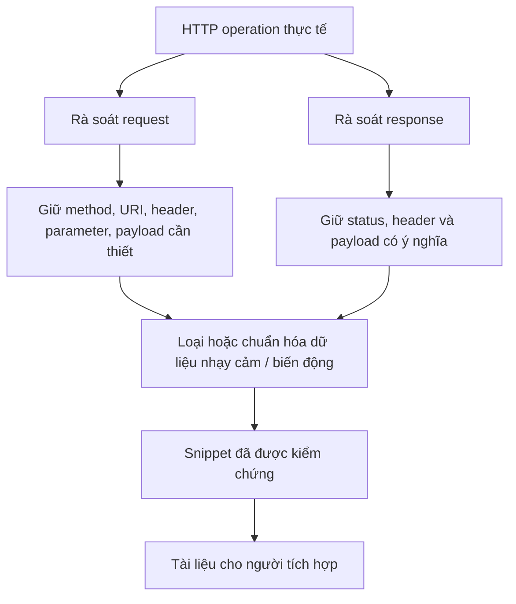

# Xác nhận thông tin tài liệu không che mất chi tiết cần thiết

## 1. Tài liệu HTTP phải đủ thông tin để người đọc hiểu và gọi API

Spring REST Docs tạo tài liệu REST API từ các bài kiểm thử HTTP bằng MockMvc, WebTestClient hoặc REST Assured. Một HTTP operation là một lần trao đổi gồm request gửi tới API và response nhận lại. Khi tài liệu hóa operation, cần giữ đủ chi tiết để người tích hợp hiểu cách gọi endpoint, đồng thời tránh công bố token, cookie, dữ liệu cá nhân hoặc thông tin nội bộ không cần thiết.

Một tài liệu quá ít thông tin có thể trông gọn nhưng không dùng được. Ví dụ, xóa toàn bộ header khỏi request có thể làm người đọc không biết endpoint yêu cầu `Content-Type`, `Accept`, `If-Match` hay một header định tuyến nào. Ngược lại, giữ nguyên `Authorization: Bearer ...` hoặc session cookie có thể làm lộ thông tin nhạy cảm. Công việc cần làm là **chọn lọc có chủ đích**: xác định chi tiết nào thuộc hợp đồng HTTP, chi tiết nào là dữ liệu riêng của lần test, rồi áp dụng preprocessor tương ứng.

Một operation nên được rà soát theo các nhóm sau:

| Nhóm thông tin | Câu hỏi cần xác nhận |
| --- | --- |
| Method và URI | Người dùng cần gọi `GET`, `POST`, `PUT`, `PATCH` hay `DELETE`? Path và query có chính xác không? |
| Request headers | Header nào bắt buộc hoặc có ý nghĩa với client? Header nào chỉ dành cho xác thực nội bộ hoặc tracing? |
| Request parameters | Path, query, form và multipart part nào cần mô tả? Có giá trị mặc định hoặc giới hạn nào không? |
| Request body | Client phải gửi JSON/XML/form gì? Trường nào bắt buộc, tùy chọn hoặc có cấu trúc lồng nhau? |
| Response status | API trả status nào khi thành công, lỗi đầu vào, không tìm thấy hoặc không có nội dung? |
| Response headers | `Content-Type`, `Location`, `ETag`, `Cache-Control`, `Link` hoặc header khác có ý nghĩa gì? |
| Response body | Body có đầy đủ field, kiểu dữ liệu và ví dụ đại diện không? |
| Giá trị nhạy cảm/nhiễu | Có token, cookie, ID ngẫu nhiên, host nội bộ hay dữ liệu cá nhân cần che hoặc chuẩn hóa không? |



## 2. Phân biệt thông tin thuộc hợp đồng API với dữ liệu riêng của lần test

Không nên quyết định giữ hoặc xóa một header chỉ dựa vào tên của nó. Hãy xét vai trò của header trong hợp đồng API và giá trị cụ thể được ghi nhận.

| Thông tin | Thông thường nên giữ? | Cách xử lý |
| --- | --- | --- |
| `Content-Type` của request | Có, khi client cần biết định dạng body. | Giữ nguyên và mô tả bằng `requestHeaders(...)` nếu có ích. |
| `Accept` | Có, khi API hỗ trợ thương lượng định dạng response. | Giữ lại giá trị đại diện như `application/json`. |
| `If-Match` / `If-None-Match` | Có, nếu endpoint dùng điều kiện hoặc optimistic concurrency. | Giữ header và mô tả ý nghĩa; dùng giá trị ETag mẫu ổn định. |
| `Authorization` | Thường không công bố giá trị credential thật. | Xóa hoặc thay token bằng placeholder; tài liệu riêng mô tả cách xác thực. |
| `Cookie` / `Set-Cookie` | Không nên công bố session ID thật. | Xóa giá trị cookie hoặc thay bằng ví dụ giả nếu cookie là một phần hợp đồng. |
| `X-Request-Id` / trace ID | Có thể cần giải thích, nhưng giá trị sinh ngẫu nhiên thường không quan trọng. | Giữ header nếu API yêu cầu; thay giá trị bằng mẫu cố định hoặc bỏ nếu chỉ là telemetry. |
| `Host` | Có ích nếu client phải gọi domain cụ thể. | Chuẩn hóa thành hostname công khai; không để lộ địa chỉ container/local. |
| `Location` | Thường cần giữ với `201 Created` hoặc redirect. | Giữ path/URI tài nguyên được tạo; loại bỏ host nội bộ nếu cần. |
| `ETag`, `Last-Modified`, `Cache-Control` | Có, khi mô tả caching hoặc conditional request. | Giữ lại và mô tả đúng hợp đồng. |

Một quy tắc hữu ích: nếu việc xóa một chi tiết khiến người đọc không thể tạo request hợp lệ hoặc diễn giải response, chi tiết đó không nên bị loại bỏ hoàn toàn. Có thể thay giá trị nhạy cảm bằng placeholder, nhưng phải nói rõ placeholder cần được thay như thế nào khi gọi API.

## 3. Bắt đầu từ request/response gốc trước khi tiền xử lý

Trước khi thêm preprocessor, hãy đọc request và response mà test thực sự gửi/nhận. Spring REST Docs sinh các snippet mặc định như:

| Snippet | Nội dung |
| --- | --- |
| `curl-request.adoc` | Lệnh `curl` tương ứng với request. |
| `http-request.adoc` | Request HTTP, gồm method, URI, headers và body. |
| `http-response.adoc` | Response HTTP, gồm status, headers và body. |
| `httpie-request.adoc` | Ví dụ request dùng HTTPie. |
| `request-body.adoc` | Riêng phần request body. |
| `response-body.adoc` | Riêng phần response body. |

Các snippet bổ sung có thể được tạo từ descriptor, chẳng hạn `path-parameters.adoc`, `query-parameters.adoc`, `request-headers.adoc`, `response-headers.adoc`, `request-fields.adoc` và `response-fields.adoc`. Danh sách snippet mặc định có thể được cấu hình theo dự án; hãy kiểm tra đúng output directory và phiên bản Spring REST Docs đang dùng. Xem [Default Snippets](https://docs.spring.io/spring-restdocs/reference/documenting-your-api/default-snippets.html).

Đọc hai snippet `http-request.adoc` và `http-response.adoc` như một bản ghi giao thức hoàn chỉnh. Nếu tài liệu có bảng mô tả field nhưng không có ví dụ HTTP tổng quát, người đọc có thể vẫn không biết method, media type hoặc status code. Nếu chỉ có ví dụ HTTP mà không có bảng field, người đọc phải tự đoán ý nghĩa từng thuộc tính JSON.

## 4. Ví dụ: giữ header cần thiết, chỉ thay credential

Giả sử endpoint yêu cầu:

```http
GET /api/accounts/42 HTTP/1.1
Accept: application/json
Authorization: Bearer <access-token>
If-None-Match: "account-v3"
```

Response có thể là:

```http
HTTP/1.1 200 OK
Content-Type: application/json
ETag: "account-v3"
Cache-Control: private, max-age=60

{"id":42,"displayName":"An Nguyen"}
```

Trong tài liệu công khai, giá trị token thật không cần thiết; `Accept`, `If-None-Match`, `ETag` và `Cache-Control` lại có thể là một phần quan trọng của cách client sử dụng API. Có thể xóa đúng header xác thực trong preprocessor, không xóa toàn bộ request headers:

```java
given(this.specification)
        .accept(ContentType.JSON)
        .header("Authorization", "Bearer test-only-token")
        .header("If-None-Match", "\"account-v3\"")
        .filter(document("accounts-get",
                preprocessRequest(
                        modifyHeaders().remove("Authorization")),
                requestHeaders(
                        headerWithName("Accept")
                                .description("Định dạng response client chấp nhận"),
                        headerWithName("If-None-Match")
                                .description("ETag hiện tại của client, dùng cho request có điều kiện")),
                responseHeaders(
                        headerWithName("ETag")
                                .description("Phiên bản biểu diễn của tài nguyên"),
                        headerWithName("Cache-Control")
                                .description("Chính sách cache của response")),
                responseFields(
                        fieldWithPath("id").description("Mã tài khoản"),
                        fieldWithPath("displayName").description("Tên hiển thị"))))
.when()
        .get("/api/accounts/42")
.then()
        .statusCode(200);
```

Các static import chính:

```java
import static org.springframework.restdocs.operation.preprocess.Preprocessors.modifyHeaders;
import static org.springframework.restdocs.operation.preprocess.Preprocessors.preprocessRequest;
import static org.springframework.restdocs.headers.HeaderDocumentation.headerWithName;
import static org.springframework.restdocs.headers.HeaderDocumentation.requestHeaders;
import static org.springframework.restdocs.headers.HeaderDocumentation.responseHeaders;
import static org.springframework.restdocs.payload.PayloadDocumentation.fieldWithPath;
import static org.springframework.restdocs.payload.PayloadDocumentation.responseFields;
import static org.springframework.restdocs.restassured.RestAssuredRestDocumentation.document;
```

Ví dụ trên giả định server thực sự hỗ trợ conditional request và các header được nêu. Nếu endpoint không hỗ trợ `If-None-Match`, không thêm header này vào tài liệu chỉ vì nó xuất hiện trong ví dụ. Khi tài liệu hóa thành công, request snippet không chứa token nhưng vẫn giữ header điều kiện cần thiết; response snippet giữ ETag và chính sách cache.

## 5. Không xóa toàn bộ headers khi chỉ cần che một giá trị

Một cách tiền xử lý quá rộng là:

```java
// Không nên dùng nếu các header khác là yêu cầu của hợp đồng API.
preprocessRequest(modifyHeaders().remove("Authorization")
        .remove("Accept")
        .remove("Content-Type")
        .remove("If-Match"));
```

Việc xóa `Accept` có thể che mất media type mà client cần gửi; xóa `Content-Type` khiến người đọc không biết định dạng body; xóa `If-Match` có thể bỏ qua điều kiện cập nhật an toàn. Thay vào đó, xóa hoặc thay riêng giá trị credential và giữ những header còn lại.

Nếu header xác thực cần được thể hiện về mặt cấu trúc, có thể thay giá trị bằng placeholder, ví dụ `Authorization: Bearer <access-token>`, thay vì loại toàn bộ header. Hãy dùng API `modifyHeaders().set(...)` theo phiên bản Spring REST Docs đang dùng và kiểm tra snippet sau đó. Với tài liệu công khai, cách trình bày placeholder cần đi kèm hướng dẫn cấp token qua quy trình OAuth/API key thích hợp.

Không phải mọi header đều cần tạo thành bảng descriptor. `http-request.adoc` đã biểu diễn headers thực được giữ trong operation. `requestHeaders(...)` bổ sung bảng mô tả ý nghĩa, bắt buộc hay tùy chọn. Chọn những header giúp người tích hợp hiểu hành vi API; tránh lập bảng dài cho các header transport tự động như `Connection` hoặc `User-Agent` nếu chúng không thuộc hợp đồng.

## 6. Giữ đủ thông tin URI, parameter và payload

Preprocessor URI có thể giúp thay `localhost:<random-port>` thành hostname công khai, nhưng không được làm mất phần path hoặc query parameter.

```java
preprocessRequest(
        modifyUris()
                .scheme("https")
                .host("api.example.com")
                .removePort())
```

Sau biến đổi, hãy xác nhận URI vẫn giữ đúng `/api/accounts/42`, query string như `?expand=roles`, và các parameter được mô tả bởi `pathParameters(...)` hoặc `queryParameters(...)`. Không thay path bằng một URL đẹp hơn nhưng không khớp routing thật.

Tương tự, không thay toàn bộ JSON body bằng `{}` chỉ để ẩn dữ liệu nhạy cảm. Cần giữ cấu trúc và field quan trọng, thay riêng giá trị nhạy cảm bằng ví dụ an toàn. Ví dụ:

```json
{
  "id": 42,
  "displayName": "Example User",
  "email": "user@example.test",
  "roles": ["READER"]
}
```

Đối với dữ liệu JSON, có thể dùng custom `ContentModifier` để thay một giá trị, hoặc thiết kế fixture từ đầu chỉ chứa dữ liệu giả. Khi response có nested object, mảng, nullable field hoặc enum, bảng `responseFields(...)` nên mô tả cấu trúc theo đúng payload thực tế. Nếu field thật sự tùy chọn, dùng descriptor `.optional()`; nếu field có mặt nhưng không cần đưa vào bảng, cân nhắc `.ignored()` và giải thích vì sao. Không sử dụng `relaxedResponseFields(...)` chỉ để bỏ qua một field chưa được review.

## 7. Giữ chi tiết quan trọng trong response status và headers

Tài liệu không chỉ có body. Status code và response headers thường thể hiện một phần hợp đồng API:

| Trường hợp | Thông tin cần giữ |
| --- | --- |
| `200 OK` | Body trả về và `Content-Type`. |
| `201 Created` | Body nếu có, cùng `Location` nếu API trả URI tài nguyên mới. |
| `202 Accepted` | Ý nghĩa xử lý bất đồng bộ, ID hoặc URL để theo dõi tác vụ nếu có. |
| `204 No Content` | Status, các response headers có ý nghĩa; không giả định có body. |
| `304 Not Modified` | Status và ETag/cache validators; không tự tạo body thành công. |
| `400 Bad Request` / `422 Unprocessable Content` | Mã lỗi, cấu trúc lỗi, field validation và correlation ID nếu được công bố. |
| `401 Unauthorized` / `403 Forbidden` | Khác biệt giữa chưa xác thực và không đủ quyền; không ghi lại credential. |
| `404 Not Found` | Status và payload lỗi nếu API có định dạng error response. |
| `429 Too Many Requests` | `Retry-After` hoặc thông tin rate limit nếu là hợp đồng được hỗ trợ. |

Không nên chỉ document happy path. Với endpoint quan trọng, tài liệu hóa thêm status lỗi và response tương ứng để người tích hợp biết cách xử lý. Mỗi tình huống nên có identifier riêng, ví dụ `accounts-get-200`, `accounts-get-404` hoặc `accounts-update-412`.

Với response không có body như 204, không khai báo `responseFields(...)` yêu cầu các field JSON. Ngược lại, nếu response lỗi trả `ProblemDetail`, hãy mô tả đúng các trường lỗi và không tái sử dụng descriptor của response 200.

## 8. Sử dụng Operation snippets và attributes mà không làm mất ngữ cảnh

Spring REST Docs có snippet mặc định `http-request` và `http-response`. Khi cần tùy chỉnh cách render, API `HttpDocumentation.httpRequest(...)` và `httpResponse(...)` có thể nhận attributes dành cho template. Attributes bổ sung ngữ cảnh khi sinh snippet; chúng không thay thế request/response thực tế.

Ví dụ Asciidoctor có thể nhóm operation với các snippet cần cho người đọc:

```asciidoc
== Lấy tài khoản

=== Request
include::{snippets}/accounts-get/http-request.adoc[]

=== Request headers
include::{snippets}/accounts-get/request-headers.adoc[]

=== Conditional request header
include::{snippets}/accounts-get/response-headers.adoc[]

=== Response fields
include::{snippets}/accounts-get/response-fields.adoc[]

=== Response
include::{snippets}/accounts-get/http-response.adoc[]
```

Chọn snippet theo hành trình người đọc. Một trang API thông thường nên cho thấy request mẫu, parameter/header quan trọng, response mẫu và bảng field. Không cần nhúng mọi file mặc định vào mọi trang, nhưng không được bỏ phần thiết yếu khiến request mẫu không thể sử dụng.

## 9. Quy trình rà soát trước khi chấp nhận snippet

Hãy thực hiện rà soát theo thứ tự dưới đây:

1. **Đối chiếu với HTTP thật:** kiểm tra method, URI, query, status, headers và body trong `http-request.adoc`/`http-response.adoc`.
2. **Kiểm tra khả năng gọi API:** một client đọc tài liệu có đủ method, URL, media type, parameter và body cần thiết để tái tạo request không?
3. **Kiểm tra phần bị che:** mọi header/body/URI bị xóa hoặc thay có lý do không? Có làm mất điều kiện API như `If-Match`, `Content-Type` hoặc `Location` không?
4. **Kiểm tra thông tin riêng:** token, cookie, email cá nhân, hostname nội bộ, port ngẫu nhiên hoặc ID bí mật đã được thay/loại đúng chưa?
5. **Kiểm tra descriptor:** bảng headers, parameters và fields có mô tả đúng các phần hiện diện trong request/response không?
6. **Kiểm tra nhiều status:** endpoint có lỗi nghiệp vụ nào cần document ngoài 200/201 không?
7. **Kiểm tra test:** assertion và descriptor đều pass; snippet thuộc output sạch của lần chạy hiện tại.
8. **Kiểm tra bản biên soạn:** Asciidoctor/Markdown có nhúng đủ snippet theo trình tự người đọc cần không?

## 10. Ví dụ checklist ngắn cho reviewer

| Câu hỏi | Pass khi |
| --- | --- |
| Request có thể tái tạo không? | Có method, URI, media type, parameter và payload cần thiết. |
| Header có đủ không? | Giữ header thuộc hợp đồng; token/cookie được ẩn hoặc thay an toàn. |
| Response có thể hiểu không? | Có status, header quan trọng và body mẫu phù hợp. |
| Parameter có đúng không? | Path/query values trong request khớp descriptor và giải thích. |
| Payload có bị rút gọn quá mức không? | Vẫn giữ cấu trúc và các field cần thiết để dùng API. |
| Giá trị thay thế có nhất quán không? | Placeholder được mô tả, không gây nhầm là giá trị thật cần gửi. |
| Có bao phủ lỗi không? | Status lỗi và payload lỗi quan trọng được document khi cần. |
| Có an toàn để phát hành không? | Không còn secret hoặc dữ liệu thật; snippet xuất phát từ test pass. |

## 11. Lỗi thường gặp

| Lỗi | Hệ quả | Cách khắc phục |
| --- | --- | --- |
| Xóa tất cả headers | Người đọc không biết `Content-Type`, `Accept` hoặc conditional header cần gửi. | Chỉ loại header nhạy cảm; giữ headers thuộc hợp đồng. |
| Chỉ tạo bảng `responseFields` mà bỏ HTTP response | Người đọc không biết status, content type và response headers. | Include `http-response.adoc` và bảng field. |
| Che toàn bộ payload | Mất cấu trúc dữ liệu và ví dụ client cần. | Dùng fixture giả hoặc thay riêng giá trị nhạy cảm. |
| Thay URI nhưng bỏ query/path | Ví dụ không tái hiện đúng resource hoặc hành vi API. | Đối chiếu URI sau preprocessor với routing thực tế. |
| Xóa `Location` hoặc `ETag` | Bỏ mất thông tin tạo resource hoặc caching/conditional request. | Giữ lại và mô tả nếu endpoint cung cấp chúng như hợp đồng. |
| Dùng `relaxed...Fields` để lờ field mới | API có thể đổi schema mà tài liệu không cảnh báo. | Review field mới rồi cập nhật descriptor một cách tường minh. |
| Dùng giá trị production trong fixture | Secret/PII có thể xuất hiện trong snippet hoặc CI artifact. | Dùng dữ liệu giả và kiểm tra snippet sau preprocessing. |
| Nhúng quá nhiều snippet không chọn lọc | Trang tài liệu dài và thông tin quan trọng khó tìm. | Chọn snippet theo nhu cầu của người tích hợp, vẫn giữ đủ request/response. |

## 12. Checklist hoàn thành

- [ ] Đã xem cả `http-request.adoc` và `http-response.adoc` của operation.
- [ ] Method, URI, path/query parameter và body không bị che mất chi tiết cần thiết.
- [ ] Header bắt buộc/quan trọng được giữ và mô tả; credential/cookie được xử lý an toàn.
- [ ] Response status, `Content-Type`, `Location`, `ETag` hoặc header nghiệp vụ cần thiết được giữ.
- [ ] Payload mẫu vẫn có cấu trúc và field quan trọng; ví dụ dùng dữ liệu giả.
- [ ] Preprocessor chỉ sửa những phần đã xác định rõ lý do.
- [ ] Descriptor phản ánh đúng payload/header/parameter thực tế.
- [ ] Có ví dụ status lỗi khi nó thuộc hợp đồng API quan trọng.
- [ ] Snippet từ lượt test thành công và bản tài liệu cuối cùng nhúng đúng các snippet cần dùng.

Một HTTP operation được document tốt cần đủ chi tiết để người khác có thể hiểu và gọi API, nhưng không phơi bày dữ liệu riêng của môi trường kiểm thử. Hãy giữ nguyên method, URI, status, header và cấu trúc payload thuộc hợp đồng; chỉ ẩn hoặc chuẩn hóa những giá trị không nên công bố. Cách làm này giúp tài liệu Spring REST Docs vừa an toàn vừa hữu ích cho người tích hợp.

## Tài liệu tham khảo

- [Spring REST Docs – Default Snippets](https://docs.spring.io/spring-restdocs/reference/documenting-your-api/default-snippets.html)
- [Spring REST Docs – Customizing requests and responses](https://docs.spring.io/spring-restdocs/reference/customizing-requests-and-responses.html)
- [Spring REST Docs 3.0.6 – HttpDocumentation API](https://docs.spring.io/spring-restdocs/docs/current/api/org/springframework/restdocs/http/HttpDocumentation.html)
- [Spring REST Docs 3.0.6 – RequestDocumentation API](https://docs.spring.io/spring-restdocs/docs/current/api/org/springframework/restdocs/request/RequestDocumentation.html)
