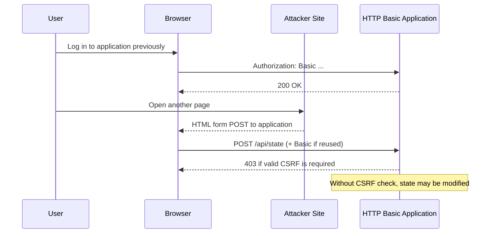

# Automatic Browser Sending of HTTP Basic Credentials and CSRF Risk

**Scope:** HTTP Basic in web applications running in a browser, especially with Spring Security (Servlet). The focus is the difference between a user **actively entering** credentials the first time and the browser **automatically re-attaching** those credentials to subsequent requests; from there, evaluating Cross-Site Request Forgery (CSRF) risk.

## 1. Why Can HTTP Basic Be Sent Automatically?

HTTP Basic is an HTTP-layer authentication mechanism, not a login form. When accessing a protected resource, the typical flow is:

1. The client calls `GET /api/state` without credentials.
2. The server returns `401 Unauthorized` with `WWW-Authenticate: Basic realm="demo"`.
3. The browser may open a login dialog; after the user enters a username and password, the browser sends `Authorization: Basic <base64(username:password)>`.
4. If valid, the server grants access. The browser may keep the credentials in the browsing session's memory/cache to reuse for URLs belonging to the matching **protection space**, even without the user re-entering the password.

Abbreviated protocol example:

```http
GET /api/state HTTP/1.1
Host: bank.example

HTTP/1.1 401 Unauthorized
WWW-Authenticate: Basic realm="demo"

GET /api/state HTTP/1.1
Host: bank.example
Authorization: Basic <base64-value>
```

The `Authorization` header is sent in the **request**, whereas `WWW-Authenticate` is the **response** challenge. The Base64 string only encodes `username:password` for representation, **not cryptographic encryption**; HTTP Basic must be used over HTTPS to avoid exposing credentials in transit.

Per RFC 7617, a client **may** resend Basic credentials before receiving a new challenge within the matching authentication scope. This scope relates to origin, `realm`, path, and how the client manages its cache; there is no rule that "every request to every website carries the password." Browsers, browsing sessions, private mode, and credential isolation policies may behave differently.

## 2. Automatic Sending Is Precisely What Introduces CSRF Risk

**CSRF** occurs when an attacker causes **an authenticated user's browser** to send a request to a trusted system to perform an unwanted action. The attacker does not need to know the password or read the response body if the action has already been executed by the server.

A typical scenario with HTTP Basic:

1. The user logs into `https://bank.example` using HTTP Basic. The browser has remembered the credentials for the relevant protection space.
2. The application has a state-changing endpoint `POST /api/state` that verifies Basic credentials, but **does not verify a CSRF token or request origin**.
3. When the user visits a page controlled by an attacker, that page constructs an HTML form that sends a POST to the endpoint above.
4. If the browser automatically attaches the stored Basic credentials to the target request, the server sees an **authenticated** request. Without CSRF verification, the action can be executed even though the user never consented.



The core point: **authentication** answers "which identity does the request carry?", while **CSRF protection** answers "was this state-changing action genuinely initiated within a trusted flow?". A request carrying a valid identity can still be a forged request.

The risk requires several conditions at once: the browser holds valid credentials; the credentials are automatically included on the target request in that context; the endpoint accepts state-changing requests; and the server lacks CSRF defenses. If the browser does not resend Basic credentials under its policy, that specific scenario does not succeed. Differences across browsers must not be relied upon as a security control.

## 3. Demonstration with an HTML Form from Another Origin

Suppose the application has `POST http://localhost:8080/api/state` accepting form data `value=...`. A page running on another origin (for example `http://localhost:8081`) can contain:

```html
<!doctype html>
<html lang="en">
<head><meta charset="utf-8"><title>Test CSRF in local lab</title></head>
<body>
  <form action="http://localhost:8080/api/state" method="post">
    <input type="hidden" name="value" value="999">
    <button type="submit">Submit form</button>
  </form>
</body>
</html>
```

When the button is clicked, the browser **can send** a form POST to another origin; it does not need permission to read the response to cause a side effect. If the browser also reuses HTTP Basic credentials and the server has disabled CSRF, the state can be changed to `999`. With CSRF protection active and no valid token, the operation must be rejected.

Distinguish these mechanisms:

| Mechanism | What it controls | Conclusion regarding CSRF |
| --- | --- | --- |
| Same-Origin Policy | Permission for JavaScript on origin A to read/access resources on origin B | Does not by itself prevent an HTML form from sending a request to B |
| CORS | Permission for JavaScript to read cross-origin responses; preflight for requests that require it | Not a general CSRF protection layer; simple form POSTs can still reach the server |
| HTTP Basic | Authenticated identity via the `Authorization` header | Does not prove the user's intent to perform the operation |
| CSRF token | Additional proof that an attacker page cannot know or set validly | Can block forged POSTs even when the request is authenticated |

**Do not assume:** "the API returns JSON", "CORS is not enabled", or "no session cookie is used" means "no CSRF". Look at **how the browser sends credentials and whether the endpoint accepts state-changing requests**. With `fetch()`, the `credentials` mode and CORS affect cross-origin JavaScript requests; HTML forms are a different request path. These differences do not replace server-side controls.

## 4. Spring Boot 3 / Spring Security 6 Lab (Java 17+)

The small example below runs on localhost and does not persist real data. Use a Maven Spring Boot project with `spring-boot-starter-web` and `spring-boot-starter-security`. A `pom.xml` template can be used to run standalone:

```xml
<!-- pom.xml -->
<project xmlns="http://maven.apache.org/POM/4.0.0"
         xmlns:xsi="http://www.w3.org/2001/XMLSchema-instance"
         xsi:schemaLocation="http://maven.apache.org/POM/4.0.0 https://maven.apache.org/xsd/maven-4.0.0.xsd">
    <modelVersion>4.0.0</modelVersion>
    <parent>
        <groupId>org.springframework.boot</groupId>
        <artifactId>spring-boot-starter-parent</artifactId>
        <version>3.3.9</version>
        <relativePath/>
    </parent>
    <groupId>example</groupId>
    <artifactId>basic-csrf-lab</artifactId>
    <version>1.0.0</version>
    <properties><java.version>17</java.version></properties>
    <dependencies>
        <dependency>
            <groupId>org.springframework.boot</groupId>
            <artifactId>spring-boot-starter-web</artifactId>
        </dependency>
        <dependency>
            <groupId>org.springframework.boot</groupId>
            <artifactId>spring-boot-starter-security</artifactId>
        </dependency>
    </dependencies>
    <build>
        <plugins>
            <plugin>
                <groupId>org.springframework.boot</groupId>
                <artifactId>spring-boot-maven-plugin</artifactId>
            </plugin>
        </plugins>
    </build>
</project>
```

Create `src/main/java/example/BasicCsrfLabApplication.java`:

```java
package example;

import java.util.Map;
import java.util.concurrent.atomic.AtomicInteger;

import org.springframework.boot.SpringApplication;
import org.springframework.boot.autoconfigure.SpringBootApplication;
import org.springframework.context.annotation.Bean;
import org.springframework.http.MediaType;
import org.springframework.security.config.Customizer;
import org.springframework.security.config.annotation.web.builders.HttpSecurity;
import org.springframework.security.core.userdetails.User;
import org.springframework.security.core.userdetails.UserDetailsService;
import org.springframework.security.provisioning.InMemoryUserDetailsManager;
import org.springframework.security.web.SecurityFilterChain;
import org.springframework.security.web.csrf.CsrfToken;
import org.springframework.web.bind.annotation.GetMapping;
import org.springframework.web.bind.annotation.PostMapping;
import org.springframework.web.bind.annotation.RequestParam;
import org.springframework.web.bind.annotation.RestController;

@SpringBootApplication
public class BasicCsrfLabApplication {
    public static void main(String[] args) {
        SpringApplication.run(BasicCsrfLabApplication.class, args);
    }

    @Bean
    SecurityFilterChain securityFilterChain(HttpSecurity http) throws Exception {
        return http
                .authorizeHttpRequests(auth -> auth.anyRequest().authenticated())
                .httpBasic(Customizer.withDefaults())
                .csrf(Customizer.withDefaults())
                .build();
    }

    @Bean
    UserDetailsService users() {
        return new InMemoryUserDetailsManager(
                User.withUsername("alice")
                        .password("{noop}example-password")
                        .roles("USER")
                        .build()
        );
    }

    @RestController
    static class StateApi {
        private final AtomicInteger value = new AtomicInteger(0);

        @GetMapping("/api/state")
        Map<String, Integer> read() {
            return Map.of("value", value.get());
        }

        @PostMapping(value = "/api/state",
                     consumes = MediaType.APPLICATION_FORM_URLENCODED_VALUE)
        Map<String, Integer> update(@RequestParam("value") int newValue) {
            value.set(newValue);
            return Map.of("value", value.get());
        }

        @GetMapping("/csrf")
        CsrfToken csrf(CsrfToken token) {
            return token;
        }
    }
}
```

Run with JDK 17+ and Maven:

```bash
mvn spring-boot:run
```

In another terminal:

```bash
# GET with valid Basic: expected HTTP 200 and {"value":0}.
curl -i -u alice:example-password http://localhost:8080/api/state

# POST with Basic but WITHOUT CSRF token: expected HTTP 403.
curl -i -u alice:example-password \
  -d 'value=99' http://localhost:8080/api/state

# Read value; still 0 after rejected POST.
curl -s -u alice:example-password http://localhost:8080/api/state
```

To test a valid POST, obtain a token **and save the CSRF session cookie** via the same client:

```bash
# Returned JSON includes headerName, parameterName, token.
curl -s -u alice:example-password -c cookies.txt \
  http://localhost:8080/csrf

# Replace <TOKEN> with the token field value from the JSON just received.
curl -i -u alice:example-password -b cookies.txt \
  -H 'X-CSRF-TOKEN: <TOKEN>' \
  -d 'value=99' http://localhost:8080/api/state
```

The final request expects `HTTP 200` with `{"value":99}` when the token and session cookie match. In this example, **HTTP Basic** still authenticates the user; the session cookie serves to store/verify the **CSRF token** and does not replace Basic with cookie-based login. Spring Security 6 includes BREACH protection for tokens; use the exact `token` value returned by the `/csrf` endpoint.

To observe the **insecure** configuration, in a localhost lab only, try replacing `.csrf(Customizer.withDefaults())` with `.csrf(csrf -> csrf.disable())`, restart the app, and send a POST without a token: the authenticated request will be accepted. After verifying, re-enable CSRF. The `{noop}` password is for demo only; real systems must use a proper password encoder and user store. The Spring Boot version in the POM is only to reproduce the example; choose a supported branch and apply patches in real deployments.

## 5. Defending Properly in Applications Using HTTP Basic

1. **Keep CSRF protection for applications where users interact via a browser.** Spring Security Servlet protects unsafe methods (such as POST, PUT, PATCH, DELETE) by default. In `SecurityFilterChain`, `.csrf(Customizer.withDefaults())` makes the intent explicit. Do not disable CSRF simply because you use Basic or `SessionCreationPolicy.STATELESS`.
2. **Send the token in a place the browser will not auto-populate from a foreign page.** For legitimate HTML forms, render the hidden `_csrf` field; for same-origin AJAX, send `X-CSRF-TOKEN` (or the configured token mechanism). The server must compare the token with the expected value; a cookie containing a token that is sent automatically **is not sufficient** without an additional verification mechanism.
3. **Do not use GET for state-changing operations.** Links, images, and navigation can trigger GETs easily. Data mutations must use appropriate methods with CSRF and authorization checks.
4. **Check `Origin`/`Referer` or Fetch Metadata (`Sec-Fetch-Site`) as an extra layer** when the architecture allows; handle missing headers and reverse proxies deliberately. CORS should be configured tightly but must not be treated as a substitute for CSRF tokens.
5. **Only consider omitting CSRF for APIs that genuinely never receive automatic browser credentials**, such as non-browser clients manually sending a Bearer token on each request, after inventorying all endpoints and access flows. If the same system also uses Basic auth in browsers, do not apply sweeping exemptions.
6. **Require HTTPS** to protect Basic credentials in transit. TLS prevents eavesdropping but does not by itself prevent CSRF; `SameSite` helps restrict certain cross-site cookies, not the HTTP Basic credential cache.

## 6. Misconceptions to Avoid

- **"Basic is stateless, so there is no CSRF."** False: being stateless on the server does not stop the browser from automatically resending credentials; the deciding factor is **ambient authority** on the client.
- **"An attacker has to know the password to send a POST."** False in a CSRF scenario: the victim's browser can attach stored credentials to a request sent to the legitimate server.
- **"CORS already blocked reading the response, so the action did not run."** False: a simple/form request can already reach the server and cause side effects before JavaScript is blocked from reading the response.
- **"Putting a token in a cookie is enough."** False if the server solely trusts a cookie automatically sent by the browser; the token must be sent/verified in a separate header or parameter bound to a trusted context.
- **"Seeing `401` or `403` is the same thing."** `401` usually indicates missing/invalid credentials; `403` in the Spring Security lab indicates the request was rejected due to a missing/invalid CSRF token (even with valid Basic credentials).
- **"Every browser always resends Basic on every cross-site request."** False: caching, protection space, and credential policies depend on the browser/context. Test actual browsers, but protect the server against automatic sending.

## 7. Self-Check After the Lesson

1. Open the app in a browser, log in with Basic, and submit a POST from a form on another origin; inspect the request in DevTools Network, especially `Authorization` (never share this value), `Origin`/`Sec-Fetch-Site`, status code, and post-request state.
2. With CSRF enabled: a POST with only Basic must be rejected; a POST with a valid token and matching session context must succeed. Read back with GET to confirm state.
3. With CSRF disabled **in the lab only**: verify a POST without a token can alter state once the client is authenticated; then restore the secure configuration.
4. Test clients like `curl`/Postman: distinguish explicitly setting `Authorization` from a browser's automatic caching behavior. Try another browser if a cross-origin form flow does not automatically attach Basic.

**Takeaway:** HTTP Basic authenticates identity via `Authorization`; CSRF protects the **intent** of state-changing operations. Whenever a browser can automatically reuse Basic credentials, an "authenticated" request can still be a forged request. Therefore, browser-facing applications using Basic need appropriate CSRF controls.

### Authoritative References

- [RFC 7617 — The 'Basic' HTTP Authentication Scheme](https://www.rfc-editor.org/rfc/rfc7617.html), especially §2.2 on credential reuse.
- [Spring Security — CSRF](https://docs.spring.io/spring-security/reference/servlet/exploits/csrf.html), how to protect state-changing methods and integrate CSRF tokens.
- [Spring Security — CSRF and Stateless Browser Applications](https://docs.spring.io/spring-security/reference/features/exploits/csrf.html#csrf-considerations), why HTTP Basic and stateless apps can still face CSRF.
- [MDN — Cross-Site Request Forgery](https://developer.mozilla.org/en-US/docs/Web/Security/Attacks/CSRF) and [MDN — CORS](https://developer.mozilla.org/en-US/docs/Web/HTTP/Guides/CORS), the boundary between sending requests and reading responses.