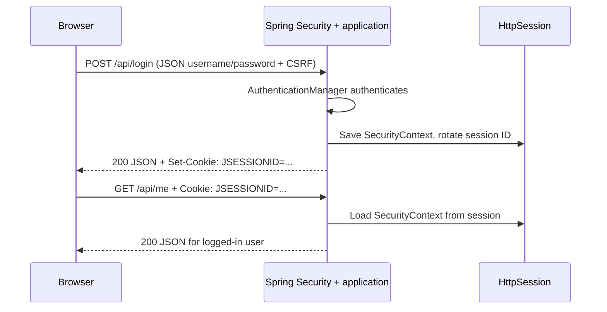

# Distinguishing JSON Login Request Format from Session or Token Models

**Context:** JSON login in a web application using Spring Security. An API accepting `POST /api/login` with `Content-Type: application/json` **does not indicate** whether the application uses sessions, JWTs, opaque tokens, or another mechanism to authenticate subsequent requests. These are two independent design decisions.

**After this lesson, you should be able to:** read the HTTP flow after login, distinguish the JSON body from the authentication state storage mechanism, properly design how credentials are sent on subsequent requests, and avoid misjudging CSRF, logout, sessions, or tokens.

## 1. Two Different Questions Often Conflated into One

### Question A: In what format does the client send login credentials?

This is the **request representation**. For example:

```http
POST /api/login HTTP/1.1
Host: app.example
Content-Type: application/json
Accept: application/json

{"username":"alice","password":"demo-secret"}
```

`Content-Type: application/json` tells the server how to decode the **request body**. `Accept: application/json` indicates the **response** type the client expects. The field names `username` and `password` are an API contract chosen by the system; they say nothing about sessions or JWTs.

Other ways of packaging login credentials can also lead to **the same authentication model**:

- An HTML form transmits `username=alice&password=...` with `application/x-www-form-urlencoded`.
- JSON transmits `{"username":"alice","password":"..."}` with `application/json`.
- HTTP Basic transmits the credential pair via the `Authorization` header.

All three approaches can authenticate the same user. The main difference lies in **how credentials are received at login**, which does not determine where the application stores or verifies state afterward.

### Question B: After login, how does a subsequent request prove identity?

This is the **authentication persistence model**:

1. **Server-side session:** the server stores the `SecurityContext`/identity in `HttpSession`; the client sends the session identifier, typically via a `JSESSIONID` cookie. The server looks up the session when handling a new request.
2. **Bearer access token:** the server or an authorization server issues a token; the client sends the token in `Authorization: Bearer ...` on subsequent requests. The resource server validates a JWT by its signature and claims or verifies an opaque token via introspection/storage.
3. **Hybrid model:** a BFF uses a session cookie with the browser but uses an access token when calling downstream APIs; or an application exposes both session-based endpoints and Bearer endpoints with explicit policies.

The same JSON login body can lead to option 1, 2, or 3. **JSON does not mean stateless; JWT does not mean JSON login; a cookie does not necessarily mean all auth is stored server-side** (a cookie can also hold a credential or token and still be sent automatically by the browser).

## 2. Direct Comparison of the Two JSON Login Flows

| Aspect | JSON login + server session | JSON login + Bearer access token |
| --- | --- | --- |
| Body of `POST /api/login` | JSON username/password | Can be the exact same JSON |
| Login outcome | Server stores authentication state in `HttpSession` | Client receives an access token, if the application issues tokens itself |
| What the client sends on later requests | `Cookie: JSESSIONID=...` | `Authorization: Bearer ...` |
| What determines identity? | Looking up the server's session and `SecurityContext` | Validating the token, signature/claims, or introspection |
| Automatically attached by browser? | Valid cookies are sent automatically based on domain/path/SameSite/credentials mode | Bearer in a header is usually attached explicitly by the client application |
| API statelessness level | Usually stateful by session | Can be stateless with self-verifying JWTs; opaque tokens usually require a lookup |
| Logout/revocation | Invalidating the session server-side | Depends on token lifetime, revocation, introspection, denylist, and refresh-token lifecycle |
| CSRF risk | Must be considered if the browser sends cookies automatically | A Bearer header attached explicitly by JavaScript generally avoids cookie-style CSRF; a Bearer **placed in a cookie** still carries CSRF risk |
| XSS risk | XSS can still act within an active logged-in session | XSS can access/steal the token if stored where JavaScript can read it |

This table describes **typical implementation patterns**, not rigid rules for every system. JWTs can still be revoked with supporting infrastructure; sessions can also be distributed across Redis and served across multiple instances. Choose the model based on the client, security requirements, revocation needs, and architecture—not on whether the body is JSON.

## 3. Flow A: JSON Login While Still Using a Session

A single-page web app or server-rendered interface can accept JSON while still maintaining a normal session:



The response **might** look like this (illustrative cookie value):

```http
HTTP/1.1 200 OK
Set-Cookie: JSESSIONID=demo-session-id; Path=/; HttpOnly; Secure; SameSite=Lax
Content-Type: application/json

{"username":"alice","model":"session"}
```

The cookie can be stored by the browser according to cookie policy and then automatically sent on matching requests:

```http
GET /api/me HTTP/1.1
Host: app.example
Cookie: JSESSIONID=demo-session-id
```

In this case, the JSON response **contains no access token at all**. `JSESSIONID` is merely a session identifier, not a JWT. The server stores/looks up the `SecurityContext` by session; reloading the page does not necessarily log the user out. An `HttpOnly` cookie is still sent by the browser even though JavaScript cannot read it directly.

Session-based login must handle **session fixation** (rotating the session ID on login), saving the `SecurityContext`, session timeout, logout/invalidation, and CSRF for state-changing operations. `SameSite` is a conditional defense-in-depth layer, not a full replacement for a CSRF policy.

## 4. Flow B: JSON Login Returning an Access Token

An API can accept the exact same JSON body and issue an access token. Illustrative response:

```http
HTTP/1.1 200 OK
Content-Type: application/json
Cache-Control: no-store

{"token_type":"Bearer","access_token":"demo-access-token","expires_in":900}
```

`demo-access-token` is only a placeholder value, not a verifiable token. On subsequent requests, **the client explicitly attaches** the access token:

```http
GET /api/me HTTP/1.1
Host: api.example
Authorization: Bearer demo-access-token
```

The server validates the token and rejects it if it is expired, has an invalid signature, has the wrong audience/issuer, has been revoked by policy, or lacks sufficient scope/authorities. An `access_token` can be:

- **JWT:** typically three signed base64url segments containing claims such as `sub`, `iss`, `aud`, `exp`; a resource server can verify it locally with a public key and validate claims.
- **Opaque token:** an unstructured string that the client does not need to parse; the resource server needs a lookup/introspection endpoint or a dedicated verification mechanism.

**A JWT is not a "session" just because it contains JSON**, nor is it proof that the API has a `POST /api/login` endpoint generating tokens itself. In OAuth2/OIDC architectures, tokens are typically issued by an **authorization server** according to the protocol; a Spring Security application acting as a **resource server** verifies tokens rather than arbitrarily treating a string as a JWT.

With a 15-minute JWT, the server cannot simply "delete a session" by default to invalidate an already-issued token immediately. You must plan for short lifetimes, refresh-token rotation if refresh tokens are used, key rotation, revocation where appropriate, and client/server logout handling. `Cache-Control: no-store` helps prevent caching sensitive payloads, but you must protect where the token is stored and always use HTTPS.

### What are the consequences of storing tokens in the browser?

- **JavaScript memory:** avoids persistent storage; reloading loses the token unless there is a way to re-establish the session. XSS can still use the token while active.
- **`localStorage` or `sessionStorage`:** convenient, but any malicious script running on the same origin can read the token; consider XSS exposure and token lifetime.
- **`HttpOnly` cookie containing a token:** JavaScript cannot read the token directly; however, the browser can automatically send the cookie on matching requests. Therefore, this approach **changes the CSRF threat model**, even if the token inside is a JWT.
- **Backend BFF/session:** the frontend only holds a session cookie; the backend manages access tokens server-side. This separates token storage from browser JavaScript.

No token storage mechanism is completely immune to XSS, CSRF, and leakage; mitigations must match where the credential is stored and how it is attached to requests.

## 5. Spring Security: JSON Login Does Not Automatically Create a Session or Token

Spring Security provides `formLogin` for form parameters and `httpBasic` for header challenges. **Switching the body to JSON does not make either filter understand JSON.** You need an appropriate authentication endpoint/controller or authentication filter to parse the JSON, create an unauthenticated `Authentication`, call `AuthenticationManager`, and then handle post-success processing:

```text
POST JSON
  -> parse + validate input
  -> AuthenticationManager.authenticate(...)
  -> Valid Authentication
       |-> Session: set SecurityContext + saveContext(HttpSession)
       `-> Token: delegate/issue token + token response by design
```

`AuthenticationManager` only verifies credentials and returns a valid `Authentication`. It **does not decide by default** whether the response of a JSON endpoint should be a cookie or a JWT. Calling `SecurityContextHolder.setContext(...)` only affects the current request's context unless it is properly persisted to a `SecurityContextRepository`. In Spring Security 6, a custom controller/filter that wants to **persist the session across subsequent requests** must call `saveContext` explicitly.

### Runnable Example: JSON Login + HTTP Session, Java 17 / Spring Boot 3

A Maven project with `spring-boot-starter-web` and `spring-boot-starter-security`:

```xml
<!-- pom.xml -->
<project xmlns="http://maven.apache.org/POM/4.0.0"
         xmlns:xsi="http://www.w3.org/2001/XMLSchema-instance"
         xsi:schemaLocation="http://maven.apache.org/POM/4.0.0 https://maven.apache.org/xsd/maven-4.0.0.xsd">
    <modelVersion>4.0.0</modelVersion>
    <parent>
        <groupId>org.springframework.boot</groupId>
        <artifactId>spring-boot-starter-parent</artifactId>
        <version>3.3.9</version>
        <relativePath/>
    </parent>
    <groupId>example</groupId>
    <artifactId>json-login-session</artifactId>
    <version>1.0.0</version>
    <properties><java.version>17</java.version></properties>
    <dependencies>
        <dependency>
            <groupId>org.springframework.boot</groupId>
            <artifactId>spring-boot-starter-web</artifactId>
        </dependency>
        <dependency>
            <groupId>org.springframework.boot</groupId>
            <artifactId>spring-boot-starter-security</artifactId>
        </dependency>
    </dependencies>
    <build>
        <plugins>
            <plugin>
                <groupId>org.springframework.boot</groupId>
                <artifactId>spring-boot-maven-plugin</artifactId>
            </plugin>
        </plugins>
    </build>
</project>
```

Create `src/main/java/example/JsonLoginApplication.java`:

```java
package example;

import java.util.List;
import java.util.Map;

import jakarta.servlet.http.HttpServletRequest;
import jakarta.servlet.http.HttpServletResponse;
import org.springframework.boot.SpringApplication;
import org.springframework.boot.autoconfigure.SpringBootApplication;
import org.springframework.context.annotation.Bean;
import org.springframework.http.HttpMethod;
import org.springframework.http.HttpStatus;
import org.springframework.http.MediaType;
import org.springframework.http.ResponseEntity;
import org.springframework.security.authentication.AuthenticationManager;
import org.springframework.security.authentication.ProviderManager;
import org.springframework.security.authentication.UsernamePasswordAuthenticationToken;
import org.springframework.security.authentication.dao.DaoAuthenticationProvider;
import org.springframework.security.config.annotation.web.builders.HttpSecurity;
import org.springframework.security.config.annotation.web.configurers.AbstractHttpConfigurer;
import org.springframework.security.core.Authentication;
import org.springframework.security.core.AuthenticationException;
import org.springframework.security.core.context.SecurityContext;
import org.springframework.security.core.context.SecurityContextHolder;
import org.springframework.security.core.userdetails.User;
import org.springframework.security.core.userdetails.UserDetailsService;
import org.springframework.security.crypto.factory.PasswordEncoderFactories;
import org.springframework.security.crypto.password.PasswordEncoder;
import org.springframework.security.provisioning.InMemoryUserDetailsManager;
import org.springframework.security.web.SecurityFilterChain;
import org.springframework.security.web.authentication.session.ChangeSessionIdAuthenticationStrategy;
import org.springframework.security.web.authentication.session.CompositeSessionAuthenticationStrategy;
import org.springframework.security.web.authentication.session.SessionAuthenticationStrategy;
import org.springframework.security.web.context.HttpSessionSecurityContextRepository;
import org.springframework.security.web.context.SecurityContextRepository;
import org.springframework.security.web.csrf.CsrfAuthenticationStrategy;
import org.springframework.security.web.csrf.CsrfToken;
import org.springframework.security.web.csrf.CsrfTokenRepository;
import org.springframework.security.web.csrf.HttpSessionCsrfTokenRepository;
import org.springframework.web.bind.annotation.ExceptionHandler;
import org.springframework.web.bind.annotation.GetMapping;
import org.springframework.web.bind.annotation.PostMapping;
import org.springframework.web.bind.annotation.RequestBody;
import org.springframework.web.bind.annotation.RestController;

@SpringBootApplication
public class JsonLoginApplication {
    public static void main(String[] args) {
        SpringApplication.run(JsonLoginApplication.class, args);
    }

    @Bean
    PasswordEncoder passwordEncoder() {
        return PasswordEncoderFactories.createDelegatingPasswordEncoder();
    }

    @Bean
    UserDetailsService users(PasswordEncoder encoder) {
        return new InMemoryUserDetailsManager(
                User.withUsername("alice")
                        .password(encoder.encode("demo-secret"))
                        .roles("USER")
                        .build());
    }

    @Bean
    AuthenticationManager authenticationManager(UserDetailsService users,
                                                PasswordEncoder encoder) {
        DaoAuthenticationProvider provider = new DaoAuthenticationProvider(encoder);
        provider.setUserDetailsService(users);
        return new ProviderManager(provider);
    }

    @Bean
    SecurityContextRepository securityContextRepository() {
        return new HttpSessionSecurityContextRepository();
    }

    @Bean
    CsrfTokenRepository csrfTokenRepository() {
        return new HttpSessionCsrfTokenRepository();
    }

    // Custom JSON login must explicitly run post-authentication handlers.
    @Bean
    SessionAuthenticationStrategy sessionAuthenticationStrategy(
            CsrfTokenRepository csrfTokens) {
        return new CompositeSessionAuthenticationStrategy(List.of(
                new ChangeSessionIdAuthenticationStrategy(),
                new CsrfAuthenticationStrategy(csrfTokens)));
    }

    @Bean
    SecurityFilterChain filterChain(HttpSecurity http,
                                    SecurityContextRepository contexts,
                                    CsrfTokenRepository csrfTokens) throws Exception {
        return http
                .authorizeHttpRequests(auth -> auth
                        .requestMatchers(HttpMethod.GET, "/csrf").permitAll()
                        .requestMatchers(HttpMethod.POST, "/api/login").permitAll()
                        .anyRequest().authenticated())
                .httpBasic(AbstractHttpConfigurer::disable)
                .formLogin(AbstractHttpConfigurer::disable)
                .csrf(csrf -> csrf.csrfTokenRepository(csrfTokens))
                .securityContext(context -> context.securityContextRepository(contexts))
                .build();
    }

    @RestController
    static class Api {
        private final AuthenticationManager manager;
        private final SecurityContextRepository contexts;
        private final SessionAuthenticationStrategy sessionStrategy;

        Api(AuthenticationManager manager,
            SecurityContextRepository contexts,
            SessionAuthenticationStrategy sessionStrategy) {
            this.manager = manager;
            this.contexts = contexts;
            this.sessionStrategy = sessionStrategy;
        }

        record LoginRequest(String username, String password) {}

        @GetMapping("/csrf")
        CsrfToken csrf(CsrfToken token) {
            return token;
        }

        @PostMapping(value = "/api/login",
                     consumes = MediaType.APPLICATION_JSON_VALUE)
        Map<String, String> login(@RequestBody LoginRequest input,
                                  HttpServletRequest request,
                                  HttpServletResponse response) {
            Authentication auth = manager.authenticate(
                    UsernamePasswordAuthenticationToken.unauthenticated(
                            input.username(), input.password()));

            // Rotate the session ID and refresh the CSRF token after login.
            sessionStrategy.onAuthentication(auth, request, response);

            SecurityContext context = SecurityContextHolder.createEmptyContext();
            context.setAuthentication(auth);
            SecurityContextHolder.setContext(context);
            contexts.saveContext(context, request, response);

            return Map.of("username", auth.getName(), "model", "session");
        }

        @GetMapping("/api/me")
        Map<String, String> me(Authentication authentication) {
            return Map.of("username", authentication.getName());
        }

        @ExceptionHandler(AuthenticationException.class)
        ResponseEntity<Map<String, String>> badLogin(AuthenticationException error) {
            return ResponseEntity.status(HttpStatus.UNAUTHORIZED)
                    .body(Map.of("error", "invalid_credentials"));
        }
    }
}
```

**Notes when reading the code:**

- `/api/login` receives JSON, calls `AuthenticationManager`, and then **saves the `SecurityContext` into the session**. Not a single line issues a JWT.
- `SecurityContextRepository#saveContext` is required for persistence when building a custom JSON login in Spring Security 6.
- `ChangeSessionIdAuthenticationStrategy` prevents session fixation; `CsrfAuthenticationStrategy` clears the old CSRF token on login so the client obtains a new token.
- The login request is also a POST and **is still subject to CSRF validation**, even though `permitAll()` allows unauthenticated users to reach the endpoint. `permitAll` does not mean bypassing CSRF.
- The example keeps users/passwords in memory for ease of practice. In production, you need input validation, rate limiting, proper logging, error handling, session policy, HTTPS/cookie policy, and framework patches. The version in the POM is just a baseline to reproduce the Spring Security 6 API, not advice to pin a production version.

### Testing with `curl`

Using Maven and JDK 17+:

```bash
mvn spring-boot:run
```

Open another terminal. **Step 1:** fetch the CSRF token and save the initial session cookie:

```bash
curl -s -c cookies.txt http://localhost:8080/csrf
```

The response example is JSON with three fields: `headerName`, `parameterName`, `token`. Copy the **actual value of the `token` field**. At this point, the server has not logged Alice in. The client saves the cookie into `cookies.txt` to reuse the same session.

**Step 2:** try a JSON POST without a CSRF token, even though the body contains the right password:

```bash
curl -i -b cookies.txt \
  -H 'Content-Type: application/json' \
  -d '{"username":"alice","password":"demo-secret"}' \
  http://localhost:8080/api/login
```

Expected **HTTP 403**: Spring Security blocks the request before the controller authenticates it. That result proves a JSON request can still pass through the CSRF filter.

**Step 3:** submit a valid login, replacing the token value obtained in step 1:

```bash
curl -i -b cookies.txt -c cookies.txt \
  -H 'Content-Type: application/json' \
  -H 'X-CSRF-TOKEN: <token-value-from-step-1>' \
  -d '{"username":"alice","password":"demo-secret"}' \
  http://localhost:8080/api/login
```

With a valid token and password, the response body is:

```json
{"username":"alice","model":"session"}
```

`cookies.txt` is updated from `Set-Cookie` and the session ID may have changed. **There is no Bearer token** in the response body.

**Step 4:** send a new request using only the session cookie:

```bash
curl -s -b cookies.txt http://localhost:8080/api/me
```

Result after a successful login:

```json
{"username":"alice"}
```

Try again without sending the cookie (a new client): the endpoint no longer recognizes Alice as an authenticated user. This proves that identity **is persisted via the session**.

**Step 5:** fetch a new CSRF token after login for subsequent POSTs, because the old token was cleared/rotated:

```bash
curl -s -b cookies.txt -c cookies.txt http://localhost:8080/csrf
```

Do not reuse the pre-login CSRF token if the login strategy replaced it. When inspecting with DevTools Network, verify `Content-Type`, `Cookie`, `Set-Cookie`, 403/200 statuses, and body; do not share passwords, session IDs, or active CSRF tokens.

## 6. If You Want a Bearer Token, Which Parts Must Change?

At the same JSON endpoint, the post-authentication branch **will differ**:

```java
// Illustrates the token flow, NOT a standalone application:
Authentication auth = authenticationManager.authenticate(
        UsernamePasswordAuthenticationToken.unauthenticated(
                input.username(), input.password()));

// The token issuer is configured separately and signs/registers a valid token.
String accessToken = tokenIssuer.issueFor(auth);
// JSON Response: token_type=Bearer, access_token=..., expires_in=...
```

This is **architectural pseudocode**: `tokenIssuer` is not a built-in Spring Security API; this example deliberately avoids implementing custom JWT signing or refresh tokens with homegrown algorithms. In a real system, prefer an authorization server or a properly designed/audited token-issuing service; the resource server uses mechanisms like `oauth2ResourceServer(...jwt(...))` or opaque-token introspection.

Unlike the session example in section 5, an API accepting Bearer tokens must:

1. Define the trusted issuer and audience; verify signature/expiration/claims or introspection.
2. Enforce scopes/authorities and return `401` when unauthenticated, `403` when lacking permissions.
3. Explicitly decide access token lifetime, refresh/revocation mechanism, and logout handling.
4. Instruct clients to attach `Authorization: Bearer ...` on subsequent requests. Do not conflate a JSON request with token generation.
5. Apply a CSRF policy matching **how credentials are sent**. If the browser only attaches a Bearer header explicitly and the server does not accept auto-sent cookies/Basic credentials, an API token CSRF model may apply; if the Bearer token lives in a cookie, evaluate CSRF just like a session cookie.

To show the shortest Spring Security **resource-server-side** configuration snippet (merely a configuration snippet requiring the appropriate dependencies and issuer, not issuing tokens itself):

```java
// Configuration example independent of the JSON-login controller in section 5:
http.authorizeHttpRequests(auth -> auth
        .anyRequest().authenticated())
    .oauth2ResourceServer(oauth2 -> oauth2.jwt(
            org.springframework.security.config.Customizer.withDefaults()));
```

This snippet **only accepts and verifies Bearer JWTs issued elsewhere**; you must provide a valid `JwtDecoder`/issuer configuration and the `spring-boot-starter-oauth2-resource-server` dependency. You cannot simply drop this one line into the session demo and assume you now have JWT login.

## 7. Checking Browser, CORS, CSRF, and Cookies by Chosen Model

| Scenario | How does the client send credentials? | What to verify |
| --- | --- | --- |
| Same-origin SPA + session | Browser usually sends valid cookies automatically | CSRF token for state-changing requests; HttpOnly, Secure, SameSite, session fixation, and expiry |
| Cross-origin SPA + session | `fetch` may need `credentials: "include"` with proper cookie/CORS config | CORS for trusted origins and credentials; CSRF and SameSite still need evaluation |
| SPA + Bearer in header | JavaScript explicitly attaches `Authorization` | XSS, token leakage, preflight/CORS when cross-origin, token lifetime, and token validation |
| Mobile/non-browser app + Bearer | Client explicitly attaches header | Secure device-side storage, TLS, expiry/revocation; browser CSRF is typically not an attack vector here |
| JWT stored in a cookie | Browser sends cookie automatically | CSRF still needs evaluation; JWT does not eliminate automatic credential sending by the browser |

**CORS is not a CSRF switch.** CORS governs whether cross-origin JavaScript may send certain requests and read responses. An ordinary cross-site form can submit a request without needing to read the response. `application/json` with a standard `Content-Type` usually triggers a preflight in cross-origin `fetch`, but relying solely on preflight or CORS rejection to protect every state-changing request is a fragile design.

Same-origin client example using a session:

```javascript
const response = await fetch("/api/me", {
  method: "GET",
  credentials: "same-origin"
});
const profile = await response.json();
console.log(profile.username);
```

The browser can automatically attach valid cookies. With JSON login protected by CSRF, the client must fetch the token and add the right header before POSTing; right after login, it must fetch a fresh token as in section 5.

Client example using Bearer (only illustrates calling an API once you already have a token):

```javascript
async function getProfile(accessToken) {
  const response = await fetch("/api/me", {
    headers: { Authorization: `Bearer ${accessToken}` }
  });
  if (!response.ok) throw new Error(`HTTP ${response.status}`);
  return response.json();
}
```

Here `Authorization` is **set manually by JavaScript**; no decision has been made yet about where `accessToken` is stored, how it is obtained, or how it is refreshed. That belongs to the application's security architecture.

## 8. Common Misconceptions and How to Verify Them Yourself

1. **"If the body is JSON, no session is created."** False. Open DevTools to check `Set-Cookie`, whether requests carry cookies, and whether the server saves `SecurityContext` into `HttpSession`.
2. **"If there is a cookie, it must be form login."** False. JSON login can also create a session cookie; OAuth/OIDC login after completion also typically creates an application session.
3. **"If the server returns JSON, it's a JWT."** False. The response `{"username":"alice"}` is application data; to identify a token, examine the issued credential and how the server verifies it on subsequent requests.
4. **"Setting `SessionCreationPolicy.STATELESS` automatically generates JWTs."** False. That configuration does not issue tokens; you still need a token issuer and a resource-server mechanism to verify tokens.
5. **"Just calling `SecurityContextHolder.setContext` in a controller makes login persist."** False with explicit save in Spring Security 6. You must save the context to a repository/session if subsequent requests need to remain authenticated.
6. **"Allowing `permitAll()` on `/api/login` means the POST doesn't need CSRF."** False. Authorization rules and the CSRF filter are two separate layers; cookie/session-based JSON login still needs protection.
7. **"JWTs are stateless, so logout always revokes the token immediately."** False. Signed tokens can remain valid until `exp` unless an additional revocation mechanism is in place.
8. **"A JWT in a cookie is immune to CSRF."** False. Cookies are sent automatically by the browser; evaluate CSRF based on how the credential is transmitted, not on the JWT structure.
9. **"HTTP 401 and 403 are direct proof of session or token usage."** False. Status codes reflect the rejection reason per configuration, not the session storage method. Only conclude after observing cookies/headers, server verification, and persistence.
10. **"`Content-Type: application/json` is enough to secure login."** False. Beyond proper parsing, you still need secure password verification, rate limiting, CSRF (where applicable), HTTPS, session/token protection, and error responses that do not leak sensitive details.

### Self-Check Exercises

- Keep the lab's JSON `POST /api/login`, call `/api/me` with a **cookie jar**, and then call it again without cookies. Explain why the two results differ even though the login body did not change.
- Compare two hypothetical login responses: one has `Set-Cookie: JSESSIONID`, the other has `access_token`. Identify which credential the client sends on the next request.
- An SPA stores a JWT in an `HttpOnly` cookie. Question: is this model automatically immune to CSRF? **No** — because the cookie can still be sent automatically by the browser.
- A mobile client receives an opaque token and sends a Bearer header. Question: where does the server look up the token, and how do logout/token revocation work? The answer depends on the issuer/introspection contract.
- Change the `POST /api/login` example to `Content-Type: text/plain` while the controller requires `application/json`. Observe the `415 Unsupported Media Type` error (with an appropriate body for testing). This is a **request format** error, not a session/token authentication error.

**Rule of thumb:** Answer two questions in order: **(1) How is the login request encoded? (2) What authentication proof does the next request carry and how does the server verify it?** Never use the answer to (1) to guess (2).

## References

- [Spring Security — Authentication Architecture](https://docs.spring.io/spring-security/reference/servlet/authentication/architecture.html): `Authentication`, `AuthenticationManager`, `SecurityContext`.
- [Spring Security — Authentication Persistence and Session Management](https://docs.spring.io/spring-security/reference/servlet/authentication/session-management.html): explicit save, `SecurityContextRepository`, session fixation.
- [Spring Security — CSRF](https://docs.spring.io/spring-security/reference/servlet/exploits/csrf.html): tokens on login/logout and the `/csrf` endpoint.
- [Spring Security — OAuth2 Resource Server JWT](https://docs.spring.io/spring-security/reference/servlet/oauth2/resource-server/jwt.html): resource server verifying Bearer JWTs.
- [MDN — Cookie](https://developer.mozilla.org/en-US/docs/Web/HTTP/Guides/Cookies) and [Fetch API](https://developer.mozilla.org/en-US/docs/Web/API/Fetch_API/Using_Fetch): browser cookie management, `credentials`, and headers.