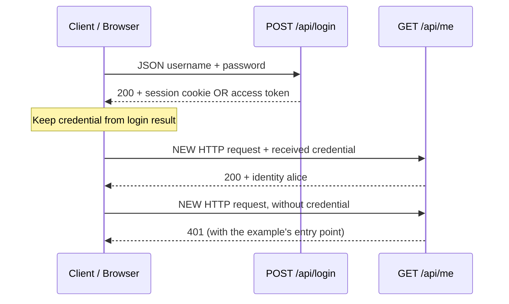
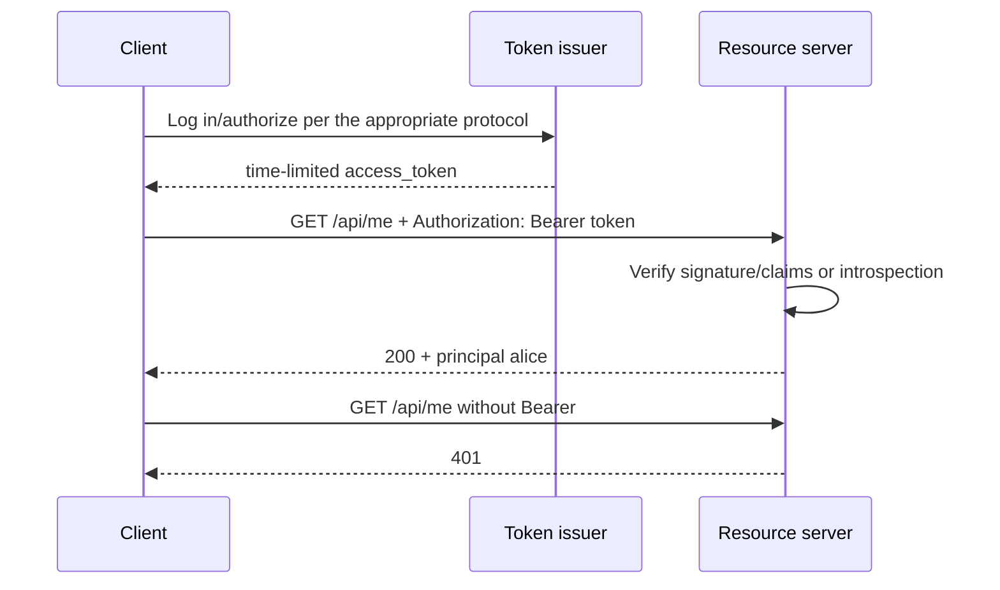

# Testing Subsequent Requests to Confirm Identity Is Truly Persisted

**Context:** JSON login with Spring Security (Servlet). After the client sends `POST /api/login` containing `username`/`password` and receives `200 OK`, we must test a **new HTTP request** to a protected endpoint. Only when the new request still recognizes the user via a valid session or credential do we have proof that the login persistence mechanism works.

**Lesson objectives:**

1. Distinguish "login just succeeded" from "authentication state persists across another request".
2. Design a **login -> next request** test pair, with a control test when credentials are missing.
3. Verify the right kind of evidence for either the **session cookie** or **Bearer token** model, even though both login bodies are JSON.
4. Write meaningful integration tests with `MockMvc` and real HTTP checks, recognizing results that easily mislead.

## 1. `200 OK` on Login Is an Initial Signal, Not Proof of Identity Persistence

Suppose the first request is:

```http
POST /api/login HTTP/1.1
Host: app.example
Content-Type: application/json

{"username":"alice","password":"demo-pass"}
```

The application might return:

```http
HTTP/1.1 200 OK
Content-Type: application/json

{"message":"login successful","username":"alice"}
```

This response **only proves** that the login request handler reported success. It **does not prove** that a second request is authenticated. Several possibilities exist:

- The server verified the password but only put `Authentication` into the current request's `SecurityContextHolder`, **without saving** `SecurityContext` to the session.
- The server intended to issue an access token but did not actually issue it, or the client did not receive/store the token.
- The server created a session, but the client did not keep or resend the `JSESSIONID` cookie.
- The cookie was blocked by domain, path, `SameSite`, `Secure`, CORS/`credentials`, or had expired.
- The server authenticated, yet the test endpoint itself was `permitAll()`, returning `200 OK` even with no identity.
- The test framework injected a user into every request (`@WithMockUser`, `.with(user(...))`), making the next request falsely succeed.

**What must be observed:** a subsequent request **not resending the password** still accesses the protected resource, and the server recognizes the exact identity via the designed mechanism; that same request **fails when the corresponding credential is omitted**.

### Minimum Proof Workflow



The `/api/me` request must be protected by Spring Security, read `Authentication` **at the time of the second request**, and return `authentication.getName()`/authorities from the second request's context. A test that simply calls `/api/login` twice does not test identity persistence.

## 2. Defining "Next Request" for Each Model

### A. JSON Login, Persisted with `HttpSession`

Example response (cookie value is illustrative only):

```http
HTTP/1.1 200 OK
Set-Cookie: JSESSIONID=example-session; Path=/; HttpOnly; SameSite=Lax
Content-Type: application/json

{"username":"alice","model":"session"}
```

New request:

```http
GET /api/me HTTP/1.1
Host: app.example
Cookie: JSESSIONID=example-session
```

Spring Security looks up `SecurityContext` from `HttpSession`, then supplies `Authentication` to the `/api/me` handler. The client **does not resend the password**. In a browser, matching cookies are usually sent automatically. With `curl`, Postman, or integration tests, the session/cookie must be carried explicitly.

All three links are required: **(1)** login succeeds; **(2)** context is saved to the server-side repository/session; **(3)** the subsequent request sends back the valid session ID. Missing any link can cause the second request to be treated as anonymous.

### B. JSON Login, Persisted with an Access Token

If the server/authorization server returns:

```http
HTTP/1.1 200 OK
Content-Type: application/json
Cache-Control: no-store

{"token_type":"Bearer","access_token":"<token-issued-by-issuer>","expires_in":900}
```

The new request must include:

```http
GET /api/me HTTP/1.1
Host: api.example
Authorization: Bearer <token-issued-by-issuer>
```

The resource server verifies the token (JWT signature and claims, or introspection/lookup for opaque tokens) **on the new request**. This does not mean the server must store `HttpSession`; the token can be re-verified on every request. With Bearer in a header, the client usually must attach `Authorization` explicitly.

**Do not confuse:** the `application/json` format only defines how the login body is sent. It **does not automatically create a session or JWT**. An API can use JSON login + session, JSON login + Bearer, or a hybrid. Testing criteria depend on **the credential used after login**, not on how the password was transmitted on the first request.

| What to verify | JSON + session | JSON + Bearer |
| --- | --- | --- |
| Proof in login response | Session created and cookie issued/stored | Real access token validly issued by issuer |
| Credential on next GET | `Cookie: JSESSIONID=...` | `Authorization: Bearer ...` |
| Where second request is authenticated | `HttpSession` + `SecurityContextRepository` | Token verifier/resource server |
| Missing-credential control | Omit cookie or use a new session | Omit Bearer header |
| Invalid-credential control | Fake/expired cookie / invalid session | Fake token, bad signature, expired/wrong audience |
| Strong evidence | Protected GET returns the right user with the same session; blocked without session | GET returns the right user with a real token; blocked when token is wrong/missing |
| Specific caveats | Session fixation, expiry, CSRF with auto-sent cookies | Token protection, `exp`/`iss`/`aud`, refresh/revocation |

A JWT placed **inside a cookie** can still be sent automatically by the browser and raise CSRF concerns. Token structure alone does not resolve this.

## 3. Designing a Meaningful Test Suite

Use an endpoint like `GET /api/me` (requiring authentication) as the probe. The response should include the identity and, when needed, roles/authorities taken from the real context. Ensure this endpoint is **not `permitAll()`**.

| Case | First request | Next request | Expected, with example config |
| --- | --- | --- | --- |
| S1: valid session | Valid JSON `POST /api/login` + valid CSRF | `GET /api/me` using post-login session, no password sent | `200`, body confirms `alice` |
| S2: no session carried | Already logged in during S1 | `GET /api/me` without cookie/session | `401` |
| S3: new session | Already logged in during S1 | `GET /api/me` with a different session | `401` |
| S4: wrong-password login | Bad JSON `POST /api/login` | `GET /api/me` from that client | `401` |
| S5: POST missing CSRF | `POST /api/login` without CSRF token | No successful login exists | `403`; does not prove session |
| T1: valid Bearer | Obtain valid token from issuer | `GET /api/me` with that token | `200`, returns right identity and authorities |
| T2: empty Bearer | Obtained token in T1 | `GET /api/me` omitting `Authorization` | `401` |
| T3: invalid Bearer | Obtained token in T1 | `GET /api/me` using wrong/expired token | Usually `401` (per config) |
| T4: Bearer lacking scope | Obtained authenticable token missing scope/authority | Call endpoint requiring higher privilege | `403` |

`401` and `403` depend on the security entry point/access-denied handling. In the example below, the app explicitly configures `401` for unauthenticated GETs; `403` applies to POSTs missing CSRF. When evaluating another system, read its configuration and compare identity/authority data rather than guessing from a status code alone.

## 4. Standalone Lab: JSON Login + Session, Java 17 / Spring Boot 3 / Spring Security 6

The lab uses a single Servlet application, username `alice`, password `demo-pass`, a JSON login endpoint, and an identity-check endpoint. This is the **session** model; the lab does not issue JWTs. The goal is to prove `SecurityContext` is **saved and reloaded on another request**.

### 4.1. Create the Maven Project

Structure:

```text
json-next-request-lab/
├── pom.xml
└── src/
    ├── main/java/example/JsonNextRequestApplication.java
    └── test/java/example/JsonNextRequestApplicationTests.java
```

`pom.xml`:

```xml
<project xmlns="http://maven.apache.org/POM/4.0.0"
         xmlns:xsi="http://www.w3.org/2001/XMLSchema-instance"
         xsi:schemaLocation="http://maven.apache.org/POM/4.0.0 https://maven.apache.org/xsd/maven-4.0.0.xsd">
    <modelVersion>4.0.0</modelVersion>
    <parent>
        <groupId>org.springframework.boot</groupId>
        <artifactId>spring-boot-starter-parent</artifactId>
        <version>3.3.9</version>
        <relativePath/>
    </parent>
    <groupId>example</groupId>
    <artifactId>json-next-request-lab</artifactId>
    <version>1.0.0</version>
    <properties><java.version>17</java.version></properties>
    <dependencies>
        <dependency>
            <groupId>org.springframework.boot</groupId>
            <artifactId>spring-boot-starter-web</artifactId>
        </dependency>
        <dependency>
            <groupId>org.springframework.boot</groupId>
            <artifactId>spring-boot-starter-security</artifactId>
        </dependency>
        <dependency>
            <groupId>org.springframework.boot</groupId>
            <artifactId>spring-boot-starter-test</artifactId>
            <scope>test</scope>
        </dependency>
        <dependency>
            <groupId>org.springframework.security</groupId>
            <artifactId>spring-security-test</artifactId>
            <scope>test</scope>
        </dependency>
    </dependencies>
    <build>
        <plugins>
            <plugin>
                <groupId>org.springframework.boot</groupId>
                <artifactId>spring-boot-maven-plugin</artifactId>
            </plugin>
        </plugins>
    </build>
</project>
```

Spring Boot 3.3.9 is only used as a baseline to illustrate the Spring Security 6 API. In real deployments, choose a supported version with security patches applied.

### 4.2. Application: JSON Authentication and Saving `SecurityContext`

Create `src/main/java/example/JsonNextRequestApplication.java`:

```java
package example;

import java.util.List;
import java.util.Map;

import jakarta.servlet.http.HttpServletRequest;
import jakarta.servlet.http.HttpServletResponse;

import org.springframework.boot.SpringApplication;
import org.springframework.boot.autoconfigure.SpringBootApplication;
import org.springframework.context.annotation.Bean;
import org.springframework.http.HttpMethod;
import org.springframework.http.HttpStatus;
import org.springframework.http.MediaType;
import org.springframework.http.ResponseEntity;
import org.springframework.security.authentication.AuthenticationManager;
import org.springframework.security.authentication.ProviderManager;
import org.springframework.security.authentication.UsernamePasswordAuthenticationToken;
import org.springframework.security.authentication.dao.DaoAuthenticationProvider;
import org.springframework.security.config.annotation.web.builders.HttpSecurity;
import org.springframework.security.config.annotation.web.configurers.AbstractHttpConfigurer;
import org.springframework.security.core.Authentication;
import org.springframework.security.core.AuthenticationException;
import org.springframework.security.core.context.SecurityContext;
import org.springframework.security.core.context.SecurityContextHolder;
import org.springframework.security.core.userdetails.User;
import org.springframework.security.core.userdetails.UserDetailsService;
import org.springframework.security.crypto.factory.PasswordEncoderFactories;
import org.springframework.security.crypto.password.PasswordEncoder;
import org.springframework.security.provisioning.InMemoryUserDetailsManager;
import org.springframework.security.web.SecurityFilterChain;
import org.springframework.security.web.authentication.HttpStatusEntryPoint;
import org.springframework.security.web.authentication.session.ChangeSessionIdAuthenticationStrategy;
import org.springframework.security.web.authentication.session.CompositeSessionAuthenticationStrategy;
import org.springframework.security.web.authentication.session.SessionAuthenticationStrategy;
import org.springframework.security.web.context.HttpSessionSecurityContextRepository;
import org.springframework.security.web.context.SecurityContextRepository;
import org.springframework.security.web.csrf.CsrfAuthenticationStrategy;
import org.springframework.security.web.csrf.CsrfToken;
import org.springframework.security.web.csrf.CsrfTokenRepository;
import org.springframework.security.web.csrf.HttpSessionCsrfTokenRepository;

import org.springframework.web.bind.annotation.ExceptionHandler;
import org.springframework.web.bind.annotation.GetMapping;
import org.springframework.web.bind.annotation.PostMapping;
import org.springframework.web.bind.annotation.RequestBody;
import org.springframework.web.bind.annotation.RestController;

@SpringBootApplication
public class JsonNextRequestApplication {
    public static void main(String[] args) {
        SpringApplication.run(JsonNextRequestApplication.class, args);
    }

    @Bean
    PasswordEncoder passwordEncoder() {
        return PasswordEncoderFactories.createDelegatingPasswordEncoder();
    }

    @Bean
    UserDetailsService users(PasswordEncoder passwordEncoder) {
        return new InMemoryUserDetailsManager(
                User.withUsername("alice")
                        .password(passwordEncoder.encode("demo-pass"))
                        .roles("USER")
                        .build());
    }

    @Bean
    AuthenticationManager authenticationManager(UserDetailsService users,
                                                PasswordEncoder encoder) {
        DaoAuthenticationProvider provider = new DaoAuthenticationProvider();
        provider.setUserDetailsService(users);
        provider.setPasswordEncoder(encoder);
        return new ProviderManager(provider);
    }

    @Bean
    SecurityContextRepository securityContextRepository() {
        return new HttpSessionSecurityContextRepository();
    }

    @Bean
    CsrfTokenRepository csrfTokenRepository() {
        return new HttpSessionCsrfTokenRepository();
    }

    @Bean
    SessionAuthenticationStrategy sessionAuthenticationStrategy(
            CsrfTokenRepository csrfTokens) {
        return new CompositeSessionAuthenticationStrategy(List.of(
                new ChangeSessionIdAuthenticationStrategy(),
                new CsrfAuthenticationStrategy(csrfTokens)));
    }

    @Bean
    SecurityFilterChain securityFilterChain(
            HttpSecurity http,
            SecurityContextRepository contexts,
            CsrfTokenRepository csrfTokens) throws Exception {
        return http
                .authorizeHttpRequests(auth -> auth
                        .requestMatchers(HttpMethod.GET, "/csrf").permitAll()
                        .requestMatchers(HttpMethod.POST, "/api/login").permitAll()
                        .anyRequest().authenticated())
                .formLogin(AbstractHttpConfigurer::disable)
                .httpBasic(AbstractHttpConfigurer::disable)
                .csrf(csrf -> csrf.csrfTokenRepository(csrfTokens))
                .securityContext(sc -> sc.securityContextRepository(contexts))
                .exceptionHandling(ex -> ex.authenticationEntryPoint(
                        new HttpStatusEntryPoint(HttpStatus.UNAUTHORIZED)))
                .build();
    }

    @RestController
    static class Api {
        private final AuthenticationManager manager;
        private final SecurityContextRepository contexts;
        private final SessionAuthenticationStrategy sessionStrategy;

        Api(AuthenticationManager manager,
            SecurityContextRepository contexts,
            SessionAuthenticationStrategy sessionStrategy) {
            this.manager = manager;
            this.contexts = contexts;
            this.sessionStrategy = sessionStrategy;
        }

        record LoginRequest(String username, String password) {}

        @GetMapping("/csrf")
        CsrfToken csrf(CsrfToken token) {
            return token;
        }

        @PostMapping(value = "/api/login",
                     consumes = MediaType.APPLICATION_JSON_VALUE)
        Map<String, String> login(@RequestBody LoginRequest input,
                                  HttpServletRequest request,
                                  HttpServletResponse response) {
            Authentication authentication = manager.authenticate(
                    UsernamePasswordAuthenticationToken.unauthenticated(
                            input.username(), input.password()));

            // Custom login: run the session strategy that standard filters normally handle.
            sessionStrategy.onAuthentication(authentication, request, response);

            SecurityContext securityContext = SecurityContextHolder.createEmptyContext();
            securityContext.setAuthentication(authentication);
            SecurityContextHolder.setContext(securityContext);

            // Critical decision: persist for the NEXT REQUEST.
            contexts.saveContext(securityContext, request, response);

            return Map.of("username", authentication.getName(), "model", "session");
        }

        @GetMapping("/api/me")
        Map<String, String> me(Authentication currentUser) {
            return Map.of("username", currentUser.getName());
        }

        @ExceptionHandler(AuthenticationException.class)
        ResponseEntity<Map<String, String>> invalidCredentials(
                AuthenticationException ignored) {
            return ResponseEntity.status(HttpStatus.UNAUTHORIZED)
                    .body(Map.of("error", "invalid_credentials"));
        }
    }
}
```

**Analyzing decision points:**

1. `POST /api/login` receives JSON and uses `AuthenticationManager` to verify username/password. This is only the step of **proving the password is correct**.
2. `sessionStrategy.onAuthentication(...)` handles session fixation (rotating the session ID when appropriate) and refreshes CSRF state after login.
3. `SecurityContextHolder.setContext(securityContext)` sets the identity for the currently executing login request.
4. **`contexts.saveContext(securityContext, request, response)` saves the context into `HttpSession`.** Spring Security 6 requires explicit save for custom login flows if the context needs to persist on subsequent requests.
5. When `GET /api/me` arrives, Spring Security loads the context from the session to pass `Authentication` into the controller. This controller accepts no self-declared username from query/body, so it cannot "guess" `alice`.
6. `permitAll()` for `POST /api/login` only waives the authenticated requirement at authorization; **CSRF still applies** to POST. The `GET /csrf` endpoint lets clients obtain a token before sending POST.
7. The entry point returns `401 Unauthorized` for GETs without a login session, making test outcomes easy to read. If an app is not configured similarly, the status may differ.
8. Both other login mechanisms (`formLogin`, `httpBasic`) are disabled in the lab to test **only** the JSON login + session path, avoiding accidental login via a side mechanism we never verified.

In-memory `UserDetailsService` and demo passwords are for practice only. Real applications need input validation, brute-force protection, password policies/encoders, HTTPS, appropriate `Secure`/`HttpOnly`/`SameSite` cookies, session timeouts, logout, and non-leaking error handling.

## 5. Automated Integration Tests: Two Independent HTTP Requests with `MockMvc`

Create `src/test/java/example/JsonNextRequestApplicationTests.java`:

```java
package example;

import org.junit.jupiter.api.Test;
import org.springframework.beans.factory.annotation.Autowired;
import org.springframework.boot.test.autoconfigure.web.servlet.AutoConfigureMockMvc;
import org.springframework.boot.test.context.SpringBootTest;
import org.springframework.http.MediaType;
import org.springframework.mock.web.MockHttpSession;
import org.springframework.test.web.servlet.MockMvc;
import org.springframework.test.web.servlet.MvcResult;

import static org.assertj.core.api.Assertions.assertThat;
import static org.springframework.security.test.web.servlet.request.SecurityMockMvcRequestPostProcessors.csrf;
import static org.springframework.test.web.servlet.request.MockMvcRequestBuilders.get;
import static org.springframework.test.web.servlet.request.MockMvcRequestBuilders.post;
import static org.springframework.test.web.servlet.result.MockMvcResultMatchers.jsonPath;
import static org.springframework.test.web.servlet.result.MockMvcResultMatchers.status;

@SpringBootTest
@AutoConfigureMockMvc
class JsonNextRequestApplicationTests {
    @Autowired
    MockMvc mvc;

    private static final String VALID_LOGIN =
            "{\"username\":\"alice\",\"password\":\"demo-pass\"}";

    @Test
    void nextRequestRecognizesAliceFromSessionWithoutSendingPassword()
            throws Exception {
        // Request 1: send JSON login with a valid CSRF token.
        MvcResult login = mvc.perform(post("/api/login")
                        .with(csrf().asHeader())
                        .contentType(MediaType.APPLICATION_JSON)
                        .content(VALID_LOGIN))
                .andExpect(status().isOk())
                .andExpect(jsonPath("$.username").value("alice"))
                .andExpect(jsonPath("$.model").value("session"))
                .andReturn();

        MockHttpSession authenticatedSession =
                (MockHttpSession) login.getRequest().getSession(false);
        assertThat(authenticatedSession).isNotNull();

        // Request 2: NO JSON login, password, Basic, or .with(user()).
        mvc.perform(get("/api/me").session(authenticatedSession))
                .andExpect(status().isOk())
                .andExpect(jsonPath("$.username").value("alice"));

        // Request 3: same endpoint, but without session.
        mvc.perform(get("/api/me"))
                .andExpect(status().isUnauthorized());

        // Request 4: fresh session, does not carry Alice's SecurityContext.
        mvc.perform(get("/api/me").session(new MockHttpSession()))
                .andExpect(status().isUnauthorized());
    }

    @Test
    void invalidCredentialsDoNotMakeTheNextRequestAuthenticated()
            throws Exception {
        MvcResult failedLogin = mvc.perform(post("/api/login")
                        .with(csrf().asHeader())
                        .contentType(MediaType.APPLICATION_JSON)
                        .content("{\"username\":\"alice\",\"password\":\"wrong\"}"))
                .andExpect(status().isUnauthorized())
                .andExpect(jsonPath("$.error").value("invalid_credentials"))
                .andReturn();

        MockHttpSession possibleSession =
                (MockHttpSession) failedLogin.getRequest().getSession(false);
        if (possibleSession != null) {
            // Having a session for CSRF does not mean logged in.
            mvc.perform(get("/api/me").session(possibleSession))
                    .andExpect(status().isUnauthorized());
        }

        mvc.perform(get("/api/me"))
                .andExpect(status().isUnauthorized());
    }

    @Test
    void postLoginWithoutCsrfIsRejected() throws Exception {
        mvc.perform(post("/api/login")
                        .contentType(MediaType.APPLICATION_JSON)
                        .content(VALID_LOGIN))
                .andExpect(status().isForbidden());
    }
}
```

Run:

```bash
mvn test
```

When the configuration and lab code work properly, **the three tests are expected to PASS**. With JUnit, a successful build usually ends with `BUILD SUCCESS`; this is an **expected** outcome, not an already-executed log.

### What the Tests Actually Prove

In the first test, `MvcResult` holds only the session generated from a **real login POST**. On the second GET, there is no:

- JSON login username/password;
- manually added `Authorization` header;
- `@WithMockUser` or `.with(user("alice"))`;
- mocked pre-existing `Authentication` just to help the GET pass.

Therefore, the second GET succeeds because the context was saved and reloaded via the session. The two control GETs with **no session** and a **fresh session** rule out `/api/me` being open to everyone.

`MockMvc` dispatches through MVC and the Spring Security filter chain using simulated request/response objects, **without opening a real HTTP port** and **without fully simulating a browser's cookie jar**. Calling `.session(authenticatedSession)` is a deliberate step to reuse the session between two mock requests. This test proves application logic, while cookie attributes, proxies, TLS, domain/path, and browser behavior need real HTTP testing.

### Why Do Some Passing Tests Lack Meaningful Proof?

```java
// NOT proof that the session is persisted:
mvc.perform(get("/api/me").with(
        org.springframework.security.test.web.servlet.request
                .SecurityMockMvcRequestPostProcessors.user("alice")));
```

`user("alice")` attaches the user **to the exact request under test**, so GET can succeed even if custom login never saved `SecurityContext`. Likewise, putting `@WithMockUser` on the whole test method gives every request a mocked user. Those techniques are great for **testing authorization**, not as proof of the **login -> persistence -> next request** flow.

Do not merely assert `200 OK`. Verify at least the **specific identity** (`alice`), session/token evidence, and **401 cases when credentials are missing**.

## 6. Real HTTP Testing with PowerShell or cURL

`MockMvc` does not test browser cookie jars or reverse proxies. So the complementary step is running the real app on localhost:

```bash
mvn spring-boot:run
```

### 6.1. With PowerShell (Windows)

Use `WebRequestSession` to retain cookies across HTTP calls:

```powershell
$clientSession = New-Object Microsoft.PowerShell.Commands.WebRequestSession

# Request 0: fetch CSRF token; cookie belongs to the unauthenticated session.
$csrfInfo = Invoke-RestMethod `
    -Method Get `
    -Uri 'http://localhost:8080/csrf' `
    -WebSession $clientSession

# Request 1: JSON login, still carrying the cookie and token from Request 0.
$loginResult = Invoke-RestMethod `
    -Method Post `
    -Uri 'http://localhost:8080/api/login' `
    -WebSession $clientSession `
    -ContentType 'application/json' `
    -Headers @{ 'X-CSRF-TOKEN' = $csrfInfo.token } `
    -Body '{"username":"alice","password":"demo-pass"}'

$loginResult
```

Expected response data:

```json
{"username":"alice","model":"session"}
```

Next, **without resending the password**:

```powershell
# Request 2: still the same cookie jar, sending no username/password.
$me = Invoke-RestMethod `
    -Method Get `
    -Uri 'http://localhost:8080/api/me' `
    -WebSession $clientSession
$me
```

Expected response:

```json
{"username":"alice"}
```

Control step using a **new client**:

```powershell
# Request 3: does not carry the cookie from the previous login.
Invoke-WebRequest `
    -Method Get `
    -Uri 'http://localhost:8080/api/me'
```

Expected HTTP `401`. In Windows PowerShell 5.1, `Invoke-WebRequest` usually throws an exception for 4xx status codes; inspect the HTTP status inside the exception rather than assuming every exception is a connection error. Never store real passwords in scripts and never print session cookie contents to shared logs.

### 6.2. With cURL in Bash/WSL/Git Bash

Save cookies to a file and obtain a real token from `/csrf`:

```bash
curl -sS -c cookies.txt http://localhost:8080/csrf > csrf.json
```

`csrf.json` will contain `token`, `headerName`, and `parameterName`. Copy the `token` value from there, then test:

```bash
# Replace <CSRF_TOKEN> with the real token string from csrf.json.
curl -i -b cookies.txt -c cookies.txt \
  -H 'Content-Type: application/json' \
  -H 'X-CSRF-TOKEN: <CSRF_TOKEN>' \
  -d '{"username":"alice","password":"demo-pass"}' \
  http://localhost:8080/api/login

# Second request: cookie only, no login body.
curl -i -b cookies.txt http://localhost:8080/api/me

# Control request: without using the cookie jar.
curl -i http://localhost:8080/api/me
```

Expected observations: login `200`; GET with cookie `200` and Alice; GET without cookie `401`. If you just use `curl -u alice:...` on GET, you are testing HTTP Basic (which the lab disabled), **not session persistence**.

With a real browser, inspect DevTools -> Network:

1. On login POST: status, JSON response, `Set-Cookie` (if any), and related CSRF headers.
2. On `GET /api/me` after login: whether the session cookie is sent, and whether the response shows the right user.
3. Try a new tab in the same browser profile and call GET: if the session cookie is still valid, it may remain authenticated; opening a separate browser profile/incognito window will lack the old cookie.
4. After logout/timeout/session invalidation, GET with the old session must no longer be recognized. You must design a logout endpoint and valid CSRF if testing logout POST; the lab above only illustrates login and `/api/me`.

**Testing limitation:** same-session behavior on localhost does not guarantee cross-site cookies work properly when frontend/backend have different origins; test CORS, `SameSite`, `Secure`, `Domain`, `Path`, and `credentials` settings in the real deployment environment.

## 7. If Using Bearer Tokens, How Do You Test the Next Request?

The testing steps are equivalent, yet **do not use `MockHttpSession` to prove Bearer auth**. Use a **real access token issued by a trusted issuer**, and call an endpoint protected by resource-server authentication.



HTTP example for the subsequent request (token value is a placeholder only):

```http
GET /api/me HTTP/1.1
Host: api.example
Authorization: Bearer <ACCESS_TOKEN_THAT_VERIFIES>
```

**PASS criteria:** the token must be validly issued, genuinely verified by the resource server, and return the right principal/claims or authorities per design. The following cases must have clear expectations: omitted header, single-character corrupted token, expired token, wrong issuer/audience, revoked token (if policy applies), and valid token lacking permissions.

Spring Security Resource Server can verify JWTs via `JwtDecoder` and issuer/JWK, or opaque tokens via introspection. An illustrative snippet:

```java
// SEPARATE CONFIGURATION SNIPPET FOR RESOURCE SERVER,
// do not merge into the session lab app in section 4.
http.authorizeHttpRequests(auth -> auth
        .anyRequest().authenticated())
    .oauth2ResourceServer(oauth2 ->
        oauth2.jwt(org.springframework.security.config.Customizer.withDefaults()));
```

Proper `JwtDecoder`/issuer dependencies and configuration are required. This snippet **does not issue JWTs itself**, nor does it prove JSON login emitted a token. In Spring Security tests using `.with(jwt())`, the framework attaches a simulated `JwtAuthenticationToken` to the request; that is useful for testing **authorization**, yet **does not prove tokens are issued, signed, sent, and verified over real HTTP**. To prove end-to-end, make requests to the issuer/resource server matching the real architecture.

### Which Result Shows Identity Is Persisted?

- For **sessions**: the second GET carries the post-login session ID, reloads `SecurityContext`, and recognizes `alice`; omitting the session leaves no identity.
- For **Bearer**: the second GET carries a previously issued valid token, verified by the resource server, recognizing `alice`; omitting/altering the token is unauthenticated.
- For **BFF/session + backend token**: the browser sends a cookie to the BFF, while the BFF uses a Bearer token when calling the resource server. Test **both boundaries**, not just one endpoint returning `200`.

## 8. Diagnosing When Login Returns `200` Yet the Next GET Returns `401` or `403`

Trace from HTTP evidence to each link in the chain instead of randomly tweaking config:

| Observation | Possible cause | How to verify |
| --- | --- | --- |
| Login POST `200`, GET has no `Cookie` | Client did not store or send cookie | Check `Set-Cookie`, cookie jar, Path/Domain/SameSite/Secure, `credentials` |
| GET has `JSESSIONID` yet returns `401` | Session expired/wrong ID; login only set context without saving; another instance cannot see session | Check repository, `saveContext`, session store, load balancer, session ID after fixation protection |
| GET always `200` even without cookie/token | Public endpoint or test mocked a user | Check `SecurityFilterChain` and control GET without credentials |
| Test passes with `.with(user())`, real HTTP fails | Test injected a fake identity into GET | Remove request postprocessor; go through real login and real session/token |
| Login POST gets `403` | Missing/wrong CSRF token with cookie/session | Check CSRF repo, token's session, request header, fresh token after login |
| GET gets `403` even though user is recognized | User lacks authority/role for endpoint | Check authorization rules, authorities, and access denied handler |
| Bearer GET has no `Authorization` | Client received token yet did not attach it on new request | Check headers in Network/cURL |
| Bearer GET has token yet gets `401` | Wrong/expired token, invalid issuer/audience/signature; misconfigured resource server | Check verifier/issuer/JWK/introspection and clock skew |
| Behavior differs between localhost and production | Different cookies, TLS, reverse proxy, CORS, SameSite, or deployed session store | Compare HTTP requests/responses, forwarded headers, domain/path, shared session store |
| GET only works right after login, fails in another client | Session/cookie belongs only to first client (may be by design) | Distinguish same-profile tabs, fresh cookie jars, and separate login sessions |

**Spring Security 6 and explicit-save:** When implementing a custom JSON controller/filter, after `authenticate()` you must create an authenticated context and save it via `SecurityContextRepository` if using sessions. Writing only to `SecurityContextHolder` makes the current request see the user, without guaranteeing the next request receives the context. This is a very common bug that only surfaces across **two truly separate requests**.

**A session can exist without being authenticated.** For example, on `GET /csrf`, the server creates a session to hold the CSRF token before login. Seeing a `JSESSIONID` cookie after `/csrf` does not mean the user is logged in; you must prove the user's context exists when calling a protected endpoint on a later request.

**UI refresh is not equivalent to testing login.** An SPA may keep the username in state/local storage and display "Hello Alice" even though the API already returned `401`. Always verify via HTTP, server principal, and protected endpoints.

## 9. Exercises and Acceptance Checklist

### Exercise 1 — Remove context saving so the test catches the bug

In the lab, temporarily remove only the line:

```java
contexts.saveContext(securityContext, request, response);
```

Prediction: the login POST may still return `200` and body `{"username":"alice","model":"session"}`, yet `GET /api/me` using the **post-login session** can no longer load the saved authentication; test `nextRequestRecognizesAliceFromSessionWithoutSendingPassword` will fail. Restore the save line after the experiment. This shows why asserting only the POST response is insufficient.

### Exercise 2 — Switch clients to separate state from credentials

- Call GET with the `WebRequestSession` used to log in: expect Alice.
- Call GET from a new `WebRequestSession`: expect unauthenticated.
- In `MockMvc`, try `.session(new MockHttpSession())`: must fail.
- Use a new tab in the same browser profile to test cookie sharing; use private browsing to create an isolated context.

### Exercise 3 — Spot "false-green" tests

Compare a GET after real login with a GET after login tagged with `.with(user("alice"))`. Explain why the second approach does not prove the server remembered the user, even though the response may look identical.

### Exercise 4 — Switch from session to token

Suppose login returns a JWT. Write a test matrix: valid token, no token, expired token, wrong issuer/audience, missing scope, refresh/revocation. Name the component that actually validates the second request's token and explain why `SessionCreationPolicy.STATELESS` by itself **does not issue JWTs**.

### Production Acceptance Checklist

- [ ] The test endpoint is **genuinely protected**, not `permitAll()`.
- [ ] The JSON login input is properly authenticated, and the password is not resent on the next GET.
- [ ] The second request is a separate request; no helper injects a user outside the mechanism under test.
- [ ] For sessions: the client uses the **post-login** session ID and the server reloads the exact `SecurityContext`.
- [ ] For Bearer: the client sends a real token and the server actually verifies it, not just a mocked `JwtAuthenticationToken`.
- [ ] The subsequent response proves the **exact principal** (and authorities, if relevant), not just `200 OK`.
- [ ] Requests without cookie/token and invalid/expired credentials must be rejected per policy.
- [ ] Login POST uses proper CSRF when choosing session cookies; distinguish CSRF `403` from authentication `401`.
- [ ] Verify logout/timeout/revocation, multi-session behavior, multi-instance deployment, cookie attributes, and real browsers when needed.
- [ ] Never log or commit real passwords, session IDs, CSRF tokens, or valid access tokens.

**Learning takeaway:** The success of a **JSON login request** is the starting milestone; proof of authentication persistence lies in the **subsequent protected request**. Only when that later request carries solely the issued session cookie or Bearer token, returns the right identity, and a credential-less control request is rejected have you verified the corresponding identity persistence flow.

## Official Documentation for Further Verification

- [Spring Security — Authentication Persistence and Session Management](https://docs.spring.io/spring-security/reference/servlet/authentication/session-management.html): custom login must save `SecurityContext` via `SecurityContextRepository`.
- [Spring Security — Persisting Authentication](https://docs.spring.io/spring-security/reference/servlet/authentication/persistence.html): `HttpSessionSecurityContextRepository`, `NullSecurityContextRepository`, and how context is loaded.
- [Spring Security — MockMvc Integration](https://docs.spring.io/spring-security/reference/servlet/test/mockmvc/): testing the Security filter chain together with Spring MVC.
- [Spring Security — Testing with CSRF](https://docs.spring.io/spring-security/reference/servlet/test/mockmvc/csrf.html): `.with(csrf())`, valid/invalid tokens.
- [Spring Security — Resource Server JWT](https://docs.spring.io/spring-security/reference/servlet/oauth2/resource-server/jwt.html): verifying Bearer JWTs and claim requirements.
- [Spring Framework — MockMvc](https://docs.spring.io/spring-framework/reference/testing/spring-mvc-test-framework.html): scope of mock requests/responses compared to a real HTTP server.